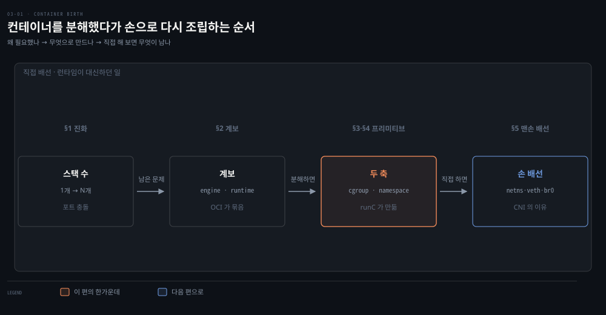
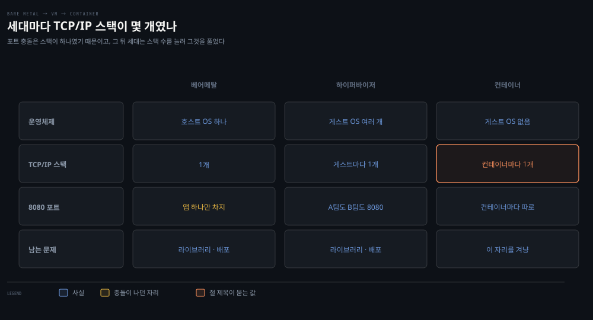
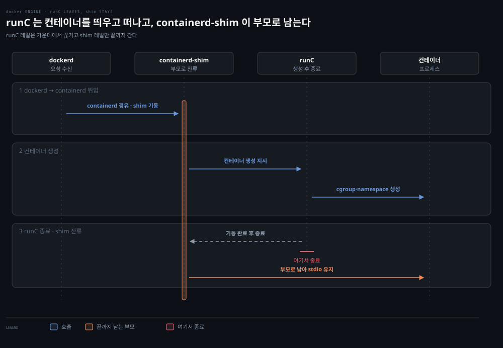
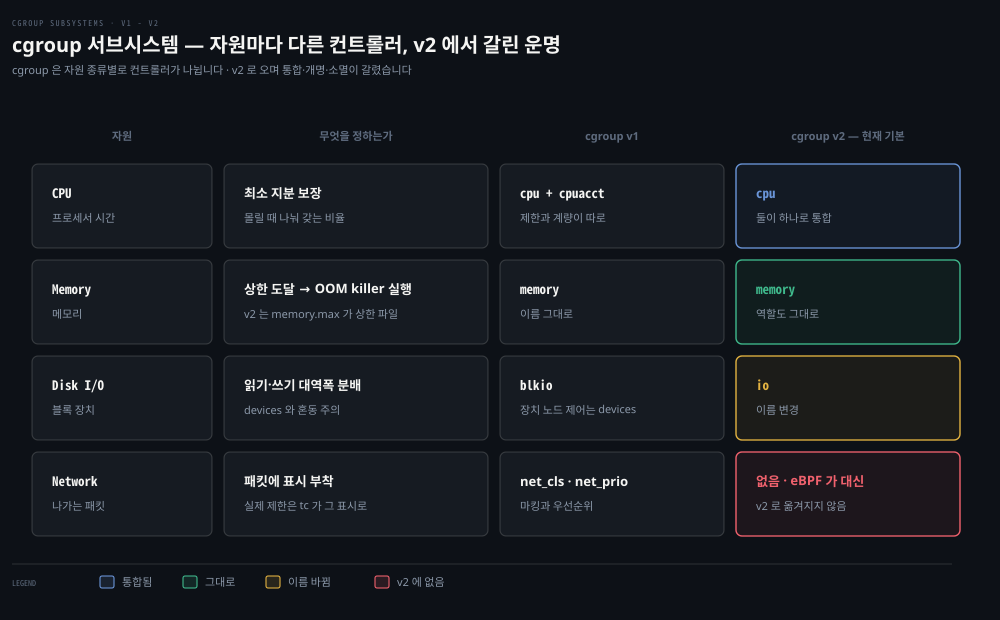
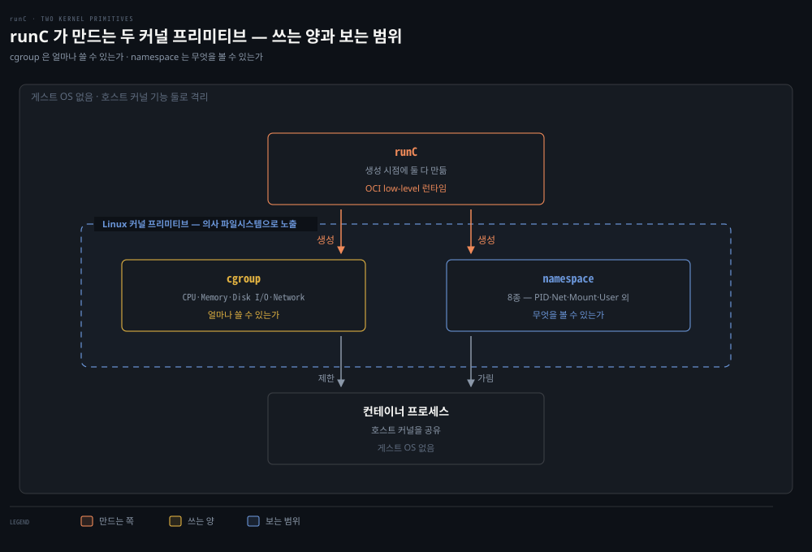
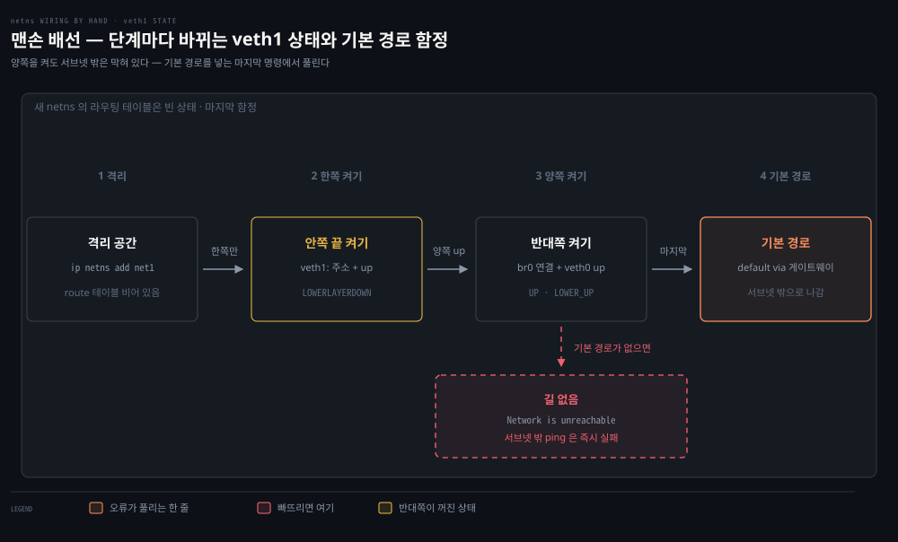

# 컨테이너의 탄생 — 앱 실행의 진화와 격리 프리미티브

---

## 핵심 요약
> 컨테이너는 새 기술이 아니라 커널의 두 기능을 묶은 포장입니다. cgroup 이 쓸 수 있는 양을, namespace 가 볼 수 있는 범위를 정합니다.

그 위에 이미지·레지스트리·런타임이라는 생태계가 쌓였고 OCI 표준과 Docker → containerd → runC 분해를 거쳐 지금의 모습이 됐습니다. 컨테이너 하나의 네트워크를 Linux 명령으로 직접 배선해 보면 런타임이 대신하는 일이 보입니다.


## 학습 목표
> 컨테이너를 도구로 쓰는 데서 나아가, 커널의 어떤 기능을 어떻게 묶은 것인지 분해해 설명할 수 있는 상태를 목표로 합니다.

1. 베어메탈·하이퍼바이저·컨테이너의 진화를 TCP/IP 스택 수로 설명할 수 있습니다.
2. engine·runtime·image·repository 용어와 low-level·high-level 런타임을 구분할 수 있습니다.
3. Docker 가 containerd·runC 로 분해된 구조와 shim 이 필요한 이유를 설명할 수 있습니다.
4. cgroup 과 namespace 의 책임을 구분하고 namespace 8종을 격리 대상과 짝지을 수 있습니다.
5. 네트워크 네임스페이스·veth·브리지를 손으로 배선하고 단계마다 인터페이스 상태가 어떻게 바뀌는지 설명할 수 있습니다.

실무에서 겪은 사례입니다. 표에는 증상만 적었고, 원인은 오른쪽 절을 읽으면 풀립니다. 사내 폴더라 로컬 사본에서만 열립니다.

| 사례 | 겪은 증상 | 답하는 절 |
|---|---|---|
| [리밋을 올리기만 해도, 낮추기만 해도 죽습니다](../../../_company/task/2026-08-19_k8s_resource-limit-tuning/README.md) | 부하 테스트를 돌리자 노드가 통째로 내려갔고, 설정 하나를 올리자 이번에는 파드가 죽기 시작했다 | §3 자원별 컨트롤러 |

아래는 이 편을 컨테이너를 분해했다가 손으로 다시 조립하는 순서로 이은 지도입니다. 단계 위의 이름이 그 내용을 다루는 절입니다.




## 컨테이너 하나가 만들어지는 길
> 컨테이너 하나는 스택 수 문제에서 출발해 용어와 표준으로 이름을 얻고, 커널의 두 기능으로 만들어지고, 네트워크 배선으로 밖과 이어집니다. 아래 표가 그 단계와 맡은 절을 잇습니다.

| 단계 | 주체 | 받치는 개념 | 절 |
|---|---|---|---|
| 1 문제 | 앱과 운영체제 | 호스트 하나에 TCP/IP 스택 하나 | §1 |
| 2 이름 | 엔진·런타임·표준 | low-level·high-level 런타임, OCI, shim | §2 |
| 3 몫 | runC 가 만드는 커널 기능 | cgroup | §3 |
| 4 시야 | runC 가 만드는 커널 기능 | namespace | §4 |
| 5 연결 | 런타임과 CNI | 네트워크 네임스페이스·veth·브리지·기본 경로 | §5 |


## 1. 스택 수로 본 진화
> 진화의 축을 네트워킹 하나로 읽으면 단순합니다. 호스트에 TCP/IP 스택이 하나뿐이라 생기던 포트 충돌을 어떻게 풀어 왔는가의 역사입니다.

흐름 위치: 1 문제 · 받치는 개념 — TCP/IP 스택 수

베어메탈 한 대에 앱 여러 개를 올리면 운영체제가 하나이므로 **TCP/IP 스택**도 하나입니다. TCP/IP 스택은 주소·경로·포트를 다루는 커널의 네트워크 처리부입니다. 스택이 하나라 모든 앱이 포트를 나눠 쓰고 같은 번호를 쓰면 충돌합니다.

문제는 포트만이 아닙니다. 라이브러리 버전이 충돌하고 회사마다 배포 방식이 다릅니다. 안정성을 지키려는 시스템 관리자와 새 기능을 내보내려는 개발자도 부딪칩니다.[^nk]



행이 축이고 열이 세대입니다. 두 번째 행만 따라 읽으면 이 절의 제목이 묻는 값이 나옵니다.

**하이퍼바이저**는 하드웨어를 에뮬레이션해 게스트 OS 여러 개를 올리는 소프트웨어입니다. 게스트마다 자기 네트워크 스택을 가지므로 A팀 Tomcat 도 B팀 Tomcat 도 8080 에서 돌 수 있습니다. 라이브러리 버전과 패키징, 배포 문제는 그대로 남습니다.

컨테이너는 그 남은 문제를 겨냥합니다. 컨테이너가 독립적이라 앱은 호스트 OS 나 하부 라이브러리에 기대지 않고 필요한 것을 담아 배포합니다. 컨테이너마다 네트워크 네임스페이스를 가져 자기 스택을 갖고 게스트 OS 가 없어 호스트 효율도 유지합니다. `--net=host` 는 이 규칙의 예외이며 03-02 가 다룹니다.

"컨테이너는 커널 기능의 추상화일 뿐 실재하지 않는다"는 말은 기술적으로 맞습니다. 다만 저자들은 그 지적이 앱 관리와 배포라는 어려운 문제를 푸는 데 도움이 안 된다고 선을 긋습니다.[^nk]


## 2. 엔진·런타임 용어와 계보
> 용어가 어려운 이유는 기능의 높낮이가 이름에 드러나지 않기 때문입니다. 컨테이너를 만드는 low-level 과 이미지를 관리하는 high-level 로 먼저 가르면 계보가 정리됩니다.

흐름 위치: 2 이름 · 받치는 개념 — low-level·high-level 런타임, OCI, shim

Docker·containerd·runC 는 이름만 보면 같은 층의 대안처럼 읽힙니다. 실제로는 맡은 일의 높이가 다르고 그 높이가 용어를 가르는 기준선입니다.

### low-level 과 high-level — 기준선

- low-level 기능: 컨테이너 생성과 실행. cgroup·namespace 를 만드는, 컨테이너 하나를 돌리기 위한 최소한
- high-level 기능: 이미지 포맷·빌드·관리·공유와 컨테이너 인스턴스 관리. 개발자가 실제로 필요로 하는 작업들

| 용어 | 한 줄 정의 |
|------|-----------|
| Container | 실행 중인 컨테이너 이미지 |
| Image | 레지스트리에서 받아와 컨테이너 시작 시 마운트 포인트로 쓰는 파일 |
| Base image | 이미지의 출발점. 여기에 변경분을 얹어 빌드 크기와 복잡도를 줄임 |
| Image layer | 부모-자식 관계로 연결된 변경분. 이미지는 실제로는 레이어들의 묶음 |
| Image format | 이미지를 이루는 파일과 메타데이터의 규격. OCI Image 는 manifest·layer·configuration 으로 구성[^oci-image] |
| Repository | 레이어들 + 이미지 메타데이터(manifest)로 구성 |
| Registry | 이미지를 저장·업로드·다운로드하는 서버 |
| Tag | 이미지 버전에 붙이는 사용자 정의 이름 |
| Container engine | 사용자 요청을 받아 이미지를 pull하고 컨테이너를 실행하는 소프트웨어 |
| Container runtime | engine 안에서 컨테이너 실행을 실제로 담당하는 low-level 부품 |
| Container host | 컨테이너 엔진을 얹어 실제로 컨테이너를 돌리는 시스템 |
| Container orchestration | 컨테이너 호스트 클러스터에 워크로드를 동적으로 스케줄링 — Kubernetes가 하는 일 |

### 구현체 계보와 OCI 표준

- LXC: 커널 namespace 와 cgroup 으로 격리 환경을 만드는 구현입니다.[^lxc]
- runC: OCI 명세에 맞춰 컨테이너를 만들고 실행하는 CLI 도구입니다.[^runc] Docker 가 컨테이너 포맷과 런타임을 OCI 에 기증한 것이 runC 입니다.[^oci-about]
- containerd: 이미지 전송·저장, 컨테이너 실행과 감독, 네트워크 연결까지 맡는 Linux·Windows 데몬입니다.[^ctrd] CNCF 에 2017-03 에 들어와 2019-02 에 졸업했습니다.[^cncf-ctrd]
- CRI-O: Kubernetes CRI 를 구현한 OCI 기반 런타임입니다.[^crio] CNCF 에 2019-04 에 incubating 으로 들어와 2023-07 에 졸업했습니다.[^cncf-crio]
- lmctfy·rkt: 역사로 남았습니다. Google 은 lmctfy 개발을 멈추고 libcontainer 로 옮겼습니다.[^lmctfy] rkt 는 CNCF 에서 2019-08 에 Archived 단계가 됐습니다.[^cncf-rkt]

OCI(Open Container Initiative)는 Linux Foundation 아래에서 컨테이너 이미지 포맷과 런타임의 개방 표준을 만드는 조직입니다. 2015-06 에 Docker·CoreOS 등이 출범시켰습니다.[^oci-about] 헌장은 일곱 가치를 둡니다. Composable·Portable·Secure·Decentralized·Open·Minimalist·Backward compatible 입니다.[^oci-charter]

### Docker 분해와 shim

예전의 Docker engine 은 이미지 빌드부터 컨테이너 실행까지 한 바이너리에 담은 모놀리스였습니다. 지금은 부품으로 나뉘어 있습니다.[^nk]

호출 순서는 이렇습니다. Docker CLI 가 Docker API 로 데몬에 명령을 보냅니다. 데몬은 그 명령을 containerd 에 넘깁니다. containerd 는 생애주기를 관리하며 `containerd-shim-runc-v2` 를 띄웁니다. shim 이 runC 를 불러 컨테이너 프로세스를 만듭니다.[^docker-alt][^ctrd-shim]

아래 도식은 그 뒤 시간 순서를 봅니다. 세로선 하나가 부품 하나의 생애이고 가운데 runC 의 선만 도중에 끊기고 shim 의 선은 끝까지 이어집니다.



containerd-shim 은 runC 같은 독립 런타임을 불러 컨테이너의 부모 역할을 맡습니다.[^ctrd-shim] 그래서 runC 는 컨테이너를 띄운 뒤 종료할 수 있고, 저자들은 오래 사는 런타임 프로세스가 필요 없는 이 구조를 daemonless 라고 부릅니다.[^nk] 직접 확인하면 컨테이너 프로세스의 부모가 shim 이고 runC 프로세스는 남아 있지 않습니다.

```bash
# 컨테이너를 띄우고, 호스트 PID 공간에서 shim 과 컨테이너 프로세스를 추림
docker run -d --name demo busybox:1.37.0 sleep 120
docker run --rm --pid=host busybox:1.37.0 sh -c 'ps -o pid,ppid,args | grep -E "containerd-shim|sleep 120" | grep -v grep'

# runC 프로세스 개수
docker run --rm --pid=host busybox:1.37.0 sh -c 'ps -o args | grep -c "^runc"'

# 정리
docker rm -f demo
```

```bash
# 출력 (Docker 29.8.2) — 다른 컨테이너의 shim 줄과 긴 인자는 줄임
12462     1 /usr/local/bin/containerd-shim-runc-v2 -namespace moby -id 6c09eec8…
12479 12462 sleep 120
0
```

`sleep` 의 PPID 12462 가 shim 의 PID 이고 shim 의 부모는 PID 1 입니다. runC 프로세스는 0개입니다. shim 은 컨테이너 종료 상태를 containerd 에 알리는 일도 맡습니다.[^ctrd-shim]

이 구조가 컨테이너를 살려 두는 조건은 따로 있습니다. systemd 가 containerd 를 `KillMode=process` 로 띄우면 containerd 만 종료되고 shim 과 컨테이너는 계속 돕니다.[^ctrd-ops] Docker 데몬은 기본값에서 종료하면 컨테이너도 함께 멈추므로, 유지하려면 live-restore 를 켜야 합니다.[^docker-live]

### Kubernetes 접점 — CRI

CRI(Container Runtime Interface)는 kubelet 이 다양한 컨테이너 런타임을 쓰게 하는 플러그인 인터페이스입니다. 통신은 gRPC 로 합니다.[^k8s-cri] 첫 구현이 Docker Engine 을 직접 잇던 dockershim 이었습니다. 1.20 에서 경고가 들어갔고 Kubernetes 1.24 에서 제거됐습니다.[^k8s-faq] 제거는 런타임 경로만 바꿉니다. Docker 로 만든 이미지는 모든 런타임에서 그대로 동작합니다.[^k8s-panic]

Docker Engine 은 지금도 Kubernetes 지원 런타임 목록에 있습니다. 다만 따로 설치한 `cri-dockerd` 어댑터를 거쳐야 붙습니다.[^k8s-runtimes] cri-dockerd 는 Mirantis 와 Docker 가 dockershim 코드를 Kubernetes 밖에서 유지하기로 합의한 결과입니다.[^cri-dockerd]

1.26 부터 kubelet 은 v1 CRI API 를 요구합니다. v1 을 구현하지 않은 런타임은 노드에 등록되지 않습니다.[^k8s-cri]

CRI로 Pod가 시작되는 gRPC 호출 순서와 플랫폼 런타임 선택 기준은 [Production Kubernetes 3장 정독 노트](../production-kubernetes/03-01.Container%20Runtime%20%E2%80%94%20OCI%20%EB%AA%85%EC%84%B8%C2%B7CRI%20%ED%86%B5%EC%8B%A0%EA%B3%BC%20%EB%9F%B0%ED%83%80%EC%9E%84%20%EC%84%A0%ED%83%9D.md#3-cri-아키텍처와-파드-기동-흐름)에서 다룹니다.


## 3. cgroup — 쓸 수 있는 양
> cgroup 은 프로세스 묶음이 쓰는 자원의 양을 제한하고 계량합니다. CPU·메모리·디스크 I/O·네트워크를 컨트롤러별로 나눠 다룹니다.

흐름 위치: 3 몫 · 받치는 개념 — cgroup 컨트롤러

한 호스트에 컨테이너를 여럿 올리면 이런 일이 생깁니다. 그중 하나가 메모리를 계속 먹어 호스트 전체를 압박하면 잘못 없는 옆 컨테이너가 함께 죽습니다. 격리됐다고 들었는데 자원은 지켜지지 않은 것입니다.

격리라는 말은 서로를 못 보게 하는 일과 서로의 몫을 못 넘게 하는 일을 한꺼번에 가리킵니다. 뒤쪽을 맡는 기능이 cgroup 입니다.

**cgroup**(control group)은 프로세스를 계층 구조의 그룹으로 묶고 그룹이 쓰는 자원을 제한·계량하는 Linux 커널 기능입니다. 2.6.24 에서 처음 들어왔고 cgroupfs 라는 의사 파일시스템으로 다룹니다.[^cg7] OCI 런타임 명세도 컨테이너의 CPU·메모리·IO·pids·네트워크 자원을 cgroup 컨트롤러로 제한한다고 적습니다.[^oci-linux]

아래 표는 자원 네 종류를 행으로 두고 v1 컨트롤러와 v2 의 대응을 나란히 놓습니다. 오른쪽 끝 열만 훑으면 v1 에서 알던 이름이 v2 에서 어떻게 됐는지 보입니다.



### 자원별 컨트롤러

- CPU: v1 `cpu` 는 CPU 가 바쁠 때 최소 지분(shares)을 보장하고 Linux 3.2 부터 사용 시간 상한(bandwidth)도 겁니다. 계량은 v1 `cpuacct` 가 맡았고 v2 `cpu` 가 둘의 후계입니다.[^cg7]
- Memory: 메모리 상한입니다. v2 `memory.max` 에 닿고 더 줄일 수 없으면 그 cgroup 안에서 OOM killer 가 실행됩니다.[^cgv2]
- Disk I/O: v1 `blkio`, v2 `io` 가 블록 장치 I/O 를 가중치나 상한으로 제어합니다.[^cg7][^cgv2] 이름이 비슷한 v1 `devices` 는 장치 파일 접근을 허용할지 정하는 컨트롤러이고 I/O 대역폭과 무관합니다. v2 에서는 그 자리를 eBPF 프로그램(`BPF_CGROUP_DEVICE`)이 맡습니다.[^cg7]
- Network: v1 `net_cls` 는 cgroup 이 만든 패킷에 classid 를 붙입니다. 방화벽 규칙과 `tc` 트래픽 셰이핑이 그 표시를 쓰고 cgroup 을 떠나는 패킷에만 적용됩니다.[^cg7]

`net_cls`·`net_prio` 는 v2 에 대응 컨트롤러가 없습니다. 그 자리는 cgroup v2 경로를 보는 eBPF 필터를 iptables 가 지원하는 방식으로 옮겨졌습니다.[^cg7]

실무 사례: [학습 목표](#학습-목표) 아래 표의 첫 줄인 리밋 조정 건이 이 문제입니다. 그 건에서는 CPU 상한과 메모리 상한이 서로 다른 방식으로 실패했습니다.

### cgroup v2 와 현재 환경

v2 는 컨트롤러마다 따로 있던 계층을 하나로 합친 단일 계층(unified hierarchy)입니다.[^cgv2] Ubuntu 21.10 이후, Debian 11 이후, RHEL 9 이후 같은 배포판이 v2 를 기본으로 씁니다.[^k8s-cgroups] Kubernetes 는 1.25 에서 cgroup v2 지원이 stable 이 됐습니다. 1.35 에서는 cgroup v1 을 deprecated 로 선언했습니다.[^k8s-cgroups]

지금 마주칠 환경은 대개 v2 입니다. v1 이름으로 `/sys/fs/cgroup` 을 뒤지면 못 찾을 수 있으므로 어느 버전인지부터 파일시스템 종류로 가립니다.[^k8s-cgroups]

```bash
# cgroup 버전 확인 — v2 면 cgroup2fs, v1 이면 tmpfs
stat -fc %T /sys/fs/cgroup/

# 이 cgroup 에서 쓸 수 있는 컨트롤러
cat /sys/fs/cgroup/cgroup.controllers
```

```bash
# 출력 (Ubuntu 24.04, kernel 7.2.12)
cgroup2fs
cpuset cpu io memory pids
```


## 4. namespace — 볼 수 있는 범위
> namespace 는 프로세스가 볼 수 있는 시스템 자원의 범위를 정합니다. 종류마다 다른 자원을 가르고, 그중 user namespace 가 컨테이너 안 root 질문을 설명합니다.

흐름 위치: 4 시야 · 받치는 개념 — namespace 8종

컨테이너 안에서 `ps` 를 치면 프로세스가 몇 개 안 보이고 내 앱이 PID 1 입니다. 호스트에서 같은 프로세스를 찾으면 전혀 다른 번호입니다. 같은 커널을 쓰는데 왜 서로 다른 것이 보일까요?

여기에 더 불편한 질문이 붙습니다. 컨테이너 안에서는 root 인데 어떻게 안전할 수 있을까요? 앞 절의 cgroup 이 몫을 정했다면 이 절의 **namespace** 는 시야를 정합니다. 두 질문 모두 이 기능으로 풀립니다.

namespace 는 전역 시스템 자원을 추상화로 감싸 그 안의 프로세스에게 자기만의 격리된 인스턴스가 있는 것처럼 보이게 합니다. 전역 자원의 변경은 같은 namespace 의 구성원에게만 보입니다.[^ns7] 아래 도식은 runC 가 두 기능을 만들고 컨테이너 프로세스에 각각 다른 제약을 거는 구조입니다.



두 축은 서로 다른 것을 정합니다. 쓰는 양을 줄여도 보이는 범위는 그대로이고 그 반대도 같습니다. 컨테이너 프로세스가 게스트 OS 없이 호스트 커널을 그대로 공유한다는 점이 VM 과 갈리는 지점입니다.

### namespace 8종

| namespace | 플래그 | 격리 대상 |
|-----------|--------|----------|
| Mount | `CLONE_NEWNS` | 마운트 포인트 |
| PID | `CLONE_NEWPID` | 프로세스 ID |
| Network | `CLONE_NEWNET` | 네트워크 장치·스택·포트 |
| IPC | `CLONE_NEWIPC` | System V IPC, POSIX 메시지 큐 |
| UTS | `CLONE_NEWUTS` | 호스트명과 NIS 도메인명 |
| User | `CLONE_NEWUSER` | 사용자·그룹 ID |
| Cgroup | `CLONE_NEWCGROUP` | cgroup 루트 디렉터리 |
| Time | `CLONE_NEWTIME` | 부팅·단조 시계 |

표는 man-pages 6.19 의 namespaces(7) 기준이고[^ns7] OCI 런타임 명세도 같은 여덟 종을 컨테이너에 거는 namespace 로 둡니다.[^oci-linux] 프로세스가 속한 namespace 는 `/proc/<PID>/ns` 링크로 확인합니다.

```bash
# PID 1 이 속한 namespace 링크 이름만 한 줄로
ls /proc/1/ns | tr '\n' ' '
```

```bash
# 출력 (Ubuntu 24.04) — _for_children 은 자식에게 물려줄 PID·시간 namespace
cgroup ipc mnt net pid pid_for_children time time_for_children user uts
```

Kubernetes 에서 같은 격리를 확인하는 방법은 [『Kubernetes in Action』 02-03 네임스페이스와 cgroup으로 보는 컨테이너 격리](../kubernetes-in-action/02-03.%EB%84%A4%EC%9E%84%EC%8A%A4%ED%8E%98%EC%9D%B4%EC%8A%A4%EC%99%80%20cgroup%EC%9C%BC%EB%A1%9C%20%EB%B3%B4%EB%8A%94%20%EC%BB%A8%ED%85%8C%EC%9D%B4%EB%84%88%20%EA%B2%A9%EB%A6%AC.md)에 있습니다.

### User namespace 와 컨테이너 안 root

user namespace 는 사용자·그룹 ID 를 namespace 안팎에서 다르게 매깁니다. 같은 프로세스가 밖에서는 비특권 사용자이면서 안에서는 UID 0 일 수 있고 안에서는 root 권한으로 동작하지만 밖의 작업에는 권한이 없습니다.[^userns7]

다만 이 매핑이 기본으로 켜져 있지는 않습니다. Docker 는 `userns-remap` 을 켜야 컨테이너의 root 를 호스트의 비특권 사용자로 대응시킵니다.[^docker-userns] 기본 설정의 컨테이너 안에서 UID 매핑을 보면 0 이 호스트의 0 으로 그대로 이어집니다.

```bash
# 기본 설정 컨테이너 안에서 UID 매핑 확인 (컨테이너 안 ID, 호스트 ID, 범위 순)
docker run --rm busybox:1.37.0 cat /proc/self/uid_map
```

```bash
# 출력 (Docker 29.8.2) — 0 → 0, 전 범위가 그대로 대응
         0          0 4294967295
```

그래서 기본 설정에서 컨테이너 root 를 좁히는 일은 user namespace 하나가 아니라 여러 커널 기능이 함께 맡습니다. OCI 런타임 명세는 namespaces·cgroups·capabilities·LSM·파일시스템 jail 을 함께 쓴다고 적습니다.[^oci-linux]

> 💬 **비유**: cgroup 과 namespace 는 기숙사의 두 규칙입니다. cgroup 은 배급 규칙으로 방마다 전기·수도를 얼마나 쓸 수 있는지 정하고, namespace 는 시야 규칙으로 자기 방 안만 보이게 벽을 세웁니다. 컨테이너 런타임은 이 두 규칙으로 방을 찍어내는 관리사무소입니다.


## 5. 맨손 네트워크 배선
> 런타임이 대신하는 일은 ip 명령 몇 줄로 보입니다. 그 명령이 인터페이스 상태를 어떻게 바꾸는지 따라가면 이 일이 왜 자동화됐고 왜 CNI 로 표준화됐는지가 잡힙니다.

흐름 위치: 5 연결 · 받치는 개념 — 네트워크 네임스페이스·veth·브리지·기본 경로

`docker run` 한 번이면 컨테이너가 자기 IP 를 갖고 밖과 통신합니다. 그 한 줄과 통신이 되는 상태 사이에서 무슨 일이 벌어졌는지는 어디에도 안 보입니다. 그래서 정작 네트워크가 안 될 때 손댈 곳을 못 찾습니다. 인터페이스인지 주소인지 경로인지 가릴 근거가 없기 때문입니다. 그 일을 직접 해 보면 근거가 생깁니다. 앞 절들이 분해한 커널 기능을 이번에는 거꾸로 조립합니다.

쓰는 부품은 셋입니다. 네트워크 네임스페이스는 네트워크 장치·IPv4/IPv6 스택·라우팅 테이블·방화벽 규칙·포트 번호를 격리하고[^netns7] `ip netns` 가 이름으로 다룹니다.[^ipnetns8] veth 는 항상 쌍으로 만들어지는 가상 인터페이스이고 한쪽으로 보낸 패킷이 다른 쪽에서 바로 수신됩니다.[^veth4] 브리지는 여러 인터페이스를 L2 에서 이어 주는 가상 스위치입니다.

### 배선 순서

목표 구성은 루트 네트워크 네임스페이스와 컨테이너 네임스페이스를 veth 쌍으로 잇고 루트 쪽 끝을 브리지에 붙이는 것입니다. low-level 런타임은 이 순서로 만듭니다.[^nk]

1. 루트 네트워크 네임스페이스를 가진 호스트를 준비합니다.
2. 새 네트워크 네임스페이스를 만듭니다.
3. veth 쌍을 만듭니다.
4. veth 쌍의 한쪽을 새 네임스페이스로 옮깁니다.
5. 새 네임스페이스 안의 veth 에 주소를 줍니다.
6. 브리지 인터페이스를 만듭니다.
7. 브리지 인터페이스에 주소를 줍니다.
8. 브리지를 호스트 인터페이스에 붙입니다.
9. veth 쌍의 나머지 한쪽을 브리지에 붙입니다.

명령 전문과 실행 절차는 [03-04 §1](./03-04.%EC%BB%A8%ED%85%8C%EC%9D%B4%EB%84%88%20%EB%84%A4%ED%8A%B8%EC%9B%8C%ED%81%AC%20%EC%8B%A4%EC%8A%B5%20%E2%80%94%20%EB%A7%A8%EC%86%90%20%EB%B0%B0%EC%84%A0%EC%97%90%EC%84%9C%20%ED%8F%AC%ED%8A%B8%20%EB%A7%A4%ED%95%91%EA%B9%8C%EC%A7%80.md)에 있습니다. 아래 도식은 그 배선을 네 단계로 묶고 단계마다 veth1 의 상태가 어떻게 바뀌는지 보입니다. 아래로 갈라지는 점선이 마지막 함정이며 기본 경로가 없으면 서브넷 밖 목적지는 `Network is unreachable` 로 즉시 실패합니다.



```bash
# 기본 경로가 없는 네임스페이스에서 서브넷 밖으로 ping
sudo ip netns exec net1 ping -c 1 -W 1 192.168.2.100
```

```bash
# 출력 (Ubuntu 24.04, iproute2 6.1.0) — 응답 대기 없이 바로 실패
ping: connect: Network is unreachable
```

### 배선에서 배울 세 가지

1. IP 포워딩 기본값은 꺼짐(0)이고 켜면 인터페이스 사이로 패킷을 넘깁니다.[^ipsysctl] 평범한 호스트는 자기 트래픽만 주고받아 필요 없습니다.
2. 네임스페이스 안 veth 에 주소를 주고 up 해도 반대쪽이 내려가 있으면 `NO-CARRIER`·`LOWERLAYERDOWN` 입니다. veth 쌍은 어느 한쪽이 down 이면 쌍 전체의 링크 상태가 down 이기 때문입니다.[^veth4] `master br0` 는 인터페이스를 브리지에 붙일 뿐 켜 주지 않습니다. 재현에서 `veth0` 는 `master` 뒤에도 DOWN 이었습니다. 케이블 한쪽만 꽂힌 상태와 같습니다.
3. 다 연결해도 서브넷 밖으로는 못 갑니다. 새 네임스페이스는 별개의 TCP/IP 스택이라 라우팅 테이블이 비어 있고 주소를 주면 그 서브넷의 경로만 생기기 때문입니다.

### 런타임의 몫

이 명령들은 컨테이너를 만들고 지울 때마다 전부 필요합니다. 저자들은 브리지 설정 하나가 틀리면 네트워크 루프로 네트워크 일부가 통째로 내려갈 수 있다는 점을 짚습니다.[^nk] 개발자가 이걸 다 기억하기도 어렵고 시스템 관리자가 개발자에게 이 권한을 주기도 어렵습니다. 그래서 네임스페이스 생성은 컨테이너 런타임의 일이 됐습니다. 그 네트워크 생성을 모든 시스템에서 같은 인터페이스로 하게 만든 것이 CNI 이며 03-02 가 다룹니다.


## 결정 치트시트
> 용어 혼동이 올 때의 판별 질문입니다.

| 질문 | 답 |
|------|-----|
| 사용자 명령을 받아 이미지를 pull하고 실행까지 지휘하는가? | Container engine (Docker) |
| 컨테이너 프로세스를 실제로 만드는 low-level 부품인가? | Container runtime (runC) |
| engine과 runtime 사이에서 생애주기를 관리하는가? | containerd (high-level runtime) |
| kubelet이 런타임과 대화하는 인터페이스는? | CRI (구현: containerd, CRI-O, cri-dockerd) |
| 이미지 포맷·런타임의 표준 명세는? | OCI |
| "얼마나 쓰는가" vs "무엇을 보는가" | cgroup vs namespace |


## 면접에서 받을 만한 질문
> 답을 가리고 스스로 말해 본 뒤, 아래 정답 절에서 맞춰 봅니다.

1. 컨테이너를 "한 줄"로 정의한다면?
2. 베어메탈 → 하이퍼바이저 → 컨테이너의 진화를 네트워킹(TCP/IP 스택) 관점에서 설명해 보세요.
3. Docker는 모놀리스에서 어떤 부품들로 분해됐고 그중 shim은 왜 필요한가요?
4. 컨테이너 안에서 root인데 왜 안전하다고 하나요?
5. VM과 컨테이너의 격리 차이는 무엇인가요?
6. (빈칸) 컨테이너 네트워크 배선을 손으로 하면 __·__·__·__ 순서로 만들고 이 일이 런타임의 책임이 된 뒤 모든 시스템에 표준화한 것이 ____입니다.
7. 네임스페이스 안 veth1에 `192.168.1.100/24`를 주고 기본 경로를 `default via 192.168.1.100`으로 넣었습니다. 이 배선은 왜 그대로 동작하지 않나요?


## 핵심 개념 체크리스트
> 다섯 항목을 막힘없이 답할 수 있으면 다음 편으로 넘어가도 좋습니다.

- [ ] 베어메탈·하이퍼바이저·컨테이너의 차이를 TCP/IP 스택 수로 말할 수 있는가?
- [ ] engine / high-level runtime / low-level runtime에 Docker·containerd·runC를 배치할 수 있는가?
- [ ] OCI 가 무엇을 표준화하는지와 runC 가 어디서 왔는지 아는가?
- [ ] namespace 8종을 격리 대상과 짝지을 수 있는가?
- [ ] veth·bridge·기본 경로 배선 순서를 재구성하고 단계별 실패 증상(NO-CARRIER, Network is unreachable)을 설명할 수 있는가?


## 정답 (자답 후 펼치기)

> 위 면접 질문 6개에 먼저 자답한 뒤 아래를 읽으세요.

### 정답 1 — 컨테이너 한 줄 정의
"컨테이너란 cgroup으로 자원 사용량을 제한하고 namespace로 가시 범위를 격리한 프로세스입니다. 게스트 OS 없이 앱별 독립 환경(네트워크 스택 포함)을 주는 커널 수준 추상화입니다."

### 정답 2 — 진화를 네트워킹 관점에서
베어메탈은 TCP/IP 스택이 1개라 앱들이 포트를 나눠 쓰다 충돌하고 하이퍼바이저는 게스트 OS마다 스택을 따로 가져 포트 충돌을 풀지만 게스트 OS 비용이 듭니다. 컨테이너는 게스트 OS 없이 컨테이너별 스택을 가져 두 이점을 함께 취합니다.

### 정답 3 — Docker 분해와 shim
Docker는 모놀리스에서 CLI → 데몬 → containerd → shim → runC로 분해됐습니다. shim(containerd-shim)이 컨테이너 프로세스의 부모로 남기 때문에 runC는 컨테이너를 띄운 뒤 종료할 수 있고, 이것을 daemonless라고 부릅니다. shim은 종료 상태 보고도 맡습니다. containerd를 `KillMode=process` 로 띄우면 containerd가 내려가도 shim과 컨테이너는 돌고 Docker 데몬은 기본값에서 종료하면 컨테이너도 멈추므로 live-restore가 필요합니다.

### 정답 4 — 컨테이너 안 root
질문의 전제부터 짚어야 합니다. 기본 설정에서는 컨테이너 안 root 가 호스트 root 와 같은 UID 0 이어서 user namespace 로 안전해지지 않습니다(`/proc/self/uid_map` 이 `0 0 4294967295`). `userns-remap` 같은 설정으로 user namespace 를 켜야 컨테이너 root 가 호스트의 비특권 사용자로 대응되고 그때는 탈출해도 호스트 root 권한이 아닙니다. 켜지 않은 기본 상태에서 root 를 좁히는 것은 capability·seccomp·LSM 같은 다른 커널 기능입니다.

### 정답 5 — VM과 컨테이너의 격리 차이
VM은 하이퍼바이저가 하드웨어를 에뮬레이션해 커널까지 분리하고 컨테이너는 하나의 커널을 공유하며 cgroup·namespace로 프로세스 수준에서 격리합니다. 그래서 컨테이너가 가볍고 빠르지만 커널 취약점은 공유 위험이 됩니다.

### 정답 빈칸 — 배선 순서와 CNI
netns·veth·bridge·route(기본 경로) 순서로 만들며 이 일이 런타임의 책임이 된 뒤 모든 시스템에 표준화한 것이 **CNI**입니다.

### 정답 7 — 자기 자신을 게이트웨이로 지정한 경우
게이트웨이 주소가 veth1 자기 주소와 같기 때문입니다. 기본 경로는 "내 스택 밖으로 나갈 때 누구에게 넘길 것인가"를 정하는데, 그 대상이 자기 자신이면 넘길 상대가 없습니다. 재현에서 이 경로는 `ip route add` 가 오류 없이 받아들이지만 서브넷 밖으로 보낸 ping 은 응답 없이 100% 손실이었습니다. 맞은편 주소를 넣어야 하므로 veth1을 `192.168.1.101/24`로 두고 게이트웨이를 `192.168.1.100`으로 지정하는 조합이 맞습니다. 예제는 이 지점에서 주소가 어긋나 있으며 03-04 §1 이 그 자리를 다룹니다.


## 참고 자료

[^nk]: 《Networking and Kubernetes: A Layered Approach》(James Strong·Vallery Lancey, O'Reilly, 2021, ISBN 978-1492081654) Ch3 Introduction to Containers, Container Primitives, Setting Up Namespaces.
[^ns7]: namespaces(7), Linux man-pages 6.19 (2026-02-08). <https://man7.org/linux/man-pages/man7/namespaces.7.html>
[^userns7]: user_namespaces(7), Linux man-pages 6.19. <https://man7.org/linux/man-pages/man7/user_namespaces.7.html>
[^netns7]: network_namespaces(7), Linux man-pages 6.19. <https://man7.org/linux/man-pages/man7/network_namespaces.7.html>
[^veth4]: veth(4), Linux man-pages 6.19. <https://man7.org/linux/man-pages/man4/veth.4.html>
[^ipnetns8]: ip-netns(8), iproute2. <https://man7.org/linux/man-pages/man8/ip-netns.8.html>
[^cg7]: cgroups(7), Linux man-pages 6.19. <https://man7.org/linux/man-pages/man7/cgroups.7.html>
[^cgv2]: Control Group v2, Linux kernel v6.12. <https://www.kernel.org/doc/html/v6.12/admin-guide/cgroup-v2.html>
[^ipsysctl]: IP Sysctl, Linux kernel v6.12. <https://www.kernel.org/doc/html/v6.12/networking/ip-sysctl.html>
[^oci-about]: About the Open Container Initiative, 2026-11-18 조회. <https://opencontainers.org/about/overview/>
[^oci-charter]: OCI Charter §7 OCI Values, 커밋 a913290. <https://github.com/opencontainers/tob/blob/a9132904ec26ab6c198af1b74e0f7ef76227365a/CHARTER.md>
[^oci-linux]: OCI runtime-spec v1.2.0, Linux Container Configuration. <https://github.com/opencontainers/runtime-spec/blob/v1.2.0/config-linux.md>
[^oci-image]: OCI image-spec v1.1.0. <https://github.com/opencontainers/image-spec/blob/v1.1.0/spec.md>
[^runc]: runc v1.2.0 README. <https://github.com/opencontainers/runc/blob/v1.2.0/README.md>
[^ctrd]: containerd v2.0.0 README. <https://github.com/containerd/containerd/blob/v2.0.0/README.md>
[^ctrd-shim]: containerd v2.0.0, Runtime v2 shim. <https://github.com/containerd/containerd/blob/v2.0.0/core/runtime/v2/README.md>
[^ctrd-ops]: containerd v2.0.0, Ops. <https://github.com/containerd/containerd/blob/v2.0.0/docs/ops.md>
[^docker-alt]: Docker Docs, Alternative container runtimes, 2026-11-18 조회. <https://docs.docker.com/engine/daemon/alternative-runtimes/>
[^docker-live]: Docker Docs, Live restore, 2026-11-18 조회. <https://docs.docker.com/engine/daemon/live-restore/>
[^docker-userns]: Docker Docs, Isolate containers with a user namespace, 2026-11-18 조회. <https://docs.docker.com/engine/security/userns-remap/>
[^cncf-ctrd]: CNCF, containerd project page, 2026-11-18 조회. <https://www.cncf.io/projects/containerd/>
[^cncf-crio]: CNCF, CRI-O project page, 2026-11-18 조회. <https://www.cncf.io/projects/cri-o/>
[^cncf-rkt]: CNCF, rkt project page, 2026-11-18 조회. <https://www.cncf.io/projects/rkt/>
[^crio]: CRI-O v1.31.0 README. <https://github.com/cri-o/cri-o/blob/v1.31.0/README.md>
[^lxc]: Linux Containers, LXC Introduction, 2026-11-18 조회. <https://linuxcontainers.org/lxc/introduction/>
[^lmctfy]: google/lmctfy README. <https://github.com/google/lmctfy/blob/master/README.md>
[^k8s-cri]: Kubernetes v1.36 Docs, Container Runtime Interface (CRI). <https://v1-36.docs.kubernetes.io/docs/concepts/architecture/cri/>
[^k8s-runtimes]: Kubernetes v1.36 Docs, Container Runtimes. <https://v1-36.docs.kubernetes.io/docs/setup/production-environment/container-runtimes/>
[^k8s-cgroups]: Kubernetes v1.36 Docs, About cgroup v2. <https://v1-36.docs.kubernetes.io/docs/concepts/architecture/cgroups/>
[^k8s-faq]: Kubernetes Blog, Updated: Dockershim Removal FAQ (2022-02-17). <https://kubernetes.io/blog/2022/02/17/dockershim-faq/>
[^k8s-panic]: Kubernetes Blog, Don't Panic: Kubernetes and Docker (2020-12-02). <https://kubernetes.io/blog/2020/12/02/dont-panic-kubernetes-and-docker/>
[^cri-dockerd]: Mirantis/cri-dockerd v0.3.16 README. <https://github.com/Mirantis/cri-dockerd/blob/v0.3.16/README.md>

- 이전 편: [02-04. Linux 네트워크 진단 도구](./02-04.Linux%20%EB%84%A4%ED%8A%B8%EC%9B%8C%ED%81%AC%20%EC%A7%84%EB%8B%A8%20%EB%8F%84%EA%B5%AC%20%E2%80%94%20%EA%B3%84%EC%B8%B5%20%EC%88%9C%EC%84%9C%EB%8C%80%EB%A1%9C%20%EC%88%98%EC%82%AC%ED%95%98%EA%B8%B0.md)
- 다음 편: [03-02. 컨테이너 네트워킹 모드와 CNI](./03-02.%EC%BB%A8%ED%85%8C%EC%9D%B4%EB%84%88%20%EB%84%A4%ED%8A%B8%EC%9B%8C%ED%82%B9%20%EB%AA%A8%EB%93%9C%EC%99%80%20CNI%20%E2%80%94%20%EA%B2%A9%EB%A6%AC%EC%99%80%20%EC%97%B0%EA%B2%B0%EC%9D%98%20%EA%B1%B0%EB%9E%98.md)
