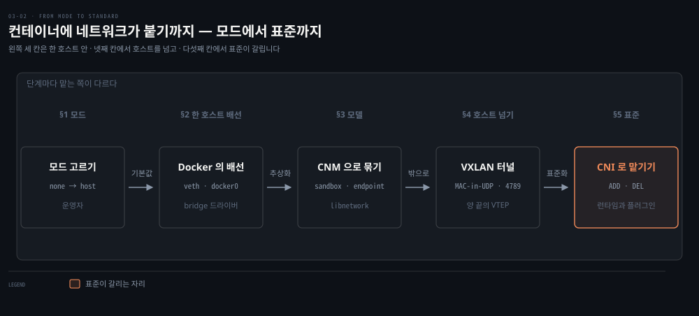
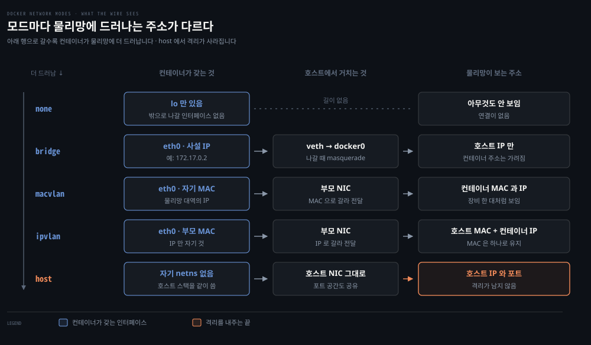
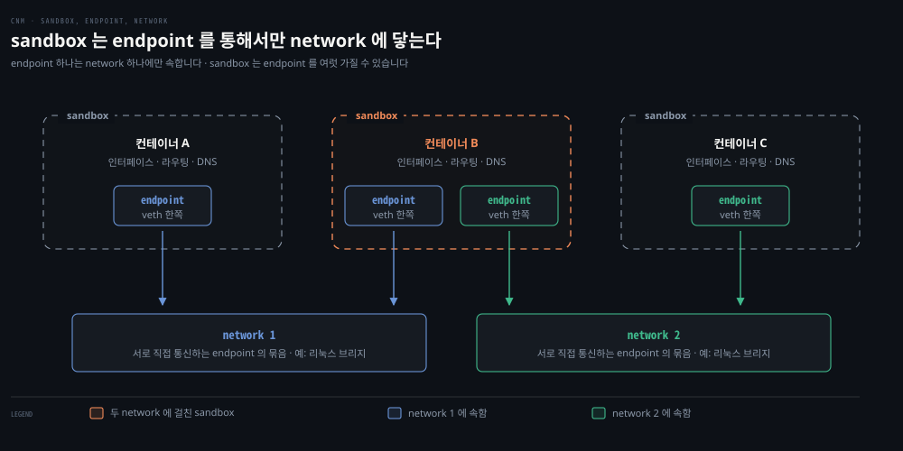
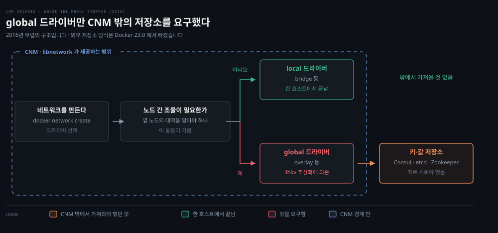
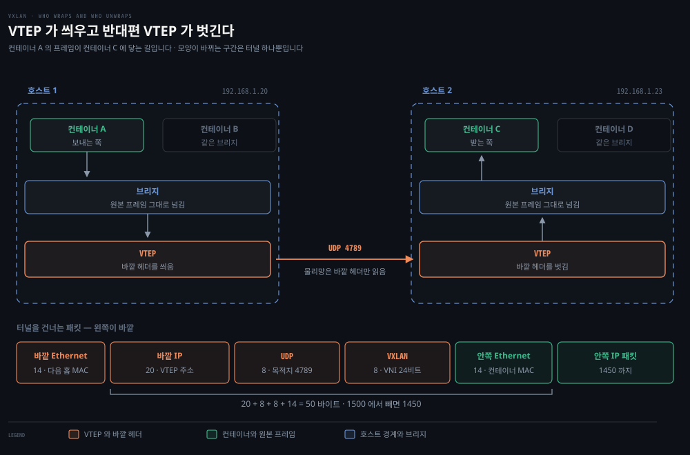
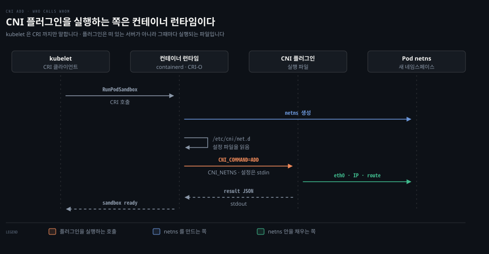
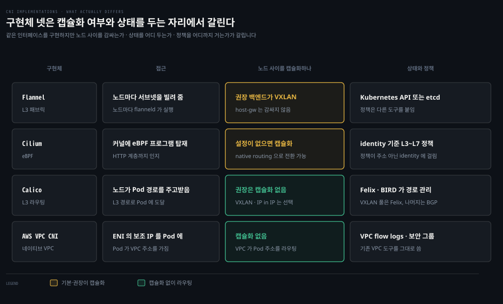

# 컨테이너 네트워킹 모드와 CNI — 격리와 연결의 거래

---

## 핵심 요약
> 이 편 전체가 매달린 하나의 생각은 **"네트워킹 모드 선택이란 격리를 얼마나 포기하고 무엇을 얻는가의 거래"**입니다.

일곱 모드가 그 거래의 스펙트럼입니다. 한쪽 끝이 완전 격리인 None이고 반대쪽 끝이 격리를 포기한 Host입니다. 호스트를 넘는 통신은 VXLAN 오버레이가 잇습니다. Docker는 이 배선을 CNM(libnetwork)으로 추상화했지만 Kubernetes는 더 단순하고 데몬이 필요 없는 CNI를 택했습니다.[^k8s-blog]

- 오늘날 Cilium·Flannel·Calico가 전부 이 인터페이스의 구현체입니다.


## 학습 목표
> 모드 이름을 외우는 대신, 각 모드가 무엇을 포기하고 무엇을 얻는지로 견주어 상황에 맞게 고를 수 있는 상태를 목표로 합니다.

이 내용을 읽고 나면:

1. 컨테이너 네트워킹 모드 7종의 격리-연결 거래를 비교해 상황에 맞게 고를 수 있습니다.
2. Docker가 만드는 기본 네트워크(docker0, 172.17.0.0/16)와 컨테이너 배선이 호스트 어디에 남는지 짚을 수 있습니다.
3. CNM의 세 구성 요소(sandbox·endpoint·network)와 local/global 드라이버를 설명할 수 있습니다.
4. VXLAN의 MAC-in-UDP 캡슐화 구조와 VTEP의 역할을 그릴 수 있습니다.
5. Kubernetes가 CNM 대신 CNI를 택한 이유와 주요 CNI 구현체의 차별점을 말할 수 있습니다.

실무에서 겪은 사례입니다. 표에는 증상만 적었고, 원인은 오른쪽 절을 읽으면 풀립니다. 사내 폴더라 로컬 사본에서만 열립니다.

| 사례 | 겪은 증상 | 답하는 절 |
|---|---|---|
| [원인이 된 변경과 증상이 나타난 날은 한 달 떨어져 있었습니다](../../../_company/task/2026-05-13_mesh_month-old-config-fails-today/README.md) | 이미지를 바꿨더니 새 파드가 하나도 만들어지지 않았고, 기존 파드는 그대로 떠 있어 한동안 아무도 몰랐다 | §5 누가 플러그인을 부르는가 |

아래 지도에서 칸 위의 이름이 그 단계를 다루는 절입니다. 왼쪽 세 칸은 한 호스트 안에서 벌어지는 일이고 넷째 칸에서 호스트의 경계를 넘습니다. 마지막 칸이 이 편의 결론이며 다음 장 전체의 전제입니다.




## 컨테이너에 네트워크가 붙기까지
> 이 편은 한 호스트 안의 선택지에서 출발해 호스트를 넘고, 마지막에 표준이 갈리는 순서로 읽습니다.

컨테이너 하나에 네트워크가 붙기까지는 단계마다 맡는 쪽이 다릅니다. 이름만 따로 외우면 CNM 과 CNI 가 왜 따로 나왔는지 보이지 않아 헷갈립니다. 아래 표는 단계마다 누가 맡고 무엇이 받치는지를 이어서 보입니다.

| 단계 | 주체 | 받치는 개념 | 절 |
|------|------|-------------|----|
| 모드 고르기 | 운영자 | none·bridge·host·macvlan·ipvlan | §1 |
| 한 호스트 배선 | Docker 의 bridge 드라이버 | veth·docker0 | §2 |
| 모델로 묶기 | libnetwork | sandbox·endpoint·network | §3 |
| 호스트 넘기 | 양 끝의 VTEP | MAC-in-UDP 캡슐화 | §4 |
| 표준에 맡기기 | 컨테이너 런타임과 플러그인 | CNI ADD·DEL | §5 |


## 1. 일곱 가지 모드
> 모드는 격리를 얼마나 내주고 무엇을 얻느냐로 줄 세울 수 있습니다. 한쪽 끝이 None, 반대쪽 끝이 Host 입니다.

흐름 위치: 1 모드 고르기 · 받치는 개념 — 격리와 연결의 거래

`docker run` 에 붙일 모드가 일곱 개이고 이름만으로는 고를 근거가 없습니다. 그래서 대개 기본값을 그대로 씁니다.

그러다 성능이 아쉬워 Host 로 바꾸면 포트 충돌이 돌아옵니다. Macvlan 은 대부분의 클라우드가 막아 두어 뜨지 않습니다.[^docker-macvlan] 도식은 한 호스트 안의 다섯 모드를 물리망이 보는 주소로 견줍니다. overlay 는 §4 가 다루고 사용자 정의 브리지는 bridge 행과 길이 같아 뺐습니다.



### 모드 일곱 가지

Docker 의 네트워크 드라이버는 bridge·host·none·overlay·ipvlan·macvlan 여섯입니다. 사용자가 만든 브리지도 bridge 드라이버로 만들지만 쓰임이 달라 따로 세어 일곱으로 봅니다.[^docker-drivers]

| 모드 | 동작 | 거래 |
|------|------|------|
| None | 루프백(lo)만 만들어 밖으로 나갈 인터페이스가 없음[^docker-none] | 완전 격리 — 네트워크가 필요 없는 컨테이너용 |
| **Bridge** | 호스트 안 사설망에서 실행, 밖으로 나갈 때 masquerade, 들어올 때 포트 게시[^docker-bridge] | 기본값. 같은 네트워크의 컨테이너와 호스트는 자유롭게 통신 |
| Host | 호스트와 네트워크 네임스페이스를 공유 | 격리 포기 — 호스트 네트워크에 직접 접근, 포트 관리는 배포자 몫 |
| Macvlan | 부모 인터페이스 위 서브인터페이스마다 MAC·IP 부여 | 물리망에 직접 매핑 — 호스트와 같은 DHCP·스위치 사용 |
| IPvlan | MAC 은 부모 것을 공유하고 IP 만 분리 | l2·l3·l3s 모드 |
| Overlay | 여러 Docker 호스트에 같은 네트워크를 확장 | 호스트가 swarm 에 속해야 하고 2377/tcp·4789/udp·7946 이 열려야 함[^docker-overlay] |
| 사용자 정의 브리지 | 직접 만든 브리지 | 예: DB 전용 브리지. 공식 문서는 기본 브리지보다 낫다고 권함 |

### Host 모드의 조건

Host 는 Linux 의 Docker Engine 에서 쓰고 Docker Desktop 에서는 4.34 이상에서 설정을 켜면 씁니다.[^docker-host] Desktop 에는 조건이 따라붙습니다.

- 컨테이너 안의 프로세스가 호스트 IP 에 bind 할 수 없습니다(Desktop 의 제약)
- TCP·UDP 위에서만 동작합니다. Linux 의 Docker 와 달리 그 아래 계층의 프로토콜은 지원하지 않습니다(Desktop 의 제약)
- Enhanced Container Isolation 과 함께 쓸 수 없습니다
- Linux 컨테이너에만 적용됩니다

### Macvlan 과 IPvlan

Macvlan 은 서브인터페이스마다 MAC 을 주고 IPvlan 은 부모 MAC 을 공유합니다.[^docker-macvlan][^docker-ipvlan] 어느 쪽을 고를지는 아래 표의 조건이 가릅니다.

| 항목 | Macvlan | IPvlan |
|------|---------|--------|
| MAC | 컨테이너마다 | 부모 것을 공유 |
| 모드 | bridge(기본)·vepa·passthru·private | l2(기본)·l3·l3s |
| 커널 | 3.9 이상(4.0 권장) | 4.2 이상 |
| 장비 요건 | 한 물리 인터페이스에 MAC 을 여럿 받는 promiscuous 처리 | 포트·인터페이스당 MAC 수에 제한이 있어도 동작 |

커널 문서는 IPvlan 을 고를 경우를 셋으로 적습니다.[^linux-ipvlan]

- 스위치나 라우터 정책이 포트당 MAC 하나만 허용합니다
- 가상 장치 수가 MAC 수용량을 넘거나 promiscuous 모드가 성능을 떨어뜨립니다
- 슬레이브를 신뢰할 수 없는 네임스페이스에 두어 L2 를 오용할 위험이 있습니다

`ip link` 로 만들 때 IPvlan 의 기본 모드는 l3 이지만 Docker 의 기본은 l2 입니다.

### 모드 목록 밖의 container 네트워킹

`--network container:<이름>` 은 다른 컨테이너의 네트워크 스택에 붙는 방식입니다.[^docker-net] Kubernetes Pod 도 같은 발상입니다. Pod 안 컨테이너는 네트워크 네임스페이스·IP·포트 공간을 공유하고 `localhost` 로 서로를 찾습니다.[^k8s-pods]


## 2. Docker 가 만든 배선
> 전편에서 손으로 하던 배선을 Docker 는 `docker run` 한 번으로 끝냅니다. 그 결과는 호스트의 docker0·veth·라우팅 테이블에 그대로 남습니다.

흐름 위치: 2 한 호스트 배선 · 받치는 개념 — veth·docker0 브리지

전편에서는 컨테이너 네트워크를 만드느라 명령을 열한 줄 손으로 쳤습니다. 자동으로 됐다고 그 배선이 사라진 것은 아닙니다. 네트워크가 안 될 때 브리지·veth·경로 가운데 어디를 볼지 가르려면, 정상일 때 그 셋이 호스트 어디에 남는지를 먼저 봐 두어야 합니다.

Docker 를 설치하면 bridge·host·none 세 네트워크가 생기고 호스트에 docker0 브리지가 서는 것은 03-04 §2 에서 실측한 모습입니다. 기본값 기준으로 docker0 은 `172.17.0.1/16` 을 가지고, 사용자가 만든 네트워크는 다음 대역(172.18.0.0/16 부터)을 받습니다.[^docker-net]

```bash
# Docker 가 만든 기본 네트워크 목록 (bridge · host · none)
docker network ls

# 호스트의 docker0 브리지 주소 — 기본값 기준 172.17.0.1/16
ip -br addr show docker0

# docker0 로 향하는 경로 — 컨테이너 대역이 브리지로 들어오는 길
ip route | grep docker0
```

컨테이너는 `172.17.0.2` 같은 주소를 받고 안쪽 기본 경로가 docker0 으로 잡힙니다. 호스트에는 `master docker0` 로 붙은 veth 반쪽이 생기고 라우팅 테이블에 `172.17.0.0/16 dev docker0` 경로가 남습니다. Host 모드로 띄우면 컨테이너 안의 인터페이스 목록이 호스트와 같아서 네임스페이스 공유가 눈에 보입니다.

```bash
# host 모드 컨테이너의 인터페이스 목록 — 호스트와 같은 인터페이스가 그대로 나옴
docker run --rm --net=host busybox ip a
```

Docker 는 Linux 에서 격리·포트 게시·필터링을 위해 방화벽 규칙을 만듭니다. 기본 백엔드는 iptables 이고 nftables 도 지원합니다. ipvlan·macvlan·host 네트워크에는 규칙을 만들지 않습니다.[^docker-fw]

실측에서 Docker 는 자기가 만든 네트워크 네임스페이스를 `ip netns list` 가 보는 `/var/run/netns` 에 등록하지 않았습니다. 컨테이너의 호스트 PID 를 찾아 `/proc/<PID>/ns/net` 을 심볼릭 링크로 걸면 `ip` 도구로 조회할 수 있습니다. 세 단계 명령은 [03-04 §2](./03-04.%EC%BB%A8%ED%85%8C%EC%9D%B4%EB%84%88%20%EB%84%A4%ED%8A%B8%EC%9B%8C%ED%81%AC%20%EC%8B%A4%EC%8A%B5%20%E2%80%94%20%EB%A7%A8%EC%86%90%20%EB%B0%B0%EC%84%A0%EC%97%90%EC%84%9C%20%ED%8F%AC%ED%8A%B8%20%EB%A7%A4%ED%95%91%EA%B9%8C%EC%A7%80.md)에 있습니다.


## 3. CNM
> Docker 는 배선을 sandbox·endpoint·network 세 부품으로 추상화했습니다. 다만 노드 사이의 상태는 모델 밖의 저장소에 맡겼고, 그 빈자리가 Kubernetes 와 갈라서는 이유가 됩니다.

흐름 위치: 3 모델로 묶기 · 받치는 개념 — sandbox·endpoint·network

Kubernetes 는 Docker 가 만든 이 모델을 쓰지 않고 다른 길을 갔습니다. 이유를 알려면 앞 두 절의 결과를 만드는 쪽의 설계를 봐야 합니다. 답은 세 부품이 아니라 모델이 비워 둔 자리에 있습니다.

libnetwork 는 Docker 의 컨테이너 네트워킹 구현이고, 그 설계 모델이 CNM(Container Network Model)입니다.[^moby-design]



- **sandbox**: 컨테이너 하나의 네트워크 스택 설정입니다. 인터페이스·라우팅 테이블·DNS 설정을 담고 여러 network 의 endpoint 를 가질 수 있습니다
- **endpoint**: sandbox 를 network 에 잇는 연결점입니다. veth 쌍의 한쪽이나 Open vSwitch 내부 포트가 될 수 있고 network 하나와 sandbox 하나에만 속합니다
- **network**: 서로 직접 통신하는 endpoint 의 묶음입니다. Linux 브리지나 VLAN 이 될 수 있습니다

### 드라이버를 가르는 물음

드라이버는 두 부류이고 가르는 물음은 하나입니다. 노드 사이의 조율이 필요한가입니다.[^k8s-blog]



- **local 드라이버**(bridge 등): 호스트 중심이라 노드 간 조율을 하지 않고 한 호스트 안에서 끝납니다
- **global 드라이버**(overlay 등): 노드 간 조율을 맡되 libkv 라는 키-값 저장소 추상화에 기댑니다

2016년 무렵 CNM 은 그 저장소를 제공하지 않았습니다. 인터페이스만 정해 두고 Consul·etcd·ZooKeeper 같은 저장소를 직접 세워 잇게 했습니다. 이 외부 저장소 방식은 Docker 20.10 에서 deprecated 되고 23.0 에서 제거됐습니다.[^docker-deprecated] 지금 overlay 는 호스트가 swarm 에 속해야 씁니다.[^docker-overlay] 그래도 §5 에서 갈라서는 배경은 이 구조입니다.

사설 주소를 받는 컨테이너가 밖에 서비스하려면 포트를 호스트 포트에 게시해야 합니다. 그 규칙은 [03-03](./03-03.%EC%BB%A8%ED%85%8C%EC%9D%B4%EB%84%88%20%EC%97%B0%EA%B2%B0%EA%B3%BC%20%ED%8F%AC%ED%8A%B8%20%EB%A7%A4%ED%95%91%20%E2%80%94%20%EA%B0%99%EC%9D%80%20%ED%98%B8%EC%8A%A4%ED%8A%B8%2C%20%EB%8B%A4%EB%A5%B8%20%ED%98%B8%EC%8A%A4%ED%8A%B8.md)이 다룹니다.


## 4. VXLAN
> 호스트를 넘는 통신은 원본 L2 프레임을 UDP 에 넣어 나르는 방식으로 풉니다. 캡슐화와 역캡슐화는 양 끝의 VTEP 가 맡습니다.

흐름 위치: 4 호스트 넘기 · 받치는 개념 — MAC-in-UDP 캡슐화

브리지는 호스트 안에서 끝나므로, 컨테이너가 서로 다른 호스트에 있으면 호스트 간 라우팅 정보 조율·포트 충돌·IP 관리 문제가 생깁니다. 그 대표 해법이 1장에서 만난 VXLAN 입니다. VLAN 식별자가 최대 4,094개인 데 비해 VXLAN 은 24비트 식별자(VNI)로 1,600만 세그먼트를 만듭니다.[^rfc7348]

**MAC-in-UDP** 는 원본 L2 프레임에 VXLAN 헤더를 붙여 UDP/IP 패킷 안에 넣는 방식입니다. 도식은 컨테이너 A 의 프레임이 컨테이너 C 에 닿는 길입니다.



**VTEP**(VXLAN Tunnel End Point)는 터널을 시작하고 끝내는 개체입니다.[^rfc7348] 도식에서 컨테이너는 브리지에 매달리고 브리지는 VTEP 에 붙습니다. 모양이 바뀌는 구간은 두 VTEP 사이 하나뿐이어서 컨테이너와 브리지는 원본 프레임만 보고 오버레이가 있다는 사실을 모릅니다. 물리망은 바깥 IP 와 UDP 까지만 읽습니다.

### 구현마다 다른 포트

IANA 는 VXLAN 목적지 포트로 4789 를 배정했고 RFC 는 이를 기본으로 쓰라고 적습니다.[^rfc7348] 그런데 Linux 커널의 vxlan 장치는 IANA 배정 이전부터 쓰던 값을 기본으로 씁니다.[^linux-vxlan] Flannel 문서는 그 값이 8472 라고 적습니다.[^flannel-backends] Flannel 과 Cilium 도 8472/UDP 가 기본입니다.[^flannel-backends][^cilium-routing] 방화벽에서 열 포트는 쓰는 구현의 설정으로 확인합니다.

### 겉봉의 대가

바깥 헤더가 IPv4 이면 IP 20 + UDP 8 + VXLAN 8 + 안쪽 Ethernet 14 = 50바이트를 씁니다. 터널이 원본 프레임을 통째로 실어 안쪽 Ethernet 헤더까지 MTU 에서 깎이기 때문입니다.[^linux-vxlan-h] MTU 1500 링크 위의 안쪽 MTU 는 1450 이고 바깥이 IPv6 이면 70바이트라 1430 입니다.[^calico-mtu]

이 값을 맞춰 두지 않으면 작은 요청은 잘 되고 응답이 큰 것만 조용히 사라집니다. "네트워크가 안 된다"가 아니라 "어떤 API 만 가끔 멈춘다"로 나타나 진단이 어렵습니다. CNI 를 설치할 때 MTU 를 명시하는 이유가 이것이고 사건의 전모는 [01-03 §Path MTU Discovery](./01-03.IP%C2%B7%EB%9D%BC%EC%9A%B0%ED%8C%85%C2%B7Ethernet%20%E2%80%94%20%ED%8C%A8%ED%82%B7%EC%9D%B4%20%EA%B8%B8%EC%9D%84%20%EC%B0%BE%EB%8A%94%20%EB%B2%95.md)에 있습니다.


## 5. CNI
> Kubernetes 는 CNM 대신 CNI 를 택했습니다. 더 단순하고 데몬이 필요 없다는 점이 이유로 꼽혔습니다.

흐름 위치: 5 표준에 맡기기 · 받치는 개념 — CNI ADD·DEL

오버레이로 호스트 간 통신은 풀립니다. 남은 문제는 이 배선을 누가 어떤 약속으로 맡느냐입니다. 2016년 Kubernetes 블로그는 먼저 CNM 쪽 문제를 짚습니다. global 드라이버가 libkv 와 그 밑의 저장소를 요구해 기본 설치에는 과한 부담이라는 것입니다. 이어서 CNI 의 장점을 셋 듭니다.[^k8s-blog]

- **단순함**: CNI 는 CNM 보다 훨씬 단순합니다
- **데몬 불필요**: 상주 프로세스 없이 실행 파일 호출만으로 동작합니다
- **이식성**: 적어도 여러 플랫폼에서 쓸 수 있을 법하다고 평했습니다

CNI 는 CoreOS 가 내놓은 appc 의 일부였고 rkt 가 이미 지원하고 있었습니다.

CNI(Container Network Interface)는 CNCF 프로젝트입니다. 리눅스 컨테이너의 네트워크 인터페이스를 설정하는 플러그인을 위한 명세와 라이브러리로 이루어집니다. 다루는 일은 컨테이너의 네트워크 연결과, 삭제될 때 할당한 자원을 되돌리는 일뿐입니다.[^cni-readme]

### 누가 플러그인을 부르는가

플러그인은 떠 있는 서버가 아니라 그때마다 실행되는 파일입니다. 컨테이너 런타임이 그 실행 파일을 호출합니다. 동작은 환경 변수로, 설정은 표준 입력의 JSON 으로 넘깁니다. 주요 환경 변수는 `CNI_COMMAND`·`CNI_NETNS`·`CNI_IFNAME`·`CNI_CONTAINERID`·`CNI_PATH` 입니다. 결과는 표준 출력의 JSON 으로 돌려받습니다.[^cni-spec]



명령은 ADD·DEL·CHECK·GC·VERSION 입니다. ADD 는 컨테이너 네임스페이스에 인터페이스를 만들거나 조정하고 DEL 은 그 자원을 회수합니다. IP 는 설정의 `ipam` 항목이 가리키는 IPAM 플러그인에 맡길 수 있습니다. 플러그인은 인터페이스를 만드는 종류와 이미 만든 인터페이스를 손보는 chained 종류로 나뉩니다.[^cni-spec]

Kubernetes 에서 플러그인을 부르는 쪽은 kubelet 이 아니라 컨테이너 런타임입니다. kubelet 은 CRI 의 `RunPodSandbox` 로 샌드박스를 요청할 뿐입니다.[^cri-api] 런타임은 CNI 플러그인을 불러오도록 설정되어 있어야 합니다. 1.24 이전에는 kubelet 이 `network-plugin` 옵션으로 CNI 를 관리할 수 있었지만 그 옵션은 1.24 에서 제거됐습니다.[^k8s-netplugins] containerd 2.1 의 기본 위치는 설정 `/etc/cni/net.d`, 플러그인 `/opt/cni/bin` 입니다.[^containerd-cri]

### 구현체 넷 — 고를 때 묻는 것

네 구현체는 같은 인터페이스를 구현하지만 노드 사이를 감싸는지, 상태를 어디 두는지, 정책을 어디까지 거는지가 갈립니다. 가운데 열이 판정 축입니다. 감싸면 물리망에 손대지 않아도 됩니다. 안 감싸면 오버헤드가 없는 대신 물리망이 Pod 대역을 알아야 합니다.



도식의 칸에는 한 줄로 담기지 않는 단서가 있습니다.

- **Cilium**: 설정이 없으면 캡슐화 모드로 돕니다. 요구 조건이 가장 적은 모드이기 때문입니다. 설정으로 native routing 에 바꿀 수 있습니다.[^cilium-routing] 정책은 주소가 아닌 identity 를 기준으로 L3~L7 에서 겁니다.[^cilium-intro]
- **Flannel**: 노드마다 flanneld 가 서브넷을 빌립니다. 상태는 Kubernetes API 나 etcd 에 두고 VXLAN 이 권장 백엔드입니다.[^flannel-readme] host-gw 는 감싸지 않지만 클라우드에서는 보통 쓸 수 없습니다.[^flannel-backends]
- **AWS VPC CNI**: ENI 의 보조 IP 를 Pod 에 줍니다. VPC flow logs·라우팅·보안 그룹을 그대로 쓰는 것이 목표입니다.[^awscni]
- **Calico**: 캡슐화 없이 쓰기를 권하고 VXLAN·IP in IP 도 지원합니다.[^calico-vxlan] IP in IP 는 IPv4 전용이라, 쓸 수 없는 Azure 같은 환경에서는 VXLAN 을 씁니다.[^calico-vxlan]

Calico 의 캡슐화는 적용 범위를 고릅니다. `Always` 는 모든 워크로드 트래픽을, `CrossSubnet` 은 서브넷 경계를 넘는 트래픽만 감쌉니다. 공식 문서는 `CrossSubnet` 을 모범 사례로 꼽습니다. 같은 서브넷 안에서는 라우팅만 하고 넘어갈 때만 껍질을 씌워 부담을 줄이기 때문입니다. 그러니 캡슐화 여부는 배타적 선택이 아니라 섞을 수 있는 축입니다.[^calico-vxlan]


## 결정 치트시트
> 모드 선택은 "무엇을 포기할 수 있는가"로 가립니다.

| 상황 | 모드 | 근거 |
|------|------|------|
| 네트워크가 아예 불필요 (배치 연산 등) | None | 공격 표면 최소화 |
| 일반적인 단일 호스트 컨테이너 | Bridge (기본) | 격리 + NAT 외부 통신 |
| 호스트 네트워크 자원에 직접 접근 필요 (노드 에이전트) | Host | 격리 포기를 감수 — 포트 충돌 관리는 배포자 책임 |
| 컨테이너가 물리망의 1급 시민이어야 함 (기존 DHCP·스위치) | Macvlan / IPvlan | 온프레미스 한정 — 클라우드는 대부분 차단 |
| 여러 호스트에 걸친 컨테이너 통신 | Overlay (VXLAN) | 언더레이 위 가상 L2 |
| 서비스별 네트워크 분리 (DB 전용망 등) | 사용자 정의 브리지 | 브리지 단위 세그먼테이션 |


## 면접에서 받을 만한 질문
> 답을 가리고 스스로 말해 본 뒤, 아래 정답 절에서 맞춰 봅니다.

1. CNI를 "한 줄"로 정의한다면?
2. 컨테이너 네트워킹 모드 선택을 "거래"라고 부르는 이유는? Bridge와 Host를 예로 설명해 보세요.
3. VXLAN의 캡슐화 구조를 그려 보세요. VTEP는 무엇을 하나요?
4. Kubernetes가 CNM 대신 CNI를 택한 이유 세 가지는?
5. Macvlan과 IPvlan은 어떻게 다르고 언제 IPvlan을 쓰나요?
6. Calico가 "오버레이 없이 동작한다"는 것은 무슨 뜻인가요?
7. 컨테이너가 사설 IP(RFC 1918)만 받는데 외부 서비스는 어떻게 하나요?


## 정답 (자답 후 펼치기)
> 위 §면접에서 받을 만한 질문에 *먼저 자답한 뒤* 아래를 읽으세요. 자답 없이 먼저 읽으면 학습 효과가 0입니다.

### 정답 1 — CNI 한 줄 정의
"CNI란 컨테이너 런타임과 네트워크 구현 사이의 인터페이스 명세로, 컨테이너 생성 시 인터페이스 연결·IP 할당·경로 설정을, 삭제 시 자원 회수를 플러그인에 위임합니다."

### 정답 2 — 모드 선택이 거래인 이유
모드 선택은 격리-연결 거래입니다. Bridge(기본)는 사설망 격리를 유지하되 외부 통신은 NAT를 거칩니다. Host는 그 격리를 포기하는 대신 호스트 네트워크 자원에 직접 접근합니다. 얻는 것(성능·직접성)과 포기하는 것(격리·포트 자율성)이 늘 짝으로 움직입니다.

### 정답 3 — VXLAN 캡슐화와 VTEP
VXLAN은 MAC-in-UDP입니다. 원본 L2 프레임을 VNI(24비트) 헤더와 함께 UDP-IP 패킷에 넣어 L3 물리망 위에 L2 오버레이를 얹습니다. 캡슐화·역캡슐화는 양끝 VTEP(VXLAN Tunnel End Point)가 맡아 물리망은 바깥 헤더만 보고 내용물(원본 프레임)은 모른 채 패킷을 나릅니다.

### 정답 4 — Kubernetes가 CNI를 택한 이유
2016년 Kubernetes 블로그는 global 드라이버의 저장소 부담을 짚은 뒤 CNI 의 장점으로 CNM보다 훨씬 단순하고 데몬이 필요 없으며 여러 플랫폼에서 쓸 수 있을 법하다는 것입니다. 그 뒤 Cilium(eBPF)·Flannel(단순 L3)·Calico(L3 라우팅) 같은 구현이 경쟁하는 생태계가 됐습니다.

### 정답 5 — Macvlan과 IPvlan
Macvlan은 서브인터페이스마다 별도 MAC을 부여하고 IPvlan은 부모 MAC을 공유하며 IP만 나눕니다. 커널 문서는 스위치·라우터 정책이 포트당 MAC 하나만 허용할 때, 가상 장치가 MAC 수용량을 넘거나 promiscuous 모드로 성능이 떨어질 때, 슬레이브를 신뢰할 수 없는 네임스페이스에 둘 때 IPvlan 을 고르라고 합니다.

### 정답 6 — Calico의 오버레이 없는 동작
컨테이너 트래픽을 캡슐화하지 않고 노드가 Pod 경로를 주고받아(BGP 또는 Felix 가 설치한 경로) 순수 L3 로 전달한다는 뜻입니다. 캡슐화 오버헤드가 없는 대신 물리망이 그 경로를 받아 줄 수 있어야 합니다. 그렇지 못한 환경을 위해 VXLAN·IP in IP 도 지원합니다.

### 정답 7 — 사설 IP 컨테이너의 외부 서비스
포트 게시입니다. 컨테이너 포트를 호스트 포트에 하나씩 매핑해 노출하고 나가는 트래픽은 NAT(MASQUERADE)로 호스트 주소를 씁니다. 이 포트 단위 노출의 번거로움이 다음 편(연결과 포트 매핑)에서 규칙으로 드러납니다.


## 핵심 개념 체크리스트
> 여섯 항목을 막힘없이 답할 수 있으면 다음 편으로 넘어가도 좋습니다.
- [ ] 7가지 모드 각각의 거래(얻는 것/포기하는 것)를 말할 수 있는가?
- [ ] docker0·veth·컨테이너 라우팅 테이블의 기본 배선이 호스트 어디에 남는지 말할 수 있는가? (실측은 03-04 §2)
- [ ] CNM의 sandbox·endpoint·network와 local/global 드라이버를 구분할 수 있는가?
- [ ] VXLAN 패킷의 캡슐화 구조(바깥 IP·UDP·VNI·원본 프레임)를 그릴 수 있는가?
- [ ] Kubernetes가 CNI를 택한 세 가지 이유를 아는가?
- [ ] Cilium·Flannel·Calico·AWS VPC CNI의 접근 차이를 한 줄씩 말할 수 있는가?


## 참고 자료
- 《Networking and Kubernetes: A Layered Approach》(James Strong·Vallery Lancey, O'Reilly, 2021, ISBN 978-1492081654) Ch3
- [CNI 공식 — cni.dev](https://www.cni.dev/)
- 이전 편: [03-01. 컨테이너의 탄생](./03-01.%EC%BB%A8%ED%85%8C%EC%9D%B4%EB%84%88%EC%9D%98%20%ED%83%84%EC%83%9D%20%E2%80%94%20%EC%95%B1%20%EC%8B%A4%ED%96%89%EC%9D%98%20%EC%A7%84%ED%99%94%EC%99%80%20%EA%B2%A9%EB%A6%AC%20%ED%94%84%EB%A6%AC%EB%AF%B8%ED%8B%B0%EB%B8%8C.md)
- 다음 편: [03-03. 컨테이너 연결과 포트 매핑](./03-03.%EC%BB%A8%ED%85%8C%EC%9D%B4%EB%84%88%20%EC%97%B0%EA%B2%B0%EA%B3%BC%20%ED%8F%AC%ED%8A%B8%20%EB%A7%A4%ED%95%91%20%E2%80%94%20%EA%B0%99%EC%9D%80%20%ED%98%B8%EC%8A%A4%ED%8A%B8%2C%20%EB%8B%A4%EB%A5%B8%20%ED%98%B8%EC%8A%A4%ED%8A%B8.md)

[^k8s-blog]: Tim Hockin, "Why Kubernetes doesn't use libnetwork"(2016-01-14) — CNI 가 CNM 보다 훨씬 단순하고 데몬이 필요 없으며 적어도 여러 플랫폼에서 쓸 법하다는 평, local 드라이버는 머신 중심이고 global 드라이버는 libkv 에 기댄다는 설명: https://kubernetes.io/blog/2016/01/why-kubernetes-doesnt-use-libnetwork/
[^docker-drivers]: Docker 문서 Network drivers (docker/docs 94734302) — 드라이버 목록: https://github.com/docker/docs/blob/947343021a3e1eea022cbede8df39387717343f9/content/manuals/engine/network/drivers/_index.md
[^docker-none]: Docker 문서 None network driver (docker/docs 94734302) — 루프백 장치만 만들어짐: https://github.com/docker/docs/blob/947343021a3e1eea022cbede8df39387717343f9/content/manuals/engine/network/drivers/none.md
[^docker-bridge]: Docker 문서 Bridge network driver (docker/docs 94734302) — 기본 동작과 "User-defined bridge networks are superior to the default bridge network": https://github.com/docker/docs/blob/947343021a3e1eea022cbede8df39387717343f9/content/manuals/engine/network/drivers/bridge.md
[^docker-host]: Docker 문서 Host network driver (docker/docs 94734302) — Docker Desktop 4.34 이상에서 설정으로 켬, 호스트 IP bind 불가·TCP/UDP 한정: https://github.com/docker/docs/blob/947343021a3e1eea022cbede8df39387717343f9/content/manuals/engine/network/drivers/host.md
[^docker-macvlan]: Docker 문서 Macvlan network driver (docker/docs 94734302) — Linux 호스트 전용, "Most cloud providers block macvlan networking", 커널 3.9 이상, promiscuous 모드 장비 필요: https://github.com/docker/docs/blob/947343021a3e1eea022cbede8df39387717343f9/content/manuals/engine/network/drivers/macvlan.md
[^docker-ipvlan]: Docker 문서 IPvlan network driver (docker/docs 94734302) — l2(기본)·l3·l3s 모드, 커널 4.2 이상, 부모 인터페이스의 MAC 사용: https://github.com/docker/docs/blob/947343021a3e1eea022cbede8df39387717343f9/content/manuals/engine/network/drivers/ipvlan.md
[^docker-overlay]: Docker 문서 Overlay network driver (docker/docs 94734302) — swarm 에 속한 호스트, 포트 2377/tcp·4789/udp·7946: https://github.com/docker/docs/blob/947343021a3e1eea022cbede8df39387717343f9/content/manuals/engine/network/drivers/overlay.md
[^docker-net]: Docker 문서 Networking overview (docker/docs 94734302) — 기본 주소 풀 172.17.0.0/16 부터, `--network container:<name|id>`: https://github.com/docker/docs/blob/947343021a3e1eea022cbede8df39387717343f9/content/manuals/engine/network/_index.md
[^docker-fw]: Docker 문서 Packet filtering and firewalls (docker/docs 94734302) — 규칙 생성 범위, ipvlan·macvlan·host 에는 규칙 없음, iptables 기본·nftables 지원: https://github.com/docker/docs/blob/947343021a3e1eea022cbede8df39387717343f9/content/manuals/engine/network/packet-filtering-firewalls.md
[^docker-deprecated]: docker/cli Deprecated features (v28.5.2) — "Classic Swarm and overlay networks using cluster store", Deprecated v20.10, Removed v23.0: https://github.com/docker/cli/blob/v28.5.2/docs/deprecated.md
[^moby-design]: moby/moby libnetwork design.md (docker-v29.10.0) — Sandbox·Endpoint·Network 정의: https://github.com/moby/moby/blob/docker-v29.10.0/daemon/libnetwork/docs/design.md
[^k8s-pods]: Kubernetes 문서 Pods (kubernetes/website 1fad9608) — Pod 안 컨테이너가 네트워크 네임스페이스·IP·포트 공간을 공유하고 localhost 로 통신: https://github.com/kubernetes/website/blob/1fad96080d1f9d8221813823b27b78f0299265dd/content/en/docs/concepts/workloads/pods/_index.md
[^k8s-netplugins]: Kubernetes 문서 Network Plugins (kubernetes/website 1fad9608) — 1.24 에서 kubelet 의 CNI 관리 옵션 제거, 컨테이너 런타임이 CNI 플러그인을 불러오도록 설정: https://github.com/kubernetes/website/blob/1fad96080d1f9d8221813823b27b78f0299265dd/content/en/docs/concepts/extend-kubernetes/compute-storage-net/network-plugins.md
[^cni-readme]: containernetworking/cni README (v1.3.1) — CNI 의 범위: https://github.com/containernetworking/cni/blob/v1.3.1/README.md
[^cni-spec]: containernetworking/cni SPEC (v1.3.1) — 실행 파일 호출, 환경 변수·표준 입력·표준 출력, ADD·DEL·CHECK·GC·VERSION, Interface·Chained 플러그인: https://github.com/containernetworking/cni/blob/v1.3.1/SPEC.md
[^cri-api]: kubernetes/cri-api api.proto (v0.34.0) — RunPodSandbox: https://github.com/kubernetes/cri-api/blob/v0.34.0/pkg/apis/runtime/v1/api.proto
[^containerd-cri]: containerd CRI 설정 (v2.1.4) — conf_dir '/etc/cni/net.d', bin_dirs ['/opt/cni/bin']: https://github.com/containerd/containerd/blob/v2.1.4/docs/cri/config.md
[^rfc7348]: RFC 7348 Virtual eXtensible Local Area Network (VXLAN) — VTEP 정의, 포트 4789, 24비트 VNI, VLAN 한도 4094: https://www.rfc-editor.org/rfc/rfc7348
[^linux-vxlan]: Linux 커널 vxlan.rst (v6.12) — 기본 포트가 IANA 배정 이전의 값: https://github.com/torvalds/linux/blob/v6.12/Documentation/networking/vxlan.rst
[^linux-vxlan-h]: Linux 커널 include/net/vxlan.h (v6.12) — vxlan_headroom() 이 IP·UDP·VXLAN·Ethernet 헤더를 더함: https://github.com/torvalds/linux/blob/v6.12/include/net/vxlan.h
[^linux-ipvlan]: Linux 커널 ipvlan.rst (v6.12) — IPvlan 을 고를 경우 셋: https://github.com/torvalds/linux/blob/v6.12/Documentation/networking/ipvlan.rst
[^calico-mtu]: Calico 문서 MTU (tigera/docs ea3a69c1, 3.33) — VXLAN IPv4 50바이트·IPv6 70바이트, 1500 에서 1450·1430: https://github.com/tigera/docs/blob/ea3a69c19f9950e39e7ba20d33ab3486aa16a387/calico_versioned_docs/version-3.33/networking/configuring/mtu.mdx
[^calico-vxlan]: Calico 문서 VXLAN·IP-in-IP (tigera/docs ea3a69c1, 3.33) — IP in IP IPv4 전용, Always·CrossSubnet, 모범 사례: https://github.com/tigera/docs/blob/ea3a69c19f9950e39e7ba20d33ab3486aa16a387/calico_versioned_docs/version-3.33/networking/configuring/vxlan-ipip.mdx
[^cilium-routing]: Cilium 문서 Routing (v1.20.5) — 설정이 없으면 캡슐화, VXLAN 8472/UDP·Geneve 6081/UDP, native routing: https://github.com/cilium/cilium/blob/v1.20.5/Documentation/network/concepts/routing.rst
[^cilium-intro]: Cilium 문서 Introduction (v1.20.5) — eBPF, identity 기반 L3~L7 필터링: https://github.com/cilium/cilium/blob/v1.20.5/Documentation/overview/intro.rst
[^flannel-readme]: Flannel README (v0.28.10) — 노드마다 flanneld 가 서브넷을 빌리고 Kubernetes API 또는 etcd 에 설정을 저장: https://github.com/flannel-io/flannel/blob/v0.28.10/README.md
[^flannel-backends]: Flannel 문서 Backends (v0.28.10) — VXLAN 권장, host-gw 는 클라우드에서 보통 불가, VXLAN 포트 기본값은 커널 기본: https://github.com/flannel-io/flannel/blob/v0.28.10/Documentation/backends.md
[^awscni]: AWS VPC CNI proposal (v1.23.3) — ENI 보조 IP 를 Pod 에 할당, VPC flow logs·보안 그룹 사용이 목표: https://github.com/aws/amazon-vpc-cni-k8s/blob/v1.23.3/docs/cni-proposal.md
