# Kubernetes 네트워킹 모델 — Pod IP·레이아웃·Probe

---

## 핵심 요약

> Kubernetes 는 모든 Pod 에 클러스터 안에서 유일한 IP 를 주고 NAT 없이 서로 닿게 하는 모델을 택했고, 이 약속을 지키는 일은 컨테이너 런타임이 부르는 CNI 플러그인이 맡습니다.
> 그 선택 때문에 Pod IP 를 클러스터 밖에 보일지 정하는 레이아웃과, Pod 와 Service 의 주소 대역을 정하는 플래그가 따라옵니다.

Pod 는 스케줄러가 노드를 정한 뒤 그 노드의 kubelet 이 런타임을 거쳐 만듭니다. 주소를 받은 Pod 가 트래픽을 받을 자격은 readiness·liveness·startup 프로브가 따로 판정합니다.


## 학습 목표

이 내용을 읽고 나면:

1. Kubernetes 네트워킹 모델의 3가지 약속과 IP-per-Pod 의 동기·대가를 설명하고, 약속을 지키는 쪽이 CNI 임을 말할 수 있습니다.
2. Isolated·Flat·Island 레이아웃을 방향 축으로 비교하고, 나가는 쪽과 들어오는 쪽을 서로 다른 장치가 정한다는 것을 설명할 수 있습니다.
3. Pod 대역과 Service 대역을 정하는 컴포넌트와 플래그, 값이 적히는 자리를 말하고, `/16`·`/24`·`maxPods` 수치로 상한을 계산할 수 있습니다.
4. Pod 생성이 스케줄러, kubelet, 컨테이너 런타임, CNI 순으로 이어지는 흐름을 추적하고, `Pending` 과 `ContainerCreating` 이 멈춘 자리를 가를 수 있습니다.
5. readiness·liveness·startup 프로브의 실패 동작을 구분하고, liveness 오용의 위험을 설명할 수 있습니다.
6. readiness 실패가 EndpointSlice 와 kube-proxy 규칙까지 내려가는 길을 설명할 수 있습니다.

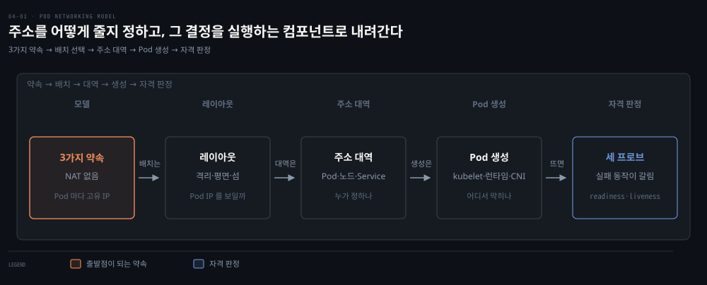

위 지도는 이 편을 모델에서 컴포넌트로 내려가는 순서로 잇습니다. 첫 칸의 3가지 약속이 출발점이고, 레이아웃 칸은 그 약속 위에서 Pod IP 를 밖에 보일지를 고릅니다. 세 번째와 네 번째 칸은 선택을 실행하는 자리입니다. 주소 대역은 컨트롤 플레인의 플래그가 정하고 Pod 생성은 노드의 kubelet 이 이끕니다.

마지막 칸은 주소를 받은 Pod 가 트래픽을 받을 자격이 있는지를 따로 판정하는 자리입니다. 칸 사이의 짧은 말은 앞 칸의 결정이 뒤 칸에서 무엇을 묻게 하는지를 적은 것입니다. 지도의 각 칸은 아래 본문의 `###` 묶음 하나 이상에 대응합니다.


## 본문 정리

### Pod 마다 IP 를 주는 3가지 약속

Kubernetes 네트워킹 모델의 공통 낱말은 NAT(Network Address Translation, 주소 변환) 없음입니다.

Docker 의 기본 모델은 호스트마다 사설 브리지를 두고 필요한 것만 포트로 노출하는 방식이었습니다. 컨테이너가 몇 개일 때는 됩니다. 앱이 수천 개가 되면 앱마다 노드의 몇 번 포트를 쓰는지 누군가 기억해야 합니다. 사람이 감당할 양이 아닙니다. Kubernetes 는 그 관리를 줄이는 대신 아예 없애는 쪽을 택해서 Pod 마다 IP 를 줍니다.

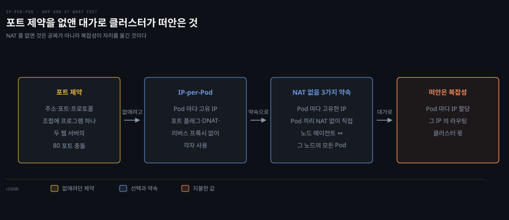

왼쪽 끝이 없애려던 제약이고 오른쪽 끝이 그 대신 치른 값입니다. 가운데 두 칸이 그 사이를 잇는 선택과 약속입니다.

공식 문서가 Pod 네트워크에 거는 약속은 세 가지로 정리됩니다.[^model]

1. 클러스터의 모든 Pod 는 클러스터 안에서 유일한 IP 주소를 받습니다.
2. Pod 는 같은 노드에 있든 다른 노드에 있든 프록시나 NAT 없이 다른 모든 Pod 와 직접 통신합니다(의도적으로 나눈 경우는 빼고).
3. 노드의 에이전트(시스템 데몬과 kubelet)는 그 노드의 모든 Pod 와 통신합니다.

둘째 약속에는 NAT 이 없으므로 주소를 갈아 끼우는 자리가 없습니다. 그래서 Pod 가 `ip addr` 로 본 자기 주소와 상대가 그 Pod 를 부르는 주소는 같은 값이 됩니다. 이 성질이 다음 묶음의 광고 주소 사고를 없앱니다. Windows 에서는 호스트 네트워크를 쓰는 Pod 에 둘째 약속이 적용되지 않습니다.

약속은 선언이고 구현은 CNI(Container Network Interface, 컨테이너 네트워크 인터페이스) 플러그인이 합니다. Pod 에 주소를 주는 것은 네트워크 플러그인이고, 그 플러그인을 부르는 쪽은 kubelet 이 아니라 컨테이너 런타임입니다.[^cni-runtime]

kubelet 이 `cni-bin-dir` 과 `network-plugin` 플래그로 CNI 를 다루던 방식은 1.24 부터 쓰지 않습니다. Kubernetes 는 기본 CNI 도 싣고 오지 않아서 표준 설치만 하면 Pod 는 네트워크를 쓸 수 없습니다. 그 증상은 뒤의 「Pod 가 안 뜰 때 보는 자리」에서 직접 확인합니다.

### 광고 주소가 어긋나는 사고

앱이 읽어서 남에게 알려 주는 자기 주소는 상대가 실제로 닿을 수 있는 값이어야 합니다.

둘째 약속이 깨지는 환경에서는 주소가 둘 나옵니다. 앞의 것은 앱이 자기 안에서 `ip addr` 로 조회해 알아낸 자기 주소입니다. 뒤의 것은 상대가 실제로 그 앱에 닿을 때 쓰는 주소입니다. 앱 중에는 켜지자마자 앞의 값을 읽어 남에게 알려 주는 것들이 있습니다. Kafka 브로커가 그렇고 서비스 레지스트리에 자기를 등록하는 앱도 그렇습니다. 이 값을 **광고 주소**라고 부르며 Kafka 의 설정 키 이름이 `advertised.listeners` 입니다.

Docker 의 포트 매핑 아래에서는 두 주소가 어긋납니다.

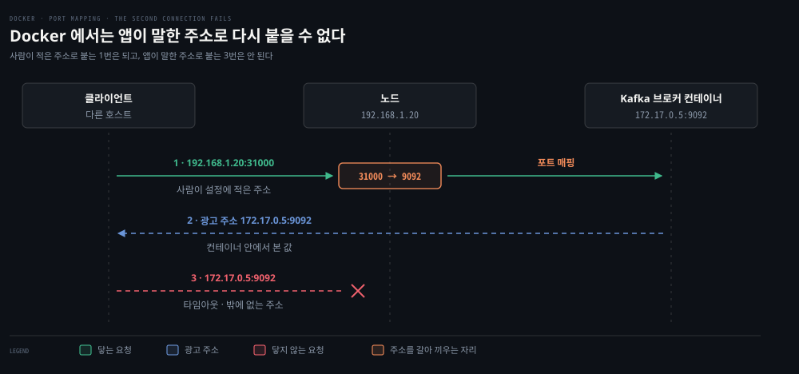

사람이 설정에 적어 준 주소로 붙은 1단계는 성공합니다. 2단계에서 브로커가 자기 주소를 알려 주는데, 그 값은 컨테이너 안에서 본 `172.17.0.5` 입니다. 3단계에서 클라이언트가 그 주소로 붙으면 타임아웃이 납니다. `172.17.0.5` 는 그 노드의 브리지 안에서만 통하는 주소입니다. 앱도 로그도 정상인데 클라이언트만 실패합니다.

클라이언트가 처음 붙은 주소를 계속 쓸 수 없는 이유는 프로토콜에 있습니다. 클라이언트는 처음 붙은 브로커에게 "이 토픽의 파티션들이 어디 있나"를 묻고, 답에는 브로커 여러 대의 주소가 담깁니다. 그 주소는 각 브로커가 자기 설정에서 읽어 보고한 값입니다. 처음 붙은 주소는 그중 한 대의 것이라 나머지에 붙으려면 받은 값을 써야 합니다.

그래서 처방은 광고 주소를 밖에서 닿는 값으로 손수 적어 주는 것인데, 그 손질이 잘 깨집니다. 브로커마다 매핑 포트가 달라 값이 제각각입니다. 컨테이너가 다른 노드로 옮겨 가면 노드 주소가 바뀌어 값이 틀려집니다. 아예 그런 설정 항목 없이 자기 IP 를 읽어 쓰는 앱도 있습니다.

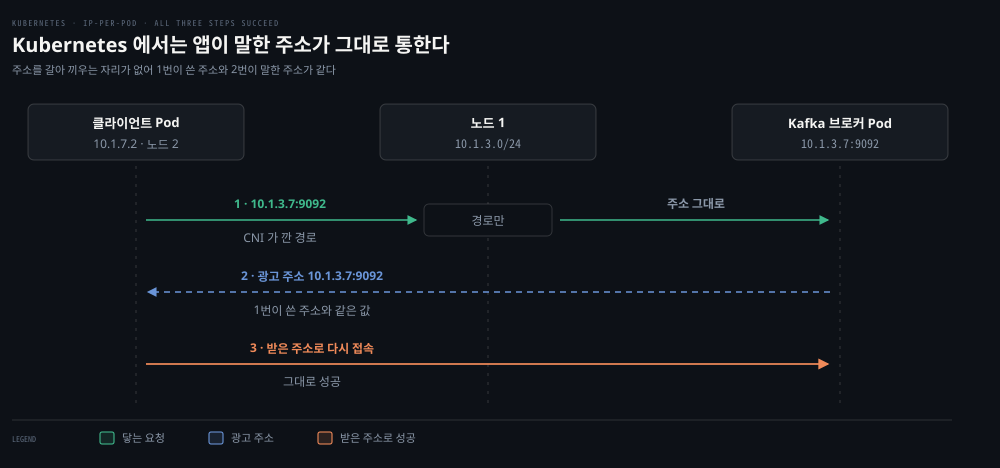

같은 세 단계인데 결과가 전부 성공입니다. 1단계가 쓴 주소와 2단계가 말한 주소가 같은 값이라 3단계가 그대로 통합니다. 중간에 주소를 갈아 끼우는 자리가 없으므로 광고 주소를 손으로 바로잡는 설정이 통째로 사라집니다.

> 여기서 Pod IP 는 가상 주소가 아닙니다. Pod 의 `eth0` 에 실제로 붙어 있는 진짜 주소입니다. 상대가 그 주소로 보내면 CNI 가 깔아 둔 경로를 타고 그대로 배달됩니다. 가상 주소는 Service 의 ClusterIP 쪽이며 「겹치면 안 되는 대역」에서 갈라 다룹니다. 이 약속의 범위는 클러스터 안입니다. 클러스터 밖에서 Pod IP 로 닿는지는 「세 가지 레이아웃」이 정합니다.

### IP-per-Pod 의 대가와 함정 둘

Pod 마다 IP 를 주면 포트 충돌은 사라집니다. 대신 그 IP 를 나눠 주고 길을 내는 일이 클러스터 몫이 됩니다.

작업 단위는 Pod 입니다. Pod 는 항상 같은 노드에 함께 스케줄되는 컨테이너 묶음이고, Pod 안의 모든 컨테이너가 IP 하나를 공유합니다.

동기는 포트 제약 제거입니다. Linux 에서 주소·포트·프로토콜 조합에는 프로그램 하나만 바인딩할 수 있습니다. Pod 가 고유 IP 를 갖지 않으면 한 노드의 두 웹 서버가 80 포트를 두고 다투게 됩니다. 풀이로는 포트 플래그, 설정 스크립트, 리버스 프록시, 그리고 목적지 주소를 바꾸는 규칙인 DNAT(Destination NAT, 목적지 주소 변환)가 있습니다. 무엇으로 풀든 "이 앱이 이 노드에서 몇 번 포트인가"를 사람이 관리해야 합니다. Google 의 Borg 같은 시스템이 이 포트 공유 모델을 씁니다.[^borg]

대가는 Pod 마다 IP 를 할당하고 라우팅하는 복잡성입니다. 그 대가와 함께 함정 둘이 따라옵니다.

| 함정 | 무슨 일이 벌어지나 | 무엇이 푸나 |
|------|-----------------|-----------|
| Pod 는 휘발성입니다 | 롤링 업데이트 한 번에 Pod 가 교체되며 새 IP 를 받습니다. Pod IP 를 설정 파일이나 DNS 에 직접 박으면 곧 틀린 값이 됩니다 | Service 와 EndpointSlice. 아래 「Service 를 거칠 때의 NAT」와 04-02 주제 |
| 기본값이 전부 허용입니다 | Pod 는 기본으로 나가는 연결도 들어오는 연결도 막히지 않습니다.[^netpol] 인증 없는 서비스나 탈취된 자격증명과 겹치면 쉽게 악용됩니다 | NetworkPolicy. 04-03 주제 |

### Service 를 거칠 때의 NAT

Service 는 NAT 없음 약속의 예외가 아니라, 그 약속 위에 얹은 층입니다.

Service 는 목적지를 바꾸고 로드밸런싱도 확률로 가르므로 약속과 어긋나 보입니다. 두 가지가 서로 다른 층이라는 점이 그 오해를 풉니다.

| 어디로 보내는가 | 목적지 주소의 성질 | NAT |
|----------------|-----------------|-----|
| Pod IP 로 직접 | 인터페이스에 붙은 진짜 주소 | 없습니다. 이 약속이 걸리는 자리입니다 |
| Service 의 ClusterIP 로 | 어디에도 붙어 있지 않은 가상 주소 | 목적지를 실제 Pod IP 로 바꿉니다 |

ClusterIP 로 온 패킷은 목적지가 Pod IP 로 바뀌고, 그다음부터는 다시 NAT 없는 Pod 사이 통신입니다. Service 는 목적지를 바꿔치는 장치라 바꿔 넣을 목적지, 곧 Pod IP 가 먼저 있어야 합니다. 그래서 Service 는 IP-per-Pod 를 대체하지 않고 그 위에 섭니다.

출발지는 보통 그대로입니다. Pod 가 Service 를 거쳐 다른 Pod 에 닿아도 받는 쪽이 보는 출발지는 원래 Pod IP 입니다. 목적지 쪽 NetworkPolicy 가 누가 보냈는지 가릴 수 있는 것이 그 덕입니다. 출발지까지 바뀌는 경우는 따로 있습니다. 노드 자신이 보낼 때, 자기 자신에게 되돌아오는 경우, 그리고 클러스터 밖에서 NodePort 로 들어와 다른 노드로 넘어갈 때입니다. 마지막 경우에 클라이언트 IP 가 노드 IP 로 지워지는 것이 실무에서 자주 만나는 증상입니다.

주소를 바꾸는 것과 연결을 새로 여는 것은 서로 다른 장치입니다. Ingress 컨트롤러 같은 프록시는 연결을 둘로 끊으므로 앞 구간과 뒤 구간이 각각 표의 다른 줄에 해당합니다. 그 구분은 [05-03](./05-03.Ingress%EC%99%80%20Service%20Mesh%20%E2%80%94%20L7%EC%9D%98%20%EB%91%90%20%EC%B8%B5.md) §1 이 다룹니다.

iptables 모드의 kube-proxy 는 규칙마다 확률을 붙여 백엔드를 고르므로 정확한 비율 분배가 아니라 무작위입니다. 다만 연결 단위로 한 번 정해지면 그 연결의 나머지 패킷은 같은 Pod 로 갑니다. IPVS 모드는 스케줄링 알고리즘을 고를 수 있었지만 v1.35 에서 deprecated 됐고 v1.40 부터 기본으로 꺼집니다. 문서는 대체로 nftables 모드를 권합니다.[^ipvs] 규칙의 생김새와 모드별 차이는 [04-02](./04-02.CNI%EC%99%80%20kube-proxy%20%E2%80%94%20Pod%20%EB%84%A4%ED%8A%B8%EC%9B%8C%ED%81%AC%EC%9D%98%20%EB%B0%B0%EC%84%A0%EA%B3%B5%EA%B3%BC%20%EB%A1%9C%EB%93%9C%EB%B0%B8%EB%9F%B0%EC%84%9C.md)가 다룹니다.

### 세 가지 레이아웃

세 레이아웃은 "Pod IP 가 클러스터 밖에서 보여야 하는가" 하나로 갈립니다.

Pod 마다 IP 를 준다고 정하고 나면 그 IP 가 어디까지 보여야 하는지가 다음 질문입니다. 클러스터 밖의 로드밸런서가 Pod 를 직접 불러야 하는지, 노드 뒤에 감춰도 되는지가 갈림길입니다. 어느 쪽이냐에 따라 필요한 주소 공간과 방화벽 설계가 달라집니다. 이 값은 클러스터를 세울 때 CNI 와 함께 고르므로 미리 정해 둡니다.

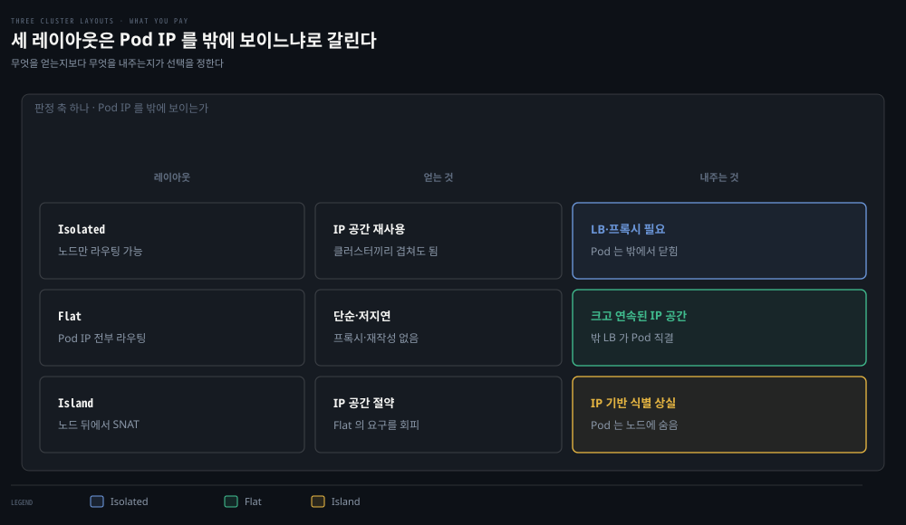

클러스터는 Pod 에 줄 IP 대역(예: `10.1.0.0/16`)을 통제해야 하고, 노드와 Pod 는 그 주소 공간에서 L3 연결성을 가져야 합니다. L3 연결성은 L4 보다 근본적입니다. 방화벽은 L4 에서 A 가 B 로 거는 연결만 허용하고 반대 방향을 거부할 수 있습니다. 그래도 L3 에서 양방향 패킷 전달이 안 되면 SYN-ACK 가 돌아오지 못해 핸드셰이크가 성립하지 않습니다.

| 레이아웃 | 구조 | 얻는 것 | 대가 |
|----------|------|--------|------|
| Isolated | 노드만 밖에서 라우팅 가능, Pod는 불가 | 보안 격리. 클러스터끼리 같은 IP 공간 재사용 가능 | 외부 연동은 로드밸런서·프록시로 뚫어야 함. 배치 처리처럼 닫힌 워크로드에 적합 |
| Flat | 모든 Pod IP가 네트워크 전체에서 라우팅 가능 | 단순함·저지연으로 프록시·재작성 비용이 없음. 클러스터 밖 LB가 Pod를 직접 밸런싱 가능 | 크고 연속된 IP 공간 필요(사설 대역이면 현실적). 프로그래머블 네트워크 필수 |
| Island | 노드는 라우팅 가능, Pod 트래픽은 노드를 프록시 삼아 SNAT(masquerade) | Flat의 IP 공간 요구를 회피 | Pod IP가 노드 IP 뒤에 숨어 클러스터 경계 밖 IP 기반 방화벽·식별이 어려워짐 |

이 표에서 헷갈리는 자리는 Isolated 와 Island 입니다. 둘 다 Pod IP 가 밖에서 보이지 않아서 같은 말처럼 읽힙니다. 실제로 갈리는 것은 트래픽 방향입니다. 들어오는 방향이 ingress 이고 나가는 방향이 egress 입니다.[^ingress-egress]

| 레이아웃 | Pod 가 밖으로 나가기 | 밖에서 Pod 로 들어오기 |
|----------|--------------------|---------------------|
| Isolated | 막힙니다. 필요하면 프록시를 따로 세웁니다 | 막힙니다 |
| Island | 됩니다. 노드 IP 로 위장해 나갑니다 | 막힙니다 |
| Flat | 됩니다. 자기 IP 그대로 나갑니다 | 됩니다 |

Island 는 나가는 것만 허용하되 얼굴을 가리는 방식입니다. Isolated 는 아예 나가지 않는 방식입니다. 다만 외부 시스템이나 사용자가 Kubernetes API 를 써야 한다면 API 서버만은 바깥 네트워크에서 라우팅 가능해야 합니다.[^isolated-api]

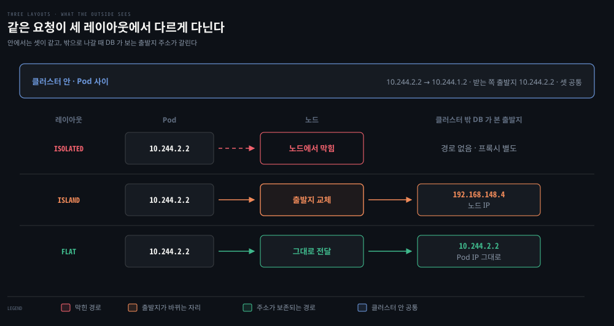

노드를 넘는 Pod 사이 통신은 셋 다 같습니다. 클러스터 안에서는 NAT 을 쓰지 않겠다는 약속이 세 레이아웃 위에 공통으로 걸려 있기 때문입니다. 갈리는 것은 클러스터 밖으로 나갈 때입니다. Flat 에서는 출발지가 Pod IP 그대로라 밖의 서버가 어느 Pod 인지 압니다. Island 에서는 노드를 지나며 출발지가 노드 IP 로 바뀌어 밖에서는 노드까지만 보입니다. Isolated 에서는 그 경로 자체가 없어서, 밖과 통신하려면 별도로 세운 프록시를 지나야 합니다.

### L2 인접성과 CNI 방식

같은 노드의 Pod 끼리 ARP 로 서로를 찾는지는 CNI 가 Pod 를 어떻게 잇느냐에 달려 있습니다. 노드를 넘으면 어느 CNI 든 L3 라우팅이 맡습니다.

Pod 의 `eth0`(veth 한쪽)에는 MAC 이 있고 컨테이너 안에서 `ip link` 로 확인됩니다. 없는 것은 **노드 간 L2 인접성**입니다. L2 인접성은 같은 브로드캐스트 도메인에 있어서 ARP(Address Resolution Protocol, IP 로 MAC 을 묻는 프로토콜)가 닿는 관계를 말합니다.

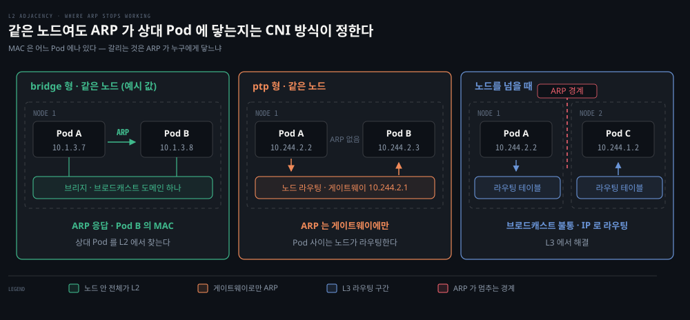

CNI 플러그인 중 bridge 는 컨테이너를 호스트의 브리지에 꽂아 veth 쌍의 한쪽 끝에 IP 를 줍니다. 이 방식에서는 같은 노드의 Pod 둘이 한 브리지에 매달려 하나의 브로드캐스트 도메인을 이룹니다. Pod A 가 "10.1.3.8 쓰는 사람 누구세요"라고 ARP 를 뿌리면 그 안의 Pod B 가 자기 MAC 으로 답합니다. 이 그림의 bridge 쪽 주소는 예시 값입니다. 같은 호스트의 컨테이너 연결은 [03-03](./03-03.%EC%BB%A8%ED%85%8C%EC%9D%B4%EB%84%88%20%EC%97%B0%EA%B2%B0%EA%B3%BC%20%ED%8F%AC%ED%8A%B8%20%EB%A7%A4%ED%95%91%20%E2%80%94%20%EA%B0%99%EC%9D%80%20%ED%98%B8%EC%8A%A4%ED%8A%B8%2C%20%EB%8B%A4%EB%A5%B8%20%ED%98%B8%EC%8A%A4%ED%8A%B8.md)이 다룹니다.

ptp 플러그인은 다릅니다. 컨테이너와 호스트 사이에 점대점 veth 링크를 만들고, 호스트 쪽을 거쳐 라우팅합니다.[^bridge-ptp] 그래서 같은 노드의 Pod 끼리도 브로드캐스트 도메인을 공유하지 않습니다.

kind 의 기본 CNI 인 kindnet 이 ptp 방식이라는 것을 쟀습니다.[^kindnet] 같은 노드의 Pod 둘(`10.244.2.2`, `10.244.2.3`) 사이 ping 은 2.488 ms 로 통했습니다. 그런데 Pod 의 neighbor 테이블에는 게이트웨이 `10.244.2.1` 의 MAC 한 줄만 있었습니다. Pod 가 이웃 Pod 가 아니라 게이트웨이를 ARP 로 물었다는 뜻입니다. 따라서 같은 노드면 한 브리지에서 ARP 로 찾는다는 설명은 bridge 형 CNI 에만 맞습니다.

다른 노드의 Pod 는 어느 방식에서도 같은 L2 에 없습니다. ARP 는 브로드캐스트라 노드 경계를 넘지 못하므로 아무도 답하지 않습니다. 패킷은 Pod 의 기본 경로를 따라 노드로 올라가고, 노드가 라우팅 테이블을 보고 상대 노드로 보냅니다. 목적지를 IP 로 찾는 이 방식이 L3 라우팅입니다.

### Pod 의 라우팅 테이블

Pod 의 라우팅 테이블은 모든 길을 노드 쪽 게이트웨이 하나로 보냅니다. 목적지별 판단은 노드가 합니다.

기본 구성의 Pod 에는 인터페이스가 `eth0` 하나이고, CNI 는 그 안에 목적지별 갈래를 적어 두지 않습니다. kindnet 의 Pod 에서 `ip route` 를 보면 세 줄이고 다음 홉이 전부 게이트웨이 `10.244.2.1` 입니다.[^kindnet]

```bash
default via 10.244.2.1 dev eth0
10.244.2.0/24 via 10.244.2.1 dev eth0  src 10.244.2.2
10.244.2.1 dev eth0 scope link  src 10.244.2.2
```

같은 노드(워커)의 테이블에는 갈래가 들어 있습니다.

```bash
default via 192.168.148.1 dev eth0
10.244.0.0/24 via 192.168.148.5 dev eth0
10.244.1.0/24 via 192.168.148.6 dev eth0
10.244.2.2 dev veth61175e6c scope host
192.168.148.0/24 dev eth0 proto kernel scope link src 192.168.148.4
```

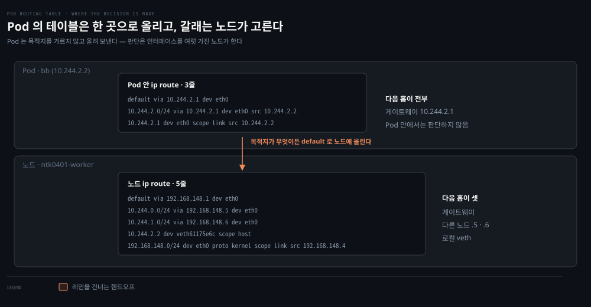

다른 두 노드의 Pod 대역은 각 노드의 `eth0` 주소로 향하고, 이 노드의 Pod 는 자기 veth 로 향합니다. 클러스터 밖으로 나가는 기본 경로도 이 테이블에 있습니다. 갈래는 Pod 가 아니라 노드에 있는 것입니다.

그래서 경로를 손보는 자리도 Pod 안이 아니라 노드 쪽입니다. [04-04](./04-04.Kubernetes%20%EB%84%A4%ED%8A%B8%EC%9B%8C%ED%81%AC%20%EC%8B%A4%EC%8A%B5%20%E2%80%94%20CNI%20%EB%B6%80%EC%9E%AC%EB%B6%80%ED%84%B0%20%EC%A0%95%EC%B1%85%C2%B7DNS%EA%B9%8C%EC%A7%80.md) 묶음 8 에서 VM 의 라우팅 테이블에 줄 하나를 넣어 Pod 대역을 연 것이 같은 이유입니다. 인터페이스가 하나라서 갈래가 불가능한 것은 아닙니다. 목적지마다 다음 홉이 다른 줄을 넣지 않는 쪽을 CNI 가 고른 것입니다. `hostNetwork` 로 띄우거나 Multus 로 인터페이스를 더 붙이면 이 그림은 달라집니다.

Pod 쪽 테이블을 직접 보려면 컨테이너 안에서 `kubectl exec deploy/web -- ip route` 한 줄이면 됩니다.

### 두 방향을 정하는 장치

방향 표의 두 열은 스위치 하나로 함께 움직이지 않고, 서로 다른 장치가 따로 정합니다.

- 밖에서 Pod 로 들어오는 쪽은 클러스터 바깥의 라우팅이 정합니다. 주변 장비의 테이블에 Pod 대역으로 가는 줄이 있으면 열리고 없으면 닫힙니다. 클러스터가 그 줄을 대신 넣을 수는 없습니다. 넣어 달라고 말할 수는 있습니다. Calico·Cilium 처럼 BGP(Border Gateway Protocol, 경로 광고 프로토콜)로 Pod 대역을 광고하는 구성이 그것입니다. 그때도 받아들일지는 이웃 장비가 정합니다.
- Pod 가 밖으로 나가는 쪽은 CNI 의 masquerade 설정이 정합니다. 나가는 패킷의 출발지를 노드 IP 로 바꾸느냐 그대로 두느냐이고, 이쪽은 노드 안에서 끝나는 결정입니다.

kind 에서는 후자를 노드의 iptables 에서 볼 수 있습니다. 워커의 `KIND-MASQ-AGENT` 체인이 목적지가 `10.244.0.0/16`(Pod 대역)이면 `RETURN` 으로 손대지 않고, 그 밖이면 `MASQUERADE` 합니다.[^kindnet] 클러스터 안으로 가는 길은 NAT 없이 두고 밖으로 가는 길만 위장하는 규칙입니다.

한쪽만 손대면 표에 없는 상태가 나옵니다. [04-04](./04-04.Kubernetes%20%EB%84%A4%ED%8A%B8%EC%9B%8C%ED%81%AC%20%EC%8B%A4%EC%8A%B5%20%E2%80%94%20CNI%20%EB%B6%80%EC%9E%AC%EB%B6%80%ED%84%B0%20%EC%A0%95%EC%B1%85%C2%B7DNS%EA%B9%8C%EC%A7%80.md) 묶음 8 이 실제로 그것을 만들었습니다. VM 의 라우팅 테이블에 경로 한 줄을 넣고 masquerade 는 그대로 두었더니 들어오는 쪽은 Flat 이 되고 나가는 쪽은 Island 로 남았습니다.

이 조합은 사고가 아니라 일부러 고르기도 하는 구성입니다. 밖의 로드밸런서는 프록시 한 겹 없이 Pod 를 직접 고를 수 있습니다. 그러면서 외부 방화벽은 나가는 트래픽을 노드 IP 로만 보면 되니 규칙이 노드 수만큼으로 줄어듭니다.

### SNAT 답장의 목적지 복원

SNAT(Source NAT, 출발지 주소 변환)으로 바뀐 연결의 답장은, conntrack 항목이 바꾸기 전의 쌍을 기억하고 있다가 목적지를 되돌려 Pod 로 보냅니다.

Island 에서 Pod 가 밖으로 나가면 출발지가 노드 IP 로 바뀝니다. 답장은 노드로 돌아오는데 그 노드에는 Pod 가 여럿이므로, 어느 Pod 의 답장인지를 알아내는 장치가 필요합니다. 포트가 그것을 기억합니다. 커널은 주소를 바꾸면서 바꾸기 전과 후의 쌍을 conntrack 항목 하나에 함께 적어 둡니다.

| | 출발지 주소와 포트 |
|---|---|
| Pod 가 보낸 것 | `10.244.2.2:45678` |
| 노드가 바꿔 내보낸 것 | `192.168.148.4:61234` |

주소는 앞의 kind 클러스터에서 쓴 Pod 와 워커 노드의 값이고, 포트 번호는 예시 값입니다.

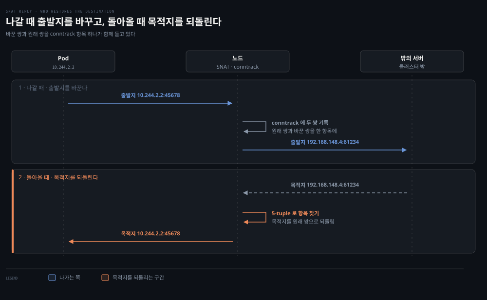

답장은 목적지가 `192.168.148.4:61234` 인 채로 돌아옵니다. 커널은 그 패킷의 5-tuple 로 conntrack 항목을 찾아 목적지를 `10.244.2.2:45678` 로 되돌린 뒤 Pod 에 넘깁니다. 나갈 때 출발지를 바꿨으니 돌아올 때 되돌리는 것은 목적지 쪽입니다. 노드 IP 하나 뒤에 Pod 가 수십 개 있어도 답장이 안 섞이는 것은, 노드가 연결마다 다른 포트를 골라 두어 5-tuple 이 서로 달라지기 때문입니다.

대가는 그 포트가 유한하다는 것입니다. 다만 나가는 연결을 다 합쳐 세는 것은 아닙니다. 목적지가 다르면 같은 포트를 다시 써도 항목이 갈리므로, 바닥나는 것은 같은 목적지로 한꺼번에 많이 붙을 때입니다. 노드 하나가 바깥의 같은 주소를 수만 번 부르는 구성이 이 상한에 먼저 걸립니다. 되돌리는 표 자체가 차는 문제는 [02-02](./02-02.%EC%BB%A4%EB%84%90%EC%9D%B4%20%ED%8C%A8%ED%82%B7%EC%9D%84%20%ED%8C%90%EC%A0%95%ED%95%98%EB%8A%94%20%EC%B8%B5%20%E2%80%94%20Netfilter%C2%B7Conntrack%C2%B7%EB%9D%BC%EC%9A%B0%ED%8C%85.md) §2 가, 포트가 연결을 가르는 다섯 값의 이야기는 [07-02](../../../02_os/book/learning-modern-linux/07-02.%ED%8F%AC%ED%8A%B8%EA%B0%80%20%EC%9E%88%EC%96%B4%EC%95%BC%20%EC%84%9C%EB%B9%84%EC%8A%A4%EB%A5%BC%20%EA%B0%80%EB%A6%AC%ED%82%AC%20%EC%88%98%20%EC%9E%88%EA%B3%A0%20%EC%9D%B4%EB%A6%84%EC%9D%B4%20%EC%9E%88%EC%96%B4%EC%95%BC%20%EC%82%AC%EB%9E%8C%EC%9D%B4%20%EA%B8%B0%EC%96%B5%ED%95%9C%EB%8B%A4.md) 가 다룹니다.

### 레이아웃의 기본값

Kubernetes 자체에는 기본 레이아웃이 없고, CNI 플러그인과 그 설정이 정합니다.

Kubernetes 는 앞의 3가지 약속만 강제합니다. 널리 쓰는 CNI 의 기본값을 버전을 고정해 확인하면 대체로 클러스터 밖으로 나가는 트래픽에 masquerade 를 켜 둡니다.

- Calico 의 IPPool 은 `natOutgoing` 이 기본으로 켜져 있습니다.[^calico]
- Cilium 은 ENI 모드가 아니면 `enableIPv4Masquerade` 가 기본 true 입니다. `ipv4NativeRoutingCIDR` 를 정하면 그 범위로 가는 트래픽은 SNAT 하지 않습니다.[^cilium]
- kindnet 은 ptp 에 `ipMasq: false` 를 두고, 노드 단위의 masquerade 로 Pod 대역 밖으로 가는 트래픽만 위장합니다.[^kindnet]

그래서 실무에서 마주치는 기본값은 대체로 Island 입니다. 사내망 주소를 많이 떼어 오지 않아도 클러스터가 서니 기본값으로 안전한 선택입니다.

AWS 의 VPC CNI 는 Pod 에 VPC 주소를 직접 주므로 VPC 안에서는 Flat 입니다. 다만 VPC 밖으로 나갈 때는 `AWS_VPC_K8S_CNI_EXTERNALSNAT` 가 기본 `false` 라서 SNAT 이 남습니다.[^awscni] Flat 이 기본이라고 한 줄로 말하면 이 절반이 빠집니다. VPC 가 이미 API 로 경로를 넣을 수 있고 사설 대역도 넉넉해서, Flat 의 비싼 조건 둘이 처음부터 갖춰져 있다는 점이 안쪽 Flat 의 이유입니다.

위에서 확인한 기본값 어디에도 Isolated 는 없습니다. Isolated 는 의도해서 짜는 구성입니다.

### control plane 과 data plane

control plane 은 패킷의 행선지를 정하는 기능이고 data plane 은 그 결정에 따라 실제로 전달하는 기능이며, 둘 다 장비가 아니라 역할의 이름입니다.

한 장비 안에 함께 둘 수도 있고 아예 다른 장비로 갈라 놓을 수도 있습니다. 라우터 하나를 열어 보면 그 안에서 BGP 데몬이 이웃과 경로를 주고받습니다. 이것이 control plane 입니다. 그렇게 배운 경로를 커널의 라우팅 테이블에 써 넣으면 커널은 그 테이블만 보고 패킷을 내보냅니다. 이쪽이 data plane 입니다. 한 기계 안에서 하나는 정하고 하나는 나릅니다.

반대로 SDN(Software-Defined Networking, 소프트웨어 정의 네트워크)은 이 둘을 일부러 떼어 놓습니다. 정하는 쪽을 컨트롤러로 모으고 장비에는 나르는 일만 남깁니다. 떼어 놓을 수 있다는 것 자체가 그것이 장비가 아니라 역할이라는 증거입니다.

Kubernetes 의 "control plane 노드"라는 말도 그래서 노드의 종류가 아니라 역할의 이름입니다. API 서버·스케줄러·컨트롤러가 그 노드에서 도니 그렇게 부르는 것이고, 그 노드도 패킷을 나를 때는 data plane 으로 일합니다. [04-04](./04-04.Kubernetes%20%EB%84%A4%ED%8A%B8%EC%9B%8C%ED%81%AC%20%EC%8B%A4%EC%8A%B5%20%E2%80%94%20CNI%20%EB%B6%80%EC%9E%AC%EB%B6%80%ED%84%B0%20%EC%A0%95%EC%B1%85%C2%B7DNS%EA%B9%8C%EC%A7%80.md) 묶음 1 에서 control-plane 노드가 CoreDNS 를 받아 준 것이 그 예입니다.

### 주소 대역을 정하는 플래그

Pod 대역과 Service 대역은 서로 다른 컴포넌트가 정합니다.

레이아웃을 골랐으면 실제 주소 대역을 어딘가에 적어야 합니다. 이 값을 잘못 잡으면 뒤늦게 아픕니다. 노드를 늘리다 주소가 모자라거나, Pod 대역과 Service 대역이 겹쳐 설명되지 않는 라우팅이 생깁니다.

`kube-controller-manager` 는 Kubernetes 컨트롤러 대부분을 한 바이너리·한 프로세스로 돌립니다. 컨트롤러란 리소스를 감시하며 특정 상태를 동기화·강제하는 소프트웨어입니다. 노드마다 Pod 대역 조각을 떼어 주는 일이 여기서 일어나고, 관리자가 클러스터 CIDR(Classless Inter-Domain Routing, 주소 대역 표기)을 정하는 곳도 여기입니다.[^kcm]

- `--allocate-node-cidrs`: 노드마다 Pod CIDR 조각을 할당할지 정합니다. `--cluster-cidr` 은 이 값이 `true` 일 때만 쓰입니다
- `--cluster-cidr`: Pod IP 를 할당할 대역입니다
- `--node-cidr-mask-size`: 노드별 CIDR 마스크이고 기본값은 IPv4 `/24`, IPv6 `/64` 입니다. IPv4 와 IPv6 를 따로 정하는 `-ipv4`·`-ipv6` 변형도 있습니다. 노드마다 2^(32-마스크)개 주소가 배정되므로 `/24` 마스크의 노드는 2^8=256개를 받습니다

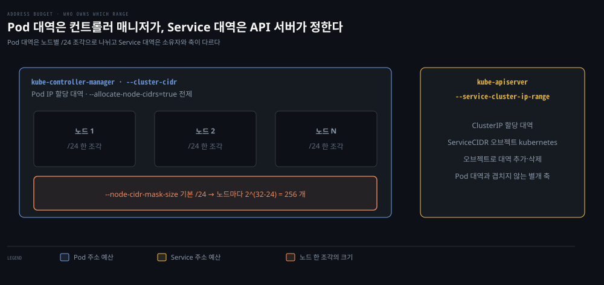

왼쪽 큰 상자 안이 Pod 주소 예산이고, 오른쪽은 그와 겹치지 않는 별개 축입니다. Service ClusterIP 를 할당하는 대역은 kube-apiserver 의 `--service-cluster-ip-range` 가 정합니다.[^svc-range] kube-controller-manager 에도 같은 이름의 플래그가 있지만 그쪽은 노드 CIDR 을 할당할 때 Service 대역과 겹치는 범위를 거르는 데 씁니다.

### 값이 적히는 자리

대역 값은 kubeadm 설정 파일에서 시작해 정적 Pod 매니페스트의 플래그로 내려가고, 노드 오브젝트의 `spec.podCIDR` 로 확인합니다.

`kubeadm` 으로 세운다면 설정 파일에 적습니다. 여기서는 플래그 이름이 아니라 `podSubnet` 과 `serviceSubnet` 이라는 이름으로 받습니다. 설정 파일의 apiVersion 은 `kubeadm.k8s.io/v1beta4` 입니다.[^kubeadm]

```yaml
apiVersion: kubeadm.k8s.io/v1beta4
kind: ClusterConfiguration
networking:
  podSubnet: 10.1.0.0/16        # --cluster-cidr 로 내려간다
  serviceSubnet: 10.96.0.0/12   # --service-cluster-ip-range 로 내려간다
controllerManager:
  extraArgs:
    - name: node-cidr-mask-size
      value: "24"
```

`serviceSubnet` 을 비우면 기본값 `10.96.0.0/12` 가 들어갑니다. 한 가지 조건이 있습니다. kubeadm 은 `podSubnet` 을 정했을 때만 kube-controller-manager 에 `--allocate-node-cidrs`·`--cluster-cidr`·`--service-cluster-ip-range` 를 넣습니다. kube-apiserver 의 `--service-cluster-ip-range` 는 늘 들어갑니다.

kubeadm 은 이 값을 읽어 컨트롤 플레인 노드의 정적 Pod 매니페스트로 내려보냅니다. 그 파일이 `/etc/kubernetes/manifests/kube-controller-manager.yaml` 이고 안에는 플래그가 그대로 들어 있습니다.

```yaml
spec:
  containers:
    - command:
        - kube-controller-manager
        - --allocate-node-cidrs=true
        - --cluster-cidr=10.1.0.0/16
        - --node-cidr-mask-size=24
        - --service-cluster-ip-range=10.96.0.0/12
```

돌고 있는 클러스터에서 확인하려면 두 명령이면 됩니다. 앞은 클러스터 전체의 주소 예산이고 뒤는 그 노드가 받아 간 조각입니다.

```bash
kubectl -n kube-system get pod -l component=kube-controller-manager \
  -o jsonpath='{.items[0].spec.containers[0].command}' | tr ',' '\n' | grep cidr

kubectl get node <노드이름> -o jsonpath='{.spec.podCIDR}'
```

kind v0.33.0 이 만든 Kubernetes v1.37.0 클러스터(2026-11-08)에서 앞의 명령은 `--allocate-node-cidrs=true` 와 `--cluster-cidr=10.244.0.0/16` 을 보여 줬습니다. 노드 셋은 `10.244.0.0/24`, `10.244.1.0/24`, `10.244.2.0/24` 를 하나씩 받았고, `--node-cidr-mask-size` 를 따로 주지 않았는데도 `/24` 였습니다. 기본값이 24 이기 때문입니다.[^kindnet]

두 번째 명령이 보여 주는 `spec.podCIDR` 는 컨트롤러가 `--cluster-cidr` 로 준 `/16` 에서 `/24` 를 하나 떼어 적어 둔 값입니다. CNI 의 IPAM(IP Address Management, 주소 관리)이 Pod 에 주소를 줄 때 이 노드별 값에서 꺼내 씁니다. kindnet 의 설정도 `host-local` IPAM 의 범위로 이 노드 대역을 씁니다.

Service 대역은 클러스터를 세운 뒤에도 늘릴 수 있습니다. 부트스트랩 때 kube-apiserver 의 플래그 값으로 `kubernetes` 라는 ServiceCIDR 오브젝트가 만들어집니다. 사용자는 `networking.k8s.io/v1` 의 ServiceCIDR 오브젝트를 더 만들거나 지워 Service 가 쓸 대역을 관리합니다. 이 기능(`MultiCIDRServiceAllocator`)은 1.33 에서 stable 이 되었습니다.[^servicecidr]

### 겹치면 안 되는 대역

Pod IP 는 인터페이스에 붙은 진짜 주소이고 ClusterIP 는 규칙이 가로채는 가짜 주소이므로, 두 대역이 겹치면 주소 하나가 두 뜻을 갖게 됩니다.

Pod IP 는 Pod 안 `eth0` 에 실제로 붙어 있고 그 주소로 패킷이 배달됩니다. ClusterIP 는 어느 인터페이스에도 붙어 있지 않습니다. 노드의 규칙이 그 주소로 가는 패킷을 가로채 목적지를 진짜 Pod IP 로 바꿔치웁니다. ClusterIP 에 `ping` 이 통하지 않는 이유가 여기 있습니다. 응답할 주인이 없습니다.

`10.1.5.7` 이 그대로 배달할 진짜 주소이면서 동시에 가로채 바꿔칠 가짜 주소가 되면 어느 쪽으로 처리할지 정할 수 없습니다. 그래서 서로 다른 대역을 줍니다.

클러스터에는 서로 겹치면 안 되는 대역이 최소 셋 있습니다. 보통 RFC 1918 의 사설 대역에서 잡습니다.[^rfc]

- 노드 서브넷: 노드의 NIC(Network Interface Card)가 받는 주소이며 VPC(Virtual Private Cloud) 서브넷에서 나옵니다
- Pod CIDR: Pod 에 배정되는 대역입니다. CNI 가 노드마다 조각을 떼어 씁니다
- Service CIDR: ClusterIP 에 배정되는 가상 대역이며 실제 인터페이스에 붙지 않습니다

셋은 서로 겹치면 안 되고 클러스터 밖에서 통신할 상대의 대역과도 겹치면 안 됩니다. Service CIDR 는 실재하지 않는 주소라 겹쳐도 당장은 조용합니다. 그 대역과 같은 주소를 쓰는 외부 시스템을 호출할 때 그쪽으로 가지 않고 kube-proxy 규칙에 먹히는 형태로 드러납니다.

노드마다 `/24` 를 떼어 주는 구성이라면 Pod CIDR 가 `/16` 일 때 노드는 256대가 상한입니다. Pod 수가 아니라 노드 수가 먼저 막히는 구조라, 스케일 계획을 세울 때 노드당 할당 prefix 와 전체 Pod CIDR 를 함께 봐야 합니다. 노드마다 조각이 이미 배정되므로 Pod CIDR 는 처음에 넉넉하게 잡는 쪽이 안전합니다.

클러스터 안에서 이 대역들이 실제로 어떻게 배선되는지는 [01-03. IP·라우팅·Ethernet](./01-03.IP%C2%B7%EB%9D%BC%EC%9A%B0%ED%8C%85%C2%B7Ethernet%20%E2%80%94%20%ED%8C%A8%ED%82%B7%EC%9D%B4%20%EA%B8%B8%EC%9D%84%20%EC%B0%BE%EB%8A%94%20%EB%B2%95.md)와 [04-02. CNI와 kube-proxy](./04-02.CNI%EC%99%80%20kube-proxy%20%E2%80%94%20Pod%20%EB%84%A4%ED%8A%B8%EC%9B%8C%ED%81%AC%EC%9D%98%20%EB%B0%B0%EC%84%A0%EA%B3%B5%EA%B3%BC%20%EB%A1%9C%EB%93%9C%EB%B0%B8%EB%9F%B0%EC%84%9C.md)가 다룹니다.

### 주소 상한과 Pod 수 상한

`/24` 를 받은 노드에 주소가 256개 있어도 Pod 를 256개 띄울 수 있는 것은 아니고, kubelet 의 `maxPods` 기본값 110 이 먼저 걸립니다.

kubelet 설정의 `maxPods` 는 그 kubelet 에서 돌 수 있는 Pod 의 최대 수이고 기본값이 110 입니다.[^maxpods] kind 노드의 kubelet 에서도 110 이었습니다.[^kindnet] 이 값은 주소가 모자라서 정해진 것이 아닙니다. 공식 문서의 대규모 클러스터 고려사항은 다음 네 수치를 모두 만족하는 구성을 기준으로 설계했다고 적습니다.

- 노드당 Pod 110개 이하
- 노드 5,000대 이하
- 전체 Pod 150,000개 이하
- 전체 컨테이너 300,000개 이하

값은 kubelet 설정 `maxPods` 로 바꿀 수 있습니다. 다만 110 보다 올리면 위 네 수치가 함께 정한 설계 기준을 벗어납니다.

### Pod 생성의 주체

스케줄러는 노드 이름만 적고, 컨테이너와 그 네트워크를 만드는 일은 그 노드의 kubelet 이 컨테이너 런타임을 거쳐 합니다.

`kubectl apply` 를 치면 Pod 가 뜹니다. 안 뜰 때가 문제입니다. 스케줄러의 노드 선택, kubelet 수신, 런타임의 컨테이너 생성, CNI 연결 중 어디서 막혔는지에 따라 봐야 할 로그가 전부 다릅니다. Pod 하나가 만들어지는 동안 일하는 주체가 순서대로 바뀌므로, 구간을 나눠 두면 그 판별이 쉬워집니다.

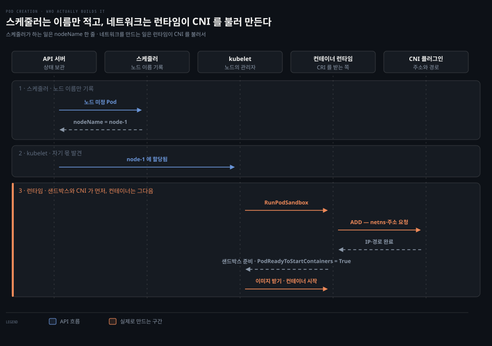

kubelet 은 모든 노드에서 도는 에이전트로, 노드에 스케줄된 Pod 를 관리하고 상태를 보고합니다. 본질은 조율자입니다. 스케줄러는 CPU·메모리 요청, affinity, taint 같은 제약에 맞춰 `nodeName` 만 적습니다. 존재해야 하는데 없는 Pod 는 그 노드의 kubelet 이 만듭니다.

네트워크는 kubelet 이 직접 만들지 않습니다. kubelet 이 CRI(Container Runtime Interface, 컨테이너 런타임 인터페이스)의 `RunPodSandbox` 를 부릅니다. 그러면 컨테이너 런타임이 샌드박스를 만들면서 CNI 플러그인을 불러 Pod 네트워크를 구성합니다.[^sandbox]

containerd 의 소스에서 이 호출은 `setupPodNetwork` 입니다. 실패하면 `failed to setup network for sandbox` 로 시작하는 오류가 납니다. 샌드박스와 네트워크 구성이 끝나면 Pod 의 `PodReadyToStartContainers` 조건이 True 가 됩니다. 컨테이너는 그 뒤에 시작합니다.

### Pod 가 안 뜰 때 보는 자리

`kubectl get pod -o wide` 의 NODE 칸이 비어 있으면 스케줄러 쪽이고, 노드가 정해졌는데 멈췄으면 그 노드의 kubelet 쪽입니다.

STATUS 칸에 걸리는 두 문구가 서로 다른 주체의 자리이기 때문입니다.

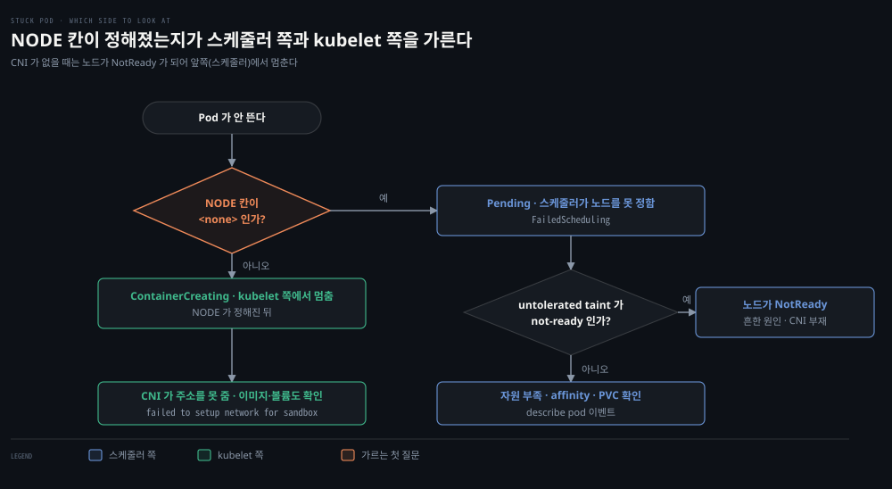

| STATUS | 일하다 멈춘 주체 | 대표 원인 |
|--------|---------------|----------|
| `Pending` | 스케줄러 | 자원 부족, taint, affinity 불만족, PVC 미바인딩, CNI 부재로 노드가 `NotReady` |
| `ContainerCreating` | 그 노드의 kubelet | 이미지 수신 지연(실패하면 `ImagePullBackOff` 로 바뀜), 볼륨 마운트 실패, CNI 는 있는데 IP 를 못 줌 |

둘 다 Pod phase 로는 `Pending` 입니다. `ContainerCreating` 은 phase 가 아니라 컨테이너가 대기 중인 이유입니다. STATUS 칸이 phase 대신 그것을 보여 줍니다. phase 와 condition 과 컨테이너 상태의 층위 구분은 [『Kubernetes in Action』 06-01](../kubernetes-in-action/06-01.Pod%20%EC%83%81%ED%83%9C%20%E2%80%94%20phase%C2%B7conditions%C2%B7%EC%BB%A8%ED%85%8C%EC%9D%B4%EB%84%88%20%EC%83%81%ED%83%9C.md)이 정본입니다.

네트워킹 관점으로 좁히면 CNI 는 두 줄 모두에 나타나고, 어느 줄이냐가 증상을 가릅니다.

CNI 가 아예 없으면 Pod 는 `Pending` 에서 멈춥니다. kind v0.33.0 으로 CNI 없이 Kubernetes v1.37.0 클러스터를 세워 쟀습니다(2026-11-08).[^kindnet]

- 워커 노드는 `Ready=False`(reason `KubeletNotReady`)였고 메시지에 `NetworkPluginNotReady` 와 `cni plugin not initialized` 가 적혀 있었습니다
- 노드에는 `node.kubernetes.io/not-ready:NoSchedule` taint 가 붙었습니다
- 그 위에 띄운 Pod 는 NODE 가 `<none>` 인 채 `Pending` 이었습니다
- 이벤트는 `FailedScheduling` 이고 내용은 `0/2 nodes are available: 2 node(s) had untolerated taint(s)` 였습니다

스케줄러는 그 taint 를 견디지 않는 Pod 를 노드에 보내지 않으므로 Pod 는 노드를 배정받지 못한 채 남습니다.

CNI 는 있는데 주소를 못 주면 `ContainerCreating` 에서 멈춥니다. 노드가 `Ready` 라 배치는 이미 끝났고, 샌드박스를 만드는 단계에서 걸린 것입니다. 이때 Pod 이벤트에 `failed to setup network for sandbox` 계열 문구가 남습니다.

둘을 가르는 가장 빠른 질문은 "노드가 `Ready` 인가"입니다. `NotReady` 면 앞쪽이고 `Ready` 면 뒤쪽입니다. 클러스터를 갓 세우고 CNI 를 아직 깔지 않은 상태가 앞쪽입니다.

`NotReady` 의 원인이 CNI 부재만은 아닙니다. 노드가 건강하지 않아 Pod 를 받지 않으면 `Ready` 조건은 `False` 입니다. 노드 컨트롤러가 `node-monitor-grace-period` 동안 노드 소식을 듣지 못하면 `Unknown` 입니다.[^node-ready] CNI 를 깔았는데도 `NotReady` 면 노드 조건 쪽을 함께 봅니다.

### 세 프로브와 실패 시 동작

세 프로브는 실패했을 때 무엇을 하느냐로 갈립니다. readiness 는 트래픽만 끊고 liveness 와 startup 은 컨테이너를 죽입니다.

배포 직후 502 가 잠깐 나는 일이 있습니다. 컨테이너는 떴는데 앱이 아직 요청을 받을 상태가 아닌 동안 트래픽이 들어간 것입니다. 그래서 프로브를 걸었더니 이번에는 반대 사고가 납니다. 멀쩡한 컨테이너가 계속 재시작합니다. 두 사고의 원인이 같습니다. 프로브가 실패했을 때 무엇을 하는지가 종류마다 다른데 그것을 모르고 걸었기 때문입니다.

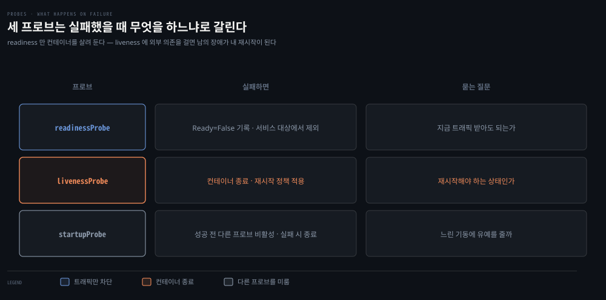

가운데 열만 세로로 훑으면 셋의 차이가 한 번에 잡힙니다. 색이 붙은 줄이 컨테이너를 죽이고, 하나만 트래픽을 끊습니다.

여기서 두 가지를 갈라야 합니다. 하나는 진단 방식인 **핸들러**입니다. `exec`·`tcpSocket`·`httpGet`·`grpc` 넷이고, 결과는 Success·Failure·Unknown 입니다. `grpc` 핸들러는 1.23 에서 alpha 로 들어와 1.27 에서 stable 이 되었습니다.[^probe-ver] 1.37 에는 alpha 단계 gate 두 개가 더 있습니다. `GRPCContainerProbeTLS` 는 `grpc` 에 `mode: TLS` 를, `H2CContainerProbe` 는 `httpGet` 에 `protocol: HTTP2` 를 추가합니다.[^gates]

다른 하나는 **프로브 종류**로, 아래 표의 셋(readiness·liveness·startup)입니다. 컨테이너가 특정 프로브를 정의하지 않으면 kubelet 은 그 결과를 늘 Success 로 봅니다.[^liveness] 그래서 readinessProbe 를 안 걸면 컨테이너는 기동 직후부터(startupProbe 가 있으면 그것이 통과한 직후부터) ready 로 취급됩니다.[^prober]

| 프로브 | 실패하면 | 용도 |
|--------|--------|------|
| readinessProbe | 컨테이너는 그대로 두고 Pod 에 Ready=False 를 기록합니다. 서비스가 그 Pod 로 트래픽을 보내지 않습니다 | 지금 트래픽을 받아도 되는가 |
| livenessProbe | kubelet 이 컨테이너를 죽이고 재시작 정책을 적용합니다 | 재시작해야 하는 상태인가 |
| startupProbe | 성공하기 전에는 liveness 와 readiness 를 돌리지 않습니다. 실패하면 컨테이너를 죽입니다 | 느린 기동에 유예를 주기 |

롤링 업데이트를 이끄는 것은 ReplicaSet 이 아니라 Deployment 입니다. Deployment 는 새 Pod 가 ready 가 된 뒤에 옛 ReplicaSet 을 더 줄이므로, readiness 가 통과하지 못하면 업데이트가 앞으로 나가지 않습니다.[^deploy] 사이드카 컨테이너(1.33 에서 stable)는 init 컨테이너와 달리 프로브를 걸어 자기 생명주기를 제어할 수 있습니다.[^sidecar]

### 프로브 상태 전이와 타이밍

startup 이 통과해야 liveness 와 readiness 가 시작되고, 실패 횟수가 `failureThreshold` 에 닿으면 종류별 동작이 일어납니다.

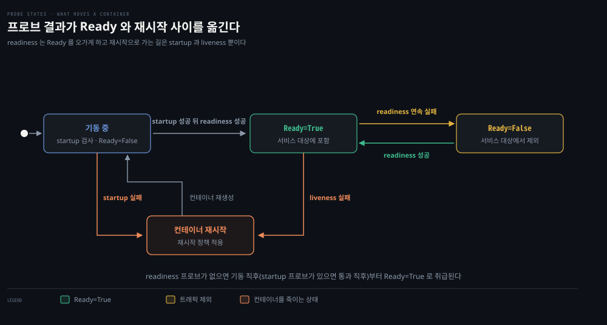

startup 이 통과한 뒤 readiness 가 성공하면 Ready=True 가 됩니다. readinessProbe 가 없으면 startup 통과가 곧 Ready=True 입니다. readiness 실패는 Ready=False 로 트래픽에서만 뺍니다. startup 이나 liveness 가 실패 횟수를 채우면 컨테이너를 재시작합니다. 프로브의 타이밍 옵션은 다섯이고 기본값은 다음과 같습니다.[^probe-ver]

- `initialDelaySeconds`: 첫 검사까지 대기합니다. 기본 0
- `periodSeconds`: 검사 주기입니다. 기본 10
- `timeoutSeconds`: 검사 타임아웃입니다. 기본 1
- `successThreshold`: 성공 판정 연속 횟수입니다. 기본 1이고 liveness·startup 은 1 이어야 합니다
- `failureThreshold`: 실패 판정 연속 횟수입니다. 기본 3

컨테이너 기동이 `initialDelaySeconds + failureThreshold × periodSeconds` 보다 오래 걸린다면 startup 프로브를 둡니다. 문서는 startup 프로브가 liveness 와 같은 엔드포인트를 검사하되 `failureThreshold` 를 기동이 끝나기에 충분하도록 높게 잡으라고 안내합니다.[^liveness] 이렇게 하면 liveness 의 기본값은 건드리지 않고 기동 유예만 늘릴 수 있습니다.

프로브 단위의 `terminationGracePeriodSeconds` 도 있습니다. 실패한 컨테이너를 죽이기 전에 기다리는 시간을 Pod 수준 값과 따로 정하는 옵션이며 1.28 에서 stable 이 되었고 readiness 에는 설정할 수 없습니다.[^probe-ver]

### readiness 실패가 규칙까지 가는 길

readiness 실패는 그 Pod 의 네트워크를 건드리지 않고, 모든 노드(그 Pod 의 노드 포함)의 서비스 규칙에서 그 Pod 줄을 빼는 일로 이어집니다.

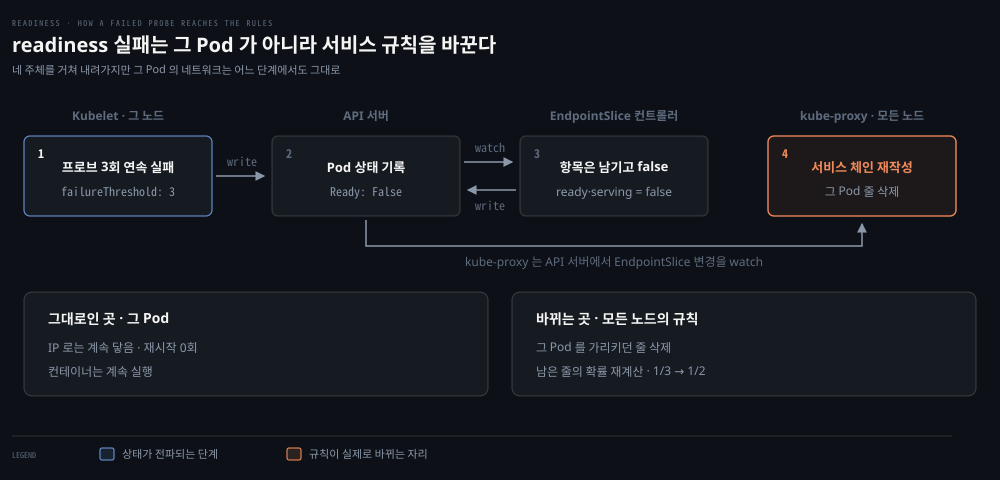

"서비스 대상에서 제외"만 읽으면 그 Pod 의 네트워크가 끊기는 것처럼 보입니다. 실제로는 그 Pod 를 아무도 건드리지 않습니다. 바뀌는 것은 모든 노드의 서비스 규칙이고, 그 Pod 가 사는 노드의 규칙도 여기에 듭니다.

그 사이에 주체가 넷 있고, 순서는 다음과 같습니다.

1. kubelet 이 프로브 실패를 세어 Pod 상태 `Ready: False` 를 API 서버에 씁니다.
2. API 서버가 그 상태를 저장하고, 지켜보는 쪽에 변경을 알립니다.
3. EndpointSlice 컨트롤러가 그 변화를 보고 해당 항목의 `ready`·`serving` 을 false 로 바꿉니다.
4. 각 노드의 kube-proxy 가 그 변경을 받아 서비스 체인에서 그 Pod 줄을 지우고 남은 줄의 확률을 다시 계산합니다.

이 길을 kind v0.33.0(Kubernetes v1.37.0)에서 쟀습니다(2026-11-08). Deployment `web` 의 Pod 3개를 Service 로 묶었고, Service 의 ClusterIP 는 `10.96.240.184` 이며 포트는 80 에서 8080 으로 넘겼습니다.

실패시키기 전의 EndpointSlice 는 세 항목(`10.244.2.4`, `10.244.1.3`, `10.244.1.2`)이 모두 `ready`·`serving` 이 true, `terminating` 이 false 였습니다. kube-proxy 체인의 확률은 `0.33333333349`, `0.50000000000`, 무조건 순이었습니다.

Pod 하나(`10.244.2.4`)의 readiness 를 실패시킨 뒤에 그 Pod 는 `Ready=False` 였고 재시작은 0회였습니다. EndpointSlice 항목은 사라지지 않고 `ready=false`, `serving=false`, `terminating=false` 로 남았습니다.[^slice]

`kubectl get endpoints` 는 `v1 Endpoints is deprecated in v1.33+` 경고와 함께 준비된 두 주소(`10.244.1.2:8080`, `10.244.1.3:8080`)만 보여 줬습니다. 체인은 `0.50000000000` 과 무조건 두 줄로 줄어, 한 Pod 가 받는 몫이 3분의 1에서 2분의 1이 되었습니다. 실패한 Pod 에는 IP 로 보낸 ping 이 3.077 ms 로 여전히 통했습니다.

readiness 는 끊는 장치가 아니라 명단에서 빼는 장치라, 들어오는 서비스 트래픽만 막고 Pod 자체로 가는 길은 남깁니다. 프로브 설정값과 엔드포인트 편입 규칙은 [『Kubernetes in Action』 11-03](../kubernetes-in-action/11-03.%EC%97%94%EB%93%9C%ED%8F%AC%EC%9D%B8%ED%8A%B8%C2%B7DNS%C2%B7%ED%86%A0%ED%8F%B4%EB%A1%9C%EC%A7%80%C2%B7readiness.md) §4 가 다룹니다. 확률 사다리는 [02-06](./02-06.%EC%BB%A4%EB%84%90%20%EB%84%A4%ED%8A%B8%EC%9B%8C%ED%82%B9%20%EC%8B%A4%EC%8A%B5%202%20%E2%80%94%20%EB%A7%89%EA%B3%A0%2C%20%EC%A7%84%EB%8B%A8%ED%95%98%EA%B3%A0%2C%20%EB%82%98%EB%88%84%EA%B8%B0.md)에서 손으로 만들어 본 그 구조이고, 체인의 생김새와 kube-proxy 의 모드별 차이는 [04-02](./04-02.CNI%EC%99%80%20kube-proxy%20%E2%80%94%20Pod%20%EB%84%A4%ED%8A%B8%EC%9B%8C%ED%81%AC%EC%9D%98%20%EB%B0%B0%EC%84%A0%EA%B3%B5%EA%B3%BC%20%EB%A1%9C%EB%93%9C%EB%B0%B8%EB%9F%B0%EC%84%9C.md)가 다룹니다.

### liveness 오용과 readiness gates

liveness 는 컨테이너 자신만 검사하고, 남에게 기대는 검사는 readiness 에 둡니다.

liveness 는 오용하기 쉽습니다. 웹 앱 메인 페이지를 liveness 로 걸었다고 합시다. DB·의존 서비스 장애나 버그를 드러낸 feature flag 처럼 코드 밖 원인으로 페이지가 404·500 을 내면 liveness 가 컨테이너를 재시작합니다. 재시작은 남의 문제를 풀지 못합니다. 모든 Pod 의 liveness 가 같은 이유로 함께 실패하면 전부 재시작을 반복하고, CrashLoopBackOff 의 대기 시간이 겹치면 홈 화면 에러가 서비스 전면 다운으로 커질 수 있습니다.

문서가 권하는 구성은 둘입니다. 하나는 백엔드에 강하게 의존하는 앱에서 liveness 와 readiness 를 모두 두는 것입니다. liveness 는 앱 자신이 건강할 때 통과하고, readiness 는 거기에 더해 필요한 백엔드가 살아 있는지까지 확인합니다. 다른 하나는 liveness 와 readiness 에 같은 저비용 HTTP 엔드포인트를 쓰되 liveness 의 `failureThreshold` 를 더 높게 두는 것입니다. 그러면 Pod 가 한동안 not-ready 로 관찰된 뒤에야 컨테이너를 죽입니다.[^liveness]

readiness gates(1.14 에서 stable)를 더하면 Pod 조건 목록의 커스텀 조건까지 준비 판정에 넣을 수 있습니다. Pod 의 `spec.readinessGates` 에 조건 이름을 적으면 kubelet 이 그 조건을 함께 평가하고, `status.conditions` 에서 찾지 못한 조건은 False 로 봅니다.[^gates-ready]

> 💬 **비유**: 세 프로브는 식당에서 던지는 서로 다른 질문 셋입니다. startup 은 "개점 준비 끝났나요"이고, 끝났다는 답이 올 때까지 다른 질문을 하지 않습니다. readiness 는 "지금 손님 받을 수 있나요"이고, 아니라는 답이 오면 손님을 다른 지점으로 보냅니다. liveness 는 "주방장이 쓰러졌나요"이고, 그렇다는 답이 오면 교체합니다. 사고는 세 번째 질문에 남의 사정까지 얹을 때 납니다. "재료 배송이 늦어요"를 주방장이 쓰러진 것으로 세면 멀쩡한 주방장을 계속 갈아 치우게 됩니다. 그래도 배송은 오지 않습니다.


## 결정 치트시트

> 레이아웃 선택은 "Pod IP가 클러스터 밖에서 보여야 하는가"로 시작하고, 프로브 선택은 "실패했을 때 무엇을 하게 할 것인가"로 시작합니다.

| 질문 | 답 | 선택 |
|------|-----|------|
| 클러스터 밖에서 Pod IP로 직접 접근해야 하는가? | 예 | Flat. 큰 연속 IP 공간 확보 필요 |
| 외부 연동이 거의 없는 닫힌 워크로드인가? | 예 | Isolated. IP 공간 재사용·보안 이점 |
| IP 공간은 부족하지만 외부 통신은 필요한가? | 예 | Island. SNAT 경유, IP 기반 식별 포기 감수 |
| Service 대역이 모자라는가? | 예 | ServiceCIDR 오브젝트 추가(1.33 stable). 클러스터를 다시 세울 필요 없음 |
| Pod 가 안 뜨는데 NODE 칸이 `<none>` 인가? | 예 | 스케줄러 쪽. 노드 taint·자원·CNI 부재로 인한 `NotReady` 확인 |
| 기동이 느려 liveness 가 컨테이너를 죽이는가? | 예 | startup 프로브. liveness 와 같은 엔드포인트에 `failureThreshold` 를 높게 |
| liveness 검사에 외부 의존(DB·타 서비스)을 넣을까? | 절대 아니오 | 컨테이너 자신만 검사. 외부 의존은 readiness 에 |


## 연습 문제

> 아래 여덟 문제는 3가지 약속과 레이아웃과 대역과 Pod 생성과 프로브를 하나씩 묻습니다. 답을 적은 뒤에 정답 절을 펼칩니다.

1. Kubernetes 네트워킹 모델의 3가지 약속은 무엇이며, 그 약속을 실제로 지키는 쪽은 누구입니까?
2. Docker 포트 매핑 아래에서 Kafka 브로커가 자기 주소를 광고하면 왜 클라이언트가 실패하고, Kubernetes 에서는 왜 그대로 통합니까? 이때 Pod IP 와 ClusterIP 는 무엇이 다릅니까?
3. Isolated 와 Island 는 둘 다 Pod IP 가 밖에서 보이지 않는데 무엇이 다릅니까? 들어오는 쪽은 열려 있고 나가는 쪽은 노드 IP 로 위장하는 구성은 어떤 장치 둘의 조합입니까?
4. Pod 대역을 정하는 컴포넌트와 플래그는 무엇이고, Service 대역은 무엇이 정합니까? Pod CIDR 가 `/16` 이고 노드마다 `/24` 를 받는다면 노드는 몇 대까지입니까? `/24` 노드에 Pod 를 256개 못 띄우는 이유는 무엇입니까?
5. 클러스터를 갓 세우고 CNI 를 깔지 않았을 때 Pod 는 `Pending` 과 `ContainerCreating` 중 어느 쪽에서 멈추고, 그 이유는 무엇입니까? 두 증상을 가르는 가장 빠른 질문은 무엇입니까?
6. readiness·liveness·startup 의 차이는 무엇이며, liveness 에 DB 점검을 넣으면 어떤 일이 벌어집니까?
7. readiness 와 liveness 에 같은 엔드포인트를 함께 걸어도 됩니까? 그렇다면 어떤 조건에서입니까?
8. Pod 의 readiness 가 실패하면 서비스 규칙에서 무엇이 어떤 순서로 바뀝니까? 그 Pod 로 직접 IP 를 보내면 닿습니까?


## 정답 (자답 후 펼치기)

1. 클러스터의 모든 Pod 가 클러스터 안에서 유일한 IP 를 받고, Pod 끼리 프록시나 NAT 없이 직접 통신하며, 노드의 에이전트가 그 노드의 모든 Pod 와 통신한다는 세 가지입니다. 약속은 선언이고 구현은 CNI 플러그인입니다. 그 플러그인을 부르는 쪽은 1.24 이후 kubelet 이 아니라 컨테이너 런타임입니다.
2. 포트 매핑 아래에서는 브로커가 컨테이너 안에서 본 `172.17.0.5` 를 광고하는데 그 주소는 노드 브리지 안에서만 통해서, 클라이언트의 3단계 접속이 타임아웃으로 끝납니다. Kubernetes 에서는 NAT 이 없어 앱이 본 자기 주소와 상대가 부르는 주소가 같은 값이므로 3단계도 성공합니다. Pod IP 는 `eth0` 에 붙은 진짜 주소이고, ClusterIP 는 어느 인터페이스에도 붙지 않은 채 노드 규칙이 가로채 Pod IP 로 바꾸는 가상 주소입니다.
3. 갈리는 것은 방향입니다. Isolated 는 나가는 쪽도 들어오는 쪽도 막고, Island 는 나가는 것을 허용하되 노드 IP 로 위장하며 들어오는 쪽은 막습니다. 들어오는 쪽을 여는 장치는 주변 라우팅이고, 나가는 쪽을 위장하는 장치는 CNI 의 masquerade 입니다. 주변 라우팅에 Pod 대역 경로를 넣고 masquerade 는 그대로 두면 들어오는 쪽은 Flat, 나가는 쪽은 Island 인 구성이 됩니다.
4. Pod 대역은 kube-controller-manager 의 `--cluster-cidr` 가 정합니다(`--allocate-node-cidrs=true` 일 때). Service 대역은 kube-apiserver 의 `--service-cluster-ip-range` 가 정합니다. `/16` 에서 노드마다 `/24` 를 떼면 2^(24-16)=256대가 상한입니다. 노드 하나의 `/24` 는 주소 256개입니다. 그래도 kubelet 의 `maxPods` 기본값이 110 이라 Pod 는 그 수에서 먼저 막힙니다.
5. `Pending` 입니다. CNI 가 없으면 kubelet 이 네트워크 미준비를 보고해 노드가 `NotReady` 가 되고, `node.kubernetes.io/not-ready` taint 가 붙어 스케줄러가 Pod 를 그 노드에 배정하지 못하기 때문입니다. 가르는 질문은 "노드가 `Ready` 인가"이며, `NotReady` 면 스케줄러 쪽(`Pending`)이고 `Ready` 인데 멈췄으면 샌드박스 단계의 kubelet 쪽(`ContainerCreating`)입니다.
6. readiness 는 컨테이너를 두고 Pod 를 서비스 대상에서 빼고, liveness 는 kubelet 이 컨테이너를 죽여 재시작하며, startup 은 성공할 때까지 나머지 두 프로브를 미루고 실패하면 컨테이너를 죽입니다. liveness 에 DB 점검을 넣으면 DB 장애 때 멀쩡한 컨테이너가 재시작하고, 모든 Pod 가 같은 이유로 함께 재시작을 반복해 장애가 더 커집니다. 외부 의존은 readiness 에 둡니다.
7. 됩니다. 공식 문서가 말하는 흔한 패턴이 liveness 와 readiness 에 같은 저비용 HTTP 엔드포인트를 쓰되 liveness 의 `failureThreshold` 를 더 높게 두는 것입니다. 그러면 Pod 가 먼저 not-ready 로 관찰되어 트래픽에서 빠지고, 실패가 오래 이어질 때만 컨테이너를 죽입니다. 같은 엔드포인트에 같은 임계값을 주면 트래픽 제외로 충분한 상황에서도 재시작이 함께 일어납니다.
8. 먼저 kubelet 이 Pod 에 `Ready: False` 를 씁니다. 다음에 EndpointSlice 컨트롤러가 그 항목의 `ready`·`serving` 을 false 로 바꿉니다. 마지막으로 각 노드의 kube-proxy 가 서비스 체인에서 그 Pod 줄을 지우고 남은 줄의 확률을 다시 계산합니다. 측정에서는 3개 Pod 의 확률 사다리가 1/3 에서 1/2 로 바뀌었습니다. 그 Pod 의 네트워크는 건드리지 않으므로 IP 로 직접 보내면 여전히 닿고, 컨테이너도 재시작하지 않습니다.


## 참고 자료

- 《Networking and Kubernetes: A Layered Approach》(James Strong·Vallery Lancey, O'Reilly, 2021, ISBN 978-1492081654) Ch4
- [Kubernetes 문서 — 서비스, 로드 밸런싱, 네트워킹](https://kubernetes.io/docs/concepts/services-networking/)
- [Kubernetes 문서 — 클러스터 네트워킹](https://kubernetes.io/docs/concepts/cluster-administration/networking/)
- [Kubernetes 문서 — 네트워크 플러그인](https://kubernetes.io/docs/concepts/extend-kubernetes/compute-storage-net/network-plugins/)
- [Kubernetes 문서 — Probes](https://kubernetes.io/docs/concepts/workloads/pods/probes/)
- [Kubernetes 문서 — Probes 구성](https://kubernetes.io/docs/tasks/configure-pod-container/configure-liveness-readiness-startup-probes/)
- [Kubernetes 문서 — EndpointSlice](https://kubernetes.io/docs/concepts/services-networking/endpoint-slices/)
- [Kubernetes 문서 — 가상 IP와 서비스 프록시](https://kubernetes.io/docs/reference/networking/virtual-ips/)
- [Kubernetes 문서 — 대규모 클러스터 고려사항](https://kubernetes.io/docs/setup/best-practices/cluster-large/)
- [CNI 플러그인 — bridge](https://www.cni.dev/plugins/current/main/bridge/), [CNI 플러그인 — ptp](https://www.cni.dev/plugins/current/main/ptp/)
- [『Kubernetes in Action』 06-02 liveness·startup probe](../kubernetes-in-action/06-02.liveness%C2%B7startup%20probe%EB%A1%9C%20%EC%BB%A8%ED%85%8C%EC%9D%B4%EB%84%88%20%EA%B1%B4%EA%B0%95%20%EC%9C%A0%EC%A7%80.md)는 같은 주제를 오브젝트 관점으로 다룹니다. 이 편은 네트워킹 관점이고 그쪽은 운영 관점입니다
- 이전 편: [03-03. 컨테이너 연결과 포트 매핑](./03-03.%EC%BB%A8%ED%85%8C%EC%9D%B4%EB%84%88%20%EC%97%B0%EA%B2%B0%EA%B3%BC%20%ED%8F%AC%ED%8A%B8%20%EB%A7%A4%ED%95%91%20%E2%80%94%20%EA%B0%99%EC%9D%80%20%ED%98%B8%EC%8A%A4%ED%8A%B8%2C%20%EB%8B%A4%EB%A5%B8%20%ED%98%B8%EC%8A%A4%ED%8A%B8.md)
- 다음 편: [04-02. CNI와 kube-proxy](./04-02.CNI%EC%99%80%20kube-proxy%20%E2%80%94%20Pod%20%EB%84%A4%ED%8A%B8%EC%9B%8C%ED%81%AC%EC%9D%98%20%EB%B0%B0%EC%84%A0%EA%B3%B5%EA%B3%BC%20%EB%A1%9C%EB%93%9C%EB%B0%B8%EB%9F%B0%EC%84%9C.md)

[^model]: 서비스·로드 밸런싱·네트워킹 문서는 "Each pod in a cluster gets its own unique cluster-wide IP address", "Pods can communicate with each other directly, without the use of proxies or address translation (NAT)", "Agents on a node (such as system daemons, or kubelet) can communicate with all pods on that node"를 적고, 둘째 항목에 "On Windows, this rule does not apply to host-network pods"를 덧붙입니다. 같은 문서는 이 보장을 "barring intentional network segmentation"이라는 단서와 함께 적습니다. 문서는 모델이 "built out of several pieces"라고 적으므로, Pod 네트워크의 약속을 셋으로 묶은 것은 이 노트의 정리입니다. 문서는 `main` 브랜치이며 1.37 전용 브랜치는 없습니다. <https://kubernetes.io/docs/concepts/services-networking/> (2026-11-08 조회)
[^cni-runtime]: 클러스터 네트워킹 문서는 "The network model is implemented by the container runtime on each node"라 하고, 주소는 네트워크 플러그인이 Pod 에, kube-apiserver 가 Service 에, kubelet 이나 cloud-controller-manager 가 노드에 할당한다고 구분합니다. 네트워크 플러그인 문서는 "the Container Runtime must be configured to load the CNI plugins required to implement the Kubernetes network model"이라 하고, "Prior to Kubernetes 1.24, the CNI plugins could also be managed by the kubelet using the `cni-bin-dir` and `network-plugin` command-line parameters"라고 적습니다. <https://kubernetes.io/docs/concepts/cluster-administration/networking/> · <https://kubernetes.io/docs/concepts/extend-kubernetes/compute-storage-net/network-plugins/> (2026-11-08 조회)
[^borg]: 《Networking and Kubernetes: A Layered Approach》(James Strong·Vallery Lancey, O'Reilly, 2021) 4장은 노드의 포트를 앱마다 나눠 쓰는 방식을 설명한 뒤 "Some systems, such as Google's Borg, use this model."이라 적고, 이어서 "Kubernetes chose the IP per pod model to be more comfortable for developers to adopt and make it easier to run third-party workloads."라고 적습니다.
[^netpol]: 네트워크 정책 문서는 "By default, a pod is non-isolated for egress; all outbound connections are allowed"라고 적고, 들어오는 방향도 같은 방식으로 격리 없음이 기본이라고 설명합니다. <https://kubernetes.io/docs/concepts/services-networking/network-policies/> (2026-11-08 조회)
[^ipvs]: 가상 IP 문서는 IPVS 모드를 "Deprecated since Kubernetes v1.35"로 표시하고 "Support for ipvs mode will be disabled by default from Kubernetes v1.40 (you can re-enable it with the KubeProxyIPVS feature gate); ipvs mode will be fully removed in Kubernetes v1.43"이라 적습니다. nftables 모드는 "recommended as a replacement for ipvs"라고 설명하고, 스케줄링 알고리즘은 kube-proxy 설정의 `ipvs.scheduler` 필드로 고른다고 적습니다. <https://kubernetes.io/docs/reference/networking/virtual-ips/> (2026-11-08 조회)
[^ingress-egress]: ingress 는 Pod 로 들어오는 방향이고 egress 는 Pod 에서 나가는 방향입니다. [K8s 문서 — Network Policies](https://kubernetes.io/docs/concepts/services-networking/network-policies/)를 따랐습니다.
[^isolated-api]: 《Networking and Kubernetes: A Layered Approach》(James Strong·Vallery Lancey, O'Reilly, 2021) 4장의 Isolated Networks 절은 "Note that the Kubernetes API server will need to be routable from the broader network, if external systems or users should be able to access the Kubernetes API."라고 적습니다.
[^bridge-ptp]: bridge 플러그인은 컨테이너를 호스트의 브리지에 연결하고 veth 쌍의 컨테이너 쪽 끝에 IP 를 줍니다. ptp 플러그인은 컨테이너와 호스트 사이에 점대점 veth 링크를 만들고 호스트 쪽을 거쳐 라우팅합니다. <https://www.cni.dev/plugins/current/main/bridge/> · <https://www.cni.dev/plugins/current/main/ptp/> (2026-11-08 조회)
[^kindnet]: 실측 환경은 kind v0.33.0 이 만든 3노드 클러스터(노드 이미지 kindest/node v1.37.0, 런타임 containerd v2.3.4)이고 CNI 는 kindnet 입니다(2026-11-08). kindnet 의 `10-kindnet.conflist` 는 `ptp`(`ipMasq: false`, IPAM `host-local`, 범위는 노드의 podCIDR, 경로 `0.0.0.0/0`, mtu 1500)와 `portmap` 으로 구성됩니다. 워커의 iptables 에는 `KIND-MASQ-AGENT` 체인이 `-d 10.244.0.0/16 -j RETURN` 다음 `-j MASQUERADE` 를 두었고, 노드의 kubelet `maxPods` 는 110 이었습니다. <https://github.com/kubernetes-sigs/kind/releases/tag/v0.33.0> (2026-11-08 조회)
[^calico]: Calico 설치 API 의 IPPool `natOutgoing` 주석은 "Default: Enabled"입니다(tigera/operator v1.44.0). <https://github.com/tigera/operator/blob/v1.44.0/api/v1/installation_types.go> (2026-11-08 조회)
[^cilium]: Cilium 차트의 `values.yaml` 은 `enableIPv4Masquerade` 를 ENI 모드가 아니면 기본으로 켜고, `ipv4NativeRoutingCIDR` 를 정하면 그 범위로 가는 트래픽에는 SNAT 을 하지 않는다고 적습니다(Cilium v1.20.4). <https://github.com/cilium/cilium/blob/v1.20.4/install/kubernetes/cilium/values.yaml> (2026-11-08 조회)
[^awscni]: AWS VPC CNI 의 README 는 Pod 가 VPC 주소를 받는다고 설명하고, `AWS_VPC_K8S_CNI_EXTERNALSNAT` 의 기본값을 `false` 로 적어 VPC 밖으로 나가는 트래픽에 SNAT 이 남는다고 설명합니다(v1.23.2). <https://github.com/aws/amazon-vpc-cni-k8s/blob/v1.23.2/README.md> (2026-11-08 조회)
[^kcm]: kube-controller-manager 레퍼런스는 `--cluster-cidr` 를 "CIDR Range for Pods in cluster. Only used when --allocate-node-cidrs=true; if false, this option will be ignored.", `--node-cidr-mask-size` 를 "Mask size for node cidr in cluster. Default is 24 for IPv4 and 64 for IPv6."로 설명합니다. <https://kubernetes.io/docs/reference/command-line-tools-reference/kube-controller-manager/> (2026-11-08 조회)
[^svc-range]: kube-apiserver 레퍼런스의 `--service-cluster-ip-range` 가 Service ClusterIP 대역입니다. kube-controller-manager 의 같은 이름 플래그는 "Only used when --allocate-node-cidrs=true"이고, v1.37.2 의 `range_allocator.go` 는 노드 CIDR 할당 때 Service 대역과 겹치는 범위를 걸러 냅니다(`filterOutServiceRange`). <https://kubernetes.io/docs/reference/command-line-tools-reference/kube-apiserver/> · <https://github.com/kubernetes/kubernetes/blob/v1.37.2/pkg/controller/nodeipam/ipam/range_allocator.go> (2026-11-08 조회)
[^kubeadm]: kubeadm v1.37 은 `kubeadm.k8s.io/v1beta4` 설정을 받고 이전 v1beta3 는 거부했습니다(2026-11-08 실측). v1.37.2 의 `defaults.go` 는 `serviceSubnet` 기본값을 `10.96.0.0/12` 로 두고, `manifests.go` 는 `podSubnet` 이 있을 때만 kube-controller-manager 에 `allocate-node-cidrs`·`cluster-cidr`·`service-cluster-ip-range` 를 넣고 kube-apiserver 에는 `service-cluster-ip-range` 를 늘 넣습니다. v1beta4 에서 `controllerManager.extraArgs` 는 이름과 값의 목록입니다. v1.37.2 의 `common.go` 는 주석에 "v1.37: only v1beta4 config. Errors if the user tries to use v1beta3 and older"라 적고, `oldKnownAPIVersions` 에 `kubeadm.k8s.io/v1beta3` 를 `v1.36` 과 짝지으며 `experimentalAPIVersions` 에 `kubeadm.k8s.io/v1` 을 둡니다. <https://github.com/kubernetes/kubernetes/blob/v1.37.2/cmd/kubeadm/app/util/config/common.go> · <https://github.com/kubernetes/kubernetes/blob/v1.37.2/cmd/kubeadm/app/apis/kubeadm/v1beta4/defaults.go> · <https://github.com/kubernetes/kubernetes/blob/v1.37.2/cmd/kubeadm/app/phases/controlplane/manifests.go> · <https://kubernetes.io/docs/reference/config-api/kubeadm-config.v1beta4/> (2026-11-08 조회)
[^servicecidr]: 가상 IP 문서는 "During bootstrap, a default ServiceCIDR object named `kubernetes` is created from the value of the `--service-cluster-ip-range` command line argument to kube-apiserver"라 하고 "Users can create or delete new ServiceCIDR objects to manage the available IP ranges for Services"라고 적습니다. `MultiCIDRServiceAllocator` gate 는 1.27 alpha, 1.31 beta, 1.33 stable 입니다. <https://kubernetes.io/docs/reference/networking/virtual-ips/> · <https://kubernetes.io/docs/reference/command-line-tools-reference/feature-gates/> (2026-11-08 조회)
[^rfc]: RFC 1918 은 사설 주소로 `10.0.0.0/8`, `172.16.0.0/12`, `192.168.0.0/16` 을 예약합니다. <https://www.rfc-editor.org/rfc/rfc1918.txt> (2026-11-08 조회)
[^maxpods]: kubelet 설정 레퍼런스는 `maxPods` 를 "the maximum number of Pods that can run on this Kubelet"이라 하고 "Default: 110"으로 적습니다. 대규모 클러스터 문서는 Kubernetes 가 "designed to accommodate configurations that meet *all* of the following criteria"라 하고 그 기준으로 "No more than 110 pods per node", "No more than 5,000 nodes", "No more than 150,000 total pods", "No more than 300,000 total containers"를 함께 적습니다. <https://kubernetes.io/docs/reference/config-api/kubelet-config.v1beta1/> · <https://kubernetes.io/docs/setup/best-practices/cluster-large/> (2026-11-08 조회)
[^sandbox]: CRI 의 `RunPodSandbox` 는 kubelet 이 런타임에 샌드박스를 요청하는 호출이고, containerd v2.3.4 의 `sandbox_run.go` 는 샌드박스를 만들 때 `setupPodNetwork` 로 CNI 를 호출하며 실패하면 `failed to setup network for sandbox %q: %w` 로 감쌉니다. Pod 문서는 `PodReadyToStartContainers` 를 "the Pod sandbox has been successfully created, networking configured, storage volumes mounted, and any dynamic resources (if requested) allocated"로 설명하며 현재 stable 로 표시합니다. <https://github.com/kubernetes/cri-api/blob/v0.37.2/pkg/apis/runtime/v1/api.proto> · <https://github.com/containerd/containerd/blob/v2.3.4/internal/cri/server/sandbox_run.go> · <https://kubernetes.io/docs/concepts/workloads/pods/pod-lifecycle/> (2026-11-08 조회)
[^node-ready]: 노드 상태 문서는 `Ready` 조건을 "True if the node is healthy and ready to accept pods, False if the node is not healthy and is not accepting pods, and Unknown if the node controller has not heard from the node in the last node-monitor-grace-period"로 설명합니다. <https://kubernetes.io/docs/reference/node/node-status/> (2026-11-08 조회)
[^probe-ver]: feature gate 표에서 `GRPCContainerProbe` 는 1.23 alpha, 1.24 beta, 1.27 stable 이고, `StartupProbe` 는 1.16 alpha, 1.18 beta, 1.20 stable 이며, `ProbeTerminationGracePeriod` 는 1.21 alpha, 1.22 beta, 1.28 stable 입니다. 프로브 문서는 옵션 기본값으로 `initialDelaySeconds` 0, `periodSeconds` 10, `timeoutSeconds` 1, `successThreshold` 1, `failureThreshold` 3 을 적고 "In 1.25 and above, users can specify a probe-level `terminationGracePeriodSeconds`"라고 설명합니다. Pod API 레퍼런스에는 이 필드를 beta 로 적은 문구가 남아 있어 이 표와 프로브 문서를 따랐습니다. <https://kubernetes.io/docs/reference/command-line-tools-reference/feature-gates-removed/> · <https://kubernetes.io/docs/concepts/workloads/pods/probes/> (2026-11-08 조회)
[^gates]: 1.37 의 feature gate 표에는 alpha 단계의 `GRPCContainerProbeTLS`(`grpc` 프로브에 `mode: TLS` 추가)와 `H2CContainerProbe`(`httpGet` 프로브에 `protocol: HTTP2` 추가)가 있습니다. alpha 는 기본으로 꺼져 있으므로 운영에서는 gate 를 켠 클러스터에서만 씁니다. <https://kubernetes.io/docs/reference/command-line-tools-reference/feature-gates/> (2026-11-08 조회)
[^prober]: v1.37.2 의 `prober_manager.go` `UpdatePodStatus` 는 컨테이너가 started 가 아니면 ready 판정을 건너뛰고(`if !started { continue }`), 그다음 readiness 결과가 Success 일 때만 ready 로 두며, readiness 워커가 없으면 `ready = !exists // no readinessProbe -> always ready` 로 둡니다. 프로브 문서는 "For readiness probes specifically, the result is considered Failure before the initial delay."라고 적습니다. <https://github.com/kubernetes/kubernetes/blob/v1.37.2/pkg/kubelet/prober/prober_manager.go> · <https://kubernetes.io/docs/concepts/workloads/pods/probes/> (2026-11-08 조회)
[^liveness]: 프로브 문서는 "If a container does not provide a particular probe, the kubelet always considers the result as `Success`"라 하고, startup 프로브는 "checks the same endpoint as the liveness probe"이며 `failureThreshold` 를 충분히 높게 잡으라고 안내합니다. 또 "A common pattern for liveness probes is to use the same low-cost HTTP endpoint as for readiness probes, but with a higher `failureThreshold`"이고 "When your app has a strict dependency on back-end services, you can implement both a liveness and a readiness probe. The liveness probe passes when the app itself is healthy, but the readiness probe additionally checks that each required back-end service is available."라고 적습니다. <https://kubernetes.io/docs/concepts/workloads/pods/probes/> (2026-11-08 조회)
[^deploy]: Deployment 문서는 `maxUnavailable` 설명에서 "Once new Pods are ready, old ReplicaSet can be scaled down further, followed by scaling up the new ReplicaSet, ensuring that the total number of Pods available at all times during the update is at least 70% of the desired Pods"라고 적습니다. <https://kubernetes.io/docs/concepts/workloads/controllers/deployment/> (2026-11-08 조회)
[^sidecar]: 사이드카 문서는 "Unlike init containers, sidecar containers support probes to control their lifecycle."라고 적습니다. init 컨테이너 문서는 일반 init 컨테이너가 `lifecycle`·`livenessProbe`·`readinessProbe`·`startupProbe` 필드를 지원하지 않는다고 적고, `SidecarContainers` gate 는 1.28 alpha, 1.29 beta, 1.33 stable 입니다. <https://kubernetes.io/docs/concepts/workloads/pods/sidecar-containers/> · <https://kubernetes.io/docs/concepts/workloads/pods/init-containers/> · <https://kubernetes.io/docs/reference/command-line-tools-reference/feature-gates/> (2026-11-08 조회)
[^slice]: EndpointSlice 문서는 조건 셋을 `serving`·`terminating`·`ready` 로 구분하고 `ready` 를 "essentially a shortcut for checking `serving` and not `terminating`"이라 합니다. 프로브 문서는 readiness 실패 때 "the EndpointSlice controller removes the Pod's IP address from the EndpointSlices of all Services that match the Pod"라고 적지만, 측정에서는 항목이 남은 채 `ready`·`serving` 이 false 였고 서비스가 그 Pod 로 보내지 않는다는 결과는 같았습니다. 삭제 중인 Pod 에 대해서는 문서가 "Service proxies will normally ignore endpoints that are `terminating`"이라고만 적어, 이 측정은 삭제 경로를 다루지 않습니다. <https://kubernetes.io/docs/concepts/services-networking/endpoint-slices/> · <https://kubernetes.io/docs/concepts/workloads/pods/probes/> (2026-11-08 조회)
[^gates-ready]: Pod 문서는 `readinessGates` 를 "a list of additional conditions that the kubelet evaluates for Pod readiness"라 하고 "If Kubernetes cannot find such a condition in the `status.conditions` field of a Pod, the status of the condition is defaulted to `False`"라고 적습니다. `PodReadinessGates` gate 는 1.11 alpha, 1.12 beta, 1.14 stable 입니다. <https://kubernetes.io/docs/concepts/workloads/pods/pod-lifecycle/> · <https://kubernetes.io/docs/reference/command-line-tools-reference/feature-gates-removed/> (2026-11-08 조회)
