# CNI와 kube-proxy — Pod 네트워크의 배선공과 로드밸런서

---

## 핵심 요약

> CNI 는 Pod 가 주소를 받아 네트워크에 연결되는 계약이고, kube-proxy 는 서비스 주소를 Pod 주소로 바꾸는 규칙을 노드마다 깝니다.

CNI 명세는 실행 파일 하나가 연산 여섯을 JSON 으로 처리하는 작은 계약이어서 구현체가 다양합니다. kube-proxy 는 서비스 하나를 체인 셋으로 번역하며 1.37 의 기본 모드는 iptables 입니다.[^modes] 아홉 번 확인은 이 결과를 Pod 에서 한 줄로 따라가는 순서이고 끊긴 자리가 곧 문제의 컴포넌트입니다.


## 학습 목표

이 내용을 읽고 나면:

1. CNI 명세의 연산 여섯 가지와 호출마다 넘어가는 환경 변수를 설명할 수 있습니다.
2. flat 과 overlay 의 거래, 캡슐화와 라우팅 광고의 대가를 IP 공간과 MTU 관점에서 비교할 수 있습니다.
3. 4대 CNI 를 NetworkPolicy 강제 여부로 가르고 Cilium 의 네 부품이 맡은 일을 구분할 수 있습니다.
4. kube-proxy 모드가 버전에 따라 빠지고 들어온 순서와 1.37 의 기본값을 말할 수 있습니다.
5. KUBE-SERVICES 에서 KUBE-SEP 까지 서비스 체인을 추적하고 연결 단위 쏠림이 생기는 이유를 설명할 수 있습니다.
6. 아홉 번 확인으로 예측한 경로를 실제와 대조하고 끊긴 자리를 컴포넌트에 연결할 수 있습니다.

아래 지도는 네 묶음을 위에서 아래로 읽습니다. 첫째 줄에서는 CNI 명세가 주소를 IPAM 에 맡기고 배선을 flat 이나 overlay 로 정합니다. 둘째 줄에서는 4대 CNI 가 그 명세를 구현하고 conflist 로 골라 씁니다. 셋째 줄에서는 kube-proxy 가 서비스 주소를 Pod 주소로 바꿉니다. 넷째 줄에서는 CNI 와 kube-proxy 가 만든 결과를 아홉 번 확인으로 점검합니다. 일하는 시점도 다릅니다. CNI 는 Pod 가 만들어질 때 움직이고 kube-proxy 는 트래픽이 들어올 때 움직입니다.

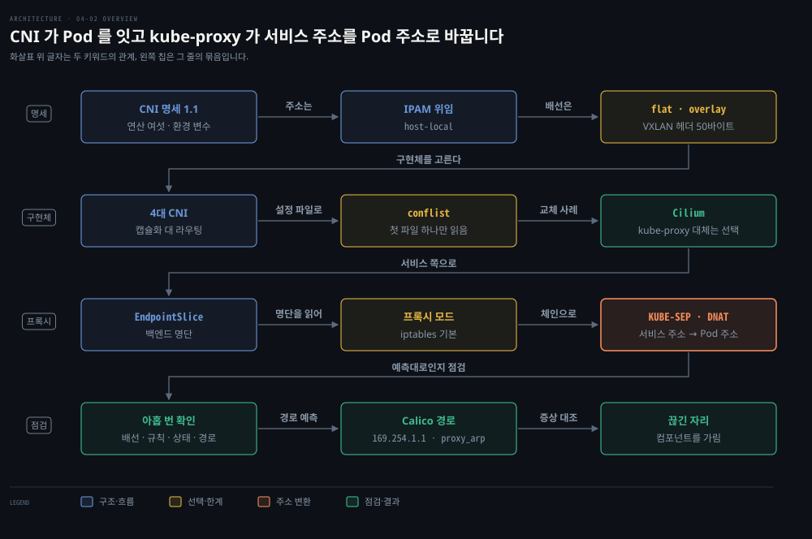


## 본문 정리

### CNI 명세는 연산 여섯과 JSON 두 줄기뿐

플러그인이 지켜야 할 것은 연산 여섯 가지와 JSON 입출력이 전부입니다. Kubernetes 는 CNI 플러그인을 싣고 오지 않습니다. 무엇을 끼울지는 쓰는 쪽이 정합니다. 그런데 후보들이 서로 크게 다릅니다. 하나는 BGP 로 라우팅하고 다른 하나는 오버레이로 감싸며 또 하나는 eBPF 로 커널에서 처리합니다. 이렇게 다른 것들을 Kubernetes 가 똑같이 다룰 수 있는 이유는 명세가 요구하는 것이 아주 작기 때문입니다.

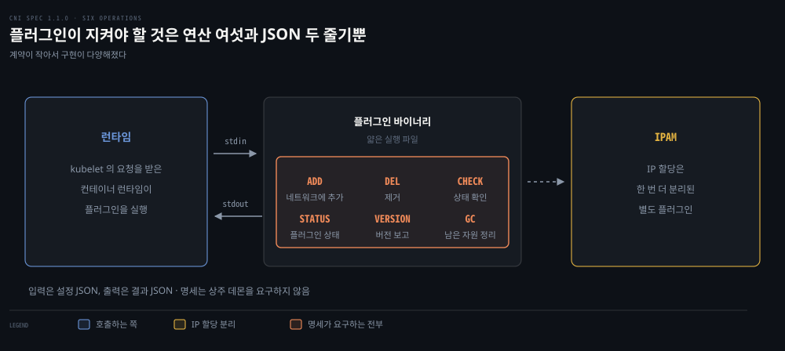

CNI 명세 1.1.0 의 연산은 아래 여섯입니다.[^spec]

| 연산 | 하는 일 |
|------|--------|
| `ADD` | 컨테이너를 네트워크에 추가한다 |
| `DEL` | 네트워크에서 제거한다 |
| `CHECK` | 컨테이너의 네트워킹이 기대한 상태인지 확인한다 |
| `STATUS` | 플러그인의 상태를 확인한다 |
| `VERSION` | 지원하는 버전을 보고한다 |
| `GC` | 남은 자원을 정리한다 |

Kubelet 의 요청을 받은 컨테이너 런타임(containerd·CRI-O)이 플러그인 바이너리를 실행합니다. CNI 명세는 이 컨테이너 런타임을 런타임이라 부릅니다. 설정 JSON 은 stdin 으로 주고 결과 JSON 은 stdout 으로 받습니다. 플러그인 바이너리는 얇은 래퍼인 경우가 많습니다. 실제 작업은 상주 백엔드에 HTTP 나 RPC 로 넘기기도 합니다.

### 호출마다 달라지는 값, 환경 변수 넷

호출 한 번에 필요한 값은 stdin 설정과 환경 변수 두 갈래로 나뉘어 들어갑니다. stdin 으로 가는 설정만으로는 플러그인이 일을 시작할 수 없습니다. 그 설정에는 브리지 이름과 대역처럼 노드에 한 번 정해 두는 값만 있습니다. 지금 어느 Pod 에 붙일지는 환경 변수가 알려 줍니다.

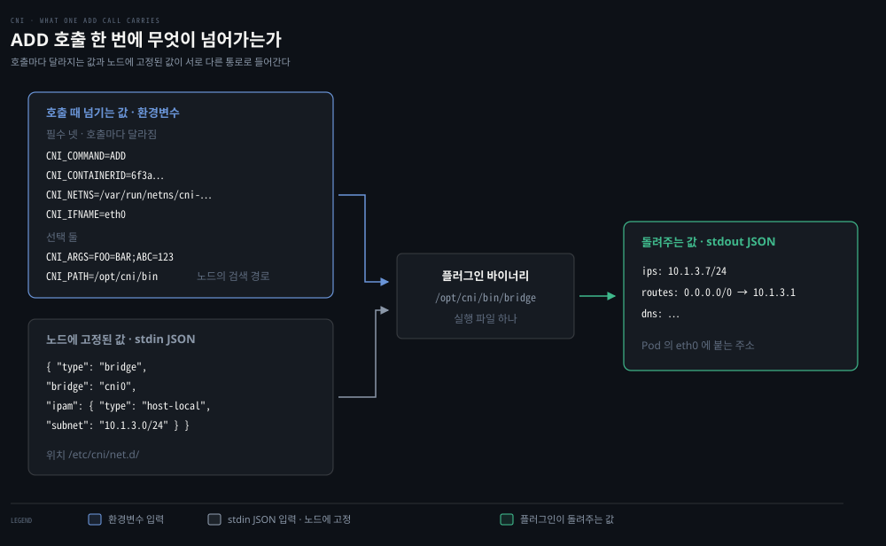

호출마다 달라지는 값은 환경 변수 넷으로 갑니다.

| 변수 | 담기는 것 |
|------|----------|
| `CNI_COMMAND` | 어느 연산인지 |
| `CNI_CONTAINERID` | 어느 컨테이너인지 |
| `CNI_NETNS` | 그 Pod 의 네트워크 네임스페이스 경로 |
| `CNI_IFNAME` | 컨테이너 안에 만들 인터페이스 이름. 보통 `eth0` |

명세는 이 넷을 `ADD` 의 필수 환경 변수로 두고, `CNI_ARGS` 와 `CNI_PATH` 를 선택 항목으로 둡니다.[^spec] `CNI_NETNS` 는 2장 실습에서 `ip link set veth1 netns <대상>` 을 칠 때 그 자리에 넣었던 값입니다. 이 값이 없으면 플러그인은 인터페이스를 만들어도 어디에 밀어 넣을지 모릅니다.

플러그인이 하는 일도 그 실습과 같습니다. 네임스페이스를 지정한 다음 그 안에 인터페이스를 만들고 주소와 기본 경로를 넣습니다. [02-05](./02-05.%EC%BB%A4%EB%84%90%20%EB%84%A4%ED%8A%B8%EC%9B%8C%ED%82%B9%20%EC%8B%A4%EC%8A%B5%20%E2%80%94%20veth%C2%B7%EB%B8%8C%EB%A6%AC%EC%A7%80%C2%B7%ED%8F%AC%EC%9B%8C%EB%94%A9%EC%9D%84%20%EC%86%90%EC%9C%BC%EB%A1%9C%20%EC%A7%93%EA%B8%B0.md)에서 손으로 친 명령들이 이 바이너리 안에 들어 있습니다.

### Pod 하나가 주소를 받기까지

Pod 하나를 띄우면 주체 넷이 차례로 일하고, Kubelet 은 그중 배선을 직접 하지 않습니다.

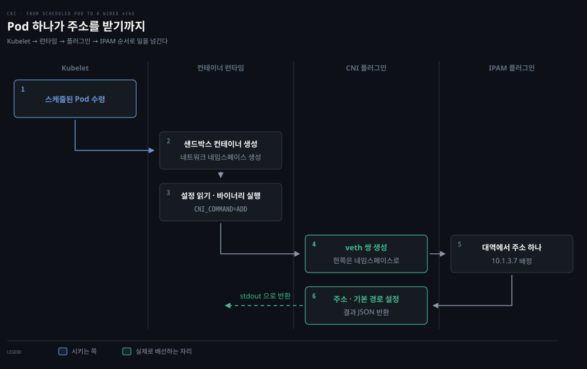

Kubelet 은 컨테이너 런타임에게 시킵니다. 런타임이 플러그인을 실행하고 플러그인은 IPAM 에게 주소를 받아옵니다. 그래서 Pod 가 `ContainerCreating` 에서 멈췄을 때 볼 로그가 층마다 다릅니다.

도식의 2번에서 네임스페이스가 먼저 생겨야 플러그인에게 넘길 `CNI_NETNS` 값이 존재합니다. 그래서 배선은 컨테이너 생성 뒤에 옵니다. 6번의 결과가 돌아오면 Pod 의 컨테이너들이 그 네임스페이스를 함께 쓰며 뜹니다.

### 런타임이 설정과 바이너리를 찾는 자리

런타임은 정해진 두 디렉토리에서 설정과 바이너리를 찾고, 둘은 `type` 한 줄로 이어집니다. 플러그인을 실행하는 쪽이 정하는 것은 설정을 읽는 자리와 바이너리를 찾는 자리입니다.

| 자리 | 기본 경로 |
|------|----------|
| 설정 JSON | `/etc/cni/net.d/` |
| 플러그인 바이너리 | `/opt/cni/bin/` |

설정 JSON 안의 `"type": "cilium-cni"` 는 종류를 가리키는 이름이 아니라 파일 이름입니다. 런타임은 그 문자열을 바이너리 디렉토리 뒤에 붙여 `/opt/cni/bin/cilium-cni` 를 그대로 실행합니다. 등록 절차도 조회 API 도 없고 이름이 맞는 실행 파일이 그 자리에 있으면 그만입니다.

설정 파일의 확장자는 둘로 갈립니다. `.conf` 는 플러그인 하나짜리이고 `.conflist` 는 여러 개를 `plugins` 배열로 묶은 것입니다.

containerd 는 설정 디렉토리의 파일 이름을 사전순으로 정렬해 앞에서부터 `max_conf_num`(기본 1)개만 읽습니다.[^cd] 디렉토리에 CNI 설정이 둘 있으면 이름이 앞서는 쪽만 쓰이고 다른 쪽은 쓰이지 않는다는 뜻입니다. 그래서 `05-cilium.conflist` 처럼 숫자 접두사를 붙여 어느 쪽이 앞설지를 이름으로 정하는 관례가 있습니다.

설정 경로는 컨테이너 런타임 설정에서 지정합니다. dockershim 이 제거된 1.24 부터 CNI 를 구동하는 책임은 컨테이너 런타임(containerd, CRI-O)에게 있습니다. Kubelet 의 `--network-plugin=cni` 플래그도 그때 함께 사라졌습니다.[^cri] 관리형 클러스터와 배포판 대부분은 이미 구성된 채로 옵니다.

Pod 에는 보통 루프백을 뺀 인터페이스가 하나뿐입니다. Multus 는 여러 CNI 를 호출하는 플러그인 노릇을 해서 Pod 에 인터페이스를 더 붙입니다.[^multus]

### flat 과 overlay

CNI 의 두 범주는 앞 편 레이아웃과 짝을 이루고, 고르는 축은 IP 를 얼마나 쓸 수 있느냐입니다.

| 범주 | 주소를 어떻게 쓰나 | 얻는 것 | 내주는 것 |
|------|-----------------|--------|----------|
| flat | 클러스터 네트워크의 IP 를 Pod 가 그대로 쓴다 | 호스트가 Pod 에 직접 닿는다. 중간 처리가 없다 | 큰 IP 공간이 필요하다 |
| overlay | 언더레이 위에 가상 네트워크를 만들어 감싼다 | 노드만 언더레이 IP 를 가지면 된다 | 호스트가 Pod 에 직접 못 닿고 캡슐화 비용이 붙는다 |

노드가 IP 를 충분히 못 받는 환경이면 overlay 가 사실상 강제됩니다.

### IPAM — 주소 배분의 분리

명세는 IPAM(IP Address Management)을 배선과 따로 떼어 낸 플러그인 유형으로 정의하고, 그래서 배선과 주소 배분은 따로 고를 수 있습니다.[^spec]

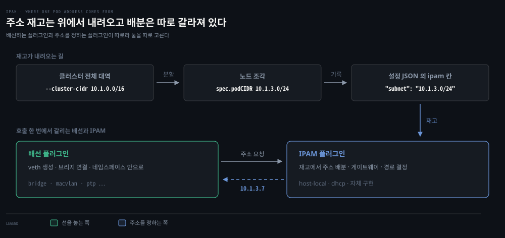

IPAM 을 떼어 낸 것은 IP 할당 코드의 중복을 줄이려는 것입니다. IPAM 플러그인이 인터페이스 IP 와 게이트웨이와 경로를 결정해 출력합니다. 실행 모델은 CNI 와 같은 JSON stdin/stdout 바이너리입니다.[^spec] 가장 단순한 구현은 `host-local` 이고 노드가 자기 몫 대역에서 하나씩 순서대로 떼어 줍니다. 그 몫은 `--cluster-cidr` 로 준 전체 대역을 컨트롤러가 잘라 노드의 `spec.podCIDR` 에 적어 둔 값입니다([04-01](./04-01.Kubernetes%20%EB%84%A4%ED%8A%B8%EC%9B%8C%ED%82%B9%20%EB%AA%A8%EB%8D%B8%20%E2%80%94%20Pod%20IP%C2%B7%EB%A0%88%EC%9D%B4%EC%95%84%EC%9B%83%C2%B7Probe.md)의 「주소 대역을 정하는 플래그」 절).

Calico 와 Cilium 은 host-local 대신 자기 방식으로 주소를 나눠 주는 IPAM 을 쓸 수 있습니다.

명세는 이 분리를 허용할 뿐 강제하지 않습니다. Cilium 이 노드에 써 두는 conflist 에는 `ipam` 칸이 아예 없고 `plugins` 에도 `cilium-cni` 하나뿐입니다. 주소 배분을 자기 안에서 처리하기 때문입니다. 실측에서도 같았습니다. kind 로 만든 Kubernetes v1.37.0 노드에 Cilium 1.20.4 를 `ipam.mode=kubernetes` 로 올리자(2026-11-08) `05-cilium.conflist` 는 아래 모양이었습니다.

```json
{
  "cniVersion": "1.0.0",
  "name": "cilium",
  "plugins": [
    {
       "type": "cilium-cni",
       "enable-debug": false,
       "log-file": "/var/run/cilium/cilium-cni.log"
    }
  ]
}
```

그래서 노드 `/opt/cni/bin/` 에 있는 `host-local` 은 그 클러스터에서 한 번도 실행되지 않는, 노드 이미지의 기본 표준 플러그인일 뿐입니다. 같은 실측에서 이 디렉토리에는 `cilium-cni` 와 `host-local` 과 `loopback` 과 `portmap` 과 `ptp` 가 있었습니다.

### 4대 CNI — 첫 관문은 정책 강제

CNI 는 클러스터를 세울 때 한 번 정하면 바꾸기 어려운 축이라, 후보를 거르는 첫 기준은 NetworkPolicy 를 강제할 수 있는가 하나입니다. 명세가 작아서 후보가 많습니다. 그래서 성능이나 이름값으로 고르기 쉽습니다. 하지만 그 판단은 오래 남습니다.

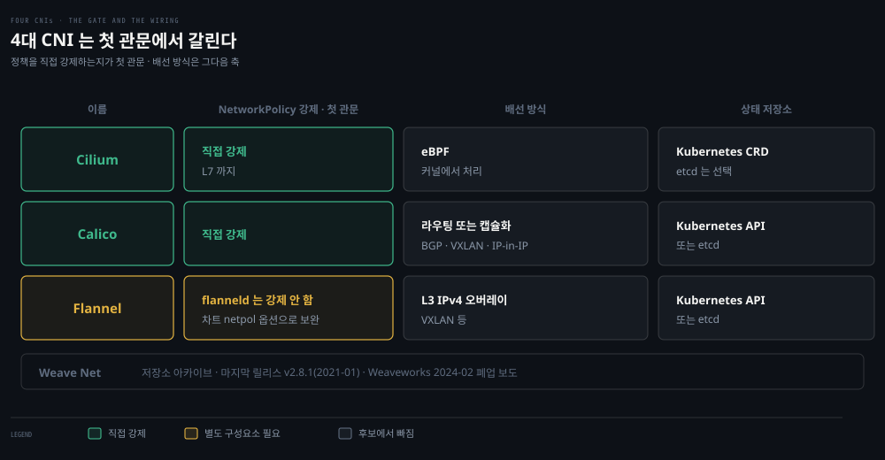

왼쪽 두 칸만 보면 후보가 줄어듭니다. Flannel 은 네트워킹에만 집중하고 flanneld 가 NetworkPolicy 를 강제하지 않아서 첫 관문에서 걸립니다. Helm 차트의 `netpol.enabled` 를 켜면 Kubernetes SIG 의 정책 컨트롤러를 함께 배포합니다. Calico 같은 다른 프로젝트에 정책만 맡기는 방법도 있습니다.[^flannel]

Weave Net 은 표에서 빼도 되는 항목이 됐습니다. 저장소가 2024년 6월에 아카이브됐고 마지막 릴리스가 2021년 1월의 v2.8.1 이라 유지보수가 없습니다.[^weave]

남은 둘은 배선 방식으로 갈립니다. Cilium 은 eBPF 로 커널 안에서 처리하며 identity 기반으로 L7 까지 정책을 겁니다. Calico 는 BGP 유무와 오버레이 유무를 조합하는 여러 모드를 제공합니다. 비오버레이 구성도 되고 VXLAN 이나 IP-in-IP 캡슐화 구성도 됩니다.[^calico]

### 캡슐화와 라우팅 광고의 대가

노드 A 의 Pod 가 노드 B 의 Pod 에 닿는 길은 크게 둘입니다. 도식의 Flannel 과 Calico 가 그 둘을 대표합니다. 캡슐화는 MTU 를 내주고 라우팅 광고는 남의 장비의 협조를 요구합니다.

캡슐화는 패킷을 한 번 더 감쌉니다. 바깥 봉투에 노드의 실주소를 적으니 중간 장비는 평범한 UDP 로 보고 옮깁니다. 대가는 봉투 크기입니다. VXLAN 헤더가 50바이트쯤 붙어 Pod 의 MTU(Maximum Transmission Unit)를 1500 에서 1450 으로 낮춰야 하고, 안 낮추면 큰 패킷이 조용히 깨집니다. 감싸고 푸는 종단점을 VTEP(VXLAN Tunnel Endpoint)이라 부르며 노드마다 하나씩 있습니다. 구조는 [03-02](./03-02.%EC%BB%A8%ED%85%8C%EC%9D%B4%EB%84%88%20%EB%84%A4%ED%8A%B8%EC%9B%8C%ED%82%B9%20%EB%AA%A8%EB%93%9C%EC%99%80%20CNI%20%E2%80%94%20%EA%B2%A9%EB%A6%AC%EC%99%80%20%EC%97%B0%EA%B2%B0%EC%9D%98%20%EA%B1%B0%EB%9E%98.md)의 「VXLAN — 호스트의 경계를 넘는 다리」 절이 정본입니다.

라우팅 광고는 감싸지 않습니다. 대신 밖의 장비가 "10.1.3.0/24 는 3번 노드로"를 알고 있어야 합니다. 대가는 그 장비의 협조입니다. 사내 물리 라우터라면 BGP(Border Gateway Protocol)로 경로를 광고할 수 있어야 합니다. 클라우드라면 VPC 라우트 API 를 씁니다.

### Cilium 으로 CNI 를 갈아 끼우는 실물

CNI 가 없는 클러스터는 노드가 NotReady 에서 멈춰 기다립니다. 그 빈칸을 채우는 것이 CNI 입니다. "CNI 가 없으면 Pod 네트워크도 없다"는 문장은 읽기에는 쉽습니다. 하지만 관리형 클러스터나 배포판은 CNI 가 이미 깔린 채로 와서 없는 상태를 볼 일이 없습니다.

kind 설정에서 `disableDefaultCNI: true` 로 클러스터를 세워 실측했습니다(Kubernetes v1.37.0, 2026-11-08). 노드는 NotReady 였고 CoreDNS 두 Pod 는 Pending 이었습니다. `/opt/cni/bin/` 에는 `cilium-cni` 가 없었습니다. Cilium 1.20.4 를 Helm 으로 올리자 노드가 Ready 로 넘어갔습니다.

Cilium 이 클러스터에 심는 부품은 넷입니다.[^cilium]

| 부품 | 실행 위치 | 하는 일 |
|------|----------|--------|
| Agent(`cilium-agent`) | 각 노드 | 네트워킹과 서비스 로드밸런싱과 네트워크 정책과 관측 요구사항을 Kubernetes API 로 받아 적용한다 |
| Client(`cilium-dbg`) | agent 와 같은 노드 | 같은 노드 agent 의 REST API 로 상태 점검 · eBPF 맵 직접 검증 |
| Operator | 클러스터 | 노드마다가 아니라 클러스터에 한 번만 처리해야 할 관리 업무를 맡는다 |
| CNI 플러그인(`cilium-cni`) | 각 노드의 `/opt/cni/bin/` | Pod 가 생기거나 사라질 때 호출되어 노드의 Cilium API 로 네트워킹과 정책 구성을 일으킨다 |

Cilium 이 kube-proxy 를 대신할지는 설치 때 고르는 선택입니다. Helm 값 `kubeProxyReplacement` 의 기본은 `"false"` 입니다.[^cilium] 위 실측에서도 `kube-proxy-replacement: "false"` 였고 kube-proxy DaemonSet 이 `iptables` 모드로 함께 돌았습니다. 라우팅은 `routing-mode: tunnel` 과 `tunnel-protocol: vxlan` 이었습니다.

설치 뒤에는 connectivity check 를 돌려 검증합니다. 다양한 연결 경로와 정책 조합을 담은 deployment 묶음입니다. Pod 이름이 곧 시나리오 이름이고 readiness 와 liveness 가 성공 여부 표시기가 됩니다.

이미 동작 중인 CNI 를 다른 플러그인으로 바꿀 때 Cilium 문서는 하이브리드 이전을 안내합니다. 새 CNI 를 기존 CNI 와 다른 IP 대역과 캡슐화 포트로 함께 세워 두고, 노드를 하나씩 cordon 한 뒤 옮기고 재부팅합니다.[^mig] 한 노드의 Pod 는 둘 중 한 네트워크에만 붙지만 옮기는 동안 양쪽 Pod 가 서로 통신합니다. drain 은 필수가 아닙니다. 하지 않으면 재부팅하는 동안 Pod 가 잠깐 끊깁니다. Multus 는 보조 인터페이스를 덧붙일 뿐 기본 CNI 의 교체를 돕지는 못합니다.

클러스터를 세우고 확인하는 명령과 예측 질문은 [04-04](./04-04.Kubernetes%20%EB%84%A4%ED%8A%B8%EC%9B%8C%ED%81%AC%20%EC%8B%A4%EC%8A%B5%20%E2%80%94%20CNI%20%EB%B6%80%EC%9E%AC%EB%B6%80%ED%84%B0%20%EC%A0%95%EC%B1%85%C2%B7DNS%EA%B9%8C%EC%A7%80.md)의 「CNI 가 없는 클러스터」 절에 있습니다.

### kube-proxy — 서비스라는 번역기

iptables·nftables 모드에서 ClusterIP 는 어디에도 붙어 있지 않은 가상 주소이고, 그것을 실제 Pod 로 바꾸는 일이 kube-proxy 몫입니다. CNI 가 Pod 에 IP 를 줬지만 그 IP 는 앞 편에서 봤듯 휘발성이라 어디에도 적어 둘 수 없습니다.

그래서 Service 주소로 부르는데, 정작 그 주소는 어느 노드에서 `ip a` 를 쳐도 나오지 않습니다. 어느 인터페이스에도 붙어 있지 않은 주소로 통신이 되는 이유는 중간에서 그 주소를 실제 Pod 주소로 바꿔 주는 것이 있기 때문입니다.

IPVS 모드는 다릅니다. 모든 ClusterIP 를 노드의 dummy 인터페이스 `kube-ipvs0` 에 바인딩하므로 `ip a` 에 나옵니다.[^ipvs]

kube-proxy 는 노드마다 하나씩 도는 컴포넌트로 클러스터 안 기본 로드밸런싱을 제공합니다. Kubelet 은 노드의 systemd 데몬이지만 kube-proxy 는 보통 DaemonSet Pod 라서 업그레이드와 재시작 경로가 갈립니다. 앞의 kind 실측에서도 `daemonset.apps/kube-proxy` 가 보였습니다.

대부분의 서비스 유형은 ClusterIP 라는 가상 IP 를 갖고, 이 주소는 클러스터 밖에서는 보통 라우팅되지 않습니다. 그 ClusterIP 로 온 요청을 건강한 Pod 로 넘기는 것이 kube-proxy 의 일입니다.

서비스는 Pod 집합에 대한 로드밸런서를 정의합니다. 그 뒤의 명단은 EndpointSlice 가 담습니다. 서비스 자신이 명단을 만드는 것이 아니라 kube-controller-manager 의 컨트롤러가 만듭니다. 서비스의 셀렉터는 그 컨트롤러가 보는 입력일 뿐입니다. kube-proxy 가 실제로 watch 하는 것도 EndpointSlice 입니다. 슬라이스는 기본 100개 엔드포인트 단위로 쪼개집니다.[^es] 옛 Endpoints API 는 1.33 부터 deprecated 입니다.

이 watch 가 규칙을 다시 쓰게 만드는 방아쇠입니다. Pod 하나가 readiness 를 잃으면 그 변화가 컨트롤러를 거쳐 슬라이스에 적힙니다. 각 노드의 kube-proxy 가 그것을 받아 체인에서 그 Pod 줄을 뺍니다. 전파 경로 전체는 [04-01](./04-01.Kubernetes%20%EB%84%A4%ED%8A%B8%EC%9B%8C%ED%82%B9%20%EB%AA%A8%EB%8D%B8%20%E2%80%94%20Pod%20IP%C2%B7%EB%A0%88%EC%9D%B4%EC%95%84%EC%9B%83%C2%B7Probe.md)의 「readiness 실패가 규칙까지 가는 길」 절에 그려 두었습니다.

> 💬 **비유**: CNI와 kube-proxy는 신도시의 두 직군입니다. CNI는 배선공입니다 — 새 집(Pod)이 들어서면 주소를 부여하고 도로(라우팅)를 연결하며, 집이 철거되면 회수합니다. 
>
> kube-proxy는 "고객센터(ClusterIP)로 전화 주세요"라고 알리고 전화를 근무 중인 상담원(ready Pod)에게 배분하는 대표번호 교환원입니다. 교환원의 배분 방식이 절차 규정집(iptables 확률 규칙)이냐 전담 교환기(IPVS)냐가 모드 선택입니다.

### 프록시 모드와 버전별 상태

kube-proxy 의 모드는 `--proxy-mode` 로 고르고, 고른 값에 따라 노드에 심는 것이 달라집니다. 여기서 말하는 모드는 kube-proxy 자신의 실행 모드입니다. iptables 규칙을 심을 수도 있고 IPVS 항목을 만들 수도 있습니다.

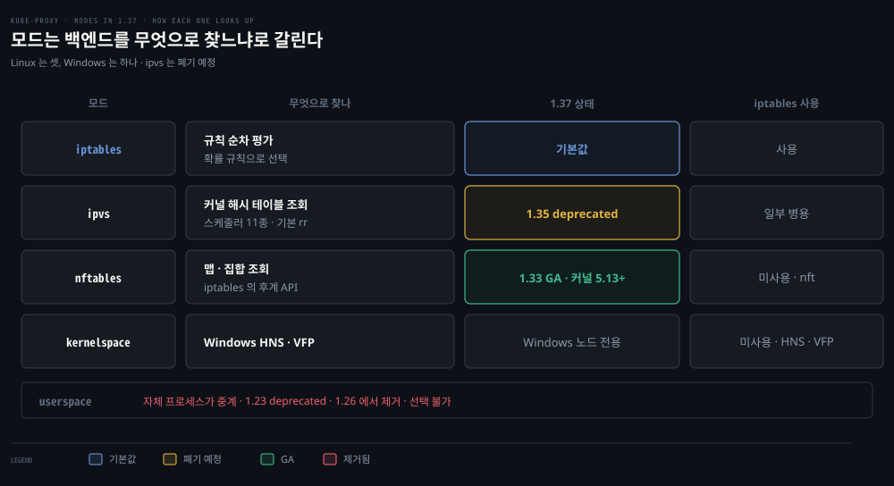

Linux 의 모드는 iptables 와 ipvs 와 nftables 셋이고 Windows 에는 kernelspace 하나뿐입니다.[^modes] 모드마다 규칙을 심는 곳이 다릅니다.

| 모드 | 규칙을 심는 곳 | iptables 를 쓰나 |
|------|--------------|----------------|
| iptables | iptables 규칙 | 쓴다 |
| ipvs | 커널의 IPVS 와 iptables API | 함께 쓴다 |
| nftables | nft | 쓰지 않는다 |
| kernelspace(Windows) | Windows 의 VFP(Virtual Filtering Platform) | 쓰지 않는다 |

모드를 정하지 않으면 권장 기본값이 쓰입니다. 1.37 의 기본값은 iptables 입니다. 문서는 앞으로 기본값이 nftables 로 바뀔 것이라고 하되 시점을 적지 않습니다. 그러나 1.37 의 kube-proxy 는 모드를 정하지 않고 뜨면 1.40 에서 기본값이 nftables 로 바뀐다는 경고를 남깁니다.[^def] 그래서 iptables 를 쓸 때도 `mode: iptables` 를 명시합니다.

모드는 버전을 따라 빠지고 들어왔습니다.

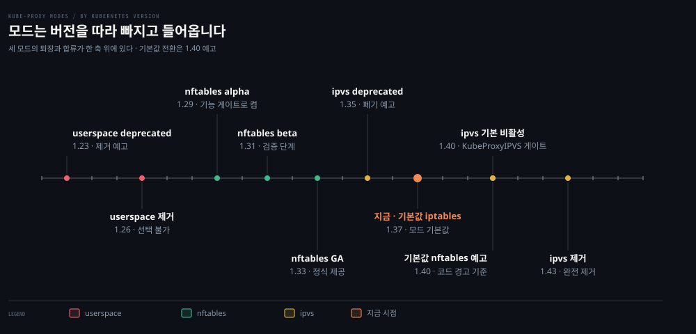

userspace 모드는 1.23 에서 deprecated 되고 1.26 에서 지원이 끝나, 지원되는 클러스터에서는 선택지가 아닙니다.[^tl] nftables 는 1.29 alpha 에서 1.31 beta 를 거쳐 1.33 에서 GA 가 됐고 커널 5.13 이상이 필요합니다. ipvs 는 1.35 에서 deprecated 됐습니다. 1.40 부터는 `KubeProxyIPVS` 기능 게이트를 켜야 쓸 수 있고 1.43 에서 완전히 제거됩니다. 문서는 nftables 를 ipvs 의 대체로 권합니다.[^modes]

여기서 GA 는 General Availability 의 줄임으로 정식 제공을 뜻합니다. Kubernetes 기능은 Alpha 에서 실험으로 시작해 Beta 에서 검증을 거쳐 GA 에 이릅니다.

| 단계 | 뜻 | 쓸 수 있나 |
|------|----|----------|
| Alpha | 실험 단계. 이름이나 동작이 바뀌거나 사라질 수 있다 | 기능 게이트로 직접 켜야 하고 프로덕션에는 권하지 않는다 |
| Beta | 널리 검증받는 단계. 세부는 아직 바뀔 수 있다 | 쓸 수 있으나 다음 버전에서 설정이 달라질 수 있다 |
| GA | 정식 제공. Stable 이라고도 부른다 | 기본으로 지원되고 이후 버전에서도 유지된다 |

그래서 nftables 모드는 이제 실험이 아니라 프로덕션에서 골라 써도 되는 선택지입니다([용어집](./00-01.%EC%9A%A9%EC%96%B4%EC%A7%91.md)). IPVS 가 고를 수 있는 스케줄러는 rr·wrr·lc·wlc·lblc·lblcr·sh·dh·sed·nq·mh 11종이고, 기본은 rr 이며 `ipvs.scheduler` 로 바꿉니다.[^modes] 세 기술의 내부 차이는 [02-03](./02-03.iptables%C2%B7IPVS%C2%B7eBPF%20%E2%80%94%20kube-proxy%EB%A5%BC%20%EC%9D%B4%ED%95%B4%ED%95%98%EB%8A%94%20%EC%84%B8%20%EA%B8%B0%EC%88%A0.md)가 정본입니다.

### 서비스 하나가 내려앉는 체인 셋

서비스라는 오브젝트는 노드의 NAT 테이블에서 체인 셋으로 번역됩니다. 규칙 평가와 확률 계산은 [02-03](./02-03.iptables%C2%B7IPVS%C2%B7eBPF%20%E2%80%94%20kube-proxy%EB%A5%BC%20%EC%9D%B4%ED%95%B4%ED%95%98%EB%8A%94%20%EC%84%B8%20%EA%B8%B0%EC%88%A0.md)의 「kube-proxy의 Service 규칙」 절이 정본이어서, 이 절은 서비스 오브젝트가 무엇으로 내려앉는지만 봅니다.

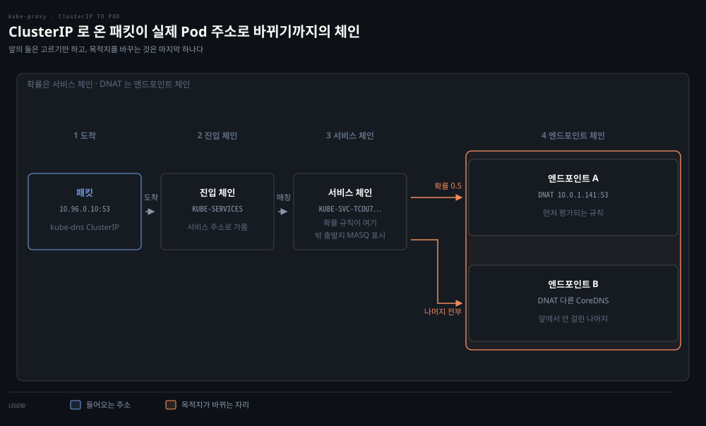

kube-dns 서비스로 보면 오브젝트 하나가 체인 셋으로 내려앉습니다.

| 층 | 체인 | 하는 일 |
|----|------|--------|
| 진입 | `KUBE-SERVICES` | 목적지가 어느 서비스의 ClusterIP 인지 가른다 |
| 서비스 | `KUBE-SVC-…` | 확률 규칙으로 백엔드 하나를 고른다 |
| 엔드포인트 | `KUBE-SEP-…` | 목적지를 실제 Pod IP 로 바꾼다 |

확률을 붙이는 것은 iptables 의 `statistic` 매치 모듈입니다. 규칙에는 `-m statistic --mode random --probability 0.25` 같은 모양으로 박힙니다. 서비스를 하나 만들면 이 셋이 노드마다 생기고 엔드포인트가 늘면 세 번째 층의 줄이 늘어납니다. 엔드포인트가 하나도 없는 서비스는 nat 표에 체인을 만들지 않고 filter 표의 `KUBE-SERVICES` 에 REJECT 규칙만 둡니다.[^noep] 그래서 서비스 연결성이나 성능을 디버깅할 때 2장의 라우팅 지식이 그대로 쓰입니다.

앞의 kind 실측(Kubernetes v1.37.0, 2026-11-08)에서 kube-dns 의 UDP 53 서비스는 아래처럼 내려앉았습니다. 백엔드가 둘이라 첫 SVC 규칙의 확률이 0.5 였고, 체인 이름 `KUBE-SVC-TCOU7JCQXEZGVUNU` 는 같은 서비스에서 늘 같은 값이었습니다. 아래는 규칙 일부를 발췌한 것으로 두 번째 SVC 규칙과 `KUBE-MARK-MASQ` 줄은 뺐습니다.

```bash
-A KUBE-SERVICES -d 10.96.0.10/32 -p udp -m comment --comment "kube-system/kube-dns:dns cluster IP" -m udp --dport 53 -j KUBE-SVC-TCOU7JCQXEZGVUNU
-A KUBE-SVC-TCOU7JCQXEZGVUNU -m comment --comment "kube-system/kube-dns:dns -> 10.244.0.106:53" -m statistic --mode random --probability 0.50000000000 -j KUBE-SEP-Q5TM5MD74MQBWMYH
-A KUBE-SEP-Q5TM5MD74MQBWMYH -p udp -m comment --comment "kube-system/kube-dns:dns" -m udp -j DNAT --to-destination 10.244.0.106:53
-A KUBE-SEP-F6PG3CAEZTI5MHQU -p udp -m comment --comment "kube-system/kube-dns:dns" -m udp -j DNAT --to-destination 10.244.0.128:53
```

### 연결 단위 fan-out 의 쏠림

iptables 모드의 함정은 확률이 연결 단위로만 걸린다는 데 있습니다. 연결이 맺어지면 그 연결의 모든 요청은 종료까지 같은 Pod 로 갑니다. 캐시 지역성 관점에서는 장점이지만 장수 연결에서는 편향을 만듭니다. HTTP/2 위에서 도는 gRPC 가 대표적입니다.

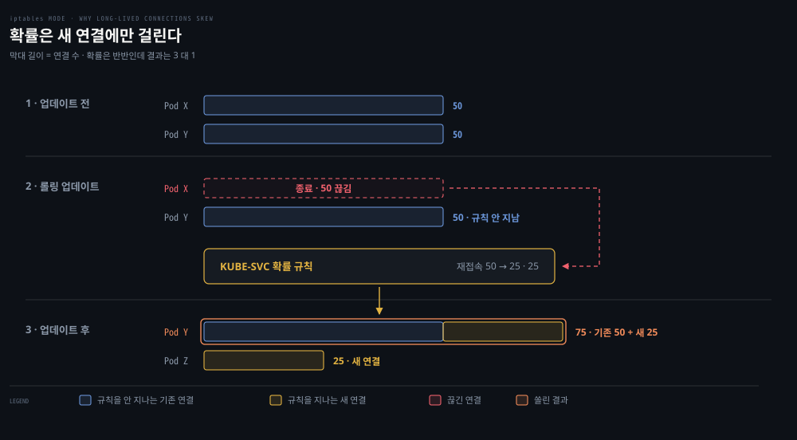

도식을 세 단으로 따라가면 쏠림이 어디서 생기는지 보입니다.

1. 1단은 Pod X 와 Y 가 연결을 50 씩 쥔 상태입니다.
2. 2단에서 X 가 내려가고 그 50 이 끊깁니다. 끊긴 연결은 다시 붙으면서 확률 규칙을 지나고, 남은 백엔드 둘로 25 씩 나뉩니다.
   - Y 가 쥐고 있던 50 은 점선을 따라 규칙을 다시 지나지 않습니다. 이미 맺어진 연결이라 그대로 살아 있습니다.
3. 그래서 3단에서 Y 는 기존 50 에 새 25 를 더해 75 를 갖고 Z 는 25 만 갖습니다. 막대 길이가 그 차이입니다.

쏠림을 만든 것은 확률이 아닙니다. 확률은 새 연결 50 을 정확히 반씩 나눴습니다. 원인은 기존 연결이 규칙을 건너뛴다는 성질입니다. 그래서 기본 `rr` 스케줄러의 IPVS 로 바꿔도 사라지지 않습니다. `lc` 스케줄러는 새 연결을 활성 연결이 적은 쪽에 주므로 이 예에서는 새 연결이 대부분 Z 로 가서 쏠림이 크게 줄지만, 이미 맺은 연결이 옮겨 가지는 않습니다.[^lc] 요청 하나하나를 나누려면 L7 로 올라가 서비스 메시나 클라이언트 쪽 로드밸런싱을 써야 합니다.

### 규모가 커지면 무엇이 먼저 무너지는가

iptables 모드에서는 규칙 수가 클러스터의 오브젝트 수를 그대로 따라가서 한계도 계산됩니다. 문서는 iptables 모드가 서비스마다 규칙 몇 줄을, 엔드포인트 IP 마다 규칙 몇 줄을 만든다고 적습니다.[^modes]

서비스가 5천 개이고 각 서비스 뒤에 Pod 가 10개씩 붙어 있다고 해 봅시다. 최상위 체인에 서비스마다 한 줄 이상이니 5천 줄이 넘습니다. 각 서비스 체인 안에는 백엔드마다 한 줄 이상이 있으니 엔드포인트 줄만 5만 개가 넘습니다.

무너지는 곳은 둘입니다. 첫째는 조회입니다. iptables 규칙은 앞에서부터 순서대로 평가되므로 뒤쪽 서비스일수록 더 많은 판정을 거칩니다.

둘째는 갱신입니다. 문서는 Pod 와 서비스가 수만 개인 클러스터에서 서비스나 EndpointSlice 가 바뀔 때 kube-proxy 가 커널의 규칙을 갱신하는 데 오래 걸릴 수 있다고 적습니다.[^modes] 그동안 규칙에 적힌 명단과 실제 Pod 상태가 어긋나, 이미 사라진 Pod 로 트래픽이 계속 가는 구간이 생깁니다.

그래서 대안이 나왔습니다. IPVS 는 커널 해시 테이블을 써서 조회 비용이 백엔드 수에 덜 끌려가도록 만든 모드입니다. nftables 는 엔드포인트 변경을 iptables 모드보다 빠르고 효율적으로 처리하도록 설계됐습니다.[^modes] Cilium 은 eBPF 맵으로 처리하며 kube-proxy 자체를 대체할 수 있습니다. 세 기술의 내부 차이와 수치는 [02-03](./02-03.iptables%C2%B7IPVS%C2%B7eBPF%20%E2%80%94%20kube-proxy%EB%A5%BC%20%EC%9D%B4%ED%95%B4%ED%95%98%EB%8A%94%20%EC%84%B8%20%EA%B8%B0%EC%88%A0.md)가 정본입니다.

### iptables 가 기본값인 이유

더 나은 후보가 있어도 기본값이 iptables 인 이유는 셋이고, 기본값은 문제를 겪는 소수가 아니라 다수에 맞춥니다.

첫째, 대부분의 클러스터에서 문제가 안 됩니다. 선형 평가와 갱신 지연이 아픈 것은 서비스와 Pod 가 수만 개일 때입니다.[^modes] 수십에서 수백 개짜리 클러스터에서는 갱신이 짧게 끝나 체감되지 않습니다.

둘째, 전제가 없습니다. nftables 모드는 커널 5.13 이상이 필요하고, ipvs 는 폐기가 예고된 모드입니다. iptables 에는 그런 전제가 없어서 어떤 노드에서도 같게 동작합니다.

셋째, 모드를 바꿔도 풀리지 않는 문제가 있습니다. 앞 절의 쏠림은 연결 단위로 나눈다는 성질에서 나오므로 기본 `rr` 스케줄러의 IPVS 로 옮겨도 그대로 남습니다.

iptables 는 규칙을 순서대로 훑습니다. ipvs 는 커널 해시 테이블로 찾습니다. nftables 는 iptables 의 후계 API 로 맵과 집합을 씁니다. 셋을 나란히 놓으면 이렇습니다.

| 축 | iptables | ipvs | nftables |
|----|---------|------|----------|
| 조회 | 앞에서부터 순서대로 | 커널 해시 테이블 | 맵과 집합 |
| 갱신 | 규칙이 많으면 오래 걸린다 | 동기화 성능을 노리고 만든 모드 | iptables 모드보다 빠르고 효율적 |
| 쓰려면 필요한 것 | 없다 | 1.43 에서 제거 예정 | 커널 5.13 이상 |
| iptables 를 여전히 쓰나 | 그렇다 | 일부 쓴다. 밖으로 나가는 패킷의 SNAT 에서 iptables 로 되돌아간다 | 아니다 |
| 연결 단위 쏠림 | 있다 | 기본 `rr` 이면 있다 | 있다 |

IPVS 로 옮겨도 iptables 가 사라지지 않아 두 스택을 다 알아야 합니다.[^ipvs] 그래서 모드 교체는 규칙 갱신이 실제로 느려졌을 때 꺼내는 카드이고, 그때 문서가 권하는 선택지는 nftables 입니다.

### 아홉 번 확인으로 예측과 실제를 대조하기

Pod 에서 출발해 배선과 규칙과 상태와 경로를 아홉 단계로 이어 확인하면, 어디서 끊기는지가 곧 어느 컴포넌트의 문제인지를 가려 줍니다. 아래 순서는 Calico CNI 의 BGP 비오버레이 구성과 kube-proxy `iptables` 모드를 전제합니다. 1~2번은 배선, 3~5번은 규칙, 6번은 상태, 7~9번은 경로를 봅니다.

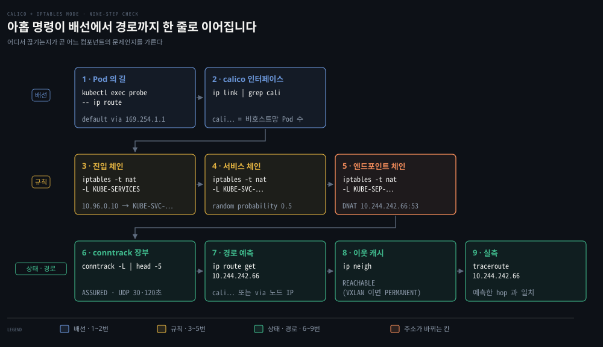

```bash
# 1. Pod 안에서 게이트웨이 확인 (169.254.1.1)
kubectl exec -it probe -- ip route

# 2. 워커노드에서 calixxx 인터페이스 개수 확인
#    (호스트 네트워크가 아닌 Pod 수와 일치해야 함)
ip link | grep cali

# 3. KUBE-SERVICES에서 가상 IP가 어디로 점프하는지
iptables -t nat -L KUBE-SERVICES -n | grep 10.96.0.10

# 4. KUBE-SVC-* 의 random LB 확인 (statistic mode random probability 0.5)
#    서비스 포트마다 규칙이 하나씩이라 포트 이름까지 고정해 체인 하나만 받는다
SVC=$(iptables -t nat -L KUBE-SERVICES -n | grep 'kube-dns:dns cluster IP' | awk '{print $1}')
iptables -t nat -L "$SVC" -n

# 5. KUBE-SEP-* 의 DNAT 규칙 (실제 Pod IP로 변환)
SEP=$(iptables -t nat -L "$SVC" -n | grep KUBE-SEP | head -1 | awk '{print $1}')
iptables -t nat -L "$SEP" -n

# 6. conntrack 장부 확인 (ASSURED 플래그, UDP 30/120초)
conntrack -L | head -5
cat /proc/sys/net/netfilter/nf_conntrack_udp_timeout
cat /proc/sys/net/netfilter/nf_conntrack_udp_timeout_stream

# 7. 어느 next hop과 인터페이스로 보낼지 커널에 물어보기
ip route get 10.244.242.66

# 8. ARP 캐시 상태 (REACHABLE, VXLAN 모드면 vxlan.calico 이웃이 PERMANENT)
ip neigh

# 9. 예측한 경로가 실제 그대로인지 traceroute로 검증
traceroute 10.244.242.66
```

7번의 결과는 어느 노드에서 묻느냐에 따라 갈립니다. 예제 주소 10.244.242.66 이 묻는 노드 자신의 Pod 이면 `dev cali…` 가 나옵니다. 다른 노드의 Pod 이면 `via <노드 IP> dev ens5` 가 나옵니다. 아래 FIB 트리는 앞의 경우입니다.

6번의 UDP 타임아웃은 일반 값 30초와 stream 값 120초가 커널 기본입니다.[^ct] 앞의 kind 노드(커널 7.2.12)에서도 30 과 120 이 읽혔습니다.

8번에서 동적 ARP 로 배운 이웃은 `REACHABLE` 이나 `STALE` 로 찍힙니다. VXLAN 모드로 돌리면 `vxlan.calico` 이웃이 `PERMANENT` 로 찍힙니다. 왜 그렇게 심는지와 NUD 일곱 상태는 [02-02. 커널이 패킷을 판정하는 층](./02-02.%EC%BB%A4%EB%84%90%EC%9D%B4%20%ED%8C%A8%ED%82%B7%EC%9D%84%20%ED%8C%90%EC%A0%95%ED%95%98%EB%8A%94%20%EC%B8%B5%20%E2%80%94%20Netfilter%C2%B7Conntrack%C2%B7%EB%9D%BC%EC%9A%B0%ED%8C%85.md)의 「neighbor 표와 NUD 일곱 상태」 절이 다룹니다. 핑 로스 장애에서 1순위로 살펴볼 값입니다.

### Calico 노드의 라우팅 테이블 읽기

7번 `ip route get` 이 돌려주는 값은 목적지에 따라 세 갈래로 갈리고, 가장 긴 접두사를 가진 규칙이 이깁니다. 운영 관점에서 라우팅 결정은 세 시나리오로 압축됩니다. 첫째, 외부망으로 나가는 경우는 default 게이트웨이 규칙을 타고 물리 NIC `ens5` 로 빠집니다. 둘째, 다른 노드의 Pod 로 가는 경우는 그 Pod IP 가 속한 노드의 물리 IP 를 next hop 으로 잡고 직접 던집니다. 셋째, 같은 노드 안 Pod 로 가는 경우는 그 Pod 와 연결된 개별 `calixxx` 인터페이스 규칙으로 내려갑니다.

다른 노드의 Pod 로 가는 두 번째 시나리오에서는, BGP 로 경로를 나누는 비오버레이 구성이면 Calico 가 노드 간 라우팅 테이블을 동기화해 둡니다. 그래서 VXLAN 같은 캡슐화 없이 원본 패킷 그대로 옆 노드로 보냅니다.[^calico]

자기 노드의 `/26` 블록(`10.244.242.64/26` 같은 대역)은 그 자체가 `blackhole` 경로이고, 그 아래에 Pod 별 `/32` 경로가 `calixxx` 로 붙습니다.

스케일인으로 막 사라져 `calixxx` 인터페이스가 없는 IP 로 패킷이 들어오면 윗단의 블록 규칙이 받습니다. 그 IP 는 자기 노드 Pod 대역에 속합니다. 그런데 그 IP 의 `/32` 규칙은 지워졌습니다. 그래서 다음으로 긴 `/26` 블랙홀 규칙에 걸려 버려집니다.[^bh]

이 안전망이 없다면 패킷이 default 게이트웨이로 빠져 옆 노드로 나가고, 옆 노드 라우팅 테이블도 같은 대역을 이 노드로 돌려보내므로 라우팅 루프가 생길 수 있습니다. 그래서 블랙홀 한 줄이 안전망 노릇을 합니다.

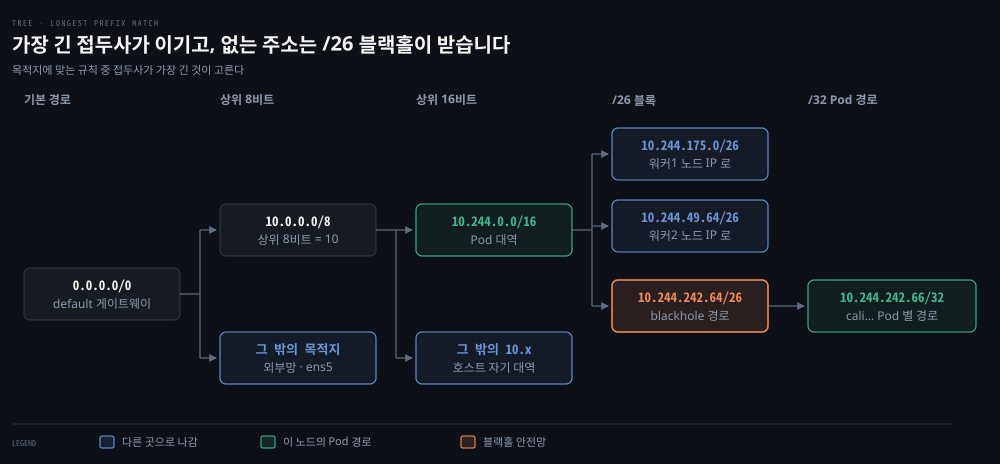

`ip route` 로 보이는 텍스트 표는 사람을 위한 표시입니다. 커널은 이 규칙을 접두사 기준 트리인 FIB(Forwarding Information Base)로 보관하고, 목적지에 맞는 규칙 중 가장 긴 접두사를 고르는 Longest Prefix Match(LPM)로 결정합니다. 커널은 규칙을 표처럼 위에서부터 훑지 않고 접두사 길이를 따라 트리를 내려갑니다. 그래서 Pod 가 늘고 줄어 규칙이 수천 개 단위로 바뀌어도 탐색 단계가 규칙 수에 비례해 늘지 않습니다. 운영 중 패킷이 어디로 빠질지 미리 확인하고 싶다면 `ip route get <IP>` 로 커널 자체의 결정을 묻는 것이 가장 빠릅니다.

### Calico 의 proxy_arp 와 rp_filter

1번과 8번이 보는 값이 왜 그 값인지는 Calico 가 게이트웨이를 만드는 방식에 있습니다. `rp_filter` 의 개념 자체는 [02-02](./02-02.%EC%BB%A4%EB%84%90%EC%9D%B4%20%ED%8C%A8%ED%82%B7%EC%9D%84%20%ED%8C%90%EC%A0%95%ED%95%98%EB%8A%94%20%EC%B8%B5%20%E2%80%94%20Netfilter%C2%B7Conntrack%C2%B7%EB%9D%BC%EC%9A%B0%ED%8C%85.md)의 「심화 1 · Martian 검사와 rp_filter」 절이 다루고 여기서는 증상과 진단만 봅니다.

Pod 안에서 `ip route` 를 보면 기본 게이트웨이가 `169.254.1.1` 이라는 고정 가상 주소로 잡혀 있습니다. 호스트마다 워크로드의 게이트웨이 라우터 노릇을 하는 Calico 가 링크 로컬 주소를 쓰는 것입니다. 그래서 사용자가 주소를 따로 정할 필요가 없고 IP 도 아낍니다. 호스트 쪽 인터페이스에는 그 주소를 할당하지 않고 `proxy_arp` 플래그를 켭니다.[^calico2]

Pod 가 이 게이트웨이의 MAC 을 ARP 로 묻는 순간 호스트의 `calixxx` 인터페이스가 자기 MAC 으로 대신 응답합니다. `proxy_arp` 값은 1이어야 합니다. 0 이면 Pod 트래픽이 호스트 라우팅 테이블로 진입하지 못해 통신이 끊깁니다. Calico 환경 통신 장애에서 가장 먼저 점검할 한 값입니다.

`tcpdump` 로 노드 호스트에서 보면 패킷이 들어온 게 잡히는데 정작 Pod 안에는 도착하지 않을 수 있습니다. 그러면 `rp_filter` 를 의심합니다. 이 필터가 버린 패킷은 `IPReversePathFilter` 카운터에 쌓입니다. `nstat -az TcpExtIPReversePathFilter` 값이 트래픽마다 늘어나는지 봅니다.[^rp]

값 1 은 strict 모드입니다. 출발지로 돌아가는 최선 경로가 들어온 인터페이스가 아니면 버립니다. 값 2 는 loose 모드입니다. 출발지에 어느 인터페이스로든 닿으면 통과시킵니다. 커널 문서는 비대칭 경로나 복잡한 라우팅이면 loose 모드를 권합니다.

커널은 `conf/all` 과 `conf/<인터페이스>` 중 큰 값을 쓰므로, 영향받는 인터페이스의 값을 1 에서 2 로 올리면 `all` 이 1 이어도 loose 로 적용됩니다.

### 증상으로 계층 가르기

세 증상은 다른 계층의 문제여서 점검 명령이 다릅니다.

| 증상 | 의심 영역 | 점검 명령 | 판정 |
|------|----------|----------|------|
| ClusterIP 접속 타임아웃 | PREROUTING의 nat 규칙 (kube-proxy 미반영) | `iptables -t nat -L KUBE-SERVICES -n \| grep <vip>` | nat 규칙이 없으면 아래 행의 `has no endpoints` 부터 가르고, 그것도 없으면 kube-proxy 미반영 |
| ClusterIP 접속이 즉시 거절 | filter 의 `KUBE-SERVICES` REJECT (엔드포인트 부재) | `iptables -t filter -L KUBE-SERVICES -n \| grep 'has no endpoints'` | 서비스 이름이 찍히면 그 서비스에 엔드포인트가 없음. 타임아웃이 아니라 `connection refused` 나 ICMP unreachable 로 바로 끊김 |
| 일부 요청만 간헐적 사라짐 | conntrack stream TTL 갱신 함정 | `dmesg \| grep -i conntrack`, `conntrack -S` | drop·invalid 카운터 증가면 테이블 포화 또는 stream 무한 갱신 |

앞의 둘은 규칙 평가 계층의 문제이고, 마지막은 그 위 상태 추적 계층의 문제입니다.


## 결정 치트시트

> kube-proxy 모드 선택 기준입니다. CNI 선택은 03-02·02-03 치트시트와 겹치므로 그쪽에 위임합니다.

| 상황 | 모드 | 근거 |
|------|------|------|
| 일반 규모, 검증된 기본값 선호 | iptables | 1.37 의 기본값, 자료 최다 — `mode: iptables` 를 명시하고 fan-out의 연결 편향을 인지 |
| 서비스·Pod 수만 개, 규칙 갱신 지연 체감 | nftables 우선, ipvs 는 기존 클러스터만 | ipvs 는 해시 조회 + 스케줄러 11종이지만 1.35 deprecated·1.43 제거 예정 |
| Windows 노드 | kernelspace | HNS·VFP 기반 — Linux 전용 기술(iptables·IPVS)을 쓰지 않음 |
| iptables 규칙 갱신 병목 + 커널 5.13 이상 | nftables | 1.33 GA. 선형 순회를 벗어난 iptables 모드의 후계, 문서가 ipvs 의 대체로 권함 |
| 장수 연결(gRPC) 편향이 실제 문제 | 모드 교체는 근본 해법이 아님 | 기본 `rr` 이면 그대로이고 `lc` 는 새 연결만 덜 쏠리게 함 — L7 밸런싱(서비스 메시·클라이언트 LB)로 접근 |
| legacy userspace를 물려받음 | 이전 필수 | 1.26 에서 제거됨 — 권고가 아니라 선택 불가 |


## 연습 문제

> 아래 여덟 문제는 kube-proxy 와 CNI 명세와 체인과 쏠림과 모드와 증상을 하나씩 묻습니다. 답을 적은 뒤에 정답 절을 펼칩니다.

1. kube-proxy 를 한 줄로 정의한다면 무엇이라고 쓰겠습니까? 어디서 무엇으로 번역합니까?
2. CNI 명세가 단순하다는 것을 연산과 실행 모델로 설명해 보십시오. IPAM 은 무엇입니까?
3. flat CNI 와 overlay CNI 는 무엇을 맞바꿉니까?
4. Cilium 이 클러스터에 심는 네 부품은 무엇이고 각각 어디서 무엇을 합니까? kube-proxy 를 대신하는 것이 기본입니까?
5. kube-dns 의 ClusterIP 로 나간 패킷이 Pod 주소가 되기까지 거치는 체인을 순서대로 말하고, 백엔드가 넷일 때 확률 규칙이 어떻게 균등해지는지 설명해 보십시오.
6. 서비스 뒤 Pod 하나로만 트래픽이 쏠립니다. kube-proxy 버그입니까? 롤링 업데이트와 어떤 관계입니까?
7. 1.37 에서 kube-proxy 의 Linux 모드는 무엇이고 기본값은 무엇입니까? userspace 와 ipvs 와 nftables 는 각각 어떤 상태입니까? ipvs 의 기본 스케줄러는 무엇입니까?
8. iptables 모드에서 ClusterIP 에 ping 이 안 가는데 서비스는 정상입니다. 왜입니까? 또 클러스터 노드가 전부 NotReady 라면 가장 먼저 무엇을 봅니까?


## 정답 (자답 후 펼치기)

> 위 연습 문제에 먼저 답을 적은 뒤에 아래를 읽습니다. 자답 없이 먼저 읽으면 학습 효과가 없습니다.

1. kube-proxy 는 노드마다 돌며 ClusterIP 로 온 트래픽을 준비된 Pod IP(EndpointSlice 가 담은 명단)로 번역(DNAT)하는 컴포넌트입니다. iptables 모드에서는 확률 체인으로 백엔드를 고르고 IPVS 나 nftables 모드에서는 각자의 자료구조로 고릅니다.
2. 명세는 연산 여섯(`ADD`·`DEL`·`CHECK`·`STATUS`·`VERSION`·`GC`)과 JSON stdin/stdout 실행 모델이 전부입니다. 설정 JSON 은 stdin 으로 주고 호출마다 다른 값은 `CNI_COMMAND`·`CNI_CONTAINERID`·`CNI_NETNS`·`CNI_IFNAME` 환경 변수로 넘깁니다. IP 할당은 IPAM 이라는 별도 플러그인 유형으로 다시 분리되어, 인터페이스 IP·게이트웨이·경로를 결정하는 코드 중복을 줄입니다. 실행 모델은 CNI 와 같은 JSON 바이너리입니다.
3. IP 공간을 크게 쓸 것인가, 캡슐화 비용과 직접 연결성 포기를 감수할 것인가의 거래입니다. flat 은 클러스터 IP 를 그대로 써서 IP 가 많이 듭니다. overlay 는 언더레이 위에 가상망을 만들어 언더레이 IP 가 노드에만 필요한 대신 호스트가 Pod 에 직접 닿지 못하고 VXLAN 헤더 50바이트만큼 MTU 가 줄어듭니다.
4. agent(`cilium-agent`)는 각 노드에서 네트워킹과 서비스 로드밸런싱과 정책을 적용합니다. client(`cilium-dbg`)는 같은 노드 agent 의 REST API 로 상태를 점검합니다. operator 는 클러스터에 한 번만 할 관리 업무를 맡습니다. CNI 플러그인(`cilium-cni`)은 Pod 가 생기고 사라질 때 호출됩니다. kube-proxy 를 대신하는 것은 기본이 아닙니다. `kubeProxyReplacement` 의 기본은 `"false"` 입니다.
5. `KUBE-SERVICES` 가 목적지 ClusterIP 와 포트로 서비스를 가르고, `KUBE-SVC-…` 가 `statistic` 확률 규칙으로 백엔드를 고르고, `KUBE-SEP-…` 가 목적지를 Pod IP 로 DNAT 합니다. 백엔드가 넷이면 첫 규칙은 1/4, 둘째는 남은 셋 중 1/3, 셋째는 남은 둘 중 1/2, 마지막은 확률 없이 전부 받습니다. 각 규칙이 앞에서 안 걸린 연결에만 적용되므로 0.25, 0.33, 0.5 로 이어져 결과가 균등해집니다.
6. 대부분 버그가 아닙니다. iptables 모드의 확률은 새 연결에만 걸리고, 이미 맺어진 연결은 규칙을 다시 지나지 않아 종료까지 같은 Pod 로 갑니다. 장수 연결(gRPC·HTTP/2)이 있으면 스케일아웃이나 롤링 업데이트 뒤에 기존 연결을 쥔 Pod 로 쏠립니다. 확률 자체는 수학적으로 균등하고, 기본 `rr` 스케줄러의 IPVS 로 바꿔도 풀리지 않습니다. `lc` 는 새 연결을 덜 붐비는 쪽에 주어 덜 쏠리게 하지만 이미 맺은 연결은 옮기지 못하므로 근본 답은 L7 밸런싱입니다.
7. Linux 모드는 iptables·ipvs·nftables 셋이고(Windows 는 kernelspace), 1.37 의 기본값은 iptables 입니다. userspace 는 1.23 에서 deprecated 되고 1.26 에서 제거됐습니다. ipvs 는 1.35 에서 deprecated 되어 1.40 부터 기본 비활성이고 1.43 에서 제거됩니다. nftables 는 1.33 에서 GA 가 됐고 커널 5.13 이상이 필요합니다. ipvs 의 스케줄러는 11종이고 기본은 rr 입니다.
8. iptables·nftables 모드에서 ClusterIP 는 인터페이스에 붙은 실제 주소가 아니라 규칙 속에만 있는 가상 IP 이기 때문입니다. 규칙은 서비스의 프로토콜과 포트에만 매칭되므로 ICMP 는 처리 대상이 아닙니다. IPVS 모드는 `kube-ipvs0` 에 주소를 붙이므로 ping 이 응답할 수 있습니다. 전 노드 NotReady 는 CNI 가 아직 배포되지 않았거나 죽었을 가능성부터 봅니다. Kubernetes 는 기본 CNI 없이 출하되므로 `disableDefaultCNI` 를 켠 kind 처럼 CNI 가 없는 노드는 NotReady 가 정상입니다.


## 참고 자료

- 《Networking and Kubernetes: A Layered Approach》(James Strong·Vallery Lancey, O'Reilly, 2021, ISBN 978-1492081654) Ch4
- [CNI 명세](https://www.cni.dev/docs/spec/)
- [Kubernetes 문서 — 가상 IP와 서비스 프록시](https://kubernetes.io/docs/reference/networking/virtual-ips/)
- [Kubernetes 문서 — EndpointSlice](https://kubernetes.io/docs/concepts/services-networking/endpoint-slices/)
- [Kubernetes 문서 — 기능 게이트](https://kubernetes.io/docs/reference/command-line-tools-reference/feature-gates/)
- [Cilium 구성 요소 개요 (v1.20.4)](https://github.com/cilium/cilium/blob/v1.20.4/Documentation/overview/component-overview.rst)
- [Calico FAQ](https://docs.tigera.io/calico/latest/reference/faq)
- [containerd CRI 설정](https://github.com/containerd/containerd/blob/main/docs/cri/config.md)
- [Kubernetes 변경 이력 — 1.26 (userspace 제거)](https://github.com/kubernetes/kubernetes/blob/master/CHANGELOG/CHANGELOG-1.26.md)와 [1.33 (nftables GA)](https://github.com/kubernetes/kubernetes/blob/master/CHANGELOG/CHANGELOG-1.33.md)
- [Cilium Helm values (v1.20.4)](https://raw.githubusercontent.com/cilium/cilium/v1.20.4/install/kubernetes/cilium/values.yaml)
- [Calico 네트워킹 모드 선택](https://docs.tigera.io/calico/latest/networking/determine-best-networking)과 [CalicoNodeStatus](https://projectcalico.docs.tigera.io/reference/resources/caliconodestatus)
- [Flannel README (v0.28.10)](https://github.com/flannel-io/flannel/blob/v0.28.10/README.md)와 [Multus README (v4.3.2)](https://github.com/k8snetworkplumbingwg/multus-cni/blob/v4.3.2/README.md)
- [Weave Net 저장소](https://github.com/weaveworks/weave)와 [ipvs 프록시 소스 (v1.37.2)](https://github.com/kubernetes/kubernetes/blob/v1.37.2/pkg/proxy/ipvs/proxier.go)
- 커널 문서: [ip-sysctl](https://www.kernel.org/doc/html/latest/networking/ip-sysctl.html), [nf_conntrack-sysctl](https://www.kernel.org/doc/html/latest/networking/nf_conntrack-sysctl.html)
- 이전 편: [04-01. Kubernetes 네트워킹 모델](./04-01.Kubernetes%20%EB%84%A4%ED%8A%B8%EC%9B%8C%ED%82%B9%20%EB%AA%A8%EB%8D%B8%20%E2%80%94%20Pod%20IP%C2%B7%EB%A0%88%EC%9D%B4%EC%95%84%EC%9B%83%C2%B7Probe.md)
- 다음 편: [04-03. NetworkPolicy와 DNS](./04-03.NetworkPolicy%EC%99%80%20DNS%20%E2%80%94%20%ED%81%B4%EB%9F%AC%EC%8A%A4%ED%84%B0%20%EC%95%88%EC%9D%98%20%EB%B0%A9%ED%99%94%EB%B2%BD%EA%B3%BC%20%EC%9D%B4%EB%A6%84.md)
- 관련 노트: [02-03. iptables·IPVS·eBPF](./02-03.iptables%C2%B7IPVS%C2%B7eBPF%20%E2%80%94%20kube-proxy%EB%A5%BC%20%EC%9D%B4%ED%95%B4%ED%95%98%EB%8A%94%20%EC%84%B8%20%EA%B8%B0%EC%88%A0.md), [04-04. Kubernetes 네트워크 실습](./04-04.Kubernetes%20%EB%84%A4%ED%8A%B8%EC%9B%8C%ED%81%AC%20%EC%8B%A4%EC%8A%B5%20%E2%80%94%20CNI%20%EB%B6%80%EC%9E%AC%EB%B6%80%ED%84%B0%20%EC%A0%95%EC%B1%85%C2%B7DNS%EA%B9%8C%EC%A7%80.md), [이 책의 인덱스](./README.md)

[^spec]: CNI 명세 1.1.0 의 개요는 "CNI defines 5 operations: ADD, DEL, CHECK, GC, and VERSION. These are passed to the plugin via the CNI_COMMAND environment variable."이라고 적지만, 같은 문서의 연산 절은 "CHECK: Check container's networking is as expected", "STATUS: Check plugin status", "VERSION: probe plugin version support", "GC: Clean up any stale resources"를 포함해 여섯을 다룹니다. 이 노트는 절 구성을 따라 여섯으로 셉니다. IPAM 은 같은 문서가 "we define a third type of plugin -- IP Address Management Plugin (IPAM plugin)"이라고 소개합니다. 환경 변수는 "CNI_CONTAINERID: Container ID", "CNI_NETNS: A reference to the container's 'isolation domain'", "CNI_IFNAME: Name of the interface to create inside the container"이며 `CNI_ARGS` 와 `CNI_PATH` 는 선택 항목입니다. <https://www.cni.dev/docs/spec/> (2026-11-08 조회)
[^cd]: containerd CRI 설정 문서는 "max_conf_num specifies the maximum number of CNI plugin config files to load from the CNI config directory. By default, only 1 CNI plugin config file will be loaded."라고 적고 기본 경로를 `bin_dirs = ['/opt/cni/bin']` 과 `conf_dir = '/etc/cni/net.d'` 로 보여 줍니다. 정렬은 containerd 가 쓰는 go-cni 의 소스 주석이 "Use lexicographical way as a defined order for network config files."라고 밝히고, 기본 네트워크는 "the first network configuration in the sorted list of network conf files"라고 적습니다. <https://github.com/containerd/containerd/blob/main/docs/cri/config.md> · <https://github.com/containerd/go-cni/blob/main/opts.go> (2026-11-08 조회)
[^cri]: dockershim 이 제거된 1.24 이후 CNI 구동은 컨테이너 런타임(containerd·CRI-O)의 책임입니다. 1.24 변경 이력은 dockershim 과 함께 kubelet 플래그 `--network-plugin`, `--cni-conf-dir`, `--cni-bin-dir` 도 제거됐다고 적습니다. 설정 경로는 [containerd CRI 문서](https://github.com/containerd/containerd/blob/main/docs/cri/config.md)를 따랐습니다. <https://github.com/kubernetes/kubernetes/blob/master/CHANGELOG/CHANGELOG-1.24.md> (2026-11-08 조회)
[^multus]: Multus 문서는 "Multus CNI enables attaching multiple network interfaces to pods in Kubernetes."라고 소개하고 "Typically, in Kubernetes each pod only has one network interface (apart from a loopback)"라고 설명합니다. <https://github.com/k8snetworkplumbingwg/multus-cni/blob/v4.3.2/README.md> (v4.3.2 태그, 2026-11-08 조회)
[^flannel]: Flannel README 는 Helm 차트의 `netpol.enabled` 옵션이 "deploys the Kubernetes SIGs network policy controller alongside Flannel"이라고 적고, 다른 방법으로 "Third-party controllers: Use Flannel for connectivity and another project for policy"를 듭니다. <https://github.com/flannel-io/flannel/blob/v0.28.10/README.md> (v0.28.10 태그, 2026-11-08 조회)
[^weave]: Weave Net 저장소 첫 화면에 "This repository was archived by the owner on Jun 20, 2024. It is now read-only."라고 표시되고, 마지막 릴리스는 v2.8.1(2021-01-25 게시)입니다. <https://github.com/weaveworks/weave> · <https://github.com/weaveworks/weave/releases/tag/v2.8.1> (2026-11-08 조회)
[^calico]: Calico 문서는 "the ability to run with a variety of CNI and IPAM plugins, and underlying network types, in non-overlay or overlay modes, with or without BGP"라고 적습니다. <https://docs.tigera.io/calico/latest/networking/determine-best-networking> (2026-11-08 조회)
[^calico2]: Calico FAQ 는 "In a Calico network, each host acts as a gateway router for the workloads that it hosts. In container deployments, Calico uses 169.254.1.1 as the address for the Calico router."라고 적고, "Calico sets the proxy_arp flag on the interface. This makes the host behave like a gateway, responding to ARPs for 169.254.1.1 without having to actually allocate the IP address to the interface."라고 설명합니다. <https://docs.tigera.io/calico/latest/reference/faq> (2026-11-08 조회)
[^bh]: Calico 의 confd 경로 템플릿은 "# IP blocks for this host." 아래에서 이 노드에 할당된 IPAM 블록마다 `route {{$cidr}} blackhole;` 를 선언하고, `/32` 로 끝나는 항목은 건너뜁니다. 그래서 블록(`/26`) 자체가 blackhole 경로이고 Pod 별 `/32` 경로는 따로 붙습니다. CalicoNodeStatus 문서는 경로 항목의 interface 값을 "For a blackhole route, the value is blackhole."라고 설명합니다. <https://github.com/projectcalico/calico/blob/release-v3.30/confd/etc/calico/confd/templates/bird_aggr.cfg.template> · <https://projectcalico.docs.tigera.io/reference/resources/caliconodestatus> (2026-11-08 조회)
[^rp]: 커널 문서는 "1 - Strict mode as defined in RFC3704 Strict Reverse Path", "2 - Loose mode as defined in RFC3704 Loose Reverse Path"라고 적고 "If using asymmetric routing or other complicated routing, then loose mode is recommended."라고 덧붙입니다. 같은 문서는 "The max value from conf/{all,interface}/rp_filter is used when doing source validation on the {interface}."라고 적습니다. 버려진 패킷의 카운터 `IPReversePathFilter` 는 커널의 `net/ipv4/proc.c` 에서 `TcpExt` 계열로 노출되므로 nstat 이름은 `TcpExtIPReversePathFilter` 입니다. <https://www.kernel.org/doc/html/latest/networking/ip-sysctl.html> · <https://github.com/torvalds/linux/blob/master/net/ipv4/proc.c> (2026-11-08 조회)
[^ct]: 커널 conntrack 문서의 기본값은 `nf_conntrack_udp_timeout` 30초와 `nf_conntrack_udp_timeout_stream` 120초입니다. <https://www.kernel.org/doc/html/latest/networking/nf_conntrack-sysctl.html> (2026-11-08 조회)
[^cilium]: Cilium 구성 요소 문서는 agent 를 "The Cilium agent (cilium-agent) runs on each node in the cluster."로, 클라이언트를 "The Cilium debug CLI client (cilium-dbg) … interacts with the REST API of the Cilium agent running on the same node."로, operator 를 "responsible for managing duties in the cluster which should logically be handled once for the entire cluster"로, CNI 플러그인을 "invoked by Kubernetes when a pod is scheduled or terminated on a node"로 설명합니다. <https://github.com/cilium/cilium/blob/v1.20.4/Documentation/overview/component-overview.rst> 기본값은 Helm values 의 `kubeProxyReplacement: "false"` 입니다. <https://raw.githubusercontent.com/cilium/cilium/v1.20.4/install/kubernetes/cilium/values.yaml> (v1.20.4 태그, 2026-11-08 조회)
[^es]: EndpointSlice 문서는 "By default, the control plane creates and manages EndpointSlices to have no more than 100 endpoints each. You can configure this with the --max-endpoints-per-slice kube-controller-manager flag, up to a maximum of 1000. EndpointSlices act as the source of truth for kube-proxy"라고 적습니다. Endpoints API 는 1.33 변경 이력이 "The v1 Endpoints API is now officially deprecated (though still fully supported)."라고 밝힙니다. <https://kubernetes.io/docs/concepts/services-networking/endpoint-slices/> · <https://github.com/kubernetes/kubernetes/blob/master/CHANGELOG/CHANGELOG-1.33.md> (2026-11-08 조회)
[^modes]: 가상 IP 문서는 Linux 모드 셋과 Windows 의 "There is only one mode available for kube-proxy on Windows: kernelspace"를 적고, "In Kubernetes 1.37, this is iptables, but a future version of Kubernetes will change the default to nftables."라고 설명합니다. nftables 는 "requires kernel 5.13 or later"이고 "The nftables proxy mode (described below) is essentially a replacement for both the iptables and ipvs modes, with better performance than either of them, and is recommended as a replacement for ipvs."라고 합니다. ipvs 는 "The ipvs proxy mode is deprecated. Support for ipvs mode will be disabled by default from Kubernetes v1.40 (you can re-enable it with the KubeProxyIPVS feature gate); ipvs mode will be fully removed in Kubernetes v1.43."이고, 스케줄러 11종(rr·wrr·lc·wlc·lblc·lblcr·sh·dh·sed·nq·mh)을 나열합니다. 규모에 대해서는 "In clusters with tens of thousands of Pods and Services, this means tens of thousands of iptables rules, and kube-proxy may take a long time to update the rules in the kernel when Services (or their EndpointSlices) change."라고 적습니다. 기능 게이트 표에서 `KubeProxyIPVS` 는 1.37 에 Deprecated 로 표시됩니다. <https://kubernetes.io/docs/reference/networking/virtual-ips/> <https://kubernetes.io/docs/reference/command-line-tools-reference/feature-gates/> (2026-11-08 조회)
[^tl]: 1.26 변경 이력은 "In kube-proxy: The 'userspace' proxy mode (deprecated for over a year) is no longer supported on either Linux or Windows."라고 적고, 1.23 변경 이력에 userspace 의 deprecation 안내가 들어 있습니다. nftables 는 1.33 변경 이력의 "kube-proxy nftables mode (GA as of 1.33)"에서 GA 로 확인됩니다. <https://github.com/kubernetes/kubernetes/blob/master/CHANGELOG/CHANGELOG-1.26.md> <https://github.com/kubernetes/kubernetes/blob/master/CHANGELOG/CHANGELOG-1.33.md> (2026-11-08 조회)
[^ipvs]: Kubernetes v1.37.2 의 ipvs 프록시 소스에는 "ipvs Proxier fall back on iptables when it needs to do SNAT for engress packets"라는 주석이 있고, 가상 IP 문서는 ipvs 모드가 "the kernel IPVS and iptables APIs"를 쓴다고 적습니다. 같은 소스는 `defaultDummyDevice = "kube-ipvs0"` 에 "defaultDummyDevice is the default dummy interface which ipvs service address will bind to it."라는 주석을 달고, 기본 스케줄러를 `defaultScheduler = "rr"` 로 둡니다. <https://github.com/kubernetes/kubernetes/blob/v1.37.2/pkg/proxy/ipvs/proxier.go> (2026-11-08 조회)
[^mig]: Cilium 이전 문서는 "Cilium supports a *hybrid* mode"로 기존 네트워킹과 나란히 올리는 방식을 설명하고, "Cilium will be installed with a separate CIDR range and encapsulation port than that of the currently installed CNI"라고 적습니다. 노드 비우기에 대해서는 "Draining is not strictly required, but it is recommended. Otherwise pods will encounter a brief interruption while the node is rebooted."라고 밝힙니다. <https://github.com/cilium/cilium/blob/v1.20.4/Documentation/installation/k8s-install-migration.rst> (2026-11-08 조회)
[^def]: Kubernetes v1.37.2 의 `server_linux.go` 는 모드를 정하지 않으면 "No kube-proxy mode specified: defaulting to 'iptables'. Note that in Kubernetes 1.40 the default mode will switch to 'nftables'."라는 경고를 남기고, "you must explicitly specify 'mode: iptables'"로 계속 쓰는 방법을 안내합니다. <https://github.com/kubernetes/kubernetes/blob/v1.37.2/cmd/kube-proxy/app/server_linux.go> (2026-11-08 조회)
[^lc]: 가상 IP 문서는 IPVS 스케줄러 `rr` 을 "Traffic is equally distributed amongst the backing servers.", `lc` 를 "More traffic is assigned to servers with fewer active connections."라고 설명합니다. 기본값이 `rr` 인 것은 위 ipvs 프록시 소스(`defaultScheduler = "rr"`)가 보여 줍니다. <https://kubernetes.io/docs/reference/networking/virtual-ips/> (2026-11-08 조회)
[^noep]: Kubernetes v1.37.2 의 iptables 프록시 소스는 엔드포인트가 없는 서비스에 대해 nat 표에는 체인을 만들지 않고 "only rules in the "filter" table rejecting incoming packets"만 둔다고 주석으로 밝히고, 그 규칙의 주석을 `"<서비스> has no endpoints"` 로 붙입니다. <https://github.com/kubernetes/kubernetes/blob/v1.37.2/pkg/proxy/iptables/proxier.go> (2026-11-08 조회)
