# NetworkPolicy와 DNS — 클러스터 안의 방화벽과 이름

---

## 핵심 요약

> NetworkPolicy 는 Pod 를 고르고 policyTypes 에 방향을 적는 순간부터 그 방향에 허용 목록의 연결만 통과시키는 방화벽입니다.

기본은 전부 허용이라 선택되지 않은 Pod 는 무제한입니다. 선택된 Pod 는 정책이 허용한 연결만 받거나 보냅니다. 규칙은 허용만 더할 수 있어서 거부와 클러스터 전체 규칙은 CNI 확장이나 ClusterNetworkPolicy 가 맡습니다.[^np] 이름 쪽에서는 짧은 이름 하나가 검색 경로 때문에 질의 여러 번으로 불어나고, 서비스가 어느 주소 계열로 뜨는지는 ipFamilyPolicy 가 정합니다.


## 학습 목표

이 내용을 읽고 나면:

1. 선택-잠금 모델과 세 단계 조이기의 결과를 설명할 수 있습니다. 양방향이 닫히고 예외는 방향마다 따로 열립니다.
2. 정책이 라벨을 주소로 번역하는 CNI 없이는 효력이 없는 이유와 타이밍·기존 연결·hostNetwork 의 한계를 말할 수 있습니다.
3. LabelSelector 의 연산자 넷을 구분하고 peer 의 AND·OR 함정을 판정할 수 있습니다.
4. 표준 정책이 적지 못하는 것과 Cilium·ClusterNetworkPolicy 의 확장을 구분할 수 있습니다.
5. dnsPolicy 4종과 검색 경로가 만드는 질의 횟수, 클라이언트별 차이, 처방 셋을 설명할 수 있습니다.
6. ipFamilyPolicy 3종의 기본값 근거와 primary family 불변 규칙을 설명할 수 있습니다.

아래 지도는 열두 절을 네 줄로 묶습니다. 첫째 줄은 정책이 Pod 를 선택해 방향을 잠그고 CNI 가 그것을 커널에 옮기는 흐름입니다. 둘째 줄은 셀렉터와 peer 를 적는 문법에서 표준 문법 밖의 확장으로 넘어가는 흐름입니다. 셋째 줄은 Pod 의 DNS 설정에서 검색 경로가 질의를 불리는 흐름입니다. 넷째 줄은 그 비용을 줄이는 처방과 서비스의 주소 계열을 정하는 규칙입니다.

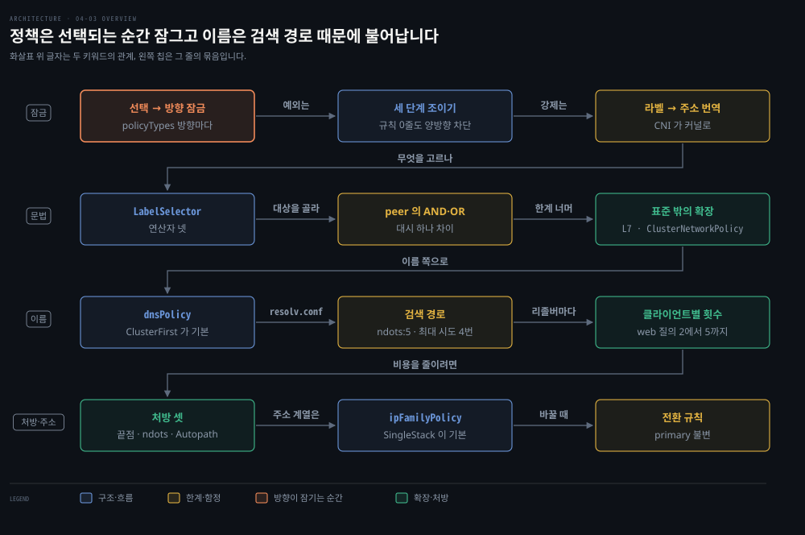


## 본문 정리

### 선택·잠금 규칙 셋과 오해 둘

정책은 Pod 를 선택하는 순간 그 방향을 기본 차단으로 뒤집고, 그 뒤로는 허용만 더할 수 있습니다. 이 규칙이 필요한 이유는 Kubernetes 의 기본이 클러스터 안 임의 Pod 끼리 전부 허용이기 때문입니다. 도입은 쉽지만 공격자가 탈취한 워크로드 하나에서 다른 Pod 를 탐색해 데이터를 빼내기도 쉽습니다. 그래서 NetworkPolicy 로 통신 범위를 좁히고 mTLS(상호 TLS) 같은 애플리케이션 계층 보안을 병행합니다.

아래 도식은 정책 `demo-db-allow-demo` 가 걸린 demo-db 에서 연결 셋이 판정되는 과정입니다. 각 값은 뒤의 「세 단계로 조여 보기」 실측과 같습니다.

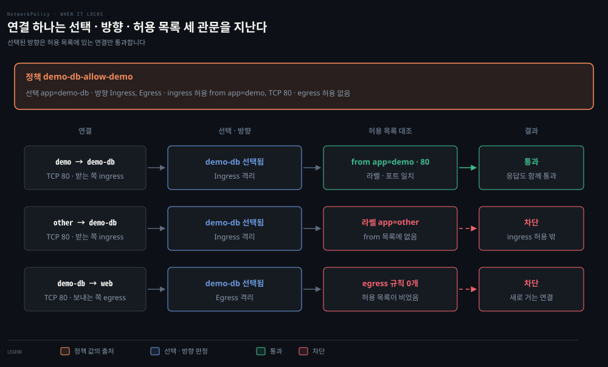

규칙은 셋입니다.

1. 격리는 방향마다 따로 선언됩니다. Pod 를 선택하면서 policyTypes 에 그 방향이 적힌 정책이 하나라도 있어야 그 방향이 격리됩니다. 선택되지 않았거나 방향이 적히지 않았으면 그 방향은 전부 허용입니다.[^np]
2. 격리된 방향은 적용되는 정책들의 허용 목록을 합친 것만 통과시킵니다. 순서는 상관없고 허용만 더하므로 정책을 늘리면 열리는 쪽으로만 움직입니다. 허용한 연결의 응답 트래픽은 따로 적지 않아도 허용됩니다.
3. 연결 하나는 보내는 Pod 의 egress 와 받는 Pod 의 ingress 를 둘 다 통과해야 합니다. 한쪽이 격리되지 않았으면 그쪽은 열려 있는 것으로 칩니다. 예컨대 store 네임스페이스의 정책이 egress 로 downstream-1 Pod 의 8080 을 열어 줬다고 합시다. downstream-1 이 ingress 로 격리돼 있다면 그쪽 정책에도 store 의 Pod 를 허용하는 규칙이 따로 있어야 연결이 맺어집니다. 한쪽의 허용이 다른 쪽을 대신 열어 주지 않습니다.

여기서 격리는 "일부 제한이 적용된다"는 뜻이지 모든 통신이 막힌다는 뜻이 아닙니다.

규칙 1에는 흔히 빠지는 오해가 둘 있습니다. 먼저 포트 단위 차단이 아닙니다. 정책에 `80` 하나를 적어도 선택된 Pod 의 그 방향 전체가 차단으로 뒤집히고 적어 둔 것만 예외로 열립니다. 그 Pod 를 긁던 모니터링이나 로그 수집기도 함께 끊깁니다.

다음으로 정책은 언제나 자기 Pod 의 관점입니다. payment 를 잠가도 cart 로 들어오는 트래픽은 여전히 전부 허용입니다. 다만 cart 가 payment 를 부르던 호출은 막힙니다. cart 가 잠겨서가 아니라 payment 가 잠겼기 때문입니다.

초대장이 있는 파티에 견주면 정책은 초대장이고 문지기는 CNI 입니다. 문지기가 없으면 초대장은 소용이 없고 명단에 오르지 않은 손님은 검문 대상도 아닙니다.

### 세 단계로 조여 보기

규칙을 한 줄도 적지 않은 정책이 양방향을 닫고, 예외는 방향마다 따로 엽니다. 정책 하나를 통째로 읽으면 policyTypes 와 ingress 가 서로 어떤 관계인지 흐려집니다. demo 와 demo-db 두 컴포넌트에 정책을 한 단계씩 얹으면 그 관계가 그대로 드러납니다.

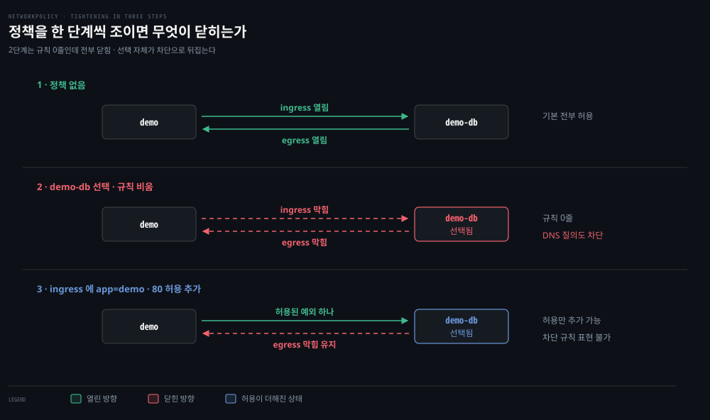

1. 정책이 없으면 둘은 전부 통신할 수 있습니다.
2. demo-db 를 선택하고 policyTypes 에 Ingress·Egress 를 적되 규칙을 비우면 demo-db 는 어떤 트래픽도 주고받지 못합니다.
3. `ingress.from.podSelector: app=demo` 와 포트 80 을 더하면 demo 에서 오는 80번 연결만 받습니다. 나가는 연결은 여전히 전부 차단입니다.

2단계와 3단계를 YAML 로 보면 아래와 같습니다. 읽고 모델을 잡기 위한 예제입니다.

```yaml
# 2단계 — 선택만 하고 규칙은 비운다. 이것만으로 양방향이 잠긴다
apiVersion: networking.k8s.io/v1
kind: NetworkPolicy
metadata:
  name: demo-db-lockdown
spec:
  podSelector:
    matchLabels:
      app: demo-db        # 이 라벨을 단 Pod 가 잠긴다
  policyTypes:            # 어느 방향을 잠글지
    - Ingress
    - Egress
  # ingress·egress 키가 아예 없다 = 허용 규칙이 하나도 없다
```

```yaml
# 3단계 — ingress 에 예외를 하나 더한다. egress 는 그대로 잠겨 있다
apiVersion: networking.k8s.io/v1
kind: NetworkPolicy
metadata:
  name: demo-db-allow-demo
spec:
  podSelector:
    matchLabels:
      app: demo-db
  policyTypes:
    - Ingress
    - Egress
  ingress:
    - from:
        - podSelector:
            matchLabels:
              app: demo   # 이 라벨에서 오는 것만 허용
      ports:
        - protocol: TCP
          port: 80
  # egress 키는 여전히 없다 = 나가는 것은 전부 차단
```

3단계 예제에서 잠금은 `podSelector` 가 걸었고 `ports` 는 열어 줄 예외의 범위를 좁히는 값입니다.

같은 순서를 kind 클러스터에서 재 보았습니다. 노드는 v1.37.0이고 CNI 는 kind 기본인 kindnet 입니다(`kindest/kindnetd:v20260820-69b56db7`). 측정일은 2026-11-08 입니다. demo-db 자리에는 80번 포트로 응답하는 웹 서버를 두었고 연결은 wget 으로 시험했습니다. demo 는 `app=demo` 라벨을, other 는 `app=other` 라벨을 단 Pod 입니다.

| 단계 | demo → demo-db | other → demo-db | demo-db → web | demo-db 의 이름 해석 |
|------|----------------|-----------------|---------------|----------------------|
| 1 정책 없음 | 통과 | 통과 | 통과 | 성공 |
| 2 lockdown | 차단 | 차단 | 차단 | 실패 |
| 3 allow-demo 추가 | 통과 | 차단 | 차단 | 실패 |

3단계에서 demo → demo-db 가 열린 것은 ingress 허용 덕분입니다. demo-db 의 egress 가 잠겨 있어도 응답이 돌아온 것은 허용한 연결의 응답 트래픽이 따로 적지 않아도 통과하기 때문입니다. demo-db → web 은 demo-db 가 새로 거는 연결이라 계속 막힙니다. kindnet 이 정책을 강제하는 CNI 라서 이 결과가 나왔습니다.

`policyTypes` 를 안 적으면 `Ingress` 가 기본으로 들어가고 egress 규칙이 있으면 `Egress` 도 덧붙습니다.[^ptype] 의도가 드러나지 않아 실수하기 쉬우므로 운영 매니페스트에는 어느 방향을 잠글지 항상 적는 편이 안전합니다.

`ports` 를 아예 안 적으면 뜻이 뒤집힙니다. 비어 있음이 층마다 반대로 읽히기 때문입니다. `ingress` 는 **허용 목록**입니다. 목록이 비면 허용이 하나도 없습니다. 목록 안의 각 항목은 하나의 허용이고 그 안의 `from` 과 `ports` 는 그 허용을 좁히는 조건입니다. 조건을 안 적으면 좁히지 않습니다.[^ptype]

| 적은 것 | 뜻 |
|---------|-----|
| `ingress: []` | 허용 0개 — 아무도 못 들어온다 |
| `ingress: [{from: demo, ports: [80]}]` | demo 가 80 으로만 |
| `ingress: [{from: demo}]` | demo 가 모든 포트로 |
| `ingress: [{ports: [80]}]` | 누구나 80 으로만 |
| `ingress: [{}]` | 누구나 모든 포트로 — 사실상 전면 개방 |

맨 아래가 함정입니다. 중괄호 하나짜리 규칙은 무언가 적혀 있어 보이는데 아무것도 막지 않습니다. 같은 "안 적었다"가 목록 층에서는 전면 차단이고 항목 층에서는 전면 허용입니다.

> ⚠️ Egress 를 잠그면 DNS 가 먼저 죽습니다.
>
> 2단계처럼 Egress 를 규칙 없이 잠근 Pod 는 이름 해석도 못 합니다. CoreDNS 로 가는 53번 포트 질의까지 막히기 때문입니다. 앱 로그에는 "연결 거부"가 아니라 *"host not found"* 나 이름 해석 타임아웃이 찍힙니다. 그래서 정책 문제인 줄 모르고 DNS 장애를 쫓게 됩니다. default deny-all egress 정책은 DNS 트래픽도 함께 막습니다.[^np] `kube-system` 의 CoreDNS 로 가는 UDP·TCP 53 을 함께 여는 것이 사실상 필수입니다. DNS 는 큰 응답과 재시도를 TCP 로 넘기도록 요구되므로 UDP 만 열면 간헐 실패가 납니다.[^rfc]

### 라벨을 주소로 번역하는 CNI

정책은 라벨로 쓰지만 커널은 주소와 포트로만 판정하므로 그 사이를 CNI 가 번역합니다. 커널은 `app=demo` 가 무엇인지 모릅니다. 정책을 강제하는 일은 네트워크 플러그인의 컨트롤러가 맡고, 컨트롤러가 없으면 NetworkPolicy 를 만들어도 효력이 없습니다.[^np]

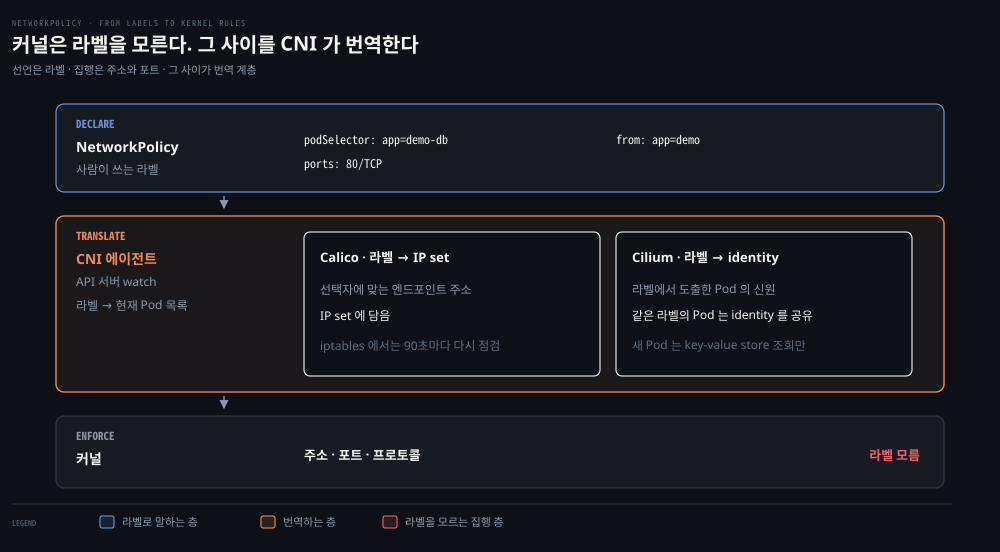

번역 계층이 없는 CNI 에서는 `kubectl apply` 가 성공하고 오브젝트도 조회되지만 커널에는 아무 규칙도 생기지 않습니다. 에러가 나지 않아 막고 있다고 믿게 되는 것이 이 함정의 위험한 지점입니다. 지원 여부는 CNI 마다 갈립니다. Flannel 은 자체 정책 컨트롤러가 없어서 Helm 차트의 `netpol.enabled` 로 정책 컨트롤러를 함께 배포하거나 정책용 프로젝트를 따로 붙입니다.[^flannel] CNI 별 정책 강제 여부는 [04-02](./04-02.CNI%EC%99%80%20kube-proxy%20%E2%80%94%20Pod%20%EB%84%A4%ED%8A%B8%EC%9B%8C%ED%81%AC%EC%9D%98%20%EB%B0%B0%EC%84%A0%EA%B3%B5%EA%B3%BC%20%EB%A1%9C%EB%93%9C%EB%B0%B8%EB%9F%B0%EC%84%9C.md)의 「4대 CNI — 첫 관문은 정책 강제」에 정리돼 있습니다.

번역 방식은 구현마다 다릅니다. Calico 는 선택자에 맞는 엔드포인트 주소를 IP set 에 담습니다. iptables 데이터패스에서는 Felix 가 그 집합이 어긋나지 않았는지 기본 90초마다 다시 점검합니다.[^calico] Cilium 은 주소 대신 라벨에서 도출한 identity 로 보안을 표현합니다. 같은 라벨을 단 Pod 는 identity 를 공유합니다. 그래서 Pod 가 새로 떠도 key-value store 에서 identity 를 찾기만 하면 되고 다른 노드의 규칙을 고칠 필요가 없습니다.[^cilium]

라벨이 정책의 입력이라서 생기는 한계가 다섯 있습니다.

- 라벨을 바꾸면 적용 대상도 바뀝니다. demo-db 라벨을 떼면 정책이 풀리고 침해된 Pod 에 `app=demo` 를 붙이면 접근권이 생깁니다.
- 정책은 노드의 데이터패스에 비동기로 반영됩니다. 정책이 처리되기 전에 만들어진 Pod 는 보호 없이 시작할 수 있습니다. 허용 규칙이 격리 규칙보다 늦게 들어오면 한동안 통신이 끊길 수 있습니다. Kubernetes API 에는 처리가 끝난 시점을 알려 주는 신호가 없습니다. 그래서 Pod 는 기대와 다른 연결 상태로 시작해도 견디도록 만듭니다. 꼭 필요한 대상이 있으면 init 컨테이너에서 도달성을 기다립니다.[^np]
- 정책이나 라벨이 바뀔 때 이미 맺어진 연결이 끊기는지는 구현이 정합니다. 그러므로 정책 배포나 라벨 변경을 침해된 세션을 끊는 수단으로 믿어서는 안 됩니다.[^np]
- `hostNetwork: true` Pod 에 대한 동작은 정의되어 있지 않습니다. 가장 흔한 구현은 hostNetwork Pod 를 podSelector 판정에서 제외하고 노드 IP 의 트래픽으로 다룹니다.[^np]
- 그 Pod 가 떠 있는 노드와 오가는 트래픽은 언제나 허용이고 Pod 는 localhost 접근도 막지 못합니다.[^np] 그래서 노드에 접근한 공격자가 노드 IP 를 출발지로 위장해 보낸 패킷도 이 허용에 걸려 정책을 지날 수 있습니다.[^spoof]

전역 기본 차단이 필요하면 방법은 넷입니다.

- 네임스페이스마다 `podSelector: {}` 로 모든 Pod 를 선택하는 deny-all 정책
- CNI 가 제공하는 전역 기본 정책
- ClusterNetworkPolicy 의 Baseline 티어 Deny 규칙. 개발자 정책이 덮어쓸 수 있는 기본 자세입니다.[^cnpapi]
- 워크로드에 NetworkPolicy 를 요구하는 admission 정책

### LabelSelector 연산자 넷

셀렉터 필드는 둘이고 연산자는 넷이며 모든 요구 사항은 AND 로 묶입니다. 정책이 아무 Pod 에도 안 걸리거나 엉뚱한 Pod 까지 잠그는 사고는 대개 셀렉터를 한 칸 틀려서 생깁니다. Kubernetes 리소스는 서로를 이름보다 라벨 셀렉터로 가리키므로 NetworkPolicy 도 이 문법 위에 있습니다.

LabelSelector 의 필드는 둘입니다.

- `matchLabels` — 키-값 맵입니다. 항목 하나는 `matchExpressions` 의 `In` 하나(값이 하나인)와 같습니다.
- `matchExpressions` — 요구 사항 목록입니다. 항목마다 `key` 와 `operator` 와 `values` 를 가집니다.

두 필드의 요구 사항은 전부 AND 로 묶여 모두 참이어야 매칭됩니다.[^labels]

연산자는 `In` `NotIn` `Exists` `DoesNotExist` 넷이고 `values` 조건이 갈립니다. `In` 과 `NotIn` 은 `values` 가 비어 있으면 안 되고 `Exists` 와 `DoesNotExist` 는 비어 있어야 합니다.[^values] `NotIn` 은 값이 목록 밖인 리소스에 더해 그 키가 아예 없는 리소스도 매칭한다는 점이 함정입니다.[^labels] 빈 셀렉터(`podSelector: {}`)는 범위 안 전부, 곧 네임스페이스의 모든 Pod 를 선택합니다.

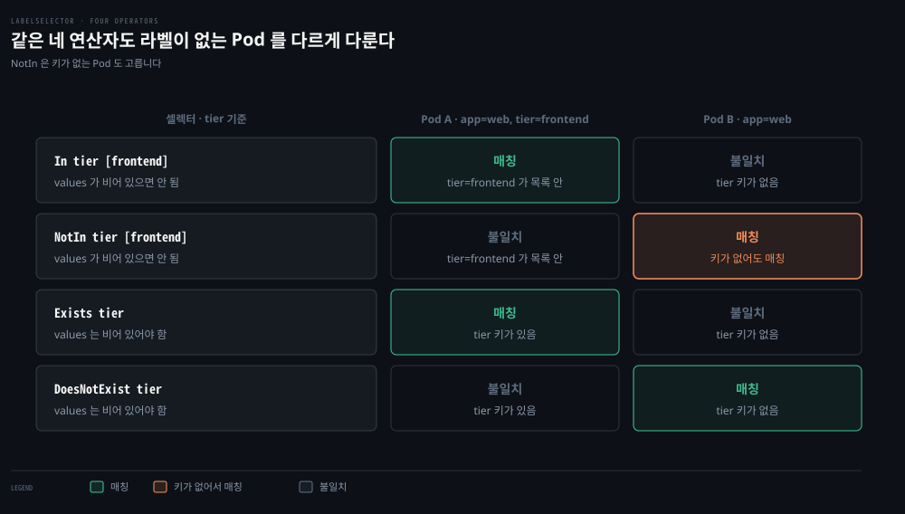

도식은 라벨이 `app=web, tier=frontend` 인 Pod A 와 `app=web` 뿐인 Pod B 에 네 연산자를 대 본 결과입니다. 예컨대 `NotIn tier [frontend]` 는 A 를 빼지만 `tier` 키가 없는 B 는 매칭합니다.

### peer 넷과 AND·OR 함정

peer 는 넷이고 그중 조합형에서는 YAML 대시 하나가 AND 를 OR 로 바꿉니다. 대상을 골랐으면 누구에게서 오는 것을 열어 줄지 적을 차례인데, 한 글자 다르게 적으면 정책이 의도보다 훨씬 넓게 열립니다. 문법이 유효하므로 오류도 나지 않고 적용도 되며 적어 놓고 보면 맞아 보이기까지 합니다.

ingress 와 egress 섹션은 각각 규칙 목록이고 각 규칙은 포트 목록과 NetworkPolicyPeer 목록을 가집니다. peer 를 지정하는 방법이 네 가지입니다.

| peer | 의미 | 주의 |
|------|------|------|
| ipBlock | CIDR + 선택적 except(하위 CIDR 제외) | 외부 시스템용. 다른 peer 필드와 한 항목에 함께 못 씀 |
| namespaceSelector | 라벨 매칭되는 모든 네임스페이스의 모든 Pod | 네임스페이스 라벨을 바꿀 수 있으면 정책을 우회 가능 |
| podSelector | 같은 네임스페이스의 라벨 매칭 Pod | namespaceSelector 없이 쓰면 정책의 네임스페이스로 한정 |
| namespace + pod 조합 | 두 조건의 AND — 매칭 네임스페이스 안의 매칭 Pod | YAML 문자 하나(`-`)가 AND를 OR 두 항목으로 바꿈 |

마지막 행이 함정입니다. `- namespaceSelector:` 아래에 `podSelector:` 를 들여쓰면 AND 하나이고, `- podSelector:` 를 새 항목으로 적으면 OR 둘입니다.

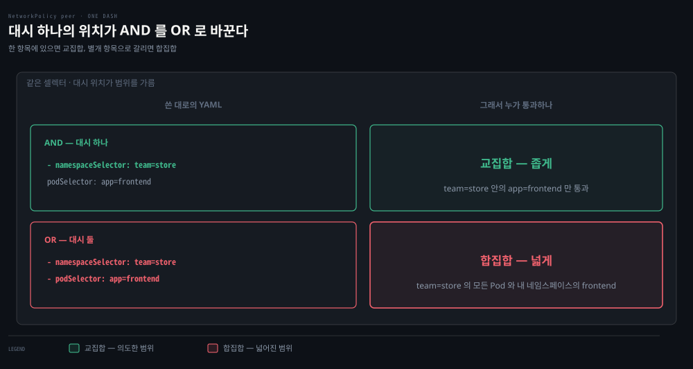

도식이 가리키는 차이를 YAML 두 벌로 놓으면 대시 하나뿐임이 보입니다.

```yaml
# AND — 대시 하나. 두 셀렉터가 같은 항목에 들어 있다
ingress:
  - from:
      - namespaceSelector:
          matchLabels: {team: store}
        podSelector:
          matchLabels: {app: frontend}
```

```yaml
# OR — 대시 둘. 두 셀렉터가 별개 항목으로 갈라진다
ingress:
  - from:
      - namespaceSelector:
          matchLabels: {team: store}
      - podSelector:
          matchLabels: {app: frontend}
```

위쪽은 `team=store` 네임스페이스 안의 `app=frontend` Pod 만 허용합니다. 아래쪽은 `team=store` 네임스페이스의 모든 Pod 와 정책이 놓인 네임스페이스의 `app=frontend` Pod 를 허용합니다. 의도한 것보다 훨씬 넓게 열립니다.

`namespaceSelector` 는 네임스페이스의 라벨만 봅니다. 네임스페이스 이름을 직접 적는 필드는 없지만 모든 네임스페이스에는 불변 라벨 `kubernetes.io/metadata.name` 이 자동으로 붙습니다. 이 라벨로 특정 네임스페이스를 이름으로 고를 수 있습니다.[^np]

외부 대역을 지정하는 `ipBlock` 은 주소 변환의 영향을 받습니다. Service 를 거칠 때 주소 변환이 정책 처리 전에 일어나는지 후에 일어나는지는 플러그인과 클라우드와 Service 구현의 조합에 따라 다릅니다. 그래서 정책이 보는 출발지가 원래 클라이언트가 아니라 LoadBalancer 나 노드의 IP 일 수 있습니다.[^np]

포트는 `endPort` 로 연속 범위를 묶을 수 있고 v1.25 부터 Stable 입니다. 시작 `port` 와 함께 적으며 `endPort` 는 `port` 보다 크거나 같아야 하고 숫자 포트에만 쓸 수 있습니다. 외부 대역의 연속 포트 범위로 나가는 egress 를 열 때 쓰입니다(예: `10.0.0.0/24` 의 32000–32768). CNI 가 `endPort` 를 지원하지 않으면 에러 없이 시작 `port` 하나에만 적용됩니다.[^np]

NetworkPolicy 가 다루는 것은 TCP·UDP·SCTP 의 포트 기반 연결뿐입니다. ARP 나 ICMP 는 거부와 허용 규칙에서 어떻게 처리될지 정해져 있지 않아 플러그인마다 다릅니다. ping 결과만으로 L4 정책의 효력을 단정하면 안 됩니다.[^np]

### 표준 정책 밖의 규칙과 확장

표준 NetworkPolicy 는 누가 어느 포트로까지만 적고, 요청 내용과 거부와 클러스터 전체 규칙은 확장이 맡습니다. 실무 요구는 그보다 잘게 나뉩니다. 같은 Pod 의 같은 8080 포트라도 조회 경로는 열고 관리 경로는 막고 싶은 식입니다. 표준 문법으로는 이를 적을 방법이 없어 포트를 억지로 나누거나 앱 코드에서 처리하는 우회가 남습니다.

Cilium 은 두 층을 모두 정책으로 적습니다. L3 정책은 "DB 에는 웹 서버만"처럼 상대를 라벨로 고릅니다. `CiliumNetworkPolicy` 에서 `endpointSelector` 는 대상 Pod 를 고르고 `fromEndpoints` 는 허용할 상대를 적습니다.[^cilium]

L7 정책은 거기에 `rules.http` 를 더해 메서드와 경로까지 조건으로 씁니다. 경로와 메서드는 확장 POSIX 정규식으로 매칭하므로 `GET /` 와 `GET /data` 만 허용하면 같은 포트의 `/health` 는 막힙니다.[^cilium7] 이 판정은 노드의 Envoy 프록시가 요청을 읽어서 합니다. Envoy 가 agent Pod 에 내장된 구성에서는 L7 트래픽이 agent 의 가용성에 달립니다.[^cilium7]

L7 정책에는 값이 둘 따릅니다. 요청을 뜯어봐야 하므로 처리가 더 듭니다. 표준 리소스가 아닌 CNI 고유 확장이라서 다른 CNI 로 옮기면 정책을 다시 써야 합니다.

Cilium 에는 거부도 있습니다. deny 정책은 allow 정책보다 우선하고 Kubernetes NetworkPolicy 보다도 우선합니다.[^cilium] 정책을 실제로 걸고 응답 코드를 재는 절차는 [04-04](./04-04.Kubernetes%20%EB%84%A4%ED%8A%B8%EC%9B%8C%ED%81%AC%20%EC%8B%A4%EC%8A%B5%20%E2%80%94%20CNI%20%EB%B6%80%EC%9E%AC%EB%B6%80%ED%84%B0%20%EC%A0%95%EC%B1%85%C2%B7DNS%EA%B9%8C%EC%A7%80.md)의 「선택되는 순간의 잠금」과 「Cilium L7 정책」에 있습니다.

L7 외에도 표준 API 에 없는 것이 더 있습니다. 1.37 문서가 꼽는 것 가운데 일부는 다음과 같습니다.[^np]

- Service 이름이나 노드 신원을 규칙의 대상으로 지정하는 일
- 허용·차단 이벤트를 남기는 표준 로깅
- 모든 네임스페이스에 걸리는 전역 기본 정책
- 다른 허용을 덮어쓰는 명시적 거부
- Pod 의 localhost 접근과 자기 노드발 트래픽의 차단

이런 요구는 우회로가 있습니다. OS 구성 요소(SELinux·OpenVSwitch·iptables 등), L7 기술(Ingress 컨트롤러·서비스 메시), admission 컨트롤러가 그것입니다.[^np] 명시적 거부와 전역 기본 정책은 CNI 확장 리소스나 ClusterNetworkPolicy 가 맡습니다.

ClusterNetworkPolicy 는 클러스터 관리자용 표준화 시도입니다. AdminNetworkPolicy 와 BaselineAdminNetworkPolicy 를 하나로 합친 리소스이고 API 그룹은 `policy.networking.k8s.io` 입니다.[^cnp] 2026-11-06 의 v0.3.0 에서 v1beta1 로 올라 저장 버전이 되었고 v1alpha2 도 함께 제공됩니다.[^cnpver]

개발자의 NetworkPolicy 와 우선순위를 가르기 위해 티어를 둡니다. 평가 순서는 Admin 티어, NetworkPolicy 티어, Baseline 티어이고 ClusterNetworkPolicy 는 Admin 과 Baseline 두 티어를 쓸 수 있습니다.

규칙의 액션은 Accept·Deny·Pass 셋이며 Pass 는 현재 티어의 남은 규칙을 건너뛰고 다음 티어로 넘깁니다. 같은 티어 안에서는 priority 값이 작은 ClusterNetworkPolicy 가 먼저 평가됩니다. Admin 티어가 Accept 나 Deny 로 판정하지 않은 트래픽은 NetworkPolicy 티어로 넘어갑니다. 거기서도 맞는 정책이 없으면 Baseline 티어에서 평가됩니다.[^cnpapi]

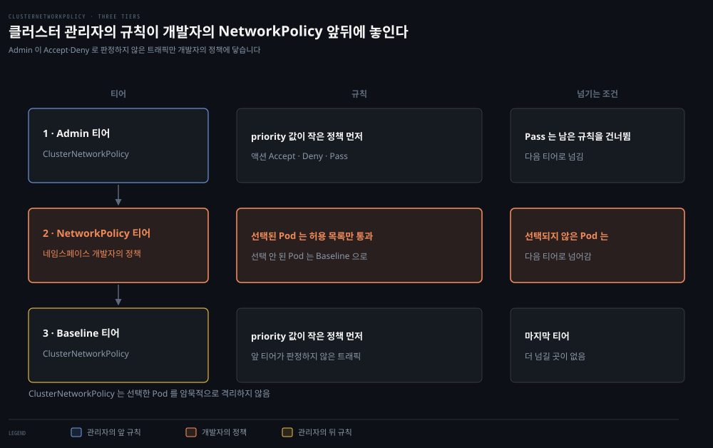

ClusterNetworkPolicy 는 NetworkPolicy 와 달리 규칙을 읽은 그대로 적용하고 선택된 Pod 를 암묵적으로 격리하지 않습니다.[^cnpapi] 이 API 는 CRD 이므로 구현과 지원 범위는 CNI 마다 따로 봐야 합니다.

### Pod 의 DNS 설정과 dnsPolicy

dnsPolicy 가 Pod 의 `resolv.conf` 를 정하고 기본값은 ClusterFirst 입니다. 클러스터 안의 서비스를 이름으로 부르는 것이 Pod 의 정상적인 동작이므로 기본이 그쪽으로 잡혀 있습니다. Pod 쪽 설정은 dnsPolicy 4종입니다.[^dnspod]

| dnsPolicy | 동작 | 언제 고르나 |
|-----------|------|-----------|
| ClusterFirst | 클러스터 도메인 접미사와 안 맞는 질의(`www.kubernetes.io` 등)는 DNS 서버가 업스트림으로 넘깁니다 | 기본값입니다. 아무것도 안 적으면 이것입니다 |
| ClusterFirstWithHostNet | ClusterFirst 와 같되 hostNetwork Pod 에서 동작합니다 | `hostNetwork: true` 인 Pod. 이때는 명시해야 합니다 |
| Default | 노드의 이름 해석 설정을 그대로 상속합니다. 클러스터 DNS 를 안 씁니다 | 서비스 이름을 부를 일이 없는 Pod |
| None | 클러스터 설정을 전부 무시하고 `dnsConfig` 로 직접 지정합니다. nameservers 최대 3개, searches 최대 32개 | 외부 DNS 를 강제하거나 검색 경로를 손수 짤 때 |

`Default` 가 기본값이 아닙니다. 기본값은 `ClusterFirst` 이고 `Default` 는 "노드 설정을 따른다"는 뜻의 이름입니다. hostNetwork Pod 에 ClusterFirst 를 두면 Default 처럼 동작하므로 `ClusterFirstWithHostNet` 을 명시해야 합니다.

`dnsConfig` 에는 한도가 있습니다. search domain 은 32개를 넘지 못하고 전체 길이는 2048자를 넘지 못합니다. 이 한도는 세 곳에 따로 걸립니다. 노드의 설정 파일, Pod 의 `dnsConfig`, 둘을 병합한 결과입니다(v1.28 부터 Stable).[^dnspod]

Pod 의 `dnsConfig` 자체가 한도를 넘으면 API 서버가 Pod 생성을 거부합니다.[^dnsval] 병합한 결과만 넘으면 kubelet 이 넘친 search 를 잘라 내고 경고를 남깁니다.[^dnskubelet]

사내 도메인은 완전한 이름으로 부릅니다. 그 도메인을 사내 DNS 로 보내는 일은 CoreDNS 의 조건부 전달(`forward`)에 맡기면 search 목록을 늘리지 않아도 됩니다.[^dnscustom]

### 검색 경로와 이름 하나의 질의

점이 ndots 개 미만인 이름은 검색 도메인을 하나씩 붙여 본 뒤에야 이름 그대로 질의됩니다. 클러스터 안에서는 `web` 처럼 짧은 이름이 편하지만 그 편의에 질의 비용이 붙습니다. 아무것도 잘못하지 않았는데 DNS 질의가 앱 지연의 눈에 띄는 몫을 차지하는 일이 흔합니다.

클러스터 DNS 는 Kubernetes 1.13 부터 CoreDNS 가 기본입니다.[^coredns] kubeadm 이 올리는 CoreDNS 는 v1.37.2 기준으로 v1.14.6 입니다.[^kubeadm] kube-system 의 Deployment `coredns` 로 돌며 kind 의 kubeadm 클러스터에서는 replica 2 로 떠 있었습니다. 설정 파일인 Corefile 은 ConfigMap 에 담겨 있어서 CoreDNS 의 동작을 바꾸려면 이 ConfigMap 을 고칩니다.[^dnscustom]

Pod 의 `resolv.conf` 에는 `search <네임스페이스>.svc.cluster.local svc.cluster.local cluster.local` 과 `options ndots:5` 가 들어갑니다.[^dnspod]

리졸버는 질의명 뒤에 각 검색 도메인을 붙여 후보 이름을 만듭니다. 후보를 앞에서부터 시도하고 답이 오면 멈춥니다. 마지막 후보가 이름 그대로입니다. 뒤쪽 후보도 매번 앞에 원래 이름이 붙은 채로 질의됩니다. 예컨대 `web` 은 `web.default.svc.cluster.local` 부터 시작합니다.

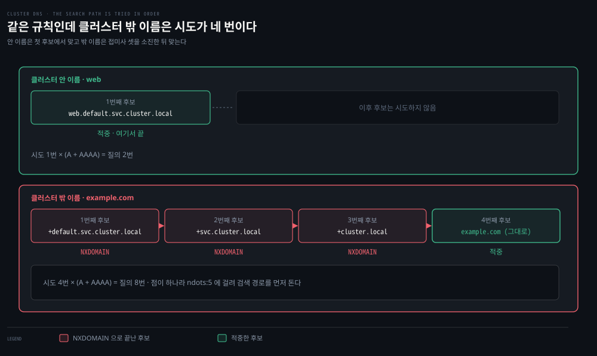

`ndots:5` 의 5는 질의 횟수가 아니라 "점이 5개 미만인 이름은 검색 경로를 먼저 시도한다"는 임계값입니다.[^ndots] 모든 후보가 실패할 때의 최대 시도 수는 검색 도메인 수에 이름 그대로 한 번을 더한 값입니다. 각 시도는 A 와 AAAA 두 질의를 내보냅니다. 호스트의 검색 도메인은 Pod 의 목록에 합쳐져 시도를 더 늘리는데 측정한 노드에는 호스트 검색 도메인이 없었습니다.

| 이름 | 점 | 시도 | 질의(A+AAAA) |
|------|----|------|--------------|
| `web` | 0 | 첫 후보에서 적중 | 2 |
| `example.com` | 1 | 클러스터 접미사 셋이 NXDOMAIN, 이름 그대로 적중 | 8 |
| `example.com.` | 끝점 | 완전한 이름이라 검색 경로를 안 탐 | 2 |

표는 kind(kubeadm, 노드 v1.37.0)에 CoreDNS v1.14.6 의 `log` 플러그인을 켜고 2026-11-08 에 쟀습니다. `web` 은 glibc 2.41 의 `getent hosts` 결과이고 나머지 둘은 Alpine 의 curl 8.23.0 결과입니다.

### 클라이언트마다 다른 질의 횟수

같은 이름이라도 질의 횟수는 클라이언트의 리졸버 구현이 정합니다. 위 표의 `web` 이 2번이었다고 해서 모든 클라이언트가 그런 것은 아닙니다. 같은 클러스터와 같은 CoreDNS 에서 클라이언트만 바꿔 `web` 한 번의 질의를 세었습니다.

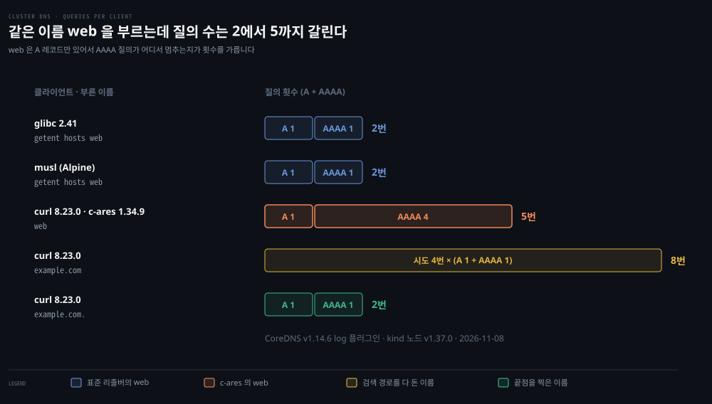

Debian 13 의 glibc 2.41 과 Alpine 의 musl 은 `getent hosts web` 에서 2번 묻습니다. A 와 AAAA 가 첫 후보 한 번씩이고 거기서 멈춥니다. Alpine 의 curl 8.23.0 은 c-ares 1.34.9 를 쓰며 `http://web/` 에서 5번 묻습니다. A 가 1번이고 AAAA 가 4번입니다.

같은 curl 이 `http://example.com/` 에서는 8번이고 `http://example.com./` 에서는 2번입니다. 모두 2026-11-08 에 쟀습니다.

`web` 은 싱글스택 클러스터의 Service 라서 A 레코드는 있지만 AAAA 레코드는 없습니다. glibc 와 musl 은 AAAA 의 빈 답(NODATA)을 받고 멈췄습니다. c-ares 의 AAAA 는 첫 후보에서 같은 빈 답을 받고도 남은 세 후보를 끝까지 돌았다고 보면 측정값 4와 맞아떨어집니다. A 와 AAAA 가 서로 독립으로 검색 경로를 도는 구현이어서 패킷 수가 "두 배"가 아니라 홀수로 나옵니다.

### 질의를 줄이는 처방 셋

처방은 고치는 자리로 갈립니다. 앱에서는 이름 끝에 점을 찍습니다. Pod 설정에서는 ndots 를 낮춥니다. 서버에서는 Autopath 가 검색 경로를 대신 걷습니다.

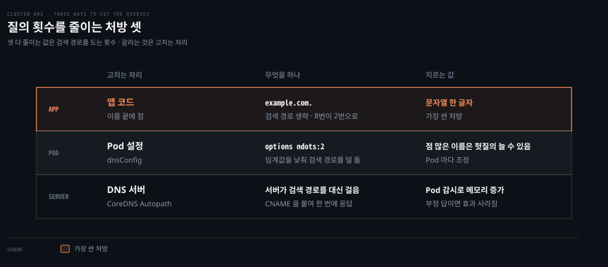

가장 싼 것은 앱 쪽입니다. 이름 끝에 점을 하나 찍으면 완전한 이름이라는 표시가 되어 검색 경로를 아예 안 탑니다. `example.com.` 으로 부른 질의가 8번에서 2번이 된 것이 앞 절의 측정입니다.

Pod 설정에서는 `dnsConfig` 로 `ndots` 를 낮춥니다. 임계값이 내려가면 그만큼 검색 경로를 덜 돕니다. 대신 점이 새 임계값 이상인 이름(`web.ns.svc` 등)은 이름 그대로를 먼저 물으므로 클러스터 이름이면 헛질의가 한 번 생깁니다. 그래서 그 Pod 가 무엇을 부르는지 알고 조정해야 합니다.[^ndots]

서버 쪽 해법이 CoreDNS 의 Autopath 입니다. 클라이언트가 첫 후보를 물으면 서버가 검색 경로를 대신 돌아 처음 NXDOMAIN 이 아닌 답을 돌려줍니다. 원래 이름에서 그 답으로 가는 CNAME 도 함께 붙입니다.[^autopath] 앱을 안 고쳐도 되는 것이 장점입니다.

값은 둘입니다. Autopath 는 요청한 Pod 의 네임스페이스를 알아야 해서 kubernetes 플러그인의 `pods verified` 가 필요합니다. 이 모드는 모든 Pod 를 감시하므로 메모리가 훨씬 듭니다.[^k8splug] 서버 쪽 검색이 결국 부정 답(NXDOMAIN)으로 끝나면 클라이언트가 모든 경로를 직접 다시 돌아 최적화가 사라집니다.[^autopath] 클러스터 크기에 맞춰 replica 메모리와 requests 를 조정하고 coredns 메트릭으로 감시해야 합니다.

NodeLocal DNSCache 는 질의 수가 아니라 질의 하나의 값을 줄입니다. 노드마다 캐시 에이전트를 DaemonSet 으로 띄웁니다. Pod 가 같은 노드의 캐시에 물으면 ClusterIP 로 가던 질의의 DNAT 와 conntrack 항목이 생기지 않습니다. 클러스터 이름의 캐시 미스만 CoreDNS 로 보내며 그 구간은 TCP 로 올릴 수 있습니다. v1.18 부터 Stable 입니다.[^nld] 이름 하나의 질의 횟수를 재는 절차는 [04-04](./04-04.Kubernetes%20%EB%84%A4%ED%8A%B8%EC%9B%8C%ED%81%AC%20%EC%8B%A4%EC%8A%B5%20%E2%80%94%20CNI%20%EB%B6%80%EC%9E%AC%EB%B6%80%ED%84%B0%20%EC%A0%95%EC%B1%85%C2%B7DNS%EA%B9%8C%EC%A7%80.md)의 「이름 하나의 질의 횟수」에 있습니다.

### ipFamilyPolicy 와 기본값 근거

서비스의 주소 계열은 ipFamilyPolicy 가 정하고 기본값은 SingleStack 입니다. IPv4 주소가 모자라거나 IPv6 를 요구받는 환경이 있습니다. 클러스터의 IPv6 활성화와 서비스별 계열은 층이 다릅니다. 둘을 섞으면 "클러스터는 dual-stack 인데 서비스에는 IPv6 가 안 붙는" 상황이 설명되지 않습니다. 서비스 쪽 축을 따로 보면 정리됩니다.

dual-stack 은 Pod 당 IPv4·IPv6 주소 각 1개, IPv4·IPv6 서비스, 두 계열의 egress 라우팅을 제공합니다. v1.23 에서 Stable 이 되었습니다.[^dual]

서비스에는 ipFamilyPolicy 가 생깁니다. 셋 중 하나를 고르고 안 고르면 첫 줄이 됩니다.

| ipFamilyPolicy | 동작 | 클러스터가 단일 스택이면 |
|----------------|------|----------------------|
| SingleStack | 첫 계열로만 ClusterIP 를 줍니다 | 정상 동작합니다. 기본값입니다 |
| PreferDualStack | dual-stack 이 켜져 있으면 두 계열을 줍니다 | SingleStack 처럼 동작합니다. 실패하지 않습니다 |
| RequireDualStack | IPv4·IPv6 둘 다에서 할당합니다 | 오브젝트 생성이 실패합니다. selector 없는 headless Service 는 예외입니다 |

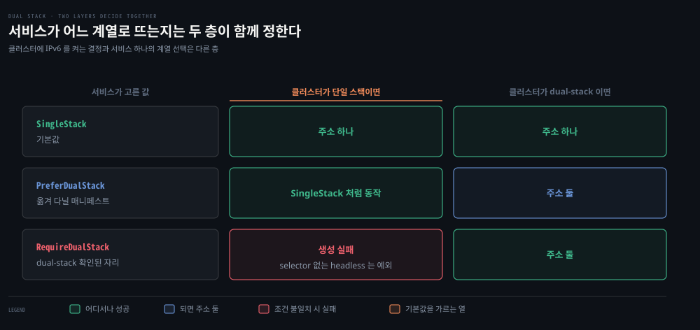

기본값이 `SingleStack` 인 이유가 마지막 열에 있습니다. 클러스터가 dual-stack 인지 아닌지를 서비스 정의가 알 수 없으므로 어느 클러스터에 올려도 뜨는 값이 기본이어야 합니다. 옮겨 다닐 매니페스트라면 `PreferDualStack` 이 안전한 절충입니다. `RequireDualStack` 은 그 클러스터가 dual-stack 이라는 것을 아는 자리에서만 씁니다.

`ipFamilies` 배열로 계열과 순서를 고릅니다. 첫 번째 계열이 단수 `clusterIP` 의 계열이 됩니다.[^dual]

### 클러스터 전제와 전환 규칙

이중 스택은 컴포넌트마다 CIDR 쌍을 넘겨야 켜지고 한번 정한 primary family 는 바꿀 수 없습니다. dual-stack 은 1.21 부터 기본으로 켜져 있어 feature gate 설정이 필요 없습니다. 대신 control plane 과 노드 컴포넌트에 두 계열의 CIDR 을 나란히 전달해야 합니다. 노드에는 라우팅 가능한 IPv4·IPv6 인터페이스가 있어야 하고 CNI 가 이중 스택을 지원해야 합니다.[^dual]

- kube-apiserver — `--service-cluster-ip-range=<IPv4 CIDR>,<IPv6 CIDR>`
- kube-controller-manager — `--cluster-cidr` 와 `--service-cluster-ip-range` 에 같은 방식으로 두 대역
- kube-proxy — `--cluster-cidr` 에 두 Pod 대역
- kubelet — `--node-ip=<IPv4 IP>,<IPv6 IP>` (cloud provider 를 쓰지 않는 bare metal 노드에서는 필수)

CIDR 을 적는 순서가 설계 선택입니다. 서비스의 기본 계열은 첫 번째 service cluster IP range 의 계열을 따릅니다.[^dual]

Service 에서 가장 중요한 제약은 primary family 의 불변성입니다. `.spec.ipFamilies` 는 조건부로만 바꿀 수 있습니다. secondary 계열은 추가하거나 뺄 수 있지만 이미 있는 Service 의 primary 계열은 바꿀 수 없습니다.[^dual] 주 계열을 바꿔야 한다면 원하는 순서로 새 Service 를 만들어 클라이언트를 옮깁니다.

클러스터를 바꿔도 기존 Service 는 자동으로 올라가거나 내려가지 않습니다. `PreferDualStack` Service 도 클러스터의 dual-stack 여부가 바뀐 것만으로는 주소가 늘거나 줄지 않습니다.[^alloc]

단일 스택 Service 를 확장하려면 `ipFamilyPolicy` 를 `PreferDualStack` 이나 `RequireDualStack` 으로 바꿉니다. 그러면 비어 있던 secondary 계열의 ClusterIP 가 할당됩니다. 반대로 `SingleStack` 으로 되돌리면 `clusterIPs` 의 첫 항목만 남기고 `ipFamilies` 도 그 계열로 줄어듭니다.[^dual] 할당 목록의 정본은 복수형 `spec.clusterIPs` 이고 단수 `spec.clusterIP` 는 그 값에서 계산됩니다.

기본값 규칙에서 벗어나는 예외가 selector 없는 headless Service 입니다. selector 가 있는 headless Service 는 정책을 생략하면 `SingleStack` 이 기본입니다. selector 없는 headless Service 는 정책을 비워 두면 `RequireDualStack` 이 기본값이 됩니다.[^dual] 이 조합은 할당 코드가 따로 허용하므로 단일 스택 클러스터에서도 생성이 실패하지 않습니다.[^alloc]

`type: LoadBalancer` 에 dual-stack 을 선언해도 외부 주소 발급은 클라우드 공급자가 IPv4·IPv6 로드 밸런서를 지원해야 합니다. 비공개 IPv6 대역을 쓰는 Pod 가 클러스터 밖으로 나가려면 투명 프록시나 `ip-masq-agent` 같은 IP 마스커레이딩으로 공개 IPv6 주소를 쓰게 해야 합니다. CNI 도 IPv6 를 지원해야 합니다.[^dual] IPv4 아웃바운드가 정상이라고 IPv6 egress 까지 성공한다고 가정해서는 안 됩니다. 계열마다 라우팅과 방화벽과 NAT 구성과 DNS AAAA 응답 상태를 따로 점검합니다.


## 결정 치트시트

> 정책 작성 전 점검 여섯 줄입니다.

| 점검 | 기준 |
|------|------|
| CNI 가 NetworkPolicy 를 강제하는가? | 정책 컨트롤러가 없는 CNI(예: Flannel 단독)면 오브젝트만 생기고 효력이 없음 — 컨트롤러를 붙이거나 정책을 강제하는 CNI 로 |
| 이 Pod 가 이미 다른 정책에 선택되는가? | 여러 정책은 합집합 — 예외가 어디서 오는지 전수 확인 |
| peer 의 AND/OR 가 의도대로인가? | `-` 위치 하나로 갈림 — namespace+pod 조합은 한 항목 안에 |
| 상대편 정책도 허용하는가? | 내 egress 허용 ≠ 상대 ingress 허용 — 양쪽 모두 필요 |
| 기본-차단이 필요한가? | 네임스페이스별 deny-all + 명시적 허용, 또는 admission 강제 |
| Egress 를 잠그는가? | CoreDNS 로 가는 UDP·TCP 53 을 함께 열기 — 안 열면 증상이 "연결 거부"가 아니라 이름 해석 실패 |


## 연습 문제

> 아래 여덟 문제는 선택-잠금과 세 단계와 CNI 와 빈 값과 peer 와 확장과 DNS 와 dual-stack 을 하나씩 묻습니다. 답을 적은 뒤에 정답 절을 펼칩니다.

1. NetworkPolicy 를 한 줄로 정의한다면 무엇이라고 쓰겠습니까? 선택-잠금 모델의 세 규칙과 오해하기 쉬운 두 곳도 말해 보십시오.
2. demo-db 에 Ingress·Egress 를 적고 규칙은 비운 정책을 걸었습니다. 여기에 demo 에서 오는 80번 허용을 더하면 demo 에서 demo-db 로 보낸 요청은 응답까지 오갑니다. 그런데 demo-db 가 web 을 부르는 호출은 막힙니다. 왜 그렇습니까? demo-db 의 이름 해석은 어떻게 됩니까?
3. NetworkPolicy 를 만들었는데 아무 효과가 없습니다. 어떤 순서로 원인을 좁히겠습니까?
4. `ingress: []` 인 정책과 규칙 안의 `ports:` 를 안 적은 정책은 각각 무엇을 뜻합니까?
5. peer 의 AND 와 OR 는 무엇이 가릅니까? 또 `NotIn` 은 그 키가 없는 Pod 를 어떻게 다룹니까?
6. 특정 Pod 의 접근만 명시적으로 차단하고 싶습니다. 표준 NetworkPolicy 로 되는 것과 안 되는 것은 무엇이고 대안은 무엇입니까?
7. Pod 에서 `web` 을 한 번 부르는데 DNS 질의가 몇 번 나가고 클라이언트에 따라 왜 달라집니까? `example.com` 이면 어떻게 되고 처방은 무엇입니까?
8. 서비스의 기본 ipFamilyPolicy 는 무엇이고 왜 그렇습니까? 이미 도는 Service 의 primary 계열을 바꿀 수 있습니까?


## 정답 (자답 후 펼치기)

> 위 연습 문제에 먼저 답을 적은 뒤에 아래를 읽습니다. 자답 없이 먼저 읽으면 학습 효과가 없습니다.

1. NetworkPolicy 는 podSelector 로 고른 Pod 의 Ingress·Egress 를 기본 차단하고 허용만 합집합으로 더하는 네임스페이스 단위 리소스이며, 강제는 CNI 가 합니다. 세 규칙은 격리가 방향마다 따로 선언되고(선택되지 않으면 그 방향은 무제한), 격리된 방향에는 허용 목록의 합집합만 통과하며, 연결 하나는 보내는 Pod 의 egress 와 받는 Pod 의 ingress 를 둘 다 통과해야 한다는 것입니다. 오해 둘은 포트 단위가 아니라 방향 전체가 뒤집힌다는 점과 정책이 자기 Pod 관점이어서 잠긴 Pod 로 가는 호출이 막힌다는 점입니다.
2. 허용한 연결의 응답 트래픽은 암묵적으로 허용되므로 demo 가 건 연결의 응답은 demo-db 의 egress 가 잠겨 있어도 돌아옵니다. demo-db 가 web 을 부르는 호출은 demo-db 가 새로 거는 연결이라 egress 허용이 없으면 막힙니다. 이름 해석도 CoreDNS 로 가는 53번 질의가 막혀 실패합니다. 측정에서도 2단계와 3단계 모두 이름 해석이 실패했습니다.
3. 먼저 CNI 가 정책을 강제하는지 봅니다. 컨트롤러가 없는 CNI 에서는 오브젝트가 생겨도 효력이 없습니다. 다음으로 셀렉터가 실제 Pod 를 선택하는지(라벨·네임스페이스), policyTypes 에 의도한 방향이 있는지 봅니다. 마지막으로 정책이 아직 노드에 반영되지 않았을 가능성과 기존 연결이 유지되는 경우를 생각합니다.
4. `ingress: []` 는 허용이 하나도 없다는 뜻이라 그 정책만 놓고 보면 아무도 못 들어옵니다. 다른 정책이 같은 Pod 를 선택해 허용을 더하면 합집합이 됩니다. 규칙 하나를 적고 그 안의 `ports:` 를 비우면 그 허용을 포트로 좁히지 않는다는 뜻이라 모든 포트가 열립니다. 같은 "안 적음"이 목록 층에서는 전면 차단이고 항목 층에서는 전면 허용이며 `ingress: [{}]` 가 그 끝입니다.
5. YAML 항목 경계(`-`)가 가릅니다. namespaceSelector 와 podSelector 를 한 항목에 두면 AND(매칭 네임스페이스 안의 매칭 Pod)이고 항목을 나누면 OR(두 조건 각각)입니다. `NotIn` 은 값이 목록 밖인 Pod 에 더해 그 키가 아예 없는 Pod 도 매칭합니다.
6. 표준 NetworkPolicy 는 허용만 더할 수 있어서 명시적 거부를 쓸 수 없습니다. 대상 Pod 를 기본 차단하고 막을 상대만 뺀 허용 목록을 쓰는 우회가 가능합니다. 정공법은 Cilium 의 deny 정책 같은 CNI 확장이나 Admin 티어에 Deny 를 적는 ClusterNetworkPolicy 입니다.
7. 리졸버는 점이 5개 미만인 이름에 검색 도메인을 하나씩 붙여 시도하고, 각 시도가 A 와 AAAA 를 묻습니다. `web` 은 첫 후보에서 적중하지만 클라이언트가 AAAA 의 빈 답 뒤에 멈추는지에 따라 달라집니다. 측정에서 glibc 와 musl 은 2번이고 c-ares 기반 curl 은 5번(A 1, AAAA 4)이었습니다. `example.com` 은 클러스터 접미사 셋이 실패한 뒤 이름 그대로 적중해 시도 4번이고 질의 8번입니다. 처방은 끝점을 찍은 이름, `dnsConfig` 의 ndots 하향, CoreDNS Autopath 순으로 시도합니다. 질의 하나의 값은 NodeLocal DNSCache 가 줄입니다.
8. 기본은 SingleStack 입니다. 서비스 정의는 클러스터가 dual-stack 인지 알 수 없어서 어느 클러스터에 올려도 뜨는 값이 기본이어야 하기 때문입니다. primary 계열은 만든 뒤 바꿀 수 없고 secondary 계열만 추가하거나 뺄 수 있습니다. 주 계열을 바꾸려면 새 Service 를 만들어 클라이언트를 옮깁니다.


## 참고 자료

- 《Networking and Kubernetes: A Layered Approach》(James Strong·Vallery Lancey, O'Reilly, 2021, ISBN 978-1492081654) Ch4
- [Kubernetes 문서 — Network Policies](https://kubernetes.io/docs/concepts/services-networking/network-policies/)
- [Kubernetes 문서 — Labels and Selectors](https://kubernetes.io/docs/concepts/overview/working-with-objects/labels/)
- [Kubernetes 문서 — DNS for Services and Pods](https://kubernetes.io/docs/concepts/services-networking/dns-pod-service/)
- [Kubernetes 문서 — NodeLocal DNSCache](https://kubernetes.io/docs/tasks/administer-cluster/nodelocaldns/)
- [Kubernetes 문서 — Customizing DNS Service](https://kubernetes.io/docs/tasks/administer-cluster/dns-custom-nameservers/)
- [Kubernetes 문서 — IPv4/IPv6 dual-stack](https://kubernetes.io/docs/concepts/services-networking/dual-stack/)
- [networking/v1 타입 정의 (v1.37.2)](https://github.com/kubernetes/kubernetes/blob/v1.37.2/staging/src/k8s.io/api/networking/v1/types.go)와 [ipFamilyPolicy 기본값 추론 (v1.37.2)](https://github.com/kubernetes/kubernetes/blob/v1.37.2/pkg/registry/core/service/storage/alloc.go)
- [apimachinery LabelSelectorRequirement (v0.37.2)](https://github.com/kubernetes/apimachinery/blob/v0.37.2/pkg/apis/meta/v1/types.go)
- [Cilium 정책 문서 (v1.20.4)](https://github.com/cilium/cilium/blob/v1.20.4/Documentation/security/policy/layer7.rst)와 [Calico Felix 설정](https://docs.tigera.io/calico/latest/reference/felix/configuration)
- [Network Policy API — ClusterNetworkPolicy](https://network-policy-api.sigs.k8s.io/api-overview/)
- [CoreDNS autopath (v1.14.6)](https://github.com/coredns/coredns/blob/v1.14.6/plugin/autopath/README.md)와 [CoreDNS kubernetes (v1.14.6)](https://github.com/coredns/coredns/blob/v1.14.6/plugin/kubernetes/README.md)
- [resolv.conf(5)](https://man7.org/linux/man-pages/man5/resolv.conf.5.html)
- 이전 편: [04-02. CNI와 kube-proxy](./04-02.CNI%EC%99%80%20kube-proxy%20%E2%80%94%20Pod%20%EB%84%A4%ED%8A%B8%EC%9B%8C%ED%81%AC%EC%9D%98%20%EB%B0%B0%EC%84%A0%EA%B3%B5%EA%B3%BC%20%EB%A1%9C%EB%93%9C%EB%B0%B8%EB%9F%B0%EC%84%9C.md)
- 다음 편: [04-04. Kubernetes 네트워크 실습](./04-04.Kubernetes%20%EB%84%A4%ED%8A%B8%EC%9B%8C%ED%81%AC%20%EC%8B%A4%EC%8A%B5%20%E2%80%94%20CNI%20%EB%B6%80%EC%9E%AC%EB%B6%80%ED%84%B0%20%EC%A0%95%EC%B1%85%C2%B7DNS%EA%B9%8C%EC%A7%80.md)

[^np]: Kubernetes 문서는 "By default, a pod is non-isolated for egress; all outbound connections are allowed."라고 적고, 격리를 "A pod is isolated for egress if there is any NetworkPolicy that both selects the pod and has "Egress" in its policyTypes"로 정의합니다. 합집합과 응답 트래픽은 "The effects of those egress lists combine additively."와 "Reply traffic for those allowed connections will also be implicitly allowed."로, 격리의 뜻은 "'Isolation' here is not absolute, rather it means "some restrictions apply"."로 적습니다. 컨트롤러가 없을 때는 "Creating a NetworkPolicy resource without a controller that implements it will have no effect."라고 하고, 노드 트래픽은 "traffic to and from the node where a Pod is running is always allowed"라고 합니다. 처리 시점은 "there is no way to tell from the Kubernetes API when exactly that happens", 기존 연결은 "it is implementation defined as to whether the change will take effect for that existing connection or not", hostNetwork 는 "NetworkPolicy behaviour for hostNetwork pods is undefined"라고 적습니다. 1.37 에 없는 기능으로 "The ability to explicitly deny policies"와 "The ability to log network security events"를 꼽고, default deny-all egress 에는 "A default deny-all egress policy also blocks DNS traffic."이라는 주의가 붙습니다. endPort 는 "If your network plugin does not support the endPort field and you specify a NetworkPolicy with that, the policy will be applied only for the single port field."이고 ICMP 는 "For other protocols, such as ARP or ICMP, the behaviour is undefined."입니다. endPort 예시는 "The above rule allows any Pod with label role=db on the namespace default to communicate with any IP within the range 10.0.0.0/24 over TCP, provided that the target port is between the range 32000 and 32768."입니다. 표준 API 에 없는 기능의 목록 앞에는 "you might be able to implement workarounds using Operating System components (such as SELinux, OpenVSwitch, IPTables, and so on) or Layer 7 technologies (Ingress controllers, Service Mesh implementations) or admission controllers"라는 문장이 붙습니다. 네임스페이스는 "The Kubernetes control plane sets an immutable label kubernetes.io/metadata.name on all namespaces"로 고릅니다. <https://kubernetes.io/docs/concepts/services-networking/network-policies/> (2026-11-08 조회)
[^spoof]: 《Networking and Kubernetes》 4장은 "the CNI plugin must always allow traffic from a pod's node"라고 적고, 라벨 악용을 다루는 대목에서 "Attackers can spoof a node's IP and deliver packets with the node's IP address as the source."라고 경고합니다. Kubernetes 문서는 노드 트래픽을 "traffic to and from the node where a Pod is running is always allowed, regardless of the IP address of the Pod or the node"로 적고, ingress 쪽은 "the only allowed connections into the pod are those from the pod's node and those allowed by the ingress list of some NetworkPolicy that applies to the pod for ingress"라고 적습니다. <https://kubernetes.io/docs/concepts/services-networking/network-policies/> (2026-11-08 조회)
[^ptype]: networking/v1 타입 정의(v1.37.2)의 policyTypes 주석은 "policies that contain an egress section are assumed to affect egress, and all policies (whether or not they contain an ingress section) are assumed to affect ingress."라고 적습니다. ports 는 "If this field is empty or missing, this rule matches all ports (traffic not restricted by port)."이고 ipBlock 은 "If this field is set then neither of the other fields can be."입니다. <https://github.com/kubernetes/kubernetes/blob/v1.37.2/staging/src/k8s.io/api/networking/v1/types.go> (v1.37.2 태그 고정, 2026-11-08 조회)
[^rfc]: RFC 7766 의 초록은 "This document specifies the requirement for support of TCP as a transport protocol for DNS implementations"라고 적습니다. <https://www.rfc-editor.org/rfc/rfc7766> (2026-11-08 조회)
[^flannel]: Flannel README 는 Helm 차트의 `netpol.enabled` 옵션이 "deploys the Kubernetes SIGs network policy controller alongside Flannel"이라고 적고, 다른 방법으로 "Third-party controllers: Use Flannel for connectivity and another project for policy"를 듭니다. <https://github.com/flannel-io/flannel/blob/v0.28.10/README.md> (v0.28.10 태그 고정, 2026-11-08 조회)
[^calico]: Calico Felix 설정 문서는 iptables 데이터패스 항목에서 IpsetsRefreshInterval 을 "Controls the period at which Felix re-checks all IP sets to look for discrepancies."라고 설명하고 기본값을 90초로 적습니다. 선택자와 엔드포인트의 관계는 BPFMapSizeIPSets 항목의 "The IP sets map must be large enough to hold an entry for each endpoint matched by every selector in the source/destination matches in network policy."라는 설명에 나옵니다. 이 항목은 eBPF 데이터패스 아래에 있고 IpsetsRefreshInterval 은 iptables 데이터패스 아래에 있습니다. <https://docs.tigera.io/calico/latest/reference/felix/configuration> (2026-11-08 조회)
[^cilium]: Cilium 문서는 "Cilium entirely separates security from network addressing. Instead, security is based on the identity of a pod, which is derived through labels."라고 적고, 새 Pod 는 "only requires to resolve this identity via a key-value store"라고 설명합니다. <https://github.com/cilium/cilium/blob/v1.20.4/Documentation/security/network/identity.rst> (v1.20.4 태그 고정, 2026-11-08 조회) L3 규칙의 필드는 "the rule selects the source endpoint with the `EndpointSelector` in the ``fromEndpoints`` field"로, deny 정책은 "Deny policies take precedence over allow policies, regardless of whether they are a Cilium Network Policy, a Clusterwide Cilium Network Policy or even a Kubernetes Network Policy."로 적습니다. <https://github.com/cilium/cilium/blob/v1.20.4/Documentation/security/policy/layer3.rst>, <https://github.com/cilium/cilium/blob/v1.20.4/Documentation/security/policy/deny.rst> (v1.20.4 태그 고정, 2026-11-08 조회)
[^cilium7]: Cilium L7 문서는 HTTP 의 Path 를 "an extended POSIX regex matched against the path of a request"로, Method 를 "an extended POSIX regex matched against the method of a request"로 적습니다. 프록시는 "either be deployed as a DaemonSet or embedded in the agent pod"이고 내장 구성에서는 "Layer 7 traffic targeted by policies will therefore depend on the availability of the Cilium agent pod"입니다. <https://github.com/cilium/cilium/blob/v1.20.4/Documentation/security/policy/layer7.rst> (v1.20.4 태그 고정, 2026-11-08 조회)
[^labels]: Kubernetes 문서는 "A single {key,value} in the matchLabels map is equivalent to an element of matchExpressions, whose key field is "key", the operator is "In", and the values array contains only "value"."라고 적고 "All of the requirements, from both matchLabels and matchExpressions are ANDed together"라고 덧붙입니다. notin 은 "all resources with key equal to tier and values other than frontend and backend, and all resources with no labels with the tier key"를 고른다고 설명합니다. <https://kubernetes.io/docs/concepts/overview/working-with-objects/labels/> (2026-11-08 조회)
[^values]: apimachinery v0.37.2 의 LabelSelectorRequirement 주석은 "Valid operators are In, NotIn, Exists and DoesNotExist."라고 적고, values 를 "If the operator is In or NotIn, the values array must be non-empty. If the operator is Exists or DoesNotExist, the values array must be empty."라고 정의합니다. <https://github.com/kubernetes/apimachinery/blob/v0.37.2/pkg/apis/meta/v1/types.go> (v0.37.2 태그 고정, 2026-11-08 조회)
[^cnp]: Network Policy API 블로그(2025-10-09)는 제목에서 "`ClusterNetworkPolicy` replaces `AdminNetworkPolicy` and `BaselineAdminNetworkPolicy`"라고 하고 "We have merged `v1alpha1.AdminNetworkPolicy` and `v1alpha1.BaselineAdminNetworkPolicy` into a single API in `v1alpha2.ClusterNetworkPolicy`."라고 적습니다. API 그룹은 개요 문서가 `policy.networking.k8s.io` 로 적습니다. <https://github.com/kubernetes-sigs/network-policy-api/blob/v0.3.0/site-src/blog/posts/ClusterNetworkPolicy.md> (v0.3.0 태그 고정, 2026-11-08 조회)
[^cnpver]: v0.3.0 릴리스(2026-11-06)는 "graduates `ClusterNetworkPolicy` (CNP) to the `v1beta1` API version"이라고 적고 "`v1beta1` is now the storage version and is served alongside `v1alpha2`"라고 설명합니다. <https://github.com/kubernetes-sigs/network-policy-api/releases/tag/v0.3.0> (2026-11-08 조회)
[^cnpapi]: 개요 문서는 평가 순서를 "`Admin` tier, NetworkPolicy tier, `Baseline` tier"로, ClusterNetworkPolicy 가 쓰는 티어를 "can use 2 of these tiers: `Admin` and `Baseline`"로 적습니다. 액션은 "Pass: Skips all further ClusterNetworkPolicy rules in the current tier for the selected traffic, and passes evaluation to the next tier."이고 Accept 와 Deny 는 "No further ClusterNetworkPolicy or NetworkPolicy rules will be processed."이고, Admin 티어에서 Pass 가 맞은 트래픽은 "NetworkPolicy will apply next or if there is no NetworkPolicy match, Baseline policies will be evaluated."입니다. 우선순위는 "The Priority field in the CNP spec is defined as a non-negative integer value where rules with lower priority values have higher precedence, and are checked before policies with higher priority values in the same tier."입니다. Baseline 티어는 "The major use case for Baseline tier is the ability to flip the default security stance of the cluster."라고 적습니다. 격리는 "there will not be any implicit isolation effects for the Pods selected by the ClusterNetworkPolicy"라고 적습니다. <https://network-policy-api.sigs.k8s.io/api-overview/> (2026-11-08 조회)
[^dnspod]: Kubernetes 문서는 "Note: "Default" is not the default DNS policy. If dnsPolicy is not explicitly specified, then "ClusterFirst" is used."라고 적고, hostNetwork 는 "Pods running with hostNetwork and "ClusterFirst" will fallback to the behavior of the "Default" policy."라고 설명합니다. dnsConfig 는 "There can be at most 3 IP addresses specified."와 "Kubernetes allows up to 32 search domains."이고, 한도는 "Kubernetes itself does not limit the DNS Config until the length of the search domain list exceeds 32 or the total length of all search domains exceeds 2048."입니다(Stable since v1.28). 기본 resolv.conf 예시는 `search <namespace>.svc.cluster.local svc.cluster.local cluster.local` 과 `options ndots:5` 입니다. <https://kubernetes.io/docs/concepts/services-networking/dns-pod-service/> (2026-11-08 조회)
[^dnsval]: Kubernetes v1.37.2 의 Pod 검증 코드는 `MaxDNSSearchPaths = 32` 와 `MaxDNSSearchListChars = 2048` 을 두고 dnsConfig 의 searches 가 넘으면 "must not have more than %v search paths"로 거부합니다. <https://github.com/kubernetes/kubernetes/blob/v1.37.2/pkg/apis/core/validation/validation.go> (v1.37.2 태그 고정, 2026-11-08 조회)
[^dnskubelet]: kubelet 의 DNS 구성 코드는 병합한 search 가 한도를 넘으면 자르고 "Search Line limits were exceeded, some search paths have been omitted"라는 메시지를 `DNSConfigForming` 이유의 Warning 이벤트로 남기고 같은 내용을 오류 로그로도 찍습니다. <https://github.com/kubernetes/kubernetes/blob/v1.37.2/pkg/kubelet/network/dns/dns.go> (v1.37.2 태그 고정, 2026-11-08 조회)
[^ndots]: resolv.conf 매뉴얼은 "Resolver queries having fewer than ndots dots (default is 1) in them will be attempted using each component of the search path in turn until a match is found."라고 적습니다. ndots 항목은 "Sets a threshold for the number of dots which must appear in a name given to res_query(3) before an initial absolute query will be made."이고, 기본값 1 에서는 "the name will be tried first as an absolute name before any search list elements are appended to it"라고 설명합니다. <https://man7.org/linux/man-pages/man5/resolv.conf.5.html> (2026-11-08 조회)
[^coredns]: Kubernetes 1.13 릴리스 글의 제목은 "Kubernetes 1.13: Simplified Cluster Management with Kubeadm, Container Storage Interface (CSI), and CoreDNS as Default DNS are Now Generally Available"입니다. <https://kubernetes.io/blog/2018/12/03/kubernetes-1-13-release-announcement/> (2026-11-08 조회)
[^kubeadm]: kubeadm 상수 파일의 주석은 "CoreDNSVersion is the version of CoreDNS to be deployed if it is used"이고 값은 `v1.14.6` 입니다. <https://github.com/kubernetes/kubernetes/blob/v1.37.2/cmd/kubeadm/app/constants/constants.go> (v1.37.2 태그 고정, 2026-11-08 조회)
[^autopath]: CoreDNS autopath 문서는 "it will follow the chain of search path elements and return the first reply that is not NXDOMAIN"이라고 적고 "it will add a CNAME that points from the original name (with the search path element in it) to the name of this answer"라고 설명합니다. 한계는 "If the server side search ultimately results in a negative answer (e.g. `NXDOMAIN`), then the client will fruitlessly search all paths manually, thus negating the autopath optimization."입니다. <https://github.com/coredns/coredns/blob/v1.14.6/plugin/autopath/README.md> (v1.14.6 태그 고정, 2026-11-08 조회)
[^k8splug]: CoreDNS kubernetes 플러그인 문서는 Autopath 에 대해 "Note: `pods` must be set to `verified` for this to function properly."라고 적고, verified 를 "This option requires substantially more memory than in insecure mode, since it will maintain a watch on all pods."라고 설명합니다. <https://github.com/coredns/coredns/blob/v1.14.6/plugin/kubernetes/README.md> (v1.14.6 태그 고정, 2026-11-08 조회)
[^nld]: NodeLocal DNSCache 문서는 Pod 가 같은 노드의 캐시 에이전트에 묻게 해 "thereby avoiding DNAT rules and connection tracking"이라고 적고, 캐시 에이전트는 "will query the CoreDNS service for cache misses of cluster hostnames ("cluster.local" suffix by default)"라고 적고, 에이전트에서 CoreDNS 로 가는 연결은 "can be upgraded to TCP"라고 설명합니다. 상태는 "Stable since Kubernetes v1.18"입니다. <https://kubernetes.io/docs/tasks/administer-cluster/nodelocaldns/> (2026-11-08 조회)
[^dnscustom]: CoreDNS 사용자 지정 문서는 "you can modify the ConfigMap for the CoreDNS Corefile to change how DNS service discovery behaves for that cluster"라고 적고, "CoreDNS has the ability to configure stub-domains and upstream nameservers using the forward plugin."이라며 사내 도메인 서버의 예로 "the cluster administrator creates the following stanza in the CoreDNS ConfigMap"과 `consul.local:53 { errors cache 30 forward . 10.150.0.1 }` 를 듭니다. <https://kubernetes.io/docs/tasks/administer-cluster/dns-custom-nameservers/> (2026-11-08 조회)
[^dual]: 이중 스택 문서는 "Stable since Kubernetes v1.23"이고 "enabled by default for your Kubernetes cluster starting in 1.21"이라고 적습니다. 플래그는 kube-apiserver 의 `--service-cluster-ip-range=<IPv4 CIDR>,<IPv6 CIDR>`, kube-controller-manager 의 `--cluster-cidr` 와 `--service-cluster-ip-range`, kube-proxy 의 `--cluster-cidr`, kubelet 의 `--node-ip=<IPv4 IP>,<IPv6 IP>` 입니다. 필수 조건은 "Provider support for dual-stack networking"과 "A network plugin that supports dual-stack networking"이고, 서비스의 기본 계열은 "defaults to the address family of the first service cluster IP range"입니다. ipFamilies 는 "you can add or remove a secondary IP address family, but you cannot change the primary IP address family of an existing Service"입니다. 전환은 "Kubernetes retains only the first element in the .spec.clusterIPs array"이고, selector 없는 headless Service 는 "the .spec.ipFamilyPolicy field defaults to RequireDualStack"입니다. egress 는 "The ip-masq-agent project supports IP masquerading on dual-stack clusters."라고 적습니다. <https://kubernetes.io/docs/concepts/services-networking/dual-stack/> (2026-11-08 조회)
[^alloc]: Kubernetes v1.37.2 의 서비스 할당 코드는 PreferDualStack 서비스에 대해 "We don't want to auto-upgrade (add an IP) or downgrade (remove an IP) PreferDualStack services following a cluster change to/from dual-stackness."라고 적고, 정책이 비었을 때 "Special-case: headless + selectorless defaults to dual."로 RequireDualStack 을 넣으며 그 밖에는 SingleStack 을 넣습니다. 검증 쪽에서는 "Special-case: headless + selectorless.  This has to happen before other checks because it explicitly allows combinations of inputs that would otherwise be errors."라는 분기가 먼저 오고, 그 안에서 "on a single stack cluster the user is allowed to create headless services that has multi families the validation allows it"라고 적은 뒤 `return nil` 로 끝납니다. "Demanding dual-stack on a non dual-stack cluster" 검사는 그 분기 아래에 있습니다. <https://github.com/kubernetes/kubernetes/blob/v1.37.2/pkg/registry/core/service/storage/alloc.go> (v1.37.2 태그 고정, 2026-11-08 조회)
