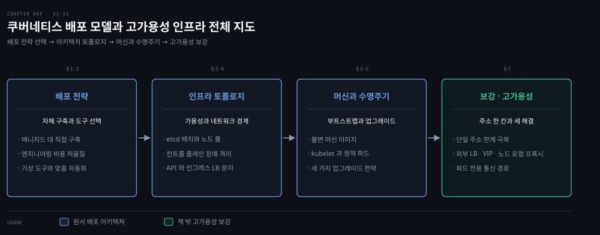
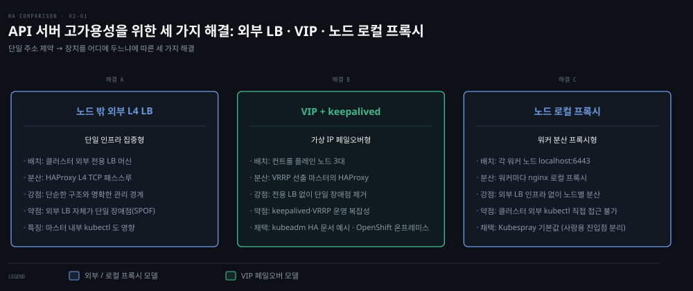

# Deployment Models — 배포 모델과 고가용성 인프라 구축
---
> 매니지드 서비스와 자체 구축의 선택 기준부터 etcd 토폴로지, 머신 부트스트랩, 업그레이드 전략, 그리고 kubeconfig 단일 API 주소 문제를 푸는 세 가지 해결(외부 로드밸런서·VIP·노드 로컬 프록시)까지 정리합니다.

## 학습 목표

> 이 편을 읽고 나면 프로덕션 쿠버네티스 클러스터를 설계할 때 필요한 아키텍처 결정과 고가용성 배포 방식을 체계적으로 설명할 수 있습니다.

1. 매니지드 서비스와 자체 구축 사이의 제어권 및 엔지니어링 비용 트레이드오프를 평가할 수 있습니다.
2. etcd 배치 토폴로지(단독 대 통합)와 가용 영역 분산 시의 네트워크 지연 영향을 설명할 수 있습니다.
3. 노드 풀의 두 가지 유형(특성 기반과 역할 기반) 및 클러스터 분할의 장애 반경을 분석할 수 있습니다.
4. 세 가지 업그레이드 전략(클러스터 교체·노드 교체·인플레이스)의 비용과 위험도를 비교할 수 있습니다.
5. kubeconfig의 `server:` 필드 단일 주소 제약을 푸는 세 가지 해결(외부 로드밸런서·VIP·노드 로컬 프록시)을 구분할 수 있습니다.

아래는 배포 모델 선택부터 인프라 토폴로지, 머신 수명주기, 그리고 책 밖의 고가용성 보강까지 이어지는 이 편의 전체 구조입니다.

## 1. 매니지드 서비스와 자체 구축의 선택 기준

> 매니지드 서비스는 엔지니어링 노력을 아껴 주지만 그 대가로 유연성과 자유도를 내줍니다.

프로덕션에서 쿠버네티스를 쓰는 첫 단계는 쿠버네티스를 띄우는 일입니다. 클러스터를 프로비저닝하고 앞으로의 업그레이드를 관리할 시스템을 갖추는 일까지 포함합니다. 쿠버네티스는 분산 소프트웨어 시스템이라 배포는 대체로 소프트웨어 설치 작업입니다. 다른 설치와 다른 점은 쿠버네티스가 인프라와 본질적으로 얽혀 있다는 것입니다. 그래서 소프트웨어 설치와 설치 대상 인프라를 동시에 풀어야 합니다. 먼저 따져 볼 질문은 클라우드 제공자의 매니지드 서비스를 쓸 것인지 인프라 위에 직접 자체 구축(Roll Your Own)할 것인지입니다.

### 엔지니어링 비용과 제어권의 상충

매니지드 서비스를 도입하는 가장 큰 이유는 엔지니어링 노력의 절감입니다. 쿠버네티스의 배포와 생애주기를 제대로 관리하는 일에는 상당한 기술 설계와 구현이 필요하고, 쿠버네티스는 애플리케이션 플랫폼의 한 부품인 컨테이너 오케스트레이터일 뿐입니다. 매니지드 서비스를 쓰면 워커 노드를 원하는 대로 붙일 수 있는 컨트롤 플레인이 주어져, 컨트롤 플레인을 확장하고 가용성을 확보하고 관리하는 책임이 덜어집니다. 데이터베이스를 매니지드 서비스로 쓰는 것과 비슷해서, 전담 관리자를 둘 형편이 안 되는 팀도 더 빨리 시작할 수 있습니다.

반대로 매니지드 서비스로 아낀 노력의 대가는 유연성과 자유도입니다. 한 벤더의 인프라에 깊이 투자하면 벤더 중립적이지 않은 시스템을 설계하고 서비스를 쓰게 될 가능성이 높습니다. 그 벤더가 가격을 올리거나 서비스 품질이 떨어지면 궁지에 몰릴 수 있습니다. 여러 제공자의 매니지드 서비스를 섞어 쓸 수도 있지만 제공자마다 쿠버네티스 기능을 노출하는 방식과 노출하는 기능이 달라서, 어색한 불일치를 넘어야 할 수 있습니다.

이런 이유로 직접 구축을 택할 수 있습니다. 쿠버네티스에는 조정할 손잡이가 아주 많고, 쿠버네티스 자체를 이해하고 관리하는 데 투자하면 구현하지 못할 기능도 충족하지 못할 요구도 없습니다.

인프라 제공자 사이의 차이를 처리하고 나면 퍼블릭 클라우드든 프라이빗 데이터센터든 플랫폼이 노출하는 쿠버네티스 기능은 일관됩니다. 쿠버네티스 버전을 직접 고르고, 컨트롤 플레인 컴포넌트의 모든 플래그와 기능, 하부 머신과 그 위의 소프트웨어, 디스크에 쓰이는 정적 파드 매니페스트까지 다룰 수 있습니다. 다만 강력한 만큼 위험한 도구입니다. 도구를 잘 배울 책임을 소홀히 하면 자신과 남을 다치게 할 수 있습니다.

### 의사결정 기준

이 결정은 사업에 오래 영향을 줍니다. 어느 쪽으로 기울지 가늠할 길잡이 조건이 쪽마다 네 가지씩 있습니다.

매니지드 서비스로 기우는 경우:

- 쿠버네티스를 밑바닥부터 이해하는 일이 몹시 버겁게 느껴질 때
- 비즈니스에 필수적인 분산 시스템을 직접 운영하는 책임이 위험하게 느껴질 때
- 벤더가 제공하는 기능 제약이 감당할 만하다고 판단될 때
- 매니지드 서비스 벤더를 신뢰할 수 있고 요구에 잘 부응해 줄 때

자체 구축(Roll Your Own)으로 기우는 경우:

- 벤더가 부과하는 제약이 불편하게 느껴질 때
- 클라우드 컴퓨팅 인프라를 제공하는 대기업을 크게 신뢰하지 않을 때
- 쿠버네티스를 중심으로 직접 꾸려갈 플랫폼의 가능성에 기대가 클 때
- 오케스트레이터를 활용해 사내 개발자에게 뛰어난 개발 경험을 만들어 주고 싶을 때

매니지드 서비스를 고르면 이 장 대부분은 건너뛰어도 되지만 애드온과 트리거링 절은 그대로 적용됩니다.

## 2. 배포 자동화 방식 — 기성 도구와 맞춤형 자동화

> 기성 설치 도구는 요구가 도구의 규격에 맞을 때 알맞고, 맞춤형 자동화는 매니지드 서비스나 기성 도구로 채워지지 않는 특수 요구가 있을 때 고려합니다.

자체 구축을 결정했더라도 모든 구성 요소를 맨땅에서 작성할 필요는 없습니다. 커뮤니티에는 수많은 배포 도구가 이미 존재하며, 이를 활용할 것인지 독자적인 자동화 시스템을 개발할 것인지 판단해야 합니다.

### 기성 설치 도구의 활용

배포 자동화를 검토할 때는 기성 설치 도구(Prebuilt Installer)를 살펴볼 수 있습니다. 기성 도구는 오픈소스와 엔터프라이즈 지원 제품을 합쳐 셀 수 없이 많습니다. 집필 당시 CNCF 웹사이트에 오른 인증 서비스 제공자만 180곳이었습니다. 비용을 내는 제품에는 경험 많은 현장 엔지니어와 지원 인력이 붙는 경우가 있습니다. 버튼 한 번으로 클러스터를 띄워 주는 설치 도구도 있는데, 대개 비용을 내는 제품입니다. 조직의 요구가 도구가 정한 규격과 선택지에 맞고 예산이 허용된다면 훌륭한 선택지가 될 수 있습니다. 집필 시점 현장에서 가장 흔한 방식이 바로 이 기성 도구 활용입니다.

### 맞춤형 자동화가 필요한 조건

직접 설치 자동화(Custom Automation)는 대체로 세 조건이 모두 맞을 때만 고르게 됩니다. 한두 명보다 많은 엔지니어를 붙일 수 있어야 합니다. 쿠버네티스 경험이 깊은 엔지니어가 있어야 하며, 매니지드 서비스나 기성 도구로 채워지지 않는 특수 요구가 있어야 합니다. 플랫폼은 앱 개발팀의 요구, 그중에서도 가장 먼저 쓸 팀의 요구에서 출발합니다. 쓰는 팀과 떨어져 만들지 않습니다. 출시 전 버전을 개발팀에 먼저 내주어 시험하게 합니다. 버그를 고치고 기능을 더하는 피드백 고리를 키웁니다. 플랫폼이 성공적으로 채택되는지는 이 고리에 달려 있습니다.

이 장의 나머지는 그런 팀과, 설치 도구를 평가하며 좋은 패턴을 알고 싶은 팀을 위한 내용입니다.

## 3. 아키텍처와 토폴로지 설계

> etcd 배치, 클러스터 계층, 노드 풀, 클러스터 연합은 클러스터를 프로비저닝하고 관리하는 시스템 전체에 폭넓게 영향을 주는 결정입니다.

etcd를 어디에 두고 클러스터를 어떻게 나누느냐는 클러스터를 프로비저닝하고 관리하는 시스템 전체에 폭넓게 영향을 줍니다. 이 절은 etcd의 배포 모델, 서비스 수준 목표(SLO)에 따른 클러스터 계층 분리, 노드 풀의 쓰임, 클러스터 연합을 차례로 다룹니다.

### etcd 배포 모델과 지연 시간

etcd는 쿠버네티스 클러스터 객체의 데이터베이스입니다. 합의 알고리즘으로 여러 머신에 클러스터 상태의 사본을 유지하는 분산 저장소이기도 합니다.

그래서 etcd 노드는 네트워크 연결로 합의를 안정적으로 유지해야 하며 네트워크 지연 요구도 독특합니다. etcd 기본 설정은 단일 데이터센터 내부의 낮은 지연 시간을 전제로 맞춰져 있습니다. 여러 데이터센터에 걸쳐 etcd 멤버를 분산한다면 멤버 간 평균 왕복 시간을 재 보고 필요하면 하트비트 간격과 선출 타임아웃을 조정합니다. 가용성을 위해 여러 데이터센터를 쓰더라도 적어도 한 리전 안에서 가까운 거리에 두어야 하며, 리전을 가로지르는 etcd 분산 배치는 강하게 만류합니다.

물리적 배치에서는 컨트롤 플레인 노드에 함께 띄우는 통합 배치(colocated)와 독립 머신을 쓰는 전용 배치(dedicated) 중 하나를 선택합니다.

- 통합 배치(colocated): 컨트롤 플레인 머신에 etcd를 함께 둡니다. 클러스터 규모가 작다면 관리 부담과 인프라 비용을 아끼기 위해 통합 배치를 쓰는 편이 좋습니다. kubeadm이 이 모델을 잘 지원합니다.
- 전용 배치(dedicated): etcd만을 위한 독립 머신 클러스터를 구성합니다. 큰 클러스터의 기준은 컨트롤 플레인 머신의 크기에 따라 달라지지만 워커 노드가 50대를 넘으면 전용 배치를 검토합니다. 200대를 넘길 계획이라면 읽기·쓰기 부하에 따른 컨트롤 플레인 자원 경합을 없애기 위해 전용 etcd를 계획하는 것이 좋습니다.

etcd를 컨테이너로 띄울지 호스트 머신에 직접 설치할지도 결정해야 합니다. 통합 배치라면 kubeadm 지원과 검증이 잘 갖춰진 컨테이너 실행이 가장 좋습니다. 전용 머신을 쓴다면 etcd를 머신 이미지에 구워 실행하거나, 컨테이너 런타임과 kubelet을 깔고 정적 매니페스트로 띄우는 패턴을 씁니다.

### 서비스 수준에 따른 클러스터 계층

클러스터는 서비스 수준 목표(SLO)와 용도에 따라 네 가지 계층(Tier)으로 분리 운영하는 것이 일반적입니다.

- Testing: 단일 테넌트이고 수명이 짧은(ephemeral) 클러스터입니다. 흔히 TTL 을 걸어 정해 둔 시간이 지나면 자동으로 파기하며, 대개 일주일 미만입니다. 플랫폼 엔지니어가 개발 중인 구성 요소나 플랫폼 기능을 시험하려고 아주 자주 띄웁니다.
- Development: 대개 TTL 이 없는 영구 클러스터입니다. 가능하면 멀티테넌트로 운영하고 프로덕션 클러스터의 기능을 모두 갖춥니다. 애플리케이션의 첫 통합 시험과 알파 버전 플랫폼과의 호환성 시험, 앱 개발팀의 일반 시험과 개발에 씁니다.
- Staging: 개발 계층처럼 영구 클러스터이고 흔히 여러 테넌트가 씁니다. 운영에 내보내기 전 최종 통합 시험과 승인에 씁니다. 프로젝트 매니저, 제품 책임자, 임원처럼 그 위의 소프트웨어를 직접 개발하지 않는 이해관계자가 씁니다. 출시 전 버전을 봐야 하는 고객이나 외부 이해관계자가 쓸 수도 있습니다.
- Production: 고객을 직접 대하고 수익을 내는 애플리케이션과 웹사이트를 돌리는 환경입니다. 승인을 거친 프로덕션용 안정 릴리스만 올라갑니다. 잘 정의한 SLO 를 추적하며, 법적 구속력이 있는 SLA 가 적용되는 경우가 많습니다.

중요한 원칙은 네 계층 모두에서 같은 클러스터 배포 도구와 생애주기 관리 시스템을 쓰라는 점입니다. 하위 계층에서 이 시스템을 많이 쓰면 중요한 프로덕션 클러스터에 적용할 때도 기대대로 동작하는 데 도움이 됩니다.

### 특성과 역할 기반 노드 풀

단일 클러스터 내부의 노드들을 성격에 따라 묶는 단위가 노드 풀(Node Pool)입니다.

- 특성 기반 노드 풀: GPU 같은 특수 장치, 특정 종류의 네트워크 인터페이스, 다른 메모리 대 CPU 비율처럼 특정 워크로드가 필요로 하거나 잘 맞는 구성 요소와 속성을 가진 노드들을 묶습니다.
- 역할 기반 노드 풀: 특정 기능을 맡고 흔히 자원 경합으로부터 떼어 놓고 싶은 노드들을 분리합니다. 노드에 특이한 특성이 있는 것은 아니고 기능만 다릅니다. 흔한 예가 클러스터의 인그레스(Ingress) 계층 전용 풀입니다. 전용 풀은 이 워크로드를 자원 경합으로부터 떼어 놓고, 클러스터 밖에서 오는 트래픽을 받는 노드를 좁혀 네트워크 모델을 단순하게 합니다. 이런 역할은 대개 다른 클러스터로 옮길 수 없습니다. 그 머신이 클러스터 기능에서 중요한 역할을 맡기 때문입니다.

노드 풀을 쓰면 워크로드가 알맞은 풀에 앉도록 노드 셀렉터를 써야 합니다. 셀렉터 없는 워크로드가 엉뚱한 풀에 앉지 않도록 노드 테인트도 쓰게 될 가능성이 큽니다. 노드 확장도 풀마다 따로 감시하고 확장해야 해서 더 복잡해집니다. 별도 클러스터를 쓰면 이 부담이 클러스터 관리와 연합 쪽으로 옮겨 갑니다. 풀은 이유가 있을 때만 나누고 함부로 만들지 않습니다.

### 관리 클러스터와 클러스터 연합

관리해야 할 클러스터 수가 늘어나면 이를 다룰 소프트웨어가 필요해지고, 흔히 그 소프트웨어를 쿠버네티스 위에서 돌립니다. 다른 클러스터를 관리하는 이 쿠버네티스가 관리 클러스터(Management Cluster)입니다. 널리 쓰이는 프로젝트가 Cluster API 입니다. 관리 클러스터는 `Cluster`, `Machine` 같은 커스텀 리소스로 다른 워크로드 클러스터들의 프로비저닝과 삭제를 선언적으로 관제합니다.

관리 클러스터 운용에는 몇 가지 고려 사항이 따릅니다. 프로덕션 계층과 비프로덕션 계층 간의 엄격한 관심사 분리를 위해 프로덕션 전용 관리 클러스터를 따로 두는 경우가 흔합니다. 이는 관리 클러스터 자체의 오버헤드를 가중시킵니다. 또한 관리 클러스터는 CI/CD 시스템이나 사내 컨테이너 레지스트리 같은 공유 서비스를 호스팅하는 논리적 위치로 자주 활용됩니다.

클러스터 오토스케일링에서도 문제가 생깁니다. 워크로드 클러스터의 Cluster Autoscaler가 노드를 늘리려면 관리 클러스터의 컨트롤러에 기대야 합니다. 그래서 클러스터가 확장해야 하는 바쁜 순간에 관리 클러스터를 쓸 수 없다면 확장이 막힐 수 있습니다.

이를 풀 한 가지 전략은 Cluster API 구성요소를 워크로드 클러스터 안에서 자립(self-contained)시켜 돌리는 것입니다. 클러스터 생성과 삭제에는 관리 클러스터를 계속 쓰지만 오토스케일링 같은 일상 작업은 대체로 워크로드 클러스터가 스스로 처리합니다. 이 구조에서는 클러스터 안의 다른 컨트롤러나 워크로드가 관리 클러스터 API 를 거치지 않고 로컬 API에서 `Cluster` 리소스 메타데이터를 직접 읽을 수 있습니다.

흔히 쓰는 유용한 연합 접근은 먼저 지역(Region) 단위로 연합한 뒤 이를 다시 전역(Global)으로 묶는 것입니다. 이렇게 하면 연합 클러스터의 장애 반경과 연산 부하가 줄어듭니다. 처음에는 다단계 연합을 정당화할 만큼 전역 규모나 인프라 물량이 없을 수 있지만, 나중에 필요해질 때를 대비해 설계 원칙으로 염두에 둡니다.

연합 환경에서는 여러 클러스터의 메트릭을 중앙으로 모으는 일도 과제입니다. 프로메테우스를 쓰든 안 쓰든 그 연합 모델은 참고할 가치가 있어, 쓰는 도구로 따라 해 볼 만합니다. 상위 연합 프로메테우스 서버가 하위 프로메테우스 서버에서 메트릭 일부만 긁어 가는 방식이라 어떤 연합 전략에도 맞습니다.

다중 클러스터 워크로드 배포에서 쿠버네티스 커뮤니티가 가장 최근에 내놓은 시도가 KubeFed 프로젝트입니다. KubeFed는 임의의 쿠버네티스 API 타입을 연합 버전(`FederatedDeployment` 등)으로 정의하여 여러 클러스터에 선언적으로 전파합니다. 다만 현장에서는 각 대상 클러스터로 직접 배포하도록 설정된 CI/CD 파이프라인 도구를 활용하는 방식이 가장 흔하게 쓰입니다.

## 4. 인프라 계층 설계와 네트워크 분리

> 가상화와 베어메탈의 선택부터 다중 가용 영역 구성, 그리고 API 서버와 인그레스 로드밸런서의 분리까지 인프라와 네트워크 쪽 결정을 다룹니다.

쿠버네티스 클러스터에는 머신이 필요하고, 네트워킹은 구현 세부로 넘기기 쉽지만 배포 모델에 중요한 영향을 줄 수 있습니다.

### 가상화와 베어메탈의 트레이드오프

가상화 인프라는 하이퍼바이저와 통합 API를 통해 물리 하드웨어를 추상화합니다. 가상화 환경에서는 하드웨어를 격리된 가상 서버로 쪼개어 머신과 이미지를 쉽게 생성하고 복제할 수 있습니다. 한 물리 서버에서 여러 운영체제를 실행하며 서버 무중단으로 자원 설정을 변경할 수 있습니다. 가상 머신 단위로 독립된 네트워크와 라우팅을 구성할 수도 있습니다. 특정 호스트만 격리하여 업그레이드할 수 있어 운영 범위를 작게 제어합니다.

반면 가상화는 대개 하드웨어에서 멀어지는 만큼 오버헤드가 따르고, 가상화 스택 자체를 돌리는 오버헤드도 있습니다. 그래서 성능에 극도로 민감한 트레이딩 애플리케이션은 베어메탈에서 돌리는 편을 선호할 수 있습니다. 5G 망을 운영하는 통신사의 엣지 컴퓨팅처럼 하드웨어 위에서 직접 돌리고 싶어 하는 경우도 있습니다.

가상화를 떠나 베어메탈에서 쿠버네티스를 구동하면 인프라 팀이 누리던 편의 기능을 여러 가지 잃습니다. 이는 쿠버네티스가 기본으로 풀어 주는 문제가 아닙니다. 베어메탈 성공에는 다음과 같은 과제가 따릅니다.

- 크게 커진 노드: 노드가 크면 대개 노드당 파드 수가 늘어납니다. 하드웨어를 잘 쓰려고 노드 하나에 수천 개의 파드가 필요해지면 운영이 복잡해질 수 있습니다. 인플레이스 업그레이드를 하려고 노드를 비우면 재스케줄링 이벤트가 1,000개 넘게 일어날 수 있습니다.
- 동적 확장: 워크로드나 트래픽 수요에 따라 새 노드를 빠르게 띄우는 방법을 찾아야 합니다.
- 이미지 프로비저닝: 클러스터 노드를 가능한 한 불변(immutable)으로 유지하도록 머신 이미지를 빠르게 굽고 배포해야 합니다.
- 부하 분산기 API 부재: 클러스터 밖에서 안쪽 파드 네트워크로 들어오는 인그레스 라우팅을 따로 마련해야 합니다. 이 문제는 kube-vip이나 MetalLB 같은 프로젝트로 풀 수 있습니다.
- 덜 정교한 스토리지 연동: 네트워크 연결 스토리지를 파드에 붙이는 문제를 따로 풀어야 합니다. Ceph 클러스터와 연동해 풀 수 있습니다.
- 멀티테넌트 보안 격리: 하이퍼바이저가 있으면 물리 서버를 마음대로 쪼갤 수 있습니다. 그래서 보안에 민감한 컨테이너는 전용 하이퍼바이저에서 돌리도록 배치를 정할 수 있습니다. 베어메탈에서는 이런 여유가 없습니다.

컨테이너는 새로운 가상화 기술이 아닙니다. 대부분의 구현에서 컨테이너는 리눅스 커널 프리미티브로 프로세스가 호스트의 다른 프로세스와 격리된 것처럼 느끼게 할 뿐입니다. 클라우드 제공자(가상화), 온프레미스 가상화, 베어메탈 중에서 고르는 기준은 기술 요구사항과 조직의 운영 경험입니다. 쿠버네티스를 가상화 스택의 대체재로 생각하고 있다면 쿠버네티스가 정확히 무엇을 푸는지 다시 따져 봅니다. 쿠버네티스를 운영하는 법을 배우고 팀이 운영하게 만드는 것만으로도 큰일입니다. 그 아래 인프라를 다루는 방식까지 통째로 바꾸면 엔지니어링 노력과 위험이 크게 늘어납니다.

### 클러스터 크기 산정과 장애 반경

클러스터를 크게 가져갈 때와 작게 여러 개로 나눌 때 얻는 이점이 서로 다릅니다. 대표적인 차이가 장애 반경(blast radius)입니다.

- 대규모 소수 클러스터: 클러스터마다 etcd·API 서버 같은 컨트롤 플레인 비용과 인그레스 컨트롤러 같은 플랫폼 서비스 비용이 듭니다. 클러스터가 크면 이 서비스들의 중복이 줄어듭니다. 베어메탈 컴퓨팅 인프라를 직접 운영하면 클러스터를 필요할 때마다 올리고 내리거나 수요에 맞춰 늘리기가 어려워집니다. 클러스터 배포를 덜 자주 하면 배포 자동화를 덜 갖춰도 되고, 완전 자동화에 드는 노력이 덜 자동화된 방식을 관리하는 노력보다 클 수도 있습니다. 운영 클러스터가 적으면 클러스터와 워크로드를 배분하고 연합해 관리하는 체계도 덜 정교해도 됩니다. 반대로 클러스터가 깨지면 영향받는 워크로드가 많아지고, 워커 노드가 수백 대로 커지면 흔히 규모 문제를 만나 컨트롤 플레인 병목을 찾아 조정하는 노력이 필요해질 수 있습니다.
- 소규모 다수 클러스터: 클러스터가 깨져도 영향받는 워크로드가 적어 장애 반경이 작습니다. 특정 테넌트에 클러스터를 따로 내주는 편이 멀티테넌트 플랫폼을 짜는 것보다 엔지니어링 노력이 훨씬 적게 드는 경우도 있습니다. 수백 대 규모에서 생기는 확장 문제를 조정하는 노력이 크게 줄고, 클러스터를 통째로 교체해 업그레이드하는 방식이 더 매력적인 선택지가 됩니다. 단점은 클러스터를 자주 만들고 연합해 관리해야 해서 배포 자동화와 관리 체계를 더 정교하게 갖춰야 한다는 점입니다.

노드 풀 대안(Node pool alternative)도 있습니다. GPU나 메모리 최적화 노드 같은 특수한 요구가 있는 워크로드가 있고 작은 클러스터를 여러 개 쉽게 다룰 수 있는 환경이라면, 그 요구를 위한 전용 클러스터를 띄우는 일은 어렵지 않습니다. 이렇게 하면 여러 노드 풀을 관리하는 복잡성이 줄어듭니다.

### 컴퓨트 인프라와 머신 유형 선택

클러스터를 구성하는 머신은 실행할 워크로드의 CPU·메모리 소비 비율과 특수 장치 요구에 맞추어 유형을 선별해야 합니다.

- etcd 머신(전용 클러스터 구성 시): 디스크 읽기·쓰기 성능이 최우선입니다. 구형 회전식 디스크는 절대 사용해서는 안 됩니다. 전용 머신이라도 운영체제나 다른 프로그램과 디스크를 놓고 다투지 않도록 etcd 전용 저장 디스크를 두는 방안을 고려합니다. 같은 etcd 클러스터의 머신 사이 네트워크 지연을 줄이도록 네트워크상 근접성을 포함한 네트워크 성능도 고려합니다.
- 컨트롤 플레인 노드: API 서버, 스케줄러, 컨트롤러 매니저를 실행하는 범용 머신입니다. 클러스터가 커지면 API 서버는 클라이언트와 트래픽이 늘어나므로 머신당 자원을 늘리거나 머신 대수를 늘려 대응할 수 있습니다. 하지만 스케줄러와 컨트롤러 매니저는 어느 시점에든 활성 리더(leader) 단 하나만 동작합니다. 따라서 이들 컴포넌트의 자원이 부족할 때는 레플리카를 늘릴 수 없으며, 머신 스펙 자체를 늘리는 수직 확장(vertical scaling)으로 해결해야 합니다. etcd를 통합 배치한다면 etcd 디스크 요구사항도 함께 충족해야 합니다.
- 일반 워커 노드: 컨트롤 플레인 컴포넌트를 제외한 일반 애플리케이션 워크로드를 호스팅하는 범용 머신입니다.
- 메모리 최적화 노드(선택): 메모리 사용 모양이 일반 워커 노드와 잘 맞지 않는 워크로드가 있다면 메모리 최적화 노드 풀을 고려합니다. CPU 대비 메모리 비율이 맞지 않는 범용 노드에 고메모리 워크로드를 배치하면 자원을 이 비율로 예약(reserve)할 때 남는 CPU 자원이 낭비됩니다. 메모리 최적화 인스턴스를 노드 풀로 추가하면 이 비효율을 해소할 수 있습니다.
- 컴퓨팅 최적화 노드(선택): 워크로드가 연산 집약적이라 CPU 비율이 높은 머신에 맞는다면 그 머신으로 노드 풀을 구성하는 것을 고려합니다.
- 특수 하드웨어 노드(선택): GPU 같은 특수 하드웨어가 필요한 워크로드(예: 머신러닝)가 있다면 클러스터에 노드 풀을 추가하고 해당 워크로드가 그 노드를 겨냥하게 하면 잘 동작합니다.

### 접근 경로와 가용 영역 이중화

클러스터 노드를 공용 인터넷에 노출하는 일은 거의 바랄 일이 아닙니다. 어디서든 접속할 수 있는 편리함이 위협 노출을 정당화하는 경우는 거의 없기 때문입니다. 노드에 접속할 방법은 따로 풀어야 하는데, 잘 보호한 베스천 호스트(Jump box)로 SSH 를 허용하면 부담이 낮습니다. 사설망 안에는 클러스터와 서로 연결돼야 하는 서비스가 있습니다. 스토리지 어레이, 내부 컨테이너 레지스트리, CI/CD 시스템, 내부 DNS, 사설 NTP 서버와의 연결이 흔히 필요합니다.

가동 시간을 지키려면 가능한 곳에서 가용 영역(AZ)을 활용합니다. 가용 영역은 전원과 백업, 공용 인터넷 연결이 따로 있는 데이터센터입니다. 전원을 공유하는 서브넷 두 개는 가용 영역 둘이 아닙니다. 지연이 낮고 대역폭이 높은 회선으로 이어진 가까운 데이터센터 둘은 가용 영역 한 쌍입니다. 둘이면 좋고 셋이면 더 좋습니다. etcd를 가용 영역에 걸쳐 돌려도 괜찮지만 그렇게 하면 앞의 네트워크 고려 사항을 다시 봅니다. 컨트롤 플레인을 가용 영역에 분산하면 클러스터를 제어하는 수단이 이중화됩니다.

여기서 핵심 원칙이 있습니다. 워크로드가 컨트롤 플레인에 기대지 않는다면(기대게 만들지 않아야 합니다) 컨트롤 플레인이 멈춰도 워크로드 가용성은 영향을 받지 않습니다. 영향을 받는 것은 실행 중인 소프트웨어를 바꾸는 능력입니다. 컨트롤 플레인 장애는 사소하지 않고 우선순위가 높은 비상 상황입니다. 다만 사용자 대면 워크로드의 장애와는 다릅니다.

### API 서버와 인그레스 로드밸런싱 분리

네트워크 설계에서 고려해야 할 로드밸런싱 원칙들이 있습니다.

- API 서버 앞단 로드밸런서: API 서버 앞에는 로드밸런서가 필요합니다. 환경에서 로드밸런서를 API로 프로비저닝할 수 있다면 컨트롤 플레인 배포 과정에 넣어 함께 구성합니다. 공용 인터넷에는 거의 열지 않으며, 원격 관리는 클러스터 네트워크로 통하는 VPN을 거치는 경우가 훨씬 흔합니다.
- 워커 인그레스 LB와의 분리: 외부에 공개하는 워크로드가 있다면 API용과 별개인 로드밸런서를 인그레스 앞에 둡니다. 대개 이 로드밸런서 하나가 모든 워크로드 요청을 받으며, 워크로드마다 로드밸런서와 인그레스를 따로 두는 것은 얻는 실익이 적습니다.
- etcd 앞단 LB 금지: 전용 etcd 클러스터를 구축하더라도 API 서버와 etcd 사이에는 로드밸런서를 두지 않습니다. API 서버에 내장된 etcd 클라이언트가 로드밸런서 없이도 etcd 연결을 직접 처리하기 때문입니다.

## 5. 인프라 자동화와 머신 프로비저닝 전략

> 인프라는 마법사 화면을 클릭하는 수작업 대신 API 를 부르는 선언적 시스템으로 자동화하고, 머신 이미지를 미리 구워 두면 노드가 클러스터에 조인하는 신뢰성이 오르고 준비 시간이 크게 줄어듭니다.

인프라 관리는 온라인 마법사의 양식을 클릭하는 수작업을 멀리하고, 같은 결과를 내도록 API 를 호출하는 선언적 시스템 쪽으로 기울여 자동화합니다. 이 자동화 모델은 서버와 네트워크 같은 자원을 필요할 때 프로비저닝할 수 있어야 하는데, 모든 환경에 그런 API 나 웹 화면이 있는 것은 아닙니다. API 가 없다면 프로그램으로 접근하고 제어할 수 있는 지점까지는 수작업으로 빈틈을 메워야 합니다.

### IaC 도구와 쿠버네티스 오퍼레이터

Terraform 이나 AWS 의 CloudFormation 같은 인프라 관리 도구는 컴퓨팅과 네트워킹 인프라의 원하는 상태를 텍스트 파일에 선언하고 그 상태를 적용하게 해 줍니다. 엔지니어가 쉽게 익혀 결과를 낼 수 있고, 비교적 복잡한 인프라 프로비저닝을 단순하게 만드는 데 능합니다. 정해진 인프라를 인스턴스 사이에 차이가 크지 않게 반복해 찍어 낼 때 빛을 냅니다. 반복이 믿을 만해서 인프라를 변경하는 대신 교체하는 불변 인프라 원칙에도 잘 맞습니다.

그러나 인프라 요구사항이 상당히 복잡해지고 동적으로 변하며 변수 조건에 기대기 시작하면 이 도구들의 가치는 떨어지기 시작합니다. 예를 들어 여러 클라우드 제공자에 걸친 쿠버네티스 배포 시스템을 설계한다면 다루기 번거로워집니다. JSON 같은 데이터 형식과 설정 언어는 조건문과 반복문을 표현하는 데 서툴기 때문입니다. 개발 단계에서는 이 도구들이 아주 흔히 잘 쓰이고 일부 조직은 프로덕션 환경 관리에도 씁니다. 하지만 시간이 갈수록 다루기 번거로워지고 거의 갚을 수 없는 기술 부채를 안기도 합니다. 이런 이유로 쿠버네티스 오퍼레이터를 쓰거나 개발하는 것을 강력히 고려합니다.

오퍼레이터는 커스텀 리소스와 직접 만든 컨트롤러로 시스템을 관리합니다. 인프라 개념을 나타내는 새 리소스 종류로 쿠버네티스 API 를 확장하고, 그 리소스의 상태를 관리하는 오퍼레이터를 개발하는 방식이 강력합니다.

Cluster API 프로젝트가 바로 이런 오퍼레이터 모음이며 쿠버네티스 클러스터의 인프라를 관리하는 데 쓸 수 있습니다. 비슷한 프로젝트를 처음부터 시작하기 전에 Cluster API 가 요구에 맞는지 먼저 살펴봅니다. 맞지 않으면 필요한 기능이나 인프라 제공자를 개발하도록 기여하는 길도 고려합니다. 요구가 독특해 인프라 관리 도구를 고수해도 성공할 수는 있습니다. 다만 설정 언어와 데이터 형식의 한계 때문에 유연성이 낮고 우회책이 늘어납니다.

### 머신 이미지 빌드와 조인 지연 단축

클러스터의 머신이 뜨면 운영체제와 일부 패키지, 설정이 필요합니다. 이를 갖추는 흔한 전략은 설정 관리 도구와 머신 이미지 두 가지입니다. Ansible, Chef, Puppet, Salt 같은 설정 관리 도구는 머신 일관성을 믿을 만하게 만들어 주고, 선언적 레시피나 플레이북을 버전 관리에 둘 수 있어 훌륭합니다. 하지만 쿠버네티스 세계에서는 클러스터 노드를 띄우는 속도와 신뢰성이 아쉽습니다.

새 워커 노드를 클러스터에 조인하는 과정에 설정 관리 도구가 네트워크로 자산을 내려받아 패키지를 설치하는 단계가 들어 있다면 조인 시간이 상당히 늘어납니다. 패키지 저장소가 잠시 닫혔거나 변수가 빠지거나 잘못된 일만으로도 설정 과정이 실패해 노드 조인이 끊깁니다. 자원이 빠듯한 오토스케일 클러스터가 그 노드의 조인에 기대고 있다면 가용성 문제를 일으키거나 길어지게 할 수 있습니다.

더 나은 대안은 필요한 패키지를 모두 설치해 둔 머신 이미지를 쓰는 것입니다. 머신이 부팅되면 소프트웨어가 바로 실행할 준비가 돼 있어, 네트워크와 패키지 저장소에 기대는 설치 단계가 없습니다. 노드가 클러스터에 조인하는 신뢰성이 오르고 트래픽을 받을 준비가 되기까지의 시간이 크게 줄어듭니다.

익숙한 설정 관리 도구로 머신 이미지를 빌드하는 경우도 많습니다. 예를 들어 HashiCorp 의 Packer 로 Ansible 을 써서 Amazon Machine Image 를 빌드해 두면 인스턴스가 필요할 때 바로 적용할 수 있습니다.

이미지를 빌드하는 중에 Ansible 플레이북 오류가 나는 것은 큰 문제가 아닙니다. 반면 워커 노드가 클러스터에 조인하는 도중 플레이북 오류가 나면 심각한 프로덕션 사고로 이어질 수 있습니다. 빌드에 쓰는 자산은 버전 관리에 두고, 업그레이드나 보안 패치가 필요할 때 자산을 갱신해 병합 뒤 파이프라인이 자동으로 돌게 하는 것이 이상적입니다. 어려운 트레이드오프가 따르는 결정도 있지만 이 결정은 명백합니다. 미리 구운 머신 이미지를 씁니다.

### 호스트 설치 요소와 kubelet의 경계

호스트에는 먼저 운영체제, 컨테이너 런타임, kubelet을 설치합니다. 컨트롤 플레인을 띄울 kubeadm과 부트스트랩 유틸리티도 필요한데, 이 둘은 아래 두 절에서 다룹니다.

- 지원이 검증된 리눅스 운영체제 배포판 (Ubuntu, RHEL, Flatcar 등)
- 컨테이너 런타임 (containerd 등)
- 노드 에이전트인 kubelet

쿠버네티스 컴포넌트 대부분은 컨테이너로 실행합니다. 반면 kubelet은 호스트 머신에서 일반 바이너리(프로세스)로 직접 실행합니다. kubelet을 컨테이너 안에서 실행하려는 시도는 시스템을 불필요하게 복잡하게 만들 뿐이므로 피하는 것이 좋습니다.

### 부트스트랩 유틸리티와 토큰 기반 노드 조인

머신이 부팅될 때 kubeadm을 호출하고 런타임 설정을 관리하는 부트스트랩 유틸리티(Bootstrap utility)가 필요합니다. Cluster API처럼 커스텀 리소스와 컨트롤러로 만들 수도 있고, 호스트에 설치한 CLI 프로그램으로도 충분합니다. AWS라면 사용자 데이터(user data)로 이 유틸리티를 실행하고 인자를 넘길 수 있습니다. 인자로는 kubeadm 명령에 붙일 플래그와 kubeadm config 파일에 넣을 내용을 알려 줍니다.

부트스트랩 유틸리티에는 최소한의 런타임 설정이 전달되어야 합니다. 새 클러스터를 생성하는 마스터인지(`kubeadm init`), 기존 클러스터에 편입되는 노드인지(`kubeadm join`)를 구분해야 합니다.

노드가 안전하게 클러스터에 조인하려면 부트스트랩 토큰(bootstrap token) 체계를 사용합니다. kubeadm이 생성하는 이 토큰은 승인된 머신만 클러스터에 편입되도록 보장합니다. 클러스터를 초기화할 때 토큰을 안전한 저장소에 보관하고, 새 노드가 조인할 때 이를 안전하게 조회하여 사용해야 합니다.

### 정적 파드를 통한 컨트롤 플레인 부트스트랩

컨트롤 플레인이 아직 존재하지 않는데 kubelet이 어떻게 컨트롤 플레인 파드를 실행할 수 있을까요? 이 닭과 달걀 문제를 푸는 열쇠가 kubeadm과 정적 파드(Static Pod)입니다.

kubelet 은 호스트의 디렉터리 하나를 감시하다가 거기서 찾은 파드 매니페스트를 실행하도록 설정할 수 있고, kubeadm 이 kubelet 을 그렇게 설정해 줍니다. `kubeadm init` 명령이 실행되면 이 디렉터리에 etcd, kube-apiserver, kube-controller-manager, kube-scheduler의 파드 매니페스트가 기록됩니다. kubelet은 API 서버 없이도 로컬 매니페스트를 직접 읽어 핵심 컨트롤 플레인 컨테이너들을 부트스트랩합니다. API 서버가 기동된 이후부터는 API를 통해 제출되는 일반 파드 매니페스트를 받아 처리합니다.

정적 매니페스트에는 etcd, kube-apiserver, kube-scheduler, kube-controller-manager 같은 컨트롤 플레인의 핵심 컴포넌트를 넣습니다. 필요하면 파드 매니페스트를 더 얹을 수 있지만, 쿠버네티스 API 가 뜨기 전이나 연합 시스템에 등록되기 전에 꼭 실행돼야 하는 파드로 엄격히 한정합니다. 정적 매니페스트로 만든 파드는 머신 디스크의 매니페스트를 고쳐야만 관리할 수 있는데, 디스크는 접근하기 훨씬 불편하고 자동화하기도 어렵습니다. API 서버로 나중에 설치할 수 있는 워크로드라면 그렇게 합니다.

kubeadm 을 쓰면 컨트롤 플레인 노드를 `kubeadm init` 으로 초기화할 때 etcd 를 포함한 정적 매니페스트가 만들어집니다. kubeadm 사용이 강력히 권장됩니다. 이 컴포넌트들에 필요한 플래그는 kubeadm 설정 파일로 넘길 수 있고, 부트스트랩 유틸리티가 템플릿으로 설정 파일을 써 주는 방식이 한 예입니다.

부트스트랩 유틸리티로 정적 파드 매니페스트를 직접 고치는 것은 피합니다. 정말 필요하다면 kubeadm 으로 정적 매니페스트 생성과 클러스터 초기화 단계를 따로 실행해 그 사이에 사용자 지정 내용을 끼울 수 있습니다. 다만 중요하고 kubeadm 설정으로는 이룰 수 없을 때만 그렇게 합니다. 컨트롤 플레인 부트스트랩이 단순할수록 더 견고하고 빠르며 쿠버네티스 버전 업그레이드에 깨질 가능성이 훨씬 낮습니다.

kubeadm 은 컨트롤 플레인 컴포넌트를 안전하게 잇는 데 필요한 자체 서명 TLS 자산도 생성합니다. 이 부분도 손대지 않는 쪽을 택합니다.

보안 요구사항 때문에 사내 CA 를 신뢰의 출처로 써야 한다면 그렇게 할 수 있습니다. 그 경우 중간 인증 기관을 받아 오는 일을 자동화할 수 있어야 합니다. 클러스터 부트스트랩 시스템이 안전하다면 컨트롤 플레인이 쓰는 자체 서명 CA 의 신뢰도 안전합니다. 그 신뢰는 단일 클러스터의 컨트롤 플레인에만 유효합니다.

## 6. 애드온 관리와 클러스터 업그레이드 전략

> 플랫폼 애드온을 쿠버네티스와 한 묶음으로 버전 관리하고, 환경과 위험도에 맞춰 세 가지 업그레이드 전략을 선택합니다.

핵심 컨트롤 플레인이 떴다고 해서 프로덕션 플랫폼이 완성된 것은 아닙니다. 필수 네트워크 플러그인과 플랫폼 서비스가 얹어져야 하며, 안전한 버전 업그레이드 경로가 사전에 확보되어야 합니다. 업그레이드 전략은 최소한 프로덕션에 들어가기 전에 풀려 있어야 합니다. 배포만 할 수 있고 업그레이드와 유지보수를 할 수 없는 플랫폼은 좋게 말해도 위험합니다. 프로덕션을 시작하면 빠진 기능과 날카로운 모서리를 손보는 일이 먼저가 됩니다. 업그레이드 전략은 백로그에서 낡아 가기 쉬우니 2일 차 일은 처음부터 예산에 넣어 둡니다.

### 필수 애드온 설치와 오퍼레이터 패턴

애드온은 배포 모델의 일부로, 보통 클러스터 배포의 마지막 단계에서 설치합니다. 쿠버네티스 클러스터와 함께 관리하고 버전을 매깁니다. 쿠버네티스와 애드온을 한 묶음으로 보고 함께 시험하고 함께 릴리스하는 편이 좋습니다. 일부 플랫폼 구성 요소 사이에는 버전과 설정 의존이 반드시 생기기 때문입니다.

kubeadm 은 쿠버네티스 프로젝트의 적합성 테스트를 통과하는 데 필요한 "필수" 애드온을 설치합니다. 클러스터 DNS 와, 쿠버네티스 Service 리소스를 구현하는 kube-proxy 가 여기에 들어갑니다. 하지만 kubeadm 이 일을 마친 뒤에 적용해야 할 비슷하게 중요한 구성 요소가 훨씬 많습니다. 가장 눈에 띄는 예가 CNI(Container Network Interface) 플러그인으로, 파드 네트워크가 없으면 클러스터는 쓸모가 크지 않습니다. 그 밖에도 보통 DaemonSet, Deployment, StatefulSet 형태로 얹어야 할 구성 요소가 상당히 많습니다.

새 클러스터를 연합 시스템에 등록하는 일이 대개 애드온 설치의 선행 단계입니다. 설치에 쓰는 시스템과 정의가 흔히 관리 클러스터에 있기 때문입니다. 등록이 끝나면 애드온 설치를 촉발할 수 있고, 이 설치는 각 구성 요소에 필요한 쿠버네티스 리소스를 만들려고 클러스터의 API 서버를 호출하는 일련의 과정입니다. 호출은 클러스터 밖의 시스템에서도 안에서도 올 수 있습니다. 설치하는 방식은 두 가지를 듭니다.

하나는 Jenkins 같은 기존 도구로 만든 CD 파이프라인입니다. 여기서 "지속적"이라는 말은 의미가 없습니다. 촉발 계기가 소프트웨어 업데이트가 아니라 설치할 새 대상이기 때문입니다. 파이프라인에는 설치에 필요한 기능이 대개 들어 있어서, 새 클러스터가 생기면 파이프라인을 돌리는 호출과 설치에 필요한 변수만 넘기면 됩니다.

다른 하나는 쿠버네티스에 더 가까운 방식으로, 오퍼레이터를 쓰는 고급 접근입니다. 커스텀 리소스로 클러스터의 애드온 구성 요소와 버전을 정의하게 쿠버네티스 API 를 확장하고, 그 리소스의 스펙대로 애드온을 설치하는 컨트롤러 로직도 직접 짭니다.

이 방식은 클러스터의 애드온이 무엇인지 분명한 단일 정보원을 준다는 점에서 유용합니다. 더 중요한 점은 이 애드온의 생애주기를 프로그램으로 꾸준히 관리할 기회를 준다는 것입니다.

단점은 더 복잡한 소프트웨어를 개발하고 유지해야 한다는 점입니다. 이 복잡도를 떠안는다면 앞으로 사람 손이 드는 일을 크게 줄일 2일 차 업그레이드와 지속 관리를 구현하려는 이유가 있어야 합니다. 1일 차 설치에서 멈추고 업그레이드를 관리하는 로직을 만들지 않으면 얻는 이득이 작은데도 큰 소프트웨어 엔지니어링 비용을 치릅니다.

오퍼레이터 방식이 CI/CD 같은 외부 시스템과 완전히 따로 노는 것은 아닙니다. 오히려 함께 쓰일 가능성이 훨씬 큽니다. 예를 들어 CD 파이프라인으로 오퍼레이터와 애드온 커스텀 리소스를 설치한 뒤 오퍼레이터가 이어받게 할 수 있습니다. 오퍼레이터도 설치용 매니페스트를 가져와야 할 가능성이 높은데, 애드온의 템플릿 매니페스트가 든 코드 저장소에서 가져오는 식입니다.

이렇게 오퍼레이터를 쓰면 외부 의존이 줄어 신뢰성이 올라갑니다. 다만 외부 의존을 완전히 없앨 수는 없습니다. 오퍼레이터로 애드온을 해결하는 일은 오퍼레이터 패턴을 잘 알고 활용해 본 엔지니어가 있을 때만 시도하고, 그렇지 않으면 팀이 잘 아는 도구와 시스템을 쓰면서 이 분야의 지식과 경험을 키웁니다.

### 플랫폼 독립 버전 관리와 호환성

플랫폼에 버전을 매깁니다. 그 플랫폼이 쓰는 모든 소프트웨어의 버전도 문서화합니다. 머신의 운영체제 버전과 그 위에 설치한 컨테이너 런타임 같은 모든 패키지가 들어갑니다. 쿠버네티스 버전은 당연히 들어갑니다. 애플리케이션 플랫폼을 이루려고 얹은 애드온마다 버전도 들어갑니다.

팀이 플랫폼 버전을 쿠버네티스 버전과 맞추는 경우는 제법 흔합니다. 예를 들어 플랫폼 1.18이 쿠버네티스 1.18을 쓴다고 하면 따로 기억하거나 찾아볼 필요가 없습니다. 그러나 이 선택은 버전을 매기고 문서화하는 일 자체에 비하면 중요도가 사소합니다. 팀이 선호하는 체계를 쓰되, 그 체계를 갖추고 문서화하고 철저히 씁니다.

플랫폼 버전을 어느 한 구성 요소에 묶어 두면 가끔 혼란이 생길 수 있다는 점이 유일한 반대 이유입니다. 예를 들어 보안 취약점 때문에 컨테이너 런타임 버전을 올렸다면 그 사실을 플랫폼 버전에 반영해야 합니다. 시맨틱 버저닝을 쓴다면 아마 수정(bugfix) 번호가 바뀌는 모양일 텐데, `v1.18.5 → v1.18.6` 같은 쿠버네티스 자체의 버전 변경과 헷갈릴 수 있습니다.

그래서 플랫폼에 독립된 버전 번호를 주는 방안을 고려합니다. 주·부·수정 규칙을 따르는 시맨틱 버저닝을 쓴다면 특히 그렇습니다. 소프트웨어가 다른 소프트웨어와 그 버전에 의존하면서도 자기만의 버전을 갖는 것은 거의 보편적입니다. 플랫폼이 같은 관례를 따르면 그 의미가 모든 엔지니어에게 곧바로 분명해집니다.

### 실패를 가정한 복구와 통합 적합성 테스트

업그레이드 과정에서 무언가 잘못된다는 전제에서 출발합니다. 치명적인 장애에서 복구해야 하는 처지를 상상하고, 그 두려움을 철저한 대비의 동기로 삼습니다.

etcd 스냅샷과 API 로 받는 Velero 백업으로 쿠버네티스 리소스를 백업하고 복원하는 자동화를 만듭니다. 애플리케이션이 쓰는 영속 데이터도 같은 방식으로 다루고, 중요한 애플리케이션과 그 의존성의 재해 복구도 직접 다룹니다.

복잡한 상태 기반 분산 애플리케이션은 순서와 의존성을 따지지 않고 애플리케이션 상태와 쿠버네티스 리소스를 복원하는 것만으로는 대개 부족합니다. 가능한 장애 유형을 모두 떠올리고 이를 바로잡는 자동 복구 체계를 만들어 시험합니다. 가장 중요한 워크로드와 그 의존성에는 페일오버할 대기(Standby) 클러스터를 두는 것을 고려하고, 가능한 곳에서는 그 페일오버를 자동화하고 시험합니다.

업그레이드가 즉시 진단할 수 없는 오류나 장애를 일으킬 때를 대비해 롤백(Rollback) 경로를 신중히 따져 둡니다. 복잡한 분산 시스템은 문제를 풀어내는 데 시간이 걸리고, 운영 장애의 압박과 주의 분산이 그 시간을 더 늘립니다. 쿠버네티스 기반 플랫폼에서는 미리 정해 둔 절차(playbook)와 의지할 자동화가 어느 때보다 중요합니다.

다만 롤백이 늘 좋은 선택은 아닙니다. 업그레이드가 꽤 진행된 뒤에 앞선 변경을 모두 되돌리면 오히려 큰일이 날 수 있습니다. 그래서 되돌릴 수 없는 지점(Point of no return)이 어디인지 미리 알아 둡니다. 실제로 작업하기 전에 그 지점에서 어떻게 할지도 정해 둡니다.

플랫폼 구성 요소의 단위 시험도 중요하지만 통합 시험도 똑같이 중요하고 훨씬 어렵습니다. 이를 돕는 훌륭한 도구가 Sonobuoy 적합성 테스트 유틸리티입니다. 흔히 업스트림 쿠버네티스 e2e 테스트를 돌려 클러스터의 구성 요소가 기대대로 함께 동작하는지 확인하는 데 씁니다. 팀들은 새 클러스터를 프로비저닝한 뒤 Sonobuoy 스캔을 돌려, 컨트롤 플레인 파드를 살펴보고 시험 워크로드를 배포하던 수작업을 자동화하곤 합니다.

여기서 몇 걸음 더 나아가길 권합니다. 플랫폼의 특정 기능을 시험하는 자체 플러그인을 개발합니다. 조직의 요구사항에 중요한 작업도 시험하고 이 스캔을 정기적으로 돌립니다. 최소한 플러그인 일부는 쿠버네티스 CronJob 으로 돌립니다. 지금은 기본 제공되지 않지만 약간의 엔지니어링으로 이룰 수 있고 들일 만한 노력입니다. 스캔 결과를 메트릭으로 노출해 대시보드에 띄우고 경보를 걸 수 있습니다.

플랫폼 위에서 도는 애플리케이션도 통합 시험을 해야 합니다. 앱 개발팀마다 방식이 다르고 플랫폼 팀의 손을 벗어난 일일 수 있지만 강하게 권합니다. 시험은 프로덕션과 비슷한 클러스터에서 돌립니다. 플랫폼 기능을 쓰는 워크로드일수록 중요합니다. 오퍼레이터는 쿠버네티스 API를 확장하는 것이라 플랫폼과 깊이 얽힙니다. 오퍼레이터로 조직의 소프트웨어를 배포·관리한다면 플랫폼 버전 사이의 통합 시험이 필수이고, 쿠버네티스 버전 업그레이드가 끼면 특히 그렇습니다.

### 세 가지 업그레이드 전략의 비용과 위험

쿠버네티스 클러스터를 업그레이드하는 전략은 세 가지이고, 비용이 높고 위험이 낮은 것부터 비용이 낮고 위험이 높은 것 순으로 늘어놓을 수 있습니다. 모두에게 이상적인 만능 해법은 없으므로 요구사항과 예산, 위험 허용도에 맞춰 비용과 이점을 따져 봅니다. 각 전략 안에서도 자동화와 시험의 정도는 엔지니어링 예산, 위험 허용도, 업그레이드 빈도 같은 요인에 따라 달라집니다.

- 클러스터 교체(Cluster replacement): 비용이 가장 높고 위험은 가장 낮습니다. 클러스터 전체에 불변 인프라 원칙을 적용하는 방식이라 위험이 낮습니다. 기존 클러스터 옆에 업그레이드한 새 클러스터를 통째로 띄우고 워크로드를 옮깁니다.
- 노드 교체(Node replacement): 비용과 위험이 중간입니다. 흔히 쓰는 방식이고 Cluster API 가 지원합니다. 큰 클러스터를 운영하고 호환성 문제를 잘 파악하고 있다면 받아들일 만한 선택입니다.
- 인플레이스 업그레이드(In-place upgrade): 비용이 가장 낮고 위험은 가장 높습니다. 노드를 교체하기 현실적이지 않은 자원 제약 환경에 맞습니다. 롤백 경로가 더 까다로워 위험이 높지만, 충분한 시험으로 그 위험을 낮출 수 있고 낮춰야 합니다.

세 전략은 서로 배타적이지 않아 조합할 수 있습니다. 예를 들어 전용 etcd 클러스터는 인플레이스로 올리고 나머지 쿠버네티스 클러스터는 노드 교체로 올릴 수 있습니다. 위험 허용도가 다른 계층에서 서로 다른 전략을 쓸 수도 있습니다. 다만 프로덕션에서 쓰는 방법을 개발과 스테이징에서 먼저 철저히 시험하려면 모든 곳에서 같은 전략을 쓰는 편이 바람직합니다.

어느 전략이든 철저히 시험하고 현실적인 만큼 최대한 자동화한다는 원칙은 같습니다. 자동화를 만들어 테스트·개발·스테이징 클러스터에서 철저히 시험하면 프로덕션 업그레이드가 최종 사용자에게 문제를 일으킬 가능성이 훨씬 낮아지고, 플랫폼 운영팀이 받는 스트레스도 훨씬 줄어듭니다.

클러스터 교체에서는 새 클러스터를 필요한 만큼 늘리고 옛 클러스터는 워크로드가 빠져나가는 만큼 워커 노드를 줄입니다. 그래서 300노드 프로덕션 클러스터를 올리더라도 처음부터 300노드짜리를 만들 필요는 없고, 예컨대 20노드로 시작합니다. 흔한 어려움이 둘 있습니다. 첫째는 인그레스 트래픽입니다. 공개 워크로드의 DNS 가 클러스터 인그레스가 아니라 GSLB 나 리버스 프록시로 풀려야, 이 지점에서 여러 클러스터로 들어가는 트래픽 경로를 관리할 수 있습니다. 둘째는 영속 스토리지의 접근 가능성입니다. 두 클러스터에서 같은 스토리지에 접근할 수 있어야 합니다.

클러스터 교체에서 워크로드(Deployment, Service, ConfigMap 같은 쿠버네티스 리소스)를 옮기는 방법은 두 가지입니다. 하나는 선언된 정본에서 다시 배포하는 것인데, 버전 관리에 둔 리소스 정의가 믿을 만하고 제자리 변경이 없었다고 가정합니다. 현실에서는 꽤 드뭅니다.

보통은 사람과 컨트롤러 같은 시스템이 제자리에서 바꾸고 조정해 놓았으므로, 기존 리소스를 복사해 새 클러스터에 배포하는 두 번째 방법을 써야 합니다. 이때 Velero 가 아주 유용합니다.

Velero 는 클러스터의 전체 리소스나 일부의 스냅샷을 뜰 수 있어서, 네임스페이스 하나씩 옮긴다면 옮길 때마다 그 네임스페이스의 스냅샷을 떠 새 클러스터에 복원합니다. 스냅샷은 etcd 에서 직접 뜨지 않고 쿠버네티스 API 로 뜨므로 두 클러스터의 API 서버에 Velero 가 접근할 수 있으면 됩니다.

노드 교체에서는 컨트롤 플레인을 제자리에서 올리는 셈이라 호환성 문제가 가장 큰 위험 중 하나입니다. 제자리에서 쿠버네티스를 올렸는데 워크로드가 쓰던 API 버전이 사라졌다면 그 워크로드에 장애가 날 수 있습니다. 완화하는 방법이 여러 가지 있습니다.

- 쿠버네티스 릴리스 노트를 읽습니다. 쿠버네티스 버전 업그레이드가 든 플랫폼 새 버전을 내보내기 전에 CHANGELOG 를 꼼꼼히 읽습니다. API 폐기나 제거가 잘 문서화돼 있어 미리 알 수 있습니다.
- 프로덕션 전에 철저히 시험합니다. 개발과 스테이징 클러스터에서 플랫폼 새 버전을 충분히 돌려 봅니다. 쿠버네티스 최신 버전을 출시 직후 개발에 올리면 철저히 시험하고도 프로덕션에서 최근 릴리스를 유지할 수 있습니다.
- API 와 강하게 결합하는 것을 피합니다. 클러스터에서 도는 플랫폼 서비스는 성격상 쿠버네티스와 긴밀히 통합돼야 하므로 해당하지 않습니다. 최종 사용자용 프로덕션 워크로드를 가능한 한 플랫폼 중립으로 두고 쿠버네티스 API 에 의존하지 않게 합니다. 예를 들어 애플리케이션이 쿠버네티스 Secret 을 알 필요 없이 환경 변수를 읽거나 노출된 파일을 읽게 합니다. 그러면 앱을 배포하는 매니페스트만 올려 주면 API 가 바뀌어도 애플리케이션 워크로드 자체는 계속 잘 돕니다. 워크로드에서 쿠버네티스 기능을 쓰고 싶다면 오퍼레이터를 고려합니다. 오퍼레이터 장애는 급히 고쳐야 할 문제지만 고객이나 최종 사용자에게 보여서는 안 되는 문제여서 사정이 크게 다릅니다.

노드 교체는 시험과 검증을 마친 머신 이미지를 미리 만들어 둘 때 아주 유익합니다. 새 머신을 띄워 바로 클러스터에 조인할 수 있기 때문입니다. 운영체제와 패키지를 포함해 업데이트된 소프트웨어가 이미 설치돼 있어 과정이 빠르고, 새 머신을 배포하는 과정도 최초 배포와 거의 같은 과정을 쓸 수 있습니다.

노드를 교체할 때는 컨트롤 플레인부터 시작합니다. 전용 etcd 클러스터를 운영한다면 거기서 시작합니다. 클러스터의 영속 데이터는 중요하므로 조심해서 다뤄야 합니다. 준비가 제대로 돼 있다면 첫 etcd 노드를 올리다 문제가 났을 때 업그레이드를 중단하기가 비교적 쉽습니다. 워커 노드와 컨트롤 플레인을 모두 올린 뒤에 etcd 업그레이드에서 문제를 만나면 전체 업그레이드를 되돌리기가 현실적이지 않습니다. 그때는 살아 있는 문제를 우선 해결해야 하고, 전체 과정을 중단하고 정비해 다시 시험한 뒤 나중에 재개할 기회를 잃습니다.

전용 etcd 클러스터는 뺀 다음 업그레이드한 노드를 넣는 감산 방식의 교체를 고려합니다. 클러스터에 노드를 먼저 더하고 옛 노드를 빼는 방식과 반대입니다. 이 방식이면 각 etcd 노드의 멤버 목록을 그대로 둘 수 있습니다.

예를 들어 3노드 etcd 클러스터에 네 번째 멤버를 더하면 모든 etcd 노드의 멤버 목록을 고쳐야 하고 재시작이 필요합니다. 가능하다면 멤버를 빼고 옛 노드와 IP 가 같은 새 멤버로 바꾸는 편이 훨씬 덜 방해됩니다.

etcd 업그레이드 문서가 훌륭해서 etcd 는 인플레이스 업그레이드를 고려하게 될 수도 있습니다. 이 경우 머신의 OS 와 패키지도 해당되는 만큼 인플레이스로 올려야 하지만 흔히 꽤 받아들일 만하고 완벽히 안전합니다.

컨트롤 플레인 노드는 추가 방식으로 교체할 수 있습니다. 업그레이드한 쿠버네티스 바이너리(kubeadm, kubectl, kubelet)를 설치한 새 머신에서 `kubeadm join` 을 `--control-plane` 플래그와 함께 실행합니다. 컨트롤 플레인 노드가 하나 뜨고 정상 동작을 확인하면 옛 버전 노드 하나를 비우고 삭제합니다. etcd 를 컨트롤 플레인 노드에 통합 배치했다면 정상 동작을 확인할 때 etcd 점검을 포함하고, 필요하면 etcdctl 로 클러스터 멤버를 관리합니다.

이어서 워커 노드를 교체합니다. 추가 방식이든 감산 방식이든 한 번에 하나씩이든 여러 대씩이든 할 수 있습니다. 주된 관심사는 클러스터 사용률입니다. 클러스터 사용률이 높다면 밀려난 파드를 받을 컴퓨팅 자원이 충분하도록 기존 노드를 비우고 빼기 전에 새 워커 노드를 먼저 더합니다. 업데이트된 소프트웨어를 모두 설치한 머신 이미지를 띄워 `kubeadm join` 으로 클러스터에 더하는 것이 좋은 패턴입니다.

인플레이스 업그레이드에서는 프로덕션 쿠버네티스가 고가용성 시스템이라는 점도 기억합니다. 노드를 한 대씩 제자리에서 올리면 위험이 줄어듭니다. 그래서 Ansible 같은 설정 관리 도구로 이 작업 단계를 실행한다면 프로덕션에서 모든 노드를 한꺼번에 치고 싶은 유혹을 참습니다.

etcd 노드는 해당 프로젝트 문서를 따라 한 대씩 오프라인으로 내리고 OS, etcd 같은 패키지를 올린 뒤 다시 올립니다. etcd 를 컨테이너로 돌린다면 멤버를 내리기 전에 이미지를 미리 받아 두어 다운타임을 줄이는 방안을 고려합니다. kubeadm 으로 클러스터를 초기화했다면 업그레이드에도 kubeadm 을 씁니다. 실패를 가정하고 가능한 한 자동화하고 철저히 시험한다는 원칙은 여기서도 같습니다.

### 자동화 트리거링 메커니즘

쿠버네티스 관리형 서비스, 미리 만든 설치 도구, 처음부터 만든 맞춤 자동화 중 무엇을 쓰든 클러스터 빌드와 확장, 업그레이드를 어떻게 촉발(trigger)하는지가 중요합니다. 쿠버네티스 설치 도구에는 대개 설치 과정을 시작하는 CLI 가 있습니다. 하지만 그 도구만 따로 쓰면 단일 진실 공급원(SSOT)이나 클러스터 인벤토리 기록이 남지 않고, 목록이 없으면 인벤토리를 관리하기 어렵습니다.

한 방법은 최근 몇 년 사이 인기를 얻은 GitOps 입니다. 진실 공급원은 관리하는 클러스터의 설정이 든 코드 저장소입니다. 새 클러스터의 설정이 커밋되면 자동화가 새 클러스터를 프로비저닝하고, 기존 설정이 수정되면 자동화가 클러스터를 갱신합니다. 워커 노드 수를 늘리거나 쿠버네티스와 클러스터 애드온을 업그레이드하는 일이 그 예입니다.

다른 방법은 쿠버네티스에 더 가까운 방식으로, 클러스터와 그 의존성을 커스텀 리소스로 나타내고 오퍼레이터가 그 선언된 상태에 맞춰 클러스터를 프로비저닝하게 하는 것입니다. Cluster API 같은 프로젝트가 이 방식을 씁니다. 이 경우 진실 공급원은 관리 클러스터의 etcd 에 저장된 쿠버네티스 리소스입니다.

다만 지역이나 계층마다 관리 클러스터를 여럿 두는 일이 흔합니다. 이때 GitOps 를 함께 써서 클러스터 리소스 매니페스트를 소스 관리에 두고 파이프라인이 알맞은 관리 클러스터에 제출하게 하면 GitOps 와 쿠버네티스 방식의 장점을 모두 얻습니다.

## 7. 보강: 책 밖 — API 주소 한 칸과 세 해결

> kubeconfig의 server 필드에 담기는 단일 주소 제약을 극복하기 위해, 외부 L4 LB·VIP 기반 keepalived·노드 로컬 프록시 세 가지 해결을 비교합니다.

쿠버네티스 고가용성 클러스터를 구성할 때 실무에서 흔히 마주치는 구체적인 네트워크 문제가 있습니다. 바로 클라이언트 설정 파일인 kubeconfig의 주소 표기 한계입니다.

아래 도식은 이 단일 주소 제약을 푸는 세 가지 해결이 장치를 어디에 두는지와 트레이드오프를 보여줍니다.

### kubeconfig 단일 주소와 고가용성의 모순

kubeconfig 파일의 `clusters[].cluster.server:` 필드에는 단 하나의 URL(IP 또는 FQDN)만 입력할 수 있습니다. 반면 프로덕션 환경의 고가용성(HA) 클러스터는 3대 이상의 마스터 노드에 kube-apiserver를 분산하여 띄웁니다.

`kubectl`과 각 워커 노드의 `kubelet`·`kube-proxy`는 이 한 주소를 바라보고 통신합니다. 다만 kubeadm이 만드는 `controller-manager`와 `scheduler`용 kubeconfig는 예외로 자기 노드의 로컬 api-server 주소를 적습니다. 만약 이 칸에 특정 마스터 노드 한 대의 IP만 적어 둔다면, 그 노드가 다운되었을 때 워커 노드와 외부 클라이언트의 API 호출이 즉각 단절됩니다.

따라서 `server:` 칸에는 하나의 주소만 두되, 그 주소 뒤에서 살아 있는 api-server 인스턴스로 트래픽이 가도록 장치나 방식을 둡니다. 그 주소를 외부 로드밸런서가 받게 할지, 컨트롤 플레인 노드 사이를 옮겨 다니는 가상 IP 로 둘지, 노드마다 로컬 주소로 둘지에 따라 해결이 세 가지로 갈라집니다.

### 해결 A: 노드 밖 외부 전용 로드밸런서

가장 직관적인 방법은 쿠버네티스 노드들 외부의 독립 서버에 HAProxy 같은 L4 로드밸런서를 단독으로 배치하는 모델입니다.

- 동작 방식: 외부 LB는 `mode tcp`로 동작하여 클라이언트와 api-server 간의 TLS 핸드셰이크를 복호화 없이 그대로 통과(pass-through)시킵니다.
- 헬스체크 설정: kubeadm 저장소의 HAProxy 예시는 `option httpchk`로 각 api-server에 TLS로 붙어 `GET /healthz` 200 응답을 확인합니다. 점검 간격과 실패 횟수는 지정하지 않아 HAProxy 기본값을 따릅니다.
- 트레이드오프: 아키텍처가 단순하고 노드 구성과 깔끔하게 분리됩니다. 하지만 외부 LB 머신 자체가 단일 장애점(SPOF)이 됩니다. 특히 마스터 노드의 내부 컴포넌트까지 이 외부 LB 주소를 공유할 경우, 외부 LB가 다운되면 마스터 내부의 `kubectl`마저 먹통이 됩니다.

### 해결 B: 가상 IP와 keepalived 페일오버

외부에 전용 LB를 둘 수 없거나 단일 장애점을 없애고 싶을 때는 마스터 노드들 자체에 가상 IP(VIP)를 띄우는 모델을 씁니다.

- 동작 방식: 컨트롤 플레인 노드 3대에 리눅스 표준 고가용성 도구인 keepalived(VRRP 프로토콜 기반, GPL 라이선스)를 설치합니다. keepalived 인스턴스 중 하나가 MASTER 상태가 되어 VIP를 자신의 네트워크 인터페이스에 바인딩하고, 나머지는 BACKUP 상태로 대기합니다. MASTER 노드가 죽으면 BACKUP 노드 중 하나가 수 초 내에 VIP를 넘겨받습니다.
- 부하 분산 역할: kubeadm 예시 구성에서 keepalived는 VIP 소유권만 옮기고, 부하 분산은 같은 노드의 HAProxy가 맡습니다. keepalived 자체도 IPVS로 L4 분산을 할 수 있지만 이 구성에선 쓰지 않습니다.
- 트레이드오프: 전용 LB 장비 없이 마스터 노드만으로 단일 장애점을 없앨 수 있습니다(전환 동안 몇 초간 연결 끊김 발생). 또한 keepalived 상태 감시 스크립트 관리와 동일 L2 서브넷 요구조건 등 운영 오버헤드가 있습니다. kubeadm 공식 HA 문서는 OS 서비스와 정적 파드 두 방식을 안내합니다. OpenShift 온프레미스 IPI(베어메탈 등)는 기본 설정에서 keepalived와 HAProxy를 컨트롤 플레인 노드의 정적 파드로 띄웁니다.

### 해결 C: 노드 로컬 프록시

외부 LB 나 가상 IP 를 관리하기 불편한 환경이라면 노드마다 로컬 프록시를 띄우는 방식이 더 실용적입니다.

- 동작 방식: 모든 워커 노드의 `127.0.0.1:6443` 포트에 nginx 기반 로컬 프록시 컨테이너를 띄웁니다. 워커 노드의 `kubelet`과 `kube-proxy`는 kubeconfig의 `server:` 필드에 `https://127.0.0.1:6443`을 적습니다. 워커 노드에는 api-server가 없으므로 로컬 프록시가 마스터 노드들의 실제 api-server로 부하를 분산합니다. 마스터 노드는 자기 자신의 로컬 api-server를 직접 바라봅니다.
- 트레이드오프: 워커 노드의 `kubelet`·`kube-proxy` 경로에는 외부 로드밸런서나 VIP가 필요 없습니다. 하지만 워커 노드마다 개별적으로 헬스체크를 수행하므로 전용 LB에 비해 추가적인 헬스체크 부하가 발생합니다. 또한 `127.0.0.1` 주소는 해당 노드 내부에서만 유효하므로, 클러스터 밖의 관리자(`kubectl`)나 외부 CI/CD는 이 주소로 접근할 수 없습니다. 따라서 클러스터 밖에서 쓸 진입점은 따로 둡니다. Kubespray 가 안내하는 기본 외부 주소는 첫 컨트롤 플레인 노드라 고가용성이 아니므로, 그 진입점도 고가용성이어야 한다면 해결 A 나 B 를 마련합니다. Kubespray 설치 도구는 `kube_apiserver_endpoint` 같은 엔드포인트 변수를 따로 정의하지 않으면 이 방식(`loadbalancer_apiserver_localhost`, 기본값 `True`)을 씁니다.

### 클러스터 내부 파드의 전용 통신 경로

여기서 주목해야 할 중요한 예외가 있습니다. 클러스터 안에서 실행되는 수많은 일반 파드들은 kubeconfig 파일을 전혀 사용하지 않는다는 점입니다.

파드 안의 앱은 주입받은 환경 변수(`KUBERNETES_SERVICE_HOST`)나 내부 DNS(`kubernetes.default.svc`)로 API에 접근합니다. 이 주소는 클러스터 가상 IP인 `default/kubernetes` 서비스(kubeadm 기본 서비스 대역이면 `10.96.0.1:443`)를 가리킵니다.

각 노드 커널의 iptables·IPVS 규칙이 목적지를 살아 있는 api-server 주소로 변환(DNAT)해 전달하므로 외부 LB나 VIP를 거치지 않습니다. 따라서 외부 L4 로드밸런서나 keepalived가 일시 장애를 겪더라도, 클러스터 내부 파드들의 API 통신은 정상 유지됩니다. 이는 앞서 살펴본 컨트롤 플레인 장애 격리 원칙과 일맥상통합니다.

## 학습 점검

> 본문의 핵심 개념을 자가 점검하는 여섯 문항입니다.

1. 컨트롤 플레인 전면 장애가 발생하더라도 이미 실행 중인 워크로드 파드가 멈추지 않는 아키텍처적 이유는 무엇인가요?
2. etcd 클러스터를 다중 가용 영역(AZ)에 걸쳐 구성할 때 네트워크 지연 시간과 관련하여 주의할 점은 무엇인가요?
3. 노드가 클러스터에 조인하는 과정에서 설정 관리 도구로 패키지를 설치하는 대신 미리 빌드한 머신 이미지를 쓰라고 권하는 이유는 무엇인가요?
4. kubeconfig의 `server:` 단일 주소 제약을 푸는 세 가지 해결의 배치 위치와 핵심 트레이드오프를 비교하세요.
5. 외부 L4 로드밸런서가 다운되더라도 클러스터 내부 파드의 API 통신이 유지되는 메커니즘은 무엇인가요?
6. 베어메탈 환경에서 부하 분산기 API 가 없는 문제와 덜 정교한 스토리지 연동 문제를 풀기 위해 활용할 수 있는 프로젝트는 무엇인가요?

## 정답 (자답 후 펼치기)

> 각 문항의 정답과 핵심 해설입니다.

1. 워크로드가 컨트롤 플레인에 기대지 않는 한 컨트롤 플레인 장애가 워크로드 가용성에 영향을 주지 않기 때문입니다. 영향을 받는 것은 실행 중인 소프트웨어를 바꾸는 능력입니다. 컨트롤 플레인 장애는 사소하지 않고 우선순위가 높은 비상 상황이지만 사용자 대면 워크로드의 장애와는 다릅니다.
2. etcd는 합의 알고리즘으로 여러 머신에 클러스터 상태의 사본을 유지하므로 멤버 사이 네트워크 지연 요구가 독특하고, 기본 설정은 단일 데이터센터 안의 지연에 맞춰져 있습니다. 여러 데이터센터에 멤버를 나눈다면 멤버 간 평균 왕복 시간을 재 보고 필요하면 하트비트 간격과 선출 타임아웃을 조정합니다. 리전을 가로지르는 분산은 강하게 만류하고, 데이터센터는 같은 리전 안에서 가까이 둡니다.
3. 조인 과정에 설정 관리 도구가 네트워크로 자산을 내려받아 패키지를 설치하는 단계가 들어 있으면 조인 시간이 상당히 늘어나고, 패키지 저장소가 잠시 닫혔거나 변수가 빠지거나 잘못된 일만으로도 설정이 실패해 조인이 끊길 수 있기 때문입니다. 자원이 빠듯한 오토스케일 클러스터가 그 노드에 기대고 있다면 가용성 문제를 일으키거나 길어지게 할 수 있습니다. 필요한 패키지를 모두 설치해 둔 머신 이미지를 쓰면 부팅 직후 소프트웨어가 실행할 준비가 돼 있고 네트워크와 패키지 저장소에 기대는 설치 단계가 없어, 조인의 신뢰성이 오르고 노드가 트래픽을 받을 준비가 되기까지의 시간이 크게 줄어듭니다.
4. 해결 A(외부 전용 LB)는 클러스터 외부 머신에 위치하여 단순하지만 LB 자체가 단일 장애점(SPOF)이 됩니다. 해결 B(VIP+keepalived)는 컨트롤 플레인 노드들에 위치하여 전용 LB 없이 단일 장애점을 없애지만(전환 동안 몇 초 끊김 발생), VRRP 운영 복잡도가 있습니다. 해결 C(노드 로컬 프록시)는 모든 워커 노드의 로컬호스트에 위치하여 외부 LB 나 VIP 관리가 불편한 환경에서 더 실용적이지만, 전용 LB 보다 헬스체크가 늘어 효율이 떨어지고 클러스터 밖에서는 접근할 수 없어 별도 진입점이 필요합니다.
5. 파드는 외부 로드밸런서를 거치지 않고 내부의 `default/kubernetes` ClusterIP(kubeadm 기본 서비스 대역이면 `10.96.0.1:443`)로 통신하기 때문입니다. 각 노드 커널 규칙(iptables/IPVS)이 패킷 목적지를 살아 있는 실제 api-server 엔드포인트로 변환(DNAT)하여 전달합니다.
6. 클러스터 밖에서 파드 네트워크로 들어오는 인그레스 라우팅을 맡을 부하 분산기 API 가 없는 문제는 kube-vip이나 MetalLB 프로젝트로 풀 수 있습니다. 네트워크 연결 스토리지를 파드에 붙이는 스토리지 연동 문제는 Ceph 클러스터와 연동해 풀 수 있습니다.

## 참고 자료

- [Kubernetes Documentation: Organizing Cluster Access Using kubeconfig Files](https://v1-34.docs.kubernetes.io/docs/concepts/configuration/organize-cluster-access-kubeconfig/) (확인 일자: 2026-11-09)
- [Kubernetes Documentation: Options for Highly Available Topology](https://v1-34.docs.kubernetes.io/docs/setup/production-environment/tools/kubeadm/ha-topology/) (확인 일자: 2026-11-09)
- [Kubernetes Documentation: Creating Highly Available Clusters with kubeadm](https://v1-34.docs.kubernetes.io/docs/setup/production-environment/tools/kubeadm/high-availability/) (확인 일자: 2026-11-09)
- [Kubernetes Documentation: Accessing the Kubernetes API from a Pod](https://v1-34.docs.kubernetes.io/docs/tasks/run-application/access-api-from-pod/) (확인 일자: 2026-11-09)
- [Kubernetes Documentation: Implementation Details for kubeadm](https://v1-34.docs.kubernetes.io/docs/reference/setup-tools/kubeadm/implementation-details/) (확인 일자: 2026-11-09)
- [Kubernetes kubeadm Repository: High Availability Considerations](https://github.com/kubernetes/kubeadm/blob/57a21fcc1403533937d37af678b955f356e3e17c/docs/ha-considerations.md) (확인 일자: 2026-11-09)
- [Kubernetes Core Repository: kubeconfig Phase Implementation](https://github.com/kubernetes/kubernetes/blob/v1.34.0/cmd/kubeadm/app/phases/kubeconfig/kubeconfig.go) (확인 일자: 2026-11-09)
- [keepalived Repository](https://github.com/acassen/keepalived/blob/v2.4.3/README.md) (확인 일자: 2026-11-09)
- [Kubespray Documentation: HA Endpoints for K8s](https://github.com/kubernetes-sigs/kubespray/blob/837b0e0deba8e5d0fe895bff13a669788d584a1c/docs/operations/ha-mode.md) (확인 일자: 2026-11-09)
- [Red Hat OpenShift Installer: Bare Metal IPI Overview](https://github.com/openshift/installer/blob/4da4f1f39d8fba0011e4d1ebf5dab6fc7d05285a/docs/user/metal/install_ipi.md) (확인 일자: 2026-11-09)
- [Red Hat OpenShift Machine Config Operator: on-prem keepalived manifest template](https://github.com/openshift/machine-config-operator/blob/d7cef366b8a6ebdb2d45adf651a117f678e1c410/templates/common/on-prem/files/keepalived.yaml) (확인 일자: 2026-11-09)
- [Red Hat OpenShift Machine Config Operator: on-prem haproxy manifest template](https://github.com/openshift/machine-config-operator/blob/d7cef366b8a6ebdb2d45adf651a117f678e1c410/templates/master/00-master/on-prem/files/haproxy.yaml) (확인 일자: 2026-11-09)

## 관련 문서

- [쿠버네티스란 무엇인가 — 기원과 아키텍처](../kubernetes-in-action/01-01.%EC%BF%A0%EB%B2%84%EB%84%A4%ED%8B%B0%EC%8A%A4%EB%9E%80%20%EB%AC%B4%EC%97%87%EC%9D%B8%EA%B0%80%20%E2%80%94%20%EA%B8%B0%EC%9B%90%EA%B3%BC%20%EC%95%84%ED%82%A4%ED%85%8D%EC%B2%98.md#5-컨트롤-플레인과-워커-노드의-컴포넌트): 컨트롤 플레인 3대 구성과 허브 앤 스포크 아키텍처의 원리
- [쿠버네티스 클러스터 실행하기](../kubernetes-in-action/03-01.%EC%BF%A0%EB%B2%84%EB%84%A4%ED%8B%B0%EC%8A%A4%20%ED%81%B4%EB%9F%AC%EC%8A%A4%ED%84%B0%20%EC%8B%A4%ED%96%89%ED%95%98%EA%B8%B0.md#kubeconfig-설정): kubeconfig 파일의 상세 구조와 클러스터 접근 설정 명령
- [Accessing Kubernetes](../kubernetes-up-and-running/18-01.Accessing%20Kubernetes%20%E2%80%94%20%ED%81%B4%EB%9D%BC%EC%9D%B4%EC%96%B8%ED%8A%B8%EA%B0%80%20%EA%B0%90%EC%B6%94%EB%8A%94%20HTTP%EC%99%80%20%EC%9B%90%EC%84%9C%20%EC%BD%94%EB%93%9C%20%EC%8B%A4%EC%A6%9D%20%EB%9E%A9.md#인증--출처는-둘뿐입니다): 클러스터 외부의 kubeconfig 인증과 내부 파드의 ServiceAccount 토큰 인증 비교
- [TLS와 API 접근 보안](../../docs/kubernetes/04-02.TLS%EC%99%80%20API%20%EC%A0%91%EA%B7%BC%20%EB%B3%B4%EC%95%88.md#2-kubeconfig와-신뢰-경계): kubeconfig 인증서의 신뢰 경계와 API 서버 보안 통신 체계
- [네트워크 학습 로드맵](../../../02_os/network-keywords.md#2단계--linux-경로): Linux VRRP 프로토콜과 keepalived 가상 IP를 활용한 게이트웨이 이중화 기초
