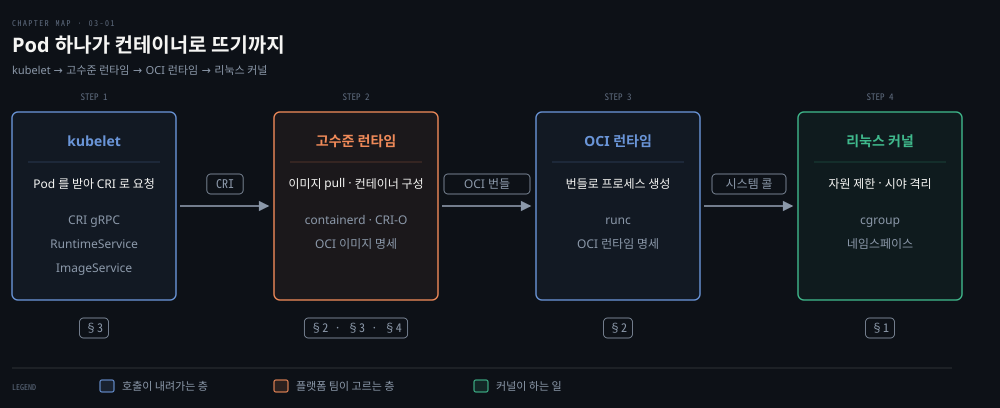
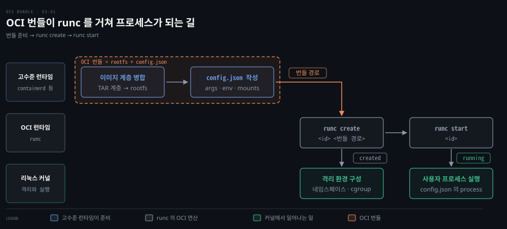
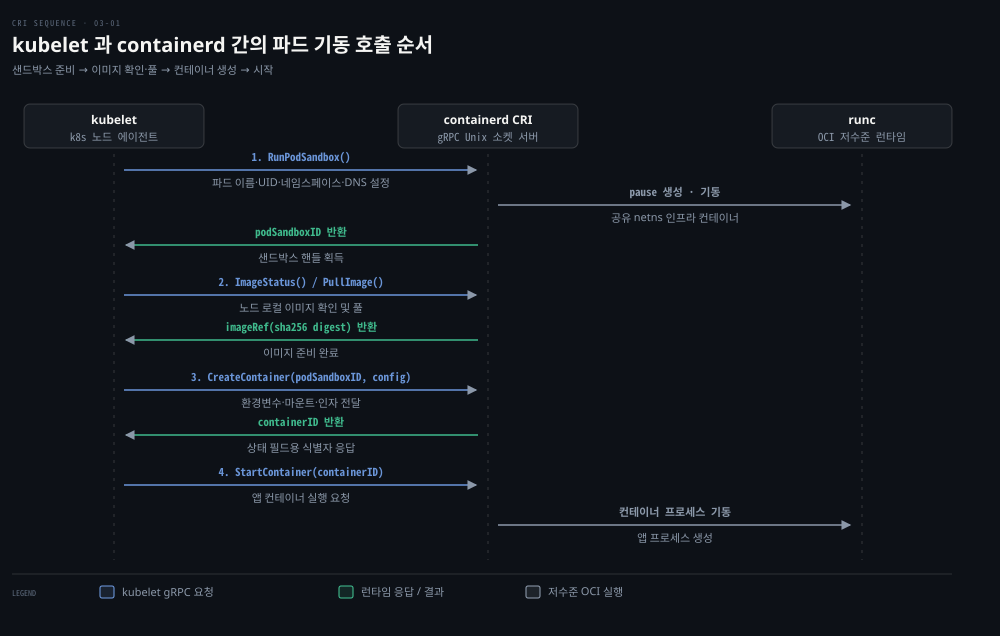
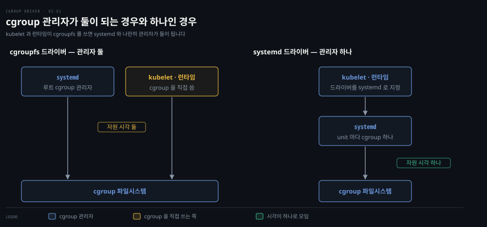
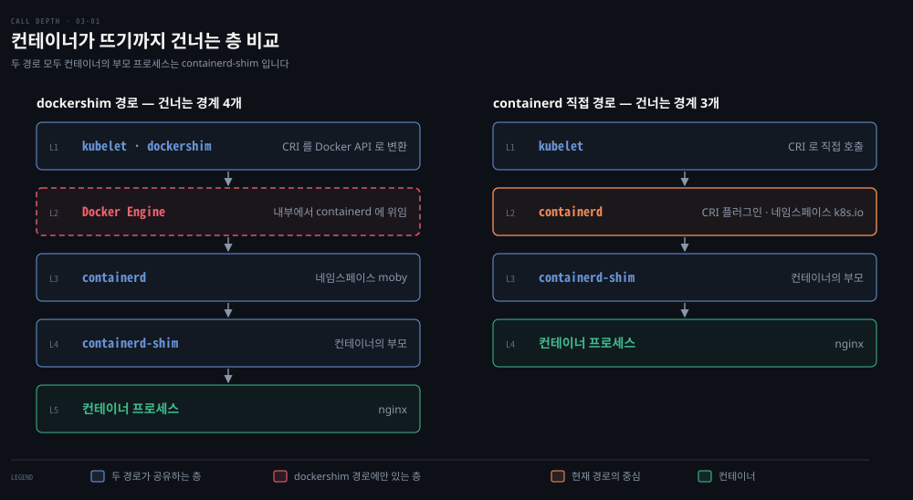
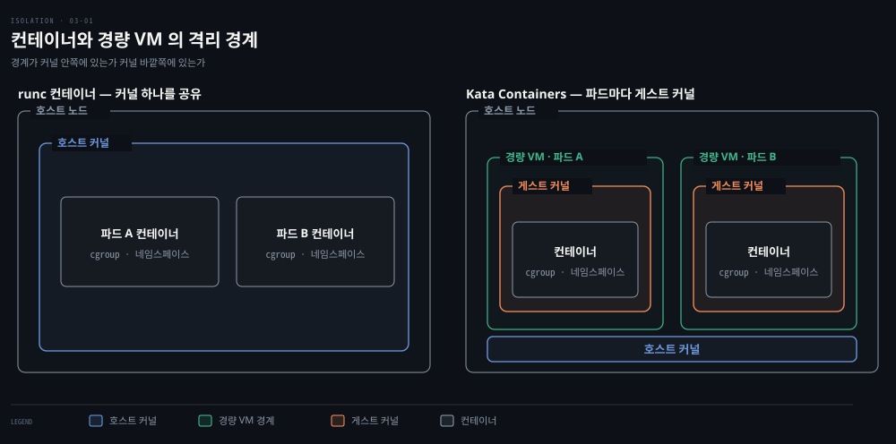

# Container Runtime — OCI 명세·CRI 통신과 런타임 선택
---
> Pod 하나는 kubelet 의 CRI 요청이 고수준 런타임과 OCI 런타임을 거쳐 커널의 cgroup·네임스페이스로 내려가면서 컨테이너가 됩니다. 층 사이의 약속이 CRI 와 OCI 이고, 플랫폼 팀이 고르는 것은 고수준 런타임과 격리 수준입니다.

## 학습 목표

> 이 편을 읽고 나면 컨테이너 런타임의 계층 구조와 CRI 통신 규약, 그리고 프로덕션 플랫폼에 적합한 런타임 선정 기준을 체계적으로 설명할 수 있습니다.

1. 리눅스 cgroup과 네임스페이스 기반의 격리 원리를 OCI 런타임 및 이미지 명세와 연결하여 설명할 수 있습니다.
2. kubelet이 CRI gRPC 인터페이스를 통해 파드 샌드박스를 만들고 컨테이너를 기동하는 4단계 흐름을 제시할 수 있습니다.
3. Docker, containerd, CRI-O, Kata Containers, Virtual Kubelet의 동작 구조와 격리 트레이드오프를 비교할 수 있습니다.
4. dockershim 제거 이후 노드에서 `docker ps` 대신 crictl이 CRI 소켓에 연결해 파드와 컨테이너를 보는 원리를 설명할 수 있습니다.
5. kubelet과 컨테이너 런타임의 cgroup 드라이버를 systemd로 일치시켜야 하는 이유를 노드 자원 관리 관점에서 분석할 수 있습니다.

실무에서 겪은 사례입니다. 표에는 증상만 적었고, 원인은 오른쪽 절을 읽으면 풀립니다. 사내 폴더라 로컬 사본에서만 열립니다.

| 사례 | 겪은 증상 | 답하는 절 |
|---|---|---|
| [Sync 뒤에도 Degraded 로 남은 앱의 이미지 pull 실패](../../../_company/task/2026-11-12_cicd_pipeline-argocd-deploy-flow/README.md) | Sync 를 해도 앱이 계속 Degraded 였고 이미지 pull 이 401 로 막혔다 | [3절 파드 기동 시의 gRPC 호출 순서](#파드-기동-시의-grpc-호출-순서) |

Pod 하나가 뜰 때 kubelet 의 요청은 CRI 로 고수준 런타임에 닿습니다. 런타임은 OCI 번들로 runc 를 불러 프로세스를 만들고, 마지막에 커널이 자원과 시야를 격리합니다. 아래 도식이 네 단계와 그 사이의 약속(CRI, OCI 번들, 시스템 콜)입니다.




## Pod 하나가 컨테이너로 뜨기까지

> Pod 하나가 컨테이너로 뜨는 길은 kubelet, 고수준 런타임, OCI 런타임, 리눅스 커널의 네 단계이고, 번호 절이 단계를 하나씩 맡습니다.

Pod 가 뜨지 않는 문제를 만나면 원인이 kubelet 에 있는지, 런타임이나 runc 에 있는지, 커널에 있는지부터 가려야 합니다. 그러려면 요청이 어떤 단계를 내려가는지 알아야 합니다. 아래 표가 그 네 단계입니다.

| 단계 | 주체 | 하는 일 | 받치는 개념 | 맡는 절 |
|---|---|---|---|---|
| 1 | kubelet | Pod 를 받아 CRI 로 요청 | CRI gRPC | 3절 |
| 2 | 고수준 런타임 | 이미지를 받고 컨테이너를 구성 | CRI 구현, OCI 이미지 명세 | 2·3·4절 |
| 3 | OCI 런타임(runc) | 번들을 받아 프로세스 생성 | OCI 런타임 명세 | 2절 |
| 4 | 리눅스 커널 | 자원 제한과 시야 격리 | cgroup, 네임스페이스 | 1절 |


## 1. 컨테이너의 등장과 격리 기술

> 마이크로서비스 확산으로 복잡해진 배포 환경을 표준화하기 위해 리눅스 커널 격리 프리미티브 위에 Docker 추상화가 세워졌습니다.

흐름 위치: 4단계 리눅스 커널 · 받치는 개념 — cgroup과 네임스페이스

애플리케이션을 빠르게, 어느 환경에서나 똑같이 배포하기가 점점 어려워졌습니다. 이 문제를 키운 압력은 세 가지입니다.

- 구성 요소 폭증: 서비스 지향 아키텍처(SOA)와 마이크로서비스가 퍼지면서 애플리케이션을 이루는 구성 요소 수가 폭증했습니다. 의미 있는 애플리케이션 하나가 여러 언어로 쓰인 서비스 열두 개쯤으로 이뤄지는 일이 흔해졌습니다.
- 배포 속도 경쟁: 소프트웨어가 사업의 차별점이 되면서 새 기능을 빠르고 안정적으로 배포하는 능력이 경쟁력이 됐습니다.
- 환경 일관성: 퍼블릭 클라우드가 호스팅 환경으로 떠오르면서 개발자 노트북부터 남의 데이터센터에 있는 운영 서버까지 애플리케이션이 똑같이 동작해야 했습니다.

### 커널 원시어와 Docker의 등장

컨테이너를 만드는 핵심 재료는 리눅스 커널의 두 원시어입니다. 둘 다 2008년부터 커널에 있었고, 네임스페이스는 그보다도 먼저 들어왔습니다.

- cgroups(컨트롤 그룹): 프로세스가 쓸 수 있는 CPU·메모리 같은 자원의 양을 제한합니다.
- 네임스페이스(namespaces): 프로세스가 볼 수 있는 시스템 뷰(마운트, 프로세스 트리, 네트워크 인터페이스, IPC)를 제한합니다.

이 원시어들은 이미 있었지만 로우레벨 시스템 콜을 직접 다뤄야 해서 일반 개발자가 일상 배포에 쓰기는 어려웠습니다.

Docker는 복잡한 커널 설정을 `docker run`이라는 CLI 명령어 뒤로 감춰 컨테이너를 대중화했습니다. 개발자는 애플리케이션의 런타임 의존성을 컨테이너 이미지로 코드화할 수 있게 되었습니다. 테스트 환경을 그대로 재현할 수 있었고, 운영 환경에 Docker Engine만 있으면 최소한의 마찰로 반복 배포할 수 있었습니다.

### 표준화 요구와 OCI의 설립

Docker의 성공 뒤 컨테이너 도구, 런타임, 이미지 레지스트리가 폭발적으로 늘었습니다. 도구마다 이미지 형식과 구동 방식이 달라지면 컨테이너의 본질적 가치인 이식성이 깨질 위험이 있었습니다. 특정 벤더 도구에 종속되지 않으려면 업계 표준이 필요했습니다.

2015년 리눅스 재단 산하에서 OCI(Open Container Initiative)가 출범했습니다.
OCI에는 runc 런타임을 기증한 Docker와 rkt 프로젝트를 이끈 CoreOS를 비롯한 주요 플랫폼 기업들이 함께 참여했습니다.
이 협의체는 런타임 명세, 이미지 명세, 레지스트리 통신을 다루는 배포 명세를 정의하여 개방형 컨테이너 생태계의 기틀을 마련했습니다.


## 2. OCI 표준과 두 핵심 명세

> OCI는 컨테이너 실행 환경을 규정하는 런타임 명세와 이미지 형식을 규정하는 이미지 명세로 도구 간 이식성과 상호 운용성을 지킵니다.

흐름 위치: 2·3단계 이미지에서 번들, 번들에서 프로세스로 · 받치는 개념 — OCI 이미지 명세와 런타임 명세

특정 도구로 빌드한 이미지가 다른 도구나 쿠버네티스 노드에서도 동작하려면 이미지 구조와 컨테이너 프로세스 구동 규칙이 일치해야 합니다. OCI는 이를 위해 두 가지 핵심 명세를 정의합니다.

### OCI 런타임 명세와 runc

OCI 런타임 명세(OCI Runtime Specification)는 호스트에서 OCI 규격대로 컨테이너를 만들고 실행하는 방식을 규정합니다. 고수준 런타임이 이미지를 풀어 **번들**(bundle)을 만들면, runc가 그 번들을 받아 프로세스로 띄웁니다. 아래 도식이 이 순서입니다.



번들은 `config.json`과 컨테이너 루트 파일시스템 디렉터리로 이뤄집니다.[^oci-bundle] `config.json`은 번들 루트에 있어야 하고 이름이 고정이며, 루트 파일시스템은 `root.path`가 가리킵니다. 이 JSON에는 루트 파일시스템 경로, 실행할 명령어(`args`), 환경 변수(`env`)가 들어갑니다. 사용자 및 그룹 식별자(`uid`, `gid`), 마운트 지점(`/proc` 등), 리소스 제약 조건도 담깁니다.

컨테이너는 4단계 수명주기 상태를 거칩니다.

1. creating: 런타임이 컨테이너 환경을 준비하는 활성 상태입니다.
2. created: 생성이 완료되었으나 사용자 프로세스는 아직 시작되지 않은 대기 상태입니다.
3. running: 컨테이너 내부의 프로세스가 실행 중인 상태입니다.
4. stopped: 컨테이너 프로세스가 종료된 완료 상태입니다.

명세는 `create` 연산을 `create <container-id> <path-to-bundle>` 꼴로 규정합니다. 이 연산은 `config.json`이 요구한 자원을 만들되 사용자 프로그램은 실행하지 않고, `start`가 그 프로그램을 실행합니다.[^oci-runtime] 도식에서 created와 running 사이를 가르는 것이 이 두 연산입니다.

OCI 런타임은 `create`, `start`, `kill`, `delete`, `state`의 다섯 가지 기본 연산을 반드시 지원해야 합니다.

OCI 프로젝트는 이 명세를 구현한 저수준 런타임 **runc**도 함께 관리합니다. Docker Engine, containerd, CRI-O 같은 고수준 런타임은 runc를 써서 OCI 명세대로 컨테이너를 띄웁니다. 덕분에 고수준 런타임은 이미지 풀, 네트워크 구성, 스토리지 처리 같은 상위 기능에 집중할 수 있습니다.

### OCI 이미지 명세와 계층 구조

OCI 이미지 명세(OCI Image Specification)는 고수준 런타임이 번들을 만들 때 풀어 쓰는 이미지의 형식을 정합니다. 인덱스·매니페스트·설정·레이어의 네 조각이 digest 로 서로를 묶는 방식은 [이미지 구조와 digest](../../../07_devops/docs/artifact/container/03-01.이미지%20구조와%20digest.md#2-이미지를-이루는-네-조각)에서 다룹니다. 레이어가 변경분을 담고 삭제를 whiteout 으로 표시하는 방식은 [layer 변경분과 whiteout](../../../07_devops/docs/artifact/container/03-03.layer%20변경분과%20whiteout.md#2-layer-는-변경분-tar)에서 다룹니다.

이 명세 덕분에 Kaniko, Buildah, Jib, Cloud Native Buildpacks 등 어떤 도구로 만든 이미지든 쿠버네티스 클러스터에서 실행됩니다.


## 3. CRI 아키텍처와 파드 기동 흐름

> kubelet은 CRI gRPC 소켓을 통해 샌드박스를 먼저 생성하고 이미지를 검사한 뒤 컨테이너를 생성하고 시작합니다.

흐름 위치: 1→2단계 kubelet 이 고수준 런타임에 요청 · 받치는 개념 — CRI gRPC 인터페이스

CRI 이전의 kubelet에는 런타임별 코드와 if 문이 곳곳에 흩어져 있었습니다. 새 런타임을 지원하려면 쿠버네티스 코드베이스를 깊이 알아야 했고 쿠버네티스 새 릴리스도 필요했습니다. 그사이 CoreOS의 rkt와 하이퍼바이저 기반 런타임이 늘어났습니다. 뒤에 Kata Containers가 된 Intel Clear Containers가 그 예입니다. 이 생태계를 받아들이려고 쿠버네티스 v1.5에서 **CRI(Container Runtime Interface)**가 도입되었습니다. 이제 런타임 개발자는 인터페이스만 지키면 쿠버네티스와 호환됩니다.

### CRI 도입 배경과 서비스 구조

CRI는 의존성 역전 원칙(Dependency Inversion Principle)을 쿠버네티스 노드 수준에서 실현한 인터페이스입니다. kubelet은 특정 런타임의 구현 세부를 알지 못하고, CRI 규약을 구현한 외부 런타임 플러그인과 통신합니다. 인터페이스에 기대게 되면서 kubelet 구현은 단순해졌고 확장과 테스트도 쉬워졌습니다.

CRI는 Unix 도메인 소켓 위에서 gRPC 및 Protocol Buffers로 통신하며 두 가지 독립된 서비스를 정의합니다.

- RuntimeService: 파드 샌드박스 수명주기 관리와 컨테이너 생성·시작·정지·삭제를 담당합니다. 프로세스 실행(`Exec`, `ExecSync`), 스트림 연결(`Attach`), 포트 포워딩(`PortForward`)도 맡습니다.
- ImageService: 노드 내부의 컨테이너 이미지 목록 조회, 이미지 풀(`PullImage`), 이미지 삭제(`RemoveImage`)를 담당합니다.

### 파드 기동 시의 gRPC 호출 순서

containerd CRI 플러그인은 `/run/containerd/containerd.sock` Unix 소켓에서 gRPC 서버를 띄우고 대기합니다. kubelet은 설정 파일의 `containerRuntimeEndpoint` 값(`unix:///run/containerd/containerd.sock`)으로 이 소켓에 연결합니다. 같은 값을 주던 `--container-runtime-endpoint` 플래그는 폐기 예정이라 설정 파일로 옮겨 씁니다.[^kubelet-config]

아래 시퀀스는 파드가 스케줄링된 뒤 kubelet, containerd CRI 플러그인, runc 사이에서 오가는 호출 순서입니다.



기동 절차는 4단계입니다.

1. 파드 샌드박스 생성 (`RunPodSandbox`): kubelet은 파드 이름, 고유 ID, 네임스페이스, DNS 설정을 담아 `RuntimeService.RunPodSandbox`를 호출합니다. 파드는 컨테이너의 묶음이므로 모든 컨테이너가 공유할 리눅스 네트워크 네임스페이스를 먼저 열어야 합니다. 런타임은 인프라 컨테이너(pause)를 띄워 네임스페이스를 고정하고 고유한 `PodSandboxID`를 반환합니다.
2. 이미지 존재 확인 및 다운로드 (`ImageStatus` / `PullImage`): kubelet은 `ImageService.ImageStatus`로 필요한 이미지가 노드 로컬 캐시에 있는지 조회합니다. 이미지가 없으면 null이 반환됩니다. 그러면 kubelet은 `ImageService.PullImage`로 레지스트리에서 이미지를 내려받고 고유 SHA256 다이제스트를 응답받습니다. `PullImage` 요청에는 레지스트리 인증 정보를 담는 `auth`(AuthConfig) 필드가 있습니다.[^cri-auth] containerd는 CRI로 인증 정보가 오면 그것을 먼저 쓰고, 오지 않을 때만 설정 파일의 `registry.configs.*.auth` 값을 씁니다. 이 항목은 DEPRECATED 로 표시돼 있습니다.[^ctrd-auth]
3. 컨테이너 생성 (`CreateContainer`): 샌드박스와 이미지가 준비되면 kubelet은 `RuntimeService.CreateContainer`를 호출합니다. 샌드박스 ID와 함께 이미지 다이제스트, 환경 변수, 볼륨 마운트 정보가 담긴 컨테이너 설정을 전달합니다. 런타임은 컨테이너를 생성한 뒤 고유 식별자인 `ContainerID`를 반환합니다. 이 식별자가 파드 상태의 `containerStatuses[].containerID`(`containerd://...`)에 기록됩니다.
4. 컨테이너 시작 (`StartContainer`): kubelet은 발급받은 컨테이너 ID를 인자로 넘겨 `RuntimeService.StartContainer`를 호출합니다. 런타임은 runc로 컨테이너 프로세스를 가동합니다.

실무 사례: [학습 목표](#학습-목표) 아래 표의 첫 줄인 이미지 pull 401 건이 이 문제입니다. 그 건은 인증 정보가 파드의 Secret이 아니라 노드의 containerd 설정에 있었던 경우입니다.

### CRI 소켓과 crictl

kubelet이 CRI 소켓으로 런타임과 대화하므로, 노드에서 컨테이너를 보는 도구도 같은 소켓에 붙어야 합니다. **crictl**은 CRI 호환 런타임용 CLI로, 노드에서 런타임과 애플리케이션을 점검하고 디버깅하는 데 씁니다.[^crictl]

containerd나 CRI-O 노드에서는 파드를 Docker 데몬이 아니라 런타임이 직접 관리하므로 `docker ps`에 워크로드가 보이지 않습니다. crictl은 `--runtime-endpoint` 플래그나 노드의 `/etc/crictl.yaml`에 적은 CRI 소켓에 연결합니다.[^crictl] 그래서 런타임이 containerd든 CRI-O든 같은 방식으로 파드와 컨테이너를 봅니다. 명령과 옵션은 [컨테이너 런타임 인터페이스·crictl](../../docs/kubernetes/architecture/컨테이너%20런타임%20인터페이스·crictl.md#2-cri-호출-경로와-소켓-통신)에 정리했습니다.

### kubelet과 런타임의 cgroup 드라이버

kubelet과 컨테이너 런타임은 같은 cgroup 드라이버를 써야 합니다. 드라이버는 `cgroupfs`와 `systemd` 두 가지이고, kubelet 설정의 기본값은 `cgroupfs`입니다.[^runtimes] 아래 도식은 systemd가 init 시스템인 노드에서 드라이버에 따라 cgroup 관리자가 몇이 되는지 보여 줍니다.



systemd가 init 시스템이면 systemd는 루트 cgroup을 만들어 쓰는 cgroup 관리자가 됩니다. systemd unit마다 cgroup도 하나씩 할당합니다. 여기에 kubelet과 런타임이 `cgroupfs` 드라이버로 cgroup 파일시스템을 직접 다루면 시스템에 cgroup 관리자가 둘 생깁니다.

두 관리자는 쓸 수 있는 자원과 쓰고 있는 자원을 서로 다르게 봅니다. 그래서 kubelet과 런타임은 `cgroupfs`, 나머지 프로세스는 systemd를 쓰는 노드가 자원 압박을 받으면 불안정해지는 경우가 있습니다.[^runtimes]

이 불안정을 줄이려면 systemd가 init 시스템일 때 kubelet과 런타임 모두 **systemd** 드라이버를 씁니다. cgroup v2를 쓰는 노드도 `systemd` 드라이버를 씁니다.[^runtimes]

- containerd: `/etc/containerd/config.toml`의 runc 옵션 항목에 `SystemdCgroup = true`를 적습니다. 항목 이름은 containerd 1.x와 2.x가 다릅니다.
- CRI-O: 기본 드라이버가 이미 systemd입니다.

kubelet 쪽은 손으로 맞추지 않아도 됩니다. 런타임이 `RuntimeConfig` CRI 호출을 지원하면 kubelet은 런타임에서 cgroup 드라이버를 읽어 옵니다. 이때 설정의 `cgroupDriver` 값은 무시합니다.[^runtimes]

이 동작은 `KubeletCgroupDriverFromCRI` 기능입니다. v1.28에 alpha, v1.31에 beta로 올라왔고 v1.34에 stable이 됐습니다.[^cgroup-fg] 런타임 쪽 지원은 containerd v2.0.0과 CRI-O v1.28.0부터입니다.[^cgroup-blog] containerd 1.x는 이 호출을 지원하지 않아서 kubelet이 자기 `cgroupDriver` 설정으로 돌아갑니다.[^runtimes] 이때는 kubelet 설정에도 `cgroupDriver: systemd`를 적습니다.


## 4. 런타임 선택 기준과 생태계 비교

> 런타임은 운영 경험, 지원 체계, 적합성 테스트, 격리 수준의 네 기준으로 고르며, 배포판이나 매니지드 서비스를 쓰면 대개 이미 정해져 있습니다.

흐름 위치: 2·3단계 고수준 런타임과 OCI 런타임 고르기 · 받치는 개념 — CRI 구현체와 OCI 런타임

CRI 덕분에 플랫폼 팀은 런타임을 고를 수 있습니다. 하지만 지난 몇 년 사이 컨테이너 런타임은 구현 세부가 됐습니다. 쿠버네티스 배포판이나 매니지드 서비스를 쓰면 런타임은 대부분 이미 정해져 있습니다. 런타임을 담은 노드 이미지를 미리 구워 주는 Cluster API 같은 커뮤니티 프로젝트도 마찬가지입니다. 그래도 런타임을 직접 고를 수 있거나 VM 기반 런타임 같은 특수 런타임이 필요하다면 아래 기준으로 판단합니다.

### 네 가지 런타임 선정 기준

1. 운영 경험: 첫 질문은 조직이 어떤 런타임을 써 봤느냐입니다. 컨테이너를 오래 써 온 조직은 대개 Docker에 익숙합니다. 저자들은 쿠버네티스에서 Docker를 쓰지 말라고 권합니다. 이미지 빌드나 컨테이너 네트워크 생성처럼 쿠버네티스에 필요 없는 기능까지 갖춰 Docker 데몬이 너무 무겁기 때문입니다. 다행히 Docker는 내부에서 containerd를 쓰므로 containerd로 옮겨 갈 수 있습니다. 대신 플랫폼 운영자는 containerd CLI를 새로 익혀야 합니다.
2. 지원 체계: VMware Tanzu Kubernetes Grid나 Red Hat OpenShift 같은 배포판은 대개 특정 런타임을 함께 싣고 나옵니다. 아주 강한 이유가 없다면 그 선택을 따릅니다. 다른 런타임으로 바꾼다면 지원에 어떤 영향이 있는지 먼저 확인합니다.
3. 적합성 테스트(Conformance Testing): 쿠버네티스 sig-node는 CRI 검증 테스트와 노드 적합성 테스트를 정의하고, 이 테스트는 모든 쿠버네티스 릴리스에 포함됩니다. 런타임마다 커버리지가 다릅니다. 커버리지가 넓을수록 런타임 문제가 쿠버네티스 릴리스 과정에서 잡힙니다. 결과는 Kubernetes Test Grid에 공개되므로 테스트 결과와 그 런타임이 쿠버네티스 프로젝트와 맺은 관계를 함께 봅니다.
4. 격리 수준(Isolation Guarantees): 워크로드가 리눅스 컨테이너보다 강한 격리를 요구하는지 확인합니다. 흔하지는 않지만 신뢰할 수 없는 코드를 실행하거나 강한 멀티테넌시 보장이 필요한 애플리케이션은 VM 수준 격리를 요구합니다. 이때 Kata Containers 같은 특수 런타임을 쓸 수 있습니다.

### Docker와 dockershim 구조

과거 쿠버네티스는 Docker Engine을 지원하려고 kubelet 안에 **dockershim**이라는 내장 어댑터를 두었습니다. Docker Engine이 CRI를 구현하지 않았기 때문입니다. dockershim은 kubelet 안에서 CRI gRPC 서버로 동작하며 CRI 호출을 Docker Engine API 호출로 바꿨습니다. 아래 도식은 이 경로와 containerd 직접 경로가 건너는 층을 나란히 놓은 것입니다.



Docker Engine은 내부에서 containerd에 작업을 위임하므로 프로세스 트리는 Docker 데몬이 아니라 containerd 아래에 놓입니다.

```bash
systemd
└─containerd
  └─containerd-shim -namespace moby -workdir ...
    └─nginx
      └─nginx
```

Docker Engine은 containerd의 `moby` 네임스페이스를 사용합니다. 노드 진단 시 `docker ps`를 치면 `k8s_nginx_nginx_default_<uuid>` 형태의 컨테이너 이름과 `k8s_POD_...` 인프라 컨테이너가 노출되었습니다. `ctr --namespace moby containers list`나 dockershim 소켓을 가리키는 `crictl --runtime-endpoint unix:///var/run/dockershim.sock ps`로도 조회가 가능했습니다.

이 경로는 이제 없습니다. dockershim 제거는 쿠버네티스 v1.20 릴리스 때 예고됐고, v1.24 릴리스에서 실제로 제거됐습니다.[^dockershim] kubelet 안의 Docker 전용 연결 코드가 사라졌으므로 지금의 kubelet은 CRI를 구현한 런타임하고만 대화합니다.

Docker Engine을 계속 쓰려면 **cri-dockerd** 어댑터를 씁니다. Mirantis와 Docker가 이 shim 코드를 쿠버네티스 밖에서 함께 유지하기로 했습니다. 이 어댑터가 쿠버네티스 CRI로 Docker를 제어하게 해 줍니다.[^cri-dockerd] cri-dockerd를 노드에 설치하면 kubelet은 이 어댑터의 소켓으로 Docker Engine에 연결합니다. 소켓 기본값은 `/run/cri-dockerd.sock`입니다.[^runtimes]

### containerd와 k8s.io 네임스페이스

**containerd**는 저자들이 현장에서 쿠버네티스 플랫폼을 꾸릴 때 가장 자주 만나는 런타임입니다. 2021년 기준으로 Cluster API 기반 노드 이미지의 기본 런타임이었고, AKS·EKS·GKE 같은 매니지드 서비스에서도 쓸 수 있었습니다.

containerd는 v1.1부터 CRI 플러그인을 기본 내장합니다. 그래서 중계 레이어 없이 `/run/containerd/containerd.sock` Unix 소켓으로 gRPC 요청을 직접 받습니다.

```bash
systemd
└─containerd
  └─containerd-shim -namespace k8s.io -workdir ...
    └─nginx
      └─nginx
```

쿠버네티스가 관리하는 컨테이너는 `moby`가 아니라 containerd의 **k8s.io** 네임스페이스에 들어갑니다. 그래서 containerd CLI인 `ctr`로 볼 때는 `--namespace k8s.io`를 지정합니다.

```bash
ctr --namespace k8s.io containers ls | grep nginx
c85e47fa... docker.io/library/nginx:latest io.containerd.runtime.v1.linux
```

CRI 소켓을 직접 바라보는 `crictl` 명령어로도 동일한 컨테이너를 확인할 수 있습니다.

```bash
crictl --runtime-endpoint unix:///run/containerd/containerd.sock ps --name nginx
CONTAINER ID   IMAGE           CREATED          STATE     NAME    POD ID
c85e47faf3616  4bb46517cac39   39 seconds ago   Running   nginx   73caea404b
```

### CRI-O와 conmon 모니터 프로세스

**CRI-O**는 쿠버네티스 전용으로 설계된 CRI 구현체입니다. Docker나 containerd와 달리 쿠버네티스 밖의 용도는 고려하지 않습니다. 2021년 기준으로 CRI-O의 주요 사용처 하나가 Red Hat OpenShift였습니다.

kubelet은 보통 `/var/run/crio/crio.sock`에 있는 Unix 소켓으로 CRI-O와 통신합니다. CRI-O는 컨테이너를 띄울 때 컨테이너 모니터인 **conmon** 프로세스를 함께 띄웁니다.

```bash
systemd
└─conmon -s -c ed779... -n k8s_nginx_nginx_default_e9115... -u 8cdf0c...
  └─nginx
    └─nginx
```

conmon은 컨테이너 프로세스의 부모 역할을 맡습니다. 컨테이너에 attach할 길을 열어 줍니다. 표준 출력과 표준 에러 스트림은 로그 파일에 기록합니다. 컨테이너 종료 처리도 conmon이 맡습니다.

CRI-O 프로젝트는 독자적인 CLI 도구를 제공하지 않으므로 노드 디버깅에는 `crictl`을 CRI-O 소켓에 연결하여 사용합니다.

```bash
crictl --runtime-endpoint unix:///var/run/crio/crio.sock ps --name nginx
CONTAINER     IMAGE                 CREATED         STATE     NAME    POD ID
8cdf0c...     nginx@sha256:179...   2 minutes ago   Running   nginx   eabf152
```

### Kata Containers와 경량 VM 격리

**Kata Containers**는 컨테이너 대신 경량 VM으로 워크로드를 실행하는 오픈소스 특수 런타임입니다. Intel의 Clear Containers와 Hyper.sh의 RunV라는 두 VM 기반 런타임이 합쳐져 탄생했습니다.

일반 컨테이너는 호스트 커널을 함께 쓰지만 Kata는 VM마다 게스트 커널을 따로 둡니다. Kata 문서는 경량 VM을 하드웨어 가상화로 얻는 두 번째 방어층으로 설명합니다. 컨테이너의 cgroup과 네임스페이스는 VM 안에서 게스트 커널이 만듭니다.[^kata-arch] 아래 도식이 두 격리 경계의 위치 차이입니다.



그래서 리눅스 컨테이너보다 강한 격리를 보장합니다. 보안 요구 때문에 워크로드끼리 리눅스 커널을 공유할 수 없거나, cgroup 격리로는 맞출 수 없는 자원 보장이 필요하다면 Kata가 잘 맞습니다. 흔한 사용 사례는 신뢰할 수 없는 코드를 돌리는 멀티테넌트 클러스터입니다. Baidu Cloud와 Huawei Cloud 같은 클라우드 사업자가 자사 인프라에 Kata를 씁니다. 다만 저자들은 Kata를 틈새 기술로 보며 현장에서 쓰이는 것을 본 적이 없다고 말합니다. 쿠버네티스 클러스터에 VM 수준 격리가 필요할 때 살펴볼 만한 선택지입니다.

Kata Containers는 CRI를 직접 구현하지 않고 containerd 하부에서 containerd-shim v2 API를 구현하는 방식으로 동작합니다. 노드에는 여전히 containerd가 떠 있으므로 일반 리눅스 컨테이너 파드와 VM 기반 파드를 한 노드에서 함께 돌릴 수 있습니다.

쿠버네티스는 런타임 여러 개를 설정해 골라 쓰는 **RuntimeClass** 리소스를 제공합니다. RuntimeClass는 v1.20부터 stable이고 `node.k8s.io/v1` API를 씁니다.[^runtimeclass]

```yaml
apiVersion: node.k8s.io/v1
kind: RuntimeClass
metadata:
  name: kata-containers
handler: kata
```

개발자는 파드 명세의 `spec.runtimeClassName`에 런타임 클래스 이름을 지정하여 Kata 격리를 선택합니다.

```yaml
apiVersion: v1
kind: Pod
metadata:
  name: kata-example
spec:
  runtimeClassName: kata-containers
  containers:
  - name: nginx
    image: nginx
```

Kata Containers는 QEMU, Cloud Hypervisor, Firecracker, Dragonball 같은 여러 하이퍼바이저를 지원합니다.[^kata-hv] QEMU 백엔드를 쓸 경우 노드 프로세스 트리에서 `qemu-system-x86_64` 프로세스가 확인됩니다.

### Virtual Kubelet과 무서버 백엔드

**Virtual Kubelet**은 kubelet처럼 동작하지만 백엔드를 플러그인 API로 바꿔 끼우는 오픈소스 프로젝트입니다. 컨테이너 런타임도 CRI 구현체도 아니고, 파드를 돌릴 대체 실행 환경을 쿠버네티스에 드러내는 것이 목적입니다. 대체 실행 환경은 서버리스 프레임워크나 엣지 프레임워크처럼 애플리케이션을 돌릴 수 있는 시스템이면 무엇이든 됩니다.

커뮤니티는 AWS Fargate, Azure Container Instances(ACI), HashiCorp Nomad 등의 공급자(provider)를 제공합니다. 이 공급자로 해당 서비스에 파드를 띄웁니다. 맞는 공급자가 없으면 Virtual Kubelet 라이브러리로 Go 프로그램을 짜서 직접 만듭니다. 공급자는 노드 등록, 파드 실행, 쿠버네티스가 기대하는 API 노출을 처리합니다. 저자들은 현장에서 Virtual Kubelet이 필요한 사례를 아직 만나지 못했지만, 있다는 것을 알아 둘 만한 도구로 봅니다.


## 학습 점검

> 본문의 핵심 개념을 자가 점검하는 여섯 문항입니다.

1. 리눅스 커널 격리 기술인 cgroups와 네임스페이스의 역할 차이는 무엇인가요?
2. OCI 런타임 명세와 이미지 명세가 각각 담당하는 표준화 영역은 무엇인가요?
3. kubelet이 CRI를 통해 파드를 기동할 때 샌드박스(RunPodSandbox)를 개별 컨테이너보다 먼저 생성하는 아키텍처적 이유는 무엇인가요?
4. containerd 노드와 CRI-O 노드에서 컨테이너 프로세스의 부모 프로세스는 각각 무엇이며, CRI-O의 부모 프로세스는 무슨 일을 하나요?
5. 호스트 OS가 systemd를 사용할 때 kubelet과 컨테이너 런타임의 cgroup 드라이버를 systemd로 일치시켜야 하는 이유는 무엇인가요?
6. containerd나 CRI-O 노드에서 `docker ps`로 워크로드가 보이지 않는 이유와, `crictl`이 연결하는 대상은 무엇인가요?


## 정답 (자답 후 펼치기)

> 위 질문 6개에 먼저 자답한 뒤 아래를 읽으세요.

### 정답 1 — cgroups와 네임스페이스의 역할 차이

cgroups(컨트롤 그룹)는 프로세스가 쓸 수 있는 CPU·메모리 같은 자원의 양을 제한합니다. 반면 네임스페이스는 마운트 목록, 프로세스 PID 트리, 네트워크 인터페이스, IPC 자원 등 프로세스가 시스템에서 바라볼 수 있는 격리 뷰를 제한합니다. 자원 상한 통제는 cgroups가 맡고 시야 격리는 네임스페이스가 맡아 안전한 실행 공간을 만듭니다.

### 정답 2 — OCI 런타임 명세와 이미지 명세의 영역

OCI 런타임 명세는 호스트에서 컨테이너를 실행하는 규칙을 정합니다. JSON 설정 스키마, 4단계 수명주기, 그리고 5가지 필수 연산(`create`, `start`, `kill`, `delete`, `state`)을 정의합니다.

OCI 이미지 명세는 파일시스템 레이어의 TAR 형식과 환경 설정을 다룹니다. 이들을 SHA256 해시로 묶는 매니페스트와 인덱스 구조를 표준화하여 도구 간 이식성을 보장합니다.

### 정답 3 — 파드 샌드박스 선행 생성 이유

파드는 단일 프로세스가 아니라 하나 이상의 컨테이너가 시스템 자원을 공유하는 묶음 단위이기 때문입니다. 네트워크 네임스페이스와 IP 주소, DNS 설정 등 파드 내부의 모든 컨테이너가 공유해야 하는 환경 인프라를 먼저 구성해야 애플리케이션 컨테이너들이 동일한 네트워크 인터페이스를 바라보며 기동할 수 있습니다. 런타임은 pause 인프라 컨테이너로 이 네임스페이스를 묶어두고 고유한 샌드박스 ID를 발급합니다.

### 정답 4 — containerd와 CRI-O 비교

containerd 노드의 프로세스 트리는 `systemd → containerd → containerd-shim → 컨테이너 프로세스` 순입니다. 컨테이너 프로세스의 부모는 containerd 데몬이 아니라 `containerd-shim`입니다. shim은 `-namespace k8s.io` 인자로 쿠버네티스용 네임스페이스에 속합니다.

CRI-O 노드에서는 `systemd → conmon → 컨테이너 프로세스` 순입니다. 컨테이너 모니터인 `conmon`이 부모입니다. conmon은 컨테이너에 attach할 길을 열어 줍니다. STDOUT·STDERR를 로그 파일에 기록하고 컨테이너 종료도 처리합니다.

### 정답 5 — cgroup 드라이버 일치 이유

systemd가 init 시스템인 노드에서 kubelet과 런타임이 cgroupfs를 쓰면 cgroup 관리자가 둘이 되기 때문입니다. 두 관리자는 쓸 수 있는 자원과 쓰고 있는 자원을 서로 다르게 봅니다. 그래서 자원 압박을 받을 때 노드가 불안정해지는 경우가 있습니다. kubelet과 런타임 모두 systemd 드라이버를 쓰면 관리자가 systemd 하나로 모입니다. 런타임이 `RuntimeConfig` CRI 호출을 지원하면 kubelet은 런타임의 드라이버를 읽어 스스로 맞춥니다.

### 정답 6 — crictl 이 연결하는 곳

쿠버네티스 v1.24에서 dockershim이 제거되었기 때문입니다. containerd나 CRI-O 노드에서 kubelet은 Docker 데몬을 거치지 않고 런타임의 CRI 소켓과 직접 통신합니다. Docker 데몬은 이렇게 뜬 워크로드를 모릅니다. `crictl`은 kubelet이 쓰는 것과 같은 CRI 소켓(containerd는 `/run/containerd/containerd.sock`, CRI-O는 `/var/run/crio/crio.sock`)에 연결해 파드와 컨테이너를 봅니다.


## 참고 자료

- [Production Kubernetes (O'Reilly, 2021)](https://www.oreilly.com/library/view/production-kubernetes/9781492092308/): Josh Rosso, Rich Lander, Alex Brand, John Harris 공저, ISBN 978-1492092308
- [Kubernetes Documentation: Container Runtime Interface (CRI)](https://kubernetes.io/docs/concepts/architecture/cri/) (확인 일자: 2026-11-18)
- [Kubernetes Documentation: Container Runtimes](https://kubernetes.io/docs/setup/production-environment/container-runtimes/) (확인 일자: 2026-11-18)
- [Kubernetes Documentation: Debugging Kubernetes nodes with crictl](https://kubernetes.io/docs/tasks/debug/debug-cluster/crictl/) (확인 일자: 2026-11-18)
- [Kubernetes Blog: Dockershim Removal FAQ](https://kubernetes.io/blog/2022/02/17/dockershim-faq/) (확인 일자: 2026-11-18)
- [Open Container Initiative: Runtime Specification](https://github.com/opencontainers/runtime-spec) (확인 일자: 2026-11-18)
- [Open Container Initiative: Image Format Specification](https://github.com/opencontainers/image-spec) (확인 일자: 2026-11-18)
- [Kubernetes cri-api: api.proto (PullImageRequest)](https://github.com/kubernetes/cri-api/blob/kubernetes-1.34.0/pkg/apis/runtime/v1/api.proto) (확인 일자: 2026-11-18)
- [containerd: CRI registry configuration](https://github.com/containerd/containerd/blob/v2.0.0/docs/cri/registry.md) (확인 일자: 2026-11-18)
- [Kata Containers Architecture Documentation](https://github.com/kata-containers/kata-containers/tree/main/docs/design) (확인 일자: 2026-11-18)
- [Mirantis cri-dockerd Repository](https://github.com/Mirantis/cri-dockerd) (확인 일자: 2026-11-18)
- [Kubernetes Documentation: Runtime Class](https://kubernetes.io/docs/concepts/containers/runtime-class/) (확인 일자: 2026-11-18)
- [Kubernetes Documentation: Kubelet Configuration (v1beta1)](https://kubernetes.io/docs/reference/config-api/kubelet-config.v1beta1/) (확인 일자: 2026-11-18)
- [Kubernetes Blog: Autoconfiguration For Node Cgroup Driver (beta)](https://kubernetes.io/blog/2024/08/21/cri-cgroup-driver-lookup-now-beta/) (확인 일자: 2026-11-18)
- [Kata Containers: Hypervisors](https://github.com/kata-containers/kata-containers/blob/main/docs/hypervisors.md) (확인 일자: 2026-11-18)


## 관련 문서

- [Production Kubernetes 정독 인덱스](./README.md) — 16개 장 전체 설계 로드맵
- [배포 모델과 고가용성 인프라 구축](./02-01.Deployment%20Models%20%E2%80%94%20%EB%B0%B0%ED%8F%AC%20%EB%AA%A8%EB%8D%B8%EA%B3%BC%20%EA%B3%A0%EA%B0%80%EC%9A%A9%EC%84%B1%20%EC%9D%B8%ED%94%84%EB%9D%BC%20%EA%B5%AC%EC%B6%95.md#3-아키텍처와-토폴로지-설계) — 컨트롤 플레인 배치와 노드 풀 아키텍처
- [컨테이너 런타임 인터페이스·crictl](../../docs/kubernetes/architecture/컨테이너%20런타임%20인터페이스·crictl.md#2-cri-호출-경로와-소켓-통신) — CRI 아키텍처 상세와 crictl 디버깅 실무
- [컨테이너의 탄생 — 앱 실행의 진화와 격리 프리미티브](../networking-and-kubernetes/03-01.컨테이너의%20탄생%20—%20앱%20실행의%20진화와%20격리%20프리미티브.md#kubernetes-접점-—-cri) — 리눅스 격리 원리와 daemonless shim 구조
- [cgroup v2 단일 트리와 컨트롤러 통합](../../../02_os/docs/kernel/01-01.cgroup%20v2.md#4-delegation과-systemd-통합) — OS 레벨 cgroup 드라이버와 systemd 위임 원리
- [Kubernetes in Action: 쿠버네티스란 무엇인가](../kubernetes-in-action/01-01.쿠버네티스란%20무엇인가%20—%20기원과%20아키텍처.md#5-컨트롤-플레인과-워커-노드의-컴포넌트) — 워커 노드 컴포넌트와 kubelet 아키텍처
- [Kubernetes in Action: 쿠버네티스 클러스터 실행하기](../kubernetes-in-action/03-01.쿠버네티스%20클러스터%20실행하기.md#2-로컬-옵션-세-가지-비교) — 로컬 및 다중 노드 클러스터 구축 환경

[^oci-bundle]: opencontainers/runtime-spec v1.2.1 — Filesystem Bundle (`bundle.md`). "`config.json`: contains configuration data. This REQUIRED file MUST reside in the root of the bundle directory and MUST be named `config.json`." "container's root filesystem: the directory referenced by `root.path`, if that property is set in `config.json`." <https://github.com/opencontainers/runtime-spec/blob/v1.2.1/bundle.md> (2026-11-18 확인)

[^oci-runtime]: opencontainers/runtime-spec v1.2.1 — Runtime and Lifecycle (`runtime.md`). create 단계: "While the resources requested in the `config.json` MUST be created, the user-specified program (from `process`) MUST NOT be run at this time." start 단계: "The runtime MUST run the user-specified program, as specified by `process`." <https://github.com/opencontainers/runtime-spec/blob/v1.2.1/runtime.md> (2026-11-18 확인)

[^kubelet-config]: Kubernetes — kubelet 명령줄 참조와 Kubelet Configuration (v1beta1). `--container-runtime-endpoint` 설명: "(DEPRECATED: This parameter should be set via the config file specified by the Kubelet's --config flag. ...)", 기본값 "unix:///run/containerd/containerd.sock". 설정 필드: "containerRuntimeEndpoint ... ContainerRuntimeEndpoint is the endpoint of container runtime." <https://kubernetes.io/docs/reference/command-line-tools-reference/kubelet/>, <https://kubernetes.io/docs/reference/config-api/kubelet-config.v1beta1/> (2026-11-18 확인)

[^cri-auth]: kubernetes/cri-api `kubernetes-1.34.0` — `api.proto`. `message PullImageRequest` 에 "// Authentication configuration for pulling the image. AuthConfig auth = 2;" 필드가 있습니다. <https://github.com/kubernetes/cri-api/blob/kubernetes-1.34.0/pkg/apis/runtime/v1/api.proto> (2026-11-18 확인)

[^ctrd-auth]: containerd v2.0.0 — `docs/cri/registry.md`. "Please note that auth config passed by CRI takes precedence over this config. The registry credential in this config will only be used when auth config is not specified by Kubernetes via CRI." 같은 문서에서 `registry.configs.*.auth` 는 DEPRECATED 로 표시됩니다. <https://github.com/containerd/containerd/blob/v2.0.0/docs/cri/registry.md> (2026-11-18 확인)

[^crictl]: Kubernetes — Debugging Kubernetes nodes with crictl. "crictl is a command-line interface for CRI-compatible container runtimes. You can use it to inspect and debug container runtimes and applications on a Kubernetes node." 엔드포인트는 "Set the endpoint in the configuration file /etc/crictl.yaml." <https://kubernetes.io/docs/tasks/debug/debug-cluster/crictl/> (2026-11-18 확인)

[^runtimes]: Kubernetes — Container Runtimes. "The cgroupfs driver is the default cgroup driver in the kubelet." "Two cgroup managers result in two views of the available and in-use resources in the system. In some cases, nodes that are configured to use cgroupfs for the kubelet and container runtime, but use systemd for the rest of the processes become unstable under resource pressure." "If the [runtime supports the RuntimeConfig CRI RPC], the kubelet automatically detects the appropriate cgroup driver from the runtime." "For cri-dockerd, the CRI socket is /run/cri-dockerd.sock by default." <https://kubernetes.io/docs/setup/production-environment/container-runtimes/> (2026-11-18 확인)

[^cgroup-fg]: Kubernetes — Feature Gates, `KubeletCgroupDriverFromCRI`. 단계 표: alpha 1.28–1.30, beta 1.31–1.33, stable 1.34. "If the CRI supports this feature, the kubelet ignores the cgroupDriver configuration setting." <https://kubernetes.io/docs/reference/command-line-tools-reference/feature-gates/> (2026-11-18 확인)

[^cgroup-blog]: Kubernetes Blog — Kubernetes 1.31: Autoconfiguration For Node Cgroup Driver (beta), 2024-08-21. "containerd: Support was added in v2.0.0", "CRI-O: Support was added in v1.28.0". <https://kubernetes.io/blog/2024/08/21/cri-cgroup-driver-lookup-now-beta/> (2026-11-18 확인)

[^dockershim]: Kubernetes — Updated: Dockershim Removal FAQ. "The removal was originally announced as a part of the Kubernetes v1.20 release. The Kubernetes v1.24 release actually removed the dockershim from Kubernetes." <https://kubernetes.io/blog/2022/02/17/dockershim-faq/> (2026-11-18 확인)

[^cri-dockerd]: Mirantis — cri-dockerd README. "This adapter provides a shim for Docker Engine that lets you control Docker via the Kubernetes Container Runtime Interface." "Mirantis and Docker have agreed to partner to maintain the shim code standalone outside Kubernetes, as a conformant CRI interface for the Docker Engine API." <https://github.com/Mirantis/cri-dockerd> (2026-11-18 확인)

[^runtimeclass]: Kubernetes — Runtime Class. 문서 머리의 feature-state 는 "v1.20 stable" 이고, 예시는 "apiVersion: node.k8s.io/v1" 입니다. <https://kubernetes.io/docs/concepts/containers/runtime-class/> (2026-11-18 확인)

[^kata-arch]: Kata Containers 3.20.0 — Architecture (`docs/design/architecture/README.md`). "lightweight virtual machines (VM's) that feel and perform like standard Linux containers, but provide stronger workload isolation using hardware virtualization technology as a second layer of defence." "Linux cgroups and namespaces are created inside the VM by the guest kernel". <https://github.com/kata-containers/kata-containers/blob/3.20.0/docs/design/architecture/README.md> (2026-11-18 확인)

[^kata-hv]: Kata Containers — Hypervisors (`docs/hypervisors.md`). 지원 하이퍼바이저 표에 Cloud Hypervisor, Firecracker, QEMU, Dragonball, StratoVirt 가 있습니다. <https://github.com/kata-containers/kata-containers/blob/main/docs/hypervisors.md> (2026-11-18 확인)
