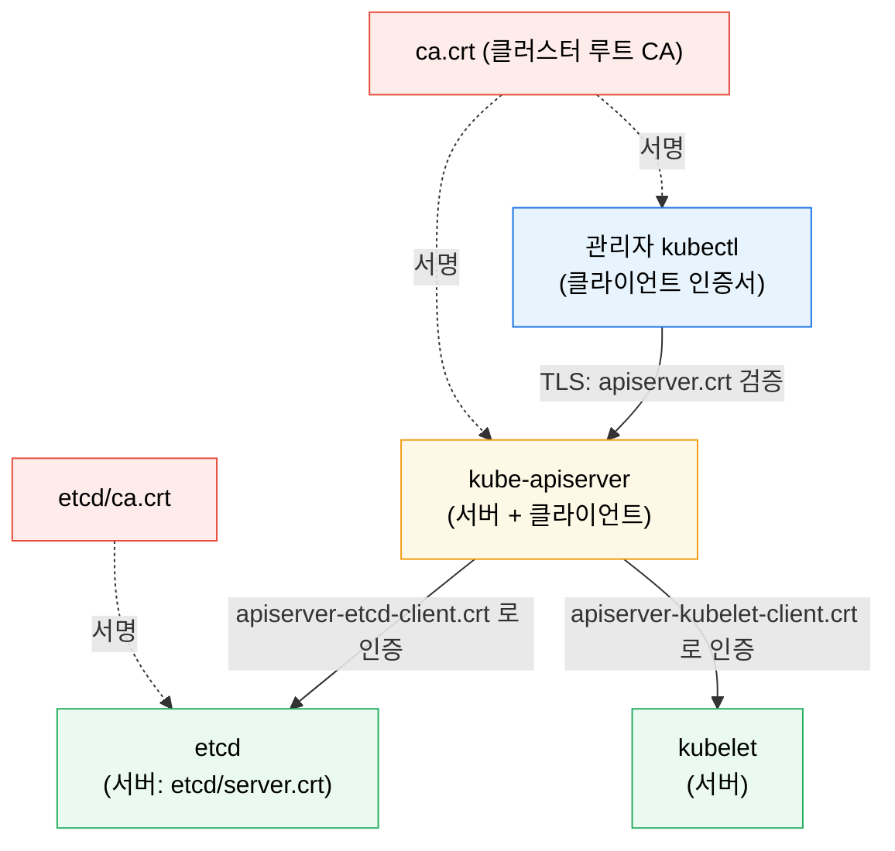
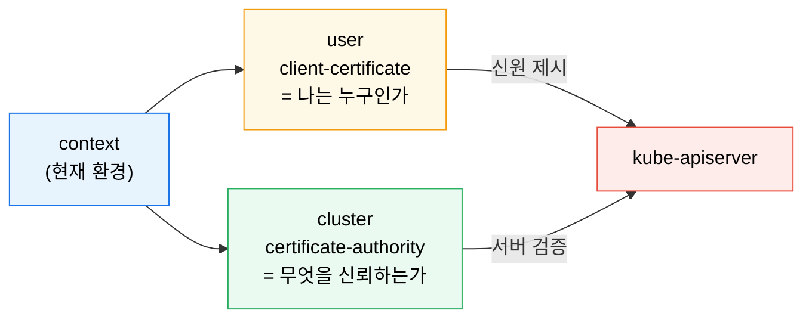

# TLS와 API 접근 보안

---

> Kubernetes 보안의 출발점은 API 서버와의 통신이 어떻게 보호되고 인증되는지 이해하는 것입니다. kubeconfig·인증서·CA 는 각각 다른 층위의 개념입니다. 본 장은 컨트롤 플레인 PKI(API 서버·etcd·kubelet 인증서)에 집중하고, 외부 트래픽 인증서 자동화(cert-manager·Issuer·Certificate)는 [Ingress TLS·설정·IngressClass](../../book/kubernetes-in-action/12-02.Ingress%20TLS%C2%B7%EC%84%A4%EC%A0%95%C2%B7IngressClass.md#cert-manager-%EB%A1%9C-tls-secret-%EC%9E%90%EB%8F%99-%EB%B0%9C%EA%B8%89)에서 다룹니다.

## 학습 목표

> RBAC 이전에 "누구로 접속했고, 무엇을 신뢰하는가" 를 먼저 분리합니다.

이 장을 끝내면 다음에 답할 수 있습니다.

1. API 서버·etcd·kubelet 이 TLS 로 어떻게 연결되는지 설명할 수 있습니다.
2. 서버 인증서와 클라이언트 인증서의 역할 차이를 설명할 수 있습니다.
3. kubeconfig 의 `cluster`·`user`·`context` 가 보안상 어떤 의미를 갖는지 설명할 수 있습니다.
4. 인증서 만료를 어떻게 점검·갱신하는지 설명할 수 있습니다.

## 사전 지식

> 이 장은 다음을 안다고 가정합니다.

1. TLS 핸드셰이크에서 서버 인증서가 "이 서버가 진짜인가" 를 증명한다는 점을 압니다.
2. CA(인증 기관)가 인증서에 서명해 신뢰 체인을 만든다는 개념을 압니다.
3. `kubectl` 이 kubeconfig 파일을 읽어 클러스터에 접속한다는 점을 압니다.


## 1. Kubernetes의 PKI 구조

> Kubernetes 는 여러 컴포넌트가 서로 TLS 로 통신하는 시스템입니다. TLS 는 "외부 사용자의 kubectl 접속" 만을 위한 것이 아니라 컨트롤 플레인 내부 통신 전체의 기반입니다.

kubeadm 으로 설치하면 인증서는 `/etc/kubernetes/pki` 에 모입니다. 핵심 인증서는 다음과 같습니다.

| 파일 | 종류 | 역할 |
|------|------|------|
| `ca.crt` | 루트 CA | 클러스터 일반 인증서를 서명·검증하는 최상위 CA |
| `apiserver.crt` | 서버 | API 서버가 HTTPS 서비스를 제공할 때 자신을 증명 |
| `apiserver-kubelet-client.crt` | 클라이언트 | API 서버가 각 노드 kubelet 에 접속할 때 자신을 인증 |
| `etcd/ca.crt` | 루트 CA | etcd 관련 인증서 전용 CA (apiserver CA 와 분리) |
| `etcd/server.crt` | 서버 | etcd 저장소가 자신을 증명 |
| `apiserver-etcd-client.crt` | 클라이언트 | API 서버가 etcd 에 접속할 때 자신을 인증 |

### 서버 인증서 vs 클라이언트 인증서

같은 PKI 안에서도 두 인증서의 방향이 다릅니다. **서버 인증서**는 서비스(API 서버·etcd·kubelet)가 "나는 진짜 그 서비스다" 를 클라이언트에게 증명합니다. **클라이언트 인증서**는 사용자나 컴포넌트(admin·controller-manager·scheduler)가 "나는 이런 신원이다" 를 서버에게 증명합니다. API 서버는 etcd·kubelet 에 접속할 때는 클라이언트가 되고, kubectl 요청을 받을 때는 서버가 되므로 양쪽 인증서를 모두 가집니다.




## 2. kubeconfig와 신뢰 경계

> kubeconfig 는 접속 설정 파일이면서 동시에 인증 실행 경로입니다.

kubeconfig(예: `admin.conf`)는 세 요소로 접속을 구성합니다.

- **cluster** — API 서버 주소와 서버를 검증할 `certificate-authority`(또는 `-data`). "무엇을 신뢰하는가".
- **user** — 클라이언트가 자신을 인증할 `client-certificate`·`client-key`(또는 `-data`). "나는 누구인가".
- **context** — 특정 user 와 특정 cluster 를 묶어 "지금 어느 환경으로 동작하는가" 를 정합니다.



```bash
kubectl config get-contexts
kubectl config current-context
kubectl config view --minify
```

공식 문서가 명시하는 경고가 하나 있습니다. **신뢰할 수 없는 kubeconfig 파일은 악성 코드 실행이나 파일 노출로 이어질 수 있으므로 셸 스크립트처럼 다뤄야 합니다.** kubeconfig 는 "어느 클러스터를 볼까" 를 정하는 편의 파일이 아니라 실제 인증과 신뢰 체인의 일부입니다.


## 3. 인증서 만료 점검과 갱신

> TLS 는 평소에 드러나지 않지만 인증서가 만료되는 순간 클러스터 API 제어가 중단됩니다.

운영 중인 클러스터에서 갑자기 `kubectl` 명령이 `x509: certificate has expired` 오류를 내며 멈출 때가 있습니다. kubeadm 으로 만든 클러스터라면 흔한 원인은 kubeadm 이 발급한 컨트롤 플레인 인증서의 수명이 끝난 것입니다. 수명 주기와 점검 절차를 미리 알아두어야 갑작스러운 API 차단 사고를 막을 수 있습니다.

### 만료 수명과 점검 절차

kubeadm 이 생성하는 인증서는 종류에 따라 기본 수명이 다릅니다.[^certs] 루트 CA 인증서인 `ca.crt`, `etcd/ca.crt`, `front-proxy-ca.crt` 의 유효기간은 10년입니다. 반면 API 서버·etcd·관리자 클라이언트 인증서의 기본 유효기간은 1년입니다. CA 와 키의 일반 원리는 [TLS로 컴포넌트 안전하게 연결하기 — 키·인증서·CA의 역할](../../book/container-security/11-01.TLS%EB%A1%9C%20%EC%BB%B4%ED%8F%AC%EB%84%8C%ED%8A%B8%20%EC%95%88%EC%A0%84%ED%95%98%EA%B2%8C%20%EC%97%B0%EA%B2%B0%ED%95%98%EA%B8%B0%20%E2%80%94%20%ED%82%A4%C2%B7%EC%9D%B8%EC%A6%9D%EC%84%9C%C2%B7CA%EC%9D%98%20%EC%97%AD%ED%95%A0.md#3-%EC%9D%B8%EC%A6%9D-%EA%B8%B0%EA%B4%80--%EC%8B%A0%EB%A2%B0%EB%8A%94-%EC%96%B4%EB%94%94%EC%84%9C-%EB%81%9D%EB%82%98%EB%8A%94%EA%B0%80)에서 설명합니다.

kubeadm 은 컨트롤 플레인을 업그레이드할 때 인증서를 새로 발급하므로 업그레이드 간격이 1년보다 짧은 클러스터는 만료를 겪지 않습니다.[^certs] 만료를 겪는 쪽은 업그레이드 없이 1년 넘게 둔 클러스터입니다. 쿠버네티스는 마이너 버전을 해마다 약 세 번 내고 각 버전의 패치 지원은 1년입니다. 지원 기간 안에 버전을 따라가면 인증서 갱신 주기도 함께 맞춰집니다.[^rel]

인증서가 만료되어도 이미 실행 중인 컨테이너 워크로드는 계속 동작합니다. 하지만 API 요청은 `x509: certificate has expired` 오류로 실패합니다. `kubectl` 접속, 파드 스케줄링, 리소스 변경이 모두 여기에 듭니다.

인증서 만료 여부는 다음 명령 묶음으로 점검합니다.

```bash
# 클러스터 전체 인증서와 CA 만료 일시 점검
sudo kubeadm certs check-expiration

# API 서버 서빙 인증서의 실제 만료 일시 확인
sudo openssl x509 -in /etc/kubernetes/pki/apiserver.crt -noout -enddate

# kubeconfig 에 포함된 클라이언트 인증서 만료 일시 확인
kubectl config view --raw --minify -o jsonpath='{.users[0].user.client-certificate-data}' | base64 -d | openssl x509 -noout -enddate
```

아래 출력은 2026-11-15 에 kind v1.35.0 클러스터를 만들고 바로 노드 안에서 돌린 결과입니다. 날짜와 남은 기간은 그날의 실측값입니다. 개별 인증서 목록과 인증 기관 목록이 두 표로 나뉩니다.

```markdown
CERTIFICATE                EXPIRES                  RESIDUAL TIME   CERTIFICATE AUTHORITY   EXTERNALLY MANAGED
admin.conf                 Nov 15, 2027 09:37 UTC   364d            ca                      no
apiserver                  Nov 15, 2027 09:37 UTC   364d            ca                      no
apiserver-etcd-client      Nov 15, 2027 09:37 UTC   364d            etcd-ca                 no
apiserver-kubelet-client   Nov 15, 2027 09:37 UTC   364d            ca                      no
controller-manager.conf    Nov 15, 2027 09:37 UTC   364d            ca                      no
etcd-healthcheck-client    Nov 15, 2027 09:37 UTC   364d            etcd-ca                 no
etcd-peer                  Nov 15, 2027 09:37 UTC   364d            etcd-ca                 no
etcd-server                Nov 15, 2027 09:37 UTC   364d            etcd-ca                 no
front-proxy-client         Nov 15, 2027 09:37 UTC   364d            front-proxy-ca          no
scheduler.conf             Nov 15, 2027 09:37 UTC   364d            ca                      no
super-admin.conf           Nov 15, 2027 09:37 UTC   364d            ca                      no

CERTIFICATE AUTHORITY   EXPIRES                  RESIDUAL TIME   EXTERNALLY MANAGED
ca                      Nov 12, 2036 09:37 UTC   9y              no
etcd-ca                 Nov 12, 2036 09:37 UTC   9y              no
front-proxy-ca          Nov 12, 2036 09:37 UTC   9y              no
```

공식 문서의 예시 출력[^certs]은 2020년 판이라 두 곳이 다릅니다. 하나는 1.29 부터 생긴 `super-admin.conf` 줄입니다. 다른 하나는 kubeconfig 파일 줄의 `CERTIFICATE AUTHORITY` 칸에도 `ca` 가 찍힌다는 점입니다.

출력의 `EXTERNALLY MANAGED` 열은 kubeadm 이 그 인증서를 직접 갱신할 수 있는지를 나타냅니다. 값이 `no` 면 kubeadm 이 디스크의 CA 키로 직접 발급한 인증서이므로 `kubeadm certs renew` 로 갱신할 수 있습니다. 값이 `yes` 면 외부 CA 가 서명한 인증서입니다. `ca.key` 없이 `ca.crt` 만 둔 External CA 모드가 여기에 듭니다. kubeadm 이 갱신하지 못하므로 운영자가 직접 또는 다른 도구로 갱신해야 합니다.[^certs]

### 자동 갱신과 수동 갱신 절차

kubeadm 은 컨트롤 플레인 업그레이드 과정에서 모든 인증서를 자동으로 갱신합니다.[^certs] `kubeadm upgrade apply` 나 `kubeadm upgrade node` 를 실행한 시점부터 인증서 수명이 다시 1년이 됩니다. 자세한 절차는 [클러스터 업그레이드와 ETCD 백업·복구](03_operations/03-03.%ED%81%B4%EB%9F%AC%EC%8A%A4%ED%84%B0%20%EC%97%85%EA%B7%B8%EB%A0%88%EC%9D%B4%EB%93%9C%EC%99%80%20ETCD%20%EB%B0%B1%EC%97%85%C2%B7%EB%B3%B5%EA%B5%AC.md)를 참고합니다. 외부 PKI 체계를 따로 써서 자동 갱신을 건너뛰어야 한다면 업그레이드 명령에 `--certificate-renewal=false` 플래그를 붙입니다.[^certs]

버전 업그레이드 없이 인증서만 갱신하거나 만료가 임박했을 때는 수동 갱신 명령을 씁니다. 다중 컨트롤 플레인 구성이라면 모든 컨트롤 플레인 노드에서 각자 실행해야 합니다.[^certs]

```bash
# 모든 관리 대상 인증서 일괄 갱신
sudo kubeadm certs renew all

# 특정 인증서만 개별 갱신
sudo kubeadm certs renew apiserver
```

수동 갱신 후에는 컨트롤 플레인 컴포넌트를 반드시 다시 시작해야 합니다. 모든 컴포넌트와 인증서가 새 인증서를 동적으로 다시 읽지는 못하기 때문입니다.[^certs] kind v1.35.0 노드에서 `certs renew all` 을 돌리면 마지막에 아래 안내가 찍힙니다.

```markdown
Done renewing certificates. You must restart the kube-apiserver, kube-controller-manager, kube-scheduler and etcd, so that they can use the new certificates.
```

같은 실측에서 API 서버(6443)와 etcd(2379)는 재시작 전에 이미 새 서빙 인증서를 내보냈습니다. 일부가 새 인증서를 읽었다고 재시작을 건너뛰지 않습니다.

정적 파드는 API 서버가 아니라 노드 kubelet 이 직접 관리하므로 `kubectl delete pod` 로 재시작할 수 없습니다.[^certs] 공식 문서는 매니페스트 디렉터리에서 파일을 잠시 밖으로 옮겼다가 되돌리는 방법을 안내합니다.[^certs] kubelet 은 파일이 사라지면 설정된 점검 주기(기본값 20초)를 거쳐 파드를 종료합니다. KubeletConfiguration 의 `fileCheckFrequency` 필드가 이 주기를 결정합니다. 매니페스트 파일이 돌아오면 새 인증서를 읽어 파드를 다시 생성합니다.

공식 문서의 예는 매니페스트 하나만 옮깁니다. 아래처럼 한꺼번에 옮기면 그 노드의 컨트롤 플레인 컴포넌트가 잠시 모두 내려갑니다. kind 실측에서는 20초 시점에 컨테이너 하나가 아직 종료 중이었지만 되돌린 뒤 네 컨테이너가 모두 새 컨테이너 ID 로 다시 떴습니다.

```bash
# 1. 매니페스트 임시 보관 디렉터리 생성 및 파일 이동
sudo mkdir -p /tmp/manifest-backup
sudo mv /etc/kubernetes/manifests/*.yaml /tmp/manifest-backup/

# 2. kubelet 감지 주기(fileCheckFrequency 기본값 20초) 동안 대기
sleep 20

# 3. 매니페스트 복원으로 정적 파드 재생성 실행
sudo mv /tmp/manifest-backup/*.yaml /etc/kubernetes/manifests/
```

인증서를 갱신하면 `/etc/kubernetes/admin.conf` 에 들어 있는 클라이언트 인증서도 함께 바뀝니다. 일반 사용자가 `$HOME/.kube/config` 로 복사해 두었던 파일도 갱신된 파일로 덮어써야 합니다.[^certs]

```bash
# 갱신된 관리자 접속 설정 복사
sudo cp -i /etc/kubernetes/admin.conf "$HOME/.kube/config"

# 복사한 설정 파일 소유권 변경
sudo chown "$(id -u):$(id -g)" "$HOME/.kube/config"
```

Kubernetes 1.29 버전부터는 `super-admin.conf` 가 도입되었습니다.[^v129] 일반 `admin.conf` 는 `kubeadm:cluster-admins` 그룹에 속해 RBAC 규칙을 따릅니다. 반면 `super-admin.conf` 는 `system:masters` 그룹으로 발급됩니다.[^certs] RBAC 인가를 완전히 우회하므로 비상 복구 전용으로 쓰입니다.[^init] kubeconfig 구조는 [kubeconfig·여러 클러스터 접근](04-04.kubeconfig%C2%B7%EC%97%AC%EB%9F%AC%20%ED%81%B4%EB%9F%AC%EC%8A%A4%ED%84%B0%20%EC%A0%91%EA%B7%BC.md)에서 다룹니다.

### kubelet 인증서 로테이션

`kubeadm certs check-expiration` 명령의 결과 목록에는 `kubelet.conf` 가 포함되지 않습니다. kubelet 인증서는 1년 고정 갱신이 아니라 자체 로테이션 기능을 사용하기 때문입니다.[^certs]

kubelet 이 API 서버에 접속할 때 쓰는 클라이언트 인증서는 `rotateCertificates: true` 설정으로 자동 순환됩니다.[^rot] 유효기간이 10%~30% 남은 시점이 되면 kubelet 이 API 서버에 새 인증서 서명 요청(CSR)을 자동으로 발행합니다.[^rot] 컨트롤러 매니저가 이 요청을 자동 승인하고 서명합니다. 새 인증서는 `/var/lib/kubelet/pki/` 에 저장되어 통신이 끊기지 않습니다.[^rot]

반대로 kubelet 이 `10250` 포트로 요청을 받을 때 쓰는 서빙 인증서는 따로 키와 인증서를 주지 않으면 자체 서명 인증서를 만들어 씁니다.[^boot] 클러스터 CA 의 서명을 받으려면 `serverTLSBootstrap: true` 설정을 켭니다.[^boot]

서빙 인증서 CSR 은 클라이언트 인증서와 달리 쿠버네티스에 든 승인 컨트롤러가 승인하지 않습니다. 관리자가 직접 검토해 승인하거나 승인 컨트롤러를 따로 둬야 합니다.[^boot] kind v1.35.0 노드에 이 설정을 넣고 kubelet 을 다시 시작해 보았습니다. 그러자 `kubernetes.io/kubelet-serving` 서명자의 CSR 이 `Pending` 으로 올라왔습니다. 아래 명령으로 승인하자 `/var/lib/kubelet/pki/kubelet-server-current.pem` 이 생겼습니다.

```bash
# 승인 대기 중인 kubelet 인증서 요청 목록 확인
kubectl get csr

# 특정 노드의 kubelet 서빙 인증서 요청 승인
kubectl certificate approve <csr-name>
```

[^certs]: Kubernetes — Certificate Management with kubeadm. "Client certificates generated by kubeadm expire after 1 year.", "kubeadm renews all the certificates during control plane upgrade.", "perform Kubernetes version upgrades regularly (less than 1 year in between each upgrade)", "dynamic certificate reload is currently not supported for all components and certificates.", "To restart a static Pod you can temporarily remove its manifest file from /etc/kubernetes/manifests/ and wait for 20 seconds". <https://kubernetes.io/docs/tasks/administer-cluster/kubeadm/kubeadm-certs/> (2026-11-15 조회)

[^rel]: Kubernetes — Kubernetes Release Cycle. "Kubernetes releases currently happen approximately three times per year.", "releases 1.19 and newer receive 1 year of patch release support". <https://kubernetes.io/releases/release/> (2026-11-15 조회)

[^v129]: Kubernetes — CHANGELOG-1.29 (v1.29.0). "Kubeadm: deploy a separate "super-admin.conf" file." <https://github.com/kubernetes/kubernetes/blob/v1.29.0/CHANGELOG/CHANGELOG-1.29.md> (2026-11-15 조회)

[^init]: Kubernetes — kubeadm init. "Also additional kubeconfig files are written, for kubeadm as administrative entity (admin.conf) and for a super admin user that can bypass RBAC (super-admin.conf)." <https://kubernetes.io/docs/reference/setup-tools/kubeadm/kubeadm-init/> (2026-11-15 조회)

[^rot]: Kubernetes — Configure Certificate Rotation for the Kubelet. "The kubelet process accepts an argument --rotate-certificates that controls if the kubelet will automatically request a new certificate as the expiration of the certificate currently in use approaches." <https://kubernetes.io/docs/tasks/tls/certificate-rotation/> (2026-11-15 조회)

[^boot]: Kubernetes — Kubelet TLS Bootstrapping. "Enabling RotateKubeletServerCertificate causes the kubelet both to request a serving certificate after bootstrapping its client credentials and to rotate that certificate. To enable this behavior, use the field serverTLSBootstrap of the kubelet configuration file", "An administrator can approve or deny a CSR with kubectl certificate approve <name>". <https://kubernetes.io/docs/reference/access-authn-authz/kubelet-tls-bootstrapping/> (2026-11-15 조회)


## 4. 실습 기록

> 개인 GCP K8s 클러스터(dev-server 1~3, kubeadm v1.31.14)에서 인증서 만료와 kubeconfig 구조를 확인합니다. 인증서 갱신은 운영 클러스터를 흔들 수 있어 실습에서는 점검·조회까지만 합니다.

### 실습 1: 인증서 만료 점검

```bash
sudo kubeadm certs check-expiration
```

**예상 결과:**

```
CERTIFICATE                EXPIRES                  RESIDUAL TIME   EXTERNALLY MANAGED
admin.conf                 May 28, 2027 06:00 UTC   364d            no
apiserver                  May 28, 2027 06:00 UTC   364d            no
apiserver-etcd-client      May 28, 2027 06:00 UTC   364d            no
apiserver-kubelet-client   May 28, 2027 06:00 UTC   364d            no
etcd-server                May 28, 2027 06:00 UTC   364d            no
```

**분석:** kubeadm 인증서의 기본 유효기간은 1년입니다. RESIDUAL TIME 이 한 달 안으로 줄기 전에 업그레이드(자동 갱신) 또는 `certs renew` 를 계획해야 합니다. 만료를 넘기면 kubectl 자체가 인증 실패로 막혀 복구 난도가 급등합니다.

### 실습 2: kubeconfig 신뢰 요소 확인

```bash
kubectl config view --minify
```

**분석:** 출력의 `cluster.certificate-authority-data`(서버 신뢰)와 `user.client-certificate-data`(내 신원)가 각각 §2 의 "무엇을 신뢰 / 나는 누구" 두 축에 대응합니다. 이 두 값이 곧 TLS 신뢰 체인의 양 끝입니다.


## 5. 점검 질문
> RBAC 전에 인증과 신뢰 체인을 먼저 점검합니다.

### Q1. kubeconfig를 왜 신뢰된 출처에서만 받아야 하는가?

공식 문서에도 경고가 있습니다. kubeconfig는 단순 텍스트 설정처럼 보여도 인증 실행 경로를 포함할 수 있어서, 신뢰할 수 없는 파일을 그대로 쓰면 악성 동작이나 정보 노출로 이어질 수 있습니다. 셸 스크립트처럼 조심해서 다루는 편이 맞습니다.

### Q2. TLS와 RBAC은 무엇이 다른가?

TLS는 누구를 신뢰하고 누구로 인증할지를 다루고, RBAC은 인증이 끝난 뒤 무엇을 할 수 있는지를 다룹니다. 접속 실패와 권한 실패를 같은 문제로 보면 진단이 오래 걸립니다.

### Q3. 인증서 만료는 언제 드러나는가?

평소에는 잘 안 보이지만, API 접속 실패, kubelet 인증 실패, kubeadm 업그레이드 시점에 갑자기 드러납니다. 그래서 인증서 관리는 보안 장보다 운영 장과 더 가까운 주제이기도 합니다.

### Q4. 서버 인증서와 클라이언트 인증서는 어떻게 다른가?

서버 인증서는 *"이 호스트가 진짜 그 호스트인가"*를 증명합니다. API 서버, etcd, kubelet이 각자 서버 인증서를 들고 있으며 SAN(Subject Alternative Name)에 호스트명·IP가 박혀 있습니다. 클라이언트가 접속할 때 이 인증서의 CN/SAN을 확인하고 신뢰 CA로 서명된 것인지 검사합니다.

클라이언트 인증서는 *"내가 누구인가"*를 증명합니다. kubeconfig에 들어 있는 `client-certificate`/`client-key`가 그것이며, CN이 사용자명, O(Organization)가 그룹이 됩니다. API 서버는 이 CN/O를 RBAC 결정의 입력으로 씁니다. 같은 PKI 안에서 발급되더라도 *역할이 정반대*다 — 한쪽은 "내 신원을 상대에게 보여 주고", 한쪽은 "상대가 진짜 그 서버인지 검증한다". 운영 사고는 둘을 같은 의미로 본 자리에서 자주 납니다.


## 6. 면접 대비 요약

### 한 줄 정의

Kubernetes TLS 는 컨트롤 플레인 컴포넌트 간 서버·클라이언트 인증서로 통신을 보호하는 PKI 이고, kubeconfig 는 "무엇을 신뢰(cluster)" 와 "나는 누구(user)" 를 묶어 인증을 실행하는 파일입니다.

### 핵심 포인트 3가지

1. TLS 는 외부 접속뿐 아니라 apiserver·etcd·kubelet 내부 통신의 기반입니다.
2. 서버 인증서(서비스 증명)와 클라이언트 인증서(신원 증명)는 방향이 다르고, API 서버는 둘 다 가집니다.
3. kubeadm 인증서는 1년 만료라 `certs check-expiration` 으로 점검하고 업그레이드나 `renew` 로 갱신합니다.

### 자주 묻는 질문

- **Q. RBAC 과 TLS 는 어떻게 다릅니까?** TLS 는 "누구인가(인증)·무엇을 신뢰", RBAC 은 "무엇을 할 수 있나(인가)" 로 층이 다릅니다.
- **Q. etcd CA 가 클러스터 CA 와 분리된 이유는?** etcd 신뢰 영역을 컨트롤 플레인과 격리해, 한쪽 CA 유출이 다른 쪽으로 번지지 않게 합니다.
- **Q. 인증서가 만료되면 어떻게 됩니까?** API 접속 자체가 막혀 kubectl 도 안 되므로, 만료 전 갱신이 유일한 안전책입니다.


## 관련 문서

> 보안 장, 업그레이드 장, 외부 트래픽 인증서 자동화 장을 함께 읽으면 맥락이 자연스럽습니다.

- [Ingress TLS·설정·IngressClass](../../book/kubernetes-in-action/12-02.Ingress%20TLS%C2%B7%EC%84%A4%EC%A0%95%C2%B7IngressClass.md#cert-manager-%EB%A1%9C-tls-secret-%EC%9E%90%EB%8F%99-%EB%B0%9C%EA%B8%89) — cert-manager 로 외부 트래픽 인증서 자동화
- [클러스터 업그레이드와 ETCD 백업·복구](03_operations/03-03.%ED%81%B4%EB%9F%AC%EC%8A%A4%ED%84%B0%20%EC%97%85%EA%B7%B8%EB%A0%88%EC%9D%B4%EB%93%9C%EC%99%80%20ETCD%20%EB%B0%B1%EC%97%85%C2%B7%EB%B3%B5%EA%B5%AC.md)
