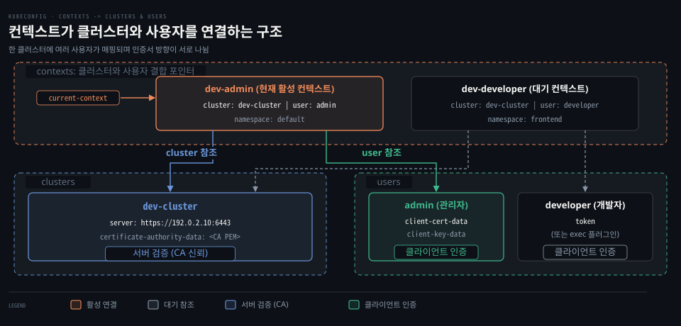
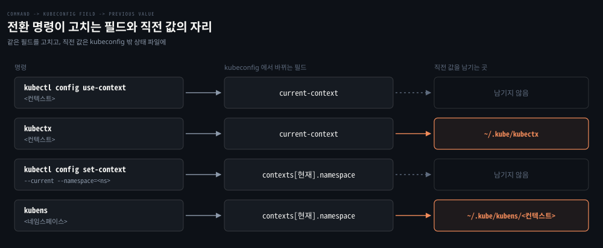

# kubeconfig·여러 클러스터 접근

---

> kubeconfig 는 여러 클러스터와 사용자 인증 정보를 context 로 묶어 관리하며, kubectl 은 탐색 우선순위와 First-wins 병합 규칙으로 활성 접속 대상을 결정합니다.

## 학습 목표와 범위

> 다중 클러스터 환경에서 kubeconfig 의 탐색·병합 규칙과 context 전환 메커니즘을 이해하고, 대상 혼동 없는 안전한 운영 절차를 적용합니다.

1. `clusters`, `users`, `contexts` 의 참조 구조와 두 방향 인증서 검증 체계를 설명할 수 있습니다.
2. `--kubeconfig` 플래그, `KUBECONFIG` 환경 변수, 기본 파일 사이의 우선순위와 병합 충돌 규칙을 비교할 수 있습니다.
3. `kubectl config` 하위 명령이 파일의 어느 블록을 갱신하는지 판별할 수 있습니다.
4. 다중 클러스터 환경에서 사고를 막는 파일 분리 기준과 명령행 플래그 명시 원칙을 적용할 수 있습니다.
5. kubectx·kubens 가 직전 값을 어디에 남기는지 설명하고, 그 값이 터미널 사이에서 공유되는 결과를 예측할 수 있습니다.

다루지 않는 범위가 있습니다. 파일 기본 위치와 기본 설정 절차는 [쿠버네티스 클러스터 실행하기](../../../book/kubernetes-in-action/03-01.쿠버네티스%20클러스터%20실행하기.md) 「kubeconfig 설정」이 다룹니다.

클라이언트의 두 가지 인증 출처는 [Accessing Kubernetes — 클라이언트가 감추는 HTTP와 원서 코드 실증 랩](../../../book/kubernetes-up-and-running/18-01.Accessing%20Kubernetes%20%E2%80%94%20%ED%81%B4%EB%9D%BC%EC%9D%B4%EC%96%B8%ED%8A%B8%EA%B0%80%20%EA%B0%90%EC%B6%94%EB%8A%94%20HTTP%EC%99%80%20%EC%9B%90%EC%84%9C%20%EC%BD%94%EB%93%9C%20%EC%8B%A4%EC%A6%9D%20%EB%9E%A9.md) 「클러스터 밖에서 돌 때」가 맡습니다.

기본 네임스페이스 전환 배경은 [namespace로 클러스터를 가상 분할하기](../../../book/kubernetes-in-action/07-01.namespace로%20클러스터를%20가상%20분할하기.md) 에 있습니다.

PKI 인증서 만료 점검은 [TLS와 API 접근 보안](TLS·API%20접근%20보안.md) 이 설명합니다.

ServiceAccount 토큰 기반 설정 조립은 [클러스터 굳히기 — API 접근·RBAC·ServiceAccount·업그레이드](../../../book/cks-study-guide/03-01.클러스터%20굳히기%20—%20API%20접근·RBAC·ServiceAccount·업그레이드.md) 가 다룹니다.


## 1. 세 블록과 이름 참조 구조

> kubeconfig 는 접속 엔드포인트, 자격 증명, 환경 조합을 세 블록으로 분리하고 이름으로 상호 참조합니다.

여러 클러스터와 여러 사용자가 얽힐 때 접속 주소와 자격 증명을 한곳에 섞어 두면 관리가 어려워집니다. 그래서 쿠버네티스는 설정을 세 블록으로 나눕니다.



위 도식은 세 블록의 참조 관계와 활성 컨텍스트 포인터를 보여 줍니다. `contexts` 블록은 클러스터와 사용자를 직접 포함하지 않고 이름으로 가리킵니다. `current-context` 포인터가 활성화한 `dev-admin` 은 `dev-cluster` 와 `admin` 사용자를 참조합니다.

### 세 블록의 역할과 연결

kubeconfig 의 골격은 `clusters`, `users`, `contexts` 세 목록입니다. 각 목록은 이름으로 찾는 맵처럼 쓰이고 항목마다 `name` 과 내용이 짝을 이룹니다.[^kubeconfig-fields]

- `clusters`: 대상 클러스터의 API 서버 URL 과 CA 인증서 데이터를 담습니다.
- `users`: API 서버에 클라이언트 자신을 증명할 인증 자격 증명을 담습니다.
- `contexts`: 특정 `cluster` 와 특정 `user`, 기본 `namespace` 를 하나의 이름으로 묶은 접속 단위입니다.[^org-kubeconfig]

하나의 클러스터에 여러 사용자가 매핑될 수 있는 까닭은 권한 분리 때문입니다. 같은 개발 클러스터라도 일상 파드 조회에는 일반 개발자 자격 증명을, 인프라 점검이나 RBAC 설정에는 관리자 자격 증명을 씁니다. `context` 가 둘을 묶으므로 클러스터 정보를 복제하지 않고도 여러 작업 환경을 독립된 이름으로 정의합니다.

### 인증서 검증의 두 방향

kubeconfig 안의 인증서 필드는 검증 주체와 대상에 따라 방향이 정반대로 나뉩니다.

- `clusters[*].cluster.certificate-authority-data`: 클라이언트가 API 서버를 검증하는 경로입니다. 클라이언트는 자신이 신뢰하는 CA 인증서로 서버의 TLS 인증서를 확인해 가짜 API 서버 접속을 막습니다.
- `users[*].user.client-certificate-data`·`client-key-data`: API 서버가 요청 클라이언트를 검증하는 경로입니다. API 서버는 클라이언트 인증서 subject 의 공통 이름(CN)을 사용자 이름으로, 조직(O) 필드를 그룹으로 읽습니다.[^authn]

두 인증서는 상호 TLS 통신을 이루는 독립적인 조각입니다. PKI 신뢰 체계의 세부 구조는 [TLS와 API 접근 보안](TLS·API%20접근%20보안.md) 에서 다룹니다.

### 참조 불일치와 동작

컨텍스트가 없는 클러스터나 사용자 이름을 가리켜도 kubectl 이 늘 "이름이 없다"며 멈추지는 않습니다. 공식 문서의 규칙은 클러스터와 사용자 정보를 플래그와 병합된 파일에서 차례로 채우고, 그래도 빈 값은 기본값으로 채우거나 인증 정보를 물어볼 수 있다고 적습니다.[^org-kubeconfig] 실패한다고 적은 경우는 서버 주소를 정하지 못했을 때와 한 사용자에 인증 방식이 둘 이상 겹칠 때입니다.[^org-kubeconfig]

아래는 kind 클러스터 `vp1-0404`(서버 v1.35.0)와 kubectl v1.33.9 로 세 경우를 재 본 결과입니다. `kind.yaml` 은 kind 가 만든 kubeconfig 입니다. `broken.yaml` 에는 없는 클러스터를 가리키는 `broken-cluster-context` 와 없는 사용자를 가리키는 `broken-user-context` 만 넣었습니다.

```bash
export KUBECONFIG=kind.yaml:broken.yaml

# 1) 컨텍스트 이름 자체가 없을 때
kubectl get nodes --context=no-such-context

# 2) 컨텍스트가 없는 클러스터를 가리킬 때
kubectl get nodes --context=broken-cluster-context

# 3) 컨텍스트가 없는 사용자를 가리킬 때 (표준 입력을 막아 입력 대기를 끊음)
kubectl get nodes --context=broken-user-context </dev/null
```

```bash
Error in configuration: context was not found for specified context: no-such-context
The connection to the server localhost:8080 was refused - did you specify the right host or port?
Please enter Username: error: EOF
```

세 줄은 위 명령 순서대로입니다. 두 번째 명령은 이 줄 앞에 `memcache.go` 의 연결 거부 로그를 다섯 줄 더 찍었습니다.

컨텍스트 이름이 틀리면 설정 오류로 바로 멈춥니다. 클러스터 이름이 틀리면 서버 주소가 비어 기본값 `localhost:8080` 으로 접속을 시도합니다. 사용자 이름이 틀리면 자격 증명이 비어 사용자 이름을 묻습니다. 그래서 스크립트에서 사용자 참조가 깨지면 오류 없이 입력을 기다리며 멈출 수 있습니다.


## 2. 파일 로딩과 병합 우선순위

> kubectl 은 플래그, 환경 변수, 기본 파일 순으로 설정을 탐색하며, 다중 파일 병합 시 먼저 등장한 키가 충돌을 이깁니다.

여러 환경을 오가다 보면 설정 파일이 여러 경로로 나뉩니다. 이때 어느 파일이 우선하는지 모르면 엉뚱한 클러스터에 요청을 보낼 위험이 생깁니다. kubectl 은 정해진 계층 규칙에 따라 설정을 찾아 하나로 합칩니다.


위 도식은 kubectl 이 설정을 찾는 세 단계 우선순위와 병합 충돌 시의 원칙을 보여 줍니다. 앞의 세 단은 먼저 걸린 하나만 쓰입니다. 네 번째 단인 First-wins 는 두 번째 단에서 `KUBECONFIG` 목록을 합칠 때만 적용됩니다.

### 설정 파일 탐색 순서

kubectl 은 다음 세 단계 우선순위를 거쳐 대상 설정을 로드합니다.[^org-kubeconfig]

1. `--kubeconfig` 명령행 플래그: 지정된 단일 파일만 로드하며 다른 파일과 병합하지 않습니다.[^org-kubeconfig]
2. `KUBECONFIG` 환경 변수: 플래그가 없을 때 파일 경로 목록을 받아 순서대로 병합합니다. 목록은 Linux·macOS 에서 콜론, Windows 에서 세미콜론으로 구분합니다.[^org-kubeconfig]
3. `$HOME/.kube/config` 기본 파일: 플래그와 환경 변수가 모두 없을 때 단일 파일로 로드하는 기본 위치입니다.[^org-kubeconfig]

### 병합 규칙과 충돌 해결

`KUBECONFIG` 환경 변수의 여러 파일은 공식 문서의 「Merging kubeconfig files」 규칙으로 병합합니다.[^org-kubeconfig]

1. 빈 파일명은 목록에서 무시합니다.[^org-kubeconfig]
2. 역직렬화할 수 없는 내용이 든 파일이 있으면 오류를 내고 멈춥니다.[^org-kubeconfig]
3. **가장 먼저 등장한 파일이 이깁니다(First-wins)**. 특정 값이나 맵 키는 가장 먼저 설정한 파일을 따릅니다. 뒤 파일이 이 값을 절대 덮어쓰지 않습니다.[^org-kubeconfig]

예컨대 첫 번째 파일이 `current-context: dev` 를 정의했다면 두 번째 파일의 지정은 무시됩니다.[^org-kubeconfig] 같은 사용자 이름이 두 파일에 중복 정의되어도 첫 번째 파일의 정의만 쓰입니다. 두 번째 파일의 같은 이름 항목 안에만 있는 필드도 합쳐지지 않고 버려집니다.[^org-kubeconfig] 이름이 다른 항목은 그대로 합쳐집니다.

아래는 임시 파일 두 개로 이 규칙을 재 본 결과입니다. 두 파일은 일부러 이름을 겹쳐 두었습니다.

- `a.yaml`: `current-context: dev`, 사용자 `admin`(token 만), 컨텍스트 `dev`
- `b.yaml`: `current-context: test`, 사용자 `admin`(token 과 `username`), 사용자 `tester`, 다른 클러스터를 가리키는 컨텍스트 `dev`, 컨텍스트 `test`

```bash
KUBECONFIG=a.yaml:b.yaml kubectl config get-contexts
```

```bash
CURRENT   NAME   CLUSTER        AUTHINFO   NAMESPACE
*         dev    dev-cluster    admin      frontend
          test   test-cluster   tester     
```

`current-context` 와 컨텍스트 `dev` 는 모두 `a.yaml` 의 것이 남았습니다. `b.yaml` 의 `dev` 는 경고 없이 사라졌습니다. 여러 파일에서 컨텍스트 이름이 겹치면 뒤 파일의 클러스터로는 그 이름으로 갈 수 없다는 뜻입니다. `kubectl config view` 로 본 사용자 `admin` 에는 `token` 만 남고 `username` 은 없었습니다.

목록 순서를 `b.yaml:a.yaml` 로 바꾸면 `current-context` 가 `test` 로 바뀝니다. 빈 항목(`a.yaml::b.yaml`)은 무시됐습니다. YAML 이 깨진 파일을 목록에 넣으면 `error loading config file "bad.yaml"` 로 멈췄습니다.

kubeconfig 안의 파일 경로(`certificate-authority` 같은 필드)는 그 kubeconfig 파일이 있는 위치를 기준으로 풉니다. 명령행 플래그로 준 경로는 현재 작업 디렉터리 기준입니다.[^org-kubeconfig]

### 컨텍스트와 플래그 덮어쓰기

병합된 설정에서 실제로 요청을 보낼 대상을 정할 때도 우선순위 체인을 따릅니다.[^org-kubeconfig]

1. `--context` 명령행 플래그가 있으면 해당 컨텍스트를 최우선으로 사용합니다.[^org-kubeconfig]
2. 플래그가 없으면 병합된 설정의 `current-context` 에 지정된 컨텍스트를 사용합니다.[^org-kubeconfig]
3. 결정된 컨텍스트 안의 클러스터·사용자보다 `--cluster`, `--user` 플래그가 앞섭니다.[^org-kubeconfig] 네임스페이스도 `-n`/`--namespace` 플래그가 컨텍스트의 기본값보다 앞섭니다. 앞 kind 클러스터에서 `-n kube-system` 을 붙이자 그 네임스페이스의 파드가 나왔습니다.

그래서 현재 활성 컨텍스트는 그대로 두고 명령 한 번만 다른 클러스터나 사용자로 임시 실행할 수 있습니다.


## 3. config 하위 명령과 변경

> kubectl config 하위 명령은 kubeconfig 의 세 블록과 current-context 를 읽고 갱신하는 도구입니다.

설정 파일을 텍스트 에디터로 직접 수정하면 들여쓰기나 이름 오타로 파일이 깨지기 쉽습니다. `kubectl config` 하위 명령은 항목 이름과 필드를 인자로 받아 파일을 고칩니다.

`KUBECONFIG` 에 파일이 여럿이면 어느 파일에 쓰이는지가 정해져 있습니다. 이미 있는 항목을 바꾸면 그 항목을 정의한 파일이 바뀝니다. 새 항목은 목록에서 처음으로 존재하는 파일에 만들어집니다. 목록의 파일이 하나도 없으면 마지막 파일을 새로 만듭니다.[^kubectl-config]

앞의 `a.yaml:b.yaml` 로 재 보았습니다(kubectl v1.33.9). `use-context test` 뒤의 `set-context --current --namespace=qa` 는 `test` 컨텍스트를 정의한 `b.yaml` 을 고쳤습니다. `set-cluster new-cluster` 는 `a.yaml` 에 새 항목을 만들었습니다. 두 파일이 모두 없는 목록에서는 마지막 파일이 `-rw-------`(600) 권한으로 생겼습니다. 이미 있던 파일의 권한은 바꾸지 않았습니다.

### 조회와 추출 명령

설정 내용을 들여다보거나 외부 전달용 설정을 뽑아낼 때는 다음 명령을 씁니다.[^kubectl-config]

```bash
# 병합된 전체 설정 보기 (인증서·키 데이터는 DATA+OMITTED, 토큰은 REDACTED 로 가림)
kubectl config view

# 마스킹을 해제하고 실제 인증서·키 데이터와 토큰 원본을 그대로 노출
kubectl config view --raw

# 현재 활성 컨텍스트와 관련된 cluster, user, context 항목만 남기고 축소
kubectl config view --minify

# 외부 파일 경로 참조를 인라인 데이터로 변환해 독립 파일로 평탄화
kubectl config view --minify --flatten --raw > portable-kubeconfig.yaml
```

`--minify --flatten --raw` 조합은 CI/CD 파이프라인이나 다른 작업자에게 특정 클러스터 접근 파일만 떼어 줄 때 씁니다. `--flatten` 은 상대 경로로 적힌 인증서 파일도 kubeconfig 위치 기준으로 찾아 넣었습니다. 결과 파일에는 키와 토큰 원본이 그대로 들어가므로 비밀 파일처럼 다룹니다.

### 전환과 기본값 변경

컨텍스트 목록을 확인하고 활성 대상을 전환하는 명령입니다.[^kubectl-config]

```bash
# 등록된 모든 컨텍스트와 대상 클러스터, 사용자, 네임스페이스 목록 조회
kubectl config get-contexts

# 현재 활성화된 컨텍스트 이름 한 줄 출력
kubectl config current-context

# 활성 컨텍스트 전환 (current-context 필드 갱신)
kubectl config use-context dev-frontend

# 현재 활성 컨텍스트의 기본 네임스페이스를 frontend 로 변경
kubectl config set-context --current --namespace=frontend
```

`set-context --current --namespace` 명령은 컨텍스트 이름이나 클러스터를 바꾸지 않고 기본 네임스페이스 필드만 갱신합니다.

### 수동 등록과 삭제

외부 클러스터 정보를 수동으로 추가할 때는 세 블록을 순서대로 작성합니다.[^kubectl-config]

```bash
# 1. clusters 블록에 새 클러스터 엔드포인트와 CA 인증서 등록
kubectl config set-cluster staging-cluster \
  --server=https://192.0.2.30:6443 \
  --certificate-authority=/etc/kubernetes/pki/ca.crt \
  --embed-certs=true

# 2. users 블록에 클라이언트 자격 증명 등록
kubectl config set-credentials staging-admin \
  --client-certificate=/etc/kubernetes/pki/admin.crt \
  --client-key=/etc/kubernetes/pki/admin.key \
  --embed-certs=true

# 3. contexts 블록에 클러스터와 사용자를 묶는 컨텍스트 등록
kubectl config set-context staging-admin-ctx \
  --cluster=staging-cluster \
  --user=staging-admin \
  --namespace=default

# 불필요해진 컨텍스트 삭제
kubectl config delete-context old-staging-ctx

# 컨텍스트 이름 변경
kubectl config rename-context staging-admin-ctx staging-prod-ctx
```

각 명령이 파일의 어느 블록을 변경하는지는 아래 표와 같습니다.

| 명령 | 변경 대상 블록 | 동작 내용 |
|---|---|---|
| `use-context` | `current-context` | 활성 컨텍스트 포인터를 교체합니다 |
| `set-cluster` | `clusters` | 클러스터 서버 URL 과 CA 정보를 설정합니다 |
| `set-credentials` | `users` | 클라이언트 인증서·키·토큰 정보를 설정합니다 |
| `set-context` | `contexts` | 클러스터·사용자·네임스페이스를 결합합니다 |
| `delete-context` | `contexts` | 특정 컨텍스트 항목을 삭제합니다 |
| `rename-context` | `contexts` | 기존 컨텍스트 식별자 이름을 바꿉니다 |


## 4. 다중 클러스터 파일 관리 비교

> 단일 파일 통합은 관리가 단순하지만 오작동 위험이 크고, 파일 분리는 세션별 격리가 뛰어납니다.

여러 클러스터를 동시에 다루는 운영 환경에서는 설정 파일을 어떻게 배치하느냐에 따라 사고가 날지 말지가 갈립니다.

### 단일 통합과 파일 분리

공식 문서에 따르면 kubectl 은 단일 파일에 여러 컨텍스트를 모으는 방식과 다중 파일을 병합하는 방식을 모두 지원합니다.[^multi-cluster]

| 비교 기준 | 단일 파일 통합 (`~/.kube/config`) | 클러스터별 파일 분리 (`KUBECONFIG` 또는 `--kubeconfig`) |
|---|---|---|
| 파일 개수 | 1개 (단일 집중 관리) | N개 (클러스터 또는 환경별 독립 파일) |
| 전환 방식 | `kubectl config use-context` 로 포인터 변경 | `export KUBECONFIG=...` 또는 `--kubeconfig` 플래그 지정 |
| 실수 위험 | 한 터미널에서 바꾼 컨텍스트가 다른 터미널에 즉시 반영 | 셸마다 다른 파일을 가리키면 전환이 그 셸에만 미침 |
| 권한 격리 | 파일 하나가 노출되면 등록된 모든 클러스터 접근 위험 | 필요한 파일만 특정 호스트나 파이프라인에 제한 배포 |
| 삭제 편의 | YAML 내부 항목을 수동 삭제하거나 하위 명령 반복 | 해당 클러스터 파일만 삭제하면 자격 증명 즉각 폐기 |

운영 환경과 개발 환경을 오갈 때는 단일 파일 통합보다 파일을 물리적으로 분리하는 편이 안전합니다. 한 터미널 창에서 개발 작업을 하려고 `use-context dev` 를 실행하면 파일 단위로 상태가 바뀝니다. 이때 운영 점검 중이던 다른 터미널 창의 활성 컨텍스트도 함께 바뀝니다. 그 상태로 운영 클러스터에 삭제 명령을 날려 리소스를 유실하는 사고가 날 수 있습니다.

### 사고 예방 절차와 보조 도구

다중 클러스터 환경에서 변경 작업을 실행하기 전에는 다음 예방 절차를 거칩니다.

1. 변경 명령 직전에 현재 활성 컨텍스트를 확인합니다.
   ```bash
   kubectl config current-context
   ```
2. 자동화 스크립트나 CI/CD 파이프라인에서는 세션의 `current-context` 에 의존하지 않습니다. 항상 `--context` 플래그를 명시하거나 전용 설정 파일을 전달합니다.
   ```bash
   kubectl delete deployment app --context=staging-ctx
   ```
3. 서드파티 보조 도구로 활성 컨텍스트와 네임스페이스를 프롬프트에 표시합니다. 상태가 셸 프롬프트에 보이면 다른 컨텍스트로 전환된 사실을 바로 알아챌 수 있습니다.
   - [kube-ps1](https://github.com/jonmosco/kube-ps1) — 현재 컨텍스트와 네임스페이스를 셸 프롬프트에 늘 표시하는 오픈소스 도구
   - [kubectx](https://github.com/ahmetb/kubectx) — 다중 컨텍스트와 네임스페이스 간 전환을 빠르게 돕는 유틸리티. 동작은 「5. kubectx·kubens 와 직전 값」에 있습니다


## 5. kubectx·kubens 와 직전 값

> kubectx 와 kubens 는 `kubectl config` 가 고치는 것과 같은 kubeconfig 필드를 고칩니다. 다른 점은 직전 값을 kubeconfig 밖의 상태 파일에 남겨 `-` 하나로 되돌아간다는 것입니다.

`kubectl config use-context` 는 바꿀 컨텍스트 이름을 매번 받고, 직전에 어느 컨텍스트에 있었는지는 기억하지 않습니다. 네임스페이스만 바꾸려 해도 `set-context --current --namespace=<ns>` 를 다 적어야 합니다. 클러스터 두 곳을 오가며 점검하면 이 두 명령을 계속 되풀이하게 됩니다. kubectx 와 kubens 는 이 반복을 줄이는 도구로, 한 저장소에서 함께 배포됩니다.[^kubectx-readme] 이 절의 실측은 v0.11.0 으로 했습니다.



가운데 열은 네 명령이 모두 kubeconfig 안의 두 필드만 고친다는 것을 보입니다. 강조한 오른쪽 칸은 kubectx 와 kubens 만 직전 값을 kubeconfig 밖에 따로 남긴다는 뜻입니다.

### 고치는 필드와 kubectl config 와의 차이

kubectx 에 컨텍스트 이름을 주면 kubeconfig 의 `current-context` 를 그 이름으로 바꿉니다. kubens 는 현재 컨텍스트 항목의 `namespace` 를 바꿉니다.[^kubectx-readme] 아래는 kind 클러스터에 컨텍스트 `staging` 을 하나 더 만들어 실행한 결과입니다. 사용자 홈은 빈 임시 폴더로 바꿔 두었습니다.

```bash
kubectx staging                 # current-context 를 staging 으로
kubectl config current-context
kubectx -                       # 직전 컨텍스트로 되돌아가기
kubens kube-system              # 현재 컨텍스트의 namespace 를 kube-system 으로
kubectl config get-contexts
```

```bash
✔ Switched to context "staging".
staging
✔ Switched to context "kind-docs-boost".
✔ Active namespace is "kube-system"
CURRENT   NAME              CLUSTER           AUTHINFO          NAMESPACE
*         kind-docs-boost   kind-docs-boost   kind-docs-boost   kube-system
          staging           kind-docs-boost   kind-docs-boost   
```

kubectl 이 읽는 값이 바로 바뀌었습니다. 두 도구가 고치는 것은 kubeconfig 파일이고 셸 변수는 건드리지 않기 때문입니다. 그러니 같은 파일을 쓰는 다른 터미널도 함께 전환됩니다. 「4. 다중 클러스터 파일 관리 비교」의 단일 파일 위험이 kubectx 에도 그대로 적용됩니다.

`KUBECONFIG` 에 파일이 둘이어도 kubectl 과 같은 파일을 고쳤습니다. 앞 파일에는 `current-context` 가, 뒤 파일에는 컨텍스트 `other-b` 가 있는 목록으로 재 보았습니다.

- `kubectx other-b`: 앞 파일의 `current-context` 를 고쳤습니다.
- 이어서 `kubens kube-system`: 뒤 파일의 `other-b` 항목을 고쳤습니다.

이미 있는 값은 그 값을 정의한 파일에서 바뀐다는 「3. config 하위 명령과 변경」의 규칙과 같습니다. 이 동작은 버전을 탑니다. v0.9.5 소스는 `KUBECONFIG` 에 파일이 여럿이면 오류로 멈춥니다.[^kubectx-v095]

kubens 와 `set-context --namespace` 사이에는 차이가 하나 있습니다. kubens 는 바꾸기 전에 API 서버에 그 네임스페이스가 있는지 묻습니다.

```bash
kubens no-such-ns
kubectl config set-context --current --namespace=no-such-ns
kubectl get pods
```

```bash
error: no namespace exists with name "no-such-ns"
Context "kind-docs-boost" modified.
No resources found in no-such-ns namespace.
```

kubens 는 오류로 멈추고 파일을 고치지 않았습니다. `set-context` 는 파일만 고치므로 오타가 그대로 저장됐고 그 뒤 `kubectl get pods` 는 오류 없이 빈 목록만 알렸습니다. 이 메시지만으로는 네임스페이스 이름이 틀린 것과 Pod 가 없는 것을 가를 수 없습니다. 없는 네임스페이스로 일부러 바꿀 때는 kubens 에 `-f` 를 붙입니다.[^kubectx-readme]

### 직전 값을 남기는 상태 파일

kubectx 는 컨텍스트를 바꿀 때마다 바꾸기 전 이름을 상태 파일 하나에 적습니다. kubens 는 컨텍스트마다 파일을 따로 두고 직전 네임스페이스를 적습니다. 두 파일이 놓이는 폴더는 `XDG_CACHE_HOME` 이 있으면 그 폴더이고 없으면 `~/.kube` 입니다.[^kubectx-src]

- 직전 컨텍스트: `~/.kube/kubectx`
- 직전 네임스페이스: `~/.kube/kubens/<컨텍스트 이름>`

`kubectx -` 와 `kubens -` 는 이 파일을 읽어 되돌아갑니다. 위 실행에서 `kubectx staging` 직후 `~/.kube/kubectx` 에는 `kind-docs-boost` 가 들어 있었습니다. `kubectx -` 뒤에는 `staging` 으로 바뀌었습니다. `-` 를 다시 누르면 두 컨텍스트를 오가는 구조입니다. kubectl 에는 이런 상태가 없어서 되돌아갈 때도 이름을 적어야 합니다.

상태 파일은 사용자 홈에 하나뿐이고 kubeconfig 파일이나 터미널을 가리지 않습니다. 이를 확인하려고 `KUBECONFIG` 가 다른 두 파일을 가리키게 하고 차례로 실행했습니다.

```bash
KUBECONFIG=config     kubectx staging   # config 안에서 전환. 상태 파일에 kind-docs-boost 가 남는다
KUBECONFIG=other.yaml kubectx -         # other.yaml 에는 kind-docs-boost 컨텍스트가 없다
```

```bash
✔ Switched to context "staging".
error: failed to switch context: no context exists with the name: "kind-docs-boost"
```

두 번째 터미널의 `kubectx -` 가 첫 번째 터미널의 이력을 따라갔습니다. 터미널마다 다른 kubeconfig 를 쓰는 분리 방식에서는 `-` 를 믿지 말고 컨텍스트 이름을 적는 편이 안전합니다.

### 격리 셸과 읽기 전용 셸

kubectx 는 kubeconfig 를 여러 터미널이 함께 쓰는 문제를 셸 단위로 피하는 방법도 둡니다. `kubectx -s <컨텍스트>` 는 컨텍스트 하나만 든 셸을 띄웁니다.[^kubectx-readme] 소스를 보면 `kubectl config view --minify --flatten` 결과를 임시 파일에 씁니다.[^kubectx-shell] 새 셸의 `KUBECONFIG` 는 그 임시 파일을 가리킵니다.

```bash
# 격리 셸 안에서 KUBECONFIG 와 컨텍스트를 보고, 다른 컨텍스트로 바꿔 봅니다
kubectx -s staging
echo "$KUBECONFIG"; kubectl config get-contexts; kubectx kind-docs-boost
```

```bash
[ISOLATED SHELL] kubectl context is staging in this shell — type 'exit' to leave.
KUBECONFIG=/var/folders/…/T/kubectx-shell-3604556098.yaml
CURRENT   NAME      CLUSTER           AUTHINFO          NAMESPACE
*         staging   kind-docs-boost   kind-docs-boost   
error: you are in a locked single-context shell ("staging"), use 'exit' to leave
```

셸 안에서는 다른 컨텍스트로 바꿀 수 없었습니다. 셸을 닫은 뒤 바깥 kubeconfig 의 `current-context` 는 셸을 열기 전 값 그대로였습니다.

`kubectx -r <컨텍스트>` 는 쓰기 작업을 막은 읽기 전용 셸을 띄웁니다.[^kubectx-readme] 그 셸 안에서 `kubectl get ns` 는 그대로 됐습니다. 반면 `kubectl create ns ro-test` 는 다음 오류로 막혔습니다.

```bash
Error from server (MethodNotAllowed): [kubectx] readonly mode: POST requests are not allowed
```

오류 앞머리의 `[kubectx]` 는 이 거부를 낸 곳이 kubectx 가 띄운 프록시라는 표시로, API 서버의 권한 검사와는 무관합니다. 이 셸은 실수로 보내는 쓰기 명령을 막는 장치일 뿐 RBAC 권한을 대신하지는 않습니다.


## 6. 실행 플러그인과 신뢰 경계

> kubeconfig 는 단순 텍스트 설정이 아니라 임의 코드를 실행할 수 있는 신뢰 경계 대상입니다.

공식 문서는 신뢰할 수 없는 kubeconfig 파일을 두고 이렇게 경고합니다.[^org-kubeconfig]

> "Only use kubeconfig files from trusted sources. Using a specially-crafted kubeconfig file could result in malicious code execution or file exposure. If you must use an untrusted kubeconfig file, inspect it carefully first, much as you would a shell script."[^org-kubeconfig]

신뢰할 수 없는 kubeconfig 파일을 셸 스크립트처럼 취급해야 하는 까닭은 `users[*].user.exec` 플러그인 기능 때문입니다.[^kubeconfig-api]

클라우드 제공자나 엔터프라이즈 싱글 사인온(SSO) 환경에서는 만료되는 동적 인증 토큰을 받으려고 kubeconfig 안에 `exec` 블록을 구성합니다. API 서버로 요청을 보내기 전에 kubectl 은 `exec` 블록에 선언된 외부 명령을 사용자 권한으로 실행하고, 그 명령이 표준 출력으로 내놓은 자격 증명을 씁니다.[^kubeconfig-api]

외부에서 받은 kubeconfig 파일의 `exec.command` 필드에 임의의 셸 명령이 적혀 있으면 보안 사고가 납니다. 사용자가 단순한 파드 조회 명령을 실행하는 즉시 로컬 머신에서 악성 코드가 실행됩니다. kubeconfig 파일의 신뢰 경계 원리는 [TLS와 API 접근 보안](TLS·API%20접근%20보안.md) 「2. kubeconfig와 신뢰 경계」에서도 강조합니다.


## 7. 점검 질문

> 위 내용을 바탕으로 다중 클러스터 접근 규칙을 점검합니다.

### Q1. 병합 충돌 시 우선순위

`KUBECONFIG` 환경 변수에 두 파일이 지정되고 동일한 사용자 이름이 충돌하면 어느 파일의 설정이 최종 반영됩니까?

### Q2. 수동 등록 시 대상 블록

외부 클러스터 접속을 위해 세 등록 명령을 실행할 때 각 명령은 파일의 어느 맵 블록을 작성합니까?

### Q3. 스크립트의 대상 고정 방법

여러 클러스터를 관리하는 자동화 셸 스크립트에서 컨텍스트 변경으로 인한 오작동을 막으려면 어떤 방식을 써야 합니까?

### Q4. kubectx - 가 돌아가는 곳

터미널 A 와 B 가 서로 다른 kubeconfig 파일을 쓰고, A 에서 방금 `kubectx` 로 컨텍스트를 바꿨습니다. 이어서 B 에서 `kubectx -` 를 실행하면 어느 컨텍스트로 가려 합니까?


## 정답 (자답 후 펼치기)

> 위 질문 4개에 먼저 자답한 뒤 아래를 읽으세요.

### 정답 1 — 병합 충돌 처리

환경 변수 목록에서 앞선 첫 번째 파일의 설정이 반영됩니다. 공식 문서의 First-wins 병합 규칙에 따라 먼저 나온 파일의 키가 남습니다. 뒤 파일에 나온 중복 키는 기존 값을 덮어쓰지 못합니다. 사용자 정의의 세부 필드도 앞선 파일의 내용만 쓰입니다.

### 정답 2 — 명령과 대상 블록

`set-cluster` 는 서버 URL 과 CA 정보를 담는 `clusters` 블록을 작성합니다. `set-credentials` 는 클라이언트 인증서와 키, 토큰을 담는 `users` 블록을 작성합니다. `set-context` 는 특정 클러스터와 사용자를 묶는 `contexts` 블록을 작성합니다.

### 정답 3 — 스크립트 실행 고정

환경의 `current-context` 포인터에 기대지 않도록 명령마다 `--context=<컨텍스트명>` 플래그를 명시합니다. 아니면 스크립트를 시작할 때 `KUBECONFIG` 환경 변수나 `--kubeconfig` 플래그를 전용 설정 파일 경로로 고정합니다.

### 정답 4 — 공유되는 직전 값

A 에서 바꾸기 전에 있던 컨텍스트로 가려 합니다. kubectx 는 직전 컨텍스트 이름을 kubeconfig 가 아니라 사용자 홈의 상태 파일 하나(`~/.kube/kubectx`)에 적기 때문입니다. B 의 kubeconfig 에 그 이름이 없으면 `no context exists with the name` 오류로 멈춥니다.


## 관련 문서

> 다중 클러스터 및 API 접근 보안을 함께 다루는 문서입니다.

- [쿠버네티스 클러스터 실행하기](../../../book/kubernetes-in-action/03-01.쿠버네티스%20클러스터%20실행하기.md) — 로컬 클러스터 도구별 초기 kubeconfig 생성과 기본 경로
- [Accessing Kubernetes — 클라이언트가 감추는 HTTP와 원서 코드 실증 랩](../../../book/kubernetes-up-and-running/18-01.Accessing%20Kubernetes%20%E2%80%94%20%ED%81%B4%EB%9D%BC%EC%9D%B4%EC%96%B8%ED%8A%B8%EA%B0%80%20%EA%B0%90%EC%B6%94%EB%8A%94%20HTTP%EC%99%80%20%EC%9B%90%EC%84%9C%20%EC%BD%94%EB%93%9C%20%EC%8B%A4%EC%A6%9D%20%EB%9E%A9.md) — 클라이언트가 인증 정보를 얻는 두 가지 출처
- [namespace로 클러스터를 가상 분할하기](../../../book/kubernetes-in-action/07-01.namespace로%20클러스터를%20가상%20분할하기.md) — kubectl 의 기본 네임스페이스 전환과 컨텍스트의 역할
- [TLS와 API 접근 보안](TLS·API%20접근%20보안.md) — API 서버 상호 TLS 인증 및 kubeconfig 의 신뢰 경계
- [클러스터 굳히기 — API 접근·RBAC·ServiceAccount·업그레이드](../../../book/cks-study-guide/03-01.클러스터%20굳히기%20—%20API%20접근·RBAC·ServiceAccount·업그레이드.md) — ServiceAccount 토큰 발급 및 kubeconfig 조립

[^org-kubeconfig]: Kubernetes — Organizing Cluster Access Using kubeconfig Files. "The first file to set a particular value or map key wins. Never change the value or map key." <https://kubernetes.io/docs/concepts/configuration/organize-cluster-access-kubeconfig/> (2026-11-15 조회)

[^multi-cluster]: Kubernetes — Configure Access to Multiple Clusters. "After your clusters, users, and contexts are defined in one or more configuration files, you can quickly switch between clusters by using the kubectl config use-context command." <https://kubernetes.io/docs/tasks/access-application-cluster/configure-access-multiple-clusters/> (2026-11-15 조회)

[^kubectl-config]: Kubernetes Reference — kubectl config. "When a value is modified, it is modified in the file that defines the stanza. When a value is created, it is created in the first file that exists." <https://kubernetes.io/docs/reference/kubectl/generated/kubectl_config/> (2026-11-15 조회)

[^kubeconfig-api]: Kubernetes Reference — kubeconfig (v1). "ExecConfig specifies a command to provide client credentials. The command is exec'd and outputs structured stdout holding credentials." <https://kubernetes.io/docs/reference/config-api/kubeconfig.v1/> (2026-11-15 조회)

[^kubeconfig-fields]: Kubernetes Reference — kubeconfig (v1). "Clusters is a map of referencable names to cluster configs" <https://kubernetes.io/docs/reference/config-api/kubeconfig.v1/> (2026-11-15 조회)

[^kubectx-readme]: ahmetb/kubectx README. "kubectx is a tool to switch between contexts (clusters) on kubectl faster, and launch readonly shells for each context." <https://github.com/ahmetb/kubectx/blob/v0.11.0/README.md> (v0.11.0, 2026-11-16 조회)

[^kubectx-src]: ahmetb/kubectx `internal/cmdutil/util.go`. "CacheDir returns XDG_CACHE_HOME if set, otherwise $HOME/.kube" <https://github.com/ahmetb/kubectx/blob/v0.11.0/internal/cmdutil/util.go> (v0.11.0, 2026-11-16 조회)

[^kubectx-shell]: ahmetb/kubectx `cmd/kubectx/shell.go`. "`exec.Command(kubectlPath, "config", "view", "--minify", "--flatten",`" <https://github.com/ahmetb/kubectx/blob/v0.11.0/cmd/kubectx/shell.go#L63> (v0.11.0, 2026-11-16 조회)

[^kubectx-v095]: ahmetb/kubectx `internal/kubeconfig/kubeconfigloader.go`. "multiple files in KUBECONFIG are currently not supported" <https://github.com/ahmetb/kubectx/blob/v0.9.5/internal/kubeconfig/kubeconfigloader.go#L65> (v0.9.5, 2026-11-16 조회)

[^authn]: Kubernetes — Authenticating. "Client certificates can also indicate a user's group memberships using the certificate's organization fields." <https://kubernetes.io/docs/reference/access-authn-authz/authentication/> (2026-11-15 조회)
