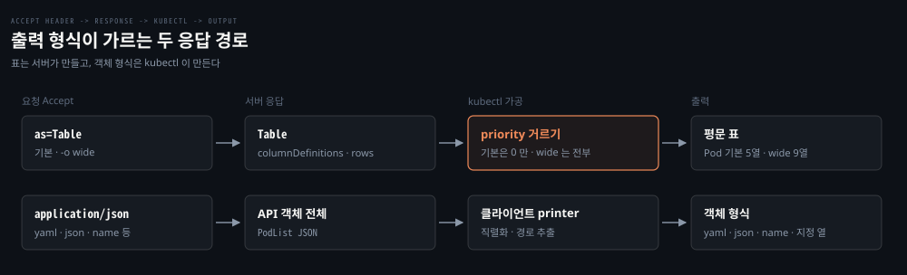

# kubectl 출력 형식 — 표는 서버가 그리고 객체는 kubectl 이 가공한다

---

> `kubectl get` 의 기본 표와 `-o wide` 는 API 서버가 만든 Table 응답을 그린 것이고, 나머지 형식은 API 객체 전체를 받아 kubectl 이 만든 것입니다. 그래서 `-o wide` 가 더 보여 주는 열은 kubectl 이 아니라 서버의 열 정의에서 옵니다.

## 학습 목표와 범위

> 출력 형식마다 kubectl 이 서버에 무엇을 요청하는지 가르고, 그 차이로 목적에 맞는 형식을 고릅니다.

1. 출력 형식마다 kubectl 이 보내는 `Accept` 헤더와, 표를 서버와 kubectl 중 누가 만드는지 설명할 수 있습니다.
2. Table 응답의 `priority` 값을 보고 어떤 열이 기본 출력에 나오고 어떤 열이 `-o wide` 에만 나올지 예측할 수 있습니다.
3. 사람이 훑을 때, 다시 적용할 때, 다른 명령에 넘길 때 어느 형식을 고를지 판단할 수 있습니다.

JSONPath 문법과 `custom-columns` 의 자세한 사용법은 [JSONPath와 kubectl 고급 조회](JSONPath·kubectl%20고급%20조회.md) 가 다룹니다. 이 문서에서는 두 형식이 객체를 받는다는 점만 봅니다. `go-template` 형식은 다루지 않습니다.


## 1. 표를 그리는 주체

> 표 모양을 클라이언트가 알고 있으면 새 리소스 유형이 생길 때마다 클라이언트를 고쳐야 합니다. 그래서 표는 서버가 만들고, 출력 형식은 이 표를 받을지 객체를 받을지를 가릅니다.



위 행은 기본 출력과 `-o wide` 의 경로이고 아래 행은 나머지 형식의 경로입니다. 위 행에서는 서버가 표를 만들고 kubectl 은 강조한 칸에서 열만 거릅니다. 아래 행에서는 서버가 객체만 주고 형식은 kubectl 이 만듭니다.

예전에는 클라이언트가 리소스 목록을 표로 보이려면 kubectl 이 구현한 표 출력을 직접 재현해야 했습니다.[^table-fetch] 이 방식은 두 군데서 막혔습니다.

- 일부 객체는 표의 칸을 채우는 로직이 단순하지 않습니다.[^table-fetch] Pod 의 `READY` 칸은 컨테이너 상태를 세어 `1/1` 로 만든 값입니다.
- API 집계(aggregation)나 CRD 로 들어온 리소스 유형은 클라이언트를 빌드할 때 알 수 없습니다.[^table-fetch] 클라이언트는 모르는 유형에 쓸 일반 구현을 따로 갖춰야 했습니다.

API 서버는 이 문제를 Table 표현으로 풉니다. 클라이언트가 Table 표현을 요청하면 표의 세부를 서버가 정합니다.[^table-fetch] kubectl 문서는 이 기능을 「Server-side columns」라 부릅니다. 이 덕분에 같은 클러스터에 붙은 클라이언트는 어느 것이든 같은 표를 봅니다.[^server-columns]


## 2. Table 응답과 열 우선순위

> 기본 출력과 `-o wide` 는 같은 Table 응답을 받습니다. 둘의 차이는 kubectl 이 `priority` 가 0 이 아닌 열을 버리는지 하나뿐입니다.

### Accept 헤더로 가르는 요청

kubectl 이 Table 을 받을지 객체를 받을지는 요청의 `Accept` 헤더에서 갈립니다. API 서버는 HTTP 콘텐츠 협상을 따릅니다. `Accept` 에 `application/json;as=Table;g=meta.k8s.io;v=v1` 을 담은 `GET` 에는 Table 로 답합니다.[^table-fetch]

kind 클러스터(서버 v1.35.0)에서 kubectl v1.33.9 로 같은 Pod 목록을 형식만 바꿔 요청했습니다. 아래 표는 `-v=8` 로그에서 Pod 목록 요청의 `Accept` 헤더만 뽑은 결과입니다.

```bash
# -v=8 은 요청 헤더를 로그로 찍습니다. 형식마다 Pod 목록 요청의 Accept 줄만 남깁니다
kubectl get pods -n kube-system -o wide -v=8 2>&1 \
  | grep -A1 '"Request" verb="GET" url="https://[^"]*/pods' | grep Accept
```

| 형식 | Pod 목록 요청의 `Accept` |
|---|---|
| (기본) | `application/json;as=Table;v=v1;g=meta.k8s.io,application/json;as=Table;v=v1beta1;g=meta.k8s.io,application/json` |
| `-o wide` | 기본과 같음 |
| `-o yaml` | `application/json` |
| `-o json` | `application/json` |
| `-o name` | `application/json` |
| `-o jsonpath=…` | `application/json` |
| `-o custom-columns=…` | `application/json` |
| `--server-print=false` | `application/json` |

`Accept` 끝의 `application/json` 은 Table 을 주지 못하는 서버를 위한 대비입니다. 공식 문서에 따르면 요청이 Table 만 받겠다고 했는데 서버가 Table 을 지원하지 않으면 406 으로 답합니다. 이 때문에 문서는 모든 유형을 다뤄야 하는 클라이언트에게 콘텐츠 유형을 여럿 적으라고 권합니다.[^table-fetch]

`--server-print=false` 는 서버 쪽 열을 끄는 플래그입니다.[^server-columns] 같은 Pod 를 이 플래그로 보면 `NAME` 과 `AGE` 두 열만 남습니다.

### columnDefinitions 와 priority

Table 응답은 열 정의 목록 `columnDefinitions` 와 행 목록 `rows` 로 이루어집니다. 열 정의마다 붙은 `priority` 는 그 열이 다른 열보다 얼마나 중요한지를 나타내는 정수입니다. 숫자가 낮을수록 중요하고 공간이 좁을 때 빠져도 되는 열에는 높은 값을 줍니다.[^table-priority]

kubectl 이 받는 응답을 그대로 보려고 `kubectl proxy` 를 띄우고 `curl` 로 같은 `Accept` 를 보냈습니다.

```bash
kubectl proxy --port=18089 &
curl -s -H 'Accept: application/json;as=Table;v=v1;g=meta.k8s.io' \
  http://127.0.0.1:18089/api/v1/namespaces/kube-system/pods > table.json

# 열 정의의 priority 와 이름, 첫 행의 칸 값
jq -r '.columnDefinitions[] | "\(.priority)\t\(.name)"' table.json
jq -c '.rows[0].cells' table.json
```

```bash
0	Name
0	Ready
0	Status
0	Restarts
0	Age
1	IP
1	Node
1	Nominated Node
1	Readiness Gates
["coredns-7d764666f9-7k4rg","1/1","Running","0","2m23s","10.244.0.4","docs-boost-control-plane","<none>","<none>"]
```

응답에는 아홉 열이 다 들어 있고 행마다 아홉 칸도 이미 채워져 있습니다. 이 열 정의는 서버 코드에 있습니다. Pod 의 `IP`·`Node`·`Nominated Node`·`Readiness Gates` 네 열이 그 코드에서 `Priority: 1` 로 선언돼 있습니다.[^pod-columns]

kubectl 의 표 출력기는 `-o wide` 가 아니면 `priority` 가 0 이 아닌 열을 건너뜁니다.[^printer-source] 그래서 기본 출력은 다섯 열, `-o wide` 는 아홉 열입니다. `-o wide` 는 서버에 더 묻지 않고 이미 받은 응답에서 버리던 열을 버리지 않을 뿐입니다. 공식 문서는 `-o wide` 에 Pod 의 노드 이름이 포함된다고 설명하는데, 그 노드 이름이 이 `Node` 열입니다.[^kubectl-output]

```bash
# 같은 Pod 를 기본 출력과 -o wide 로 차례로 봅니다
kubectl get pods -n kube-system -l component=etcd
kubectl get pods -n kube-system -l component=etcd -o wide
```

```bash
NAME                            READY   STATUS    RESTARTS   AGE
etcd-docs-boost-control-plane   1/1     Running   0          2m29s

NAME                            READY   STATUS    RESTARTS   AGE     IP              NODE                       NOMINATED NODE   READINESS GATES
etcd-docs-boost-control-plane   1/1     Running   0          2m29s   192.168.148.2   docs-boost-control-plane   <none>           <none>
```

행에 붙은 `object` 는 메타데이터만 담은 `PartialObjectMetadata` 였습니다. API 객체 전체가 없는 Table 응답만으로는 `-o yaml` 을 만들 수 없어서 객체 형식은 따로 `application/json` 을 요청합니다.

### CRD 의 열과 기본 Table

CRD 는 `additionalPrinterColumns` 로 자기 열을 선언하고 이 열에도 `priority` 를 줄 수 있습니다. 공식 문서는 `priority` 가 0 인 열은 기본 출력에, 0 보다 큰 열은 wide 출력에만 나온다고 적습니다.[^crd-priority] 열을 선언하지 않은 유형에는 서버가 `name` 과 `creationTimestamp` 로 기본 Table 을 만듭니다.[^table-fetch]

시험용 CRD `Widget` 에 `Size`(priority 0)와 `Color`(priority 1)를 선언하고 객체 하나를 만들어 확인했습니다.

```bash
# 열을 선언한 상태에서 기본 출력과 -o wide
kubectl get widgets
kubectl get widgets -o wide

# additionalPrinterColumns 를 지운 뒤 기본 출력
kubectl get widgets
```

```bash
NAME   SIZE
w1     3

NAME   SIZE   COLOR
w1     3      blue

NAME   AGE
w1     3s
```

`Color` 는 `-o wide` 에만 나왔고 열 선언을 지우자 기본 Table 의 `NAME`·`AGE` 로 돌아갔습니다. 열을 선언한 동안에는 `AGE` 열이 붙지 않았습니다. 새 CRD 에 열을 고를 때 늘 봐야 하는 값은 priority 0 에, 진단할 때만 보는 값은 priority 1 에 두면 됩니다.


## 3. 객체를 받는 형식

> `yaml`·`json`·`name`·`jsonpath`·`custom-columns` 는 API 객체 전체를 받아 kubectl 이 출력을 만듭니다. 그래서 서버가 열로 정의하지 않은 필드도 꺼낼 수 있지만, 서버가 계산한 표시값은 받지 못합니다.

공식 문서의 출력 형식 표는 `-o json` 과 `-o yaml` 을 "API 객체를 그 형식으로 낸다"고 설명합니다.[^kubectl-output] 둘은 같은 객체의 두 직렬화입니다. 출력에는 사용자가 쓴 `spec` 말고도 서버가 채운 필드가 함께 나옵니다. 아래 Namespace 에서는 `uid`·`resourceVersion`·`creationTimestamp` 가 그런 필드입니다.

```bash
kubectl get ns default -o yaml
```

```yaml
apiVersion: v1
kind: Namespace
metadata:
  creationTimestamp: "2026-11-16T01:01:22Z"
  labels:
    kubernetes.io/metadata.name: default
  name: default
  resourceVersion: "22"
  uid: af82d6b6-8c5f-4292-bdbc-311520603e83
spec:
  finalizers:
  - kubernetes
status:
  phase: Active
```

`-o name` 은 리소스 이름 말고는 아무것도 찍지 않습니다.[^kubectl-output] 실제 출력은 `pod/coredns-7d764666f9-7k4rg` 처럼 `<유형>/<이름>` 꼴이었습니다. kubectl 명령은 리소스를 `TYPE/NAME` 꼴로도 받으므로 이 출력은 다음 명령의 인자로 바로 넘어갑니다.[^kubectl-syntax]

```bash
# 레이블로 고른 Pod 를 이름만 뽑아 describe 로 넘깁니다
kubectl get pods -n kube-system -l k8s-app=kube-dns -o name \
  | xargs kubectl describe -n kube-system
```

`-o jsonpath` 와 `-o custom-columns` 도 객체를 받습니다. 둘 다 객체 안의 필드 경로로 값만 꺼냅니다. `custom-columns` 는 꺼낸 값을 `열이름:경로` 로 묶어 표로 그립니다.[^kubectl-output] 겉모양은 표지만 서버의 Table 과는 상관없이 kubectl 이 만든 표입니다.

필드 경로는 `-o yaml` 의 들여쓰기를 점으로 이은 것입니다. 문법은 [JSONPath와 kubectl 고급 조회](JSONPath·kubectl%20고급%20조회.md) 「2. 자주 쓰는 패턴」에 있습니다.

v1.37 공식 문서의 형식 표에는 쿠버네티스 전용 YAML 방언인 `-o kyaml` 도 있습니다.[^kubectl-output] 이 형식은 클라이언트 버전을 탑니다. kubectl v1.33.9 는 이 형식에 맞는 출력기가 없다는 오류(`unable to match a printer`)로 거부했습니다.


## 4. 목적별 형식 고르기

> 사람이 훑을 때는 서버 표를, 다시 쓰거나 다른 도구에 넘길 때는 객체 형식을 고릅니다.

기본 표의 칸을 스크립트로 잘라 쓰다 보면 서버가 열을 바꿀 때 조용히 깨집니다. 형식은 누가 그 출력을 읽는지로 고릅니다. 사람이 읽으면 서버가 계산한 표시값이 편하지만 프로그램에는 원래 필드 값이 안전합니다.

| 목적 | 형식 | 이유 |
|---|---|---|
| 상태를 훑어보기 | 기본 출력 | 서버가 고른 핵심 열과 `READY`·`AGE` 같은 계산값을 보입니다 |
| Pod 가 어느 노드·IP 에 있는지 보기 | `-o wide` | priority 1 열인 `NODE`·`IP` 가 붙습니다 |
| 필드 경로를 찾거나 매니페스트로 다시 쓰기 | `-o yaml` | 객체 전체가 나옵니다. 서버가 채운 필드는 걷어 내고 씁니다 |
| `jq` 같은 도구로 가공하기 | `-o json` | 객체 전체를 기계가 읽는 형식으로 줍니다 |
| 다음 kubectl 명령에 넘기기 | `-o name` | `<유형>/<이름>` 만 찍혀 인자로 바로 쓰입니다 |
| 값 몇 개만 한 줄로 뽑기 | `-o jsonpath` | 객체에서 경로로 고른 필드만 찍습니다 |
| 고른 필드를 표로 보기 | `-o custom-columns` | 경로로 고른 필드에 열 이름을 붙여 그립니다 |

`jq` 의 필터 문법은 [journalctl 출력 모양과 jq](../../../../02_os/docs/cmd/service/journalctl%20출력%20모양과%20jq.md) 시트에 있습니다.

스크립트에서 기본 출력의 칸을 `awk` 로 자르는 방식은 피합니다. 열 정의가 kubectl 이 아니라 서버 코드에 있어서 서버 쪽 변경으로 바뀌기 때문입니다.[^pod-columns] 객체 형식은 화면용 칸이 아니라 API 필드 경로를 직접 가리킵니다.


## 5. 서버 표와 객체 형식의 한계

> 서버 표의 열은 클라이언트에서 늘리거나 바꿀 수 없고, 객체 형식에는 서버가 계산한 표시값이 없습니다.

`-o wide` 가 보여 줄 수 있는 열은 서버가 그 유형에 선언한 열이 전부입니다. 열을 더 보고 싶으면 `custom-columns` 로 객체 필드를 직접 고릅니다. 자기 CRD 라면 `additionalPrinterColumns` 를 고쳐도 됩니다.

반대로 객체 형식은 서버가 계산한 칸을 주지 않습니다. 표의 `READY` 칸 `1/1` 과 `AGE` 칸 `2m23s` 는 Table 응답에 든 문자열입니다. 객체에는 컨테이너 상태 목록과 `creationTimestamp` 같은 원래 필드만 있습니다. 같은 값을 `jsonpath` 로 보이려면 그 계산을 스크립트가 다시 해야 합니다.

모든 리소스 유형이 Table 을 지원하지는 않습니다. 공식 문서는 Table 을 지원하지 않을 수 있는 예로 열 매핑이 없는 CRD 와 API 를 확장하는 APIService 를 듭니다.[^table-fetch] 다만 CRD 는 §2 실측처럼 열을 정의하지 않아도 기본 Table 로 답했습니다. Table 응답을 아예 주지 않을 수 있다고 적힌 쪽은 APIService 입니다. kubectl 이 `Accept` 끝에 `application/json` 을 두는 이유가 이 경우입니다.


## 6. 관련 실습

> 별도 실습 저장소는 두지 않았습니다. 이 문서의 출력은 모두 아래 환경에서 그대로 재현됩니다.

kind v0.31.0 으로 노드 하나짜리 클러스터(서버 v1.35.0)를 만들었습니다. 평소 쓰는 kubeconfig 와 섞이지 않도록 `kind create cluster --kubeconfig <임시 파일>` 로 접속 파일을 따로 받았습니다. 클라이언트는 kubectl v1.33.9 입니다.

이 클러스터에서 잰 값은 네 가지입니다.

- §2 의 `-v=8` 로그와 `kubectl proxy` 응답
- §2 의 CRD `Widget` 시험
- §3 의 `-o yaml`·`-o name` 출력
- §3 의 `-o kyaml` 거부 메시지

Pod 이름의 해시와 `AGE` 값은 클러스터마다 다르게 나옵니다.


## 7. 점검 질문

> 위 내용을 바탕으로 출력 형식과 응답의 관계를 점검합니다.

### Q1. wide 의 추가 열이 오는 곳

`kubectl get pods -o wide` 가 기본 출력보다 열을 더 보여 줄 때, 그 열은 어디서 정해지고 kubectl 은 무엇을 합니까?

### Q2. CRD 열의 위치 예측

CRD 의 `additionalPrinterColumns` 에 `priority: 1` 로 선언한 열은 `kubectl get` 기본 출력에 나옵니까?

### Q3. 스크립트에 넘길 형식

다른 kubectl 명령에 리소스 목록을 넘길 때 기본 표를 자르지 않고 어떤 형식을 써야 합니까?


## 정답 (자답 후 펼치기)

> 위 질문 3개에 먼저 자답한 뒤 아래를 읽으세요.

### 정답 1 — wide 열의 출처

추가 열은 API 서버가 Table 응답의 `columnDefinitions` 에 `priority` 1 로 선언한 열입니다. 기본 출력과 `-o wide` 는 같은 Table 을 받습니다. kubectl 은 `-o wide` 가 아닐 때만 priority 가 0 이 아닌 열을 버리므로 wide 에서는 버리던 열을 그대로 그릴 뿐입니다.

### 정답 2 — priority 1 열

나오지 않습니다. priority 가 0 보다 큰 열은 `-o wide` 에서만 보입니다. 시험용 CRD 에서도 priority 1 인 `Color` 열은 기본 출력에 없고 wide 출력에만 있었습니다.

### 정답 3 — 이름 형식

`-o name` 을 씁니다. `<유형>/<이름>` 만 찍히므로 다른 kubectl 명령의 인자로 바로 넘어갑니다. 기본 표는 서버가 정한 열이라 서버 버전에 따라 구성이 바뀔 수 있어 칸을 잘라 쓰기에 불안정합니다.


## 관련 문서

> API 서버와 대화하는 규칙을 함께 다루는 문서입니다.

- [JSONPath와 kubectl 고급 조회](JSONPath·kubectl%20고급%20조회.md) — `-o jsonpath`·`custom-columns` 의 문법과 실무 패턴
- [kubeconfig·여러 클러스터 접근](kubeconfig·여러%20클러스터%20접근.md) — kubectl 이 어느 클러스터에 요청을 보내는지 정하는 규칙
- [API 서버 헬스 엔드포인트](API%20서버%20헬스%20엔드포인트.md) — kubectl 을 거치지 않고 API 서버 경로를 직접 묻는 예

[^kubectl-output]: Kubernetes Reference — kubectl, Output options. "`-o wide` Output in the plain-text format with any additional information. For pods, the node name is included." <https://kubernetes.io/docs/reference/kubectl/#output-options> (v1.37 문서, 2026-11-16 조회)

[^server-columns]: Kubernetes Reference — kubectl, Server-side columns. "for any given resource, the server will return columns and rows relevant to that resource, for the client to print." <https://kubernetes.io/docs/reference/kubectl/#server-side-columns> (v1.37 문서, 2026-11-16 조회)

[^kubectl-syntax]: Kubernetes Reference — kubectl, Syntax. "To specify multiple resource types individually: `TYPE1/name1 TYPE1/name2 TYPE2/name3 TYPE<#>/name<#>`." <https://kubernetes.io/docs/reference/kubectl/#syntax> (v1.37 문서, 2026-11-16 조회)

[^table-fetch]: Kubernetes Reference — Kubernetes API Concepts, Table fetches. "clients may request the Table representation of objects, delegating specific details of printing to the server." <https://kubernetes.io/docs/reference/using-api/api-concepts/#table-fetches> (v1.37 문서, 2026-11-16 조회)

[^crd-priority]: Kubernetes Tasks — Extend the Kubernetes API with CustomResourceDefinitions, Priority. "Columns with priority greater than `0` are shown only in wide view." <https://kubernetes.io/docs/tasks/extend-kubernetes/custom-resources/custom-resource-definitions/#priority> (v1.37 문서, 2026-11-16 조회)

[^table-priority]: kubernetes/kubernetes `staging/src/k8s.io/apimachinery/pkg/apis/meta/v1/types.go` 의 `TableColumnDefinition.Priority` 주석. "Columns that may be omitted in limited space scenarios should be given a higher priority." <https://github.com/kubernetes/kubernetes/blob/7d2646453975fcb939cc1dd531c7126ac4004da4/staging/src/k8s.io/apimachinery/pkg/apis/meta/v1/types.go#L1509-L1512> (커밋 7d26464, 2026-11-16 조회)

[^printer-source]: kubernetes/kubernetes `staging/src/k8s.io/cli-runtime/pkg/printers/tableprinter.go`. "`if !options.Wide && column.Priority != 0 {`" <https://github.com/kubernetes/kubernetes/blob/7d2646453975fcb939cc1dd531c7126ac4004da4/staging/src/k8s.io/cli-runtime/pkg/printers/tableprinter.go#L241> 머리 행은 L241, 각 칸은 L288 의 같은 조건으로 건너뜁니다 (커밋 7d26464, 2026-11-16 조회)

[^pod-columns]: kubernetes/kubernetes `pkg/printers/internalversion/printers.go` 의 Pod 열 정의. "`{Name: "Node", Type: "string", Priority: 1, …}`" <https://github.com/kubernetes/kubernetes/blob/7d2646453975fcb939cc1dd531c7126ac4004da4/pkg/printers/internalversion/printers.go#L108-L111> (커밋 7d26464, 2026-11-16 조회)
