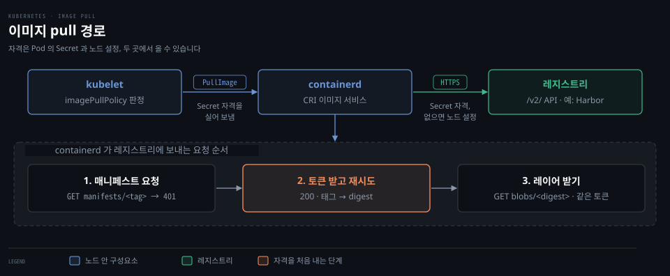

# 이미지 pull과 폐쇄망 반입 — 노드는 이미지를 어디서 누구의 자격으로 받는가

---

> Git 에 적용(Sync)이 성공해도 노드가 이미지를 받지 못하면 앱은 `ImagePullBackOff` 와 Degraded 로 남습니다. 노드가 이미지를 어디서, 언제, 누구의 자격으로 받는지를 나눠 읽으면 원인을 네 갈래로 좁힐 수 있습니다.

## 학습 목표

> 이 문서를 읽고 나면 아래 네 가지를 스스로 해낼 수 있습니다.

1. kubelet 에서 레지스트리까지 이어지는 pull 경로와, 매니페스트 요청·토큰 재시도·레이어 받기 순서를 설명할 수 있습니다.
2. `imagePullPolicy` 기본값 규칙을 말하고, `Always` 여도 레이어를 다시 받지 않는 조건과 가변 태그의 위험을 설명할 수 있습니다.
3. `imagePullSecrets` 와 노드의 containerd 설정이 각각 어느 범위에서 쓰이는지, 둘이 겹칠 때 무엇이 우선하는지 가를 수 있습니다.
4. 사설 CA·미러 설정과 폐쇄망 반입의 두 길을 고르고, 이벤트 메시지로 pull 실패 원인을 좁힐 수 있습니다.

다루지 않는 범위가 있습니다.
kubelet 이 CRI 소켓으로 containerd 를 부르는 경로는 [컨테이너 런타임 인터페이스·crictl](%EC%BB%A8%ED%85%8C%EC%9D%B4%EB%84%88%20%EB%9F%B0%ED%83%80%EC%9E%84%20%EC%9D%B8%ED%84%B0%ED%8E%98%EC%9D%B4%EC%8A%A4%C2%B7crictl.md)가 다룹니다.
받은 이미지가 디스크를 채울 때의 정리는 [노드 압박 축출과 디스크 관리](../scheduling/%EB%85%B8%EB%93%9C%20%EC%95%95%EB%B0%95%20%EC%B6%95%EC%B6%9C%C2%B7%EB%94%94%EC%8A%A4%ED%81%AC%20%EA%B4%80%EB%A6%AC.md)이 다룹니다.
`dockerconfigjson` Secret 의 구조는 [Secret과 Downward API](../../../book/kubernetes-in-action/08-03.Secret%EA%B3%BC%20Downward%20API.md)에 있습니다.
서명과 레지스트리 허용 목록은 [믿을 수 있는 이미지만 들이기](../../../book/cks-study-guide/06-02.%EB%AF%BF%EC%9D%84%20%EC%88%98%20%EC%9E%88%EB%8A%94%20%EC%9D%B4%EB%AF%B8%EC%A7%80%EB%A7%8C%20%EB%93%A4%EC%9D%B4%EA%B8%B0%20%E2%80%94%20%EC%84%9C%EB%AA%85%C2%B7digest%C2%B7%EB%A0%88%EC%A7%80%EC%8A%A4%ED%8A%B8%EB%A6%AC%20%ED%97%88%EC%9A%A9%20%EB%AA%A9%EB%A1%9D%C2%B7Trivy.md)가 다룹니다.

이 문서에서 직접 잰 것은 레지스트리의 HTTP 응답뿐입니다(2절).
노드 설정 파일과 `ctr` 명령은 돌려 볼 클러스터가 없어 공식 문서 기준이며, 해당 자리에 실측 없음이라고 적었습니다.


## 1. Sync 뒤에도 남는 Degraded

> Sync 는 매니페스트를 클러스터에 적용하는 일이고, 이미지를 받는 일은 그 뒤 노드에서 따로 일어납니다. 둘이 서로 다른 시점의 다른 컴포넌트라서 Sync 가 성공해도 pull 은 실패할 수 있습니다.

Argo CD 에서 Sync 는 Git 의 매니페스트를 API 서버에 적용하는 동작입니다. API 서버가 Deployment 를 받아들이면 적용은 끝납니다. 컨테이너 이미지는 그 Pod 가 놓인 노드에서 kubelet 이 받습니다. Sync 상태와 앱의 동작 상태(Health)가 따로 표시되는 이유는 [Argo CD 정독 노트](../../../../07_devops/book/argocd-up-and-running/README.md)가 다룹니다.

노드가 이미지를 받지 못하면 Pod 는 시작하지 못하고 `ImagePullBackOff` 가 됩니다. 쿠버네티스 문서는 이 상태를 이미지를 받지 못해 컨테이너가 시작하지 못한 것으로 설명합니다.[^images] 이름이 틀렸거나 비공개 레지스트리에 `imagePullSecret` 없이 접근한 경우가 그 이유의 예입니다.[^images] `BackOff` 는 쿠버네티스가 재시도를 계속하되 간격을 늘린다는 뜻이고, 간격의 상한은 300초입니다.[^images]

그래서 Sync 가 성공했는데 앱이 Degraded 로 남는 증상은 이미지를 받는 단계에서 막혔다는 신호일 수 있습니다. 이 문서는 그 단계를 세 질문으로 나눕니다.

- 어디서 받는가: 2절의 경로와 5절의 CA·미러, 6절의 반입
- 언제 받는가: 3절의 `imagePullPolicy`
- 누구의 자격으로 받는가: 4절의 자격 두 자리


## 2. pull 경로와 레지스트리 응답

> kubelet 은 CRI 이미지 서비스에 PullImage 를 요청하고, containerd 가 레지스트리에 매니페스트를 요청하고, `401` 을 받으면 토큰을 받아 재시도한 뒤 레이어를 받습니다. 이 응답은 `curl` 로 직접 따라가 볼 수 있습니다.

kubelet 은 이미지를 직접 받지 않습니다. CRI 의 이미지 서비스(ImageService)에 pull 을 요청하고, 실제 통신은 containerd 가 합니다. 이 호출 경로는 [컨테이너 런타임 인터페이스·crictl](%EC%BB%A8%ED%85%8C%EC%9D%B4%EB%84%88%20%EB%9F%B0%ED%83%80%EC%9E%84%20%EC%9D%B8%ED%84%B0%ED%8E%98%EC%9D%B4%EC%8A%A4%C2%B7crictl.md)의 2절이 설명하므로 여기서는 containerd 에서 레지스트리로 나가는 구간만 봅니다.



도식의 위쪽 줄은 요청이 흐르는 방향입니다. kubelet 이 containerd 에 `PullImage` 를 보내고, containerd 가 레지스트리에 HTTPS 로 나갑니다. 화살표 아래 문구는 자격이 흐르는 길입니다. Pod 의 Secret 자격은 kubelet 이 CRI 로 실어 보냅니다. containerd 는 그 자격을 레지스트리에 냅니다. 실어 온 자격이 없을 때만 노드 설정의 자격을 씁니다. 규칙은 4절에서 다룹니다.

아래쪽 점선 구역은 containerd 가 레지스트리에 보내는 요청을 순서대로 보입니다. 자격은 첫 요청이 `401` 을 받은 뒤 처음 쓰이고, 그때 받은 토큰을 레이어 요청에도 그대로 씁니다.

### 태그에서 digest 로

레지스트리가 이미지를 가리키는 이름은 둘입니다. 태그(`1.36`)는 사람이 붙인 이름표이고, **digest**(`sha256:…`)는 매니페스트 내용의 해시입니다. 매니페스트는 이미지를 이루는 레이어 목록과 설정을 적은 JSON 문서입니다. 내용이 바뀌면 digest 도 바뀝니다. 이미지의 이 구조는 [컨테이너 이미지 해부](../../../book/container-security/06-01.%EC%BB%A8%ED%85%8C%EC%9D%B4%EB%84%88%20%EC%9D%B4%EB%AF%B8%EC%A7%80%20%ED%95%B4%EB%B6%80%20%E2%80%94%20%EB%91%90%20%EB%B6%80%EB%B6%84%EA%B3%BC%20%EC%B8%B5%EA%B3%BC%20%EC%8B%9D%EB%B3%84%EC%9E%90.md)가 다룹니다.

`imagePullPolicy: Always` 일 때 containerd 는 레지스트리에 연락해 태그를 digest 로 해석하고, 노드에 없는 레이어만 내려받습니다.[^images] 레이어가 모두 있으면 다시 받지 않습니다.[^images]

### 레지스트리 응답 실측

Docker Hub 의 공개 이미지 `busybox:1.36` 에 인증 없이 요청해 응답을 따라갔습니다. containerd 의 로그가 아니라 레지스트리가 돌려 주는 HTTP 응답을 `curl` 로 직접 본 것입니다.

```bash
# 1) 자격 없이 매니페스트를 요청한다
curl -sI https://registry-1.docker.io/v2/library/busybox/manifests/1.36
```

```bash
HTTP/2 401
www-authenticate: Bearer realm="https://auth.docker.io/token",service="registry.docker.io",scope="repository:library/busybox:pull"
```

첫 응답은 `401` 이고, `www-authenticate` 헤더가 어디서 토큰을 받아야 하는지 알려 줍니다. 공개 이미지여도 토큰 교환 절차는 거칩니다. 비공개 프로젝트는 이 단계에서 계정 자격이 필요합니다.

```bash
# 2) 토큰을 받아 같은 요청을 다시 보낸다
TOKEN=$(curl -s 'https://auth.docker.io/token?service=registry.docker.io&scope=repository:library/busybox:pull' \
  | python3 -c 'import sys,json;print(json.load(sys.stdin)["token"])')
curl -sI -H "Authorization: Bearer $TOKEN" \
  -H 'Accept: application/vnd.oci.image.index.v1+json' \
  https://registry-1.docker.io/v2/library/busybox/manifests/1.36
```

```bash
HTTP/2 200
content-type: application/vnd.oci.image.index.v1+json
docker-content-digest: sha256:73aaf090f3d85aa34ee199857f03fa3a95c8ede2ffd4cc2cdb5b94e566b11662
```

토큰을 붙이면 `200` 과 함께 태그가 가리키는 digest 가 헤더로 옵니다. `content-type` 이 index 이므로 이 digest 는 여러 아키텍처의 매니페스트를 묶은 목록의 것입니다. 2026-11-15 에 잰 값이고, 태그가 다시 덮어써지면 digest 도 달라집니다.

```bash
# 3) 없는 태그를 요청한다
curl -s -w '\nHTTP %{http_code}\n' -H "Authorization: Bearer $TOKEN" \
  https://registry-1.docker.io/v2/library/busybox/manifests/no-such-tag-xyz
```

```bash
{"errors":[{"code":"MANIFEST_UNKNOWN","message":"manifest unknown","detail":"unknown tag=no-such-tag-xyz"}]}
HTTP 404
```

인증은 통과했는데 태그가 없으면 `404` 와 `MANIFEST_UNKNOWN` 이 옵니다. 같은 pull 실패여도 401 과 404 는 다른 층의 문제라는 것이 7절 진단표의 출발점입니다.


## 3. imagePullPolicy 와 받는 시점

> `imagePullPolicy` 는 kubelet 이 컨테이너를 시작할 때 pull 을 요청할지를 정하고, 기본값은 태그 모양에 따라 달라집니다. 같은 태그에 다른 내용을 올리면 노드마다 다른 이미지가 돌 수 있습니다.

노드가 이미지를 받는 시점은 Pod 가 만들어지는 순간이 아니라 kubelet 이 컨테이너를 시작하려는 순간입니다. 그때 정책이 pull 을 요청할지 정합니다.

### 세 정책과 기본값

| 정책 | 동작 |
|---|---|
| `IfNotPresent` | 노드에 이미지가 없을 때만 받습니다 |
| `Always` | 컨테이너를 시작할 때마다 런타임에 pull 을 요청합니다 |
| `Never` | 받지 않습니다. 노드에 있으면 시작하고, 없으면 시작에 실패합니다 |

필드를 생략했을 때의 기본값은 이미지 이름의 모양이 정합니다.[^images]

| 이미지 이름 | 기본 정책 |
|---|---|
| 태그 없음 | `Always` |
| `:latest` | `Always` |
| `@sha256:…` digest 지정 | `IfNotPresent` |
| 그 밖의 명시 태그 | `IfNotPresent` |

기본값은 오브젝트를 처음 만들 때 한 번 정해집니다. 나중에 이미지의 태그나 digest 를 바꿔도 정책은 갱신되지 않습니다.[^images]

### Always 가 비싸지 않은 이유

`Always` 는 kubelet 이 캐시를 확인하지 않고 런타임에 맡깁니다. 런타임은 레지스트리에서 태그를 digest 로 해석하고, 노드에 이미 있는 레이어는 받지 않습니다.[^images] 문서는 이 캐시 덕분에 `Always` 도 레지스트리에 안정적으로 닿는 한 효율적이라고 적습니다.[^images]

여기서 조건은 레지스트리에 닿아야 한다는 점입니다. 레이어를 다시 받지는 않지만 digest 를 묻는 요청은 매번 나갑니다. 레지스트리에 닿지 않는 폐쇄망에서는 이 요청 때문에 시작이 막힙니다(6절).

### 가변 태그의 위험

`IfNotPresent` 에서는 노드에 같은 태그가 있으면 레지스트리를 보지 않습니다. 같은 태그에 다른 내용을 올리면 이런 일이 생깁니다.

1. 어제 노드 A 가 `app:1.0` 을 받아 둡니다.
2. 오늘 누군가 `app:1.0` 태그에 새 빌드를 올립니다.
3. 노드 B 는 새로 받아 새 빌드를 돌리고, 노드 A 는 캐시 때문에 옛 빌드를 계속 돌립니다.

배포마다 고유한 태그를 쓰거나 digest 로 고정하면 이 문제가 사라집니다. digest 는 `<이미지>@sha256:…` 꼴로 씁니다.[^images] digest 검증과 허용 목록은 [믿을 수 있는 이미지만 들이기](../../../book/cks-study-guide/06-02.%EB%AF%BF%EC%9D%84%20%EC%88%98%20%EC%9E%88%EB%8A%94%20%EC%9D%B4%EB%AF%B8%EC%A7%80%EB%A7%8C%20%EB%93%A4%EC%9D%B4%EA%B8%B0%20%E2%80%94%20%EC%84%9C%EB%AA%85%C2%B7digest%C2%B7%EB%A0%88%EC%A7%80%EC%8A%A4%ED%8A%B8%EB%A6%AC%20%ED%97%88%EC%9A%A9%20%EB%AA%A9%EB%A1%9D%C2%B7Trivy.md)가 다룹니다. 받아 둔 이미지가 쌓여 디스크를 채우면 kubelet 이 이미지를 정리하는데, 그 기준은 [노드 압박 축출과 디스크 관리](../scheduling/%EB%85%B8%EB%93%9C%20%EC%95%95%EB%B0%95%20%EC%B6%95%EC%B6%9C%C2%B7%EB%94%94%EC%8A%A4%ED%81%AC%20%EA%B4%80%EB%A6%AC.md)에 있습니다.


## 4. 자격이 놓이는 두 자리

> 레지스트리 자격은 Pod 쪽의 `imagePullSecrets` 와 노드 쪽의 containerd 설정, 두 곳에 놓일 수 있고 범위가 다릅니다. 같은 `401` 이어도 고칠 곳이 달라서, 먼저 자격이 어디에 있는지부터 알아야 합니다.

pull 을 요청받은 containerd 는 비공개 레지스트리의 `401` 을 만나면 자격을 내야 합니다. 쿠버네티스 문서는 그 자격을 주는 방법으로 다섯 가지를 듭니다.[^images]

| 자리 | 범위 | 설정하는 쪽 |
|---|---|---|
| Pod·ServiceAccount 의 `imagePullSecrets` | 그 Pod 만 | 앱·네임스페이스 담당 |
| 노드의 containerd 설정 | 그 노드의 모든 Pod | 노드 관리자 |
| kubelet credential provider | 이미지 이름이 맞는 요청 | 노드 관리자 |
| 미리 받아 둔 이미지 | 그 노드의 모든 Pod | 노드 root 권한자 |
| 공급자별 확장 | 공급자가 정함 | 공급자 |

### Pod 쪽: imagePullSecrets

**imagePullSecrets** 는 Pod 에 레지스트리 자격을 직접 붙이는 방법입니다. 문서는 자격을 가진 Pod 만 비공개 레지스트리에 닿는다고 적습니다.[^images] 규칙은 세 가지입니다.

- Secret 은 Pod 와 같은 네임스페이스에 있어야 하고, 타입은 `kubernetes.io/dockercfg` 또는 `kubernetes.io/dockerconfigjson` 입니다.
- 네임스페이스마다 Secret 을 따로 만들어야 합니다.
- ServiceAccount 에 붙이면 그 계정을 쓰는 Pod 에 자동으로 적용됩니다.

```yaml
apiVersion: v1
kind: Pod
metadata:
  name: foo
  namespace: awesomeapps
spec:
  containers:
    - name: foo
      image: registry.example.com/team/app:1.0
  imagePullSecrets:
    - name: myregistrykey
```

Secret 안의 `auths` 키는 이미지 이름과 맞아야 자격이 전달됩니다. 쿠버네티스는 키에 접두 경로와 `*.` 형태의 glob 을 허용하는데, `*` 하나는 점으로 구분된 서브도메인 하나에만 맞습니다.[^images] 예를 들어 `*.example.com` 은 `a.example.com` 에는 맞지만 `example.com` 에는 맞지 않습니다.[^images] 이미지 주소의 호스트와 Secret 의 키가 한 글자라도 다르면 자격이 가지 않습니다.

### 노드 쪽 자격 두 방식

노드에 자격을 두면 그 노드에서 받는 모든 Pod 가 읽을 수 있습니다. 문서는 이 방법에 클러스터 관리자의 노드 설정이 필요하다고 적습니다.[^images] containerd 는 설정의 `registry.configs.<호스트>.auth` 에 자격을 둘 수 있습니다.[^cri-registry] 이 설정은 `config.toml` 안에 있어서 `kubectl` 로는 조회되지 않습니다.

containerd 문서는 `registry.configs.*.auth` 를 폐기 예정으로 두고 `hosts.toml` 에는 평문 자격을 담을 대응 자리를 만들지 않겠다고 적습니다.[^cri-registry] 다만 대신할 비밀 관리 플러그인이 나오기 전까지는 없애지 않는다고 적고, 1.x 는 1.6 LTS 까지 계속 지원합니다.[^cri-registry] 2.x 의 설정 예시도 `plugins."io.containerd.cri.v1.images".registry.configs.<호스트>.auth` 로 같은 자리를 둡니다.[^cri-registry]

**credential provider** 는 kubelet 이 외부 실행 파일(exec 플러그인)에 자격을 그때그때 묻는 방식입니다. 클라우드 API 를 불러야 자격을 얻거나 자격이 금방 만료될 때 씁니다.[^cred-provider] 쿠버네티스 v1.26 부터 안정 기능입니다.[^cred-provider]

설정은 kubelet 플래그 두 개로 합니다. `--image-credential-provider-config` 는 설정 파일 경로이고 `--image-credential-provider-bin-dir` 는 플러그인 실행 파일이 있는 디렉터리입니다.[^cred-provider] 설정의 `matchImages` 에 맞는 이미지에만 플러그인을 부릅니다.[^cred-provider]

### 둘이 함께 있을 때

쿠버네티스 문서는 노드의 `config.json` 과 `imagePullSecrets` 를 함께 쓰면 자격이 합쳐진다고 적습니다.[^images] 맞는 자격이 여럿이면 찾은 자격마다 차례로 pull 을 시도하고, 맞는 자격이 없으면 인증 없이 또는 런타임 고유 설정으로 시도합니다.[^private-registry]

여기서 노드의 `config.json` 은 kubelet 이 읽어 CRI 로 넘기는 파일이고, containerd 의 `config.toml` 은 containerd 가 직접 읽는 다른 층의 파일입니다. 「런타임 고유 설정」 이 뒤쪽입니다.

한편 containerd 문서는 CRI 로 넘어온 자격이 containerd 설정의 `auth` 보다 우선한다고 적습니다.[^cri-registry] 설정의 자격은 쿠버네티스가 CRI 로 자격을 주지 않을 때만 쓰입니다.[^cri-registry] 이 문장대로라면 Pod 의 Secret 이 옛 값일 때 노드 설정만 고쳐서는 풀리지 않을 수 있습니다. 두 자리를 함께 둔 조합은 실측하지 못했습니다.

### 사례: 고칠 곳이 Secret 이 아니었던 401

어느 운영 환경에서 앱이 Sync 뒤에도 Degraded 로 남았습니다. 레지스트리 계정에 문제가 생긴 뒤 pull 이 `401` 로 실패했습니다. 그 환경의 네임스페이스에는 `dockerconfigjson` 타입 Secret 이 하나도 없었고, 인증 정보는 각 노드의 containerd 설정에 있었습니다. 노드 쪽 설정을 고치자 pull 이 풀렸습니다.

여기서 얻는 교훈은 둘입니다. Secret 목록만 봐서는 pull 경로를 알 수 없습니다. 노드 설정의 자격은 `kubectl` 로 조회되지 않기 때문입니다. 반대로 Secret 이 없다는 사실만으로 노드 설정이라고 단정할 수도 없습니다. 이미지가 든 프로젝트가 공개이거나 credential provider 를 쓰는 경우에도 Secret 은 없습니다. 그래서 노드의 설정 파일을 열어 보고 7절의 `crictl pull` 로 확인합니다.

### 레지스트리 쪽 계정 습관

사람 계정을 클러스터나 파이프라인에 쓰면 그 사람의 비밀번호 변경이 pull 실패로 번집니다. Harbor 의 프로젝트 로봇 계정은 그 계정을 만든 프로젝트 안에서만 동작합니다.[^robot] 여러 프로젝트에 걸치는 시스템 로봇 계정은 Harbor v2.2 부터 관리자가 만들 수 있습니다.[^robot] 이름은 `<접두어><프로젝트>+<계정명>` 꼴이고, 권한은 조합해서 줍니다. push 권한은 pull 권한과 함께 줘야 합니다.[^robot] 만료 시점을 정하거나 만료 없음을 고를 수 있습니다.[^robot]

Harbor 는 로봇의 secret 을 저장하지 않아서 만든 순간 한 번만 볼 수 있고, 잃으면 새로 발급합니다.[^robot] 문서는 만료 뒤의 동작을 적지 않습니다. 만료된 자격이 `401` 로 이어진다는 것은 이 문서의 추론이므로, 만료일을 적어 두고 미리 갱신하는 편이 안전합니다.


## 5. 사설 CA 와 미러

> 레지스트리 인증서를 노드가 신뢰하는 문제와 로그인 자격은 서로 다른 층입니다. containerd 는 `certs.d/<호스트>/hosts.toml` 에서 호스트별 CA 와 미러를 읽습니다.

자격이 맞아도 노드가 레지스트리의 인증서를 믿지 못하면 연결 자체가 성립하지 않습니다. 인증서 신뢰는 누구에게 연결하는지의 문제이고, 로그인 자격은 내가 누구인지의 문제입니다. 사설 CA 가 발급한 인증서를 쓰는 레지스트리에서는 이 둘을 따로 확인해야 합니다.

### hosts.toml 로 CA 지정

containerd 는 `config_path` 로 지정한 디렉터리 아래에 호스트마다 폴더를 두고 그 안의 `hosts.toml` 을 읽습니다.[^hosts] `config_path` 를 켜는 위치는 containerd 버전에 따라 다릅니다.[^hosts]

```toml
# /etc/containerd/config.toml — containerd 2.x (version = 3)
[plugins."io.containerd.cri.v1.images".registry]
  config_path = "/etc/containerd/certs.d"
# 1.x (version = 2) 는 [plugins."io.containerd.grpc.v1.cri".registry]
```

```toml
# /etc/containerd/certs.d/registry.example.com/hosts.toml
server = "https://registry.example.com"

[host."https://registry.example.com"]
  capabilities = ["pull", "resolve"]
  ca = "/etc/containerd/certs.d/registry.example.com/ca.crt"
```

`ca` 는 레지스트리 인증에 쓸 CA 파일의 경로이고, 경로 배열도 받습니다.[^hosts] `hosts.toml` 이 없는 호스트 폴더는 Docker 방식을 따라 `.crt` 를 CA 로 읽습니다.[^hosts]

공식 문서가 CA 를 지정하는 방법으로 적는 것은 이 둘입니다. OS 신뢰 저장소에 등록하면 풀리는지는 이 문서가 다루지 않습니다. 이 설정은 노드마다 있어야 하므로 노드를 늘릴 때 빠지지 않게 프로비저닝 절차에 넣어 둡니다.

### 재시작 대상

`certs.d` 아래의 변경은 containerd 를 재시작하지 않아도 됩니다.[^hosts] 반면 `config.toml` 의 레지스트리 설정을 고쳤다면 containerd 를 재시작해야 합니다.[^cri-registry] 설정을 읽는 쪽이 kubelet 이 아니라 containerd 이므로 재시작 대상도 containerd 입니다. 실측하지 못했고 공식 문서 기준입니다.

### 미러

`[host."…"]` 항목은 기본 레지스트리 대신 쓸 주소입니다. 여러 개를 적으면 적은 순서대로 먼저 시도하고, `server` 는 마지막 후보가 됩니다.[^hosts]

```toml
# /etc/containerd/certs.d/docker.io/hosts.toml
[host."https://mirror.example.com/v2/dockerhub-proxy"]
  capabilities = ["pull", "resolve"]
  override_path = true
```

`override_path` 는 레지스트리 API 의 루트가 표준의 `/v2` 가 아니라 URL 경로에 들어 있을 때 씁니다.[^hosts] 문서는 공개 미러가 `resolve`(태그를 digest 로 해석하는 동작)를 맡는 것을 신뢰하면 안 된다고 경고합니다.[^hosts] 미러를 위한 `hosts.toml` 은 이 문서에서 돌려 보지 못했습니다.

### TLS 검증 끄기

`skip_verify = true` 는 레지스트리 인증서 체인과 호스트 이름 검증을 건너뜁니다.[^hosts] 기본값은 `false` 이고 문서는 시험용이나 다른 검증 수단과 함께일 때만 쓰라고 합니다.[^hosts] 연결은 되지만 가짜 레지스트리를 걸러 내지 못하므로 운영 설정에 두지 않습니다.


## 6. 폐쇄망 반입

> 폐쇄망에서는 이미지를 내부 레지스트리에 복사하거나 노드의 containerd 에 직접 적재합니다. 이미지만 옮겨서는 끝나지 않고, 매니페스트의 이미지 주소와 CA 등록이 함께 끝나야 합니다.

외부 레지스트리에 닿지 않는 클러스터에서는 3절의 `Always` 요청이 나갈 곳이 없습니다. 이미지를 안에 들여놓는 길은 두 가지입니다.

### 내부 레지스트리가 있을 때

`skopeo copy` 는 이미지의 매니페스트·레이어·서명을 한 위치에서 다른 위치로 복사합니다.[^skopeo] 위치는 전송 방식 접두사로 적습니다.[^skopeo]

- `docker://`: 레지스트리
- `dir:`: 디렉터리
- `oci:`: OCI 레이아웃

반입은 3단계입니다.

1. 외부망 쪽에서 파일로 내립니다.
2. 이동 매체로 폐쇄망에 옮깁니다.
3. 폐쇄망 쪽에서 내부 레지스트리로 올립니다.

```bash
# 외부망 쪽 — 레지스트리에서 디스크로
skopeo copy --all docker://docker.io/library/busybox:1.36 oci:/media/transfer/busybox:1.36

# 폐쇄망 쪽 — 디스크에서 내부 레지스트리로
skopeo copy --all --preserve-digests oci:/media/transfer/busybox:1.36 \
  docker://registry.example.com/library/busybox:1.36
```

`--all` 은 소스가 이미지 목록이면 목록과 그 안의 이미지를 모두 복사합니다.[^skopeo] 지정하지 않으면 현재 OS·아키텍처에 맞는 이미지 하나만 옮깁니다.[^skopeo] 노드 아키텍처가 섞인 클러스터라면 `--all` 이 필요합니다. `--preserve-digests` 는 복사하는 동안 digest 를 보존하고, 보존할 수 없으면 실패합니다.[^skopeo] 매니페스트가 `@sha256:` 로 고정돼 있다면 digest 가 달라지는 복사는 고정을 깹니다.

이 명령은 이 맥에 skopeo 가 없어 돌려 보지 못했습니다. 옵션 이름과 전송 방식은 공식 man 문서 기준이고, `oci:` 와 `--all` 의 조합은 실측 없음입니다.

### 외부에서 받아 캐시하는 길

Harbor 의 프록시 캐시 프로젝트는 다른 레지스트리의 이미지를 대신 받아 캐시합니다.[^proxy] 클라이언트는 이미지 이름 앞에 `<Harbor 주소>/<프록시 프로젝트>/` 를 붙여 요청하고, 캐시에 없으면 Harbor 가 대상 레지스트리에서 받아 오고 저장합니다.[^proxy] 프록시 캐시 프로젝트에는 push 할 수 없습니다.[^proxy]

이 방식은 외부로 나가는 지점을 Harbor 한 곳으로 줄이는 것이지 완전한 단절이 아닙니다. Harbor 가 처음 받을 때는 외부에 닿아야 하므로, 외부 접속이 아예 없는 망에서는 앞의 `skopeo` 반입을 씁니다.

### 내부 레지스트리가 없을 때

노드의 containerd 에 이미지를 직접 적재할 수 있습니다. 함정은 네임스페이스입니다. kubelet 은 `k8s.io` 네임스페이스의 이미지만 봅니다. `ctr` 과 `nerdctl` 은 기본이 `default` 네임스페이스여서 옵션 없이 적재하면 kubelet 이 이미지를 보지 못합니다([컨테이너 런타임 인터페이스·crictl](%EC%BB%A8%ED%85%8C%EC%9D%B4%EB%84%88%20%EB%9F%B0%ED%83%80%EC%9E%84%20%EC%9D%B8%ED%84%B0%ED%8E%98%EC%9D%B4%EC%8A%A4%C2%B7crictl.md)의 3절에서 kind 노드로 실측).

```bash
# 명령 형식은 이 문서에서 확인하지 못했다 — 실측 없음
ctr -n k8s.io images import app.tar
nerdctl -n k8s.io load -i app.tar
```

적재한 이미지를 쓰려면 정책도 맞춰야 합니다. 태그가 없거나 `:latest` 이면 기본값이 `Always` 라서 레지스트리에 닿지 못해 시작이 막힙니다.[^images] 명시 태그를 쓰면 기본값이 `IfNotPresent` 이므로 노드에 있는 이미지를 씁니다.[^images] Pod 는 어느 노드에든 놓일 수 있으므로 적재는 모든 노드에서 해야 하고, 이미지 이름은 매니페스트의 `image` 값과 정확히 같아야 합니다.

### 함께 끝나야 하는 일

이미지를 들여놓는 것은 폐쇄망 배포의 절반입니다.

- 이미지 주소: 매니페스트와 차트의 `image` 값을 내부 레지스트리 주소로 바꿉니다. 차트는 값 파일의 레지스트리 항목으로 바꾸는 경우가 많습니다.
- 인증서: 내부 레지스트리가 사설 CA 를 쓰면 5절의 `hosts.toml` 을 모든 노드에 넣습니다.
- 자격: 내부 레지스트리가 비공개이면 4절의 두 자리 중 하나를 정합니다.


## 7. ImagePullBackOff 진단 순서

> Pod 의 이벤트 메시지가 원인 층을 가르고, 노드에서 `crictl pull` 로 kubelet 을 빼고 재현하면 어느 층인지 확인됩니다.

`kubectl describe pod <이름>` 의 Events 에서 pull 실패 메시지를 읽습니다. 메시지 원문은 런타임과 버전마다 달라서 핵심 문구로 가릅니다. 이 표의 문구는 실측하지 못했고, 2절의 응답은 레지스트리 쪽 코드입니다.

### 메시지로 원인 층 가르기

| 메시지 단서 | 원인 층 | 먼저 볼 것 |
|---|---|---|
| `401 Unauthorized`, `authentication required` | 로그인 자격 | 이미지가 든 프로젝트의 공개 여부, Pod 의 Secret, 노드 설정, 로봇 계정 만료 |
| `403 Forbidden` | 권한 | 인증된 계정이 그 프로젝트의 pull 권한을 가졌는지 |
| `x509: certificate signed by unknown authority` | 인증서 신뢰 | `hosts.toml` 의 `ca` 와 `certs.d` 경로 |
| `not found`, `manifest unknown` | 이름·태그 | 철자, 그 태그가 레지스트리에 push 됐는지 |
| `i/o timeout`, `connection refused`, `no such host` | 네트워크·DNS | 노드에서 레지스트리 포트 연결과 이름 해석 |

`403` 행은 일반적인 HTTP 의미로 적은 것이고 레지스트리 제품마다 응답 코드를 다르게 쓸 수 있습니다.

### 노드에서 kubelet 을 빼고 재현

노드에 접속해 `crictl pull` 로 같은 이미지를 직접 받아 봅니다. `crictl` 의 설정은 [컨테이너 런타임 인터페이스·crictl](%EC%BB%A8%ED%85%8C%EC%9D%B4%EB%84%88%20%EB%9F%B0%ED%83%80%EC%9E%84%20%EC%9D%B8%ED%84%B0%ED%8E%98%EC%9D%B4%EC%8A%A4%C2%B7crictl.md)의 2절에 있습니다.

```bash
crictl pull registry.example.com/team/app:1.0
```

결과는 이렇게 읽습니다.

- 같은 오류가 `x509`·`i/o timeout`·`not found` 입니다: kubelet 과 Pod 의 Secret 이전의 문제입니다. 노드의 설정, 인증서, 네트워크, 레지스트리를 봅니다.
- 같은 오류가 `401`·`403` 입니다: 이것만으로는 Secret 을 배제하지 못합니다. 인자 없는 `crictl pull` 은 Pod 의 Secret 을 싣지 않아서, Secret 으로 받던 레지스트리라면 정상이어도 401 이 납니다. Secret 에 든 계정으로 `crictl pull --username <사용자> <이미지>` 를 돌려 비교합니다. 비밀번호는 따로 물어 오므로 셸 기록에 남지 않습니다.[^crictl-src]
- 성공합니다: 노드 쪽 경로는 정상입니다. Pod 가 쓰는 자격이 다르므로 `imagePullSecrets` 의 이름과 `auths` 키가 이미지 호스트와 맞는지 봅니다. `crictl pull` 은 Pod 의 Secret 을 싣지 않으므로 성공이 Pod 의 Secret 이 맞다는 증거는 아닙니다.


## 8. 점검 질문

> 위 내용을 바탕으로 pull 실패 상황에서 마주치는 핵심 질문에 답해 봅니다.

### Q1. Sync 성공과 Degraded

Git 의 매니페스트를 적용하는 Sync 는 성공했는데 앱이 Degraded 입니다. 이미지 pull 이 원인일 수 있는 이유는 무엇입니까?

### Q2. Always 와 레이어

`imagePullPolicy: Always` 인 Pod 를 같은 노드에서 다시 시작했습니다. 이미지가 바뀌지 않았다면 레이어를 다시 받습니까? 레지스트리가 끊겨 있다면 어떻게 됩니까?

### Q3. 고칠 곳 찾기

비공개 레지스트리에서 `401` 이 납니다. 네임스페이스에 `dockerconfigjson` Secret 이 없는데도 Pod 가 이전에는 받았습니다. 자격은 어디에 있었을 수 있고 어떻게 확인합니까?

### Q4. 인증서와 자격

자격은 맞는데 `x509: certificate signed by unknown authority` 가 납니다. 로그인 자격과 인증서 신뢰는 어떻게 다르고, 무엇을 고칩니까?

### Q5. 폐쇄망 적재

폐쇄망 노드에 `ctr images import` 로 이미지를 넣었는데 kubelet 이 이미지를 찾지 못했습니다. 의심할 것 두 가지는 무엇입니까?


## 정답 (자답 후 펼치기)

> 위 점검 질문 5개에 먼저 자답한 뒤 아래를 읽으세요.

### 정답 1 — Sync 와 pull 의 분리

Sync 는 매니페스트를 API 서버에 적용하는 일이고, 이미지는 그 뒤에 Pod 가 놓인 노드에서 kubelet 이 따로 받기 때문입니다. 적용이 성공해도 노드가 이미지를 받지 못하면 Pod 가 시작하지 못하고 `ImagePullBackOff` 로 남습니다. 앱의 동작 상태는 그 결과를 반영해 Degraded 로 읽힐 수 있습니다.

### 정답 2 — Always 의 요청과 캐시

이미지가 바뀌지 않았다면 레이어는 다시 받지 않습니다. 런타임이 태그를 digest 로 해석한 뒤 노드에 이미 있는 레이어는 받지 않기 때문입니다. 그러나 digest 를 묻는 요청은 매번 레지스트리로 나가므로 레지스트리가 끊겨 있으면 시작이 막힙니다. 노드에 이미지가 있어도 `Always` 에서는 마찬가지입니다.

### 정답 3 — 노드 설정과 확인

자격이 노드의 containerd 설정에 있었을 수 있습니다. 노드 설정의 자격은 그 노드에서 받는 모든 Pod 가 쓰고 `kubectl` 로 조회되지 않습니다. 이미지가 든 프로젝트가 공개이거나 credential provider 를 쓰는 경우도 가능하므로, 노드의 설정 파일을 열어 보고 노드에서 `crictl pull` 로 재현해 확인합니다. 계정을 바꿨다면 고칠 곳은 Secret 이 아니라 노드 설정입니다.

### 정답 4 — 신뢰와 자격의 두 층

인증서 신뢰는 내가 연결하는 상대가 진짜 그 레지스트리인지의 문제이고, 로그인 자격은 내가 누구인지의 문제입니다. 자격이 맞아도 CA 를 믿지 못하면 연결이 성립하지 않습니다. 레지스트리 호스트의 `hosts.toml` 에 `ca` 를 지정하거나 `certs.d` 에 CA 파일을 둡니다. `skip_verify` 는 검증을 끄는 것이어서 운영에 쓰지 않습니다.

### 정답 5 — 네임스페이스와 정책

첫째는 네임스페이스입니다. `ctr` 의 기본은 `default` 이고 kubelet 은 `k8s.io` 만 보므로 `-n k8s.io` 없이 넣으면 kubelet 이 이미지를 보지 못합니다. 둘째는 `imagePullPolicy` 입니다. 태그가 없거나 `:latest` 이면 기본이 `Always` 라 레지스트리에 닿지 못해 막힙니다. 이미지 이름이 매니페스트와 정확히 같은지와 모든 노드에 적재했는지도 함께 봅니다.


## 관련 문서

> 이 문서가 딛고 서거나 이어지는 이웃입니다.

- [컨테이너 런타임 인터페이스·crictl](%EC%BB%A8%ED%85%8C%EC%9D%B4%EB%84%88%20%EB%9F%B0%ED%83%80%EC%9E%84%20%EC%9D%B8%ED%84%B0%ED%8E%98%EC%9D%B4%EC%8A%A4%C2%B7crictl.md) — kubelet 에서 containerd 로 이어지는 CRI 경로와 `k8s.io` 네임스페이스
- [노드 압박 축출과 디스크 관리](../scheduling/%EB%85%B8%EB%93%9C%20%EC%95%95%EB%B0%95%20%EC%B6%95%EC%B6%9C%C2%B7%EB%94%94%EC%8A%A4%ED%81%AC%20%EA%B4%80%EB%A6%AC.md) — 받아 둔 이미지의 정리
- [Secret과 Downward API](../../../book/kubernetes-in-action/08-03.Secret%EA%B3%BC%20Downward%20API.md) — `dockerconfigjson` Secret 과 `imagePullSecrets`
- [믿을 수 있는 이미지만 들이기](../../../book/cks-study-guide/06-02.%EB%AF%BF%EC%9D%84%20%EC%88%98%20%EC%9E%88%EB%8A%94%20%EC%9D%B4%EB%AF%B8%EC%A7%80%EB%A7%8C%20%EB%93%A4%EC%9D%B4%EA%B8%B0%20%E2%80%94%20%EC%84%9C%EB%AA%85%C2%B7digest%C2%B7%EB%A0%88%EC%A7%80%EC%8A%A4%ED%8A%B8%EB%A6%AC%20%ED%97%88%EC%9A%A9%20%EB%AA%A9%EB%A1%9D%C2%B7Trivy.md) — digest 고정과 레지스트리 허용 목록
- [컨테이너 이미지 해부](../../../book/container-security/06-01.%EC%BB%A8%ED%85%8C%EC%9D%B4%EB%84%88%20%EC%9D%B4%EB%AF%B8%EC%A7%80%20%ED%95%B4%EB%B6%80%20%E2%80%94%20%EB%91%90%20%EB%B6%80%EB%B6%84%EA%B3%BC%20%EC%B8%B5%EA%B3%BC%20%EC%8B%9D%EB%B3%84%EC%9E%90.md) — 매니페스트·레이어·skopeo
- [Argo CD 정독 노트](../../../../07_devops/book/argocd-up-and-running/README.md) — Sync 상태와 Health 상태가 따로 보이는 쪽

[^images]: Kubernetes — Images. "The status `ImagePullBackOff` means that a container could not start because Kubernetes could not pull a container image." / "The container runtime contacts the registry, resolves the image tag or name to a digest, and downloads any layers that are not already cached locally." <https://kubernetes.io/docs/concepts/containers/images/> (2026-11-15 조회)

[^private-registry]: Kubernetes — Pull an Image from a Private Registry, 「Using images from multiple registries」. "The image pull will be attempted using each credential that matches the registry. If no credentials match the registry, the image pull will be attempted without authorization or using custom runtime specific configuration." <https://kubernetes.io/docs/tasks/configure-pod-container/pull-image-private-registry/> (2026-11-15 조회)

[^cred-provider]: Kubernetes — Kubelet Image Credential Provider. "These plugins allow the kubelet to request credentials for a container registry dynamically as opposed to storing static credentials on disk." <https://kubernetes.io/docs/tasks/administer-cluster/kubelet-credential-provider/> (2026-11-15 조회)

[^hosts]: containerd — `docs/hosts.md` (main). "Updates under this directory do not require restarting the containerd daemon." / "`skip_verify` skips verifications of the registry's certificate chain and host name when set to `true`." <https://github.com/containerd/containerd/blob/main/docs/hosts.md> (2026-11-15 조회)

[^cri-registry]: containerd — `docs/cri/registry.md` (main). "Please note that auth config passed by CRI takes precedence over this config." / "After modifying this config, you need to restart the `containerd` service." <https://github.com/containerd/containerd/blob/main/docs/cri/registry.md> (2026-11-15 조회)

[^skopeo]: containers/skopeo — `skopeo-copy(1)`. "Copy an image (manifest, filesystem layers, signatures) from one location to another." / "`--preserve-digests`: Preserve the digests during copying. Fail if the digest cannot be preserved." <https://github.com/containers/skopeo/blob/main/docs/skopeo-copy.1.md> (2026-11-15 조회)

[^proxy]: Harbor 2.11 — Configure Proxy Cache. "Proxy cache allows you to use Harbor to proxy and cache images from a target public or private registry." / "you are not able to push images to a proxy cache project." <https://goharbor.io/docs/2.11.0/administration/configure-proxy-cache/> (2026-11-15 조회)

[^robot]: Harbor 2.11 — Create Project Robot Accounts. "A project robot account can only perform actions within the project that it is created in, however, Harbor v2.2 introduces the ability for system administrators to create system robot accounts in addition to creating project robot account that can automate tasks across multiple projects." / "A robot account name follows the format `<prefix><project_name>+<account_name>`." / "There is no way to get the secret from Harbor after you have created the robot account." <https://goharbor.io/docs/2.11.0/working-with-projects/project-configuration/create-robot-accounts/> (2026-11-15 조회)

[^crictl-src]: cri-tools — `cmd/crictl/image.go` (master). `--creds`: "Use `USERNAME[:PASSWORD]` for accessing the registry", `--username`: "Use `USERNAME` for accessing the registry. The password will be requested on the command line". <https://github.com/kubernetes-sigs/cri-tools/blob/master/cmd/crictl/image.go> (2026-11-15 조회)
