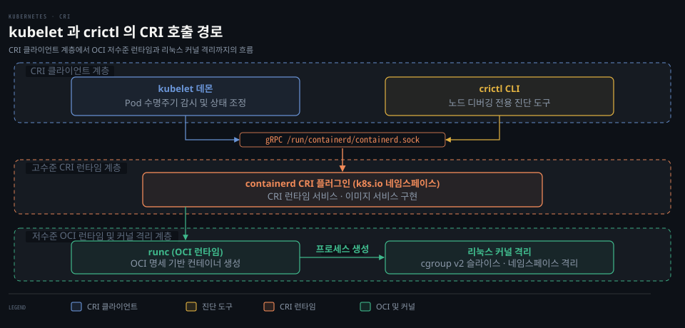
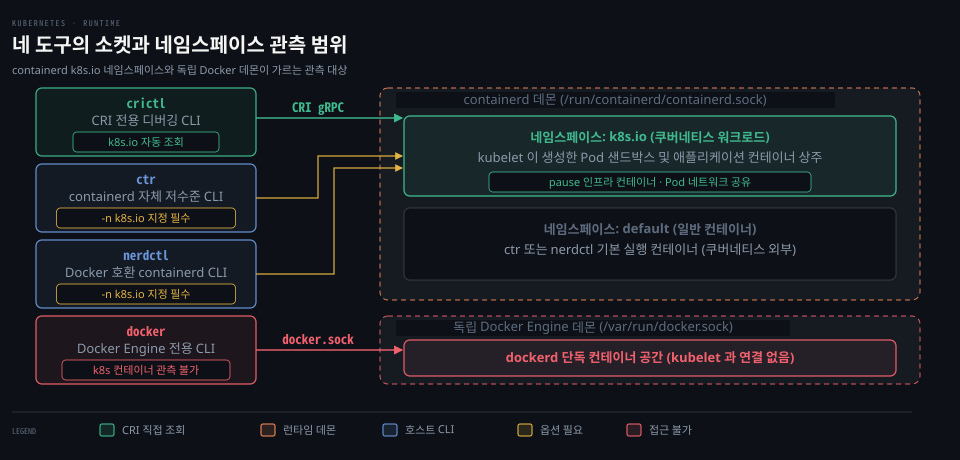

# 컨테이너 런타임 인터페이스·crictl

---

> 워커 노드에서 Pod 컨테이너를 직접 관측할 때는 `docker ps` 대신 CRI 소켓을 바라보는 `crictl` 을 써야 하며 crictl 은 디버깅 전용 도구이므로 샌드박스를 직접 제어하거나 수명주기를 임의로 바꾸지 말아야 합니다.

## 학습 목표

> 이 문서를 읽고 나면 아래 네 가지를 스스로 해낼 수 있습니다.

1. kubelet 에서 OCI 저수준 런타임까지 이어지는 CRI 호출 경로와 dockershim 제거 의미를 설명할 수 있습니다.
2. `/etc/crictl.yaml` 설정과 소켓 경로를 확인해 `crictl` 을 컨테이너 런타임에 올바르게 연결할 수 있습니다.
3. `crictl`, `ctr`, `nerdctl`, `docker` 네 도구의 관측 범위와 네임스페이스 차이를 비교할 수 있습니다.
4. `crictl pods` 와 `ps` 명령으로 샌드박스를 진단하고 cgroup 불일치가 일으키는 노드 불안정을 판별할 수 있습니다.

다루지 않는 범위가 있습니다.
컴포넌트 배치는 [쿠버네티스 기원과 아키텍처](../../../book/kubernetes-in-action/01-01.쿠버네티스란%20무엇인가%20—%20기원과%20아키텍처.md)가 다룹니다.
runc 와 OCI 동작은 [컨테이너의 탄생](../../../book/networking-and-kubernetes/03-01.컨테이너의%20탄생%20—%20앱%20실행의%20진화와%20격리%20프리미티브.md)이 설명합니다.
cgroup v2 단일 트리는 [cgroup v2](../../../../02_os/docs/kernel/01-01.cgroup%20v2.md)에 정리되어 있습니다.


## 1. 노드에서 docker ps 가 보지 못하는 것

> 쿠버네티스는 Docker Engine 을 거치지 않고 CRI 런타임과 직접 통신하므로 노드 셸에서 `docker ps` 를 쳐도 워크로드가 보이지 않습니다.

운영자가 노드 장애나 파드 기동 실패를 조사하러 워커 노드에 들어가 과거 습관대로 `docker ps` 를 입력하면 컨테이너 목록이 비어 있어 혼란을 겪습니다. 노드에는 수십 개의 파드가 스케줄링되어 도는데도 Docker CLI 에는 아무것도 나타나지 않습니다.

이 현상은 쿠버네티스에서 **dockershim** 어댑터가 제거되면서 시작되었습니다.[^dockershim] 초기 쿠버네티스는 Docker Engine 만 런타임으로 지원했습니다. 이후 다양한 런타임을 지원하기 위해 표준 규약인 **CRI(Container Runtime Interface)** 가 도입되었습니다.[^cri] 하지만 당시 Docker Engine 은 CRI 규약을 구현하지 않았습니다. 그래서 쿠버네티스 프로젝트는 kubelet 내부에 Docker 데몬과 CRI 를 중계하는 임시 어댑터 dockershim 을 직접 유지보수했습니다.

dockershim 은 v1.20 폐기 예고를 거쳐 v1.24 에서 완전히 제거되었습니다.[^dockershim] 제거 이후 kubelet 은 containerd 나 CRI-O 같은 CRI 호환 런타임과 직접 gRPC 통신을 수행합니다.

호스트에 Docker Engine 이 설치되어 있어도 Docker 데몬은 별개 소켓(`/var/run/docker.sock`)으로 독자 컨테이너만 관리합니다. kubelet 이 containerd 에 요청해 생성한 파드와 컨테이너는 Docker 데몬의 관리 범위 밖에 있습니다.

최신 노드에서 런타임과 워크로드를 보려면 Docker CLI 대신 **crictl** 도구를 씁니다. crictl 은 kubelet 과 동일한 CRI 소켓을 바라봅니다.[^crictl]


## 2. CRI 호출 경로와 소켓 통신

> kubelet 과 crictl 은 gRPC 소켓을 통해 고수준 CRI 런타임에 명령을 전달하고 런타임은 OCI 표준에 따라 runc 로 커널 격리를 수행합니다.

kubelet 이 명령을 내리거나 crictl 로 상태를 조회할 때 대상 소켓을 잘못 지정하면 연결이 실패합니다. 두 도구 모두 gRPC 소켓 엔드포인트를 통해 고수준 런타임에 접근하기 때문입니다.



위 도식은 호출이 내려가는 세 계층을 보여 줍니다. kubelet 데몬과 crictl CLI 는 동일한 gRPC 유닉스 소켓으로 런타임에 연결됩니다. 런타임은 OCI 명세에 따라 저수준 런타임인 **runc** 를 호출합니다. runc 는 커널 네임스페이스와 cgroup 을 구성해 프로세스를 실행합니다.[^dockershim]

runc 가 실행하는 OCI 번들의 구조와 생애 주기는 [번들과 컨테이너 생애 주기](../../../../07_devops/docs/artifact/container/03-04.%EB%B2%88%EB%93%A4%EA%B3%BC%20%EC%BB%A8%ED%85%8C%EC%9D%B4%EB%84%88%20%EC%83%9D%EC%95%A0%20%EC%A3%BC%EA%B8%B0.md)에서 다룹니다.

### gRPC 인터페이스와 두 가지 서비스

CRI 규약은 크게 두 개의 독립된 gRPC 서비스로 구성됩니다.[^cri]

1. RuntimeService: Pod 샌드박스와 컨테이너의 생성·시작·정지·삭제 등 수명주기를 제어합니다. 상태 조회와 exec 스트리밍도 맡습니다.
2. ImageService: 이미지 저장소 풀(pull), 목록 조회, 검사, 삭제 등 로컬 이미지 저장소 수명주기를 관리합니다.

kubelet 은 `--container-runtime-endpoint` 설정으로 지정된 소켓 경로를 통해 이 두 서비스의 클라이언트로 동작합니다. v1.26 부터 kubelet 은 런타임이 CRI v1 API 를 지원해야 노드를 등록합니다. 지원하지 않으면 노드를 등록하지 않고 오류를 보고합니다.[^cri]

### crictl 소켓 연결 방식과 설정

crictl 역시 런타임의 gRPC 소켓에 직접 질의하는 CLI 클라이언트입니다.[^crictl] crictl 이 연결할 소켓을 지정하는 방법에는 세 가지가 있습니다.

- 전역 명령줄 플래그: `--runtime-endpoint` 및 `--image-endpoint`
- 환경 변수: `CONTAINER_RUNTIME_ENDPOINT` 및 `IMAGE_SERVICE_ENDPOINT`
- 기본 설정 파일: `/etc/crictl.yaml`

설정 파일이 지정되지 않았을 때 crictl 이 참조하는 기본 경로는 `/etc/crictl.yaml` 입니다.[^critools] 아래는 kind v1.35 노드(crictl 1.33, containerd 2.2)에서 잰 설정입니다.

```bash
# /etc/crictl.yaml 내용 확인
cat /etc/crictl.yaml
```

```yaml
runtime-endpoint: unix:///run/containerd/containerd.sock
```

kind 노드의 설정에는 `runtime-endpoint` 한 줄만 있습니다. `image-endpoint` 를 비워 두면 crictl 은 `runtime-endpoint` 값을 이미지 서비스에도 씁니다.[^critools] containerd 는 런타임 서비스와 이미지 서비스를 한 소켓에서 함께 받으므로 이 한 줄로 두 서비스에 모두 닿습니다. `timeout`·`debug` 도 같은 파일에 적을 수 있습니다.[^crictl]

설정 파일이나 플래그로 런타임 엔드포인트를 정하지 않으면 crictl 은 기본 후보 소켓을 차례로 시도합니다.[^critools] 탐색 대상은 containerd, CRI-O, cri-dockerd 소켓 순서입니다.

cri-tools 문서는 이 기본 엔드포인트가 폐기 예정이니 런타임 엔드포인트를 늘 지정하라고 적습니다.[^critools] 후보마다 연결 시도가 시간 초과로 끝나야 다음 후보로 넘어가므로 그만큼 느려집니다. 쿠버네티스 문서도 엔드포인트를 정하지 않으면 성능이 떨어질 수 있다고 합니다.[^crictl] 그래서 `/etc/crictl.yaml` 에 소켓 경로를 적어 둡니다.


## 3. 같은 런타임을 보는 네 도구 비교

> containerd 는 네임스페이스로 워크로드를 격리하므로 도구마다 기본 타깃 소켓과 네임스페이스 지정 규칙이 다릅니다.

워커 노드 셸에서 컨테이너를 점검할 때 만날 수 있는 네 가지 도구의 차이를 비교합니다.



도식에서 crictl 은 CRI 소켓을 통해 `k8s.io` 네임스페이스를 직접 조회합니다. ctr 과 nerdctl 은 containerd 네이티브 소켓을 공유하지만 기본 네임스페이스가 `default` 입니다. 별도 옵션 없이는 쿠버네티스 컨테이너에 닿지 못합니다. Docker CLI 는 별개의 Docker 데몬에 묶여 있습니다.

| 도구 | 연결 소켓 | 기본 네임스페이스 | Pod 샌드박스 인식 | 적합한 목적 |
|---|---|---|---|---|
| `crictl` | `/run/containerd/containerd.sock` (CRI) | `k8s.io` (CRI 자동 인식) | 지원 (`crictl pods`) | 쿠버네티스 노드 트러블슈팅 및 장애 진단 |
| `ctr` | `/run/containerd/containerd.sock` | `default` | 미지원 (단일 컨테이너 단위) | containerd 자체 저수준 기능 개발 및 원초적 디버깅 |
| `nerdctl` | `/run/containerd/containerd.sock` | `default` | 미지원 (단일 컨테이너 단위) | Docker 호환 CLI 문법 기반 컨테이너 조작 |
| `docker` | `/var/run/docker.sock` | 해당 없음 (독립 데몬) | 미지원 | 쿠버네티스와 무관한 독립 호스트 빌드 및 컨테이너 관리 |

### containerd 네임스페이스와 k8s.io

containerd 는 단일 데몬 안에서 이미지와 컨테이너를 논리적으로 격리하기 위해 자체 네임스페이스 메커니즘을 제공합니다. kubelet 은 자신이 관리하는 모든 Pod 샌드박스와 컨테이너를 `k8s.io` 라는 이름의 네임스페이스에 할당합니다.

ctr 과 nerdctl 은 쿠버네티스 전용 도구가 아닙니다. 네임스페이스 플래그를 생략하면 `default` 네임스페이스를 바라봅니다. 그래서 워커 노드에서 `ctr container list` 나 `nerdctl ps` 를 실행하면 쿠버네티스 컨테이너가 나오지 않습니다. 이들 도구로 쿠버네티스 컨테이너를 관측하려면 반드시 `--namespace k8s.io` (또는 `-n k8s.io`) 플래그를 붙여야 합니다.

반면 `crictl` 은 CRI gRPC 프로토콜을 사용합니다. containerd 의 CRI 플러그인은 containerd 에 붙을 때 쓰는 네임스페이스를 `k8s.io` 로 고정해 둡니다.[^ctrd] 덕분에 운영자가 별도의 네임스페이스 옵션을 주지 않아도 쿠버네티스 워크로드만 일관되게 조회됩니다.

kind v1.35 노드에서 ctr 로 두 네임스페이스를 비교한 결과입니다. kind 노드 이미지에는 `nerdctl` 과 `docker` 가 설치되어 있지 않아 이 둘은 돌리지 않았습니다.

```bash
# containerd 에 있는 네임스페이스 목록
ctr namespaces ls

# 네임스페이스를 주지 않으면 default 를 본다
ctr containers ls -q | wc -l

# k8s.io 를 지정하면 kubelet 이 만든 컨테이너가 보인다
ctr -n k8s.io containers ls -q | wc -l
```

```bash
NAME   LABELS
k8s.io
0
20
```

`default` 네임스페이스는 목록에 없고, 지정하지 않은 `ctr` 은 컨테이너를 하나도 찾지 못합니다. `k8s.io` 의 20개는 같은 순간 `crictl ps -a` 가 보인 애플리케이션 컨테이너 10개와 `crictl pods` 의 샌드박스 10개를 더한 수입니다. containerd 는 샌드박스도 pause 이미지로 띄운 컨테이너로 저장하기 때문입니다.


## 4. 자주 쓰는 명령과 샌드박스 진단

> crictl 은 Pod 샌드박스와 애플리케이션 컨테이너를 구분해 다루므로 pause 인프라 컨테이너는 pods 목록에서만 관측됩니다.

노드 장애가 발생했을 때 파드가 왜 멈췄는지 모르면 엉뚱한 노드를 재부팅하게 됩니다. 샌드박스와 컨테이너를 단계별로 조회해야 원인을 좁힐 수 있습니다.

### 샌드박스와 컨테이너의 분리 관측

crictl 을 처음 사용하는 운영자가 의아해하는 지점은 **pause** 컨테이너의 노출 방식입니다. `crictl pods` 에는 Pod 목록이 나오지만 `crictl ps` 나 `crictl ps -a` 에는 pause 컨테이너가 나타나지 않습니다.

CRI 데이터 모델의 구조적 차이 때문입니다. CRI 프로토콜에서 Pod 샌드박스와 애플리케이션 컨테이너는 서로 다른 엔티티로 정의됩니다.

kubelet 은 파드를 띄울 때 먼저 `RunPodSandbox` RPC 를 부릅니다. 이 호출로 런타임이 네트워크 네임스페이스와 IP 를 준비하고 샌드박스를 만듭니다. 이때 띄우는 pause 컨테이너가 `ipc`·`uts`(켜면 `pid`) 네임스페이스의 기준점이자 샌드박스의 신원이 됩니다.[^runtimes] 이후 `CreateContainer` 와 `StartContainer` RPC 로 애플리케이션 컨테이너를 띄웁니다.

`crictl pods` 명령은 런타임의 `ListPodSandbox` RPC 를 호출하여 샌드박스 단위의 상태를 보여 줍니다. `crictl ps` 명령은 `ListContainers` RPC 를 호출합니다. 샌드박스는 CRI 의 컨테이너 목록에 들어 있지 않으므로 이 응답에는 애플리케이션 컨테이너만 담깁니다. 따라서 pause 컨테이너는 컨테이너 목록에 섞이지 않고 Pod 샌드박스 정보로 집약됩니다. 앞 절의 kind 실측에서 `ctr -n k8s.io` 가 샌드박스까지 20개를 센 것과 대조됩니다. 샌드박스 수명주기는 [Service 5유형](../../../book/networking-and-kubernetes/05-02.Service%205유형%20—%20ClusterIP에서%20LoadBalancer까지.md)의 pause 절이 다룹니다.

### Pod 와 컨테이너 조회 명령

노드에서 현재 동작 중인 Pod 와 컨테이너를 확인하는 기본 명령입니다.[^crictl]

```bash
# 전체 Pod 샌드박스 목록 조회
crictl pods
```

kind v1.35 노드에서 `busybox` Pod `sh` 를 하나 띄우고 잰 출력에서 세 줄만 옮깁니다.

```bash
POD ID              CREATED             STATE               NAME                             NAMESPACE            ATTEMPT             RUNTIME
6f45d8023e1a6       2 minutes ago       Ready               sh                               default              0                   (default)
908131a45b523       2 minutes ago       Ready               kube-proxy-7kvzf                 kube-system          0                   (default)
34bfea9e1e48c       3 minutes ago       Ready               etcd-vp1-0102-control-plane      kube-system          0                   (default)
```

`STATE` 열은 `Ready` 와 `NotReady` 둘 중 하나입니다. 재시작 전에 쓰던 옛 샌드박스나 정지된 샌드박스도 `NotReady` 로 남으므로 이 값 하나로 장애라고 단정하지 않습니다. 같은 Pod 이름에 `Ready` 샌드박스가 없을 때 샌드박스 생성 실패를 의심하고 `crictl inspectp` 로 넘어갑니다.

실행 중인 애플리케이션 컨테이너를 볼 때는 `crictl ps` 를 씁니다. 비정상 종료되거나 기동 실패한 컨테이너까지 포함해 볼 때는 `-a` 플래그를 붙입니다.[^crictl]

```bash
# 실행 중인 애플리케이션 컨테이너 조회
crictl ps

# 종료된 컨테이너를 포함한 전체 컨테이너 조회
crictl ps -a
```

같은 노드에서 잰 `crictl ps -a` 출력의 세 줄입니다.

```bash
CONTAINER           IMAGE               CREATED              STATE               NAME                ATTEMPT             POD ID              POD                              NAMESPACE
88bc37614d9c5       b7c873bd97bdc       About a minute ago   Running             sh                  0                   6f45d8023e1a6       sh                               default
1f26aee6c9dcd       de369f46c2ff5       2 minutes ago        Running             kube-proxy          0                   908131a45b523       kube-proxy-7kvzf                 kube-system
6ab17ed56754c       271e49a0ebc56       3 minutes ago        Running             etcd                0                   34bfea9e1e48c       etcd-vp1-0102-control-plane      kube-system
```

`POD ID` 열이 `crictl pods` 의 `POD ID` 와 이어지므로 컨테이너가 어느 샌드박스에 속하는지 바로 읽힙니다. `crictl ps -a` 출력에서 `Exited` 상태가 반복되면 종료 사유와 재시작 횟수(`ATTEMPT`)를 확인합니다.

### 상세 상태와 로그 확인

특정 컨테이너나 샌드박스의 내부 장애 원인을 추적할 때는 inspect 와 logs 계열 명령을 씁니다.[^crictl][^critools]

```bash
# 컨테이너 상세 상태 및 종료 코드 확인
crictl inspect 88bc37614d9c5

# Pod 샌드박스 상세 정보 및 네트워크 IP 확인
crictl inspectp 6f45d8023e1a6
```

`crictl inspect` 는 컨테이너의 프로세스 PID, 종료 코드, 마운트 경로, cgroup 경로를 JSON 으로 반환합니다. kind 실측에서 각각 `info.pid`, `status.exitCode`, `status.mounts`, `info.runtimeSpec.linux.cgroupsPath` 필드에 있었습니다. `crictl inspectp` 는 Pod IP(`status.network.ip`), 리눅스 네임스페이스 공유 방식(`status.linux.namespaces`), DNS 설정(`info.config.dns_config`)을 보여 줍니다.

```bash
# 컨테이너 로그의 마지막 10줄 확인
crictl logs --tail=10 88bc37614d9c5

# 실행 중인 컨테이너 내부 셸 진입
crictl exec -i -t 88bc37614d9c5 sh

# 셸 없이 명령 하나만 실행
crictl exec 88bc37614d9c5 ls /
```

kind 노드에서 잰 마지막 명령의 출력입니다. `product_uuid` 는 kind 가 노드마다 넣어 주는 파일이 컨테이너에도 보인 것입니다.

```bash
bin
dev
etc
home
lib
lib64
proc
product_uuid
root
sys
tmp
usr
var
```

### 이미지 관리 명령

노드 디스크 공간 부족이나 이미지 풀 장애가 발생했을 때 로컬 이미지 캐시를 직접 조회하고 정리합니다.[^crictl]

```bash
# 노드에 캐시된 전체 이미지 조회
crictl images
```

kind 노드에서 잰 `crictl images` 출력의 네 줄입니다.

```bash
IMAGE                                           TAG                                     IMAGE ID            SIZE
docker.io/library/busybox                       1.36                                    b7c873bd97bdc       1.91MB
registry.k8s.io/kube-proxy                      v1.35.0                                 de369f46c2ff5       74.1MB
registry.k8s.io/pause                           3.10                                    afb61768ce381       268kB
```

`crictl ps -a` 의 `IMAGE` 열에 나온 `b7c873bd97bdc` 가 여기 `busybox` 의 `IMAGE ID` 와 같습니다. pause 이미지도 목록에 있으니 디스크 정리 대상에서 빼야 합니다.

특정 이미지를 레지스트리에서 수동으로 받거나 지울 때는 pull 과 rmi 를 씁니다.[^critools]

```bash
# 특정 이미지를 레지스트리에서 수동 다운로드
crictl pull registry.k8s.io/pause:3.10

# 어떤 컨테이너도 쓰지 않는 이미지를 모두 삭제
crictl rmi --prune
```


## 5. cgroup 드라이버 불일치와 한계

> kubelet 과 런타임의 cgroup 드라이버가 어긋나면 시스템이 불안정해지며 crictl 로 생성한 비인가 컨테이너는 kubelet 이 자동으로 제거합니다.

crictl 과 런타임을 구성할 때 준수해야 하는 시스템 요구사항이 있으며 도구 자체에도 한계가 있습니다.

### cgroup 드라이버 일치와 노드 안정성

리눅스 **cgroup(Control Group)** 은 프로세스의 CPU 와 메모리 자원을 제한하고 감시하는 핵심 메커니즘입니다. kubelet 과 컨테이너 런타임은 모두 cgroup 에 개입해 Pod 와 컨테이너의 자원 할당량을 강제합니다.[^runtimes]

쿠버네티스에서 선택할 수 있는 cgroup 드라이버는 `cgroupfs` 와 `systemd` 두 가지입니다.[^runtimes] systemd 기반 리눅스에서 kubelet 이나 런타임이 cgroupfs 드라이버를 쓰면 문제가 생깁니다.

systemd 가 init 이면 init 프로세스가 루트 control group 을 만들어 쓰며 cgroup 관리자로 동작합니다. 그리고 systemd 유닛마다 cgroup 을 하나씩 할당합니다. 이때 kubelet 과 런타임이 cgroup 파일시스템에 직접 접근하면 시스템에 두 개의 독립된 cgroup 매니저가 생깁니다.[^runtimes]

두 매니저는 시스템의 가용 자원과 사용 중인 자원에 대해 서로 다른 뷰(two views)를 갖습니다.[^runtimes] 공식 문서는 kubelet 과 런타임만 cgroupfs 를 쓰고 나머지 프로세스는 systemd 를 쓰는 노드가 일부 경우 자원 압박을 받으면 불안정해진다고 적습니다.[^runtimes]

공식 문서가 반드시 지키라고 하는 조건은 kubelet 과 컨테이너 런타임이 같은 cgroup 드라이버를 쓰는 것입니다. 어느 드라이버를 쓸지는 권장 사항이며, systemd 가 init 인 노드와 cgroup v2 에서는 systemd 드라이버를 권장합니다.[^runtimes]

```bash
# kubelet 설정(/var/lib/kubelet/config.yaml) cgroupDriver 확인
grep cgroupDriver /var/lib/kubelet/config.yaml

# containerd 의 runc 옵션 확인
grep SystemdCgroup /etc/containerd/config.toml
```

kind v1.35 노드에서 잰 출력입니다. 두 값이 모두 systemd 쪽으로 맞춰져 있습니다.

```bash
cgroupDriver: systemd
    SystemdCgroup = true
    SystemdCgroup = true
```

`SystemdCgroup` 이 두 줄인 까닭은 kind 설정 파일에 기본 `runc` 핸들러와 시험용 `test-handler` 핸들러가 따로 있어서입니다.

containerd 는 config.toml 의 runc 옵션에서 `SystemdCgroup = true` 로 켭니다.[^runtimes] 이미 동작 중인 노드의 cgroup 드라이버 변경은 샌드박스 재생성 오류를 유발합니다. 드라이버를 바꿀 때는 노드를 새로 설치하거나 교체합니다.[^runtimes] cgroup v2 기반 격리 원리는 [cgroup v2](../../../../02_os/docs/kernel/01-01.cgroup%20v2.md)가 다룹니다.

`SystemdCgroup` 을 적는 TOML 표(table)의 이름은 containerd 버전마다 다릅니다.[^runtimes]

```toml
# containerd 1.x
[plugins."io.containerd.grpc.v1.cri".containerd.runtimes.runc.options]
  SystemdCgroup = true

# containerd 2.x
[plugins.'io.containerd.cri.v1.runtime'.containerd.runtimes.runc.options]
  SystemdCgroup = true
```

kind v1.35 노드의 containerd 는 v2.2.0 이었습니다. 그런데 `/etc/containerd/config.toml` 은 `version = 2` 형식이라 1.x 이름으로 적혀 있었습니다. `containerd config dump` 로 실제 적용된 설정을 보면 `version = 3` 의 2.x 이름 아래에 같은 값이 있었습니다. 파일에 적힌 이름과 containerd 가 읽은 이름이 다를 수 있으므로 업그레이드한 노드에서는 `config dump` 로 확인합니다.

### kubelet 의 드라이버 자동 감지

kubelet 의 `cgroupDriver` 값이 늘 쓰이지는 않습니다. `KubeletCgroupDriverFromCRI` 기능 게이트는 v1.34 에 정식(stable)이 되어 기본으로 켜져 있습니다.[^cgroup-from-cri] 런타임이 `RuntimeConfig` CRI 호출을 지원하면 kubelet 은 런타임에서 드라이버를 받아 씁니다. 이때 자기 설정의 `cgroupDriver` 는 무시합니다.[^runtimes] containerd 는 v2.0.0 부터 이 호출을 지원합니다.[^cgroup-from-cri]

kind v1.35 노드의 kubelet 로그에도 런타임에서 받은 값을 썼다는 줄이 있었습니다.

```bash
journalctl -u kubelet --no-pager | grep "cgroup driver"
```

```bash
server.go:1418] "Using cgroup driver setting received from the CRI runtime" cgroupDriver="systemd"
```

이 경우 kubelet 이 런타임 값을 따르므로 두 값이 어긋날 수 없습니다. 드라이버를 정하는 곳은 containerd 쪽 `SystemdCgroup` 하나가 됩니다. containerd 1.x 처럼 이 호출을 지원하지 않는 런타임이면 kubelet 은 자기 `cgroupDriver` 값으로 돌아갑니다. 그때는 앞의 두 값을 손으로 맞춰야 합니다.[^runtimes]

이 대체 동작은 없어질 예정입니다. 기능 게이트 페이지는 아직 1.36 이라 적지만, 1.36 과 1.37 릴리스 노트가 제거를 한 번씩 미뤄 지금 계획은 1.38 입니다.[^fallback-removal][^cgroup-from-cri] 1.38 도 확정은 아닙니다. 2026-11-16 기준 최신 태그인 v1.38.0-beta.0 kubelet 에도 대체 코드가 남아 있습니다. containerd 1.x 노드는 1.38 전에 2.x 로 올립니다.

### crictl 로 직접 생성한 Pod 의 운명

crictl 에는 Pod 생성(`runp`)이나 컨테이너 생성(`create`), 시작(`start`) 명령이 포함되어 있습니다. 하지만 운영 클러스터에서는 노드에서 crictl 로 Pod 나 컨테이너를 직접 띄우지 않습니다.

cri-tools 공식 저장소 README 는 이 동작에 대해 다음과 같이 명시적인 문장으로 경고합니다.[^readme]

> "Managing pods/containers for CRI-compatible runtimes by end-users, e.g. pods created by crictl may be removed automatically by kubelet because of non-exist on the kube-apiserver."

README 는 「may be removed」 라고만 적으므로 언제 지워지는지는 kind v1.35 노드에서 직접 쟀습니다. `crictl runp` 로 띄운 샌드박스는 0.5초 안에 containerd 로그에 `StopPodSandbox` 가 찍혀 `NotReady` 가 되었습니다. 33초 뒤에는 `crictl pods` 목록에서 사라졌습니다. 노드에서 런타임을 부르는 것은 kubelet 뿐이었으므로, kubelet 이 API 서버에 없는 Pod 의 샌드박스를 정리한 결과로 읽힙니다.

같은 실험에서 cgroup 드라이버의 흔적도 보였습니다. 설정 파일에 `cgroup_parent` 를 주지 않은 첫 시도는 runc 가 `expected cgroupsPath to be of format "slice:prefix:name" for systemd cgroups` 오류로 거부했습니다. systemd 드라이버를 쓰는 노드에서는 샌드박스 cgroup 도 `*.slice` 이름으로 넘겨야 합니다.

### 디버깅 전용 도구로서의 한계

cri-tools 저장소 README 는 이 프로젝트가 kubelet CRI 용 디버깅·검증 도구를 내놓는다고 적고, 그 도구를 둘로 듭니다.[^readme]

1. crictl: kubelet CRI 용 CLI
2. critest: kubelet CRI 용 검증 시험 묶음

쿠버네티스 문서는 crictl 을 노드에서 런타임과 애플리케이션을 검사하고 디버깅하는 도구로 소개합니다.[^crictl] README 는 사용자가 crictl 로 Pod·컨테이너를 관리하는 일을 범위 밖으로 둡니다.[^readme]

crictl 은 애플리케이션 배포나 컨테이너 관리를 위해 만들어진 범용 런타임 관리 도구가 아닙니다. 파드 생성과 삭제는 kubectl 로 API 서버에 요청해야 합니다. crictl 은 노드 내부 이상을 판독하는 읽기 중심 진단 도구로 제한합니다.


## 6. 점검 질문

> 위 내용을 바탕으로 노드 트러블슈팅 상황에서 마주치는 핵심 질문에 답해 봅니다.

### Q1. docker ps 가 비어 있는 이유

워커 노드에 SSH 로 접속해 `docker ps` 를 실행했으나 아무런 컨테이너가 조회되지 않았습니다. 클러스터는 정상 동작 중일 때 이 현상의 원인은 무엇입니까?

### Q2. pause 컨테이너의 목록 분리

`crictl pods` 에는 파드 목록이 나오지만 `crictl ps` 나 `crictl ps -a` 에는 pause 컨테이너가 조회되지 않습니다. 그 이유는 무엇입니까?

### Q3. cgroup 드라이버 불일치 문제

kubelet 은 `systemd` cgroup 드라이버를 쓰는데 컨테이너 런타임이 `cgroupfs` 로 설정되어 있다면 어떤 문제가 발생합니까?

### Q4. crictl 생성 Pod 의 자동 삭제

운영자가 노드 테스트를 위해 `crictl runp` 명령으로 직접 Pod 샌드박스를 띄웠습니다. 잠시 후 해당 파드가 저절로 종료되고 삭제된 이유는 무엇입니까?


## 정답 (자답 후 펼치기)

> 위 점검 질문 4개에 먼저 자답한 뒤 아래를 읽으세요.

### 정답 1 — docker ps 빈 출력 원인

쿠버네티스 v1.24 에서 dockershim 이 완전히 제거되었습니다. kubelet 은 Docker 데몬을 거치지 않고 containerd 나 CRI-O 같은 CRI 런타임 소켓과 직접 통신합니다. 호스트에 떠 있는 Docker 데몬은 독자적인 워크로드만 관리하므로 쿠버네티스가 띄운 워크로드를 보려면 `crictl ps` 를 사용해야 합니다.

### 정답 2 — Pod 샌드박스와 컨테이너 분리

CRI 규약에서 Pod 샌드박스와 애플리케이션 컨테이너가 서로 다른 엔티티로 정의되어 있기 때문입니다. pause 프로세스는 Pod 샌드박스의 앵커로서 `RunPodSandbox` RPC 로 만들어지며 `crictl pods` 가 호출하는 `ListPodSandbox` 결과에 집약됩니다. `crictl ps` 는 애플리케이션 컨테이너를 조회하는 `ListContainers` RPC 를 부르므로 샌드박스 인프라 컨테이너가 노출되지 않습니다.

### 정답 3 — 이중 매니저로 인한 자원 뷰 분열

systemd 가 이미 루트 cgroup 관리자로 동작하는 환경에서 `cgroupfs` 가 병행되면 시스템에 두 개의 독립된 cgroup 관리자가 공존하게 됩니다. 두 관리자가 시스템 자원에 대해 서로 다른 뷰를 가지므로 노드에 자원 압박이 가해질 때 노드가 불안정해질 수 있습니다. 공식 문서는 kubelet 과 런타임의 cgroup 드라이버를 같게 맞추라고 요구합니다.

### 정답 4 — API 서버 미등록 객체 자동 제거

crictl 로 만든 Pod 는 kube-apiserver 에 없으므로 kubelet 이 정리 대상으로 보기 때문입니다. cri-tools README 는 kubelet 이 이런 Pod 를 자동으로 지울 수 있다고 적습니다. kind v1.35 실측에서는 0.5초 안에 정지되고 33초 뒤 목록에서 사라졌습니다.


## 관련 문서

> 컨테이너 런타임 및 노드 아키텍처와 이어지는 학습 문서입니다.

- [Container Runtime — OCI 명세·CRI 통신과 런타임 선택](../../../book/production-kubernetes/03-01.Container%20Runtime%20%E2%80%94%20OCI%20%EB%AA%85%EC%84%B8%C2%B7CRI%20%ED%86%B5%EC%8B%A0%EA%B3%BC%20%EB%9F%B0%ED%83%80%EC%9E%84%20%EC%84%A0%ED%83%9D.md) — CRI 아키텍처와 파드 기동 호출 순서 및 런타임 생태계 비교
- [쿠버네티스 기원과 아키텍처](../../../book/kubernetes-in-action/01-01.쿠버네티스란%20무엇인가%20—%20기원과%20아키텍처.md) — 컨트롤 플레인과 워커 노드의 구성 요소
- [컨테이너의 탄생](../../../book/networking-and-kubernetes/03-01.컨테이너의%20탄생%20—%20앱%20실행의%20진화와%20격리%20프리미티브.md) — runc 와 OCI 표준 및 리눅스 격리 기술
- [Service 5유형](../../../book/networking-and-kubernetes/05-02.Service%205유형%20—%20ClusterIP에서%20LoadBalancer까지.md) — pause 샌드박스 네트워크 수명주기
- [cgroup v2](../../../../02_os/docs/kernel/01-01.cgroup%20v2.md) — 리눅스 cgroup v2 단일 트리와 자원 제어
- [노드 추가와 제거](../operations/노드%20추가·제거.md) — 노드 프로비저닝 시 런타임 및 kubelet 설정
- [kubeconfig·여러 클러스터 접근](../api/kubeconfig·여러%20클러스터%20접근.md) — 클러스터 접근 제어와 인증
- [TLS와 API 접근 보안](../api/TLS·API%20접근%20보안.md) — API 서버 보안 통신 구조

[^cri]: Kubernetes — Container Runtime Interface (CRI). "The Container Runtime Interface (CRI) is the main protocol for the communication between the kubelet and Container Runtime." <https://kubernetes.io/docs/concepts/architecture/cri/> (2026-11-15 조회)

[^crictl]: Kubernetes — Debugging Kubernetes nodes with crictl. "crictl is a command-line interface for CRI-compatible container runtimes. You can use it to inspect and debug container runtimes and applications on a Kubernetes node." <https://kubernetes.io/docs/tasks/debug/debug-cluster/crictl/> (2026-11-15 조회)

[^runtimes]: Kubernetes — Container Runtimes. "Two cgroup managers result in two views of the available and in-use resources in the system. In some cases, nodes that are configured to use cgroupfs for the kubelet and container runtime, but use systemd for the rest of the processes become unstable under resource pressure." <https://kubernetes.io/docs/setup/production-environment/container-runtimes/> (2026-11-15 조회)

[^dockershim]: Kubernetes — Updated: Dockershim Removal FAQ. "The dockershim code was always intended to be a temporary solution (hence the name: shim). ... The Kubernetes v1.24 release actually removed the dockershim from Kubernetes." <https://kubernetes.io/blog/2022/02/17/dockershim-faq/> (2026-11-15 조회)

[^critools]: kubernetes-sigs/cri-tools v1.31.1 — `docs/crictl.md`. "The default endpoints are now deprecated and the runtime endpoint should always be set instead. The performance maybe affected as each default connection attempt takes n-seconds to complete before timing out and going to the next in sequence." <https://github.com/kubernetes-sigs/cri-tools/blob/v1.31.1/docs/crictl.md> (2026-11-15 조회)

[^ctrd]: containerd v2.2.0 — `internal/cri/constants/constants.go`. "K8sContainerdNamespace is the namespace we use to connect containerd." <https://github.com/containerd/containerd/blob/v2.2.0/internal/cri/constants/constants.go> (2026-11-15 조회)

[^readme]: kubernetes-sigs/cri-tools v1.31.1 — `README.md`. "Managing pods/containers for CRI-compatible runtimes by end-users, e.g. pods created by crictl may be removed automatically by kubelet because of non-exist on the kube-apiserver." <https://github.com/kubernetes-sigs/cri-tools/blob/v1.31.1/README.md> (2026-11-15 조회)

[^fallback-removal]: 제거 시점. Kubernetes — Container Runtimes "In Kubernetes 1.38, this fallback behavior will be dropped" <https://github.com/kubernetes/website/blob/8a342c522c21f05564881573fcca7d5910a2ebb5/content/en/docs/setup/production-environment/container-runtimes.md#L156-L157>. CHANGELOG-1.37 "defer the configurations flags (and the related fallback behavior) deprecation removal timeline from 1.37 to 1.38" <https://github.com/kubernetes/kubernetes/blob/7d2646453975fcb939cc1dd531c7126ac4004da4/CHANGELOG/CHANGELOG-1.37.md#L1983> (1.36 에서 1.37 로 미룬 기록은 같은 커밋 CHANGELOG-1.36 L1059). KEP-4033 "will be removed in Kubernetes 1.38" <https://github.com/kubernetes/enhancements/blob/60a0637ed1876e9a8b8a52081b596a444b59d2cb/keps/sig-node/4033-group-driver-detection-over-cri/README.md#L188-L189>. v1.38.0-beta.0 kubelet 의 대체 코드 <https://github.com/kubernetes/kubernetes/blob/v1.38.0-beta.0/cmd/kubelet/app/server.go#L1490-L1493> (2026-11-16 조회)

[^cgroup-from-cri]: Kubernetes Reference — Feature Gates, `KubeletCgroupDriverFromCRI`. "If the CRI supports this feature, the kubelet ignores the `cgroupDriver` configuration setting" <https://kubernetes.io/docs/reference/command-line-tools-reference/feature-gates/> (v1.37 문서, 단계 표는 alpha 1.28·beta 1.31·stable 1.34, 2026-11-16 조회)
