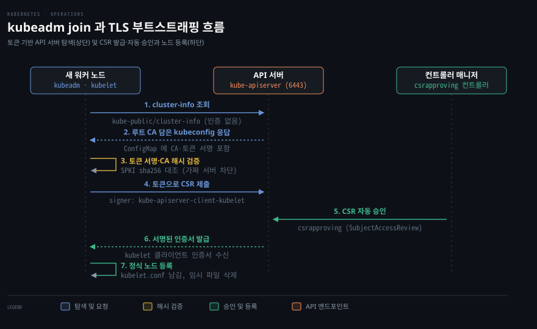
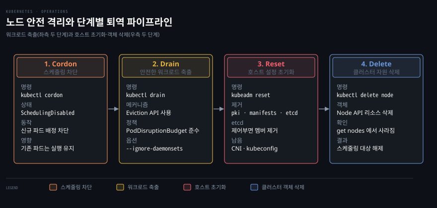

# 노드 추가와 제거

---

> 새 노드는 부트스트랩 토큰과 CA 해시로 서로를 확인한 뒤 합류합니다. 퇴역 노드는 축출과 호스트 초기화를 거쳐 클러스터에서 지우고, 컨트롤 플레인 노드라면 etcd 멤버도 함께 뺍니다.

## 학습 목표

> 이 문서를 읽고 나면 노드의 안전한 합류와 격리·퇴역 절차를 설명하고 실행할 수 있습니다.

1. 부트스트랩 토큰 규격과 CA 인증서 해시가 상호 검증에서 각각 무엇을 보증하는지 설명할 수 있습니다.
2. kubelet 이 join 이후 CSR 을 발행하고 클라이언트 인증서를 발급받는 TLS 부트스트래핑 흐름을 설명할 수 있습니다.
3. `cordon` → `drain` → `reset` → `delete` 의 4단계 퇴역 순서와 주요 플래그의 역할을 설명할 수 있습니다.
4. 컨트롤 플레인 노드 추가 시 certificate-key 의 동작과, 노드 제거 시 etcd 멤버십을 함께 정리해야 하는 이유를 설명할 수 있습니다.

다루지 않는 범위가 있습니다. 부트스트랩 유틸리티와 토큰 기반 노드 조인의 배경 개념은 [Deployment Models — 배포 모델과 고가용성 인프라 구축](../../../book/production-kubernetes/02-01.Deployment%20Models%20—%20배포%20모델과%20고가용성%20인프라%20구축.md)이 설명합니다. 클러스터 업그레이드 과정의 drain 과 uncordon 적용은 [클러스터 업그레이드와 ETCD 백업·복구](클러스터%20업그레이드·ETCD%20백업·복구.md)가 맡습니다. etcd 정족수와 상태 판독은 [etcd 헬스와 유지보수](etcd%20%ED%97%AC%EC%8A%A4%C2%B7%EC%9C%A0%EC%A7%80%EB%B3%B4%EC%88%98.md)가 다룹니다. kubelet 의 API 서버 등록 원리는 [노드와 클러스터의 소속](../architecture/노드·클러스터%20소속.md)에 있고 노드 압박과 Pod 축출 일반은 [노드 압박 축출과 디스크 관리](../scheduling/노드%20압박%20축출·디스크%20관리.md)에 있습니다. PKI 구조와 TLS 인증서 관리는 [TLS와 API 접근 보안](../api/TLS·API%20접근%20보안.md)이 다룹니다.

이 문서의 명령 출력은 kind v0.31.0 클러스터(노드 v1.35.0, 컨트롤 플레인 1대와 워커 1대)에서 2026-11-15 에 잰 것입니다. kind 노드는 컨테이너라서 `sudo` 대신 `docker exec <노드 컨테이너>` 로 같은 명령을 돌렸습니다. 토큰과 해시 값은 `<token>`·`<hash>` 로 바꿔 실었습니다.


## 1. 상호 신뢰와 합류 문제

> 새 머신이 클러스터에 붙을 때는 머신이 API 서버를 믿는 검증과 API 서버가 머신을 승인하는 검증이 둘 다 성립해야 합니다.

클러스터에 새 서버를 연결할 때 IP 등록 방식만으로는 두 가지 위협을 막지 못합니다. 첫째 위협에서는 승인되지 않은 임의의 머신이 클러스터 엔드포인트에 접속해 워크로드를 할당받습니다. 둘째는 정반대의 위협인 중간자 공격(MITM)입니다. 새로 투입된 워커 노드가 공격자가 위조한 가짜 API 서버에 접속해 인증 토큰과 설정 데이터를 넘겨줍니다.

이 두 위협을 방어하려면 노드와 컨트롤 플레인 사이에 **양방향 신뢰**(bidirectional trust)가 수립되어야 합니다.[^join] kubeadm 은 이 일을 두 단계로 나눕니다. 노드가 제어부를 믿게 하는 단계가 discovery 이고 제어부가 노드를 믿게 하는 단계가 TLS bootstrap 입니다.[^join]

고정 비밀번호나 정적 인증서를 모든 머신에 미리 배포하는 방식은 노드 확장 때마다 유출 범위를 넓힙니다. 쿠버네티스는 이를 해결하기 위해 수명이 제한된 **부트스트랩 토큰**을 씁니다. 여기에 컨트롤 플레인 신원을 확정하는 CA 인증서 해시와 TLS 부트스트래핑을 결합했습니다.


## 2. 부트스트랩 토큰과 TLS 검증

> kubeadm 은 부트스트랩 토큰과 CA 해시로 상호 검증을 마치고 kubelet 에 고유 인증서를 발급합니다.

보안 인증서가 없는 새 머신을 클러스터에 바로 붙이려고 하면 신원 위조와 중간자 공격에 노출됩니다. 이 위험을 막으면서 안전하게 조인시키는 전체 메시지 흐름은 아래와 같습니다.



흐름은 워커 노드가 `kube-public` 의 `cluster-info` 를 읽어 CA 해시를 대조하는 데서 시작합니다. 이어 임시 토큰으로 CSR 을 요청하고 컨트롤러 매니저의 자동 승인을 받아 정식 클라이언트 인증서를 얻습니다.

### 부트스트랩 토큰의 규격과 관리

부트스트랩 토큰은 소문자와 숫자로 구성된 두 영역이 점(`.`)으로 연결된 문자열입니다.[^token] 형식은 `[a-z0-9]{6}\.[a-z0-9]{16}` 정규식을 따릅니다. 앞의 6자리는 공개 식별자인 **토큰 ID**입니다. 뒤의 16자리는 인증에 쓰이는 **토큰 시크릿**입니다.[^bootstraptoken]

토큰은 `kube-system` 네임스페이스 안에 `bootstrap.kubernetes.io/token` 타입의 Secret 으로 보관됩니다.[^btsecret] kind 실측에서도 `bootstrap-token-<토큰 ID>` 이름의 Secret 이 이 타입으로 보였습니다. `kubeadm token create` 의 `--ttl` 기본값은 `24h0m0s` 입니다.[^token] `kubeadm init` 이 만드는 기본 토큰도 24시간짜리라서 시간이 지나면 만료되어 더는 조인에 쓸 수 없습니다.

```bash
# 현재 클러스터에 활성화된 부트스트랩 토큰 목록을 확인합니다
sudo kubeadm token list

# 유효 기간이 만료되었을 때 조인 명령 전체를 새로 출력합니다
sudo kubeadm token create --print-join-command
```

kind 에서 두 명령을 돌린 출력입니다. 첫 블록이 `token list`, 둘째 블록이 `token create --print-join-command` 입니다.

```bash
TOKEN     TTL   EXPIRES                USAGES                   DESCRIPTION   EXTRA GROUPS
<token>   23h   2026-11-16T09:39:01Z   authentication,signing   <none>        system:bootstrappers:kubeadm:default-node-token
```

```bash
kubeadm join vp1-0305-control-plane:6443 --token <token> --discovery-token-ca-cert-hash sha256:<hash>
```

출력되는 명령어는 API 서버 주소와 포트, `--token` 인자, 그리고 루트 CA 인증서 해시 인자를 포함합니다. 토큰의 EXTRA GROUPS 칸에는 `system:bootstrappers:kubeadm:default-node-token` 그룹이 보입니다. 뒤의 CSR 자동 승인에서 권한을 받는 주체가 이 그룹입니다.

### CA 인증서 해시와 위조 방지

`kubeadm join` 명령에 전달되는 `--discovery-token-ca-cert-hash` 인자는 `sha256:<64자리 16진수>` 형식입니다. 클러스터 루트 CA 인증서의 공개키 정보(Subject Public Key Info, SPKI) 바이트를 SHA-256 으로 계산한 값입니다.[^cahash] kind 에서 `ca.crt` 공개키를 `openssl` 로 직접 해시해 보니 `--print-join-command` 의 해시와 같았습니다.

새 노드는 인증 없이 읽을 수 있는 `kube-public` 네임스페이스의 `cluster-info` ConfigMap 을 먼저 내려받습니다.[^clusterinfo] 이 ConfigMap 안에는 클러스터의 루트 CA 인증서가 들어 있습니다. kubeadm 은 토큰으로 이 데이터의 진위를 확인하고, 내려받은 루트 CA 공개키가 인자로 받은 해시와 맞는지도 대조합니다.[^discovery]

해시가 일치하지 않으면 노드는 이 단계에서 join 을 멈춥니다. 네트워크 경로에 위치한 공격자가 가짜 API 서버를 세워 두더라도 새 노드는 그 서버의 CA 를 믿지 않습니다. kind 워커에서 해시 자리를 0 으로 채워 join 하면 아래처럼 preflight 단계에서 끝납니다.

```bash
error: error execution phase preflight: couldn't validate the identity of the API Server: cluster CA found in cluster-info ConfigMap is invalid: none of the public keys "sha256:<hash>" are pinned
```

### TLS 부트스트랩과 인증서 발급

상호 검증을 통과한 워커 노드는 아직 영구 인증서가 없습니다. 그래서 kubeadm 은 토큰을 담은 임시 kubeconfig 인 `/etc/kubernetes/bootstrap-kubelet.conf` 를 디스크에 씁니다. kubelet 은 이 파일로 API 서버와 통신을 시작합니다.[^impl]

kubelet 은 CSR 을 만들어 API 서버에 제출합니다. 이때 CSR 의 서명 요청 대상(`signerName`)은 `kubernetes.io/kube-apiserver-client-kubelet` 입니다.[^tlsbootstrap]

`kube-controller-manager` 안에서 동작하는 **`csrapproving`** 컨트롤러가 이 CSR 을 처리합니다. 이 컨트롤러는 SubjectAccessReview API 로 요청한 사용자에게 CSR 권한이 있는지 묻고 그 결과에 따라 승인합니다.[^csrapproving] kubeadm 은 앞의 토큰 그룹에 이 권한을 미리 묶어 둡니다. 그래서 워커의 첫 CSR 은 사람 손을 거치지 않고 승인됩니다.

```bash
# 보류 중이거나 자동 승인된 노드 인증서 요청 목록을 조회합니다
kubectl get csr
```

아래는 kind 클러스터를 만든 직후의 출력입니다. 워커의 요청 주체는 토큰 ID 로 인증한 `system:bootstrap:<token-id>` 이고 상태는 이미 `Approved,Issued` 입니다.

```bash
NAME        AGE    SIGNERNAME                                    REQUESTOR                            REQUESTEDDURATION   CONDITION
csr-9nn4k   100s   kubernetes.io/kube-apiserver-client-kubelet   system:bootstrap:<token-id>          <none>              Approved,Issued
csr-j2jzf   109s   kubernetes.io/kube-apiserver-client-kubelet   system:node:vp1-0305-control-plane   <none>              Approved,Issued
```

승인이 끝나면 kubeadm 은 `ca.crt` 와 정식 `kubelet.conf` 를 남기고 `bootstrap-kubelet.conf` 를 지웁니다.[^impl] kind 워커에서도 `/etc/kubernetes` 에는 `kubelet.conf`·`manifests`·`pki` 만 남아 있었습니다. `kubelet.conf` 는 `/var/lib/kubelet/pki/kubelet-client-current.pem` 을 클라이언트 인증서로 가리킵니다. 이후 kubelet 은 이 인증서로 API 서버에 접속해 Node 객체로 등록됩니다.

### 컨트롤 플레인 노드 확장

고가용성(HA) 구성을 위해 컨트롤 플레인 노드를 추가할 때는 워커 노드보다 자격증명이 더 필요합니다. 새 컨트롤 플레인이 기존 노드와 같은 CA 로 자기 인증서를 만들려면 클러스터 CA 키 같은 비밀 자료를 넘겨받아야 하기 때문입니다.

kubeadm 은 이 자료를 넘기는 **`upload-certs`** 단계를 지원합니다.[^uploadcerts] 기존 컨트롤 플레인 노드가 인증서를 암호화해 `kubeadm-certs` Secret 에 임시로 올립니다.[^uploadcerts]

```bash
# 제어부 인증서를 암호화해 업로드하고 복호화 키를 출력합니다
sudo kubeadm init phase upload-certs --upload-certs
```

kind 컨트롤 플레인에서 돌린 출력입니다. 첫 줄의 버전 조회 로그는 뺐고 키 값은 `<certificate-key>` 로 바꿨습니다.

```bash
[upload-certs] Storing the certificates in Secret "kubeadm-certs" in the "kube-system" Namespace
[upload-certs] Using certificate key:
<certificate-key>
```

올라간 Secret 의 키 목록은 `ca.crt`·`ca.key`·`etcd-ca.crt`·`etcd-ca.key`·`front-proxy-ca.crt`·`front-proxy-ca.key`·`sa.key`·`sa.pub` 였습니다. 개별 컴포넌트 인증서가 아니라 CA 키 쌍과 서비스 어카운트 서명 키입니다.

출력되는 **`--certificate-key`** 는 32바이트 AES 키를 16진수로 쓴 문자열이라 64자입니다.[^uploadcerts] 인증서와 이 키는 기본으로 2시간 뒤 만료됩니다.[^uploadcerts] 공식 HA 안내는 이 키가 클러스터의 민감한 데이터에 접근하게 해 주니 비밀로 지키라고 경고합니다.[^ha] CA 개인 키가 들어 있으니 24시간짜리 토큰보다 짧게 둔 셈입니다.

kind 실측에서 이 2시간은 별도 부트스트랩 토큰으로 구현되어 있었습니다. `kubeadm-certs` Secret 의 소유자로 토큰 하나가 붙었고 만료는 2시간 뒤였습니다. 그 토큰의 설명은 `Proxy for managing TTL for the kubeadm-certs secret` 입니다.

새 컨트롤 플레인 노드는 아래처럼 `--control-plane` 과 `--certificate-key` 인자를 함께 넘겨 합류합니다.[^certkeyjoin]

```bash
# 추가 컨트롤 플레인 노드를 클러스터에 조인합니다
sudo kubeadm join 192.0.2.10:6443 \
    --token <token> \
    --discovery-token-ca-cert-hash sha256:<hash> \
    --control-plane \
    --certificate-key <certificate-key>
```


## 3. 격리와 안전한 노드 퇴역

> 노드를 클러스터에서 뺄 때는 워크로드를 먼저 대피시키고 호스트 설정을 초기화한 뒤 노드 객체를 지웁니다.

가동 중인 노드를 즉시 꺼 버리면 그 위에서 돌던 애플리케이션 연결이 한꺼번에 끊깁니다. 컨트롤 플레인 노드라면 etcd 멤버 하나가 예고 없이 사라집니다. 이 장애를 막으려면 격리와 축출, 초기화, 삭제로 이어지는 4단계를 순서대로 밟아야 합니다. 공식 kubeadm 안내도 먼저 drain 해서 노드를 비우고 그다음 노드 설정을 걷어 내라고 합니다.[^removenode]



4단계는 스케줄링 차단, 워크로드 안전 축출, 로컬 호스트 초기화, API 자원 삭제 순서로 이어집니다. 단계마다 쓰는 명령도 도식에 함께 나옵니다.

### 격리와 워크로드 축출 순서

첫 번째 단계는 노드를 격리하는 `kubectl cordon` 입니다. 이 명령은 노드에 `spec.unschedulable: true` 를 기록해 스케줄러가 새 Pod 를 이 노드에 배정하지 못하게 합니다. 이미 실행 중인 Pod 는 영향을 받지 않습니다.[^cordon] `kubectl get nodes` 의 STATUS 에는 `Ready,SchedulingDisabled` 로 보입니다.

두 번째 단계는 노드 위의 워크로드를 다른 노드로 옮기는 `kubectl drain` 입니다. drain 은 먼저 노드를 unschedulable 로 표시하므로 cordon 을 따로 하지 않아도 됩니다.[^kubectldrain] `drain` 은 단순 Pod 삭제가 아니라 **Eviction API** 를 호출합니다. 그래서 컨테이너가 정상 종료할 시간을 주고 **PodDisruptionBudget**(PDB) 을 지킵니다.[^drain]

```bash
# 데몬셋을 무시하고 임시 볼륨 데이터를 삭제하며 노드를 비웁니다
kubectl drain worker-1 --ignore-daemonsets --delete-emptydir-data
```

플래그 없이 drain 을 돌리면 노드는 cordon 되지만 Pod 는 하나도 축출되지 않고 오류로 끝납니다. 아래는 `emptyDir` 볼륨을 쓰는 Deployment 를 올린 kind 워커에서 본 출력입니다.

```bash
node/vp1-0305-worker cordoned
error: unable to drain node "vp1-0305-worker" due to error: [cannot delete Pods with local storage (use --delete-emptydir-data to override): default/web-687ffb456d-7qxx7, default/web-687ffb456d-vw69f, cannot delete DaemonSet-managed Pods (use --ignore-daemonsets to ignore): kube-system/kindnet-wzhgd, kube-system/kube-proxy-lbmq4], continuing command...
```

오류 문구가 두 플래그를 직접 안내합니다. 각 플래그가 확인하는 것은 다음과 같습니다.

- `--ignore-daemonsets`: DaemonSet Pod 는 drain 이 지우지 않습니다. 지워도 DaemonSet 컨트롤러가 곧바로 같은 노드에 다시 만들기 때문입니다.[^drainds] 이 플래그는 그 Pod 들을 건너뛰고 drain 을 끝내겠다는 표시입니다. kind 에서도 drain 이 끝난 뒤 `kindnet`·`kube-proxy` Pod 는 워커에서 계속 돌았습니다.
- `--delete-emptydir-data`: `emptyDir` 은 노드 로컬 데이터라서 drain 하면 함께 지워집니다.[^kubectldrain] 이 플래그는 그 데이터가 사라져도 진행하겠다는 동의입니다.

두 플래그를 주어도 PDB 를 어기는 축출은 거부됩니다. kind 에서 `minAvailable: 2` 인 PDB 를 걸어 두자 drain 은 5초마다 축출을 다시 시도했습니다. 시도마다 `Cannot evict pod as it would violate the pod's disruption budget.` 가 찍혔습니다. 옮겨 갈 다른 노드가 없어 새 Pod 가 `Pending` 에 머무는 동안 drain 도 끝나지 않았습니다.

### 노드 객체 삭제와 호스트 리셋

워크로드가 비워지면 세 번째 단계로 퇴역 대상 머신에 로그인해 `kubeadm reset` 을 실행합니다. 공식 안내는 노드를 지우기 전에 kubeadm 이 설치한 상태부터 되돌리라고 합니다.[^removenode] `reset` 은 preflight, `remove-etcd-member`, `cleanup-node` 세 단계로 돕니다. kind 워커에서 `kubeadm reset -f` 를 돌린 출력은 아래와 같습니다.

```bash
[preflight] Running pre-flight checks
[reset] Deleted contents of the etcd data directory: /var/lib/etcd
[reset] Stopping the kubelet service
[reset] Unmounting mounted directories in "/var/lib/kubelet"
[reset] Deleting contents of directories: [/etc/kubernetes/manifests /var/lib/kubelet /etc/kubernetes/pki]
[reset] Deleting files: [/etc/kubernetes/admin.conf /etc/kubernetes/super-admin.conf /etc/kubernetes/kubelet.conf /etc/kubernetes/bootstrap-kubelet.conf /etc/kubernetes/controller-manager.conf /etc/kubernetes/scheduler.conf]

The reset process does not perform cleanup of CNI plugin configuration,
network filtering rules and kubeconfig files.
```

reset 은 kubelet 서비스를 멈춥니다. 그다음 정적 Pod 매니페스트와 `/var/lib/kubelet`, `/etc/kubernetes/pki`, kubeconfig 파일들을 지웁니다. 출력 끝의 안내처럼 `kubeadm reset` 은 모든 설정을 지우지는 않습니다. 아래 세 가지는 따로 판단해야 합니다.

- CNI 설정 디렉터리(`/etc/cni/net.d`): reset 이 지우지 않습니다. 이 호스트를 나중에 다른 CNI 를 쓰는 클러스터의 노드로 쓰면 설정이 충돌할 수 있습니다.[^resetcni] kind 워커에서도 reset 뒤 `10-kindnet.conflist` 가 남아 있었습니다.
- kube-proxy 가 만든 `iptables`·`nftables`·IPVS 규칙: reset 이 지우지 않습니다. 공식 문서는 이 규칙을 남겨 두어도 문제가 되지 않는다고 하고, 지우려면 kube-proxy 의 `--cleanup` 플래그를 쓰라고 안내합니다.[^resetrules]
- 로컬 kubeconfig 파일(`$HOME/.kube/config`): reset 이 지우지 않습니다. 컨트롤 플레인 노드라면 클러스터 관리자 자격증명이 담긴 파일이니 손으로 지웁니다.

네 번째 단계로 컨트롤 플레인에서 Node 객체를 지웁니다.[^removenode]

```bash
# 컨트롤 플레인의 노드 목록에서 대상을 완전히 삭제합니다
kubectl delete node worker-1
```

이 명령이 끝나면 `kubectl get nodes` 목록에서 그 노드가 사라지고 스케줄링 대상에서도 빠집니다. kind 에서는 이렇게 지운 워커 컨테이너에서 `--print-join-command` 로 받은 명령을 다시 실행하자 같은 이름으로 재조인했습니다. 이때 `kubectl get csr` 에는 새 토큰 ID 로 인증한 요청이 `Approved,Issued` 로 하나 더 생겼습니다.

### etcd 멤버십 정리와 정족수 보호

퇴역 대상이 컨트롤 플레인 노드라면 **etcd 멤버십 정리**를 빠뜨리면 안 됩니다.

kubeadm 의 기본 구성인 스택형 etcd(stacked etcd)에서는 컨트롤 플레인 노드마다 etcd 멤버가 하나씩 돕니다. etcd 는 Raft 합의를 쓰므로 멤버가 n 개면 정족수(Quorum)는 `(n/2)+1` 입니다.[^etcdfaq] 나눗셈은 정수 나눗셈이라 3대면 2, 2대면 2입니다.

3대짜리 제어부에서 한 대가 고장 났는데 멤버를 빼지 않았다고 합시다. etcd 는 죽은 멤버를 여전히 멤버 수에 넣으므로 정족수는 2이고, 살아 있는 2대 중 한 대만 더 멈춰도 쓰기가 멈춥니다. 고장 나고 제거되지 않은 멤버는 정족수에 나쁜 영향을 주고 추가 장애를 견디는 폭을 줄입니다.[^etcdreplace]

이 상태에서 죽은 멤버만 빼면 멤버가 2대가 되어 정족수는 여전히 2입니다. 제거만으로 추가 장애를 견디는 폭이 늘지는 않습니다. 그 폭은 교체 노드가 들어와 다시 3대가 되어야 1로 돌아옵니다. 그래도 제거를 먼저 하는 이유는 교체 순서에 있습니다. 죽은 멤버를 둔 채 새 컨트롤 플레인을 join 하면 멤버가 4대, 정족수가 3이 됩니다. 이때 새 멤버가 주소 설정 오류 같은 이유로 등록에 실패하면 살아 있는 멤버가 2대뿐이라 정족수를 영구히 잃습니다.[^etcdadd]

`kubeadm reset` 은 이 정리를 **`remove-etcd-member`** 단계로 내장하고 있습니다. 컨트롤 플레인 노드에서 reset 을 돌리면 이 노드의 로컬 스택형 etcd 멤버를 etcd 클러스터에서 뺍니다.[^reset]

```bash
# reset 단계 중 etcd 멤버 탈퇴 단계만 단독으로 수행할 때 사용합니다
sudo kubeadm reset phase remove-etcd-member
```

해당 노드의 하드웨어가 완전히 고장 나 머신에 접속할 수 없다면 reset 을 돌릴 수 없습니다. 이때는 살아 있는 다른 컨트롤 플레인 노드에서 `etcdctl member list` 로 죽은 멤버의 ID 를 찾습니다. 그 ID 를 `etcdctl member remove <member-id>` 로 직접 뺍니다. 교체 노드는 그다음에 join 합니다.[^etcdadd]


## 4. 노드 추가와 제거의 제약

> 워커 노드와 컨트롤 플레인 노드는 다루는 자격증명과 퇴역 영향이 다르고, kind 같은 로컬 환경에서는 그중 일부만 재현됩니다.

### 노드 유형별 퇴역 동작 비교

워커 노드와 컨트롤 플레인 노드는 추가하고 제거할 때 다루는 컴포넌트도, 잘못됐을 때 생기는 영향도 다릅니다.

| 비교 기준 | 워커 노드 | 컨트롤 플레인 노드 |
|---|---|---|
| 추가 시 필요 인자 | `--token`, `--discovery-token-ca-cert-hash` | 추가로 `--control-plane`, `--certificate-key` 필요 |
| 인증서 배포 방식 | TLS 부트스트래핑으로 자체 발급 | `kubeadm-certs` Secret 에서 CA 키 복호화 후 자체 발급 |
| 자격증명 유효 시간 | 기본 토큰 24시간 | `kubeadm-certs` 와 certificate-key 2시간 |
| 퇴역 시 핵심 영향 | 사용자 워크로드 축출 (PDB 준수) | etcd 정족수(Quorum) 유지 및 멤버십 제거 |
| reset 정리 범위 | kubelet, manifests 디렉터리 | kubelet, manifests 디렉터리 및 etcd 로컬 데이터 |
| 수동 잔재 정리 | CNI 설정(`/etc/cni/net.d`), 필요하면 kube-proxy 규칙 | CNI 설정, kubeconfig, etcd 잔여 멤버 점검 |

컨트롤 플레인 노드는 단순 워크로드 분산 대상이 아니라 합의체 구성원입니다. 그래서 추가할 때는 인증서 수명을, 제거할 때는 etcd 멤버십 처리를 챙겨야 시스템 안정성이 지켜집니다.

### 로컬 가상 환경에서의 검증 한계

kind(Kubernetes in Docker)는 노드 하나를 Docker 컨테이너 하나로 띄우고 그 안에서 kubeadm 으로 클러스터를 만듭니다. 그래서 워커 쪽 절차는 꽤 많이 재현됩니다. 이 문서의 실측에서는 토큰 발급과 CSR 자동 승인, 잘못된 CA 해시의 join 거부를 확인했습니다. drain 의 플래그와 PDB 거부, 워커의 `kubeadm reset`, 노드 삭제 뒤 재조인도 확인했습니다.

컨테이너라서 그대로 볼 수 없는 것도 있습니다. 워커 컨테이너의 reset 은 호스트가 아니라 컨테이너 안의 파일만 지웁니다. kube-proxy 규칙과 CNI 잔재가 실제 호스트 네트워크에 주는 영향은 VM 이나 물리 서버에서 봐야 합니다. 컨트롤 플레인을 추가하는 join 과 etcd 멤버 제거는 컨트롤 플레인이 여러 대인 클러스터가 있어야 확인할 수 있습니다.


## 5. 점검 질문

> 실무 운영 상황에서 노드 추가와 제거 시 마주치는 의사결정을 점검합니다.

### Q1. 조인 명령 재발급 방법

클러스터를 구성한 지 이틀이 지난 뒤 새 워커 노드를 추가하려고 합니다. `kubeadm init` 당시 출력된 join 명령을 그대로 실행하면 토큰이 만료되어 join 이 실패합니다. 컨트롤 플레인에서 유효한 조인 명령을 다시 얻으려면 어떻게 해야 합니까?

### Q2. drain 플래그의 목적

실행 중인 노드를 정비하기 위해 플래그 없이 `kubectl drain` 을 실행했습니다. 노드는 cordon 되었지만 Pod 는 하나도 축출되지 않고 오류로 끝났습니다. 오류가 안내하는 `--ignore-daemonsets` 와 `--delete-emptydir-data` 플래그는 각각 무엇을 확인하기 위한 것입니까?

### Q3. etcd 멤버 미정리 시 위험

3대의 컨트롤 플레인 노드 중 1대를 교체하기 위해 `kubectl delete node` 로 노드 자원을 지우고 장비 전원을 내렸습니다. 그러나 etcd 멤버를 탈퇴시키지 않았습니다. 이 상태로 교체 노드를 join 하면 어떤 위험이 생깁니까?


## 정답 (자답 후 펼치기)

> 위 세 점검 질문에 먼저 자답한 뒤 확인합니다.

### 정답 1 — 조인 명령 재발급

기본 부트스트랩 토큰의 유효 기간은 24시간이므로 만료된 토큰으로는 조인할 수 없습니다. 컨트롤 플레인 노드에서 `kubeadm token create --print-join-command` 를 실행합니다. 이 명령은 새 24시간 토큰을 만들고 현재 클러스터 루트 CA 의 SPKI SHA-256 해시를 붙여 바로 실행할 수 있는 `kubeadm join` 명령줄을 출력합니다.

### 정답 2 — drain 플래그의 목적

`--ignore-daemonsets` 는 DaemonSet 이 관리하는 Pod 를 축출 대상에서 빼고 drain 을 끝내겠다는 표시입니다. DaemonSet Pod 는 지워도 컨트롤러가 같은 노드에 곧바로 다시 만들기 때문에 drain 은 처음부터 이 Pod 들을 지우지 않습니다. 관리자가 이를 알고 건너뛰겠다고 밝히지 않으면 drain 이 진행되지 않습니다.

`--delete-emptydir-data` 는 Pod 가 쓰던 `emptyDir` 노드 로컬 데이터가 drain 과 함께 사라진다는 것을 관리자가 확인하고 동의했다는 표시입니다.

### 정답 3 — etcd 정족수 보존

etcd 는 멤버 n 개 중 과반수(`(n/2)+1`)의 동의를 요구합니다. 노드 객체를 지워도 etcd 멤버십에 남아 있으면 멤버 수는 여전히 3이고 정족수는 2입니다. 살아 있는 2대 중 한 대만 더 멈춰도 쓰기가 멈춥니다.

이 상태에서 교체 노드를 join 하면 멤버가 4대, 정족수가 3이 됩니다. 새 멤버가 등록에 실패하면 살아 있는 멤버가 2대뿐이라 정족수를 영구히 잃습니다. 그래서 컨트롤 플레인 노드를 뺄 때는 `kubeadm reset` 의 `remove-etcd-member` 를 돌리거나, 남은 노드에서 `etcdctl member remove` 로 죽은 멤버를 먼저 뺀 뒤 교체 노드를 join 합니다.


## 관련 문서

> 노드 생명주기와 연계되는 클러스터 운영 및 보안 문서입니다.

- [클러스터 업그레이드와 ETCD 백업·복구](클러스터%20업그레이드·ETCD%20백업·복구.md) — 노드별 drain 과 kubelet 업그레이드 및 uncordon 반복 절차
- [etcd 헬스와 유지보수](etcd%20%ED%97%AC%EC%8A%A4%C2%B7%EC%9C%A0%EC%A7%80%EB%B3%B4%EC%88%98.md) — etcd 정족수 판독과 Raft 합의 상태 진단
- [노드와 클러스터의 소속](../architecture/노드·클러스터%20소속.md) — kubelet 이 API 서버에 Node 객체로 등록되는 원리
- [노드 압박 축출과 디스크 관리](../scheduling/노드%20압박%20축출·디스크%20관리.md) — Eviction API 와 kubelet 리소스 부족 축출의 차이
- [TLS와 API 접근 보안](../api/TLS·API%20접근%20보안.md) — 클러스터 PKI 체계와 인증서 수명 관리
- [Deployment Models — 배포 모델과 고가용성 인프라 구축](../../../book/production-kubernetes/02-01.Deployment%20Models%20—%20배포%20모델과%20고가용성%20인프라%20구축.md) — 부트스트랩 토큰과 정적 파드 기반 컨트롤 플레인의 기초 개념


## 참고 자료

[^join]: Kubernetes — kubeadm join. "When joining a kubeadm initialized cluster, we need to establish bidirectional trust. This is split into discovery (having the Node trust the Kubernetes Control Plane) and TLS bootstrap (having the Kubernetes Control Plane trust the Node)." <https://kubernetes.io/docs/reference/setup-tools/kubeadm/kubeadm-join/> (2026-11-15 조회)

[^cahash]: Kubernetes — kubeadm join. "The hash is calculated over the bytes of the Subject Public Key Info (SPKI) object (as in RFC7469)." <https://kubernetes.io/docs/reference/setup-tools/kubeadm/kubeadm-join/> (2026-11-15 조회)

[^clusterinfo]: Kubernetes — kubeadm join. "In order to achieve the joining flow using the token as the only piece of validation information, a ConfigMap with some data needed for validation of the control-plane node's identity is exposed publicly by default." <https://kubernetes.io/docs/reference/setup-tools/kubeadm/kubeadm-join/> (2026-11-15 조회)

[^discovery]: Kubernetes — kubeadm join. "In this mode, kubeadm downloads the cluster configuration (including root CA) and validates it using the token as well as validating that the root CA public key matches the provided hash and that the API server certificate is valid under the root CA." <https://kubernetes.io/docs/reference/setup-tools/kubeadm/kubeadm-join/> (2026-11-15 조회)

[^token]: Kubernetes — kubeadm token. "This should be a securely generated random token of the form "[a-z0-9]{6}.[a-z0-9]{16}"." 같은 쪽 `--ttl` 설명(기본값 `24h0m0s`): "The duration before the token is automatically deleted (e.g. 1s, 2m, 3h)." <https://kubernetes.io/docs/reference/setup-tools/kubeadm/kubeadm-token/> (2026-11-15 조회)

[^bootstraptoken]: Kubernetes — Authenticating with Bootstrap Tokens. "It is used when referring to a token without leaking the secret part used for authentication." <https://kubernetes.io/docs/reference/access-authn-authz/bootstrap-tokens/> (2026-11-15 조회)

[^btsecret]: Kubernetes — Authenticating with Bootstrap Tokens. "It must also exist in the kube-system namespace." <https://kubernetes.io/docs/reference/access-authn-authz/bootstrap-tokens/> (2026-11-15 조회)

[^impl]: Kubernetes — Implementation details. "The request is then automatically approved and the operation completes saving ca.crt file and kubelet.conf file to be used by the kubelet for joining the cluster, while bootstrap-kubelet.conf is deleted." <https://kubernetes.io/docs/reference/setup-tools/kubeadm/implementation-details/> (2026-11-15 조회)

[^tlsbootstrap]: Kubernetes — TLS bootstrapping. "kubelet creates a CSR for itself with the signerName set to kubernetes.io/kube-apiserver-client-kubelet" <https://kubernetes.io/docs/reference/access-authn-authz/kubelet-tls-bootstrapping/> (2026-11-15 조회)

[^csrapproving]: Kubernetes — TLS bootstrapping. "The controller uses the SubjectAccessReview API to determine if a given user is authorized to request a CSR, then approves based on the authorization outcome." <https://kubernetes.io/docs/reference/access-authn-authz/kubelet-tls-bootstrapping/> (2026-11-15 조회)

[^uploadcerts]: Kubernetes — kubeadm init phase. "By default the certs and encryption key expire after two hours." 같은 절의 `--certificate-key` 설명: "The certificate key is a hex encoded string that is an AES key of size 32 bytes." <https://kubernetes.io/docs/reference/setup-tools/kubeadm/kubeadm-init-phase/> (2026-11-15 조회)

[^ha]: Kubernetes — Creating Highly Available Clusters with kubeadm. "Please note that the certificate-key gives access to cluster sensitive data, keep it secret!" <https://kubernetes.io/docs/setup/production-environment/tools/kubeadm/high-availability/> (2026-11-15 조회)

[^certkeyjoin]: Kubernetes — kubeadm init. "The same key can be used to download the certificates when additional control plane nodes are joining, by passing --control-plane and --certificate-key to kubeadm join" <https://kubernetes.io/docs/reference/setup-tools/kubeadm/kubeadm-init/> (2026-11-15 조회)

[^cordon]: Kubernetes — Nodes. "Marking a node as unschedulable prevents the scheduler from placing new pods onto that Node but does not affect existing Pods on the Node." <https://kubernetes.io/docs/concepts/architecture/nodes/> (2026-11-15 조회)

[^kubectldrain]: Kubernetes — kubectl drain. "The given node will be marked unschedulable to prevent new pods from arriving." 같은 쪽의 `--delete-emptydir-data` 설명: "Continue even if there are pods using emptyDir (local data that will be deleted when the node is drained)." <https://kubernetes.io/docs/reference/kubectl/generated/kubectl_drain/> (2026-11-15 조회)

[^drain]: Kubernetes — Safely Drain a Node. "Safe evictions allow the pod's containers to gracefully terminate and will respect the PodDisruptionBudgets you have specified." <https://kubernetes.io/docs/tasks/administer-cluster/safely-drain-node/> (2026-11-15 조회)

[^drainds]: Kubernetes — Safely Drain a Node. "The kubectl drain subcommand on its own does not actually drain a node of its DaemonSet pods: the DaemonSet controller (part of the control plane) immediately replaces missing Pods with new equivalent Pods." <https://kubernetes.io/docs/tasks/administer-cluster/safely-drain-node/> (2026-11-15 조회)

[^removenode]: Kubernetes — Creating a cluster with kubeadm. "you should first drain the node and make sure that the node is empty, then deconfigure the node." 같은 절의 다음 단계: "Before removing the node, reset the state installed by kubeadm" <https://kubernetes.io/docs/setup/production-environment/tools/kubeadm/create-cluster-kubeadm/> (2026-11-15 조회)

[^reset]: Kubernetes — kubeadm reset. "For control-plane nodes reset also removes the local stacked etcd member of this node from the etcd cluster." <https://kubernetes.io/docs/reference/setup-tools/kubeadm/kubeadm-reset/> (2026-11-15 조회)

[^resetcni]: Kubernetes — kubeadm reset. "Leaving the configuration of a CNI plugin on a host can be problematic if the same host is later used as a new Kubernetes node and a different CNI plugin happens to be deployed in that cluster." <https://kubernetes.io/docs/reference/setup-tools/kubeadm/kubeadm-reset/> (2026-11-15 조회)

[^resetrules]: Kubernetes — kubeadm reset. "Leaving the rules without cleanup should not cause any issues if the host is later reused as a Kubernetes node or if it will serve a different purpose." <https://kubernetes.io/docs/reference/setup-tools/kubeadm/kubeadm-reset/> (2026-11-15 조회)

[^etcdfaq]: etcd — FAQ. "For a cluster with n members, quorum is (n/2)+1." <https://etcd.io/docs/v3.6/faq/> (2026-11-15 조회)

[^etcdreplace]: etcd — Runtime reconfiguration. "Machines that have failed but haven’t been removed adversely affect the quorum and reduce the tolerance for an additional failure." <https://etcd.io/docs/v3.6/op-guide/runtime-configuration/> (2026-11-15 조회)

[^etcdadd]: etcd — FAQ. "If the cluster is in a state where it can’t tolerate any more failures, adding a node before removing nodes is dangerous because if the new node fails to register with the cluster (e.g., the address is misconfigured), quorum will be permanently lost." <https://etcd.io/docs/v3.6/faq/> (2026-11-15 조회)
