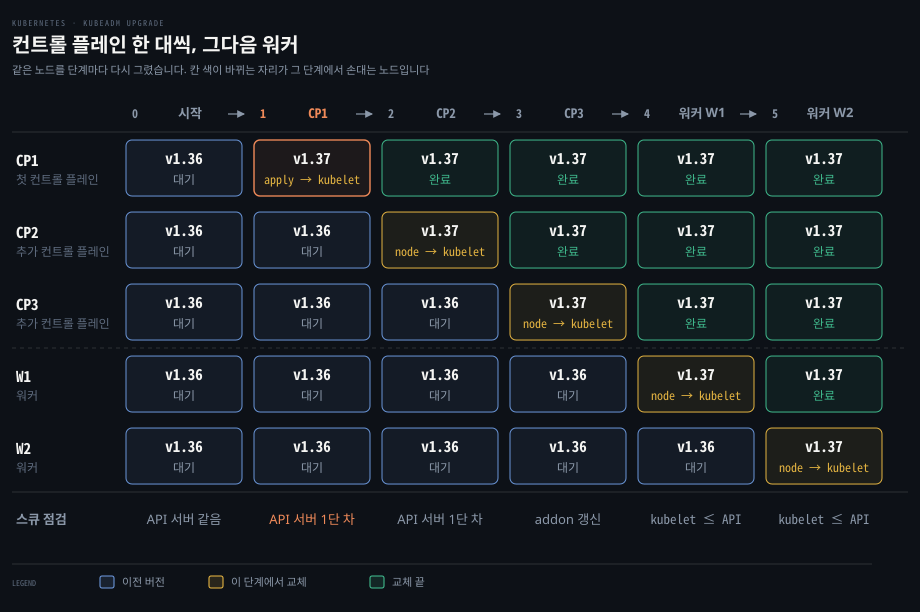
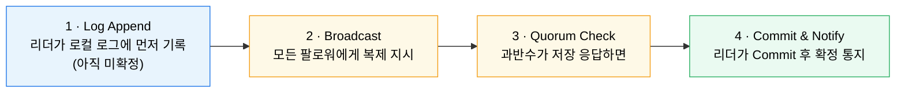
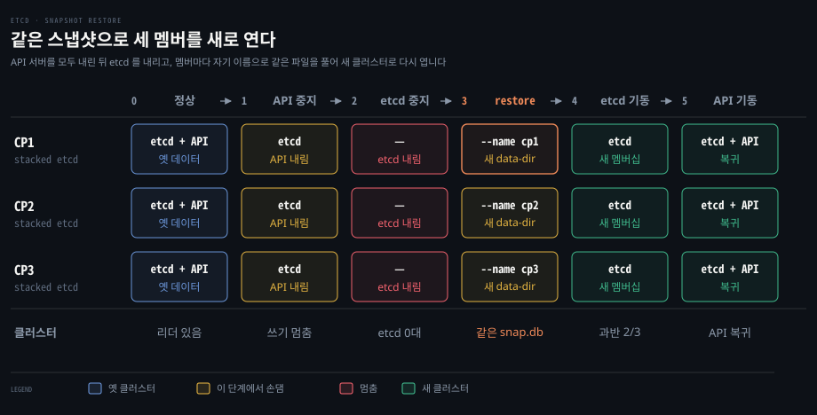

# 클러스터 업그레이드와 ETCD 백업·복구

---

> 운영에서 가장 위험한 두 작업은 업그레이드와 복구입니다. 업그레이드는 버전 스큐를 지키는 순서의 문제이고, 복구는 스냅샷 하나로 etcd 멤버십을 새로 세우는 문제입니다.

두 작업 사이에 etcd 가 일관성을 지키는 방식인 Raft 합의를 둡니다. 복구 절차가 왜 그런 모양인지가 이 방식에서 나옵니다. 셋 다 평소에는 거의 건드리지 않다가 사고가 나야 처음 해 보기 쉬운 작업입니다. 절차를 손에 익혀 두어야 가용성을 지킬 수 있습니다.

## 학습 목표

> 자주 하지 않는 작업일수록 절차를 외우는 대신 "왜 이 순서인가" 를 이해해 둡니다.

이 장을 끝내면 다음에 답할 수 있습니다.

1. kubeadm 클러스터 업그레이드의 단계 순서를 컨트롤 플레인 → 워커 순으로 설명할 수 있습니다.
2. minor 버전 스킵이 왜 막혀 있는지, 버전 스큐 정책이 컴포넌트마다 무엇을 허용하는지 설명할 수 있습니다.
3. etcd 가 Raft 합의로 강한 일관성을 얻는 방식과, 과반수(Quorum)가 왜 필요한지 설명할 수 있습니다.
4. etcd 스냅샷 복구의 흐름을 정적 Pod 매니페스트를 옮기는 이유와 revision 을 올리는 이유까지 설명할 수 있습니다.
5. 컨트롤 플레인이 여러 대일 때 스냅샷 하나로 멤버마다 무엇을 다르게 넣어 복구하는지 설명할 수 있습니다.


## 사전 지식

> 이 장은 다음을 안다고 가정합니다.

1. kubeadm 으로 클러스터를 구성하거나 조인해 본 경험이 있습니다.
2. 정적 Pod(static Pod)가 `/etc/kubernetes/manifests/` 의 매니페스트로 kubelet 이 직접 띄우는 Pod 라는 점을 압니다.
3. `kubectl drain`·`cordon`·`uncordon` 의 의미를 한 줄로 설명할 수 있습니다.


## 1. kubeadm 업그레이드 원칙

> 업그레이드는 "한 번에 최신으로" 가 아니라 지원되는 순서를 한 단계씩 밟아 가는 작업입니다.

v1.35 클러스터를 지금 최신인 v1.37 로 올린다고 합시다. 2026-11-16 기준 안정판은 v1.37.2 입니다.[^stable] 두 칸을 한 번에 올리고 싶어지지만 kubeadm 은 minor 버전을 건너뛰는 업그레이드를 지원하지 않습니다.[^upgrade] `1.35 → 1.36 → 1.37` 처럼 한 칸씩 올려야 합니다.

### 버전 스큐 정책

이 제약의 근거가 버전 스큐 정책(version skew policy)입니다. 버전 스큐는 한 클러스터 안 컴포넌트끼리의 버전 차이입니다. 정책은 컴포넌트마다 kube-apiserver 를 기준으로 허용 범위를 정합니다.[^skew]

| 컴포넌트 | kube-apiserver 대비 허용 범위 |
|---|---|
| 다른 kube-apiserver (HA) | 가장 새 것과 가장 옛 것이 minor 1 이내 |
| kube-controller-manager·kube-scheduler | 같거나 minor 1 낮음. 높으면 안 됨 |
| kubelet | 높으면 안 됨. minor 3 까지 낮음 |
| kube-proxy | 높으면 안 됨. minor 3 까지 낮음 |
| kubectl | minor 1 높거나 낮음 |

표의 기준이 늘 kube-apiserver 이므로 업그레이드도 API 서버부터 올립니다. kubelet 이 API 서버보다 새 버전이 되는 순간이 없어야 하기 때문입니다. HA 클러스터에서는 API 서버끼리도 minor 1 이내여야 합니다. 컨트롤 플레인을 한 대씩 올리는 동안 옛 버전과 새 버전이 한 칸 차이로 함께 돕니다.

kube-apiserver 는 인스턴스가 하나뿐인 클러스터에서도 minor 를 건너뛰면 안 됩니다. API 폐기 정책과 API 변경 지침이 이를 요구합니다.[^skew] kubelet 의 minor 업그레이드는 노드를 비운 뒤에만 합니다. 정책이 노드를 비우지 않은 채 kubelet 의 minor 만 바꾸는 in-place 업그레이드를 지원하지 않기 때문입니다.[^skew] kubelet 을 API 서버보다 세 칸 뒤에 둔 채 운영하면, 다음 컨트롤 플레인 업그레이드 전에 kubelet 부터 올려야 합니다.[^skew]

### 전체 흐름

공식 절차는 세 덩어리입니다. 첫 컨트롤 플레인, 나머지 컨트롤 플레인, 워커 순서입니다.[^upgrade] 아래 그림은 컨트롤 플레인 세 대와 워커 두 대를 v1.36 에서 v1.37 로 올리는 동안 노드별 버전이 어떻게 바뀌는지 보입니다.



1번 열에서는 CP1 만 v1.37 이 되고 나머지 API 서버는 v1.36 에 남습니다. 이때 API 서버 사이가 minor 1 차이라 스큐 정책 안에 있습니다. CoreDNS·kube-proxy 같은 addon 은 v1.28 부터 마지막 컨트롤 플레인이 올라간 뒤에 갱신됩니다.[^upgrade] 그 전에는 `apply` 가 다른 컨트롤 플레인을 기다리지 않고 addon 을 먼저 바꿔 호환 문제가 날 수 있었습니다. 워커는 맨 마지막입니다. 한 대씩, 또는 워크로드에 필요한 최소 용량을 해치지 않는 몇 대씩 올립니다.[^upgrade]

### 1-1. 패키지 저장소와 kubeadm

커뮤니티 패키지 저장소 `pkgs.k8s.io` 는 minor 버전마다 저장소가 따로 있습니다.[^repo] 그래서 minor 를 올릴 때는 패키지를 받기 전에 저장소 주소부터 목표 minor 로 바꿉니다. patch 만 올릴 때는 이 단계가 필요 없습니다.[^repo]

```bash
# 저장소 주소의 minor 를 목표 버전으로 바꾼다 (v1.36 → v1.37)
sudo sed -i 's#/v1.36/#/v1.37/#' /etc/apt/sources.list.d/kubernetes.list

# hold 를 잠시 풀고 목표 버전의 kubeadm 을 설치한 뒤 다시 고정한다
sudo apt-mark unhold kubeadm
sudo apt-get update && sudo apt-get install -y kubeadm='1.37.2-*'
sudo apt-mark hold kubeadm

kubeadm version   # 목표 버전인지 확인
```

설치 문서는 kubelet·kubeadm·kubectl 을 설치한 뒤 `apt-mark hold` 로 버전을 고정하라고 안내합니다.[^install] 공식 절차는 버전을 `1.37.x-*` 꼴로 적습니다.[^upgrade] `-` 뒤는 Debian 패키지 버전의 리비전 자리이고, `*` 는 apt 의 와일드카드라 어떤 리비전이든 고릅니다. 설치할 patch 는 `apt-cache madison kubeadm` 목록에서 고릅니다.[^upgrade]

### 1-2. 계획 확인과 적용

```bash
sudo kubeadm upgrade plan
# 업그레이드할 수 있는지, 올라갈 수 있는 버전, 컴포넌트 설정 버전 상태를 표로 보여 줍니다

# 첫 컨트롤 플레인에서만
sudo kubeadm upgrade apply v1.37.2

# 두 번째 이후 컨트롤 플레인에서는 apply 대신
sudo kubeadm upgrade node
```

`kubeadm upgrade apply` 는 패키지 교체가 아닙니다. 먼저 API 서버에 닿는지, 모든 노드가 `Ready` 인지, 컨트롤 플레인이 건강한지 확인하고 스큐 정책을 강제합니다.[^upgrade] 그다음 컨트롤 플레인 정적 Pod 매니페스트를 새 버전으로 바꾸고, 하나라도 뜨지 않으면 되돌립니다. kubeadm 이 관리하는 인증서도 이때 갱신합니다.[^upgrade]

`kubeadm upgrade node` 는 클러스터에서 `ClusterConfiguration` 을 받습니다. 그 값으로 그 노드의 정적 Pod 매니페스트와 kubelet 설정을 올립니다. 그래서 두 번째 이후 컨트롤 플레인에서는 `plan` 을 다시 돌리지 않습니다. CNI 플러그인은 kubeadm 이 올리지 않으므로 공급자 문서를 따라 따로 올립니다.[^upgrade]

업그레이드가 중간에 끊기면 같은 명령을 다시 돌립니다. `kubeadm upgrade` 는 여러 번 돌려도 결과가 같도록(idempotent) 만들어져 있습니다.[^upgrade] kubeadm 은 업그레이드하면서 그 노드의 etcd 데이터와 매니페스트 사본을 `/etc/kubernetes/tmp/` 에 남깁니다. 자동 롤백까지 실패했을 때 손으로 되돌리는 용도입니다. 디렉터리 이름은 `kubeadm-backup-etcd-*`·`kubeadm-backup-manifests-*` 입니다.[^upgrade]

이 사본은 그 노드 디스크에 있습니다. 다른 곳에 보관하는 스냅샷을 대신하지 못하므로 업그레이드 전 스냅샷(3절)은 따로 남깁니다.

### 1-3. drain 과 kubelet 교체

kubelet 의 minor 업그레이드 전에는 반드시 노드를 drain 합니다. 컨트롤 플레인 노드에도 CoreDNS 같은 중요한 Pod 가 떠 있을 수 있습니다.[^upgrade]

```bash
kubectl drain <node-name> --ignore-daemonsets

sudo apt-mark unhold kubelet kubectl
sudo apt-get update && sudo apt-get install -y kubelet='1.37.2-*' kubectl='1.37.2-*'
sudo apt-mark hold kubelet kubectl

sudo systemctl daemon-reload
sudo systemctl restart kubelet

kubectl uncordon <node-name>
```

워커는 순서가 조금 다릅니다. kubeadm 과 kubectl 을 먼저 올리고 `sudo kubeadm upgrade node` 로 그 노드의 kubelet 설정을 갱신합니다. 그 뒤에 drain → kubelet 교체 → uncordon 을 합니다.[^linux-nodes] drain 이 Pod 를 어떤 순서로 내보내는지는 [노드 추가·제거](노드%20추가·제거.md) 의 「격리와 안전한 노드 퇴역」 절이 다룹니다.

v1.37 kubelet 은 리눅스에서 cgroup v2 만 지원하는 것이 기본값입니다(`FailCgroupV1` 이 `true`).[^upgrade] cgroup v1 을 쓰는 노드는 올리기 전에 확인합니다. 모든 노드를 마친 뒤에는 `kubectl get nodes` 에서 `STATUS` 가 모두 `Ready` 이고 버전이 바뀌었는지 봅니다.[^upgrade]


## 2. etcd와 Raft 합의

> 백업·복구를 논하기 전에, etcd 가 애초에 어떻게 "여러 노드에 복제해도 항상 같은 값" 을 보장하는지부터 봅니다. 그 근거가 Raft 합의 알고리즘입니다.

컨트롤 플레인을 세 대로 늘리면 stacked etcd 도 세 벌이 됩니다. 세 벌이 서로 다른 값을 들고 있으면 어느 API 서버에 붙느냐에 따라 클러스터 상태가 달라집니다. etcd 는 이 문제를 Raft 합의로 풉니다. 쓰기는 과반수 멤버가 받아 둔 뒤에야 확정됩니다.[^raft]

읽기는 기본값이 선형화(linearizable) 읽기입니다. 선형화는 동시에 들어온 요청도 각각 어느 한 순간에 끝난 것처럼 보이게 하는 보장입니다. 그래서 읽기는 그 전에 끝난 쓰기보다 오래된 값을 돌려주지 않습니다.[^etcd-api] 이 보장은 요청이 Raft 합의를 거치는 비용을 치르고 얻습니다. 지연을 줄이려고 `serializable` 읽기를 고르면 과반수 기준으로 옛 값을 읽을 수 있습니다.[^etcd-api]

### 2-1. 세 가지 노드 상태

Raft 에서 각 서버는 언제나 셋 중 한 상태입니다. 정상일 때는 리더가 하나이고 나머지는 모두 팔로워입니다.[^raft]

- **Leader(리더)** — 클라이언트 요청을 받아 로그 항목을 만들고 팔로워에게 복제합니다.
- **Follower(팔로워)** — 스스로 요청을 보내지 않고 리더와 후보자의 요청에 응답만 하는 수동적 참여자입니다.
- **Candidate(후보자)** — 과도기 상태입니다. 리더가 사라졌다고 판단한 팔로워가 스스로 전환해 투표를 요청합니다.

리더는 로그 항목이 빈 AppendEntries 요청을 **Heartbeat** 로 주기적으로 보냅니다. 팔로워가 **Election Timeout** 동안 Heartbeat 를 받지 못하면 Candidate 로 바뀌어 투표를 요청합니다. 전체 멤버의 **과반수(Quorum)** 표를 얻은 후보가 새 리더가 됩니다.[^raft] 멤버는 한 임기(term)에 한 표만 주므로 한 임기에 리더는 많아야 하나입니다.[^raft] 여러 팔로워가 동시에 후보가 되어 표가 갈리지 않도록, 논문은 타임아웃을 150–300ms 같은 구간에서 무작위로 고르게 합니다.[^raft]

### 2-2. 로그 복제 (Log Replication)

쓰기가 확정되는 과정은 네 단계입니다.[^raft]



**과반수가 저장을 확인해야만 Commit** 됩니다. 리더가 만든 로그 항목은 과반수 서버에 복제된 순간 커밋됩니다.[^raft] 한두 노드가 응답하지 못해도 과반수만 살아 있으면 쓰기가 진행되므로, 이것이 고가용성의 근거가 됩니다.

### 2-3. 과반수와 Split-brain

**Split-brain** 은 네트워크 단절로 하나의 클러스터가 두 개 이상의 독립 그룹으로 쪼개져 각자 결정을 내리는 현상입니다. etcd 는 키·값 변경과 멤버십 변경 모두 과반수 `(n/2)+1` 의 동의가 있어야 커밋합니다.[^etcd-faq] 쪼개진 그룹 중 **과반수를 넘지 못하는 쪽은 리더를 뽑지도, 쓰기를 확정하지도 못합니다.** etcd FAQ 는 이 모델이 split brain 불일치의 가능성을 완전히 없앤다고 적습니다.[^etcd-faq]

| 멤버 수 | 과반수 | 견디는 장애 수 |
|---|---|---|
| 1 | 1 | 0 |
| 2 | 2 | 0 |
| 3 | 2 | 1 |
| 4 | 3 | 1 |
| 5 | 3 | 2 |

etcd 를 3·5대처럼 홀수로 두는 이유가 이 표에 있습니다. 4대는 3대와 견디는 장애 수가 같고 노드만 하나 늘어납니다. 네트워크가 갈려도 홀수면 과반수를 가진 쪽이 반드시 하나 남아 계속 동작합니다.[^etcd-faq] 멤버를 늘리면 복제할 곳도 늘어 쓰기 성능이 떨어지므로 FAQ 는 대개 5대면 충분하고 7대를 넘기지 않기를 권합니다.[^etcd-faq] 고장 난 멤버를 빼는 순서가 정족수에 주는 영향은 [노드 추가·제거](노드%20추가·제거.md) 의 「etcd 멤버십 정리와 정족수 보호」 절이 다룹니다.

과반수 규칙은 복구에서도 그대로 작동합니다. 과반수 멤버를 영구히 잃으면 etcd 는 합의를 이루지 못해 더 이상 쓰기를 받지 않습니다.[^etcd-recovery] 그때 남은 길이 3절의 스냅샷 복구입니다.


## 3. etcd 스냅샷과 복구

> etcd 는 클러스터의 모든 상태를 담은 단일 저장소이므로, 최악을 대비한 스냅샷이 반드시 필요합니다.

### 3-1. 스냅샷 백업

kubeadm 클러스터에서 etcd 는 정적 Pod 로 떠 있습니다. 접속에 필요한 인증서 경로와 엔드포인트는 `/etc/kubernetes/manifests/etcd.yaml` 에서 확인합니다.

```bash
etcdctl \
  --endpoints=https://127.0.0.1:2379 \
  --cacert=/etc/kubernetes/pki/etcd/ca.crt \
  --cert=/etc/kubernetes/pki/etcd/server.crt \
  --key=/etc/kubernetes/pki/etcd/server.key \
  snapshot save /var/lib/etcd-backup/snapshot-$(date +%F).db
```

v1.37 kubeadm 이 기본으로 쓰는 etcd 는 3.7.0 입니다.[^kubeadm-const] 4절 실습 3 에서는 etcdctl 3.6.6 에 `ETCDCTL_API=3` 을 주자 `unrecognized environment variable` 경고가 나왔습니다. 그래서 위 명령에서는 이 변수를 뺐습니다.

저장한 파일은 `etcdutl snapshot status` 로 확인합니다. 결과를 읽는 법은 [etcd 헬스·유지보수](etcd%20헬스·유지보수.md) 의 「snapshot 저장과 확인」 절에 있습니다.

여기서는 복구와 이어지는 성질 하나만 짚습니다. `etcdctl snapshot save` 로 뜬 파일에는 무결성 해시가 들어 있어 `etcdutl snapshot restore` 가 복구할 때 검사합니다.[^etcd-recovery] 데이터 디렉터리의 `member/snap/db` 를 그대로 복사한 파일에는 해시가 없어 `--skip-hash-check` 를 줘야 복구됩니다. 이 파일은 WAL(write-ahead log)에만 있고 아직 db 에 쓰지 않은 데이터를 잃을 수 있습니다.[^etcd-recovery]

### 3-2. 복구 흐름

복구는 "기존 멤버 위에 덮어쓰기" 가 아니라 **새 데이터 디렉터리로 새 논리 클러스터를 여는** 작업입니다. `etcdutl snapshot restore` 는 복구한 멤버가 아직 살아 있는 옛 클러스터에 실수로 합류하지 못하도록 멤버 ID 와 클러스터 ID 를 새로 씁니다.[^etcd-recovery] 복구 도구는 `etcdutl` 입니다. `etcdctl` 로 복구하는 방법은 v3.5 에서 폐기 예정이 됐습니다. v3.6 부터는 스냅샷 저장만 `etcdctl` 로 하고 복구는 `etcdutl` 로 합니다.[^etcd-recovery][^k8s-etcd]

순서의 원칙은 쿠버네티스 문서가 정합니다. API 서버가 하나라도 떠 있으면 etcd 를 복구하지 않습니다. 모든 API 서버를 멈추고, 모든 etcd 인스턴스를 복구한 뒤, 모든 API 서버를 다시 띄웁니다.[^k8s-etcd] 아래 그림은 컨트롤 플레인 세 대에서 이 순서를 노드별로 보입니다. 한 대짜리 클러스터는 맨 위 줄 하나만 있는 경우입니다.



3번 열을 눈여겨봅니다. 세 멤버가 모두 같은 `snap.db` 를 풀되 이름은 각자 자기 것을 씁니다(3-3). 4번 열에서 세 멤버 중 두 대가 뜨면 과반수가 채워져 리더가 뽑힙니다. 컨트롤 플레인이 한 대일 때의 명령은 이렇습니다.

```bash
# 1. 정적 Pod 내리기 (kubectl delete 는 정적 Pod 에 안 먹힘 → 매니페스트를 옮긴다)
sudo mv /etc/kubernetes/manifests/kube-apiserver.yaml /tmp/
sudo mv /etc/kubernetes/manifests/etcd.yaml /tmp/

# 2. 새 데이터 디렉터리로 복구하면서 revision 을 올리고 그 아래를 compacted 로 표시
sudo etcdutl snapshot restore /var/lib/etcd-backup/snapshot-2026-05-30.db \
  --data-dir /var/lib/etcd-restored \
  --bump-revision 1000000000 \
  --mark-compacted

# 3. /tmp/etcd.yaml 의 etcd-data 볼륨 hostPath 를 /var/lib/etcd-restored 로 수정
# 4. etcd 를 먼저, 그다음 API 서버 매니페스트를 되돌리면 kubelet 이 재기동
sudo mv /tmp/etcd.yaml /etc/kubernetes/manifests/
sudo mv /tmp/kube-apiserver.yaml /etc/kubernetes/manifests/
```

`--bump-revision` 과 `--mark-compacted` 는 쿠버네티스 컨트롤러의 캐시 때문에 붙입니다. revision 은 etcd 가 쓰기마다 1씩 올리는 전역 번호입니다. 스냅샷은 뜬 시점까지의 이력만 담으므로, 복구하면 클라이언트가 보던 revision 이 수백·수천 단위로 뒤로 갑니다.[^etcd-recovery] 컨트롤러는 informer 라는 로컬 캐시를 watch 로 갱신합니다. revision 이 뒤로 가면 이 캐시가 제대로 새로 고쳐지지 않아 컨트롤러가 예측하기 어렵게 동작할 수 있습니다.[^etcd-recovery]

그래서 etcd 문서는 쿠버네티스에서 복구할 때 revision 을 충분히 올리고, 올린 구간까지 compacted 로 표시하기를 강하게 권합니다. 그러면 기존 watch 가 모두 끊기고 informer 캐시가 사실상 무효가 됩니다.[^etcd-recovery] 10억은 문서가 든 예입니다. 초당 쓰기가 1,500회 미만인 클러스터라면 일주일 전 스냅샷을 덮는 값입니다.[^etcd-recovery]

hostPath 만 고치면 다음 업그레이드에서 옛 경로로 돌아갑니다. kubeadm 이 관리하는 클러스터라면 `kubeadm-config` ConfigMap 의 `etcd.local.dataDir` 도 새 경로로 바꿉니다. 옛 경로가 남아 있으면 다음 `kubeadm upgrade` 가 옛 디렉터리를 가리키는 etcd 매니페스트를 다시 씁니다.[^k8s-etcd] 이 값을 사이에 두고 1절의 업그레이드와 이 절의 복구가 맞물립니다. 복구 뒤에는 옛 데이터에 기대지 않도록 kube-scheduler·kube-controller-manager·kubelet 도 다시 띄우기를 권합니다.[^k8s-etcd]

운영에서 새겨 둘 두 가지가 더 있습니다. 첫째, **스냅샷은 주기적으로 남기되 복구 절차까지 한 번은 리허설해 봐야** 합니다. 백업만 있고 복구를 안 해 본 팀은 사고 당일 처음 복구를 시도하게 됩니다. 둘째, **`--data-dir` 를 생략하면 안 됩니다.** 생략하면 현재 작업 디렉터리의 `<이름>.etcd` 에 풀립니다. 이름도 주지 않으면 `default.etcd` 입니다.[^etcd-recovery] 실습 3 에서 `/tmp` 에서 빼고 돌리자 `/tmp/default.etcd` 가 생겼습니다. 매니페스트가 가리키지 않는 엉뚱한 자리에 풀리는 셈입니다.

### 3-3. 여러 대일 때의 멤버십 재구성

컨트롤 플레인이 세 대면 etcd 멤버도 세 대입니다. 스냅샷은 한 멤버에서 하나만 떴는데, 이 파일 하나로 세 멤버를 모두 살려야 합니다. 멤버 구성(이름과 peer 주소)은 etcd 데이터 안에 들어 있고 Raft 합의로 관리됩니다.[^etcd-recovery] 그래서 복구할 때 새 멤버 구성을 데이터에 직접 써 넣습니다.

```bash
# 세 노드 모두 같은 스냅샷 파일로 실행한다. 아래는 cp1 에서 돌리는 명령이다
sudo etcdutl snapshot restore snapshot.db \
  --name cp1 \
  --initial-cluster cp1=https://<cp1-ip>:2380,cp2=https://<cp2-ip>:2380,cp3=https://<cp3-ip>:2380 \
  --initial-advertise-peer-urls https://<cp1-ip>:2380 \
  --data-dir /var/lib/etcd-restored \
  --bump-revision 1000000000 \
  --mark-compacted
# cp2·cp3 에서는 --name 과 --initial-advertise-peer-urls 만 자기 값으로 바꾼다
```

| 플래그 | 세 노드에서 | 넣는 값 |
|---|---|---|
| `--name` | 노드마다 다름 | 그 노드 `etcd.yaml` 의 `--name`. kubeadm 은 노드 이름을 쓴다 |
| `--initial-cluster` | 세 노드 같음 | 세 멤버의 `이름=peer 주소` 목록 |
| `--initial-advertise-peer-urls` | 노드마다 다름 | 그 노드의 peer 주소(포트 2380) |
| 스냅샷 파일 | 세 노드 같음 | 한 멤버에서 뜬 파일 하나를 복사해 둔다 |

모든 멤버는 같은 스냅샷으로 복구해야 합니다.[^etcd-recovery] 이유는 적혀 있지 않습니다. 섞으면 멤버마다 다른 데이터를 든 채 한 클러스터로 묶일 수 있기 때문으로 짐작합니다. `--name` 이 `--initial-cluster` 목록에 없으면 복구가 바로 실패합니다. 실습 3 에서는 `couldn't find local name "t" in the initial cluster configuration` 오류가 났습니다.

etcd 문서의 예는 `--initial-cluster-token` 도 줍니다. 새 클러스터가 같은 토큰을 가진 복구 멤버끼리만 연결되게 하려는 것입니다.[^etcd-recovery] kubeadm 이 만든 매니페스트에는 이 플래그가 없습니다. 실습 3 에서는 세 멤버 모두 이 플래그를 빼고 복구했고 클러스터가 다시 묶였습니다.

복구 멤버의 ID 는 peer 주소와 이 토큰을 해시해 만듭니다.[^etcd-member] 그래서 토큰을 기본값으로 두고 같은 주소로 복구하면 멤버 ID 가 복구 전과 같을 수 있습니다. 옛 멤버와 섞이지 않게 막는 것은 멤버 ID 가 아니라 토큰입니다.

기존 멤버는 하나도 살아 있으면 안 되므로 그림의 2번 열처럼 세 노드의 etcd 를 모두 내린 뒤 복구합니다. 노드 하나를 영구히 잃었다면 그 자리에 들어갈 새 노드의 주소를 `--initial-cluster` 에 넣습니다. etcd 문서도 과반수를 잃은 뒤에는 새 멤버들로 클러스터를 다시 세울 수 있다고 적습니다.[^etcd-recovery] 남은 데이터를 살려 멤버 구성만 덮어쓰는 `--force-new-cluster` 도 있습니다. 하지만 옛 클러스터의 멤버가 살아 있으면 panic 하므로 etcd 문서가 강하게 말립니다.[^etcd-recovery]

실습 3 의 1번 멤버 매니페스트에는 `--initial-cluster` 에 자기 하나만 적혀 있었습니다. 그래도 복구한 데이터 디렉터리가 세 멤버 구성을 담고 있어, 매니페스트를 고치지 않고도 세 멤버가 다시 묶였습니다. 복구한 클러스터의 클라이언트 주소가 바뀌었다면 API 서버의 `--etcd-servers` 도 새 주소로 고칩니다.[^k8s-etcd]


## 4. 실습 기록

> 실습 1·2 는 개인 GCP K8s 클러스터(dev-server 1~3, asia-northeast3-a, kubeadm v1.31.14)에서 쓴 백업·확인 명령 기록입니다. 실습 3 은 2026-11-16 로컬 kind 클러스터에서 세 멤버 복구까지 수행했습니다.

실습 1·2 는 kubeadm v1.31.14 시절의 기록이라 명령을 당시 그대로 둡니다. 그때 쓴 `ETCDCTL_API=3` 은 3절 명령에서는 뺐습니다. 업그레이드는 운영 클러스터를 깨뜨릴 수 있어, 실습 2 는 `upgrade plan` 확인에서 멈춥니다.

### 실습 1: etcd 스냅샷 백업과 무결성 검증

```bash
# 컨트롤 플레인 노드에서
sudo mkdir -p /var/lib/etcd-backup
ETCDCTL_API=3 sudo etcdctl \
  --endpoints=https://127.0.0.1:2379 \
  --cacert=/etc/kubernetes/pki/etcd/ca.crt \
  --cert=/etc/kubernetes/pki/etcd/server.crt \
  --key=/etc/kubernetes/pki/etcd/server.key \
  snapshot save /var/lib/etcd-backup/snap-test.db
```

**출력 형식 (실제 로그는 여러 줄이며 마지막 `saved` 줄만 줄여 적음):**

```bash
{"level":"info","msg":"saved","path":"/var/lib/etcd-backup/snap-test.db"}
Snapshot saved at /var/lib/etcd-backup/snap-test.db
```

```bash
sudo etcdutl snapshot status /var/lib/etcd-backup/snap-test.db --write-out=table
```

**출력 형식 (값은 예시):**

```bash
+----------+----------+------------+------------+
|   HASH   | REVISION | TOTAL KEYS | TOTAL SIZE |
+----------+----------+------------+------------+
| a1b2c3d4 |   123456 |       1789 |     4.7 MB |
+----------+----------+------------+------------+
```

**분석:** TOTAL KEYS 는 스냅샷에 든 키 개수입니다. status 가 정상 출력되면 그 스냅샷은 복구에 쓸 수 있는 유효한 파일입니다. 백업 직후 status 를 한 번 찍어 두는 습관이 "백업은 됐는데 깨진 파일" 사고를 막습니다.

### 실습 2: 업그레이드 가능 여부만 확인 (비파괴)

```bash
sudo kubeadm upgrade plan
```

**분석:** 실제 `apply` 없이 plan 만 돌리면 현재 버전에서 올라갈 수 있는 목표 버전과, 그때 교체될 컴포넌트·addon 목록을 보여 줍니다. 운영 클러스터에서 "지금 올릴 수 있나" 를 확인하는 안전한 첫 단계입니다.

### 실습 3: 세 멤버 etcd 복구

kind v0.31.0 으로 컨트롤 플레인 세 대와 워커 한 대를 띄웠습니다. 노드 이미지의 Kubernetes 는 v1.35.0, etcd 는 3.6.6 이었습니다. 명령은 각 컨트롤 플레인 노드 안에서 `docker exec` 로 실행했습니다. 아래 `etcdctl` 은 3-1 의 인증서 옵션을 줄여 쓴 것입니다.

예측해 봅니다. 스냅샷 앞뒤에 만든 ConfigMap 두 개는 복구 뒤 어떻게 될까요?

복구 뒤 처음 쓰는 오브젝트의 `resourceVersion` 은 어디서 시작할까요?

```bash
# 스냅샷 앞뒤에 표지를 하나씩 만든다
kubectl create configmap before-snap --from-literal=at=before
etcdctl snapshot save /var/lib/etcd-backup/snap.db
kubectl create configmap after-snap --from-literal=at=after
etcdutl snapshot status /var/lib/etcd-backup/snap.db -w table
```

```bash
+----------+----------+------------+------------+---------+
|   HASH   | REVISION | TOTAL KEYS | TOTAL SIZE | VERSION |
+----------+----------+------------+------------+---------+
| 867c6960 |      696 |        410 |     1.6 MB |   3.6.0 |
+----------+----------+------------+------------+---------+
```

세 노드에서 API 서버 매니페스트를 먼저 옮기고, 그다음 etcd 매니페스트를 옮겨 둘 다 멈췄습니다. 스냅샷 파일을 세 노드에 복사한 뒤 노드마다 3-3 의 명령을 돌렸습니다. 1번 노드의 명령은 이렇습니다.

```bash
etcdutl snapshot restore /root/snap.db \
  --name etcdlab-control-plane \
  --initial-cluster etcdlab-control-plane=https://192.168.148.5:2380,etcdlab-control-plane2=https://192.168.148.4:2380,etcdlab-control-plane3=https://192.168.148.6:2380 \
  --initial-advertise-peer-urls https://192.168.148.5:2380 \
  --data-dir /var/lib/etcd-restored \
  --bump-revision 1000000000 \
  --mark-compacted
```

세 노드의 `etcd.yaml` hostPath 를 `/var/lib/etcd-restored` 로 고쳤습니다. 매니페스트를 etcd, API 서버 순서로 되돌린 뒤 결과를 확인했습니다.

```bash
kubectl get configmap before-snap after-snap
kubectl get configmap before-snap -o jsonpath='{.metadata.resourceVersion}'
kubectl create configmap post-restore --from-literal=x=y
kubectl get configmap post-restore -o jsonpath='{.metadata.resourceVersion}'
kubectl -n kube-system get configmap kubeadm-config -o jsonpath='{.data.ClusterConfiguration}'
```

```bash
NAME          DATA   AGE
before-snap   1      2m20s
Error from server (NotFound): configmaps "after-snap" not found
696
1000000871
etcd:
  local:
    dataDir: /var/lib/etcd
```

**분석:** 스냅샷 뒤에 만든 `after-snap` 은 사라지고 `before-snap` 만 남았습니다. `before-snap` 의 `resourceVersion` 696 은 스냅샷의 REVISION 696 이하이므로 스냅샷에 들어 있습니다. 이번에는 두 값이 같았지만, 그 사이에 lease 갱신 같은 쓰기가 끼면 REVISION 이 더 커집니다. 복구 뒤 새로 만든 ConfigMap 은 1000000871 에서 시작했습니다. 스냅샷 revision 에 10억을 더한 자리 위이므로 `--bump-revision` 이 먹은 것입니다.

`etcdctl member list` 로 보니 세 멤버가 모두 `started` 였습니다. 2·3번 멤버의 ID 는 복구 전과 달랐습니다. `kubeadm-config` 는 여전히 `/var/lib/etcd` 를 가리킵니다. 이대로 `kubeadm upgrade` 를 돌리면 etcd 매니페스트가 옛 경로로 돌아가므로 3-2 대로 이 값도 고칩니다.


## 5. 점검 질문

> 드물지만 위험한 작업일수록 체크리스트 관점으로 다시 점검합니다.

### Q1. kubeadm 업그레이드에서 가장 먼저 무엇을 확인해야 하는가?

`kubeadm upgrade plan`으로 현재 클러스터가 어떤 버전으로 올라갈 수 있는지, 지원되지 않는 스킵 업그레이드가 아닌지 먼저 봅니다. 업그레이드 자체보다 "지원되는 경로인지 확인하는 단계"가 더 중요합니다.

### Q2. control plane을 왜 한 대씩 올려야 하는가?

공식 문서는 컨트롤 플레인을 한 대씩 올리라고 합니다.[^upgrade] addon 은 마지막 컨트롤 플레인이 끝난 뒤 갱신되므로 순차 진행이 그 전제입니다.[^upgrade] 그동안 API 서버끼리는 minor 1 이내를 지켜야 합니다.[^skew]

### Q3. etcd 스냅샷은 어디서 떠야 하는가?

살아 있는 멤버에서 `etcdctl snapshot save` 로 뜹니다. 이렇게 뜬 파일에는 무결성 해시가 들어 있어 복구할 때 검사됩니다. 데이터 디렉터리의 `member/snap/db` 를 복사한 파일은 해시가 없고 WAL 에만 있던 쓰기를 잃을 수 있습니다. 스냅샷을 남기는 것으로 끝내지 말고 복구 리허설과 보관 정책까지 갖춥니다. "백업 파일은 있는데 실제로 복구한 적은 없다"가 가장 위험합니다.

### Q4. etcd 복구를 기존 데이터 디렉터리 위에 바로 덮어써도 되는가?

권장되지 않습니다. 복구는 새 클러스터 ID와 멤버십 기준으로 다시 여는 작업에 가깝습니다. 살아 있는 기존 멤버와 섞이면 더 큰 혼란을 만듭니다.

### Q5. etcd 는 여러 노드에 복제하면서 어떻게 항상 같은 값을 보장하는가?

Raft 합의 알고리즘 덕분입니다. 리더가 쓰기 로그를 받아 팔로워에게 복제하고, **과반수(Quorum)가 저장을 확인해야만 Commit** 합니다. 과반수 동의를 얻은 값만 확정되므로, 어느 노드에서 읽어도 최신 값이 돌아오는 강한 일관성이 성립합니다.

### Q6. etcd 를 왜 3·5대 같은 홀수로 구성하는가?

과반수 판정을 명확히 하고 장애 허용을 늘리기 위해서입니다. Raft 는 리더 선출과 쓰기 확정 모두에 과반수 동의를 요구합니다. 그래서 네트워크 단절로 클러스터가 쪼개져도(Split-brain) 과반수를 넘지 못하는 쪽은 리더를 뽑지도 쓰기를 하지도 못해 데이터가 꼬이지 않습니다. 홀수로 두면 3대 중 1대·5대 중 2대 장애까지 견디면서 과반수가 유지됩니다. 짝수(예: 4대)는 과반수 기준이 3으로 올라가 오히려 장애 허용이 3대 구성과 같으면서 비용만 늘어납니다.

### Q7. 컨트롤 플레인 세 대를 스냅샷 하나로 복구할 때 멤버마다 무엇이 달라지는가?

`--name` 과 `--initial-advertise-peer-urls` 만 노드마다 다릅니다. 스냅샷 파일과 `--initial-cluster` 목록은 세 노드에서 같게 줍니다. 복구는 멤버 ID 와 클러스터 ID 를 새로 쓰므로, 옛 멤버를 하나도 남기지 않고 모두 내린 뒤에 합니다.

### Q8. 복구 뒤 첫 `kubeadm upgrade` 에서 etcd 가 옛 데이터로 돌아갔다면 무엇을 빠뜨렸는가?

`kubeadm-config` ConfigMap 의 `etcd.local.dataDir` 를 새 경로로 바꾸지 않은 것입니다. kubeadm 은 업그레이드할 때 이 값으로 etcd 매니페스트를 다시 쓰므로, `etcd.yaml` 의 hostPath 만 고친 변경은 덮어써집니다.


## 6. 면접 대비 요약

### 한 줄 정의

kubeadm 업그레이드는 버전 스큐를 지키며 컨트롤 플레인 → 워커 순으로 minor 한 칸씩 올리는 절차입니다. etcd 는 Raft 합의로 강한 일관성을 얻고, 복구는 스냅샷으로 새 데이터 디렉터리에 새 클러스터를 여는 작업입니다.

### 핵심 포인트 3가지

1. minor 스킵 불가 — 버전 스큐 정책이 컴포넌트 호환을 보장하므로 한 칸씩 올립니다.
2. etcd 는 Raft 로 리더를 뽑고 로그를 복제하며, 과반수(Quorum) 동의가 있어야 쓰기가 확정돼 Split-brain 을 막습니다.
3. etcd 복구는 API 서버 전부 중지 → etcd 중지 → 멤버마다 같은 스냅샷을 `etcdutl ... --data-dir` 로 복구 → hostPath·`kubeadm-config` 수정 → etcd·API 서버 순으로 복귀입니다.

### 자주 묻는 질문

- **Q. 왜 minor 버전을 건너뛰면 안 됩니까?** 버전 스큐 정책상 API 서버끼리, 그리고 API 서버와 다른 컴포넌트 사이의 허용 버전 차이를 넘기 때문입니다.
- **Q. etcd 를 왜 홀수 대로 구성합니까?** 과반수 판정이 명확해지고, 3대 중 1대·5대 중 2대 장애까지 견디면서 리더 선출과 쓰기가 계속되기 때문입니다.
- **Q. etcd 정적 Pod 를 왜 `kubectl delete` 하지 않습니까?** 정적 Pod 는 kubelet 이 매니페스트로 직접 관리해 API 로 지울 수 없고, 매니페스트를 옮겨야 멈춥니다.
- **Q. 복구 시 `--data-dir` 를 생략하면?** 현재 디렉터리의 `default.etcd` 같은 엉뚱한 자리에 풀리므로 항상 새 경로를 지정합니다.
- **Q. 복구할 때 revision 을 왜 올립니까?** revision 이 뒤로 가면 informer 캐시가 제대로 새로 고쳐지지 않습니다. `--bump-revision`·`--mark-compacted` 로 기존 watch 를 끊어 캐시를 다시 받게 합니다.


## 관련 문서

> 같은 묶음의 etcd·노드 문서로 이어지고, 운영 심화편의 보안과 점검 흐름으로 넘어갑니다.

- [etcd 헬스와 유지보수](etcd%20헬스·유지보수.md) — 스냅샷 확인, compaction·defrag·quota
- [노드 추가와 제거](노드%20추가·제거.md) — drain 순서, etcd 멤버 교체와 정족수
- [TLS와 API 접근 보안](../api/TLS%C2%B7API%20%EC%A0%91%EA%B7%BC%20%EB%B3%B4%EC%95%88.md) — 컨트롤 플레인 PKI
- [모니터링 개요와 트러블슈팅 루틴](모니터링%20개요·트러블슈팅%20루틴.md) — 장애 진단


## 참고 자료

[^stable]: Kubernetes — 안정판 버전 표지. 2026-11-16 조회 값 `v1.37.2`. <https://dl.k8s.io/release/stable.txt> (2026-11-16 조회)
[^upgrade]: Kubernetes v1.37 — Upgrading kubeadm clusters. minor 스킵 미지원, 컨트롤 플레인 한 대씩, `upgrade apply`·`upgrade node` 가 하는 일, v1.28 부터 addon 을 마지막 컨트롤 플레인 뒤에 갱신, `/etc/kubernetes/tmp` 백업, idempotent 재실행, `FailCgroupV1`. <https://kubernetes.io/docs/tasks/administer-cluster/kubeadm/kubeadm-upgrade/> (v1.37 문서, 2026-11-16 조회). 판 고정 원문: <https://github.com/kubernetes/website/blob/8a342c522c21f05564881573fcca7d5910a2ebb5/content/en/docs/tasks/administer-cluster/kubeadm/kubeadm-upgrade.md> (website `8a342c5`, 당시 `hugo.toml` `latest = "v1.37"`)
[^linux-nodes]: Kubernetes v1.37 — Upgrading Linux nodes. 워커에서 kubeadm·kubectl 업그레이드 → `kubeadm upgrade node` → drain → kubelet → uncordon. <https://kubernetes.io/docs/tasks/administer-cluster/kubeadm/upgrading-linux-nodes/> (v1.37 문서, 2026-11-16 조회). 판 고정 원문: <https://github.com/kubernetes/website/blob/8a342c522c21f05564881573fcca7d5910a2ebb5/content/en/docs/tasks/administer-cluster/kubeadm/upgrading-linux-nodes.md> (website `8a342c5`, 당시 `hugo.toml` `latest = "v1.37"`)
[^skew]: Kubernetes v1.37 — Version Skew Policy. 컴포넌트별 허용 스큐, kube-apiserver minor 스킵 금지, kubelet in-place minor 업그레이드 미지원. <https://kubernetes.io/releases/version-skew-policy/> (v1.37 문서, 2026-11-16 조회). 판 고정 원문: <https://github.com/kubernetes/website/blob/8a342c522c21f05564881573fcca7d5910a2ebb5/content/en/releases/version-skew-policy.md> (website `8a342c5`, 당시 `hugo.toml` `latest = "v1.37"`)
[^repo]: Kubernetes v1.37 — Changing the Kubernetes package repository. `pkgs.k8s.io` 는 minor 마다 저장소가 따로 있고 minor 를 올릴 때만 바꾼다. <https://kubernetes.io/docs/tasks/administer-cluster/kubeadm/change-package-repository/> (v1.37 문서, 2026-11-16 조회). 판 고정 원문: <https://github.com/kubernetes/website/blob/8a342c522c21f05564881573fcca7d5910a2ebb5/content/en/docs/tasks/administer-cluster/kubeadm/change-package-repository.md> (website `8a342c5`, 당시 `hugo.toml` `latest = "v1.37"`)
[^install]: Kubernetes v1.37 — Installing kubeadm. apt 로 kubelet·kubeadm·kubectl 을 설치한 뒤 `apt-mark hold` 로 버전 고정. <https://kubernetes.io/docs/setup/production-environment/tools/kubeadm/install-kubeadm/> (v1.37 문서, 2026-11-16 조회). 판 고정 원문: <https://github.com/kubernetes/website/blob/8a342c522c21f05564881573fcca7d5910a2ebb5/content/en/docs/setup/production-environment/tools/kubeadm/install-kubeadm.md> (website `8a342c5`, 당시 `hugo.toml` `latest = "v1.37"`)
[^k8s-etcd]: Kubernetes v1.37 — Operating etcd clusters for Kubernetes. API 서버 전부 중지 → etcd 복구 → API 서버 재기동, `etcdutl` 복구, hostPath 와 `kubeadm-config` 의 `etcd.local.dataDir`, `--etcd-servers` 재설정. <https://kubernetes.io/docs/tasks/administer-cluster/configure-upgrade-etcd/> (v1.37 문서, 2026-11-16 조회). 판 고정 원문: <https://github.com/kubernetes/website/blob/8a342c522c21f05564881573fcca7d5910a2ebb5/content/en/docs/tasks/administer-cluster/configure-upgrade-etcd.md> (website `8a342c5`, 당시 `hugo.toml` `latest = "v1.37"`)
[^kubeadm-const]: kubernetes/kubernetes v1.37.2 — `cmd/kubeadm/app/constants/constants.go`. `DefaultEtcdVersion = "3.7.0-0"`. <https://github.com/kubernetes/kubernetes/blob/v1.37.2/cmd/kubeadm/app/constants/constants.go> (2026-11-16 조회)
[^etcd-recovery]: etcd v3.7 — Disaster recovery. 스냅샷 무결성 해시, revision 차이와 `--bump-revision`·`--mark-compacted`, 멤버십을 새로 넣는 복구, 같은 스냅샷 사용, `--force-new-cluster` 비권장, `--data-dir` 기본값 `<name>.etcd`. <https://etcd.io/docs/v3.7/op-guide/recovery/> (2026-11-16 조회)
[^etcd-member]: etcd-io/etcd v3.7.0 — `server/etcdserver/api/membership/member.go`·`cluster.go`. `computeMemberID` 가 정렬한 peer URL 과 클러스터 토큰(시각이 주어지면 시각까지)을 SHA-1 로 해시하고, 복구 부트스트랩의 `NewClusterFromURLsMap` 은 시각 없이 `NewMember(name, urls, token, nil)` 을 부른다. <https://github.com/etcd-io/etcd/blob/v3.7.0/server/etcdserver/api/membership/member.go> (2026-11-16 조회)
[^etcd-faq]: etcd v3.7 — Frequently Asked Questions. 과반수 `(n/2)+1`, 멤버 수별 장애 허용 표, 홀수 권장, 7대 이하 권장, split brain 불일치 배제. <https://etcd.io/docs/v3.7/faq/> (2026-11-16 조회)
[^etcd-api]: etcd v3.7 — KV API guarantees. watch 를 뺀 요청은 기본으로 linearizable, `serializable` 읽기는 옛 값을 읽을 수 있음. <https://etcd.io/docs/v3.7/learning/api_guarantees/> (2026-11-16 조회)
[^raft]: Diego Ongaro, John Ousterhout — In Search of an Understandable Consensus Algorithm (Extended Version), 2014. §5.1 세 상태, §5.2 리더 선출과 무작위 타임아웃, §5.3 과반수 복제로 커밋, Figure 3 Election Safety. <https://raft.github.io/raft.pdf> (2026-11-16 조회)
