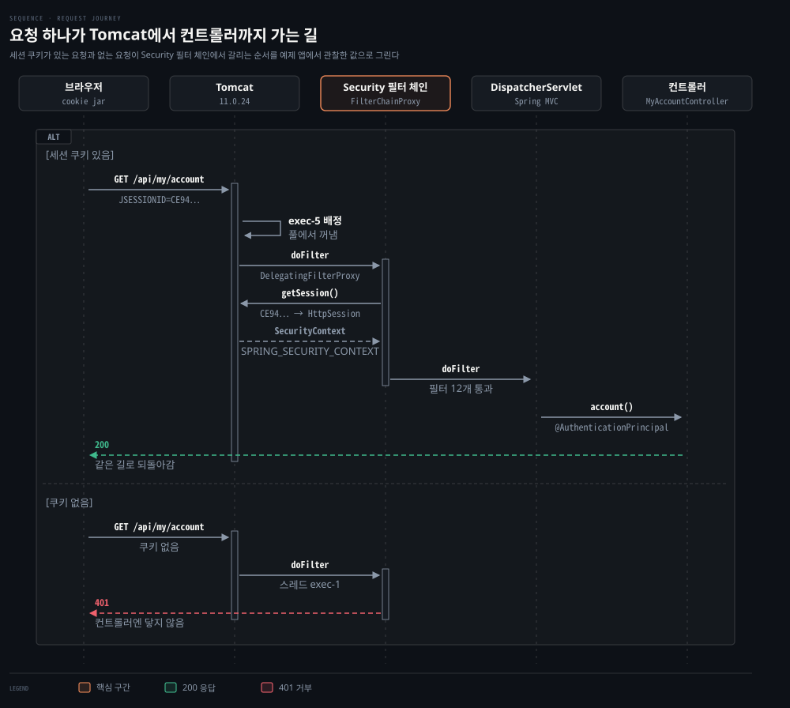
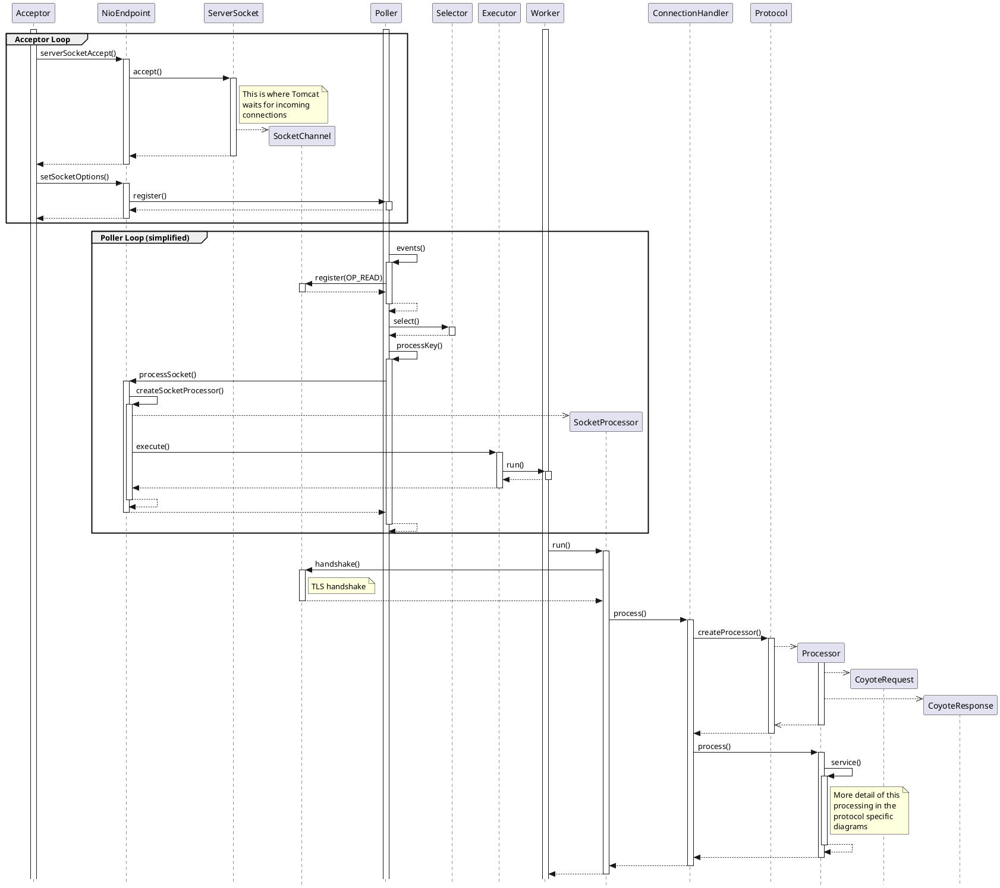
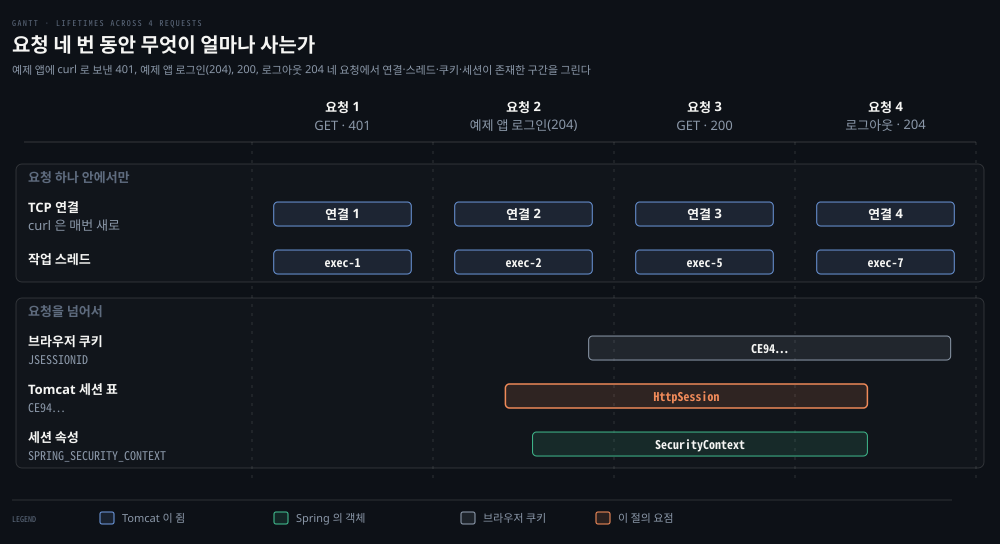
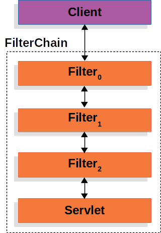
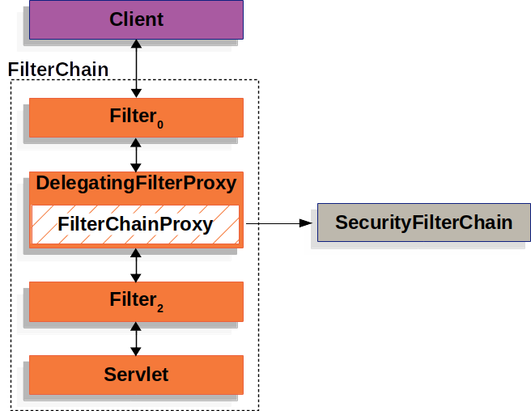
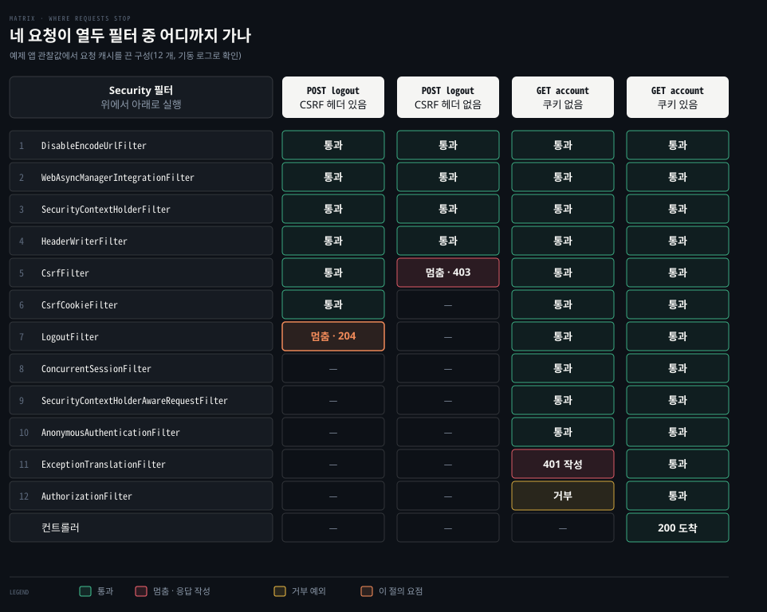
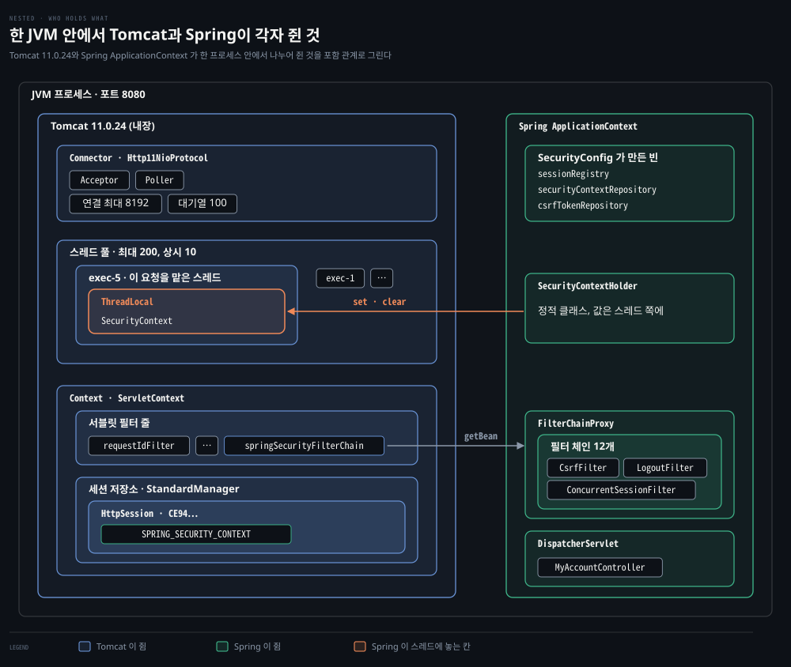
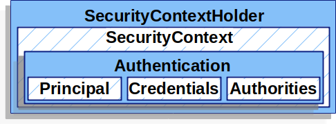
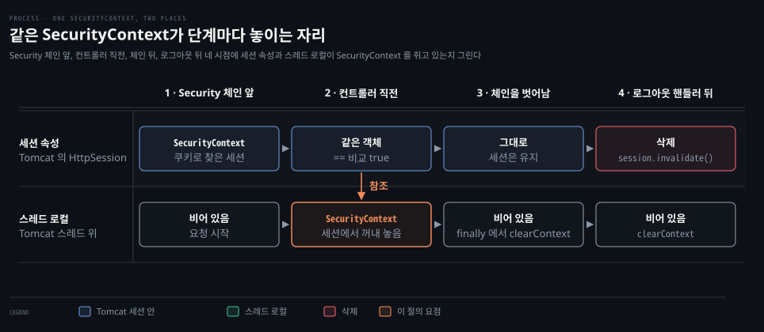

# Tomcat NIO·FilterChainProxy·DispatcherServlet

---

> Tomcat은 연결·작업 스레드·HttpSession을 쥐고 Spring은 필터 체인과 빈 구성을 맡아, 요청 하나가 같은 스레드 위에서 컨트롤러까지 이어집니다. 로그인 정보를 담은 SecurityContext만 Tomcat 세션과 요청 스레드 두 쪽에 걸쳐 놓이므로, 경계를 알아야 세션 유지와 로그아웃이 읽힙니다.

02-01·02-02·03-01에서는 "Spring Security가 이렇게 한다"로 설명했습니다. 그런데 로그인 하나만 따라가도 세션 쿠키는 Tomcat이 내립니다. 그 쿠키를 검사하는 필터는 Spring이 돌립니다. 둘은 같은 스레드에서 이어집니다.

어느 일이 누구 몫인지 모르면 세션이 사라지는 경우가 그려지지 않습니다. 로그아웃에 컨트롤러가 없는 이유도 마찬가지입니다.

이 문서의 관찰값은 Spring Boot 4.1.1, Spring Framework 7.0.9, Spring Security 7.1.1, Tomcat 11.0.24로 구성한 예제 앱(포트 18080)에서 얻었습니다.


## 학습 목표와 범위

> 다 읽은 뒤 아래 네 가지를 코드와 관찰값으로 말할 수 있으면 됩니다.

1. 요청 하나가 Tomcat에서 컨트롤러까지 지나는 순서를 스레드, 필터, 서블릿 단위로 그리면서 각 구간의 소유자를 말합니다.
2. 필터가 요청을 "가로챈다"는 말이 필터가 `chain.doFilter`를 부르지 않고 응답을 끝낸다는 뜻임을 `LogoutFilter` 코드로 설명합니다.
3. 연결, 스레드, HttpSession, SecurityContext가 각각 어느 쪽에서 어떤 수명으로 사는지 구분합니다.
4. 로그아웃에서 "로그인 정보를 지우는 일"과 "세션을 지우는 일"이 서로 다른 저장 위치를 지우는 두 동작임을 설명합니다.

Tomcat의 TLS와 클러스터링과 프록시 밸브 같은 운영 기능은 다루지 않습니다. 세션 저장소 안쪽 구조(ID 생성, 만료 검사 주기)는 [01-02](./01-02.HttpSession·SessionRegistry·SecurityContextHolder.md)가 맡습니다. 여기서는 세션이 어디에 있고 무슨 역할인지만 짚습니다.


## 문제와 필요성

> Tomcat과 Spring이 스택 트레이스에 나란히 찍히기 때문에 소유자를 모르면 세션과 로그아웃과 스레드 문제를 그림으로 그릴 수 없습니다.

로그인 학습에서 막히기 쉬운 지점은 세 가지입니다.

1. 세션이 "연결이 이어져 있다는 정보"처럼 느껴져서 웹서버에 있다고 생각하기 쉽습니다.
2. 로그아웃에 컨트롤러가 없다는 말을 들으면 Spring Security가 API를 직접 실행한다는 뜻으로 읽힙니다.
3. 로그아웃이 "로그인 정보를 지운다"와 "세션을 지운다"로 따로 설명돼 둘이 같은지 다른지 가늠이 안 됩니다.

세 질문은 같은 물음으로 답이 갈립니다. 그 값이 Tomcat의 어느 자료구조에 있는가. 그리고 Spring의 어느 클래스가 그것을 읽고 쓰는가.

예를 들어 `POST /api/my/logout`은 컨트롤러 없이 `SecurityConfig` 설정만으로 204를 냅니다. 예제 앱의 `RequestIdFilter`는 서블릿 스레드가 재사용된다는 이유로 요청이 끝날 때 MDC 값을 지웁니다. 두 동작 모두 Tomcat과 Spring의 경계를 알아야 읽힙니다.


## 한 요청이 Tomcat에서 컨트롤러까지 가는 길

> 요청은 Tomcat 작업 스레드 하나가 처음부터 끝까지 맡아 서블릿 필터 줄과 Security 필터 체인을 지난 뒤 DispatcherServlet에서 컨트롤러로 갑니다.



위쪽 갈래는 세션 쿠키가 있는 `GET /api/my/account`입니다. 아래쪽 갈래는 쿠키가 없는 같은 요청입니다. 가운데 세로 막대는 그 구간에서 해당 칸이 일을 쥐고 있다는 표시입니다.

Tomcat 막대가 처음 화살표부터 응답까지 이어지는 것은 작업 스레드 하나가 요청 전체를 맡기 때문입니다. 아래쪽 갈래는 Security 필터 체인에서 401로 끝나 DispatcherServlet과 컨트롤러에 닿지 않습니다.

도식은 두 가지를 줄여 그렸습니다. 돌아오는 화살표는 거치는 칸을 한 번에 건너뛰게 그렸습니다. 세션 조회(`getSession()`)는 체인 한가운데에서 필요할 때 일어나는 일을 화살표 하나로 모았습니다. 세션을 늦게 읽는 이유는 아래 필터 체인 절에서 풉니다.

### 연결을 받는 스레드와 일하는 스레드는 다릅니다

Tomcat의 `Connector`는 포트에서 연결을 받는 창구입니다. 예제 앱이 쓰는 구현은 `Http11NioProtocol`입니다. 그 안에서 스레드가 역할별로 나뉩니다.

`Acceptor` 스레드가 새 연결을 받습니다. `Poller` 스레드는 열려 있는 소켓 중 읽을 데이터가 생긴 것을 찾습니다. 찾으면 풀에서 작업 스레드를 꺼내 그 소켓을 처리시킵니다.[^tomcat-http] 작업 스레드의 이름이 `http-nio-8080-exec-N`입니다.



그림 출처: Apache Tomcat 11.0.24 문서 [`architecture/requestProcess/11_nio.png`](https://github.com/apache/tomcat/blob/11.0.24/webapps/docs/architecture/requestProcess/11_nio.png). Apache License 2.0, 원본 그대로 사용했습니다.

그림의 위쪽 `Acceptor Loop`가 연결을 받는 일입니다. 그 아래 `Poller Loop`는 읽을 데이터가 생긴 소켓을 찾아 `Executor.execute()`로 `Worker`(작업 스레드)에 넘깁니다. `Worker`가 `Processor`를 만들어 `service()`를 부르는 데서 서블릿 컨테이너의 일이 시작됩니다.

예제 앱의 기동 직후 스레드 목록에는 `Acceptor`와 `Poller`가 하나씩 있었습니다. `exec-1`부터 `exec-10`까지 열 개도 있었습니다. 연결 설정은 아래 값이었습니다.

| 값 | 뜻 | 관찰 | Tomcat 소스 |
|---|---|---|---|
| `maxThreads` | 작업 스레드 상한 | 200 | `AbstractEndpoint.java` L1473 |
| `minSpareThreads` | 미리 만들어 두는 스레드 수 | 10 | 기동 직후 `exec-1`~`exec-10` |
| `maxConnections` | 동시에 열어 둘 연결 수 | 8192 | `AbstractEndpoint.java` L1014 |
| `acceptCount` | 처리가 밀릴 때 운영체제가 쌓아 주는 대기열 | 100 | `AbstractEndpoint.java` L1264 |

같은 사용자의 요청이 같은 스레드로 간다는 보장은 없습니다. 예제 앱에 요청 네 번을 차례로 보냈더니 작업 스레드가 `exec-1`, `exec-2`, `exec-5`, `exec-7`로 달랐습니다.

스레드는 요청이 읽힐 때 빌렸다가 응답이 끝나면 풀로 돌아갑니다. 스레드 안의 값은 다음 요청으로 넘어가지 못합니다. 로그인 상태를 요청 사이에 잇는 일은 스레드가 못 하므로 세션이 따로 있어야 합니다.



위 구역은 요청마다 새로 생기고 사라지는 것입니다. 아래 구역은 로그인부터 로그아웃까지 이어지는 것입니다.

쿠키 막대는 세션 막대보다 늦게 시작해서 늦게 끝납니다. 세션은 서버가 로그인 응답을 쓰기 전에 만들어지고 로그아웃 처리 중에 지워집니다. 쿠키는 브라우저가 응답을 받아야 생기고 삭제 응답을 받아야 사라집니다.

Tomcat은 요청을 읽은 뒤 세션 쿠키 ID를 헤더에서 꺼내 요청 객체에 적어 둡니다. 소스는 `CoyoteAdapter.parseSessionCookiesId`입니다.

그다음 컨테이너 파이프라인을 거쳐 서블릿 앞의 필터 줄을 만듭니다. 이 일은 `StandardWrapperValve`가 합니다.

### 서블릿 필터 줄이 Spring Security보다 먼저 돕니다

서블릿 필터는 서블릿 표준의 부품입니다. Tomcat은 등록된 필터를 줄 세워 하나씩 부릅니다. `ApplicationFilterChain`이 필터의 `doFilter(request, response, chain)`을 부릅니다. 필터가 `chain.doFilter`를 부르면 다음 필터로 갑니다. 줄이 끝나면 서블릿의 `service`가 불립니다.



그림 출처: Spring Security 7.1.1 레퍼런스 [`servlet/architecture/filterchain.png`](https://github.com/spring-projects/spring-security/blob/7.1.1/docs/modules/ROOT/assets/images/servlet/architecture/filterchain.png). Apache License 2.0, 원본 그대로 사용했습니다.

그림에서 `Client`의 요청이 필터를 하나씩 지나 `Servlet`에 닿습니다. 응답은 같은 길을 되돌아옵니다. Spring Security를 쓰면 이 줄의 한가운데에 `springSecurityFilterChain`이 끼어 있습니다.

예제 앱의 Tomcat에 등록된 필터 줄은 아래 순서였습니다. 직접 더한 서블릿 필터는 `requestIdFilter` 하나뿐입니다. 나머지는 Spring Boot가 등록합니다.

```bash
1  requestIdFilter              예제 앱이 만든 필터
2  characterEncodingFilter
3  webMvcObservationFilter
4  formContentFilter
5  requestContextFilter
6  springSecurityFilterChain    Spring Security로 넘어가는 자리
7  Tomcat WebSocket Filter
```

`requestIdFilter`가 맨 앞인 것은 `@Order(Ordered.HIGHEST_PRECEDENCE)` 때문입니다. 이 필터는 요청 시작에 `MDC.put`으로 요청 ID를 넣습니다. `finally`에서는 `MDC.remove`로 지웁니다.

코드 주석이 이유를 적고 있습니다. 서블릿 스레드는 재사용되므로 지우지 않으면 다음 요청의 로그에 이전 값이 남습니다. 앞 절에서 본 스레드 재사용을 전제로 짠 코드입니다.

### springSecurityFilterChain은 Spring 빈을 필터 줄에 끼우는 다리입니다

Tomcat은 서블릿 표준 방식으로 등록된 필터만 알고 Spring이 만든 빈은 모릅니다.[^spring-arch] 그래서 필터 줄에는 `DelegatingFilterProxy`라는 서블릿 필터가 `springSecurityFilterChain`이라는 이름으로 서 있습니다. 요청이 오면 이 프록시가 Spring `ApplicationContext`에서 같은 이름의 빈을 찾아 일을 넘깁니다.



그림 출처: Spring Security 7.1.1 레퍼런스 [`servlet/architecture/filterchainproxy.png`](https://github.com/spring-projects/spring-security/blob/7.1.1/docs/modules/ROOT/assets/images/servlet/architecture/filterchainproxy.png). Apache License 2.0, 원본 그대로 사용했습니다.

점선 안이 Tomcat의 필터 줄입니다. 그 안에 선 `DelegatingFilterProxy`가 안쪽의 `FilterChainProxy`를 통해 오른쪽 `SecurityFilterChain`으로 일을 넘깁니다.

빈을 찾는 일은 첫 요청 때 한 번 일어납니다. 소스는 `DelegatingFilterProxy` L255~266이고 빈 조회는 L335입니다.

이 프록시를 필터 줄에 등록하는 쪽은 Spring Boot의 `SecurityFilterAutoConfiguration`입니다. 소스는 L55~64입니다.

넘겨받는 빈은 `FilterChainProxy`입니다. 이 빈은 요청에 맞는 `SecurityFilterChain`을 고릅니다(L245~253). 그 안의 필터는 `VirtualFilterChain`이 하나씩 부릅니다. 마지막 필터가 `chain.doFilter`를 부르면 Tomcat의 원래 줄로 돌아갑니다(L376). `SecurityConfig.securityFilterChain()`이 만드는 것이 이 `SecurityFilterChain`입니다.

체인 안의 필터는 요청 캐시를 끈 구성 기준 열두 개입니다. `RequestCacheAwareFilter`를 끄기 전 관찰(13개 체인)에서는 `FilterChainProxy`를 TRACE로 켠 요청 로그가 `Invoking … (n/13)`을 찍었습니다.

`requestCache.disable()`을 적용하면 9번에 있던 `RequestCacheAwareFilter`가 빠집니다. 기동 로그(`Will secure any request with filters: [...]`)에서도 열두 개가 확인되며 뒤쪽 필터 번호가 하나씩 당겨집니다.

```bash
 1  DisableEncodeUrlFilter
 2  WebAsyncManagerIntegrationFilter
 3  SecurityContextHolderFilter
 4  HeaderWriterFilter
 5  CsrfFilter
 6  CsrfCookieFilter                예제 앱이 추가
 7  LogoutFilter
 8  ConcurrentSessionFilter         예제 앱이 추가
 9  SecurityContextHolderAwareRequestFilter
10  AnonymousAuthenticationFilter
11  ExceptionTranslationFilter
12  AuthorizationFilter
```

순서는 Spring Security가 필터 클래스마다 정해 둔 번호표(`FilterOrderRegistration`)로 정해집니다. `addFilterAfter`는 기준 필터 번호에 1을 더해 끼웁니다(`HttpSecurity` L1830~1840). `CsrfCookieFilter`가 `CsrfFilter` 바로 뒤에 놓이는 것이 그래서입니다. `ConcurrentSessionFilter`가 `LogoutFilter` 바로 뒤에 놓이는 이유도 같습니다. 두 위치의 이유는 각각 [02-01](./02-01.CsrfFilter·CookieCsrfTokenRepository·SecurityContextRepository.md)과 [02-02](./02-02.SessionInformation·ConcurrentSessionFilter·LogoutFilter.md)가 설명합니다.

세션은 이 체인에서 늦게 읽힙니다. 3번 `SecurityContextHolderFilter`는 세션에서 꺼내는 방법만 스레드에 놓아 둡니다. 소스는 `HttpSessionSecurityContextRepository`의 `loadDeferredContext`(L145~147)입니다.

이 구성에서 세션 자체를 처음 조회하는 곳은 8번 `ConcurrentSessionFilter`의 `getSession(false)`(`ConcurrentSessionFilter.java` L136)입니다. 반면 세션 안의 `SPRING_SECURITY_CONTEXT` 속성을 실제로 읽는 때는 누군가 인증 정보를 처음 요구할 때입니다. 도식의 `getSession()` 화살표가 체인 한가운데에 놓인 이유입니다.

### DispatcherServlet이 컨트롤러를 고릅니다

12번 필터까지 통과하면 요청은 Tomcat의 원래 줄로 돌아옵니다. 남은 필터를 지나 서블릿에 닿습니다. 예제 앱에서 서블릿은 `dispatcherServlet` 하나였고 매핑은 `/`였습니다. 이것이 Spring MVC의 입구입니다.

요청은 `DispatcherServlet`의 `doService`(L829)에서 `doDispatch`(L935)로 넘어갑니다. 거기서 처리할 핸들러를 찾고 어댑터로 호출합니다. 줄 번호는 각각 L951과 L963입니다. 예제 앱에서는 이 호출이 `MyAccountController.account()`입니다.

컨트롤러 인자의 `@AuthenticationPrincipal LoginUser`는 현재 스레드의 SecurityContext에서 값을 꺼냅니다. 소스는 `AuthenticationPrincipalArgumentResolver` L117입니다.

필터 체인이 그 스레드에 값을 놓아 두었으므로 컨트롤러와 필터는 같은 작업 스레드에서 이어져야 합니다.

응답은 같은 길을 거꾸로 되돌아갑니다. 각 필터의 `chain.doFilter` 호출 다음 줄들이 이때 실행됩니다. Tomcat이 응답 바이트를 내보내면 스레드는 풀로 돌아갑니다.


## 필터가 "가로챈다"는 말의 뜻

> 가로챈다는 것은 Security가 컨트롤러 대신 API를 실행한다는 뜻이 아니라 필터가 다음 단계를 부르지 않고 그 자리에서 응답을 끝낸다는 뜻입니다.

필터 계약은 단순합니다. `doFilter` 안에서 `chain.doFilter(request, response)`를 부르면 요청이 다음으로 넘어갑니다. 부르지 않으면 거기서 멈춥니다. 멈춘 필터가 응답에 써 둔 내용이 곧 최종 응답입니다. `LogoutFilter`가 이 구조 그대로입니다.

```java
// spring-security-web 7.1.1 — LogoutFilter.java L101~108
if (requiresLogout(request, response)) {
    Authentication auth = this.securityContextHolderStrategy.getContext().getAuthentication();
    this.handler.logout(request, response, auth);          // 세션 무효화 등 정리
    this.logoutSuccessHandler.onLogoutSuccess(request, response, auth);   // 응답 작성
    return;                                                 // chain.doFilter 를 부르지 않는다
}
chain.doFilter(request, response);
```

요청 URL이 로그아웃 주소와 맞으면 정리와 응답까지 필터가 끝내고 `return`합니다. 예제 앱은 응답 쪽 핸들러로 `HttpStatusReturningLogoutSuccessHandler(NO_CONTENT)`를 꽂아 204를 내게 했습니다.

`POST /api/my/logout`을 받는 컨트롤러는 하나도 없습니다. 그 주소는 컨트롤러가 아니라 필터가 받습니다.

예제 앱에서 같은 주소와 몇 가지 요청을 보내 어디서 멈추는지 확인했습니다. 가로는 요청 넷이고 세로는 필터 번호 순서입니다.



한 열을 위에서 아래로 읽으면 요청 하나의 여정입니다.

- 첫 열은 CSRF 헤더가 있는 로그아웃입니다. 7번에서 멈춰 204를 내고 8번부터는 닿지 않습니다.
- 둘째 열은 CSRF 헤더가 없는 로그아웃입니다. 5번에서 403으로 멈춥니다.
- 셋째 열은 쿠키 없는 조회입니다. 12번까지 가서 거부당하고 11번이 401을 씁니다.
- 넷째 열은 쿠키 있는 조회입니다. 열두 칸을 모두 지나 컨트롤러에 닿습니다.

첫 열은 로그에서도 확인됩니다. 필터 체인 뒤에 둔 시험용 서블릿 필터가 로그를 남기지 않았습니다. 컨트롤러도 로그를 남기지 않았습니다. `Invoking` 기록은 7번에서 끊겼습니다.

둘째 열의 순서도 의미가 있습니다. 로그아웃 필터(7번)보다 CSRF 필터(5번)가 앞이므로 CSRF 헤더가 없으면 로그아웃 요청조차 닿지 못합니다.

셋째 열의 401은 두 필터의 합작입니다. 12번 `AuthorizationFilter`가 익명 사용자를 거부하며 예외를 던집니다(`AuthorizationFilter` L99). 11번 `ExceptionTranslationFilter`가 그 예외를 받습니다. 익명이면 인증 진입점을 부릅니다(`ExceptionTranslationFilter` L126~147, L188~202).

예제 앱의 진입점은 `HttpStatusEntryPoint(401)`이라 상태 코드만 내고 끝납니다(`HttpStatusEntryPoint` L51).

로그인 화면으로 보내는 기본 동작을 쓰지 않는 이유가 있습니다. 화면이 SPA라서 리다이렉트가 아니라 상태 코드가 필요하기 때문입니다.

둘째 열에는 덧붙일 관찰이 있습니다. CSRF 거부로 403이 나가면 오류 처리를 위해 `GET /error` 요청이 체인을 한 번 더 지났습니다. 요청 로그에 `Securing GET /error`가 이어서 찍혔습니다. Spring Security 설정에서 오류 디스패치(`DispatcherType.ERROR`)를 허용하는 이유가 이것입니다. 막아 버리면 403이 401로 바뀌어 보입니다.


## 누가 무엇을 쥐고 있나

> 연결과 스레드와 HttpSession과 세션 쿠키 발급은 Tomcat이 쥐고 빈과 필터 체인 구성은 Spring이 쥐며 SecurityContext 객체만 두 쪽에 걸쳐 놓입니다.

Spring Boot는 Tomcat을 별도로 설치한 서버가 아니라 같은 JVM 안의 라이브러리로 띄웁니다. 빌드된 jar의 `BOOT-INF/lib`에 `tomcat-embed-core-11.0.24.jar`가 들어 있습니다.

앱이 기동하면 `ServletWebServerApplicationContext`가 `onRefresh()`에서 `createWebServer()`를 부릅니다. 줄 번호는 L164와 L183~190입니다.

거기서 `TomcatServletWebServerFactory.getWebServer()`가 `Tomcat` 객체를 만듭니다. 그 객체에 `Connector`와 `Context`를 붙입니다. 소스는 L163~167입니다.

예제 앱의 기동 로그에서 `Tomcat started on port 18080`을 찍은 스레드가 `main`이었습니다. 이 흐름의 흔적입니다. `java -jar` 하나가 프로세스 하나이고 그 안에서 두 세계가 나뉘어 있습니다.[^boot-web]



왼쪽 파란 칸이 Tomcat이고 오른쪽 초록 칸이 Spring입니다. 파란 칸 안의 `Context`는 서블릿 필터 줄과 세션 저장소를 들고 있습니다. 위의 스레드 풀은 요청을 처리할 스레드를 들고 있습니다.

가로 화살표 둘이 경계를 넘습니다. 아래 화살표는 필터 줄의 `springSecurityFilterChain`이 이름으로 Spring 빈을 찾는 길입니다. 위 화살표는 Spring의 `SecurityContextHolder`가 Tomcat 스레드의 `ThreadLocal` 칸에 값을 넣고 빼는 길입니다.

주황색으로 칠한 이 칸이 도식의 요점입니다. 코드는 Spring 것인데 값은 Tomcat이 빌려준 스레드 위에 놓입니다.

### 세션은 연결 정보가 아니라 Tomcat 메모리의 표입니다

Tomcat의 세션 관리자(`ManagerBase`)는 세션 ID를 키로 하는 `ConcurrentHashMap`을 들고 있습니다(L147). 요청이 오면 쿠키에서 읽은 ID로 이 표를 찾습니다(`findSession`, L753~757).

표에 없더라도 누군가 `getSession()`(`create=true`)을 부르면 그때 `Request.doGetSession`이 새 세션을 만듭니다. 그때 응답에 `Set-Cookie: JSESSIONID`를 실어 보냅니다. 소스는 `Request.java` L2840과 L2847입니다. 예제 앱의 `Context`는 `StandardManager`를 쓰고 있었습니다.

연결 정보가 아니라는 증거는 관찰에 있습니다. 로그인 요청과 그 뒤 요청은 `curl`을 따로 실행했으므로 TCP 연결이 달랐습니다. 그래도 로그인에서 받은 `JSESSIONID=CE94…`를 담아 보내자 서버가 같은 사용자를 알아봤습니다.

연결을 끊는다고 세션이 지워지지 않습니다. 세션이 끊긴다고 연결이 닫히지도 않습니다. 세션이 사라지는 경우는 무효화와 만료와 프로세스 종료입니다.

프로세스 종료에서는 Spring Boot가 `StandardManager`의 세션 파일 저장 경로를 비우는 리스너를 기본으로 붙입니다. 소스는 `TomcatServletWebServerFactory` L361과 L475~486입니다. 그래서 재시작하면 표가 비어 모두 다시 로그인합니다.

이 표에 들어가는 내용은 두 쪽이 나눠 채웁니다. 세션 객체와 쿠키는 Tomcat이 만듭니다.

그 안의 `SPRING_SECURITY_CONTEXT` 칸은 Spring의 `HttpSessionSecurityContextRepository`가 `session.setAttribute`로 넣습니다. 소스는 L92와 L179입니다. 예제 앱에서 로그인한 세션의 속성 이름을 조회하면 이 하나뿐이었습니다.

사용자별로 세션 ID를 모아 두는 [02-02](./02-02.SessionInformation·ConcurrentSessionFilter·LogoutFilter.md)의 `SessionRegistry`는 이와 별개입니다. Spring이 따로 들고 있는 표입니다.

쿠키도 만든 쪽이 갈립니다. 같은 로그인 응답에 두 쿠키가 실렸습니다. Tomcat이 만든 `JSESSIONID`에는 `HttpOnly; SameSite=Lax`가 붙었습니다. 이 값은 `application.yml`의 `server.servlet.session.cookie.*` 설정을 따릅니다.

Spring의 `CookieCsrfTokenRepository`가 만든 `XSRF-TOKEN`은 이 설정과 무관합니다. 설정 코드의 `withHttpOnlyFalse()`가 정합니다. 관찰한 응답에서는 `SameSite` 속성이 없었습니다.

### 로그인 정보는 두 곳에 같은 객체로 있습니다

SecurityContext가 놓이는 곳은 두 군데입니다. 하나는 세션의 `SPRING_SECURITY_CONTEXT` 칸으로 세션이 끝날 때까지 삽니다. 다른 하나는 스레드 로컬입니다.

스레드 로컬은 스레드마다 따로 값을 갖는 변수입니다. Spring Security의 기본 전략이 이것입니다. 소스는 `ThreadLocalSecurityContextHolderStrategy` L34입니다.

`SecurityContextHolderFilter`가 요청 시작에 값을 놓고 `finally`에서 비웁니다. 줄 번호는 L81과 L85입니다.



그림 출처: Spring Security 7.1.1 레퍼런스 [`servlet/authentication/architecture/securitycontextholder.png`](https://github.com/spring-projects/spring-security/blob/7.1.1/docs/modules/ROOT/assets/images/servlet/authentication/architecture/securitycontextholder.png). Apache License 2.0, 원본 그대로 사용했습니다.

`SecurityContextHolder`는 값을 들고 있는 상자입니다. 그 안의 `SecurityContext`가 `Authentication`(누구이며 어떤 권한인가)을 담습니다. 그림에는 상자가 하나뿐이지만 실제로는 스레드마다 상자가 따로 있습니다.

예제 앱에서 서블릿 필터 두 개를 Security 체인의 앞뒤에 끼워 요청 하나의 스레드 로컬을 찍었습니다. 컨트롤러 안에서는 세션 속성과 스레드 로컬 객체가 같은 인스턴스인지도 비교했습니다. 결과를 단계별로 다시 그리면 아래와 같습니다.



1열부터 3열은 쿠키 있는 `GET /api/my/account` 한 번입니다. 4열은 그 세션으로 보낸 로그아웃의 끝입니다.

세션 속성(위 줄)은 로그아웃 전까지 같은 객체로 남습니다. 스레드 로컬(아래 줄)은 체인에 들어갈 때 비어 있다가 2열에서만 채워집니다. 요청이 체인을 벗어나면 다시 비워집니다. 2열의 주황색 화살표가 두 줄이 같은 객체를 가리킨다는 표시입니다.

이 도식이 "로그인 정보 지우기"와 "세션 지우기"의 차이입니다. 스레드 로컬을 비우는 일은 모든 요청의 끝에서 일어나지만 사용자는 로그아웃되지 않습니다. 다음 요청에서 세션에서 다시 꺼내 채우기 때문입니다.

반대로 로그아웃은 둘을 모두 지워야 끝납니다. 기본 로그아웃 핸들러 `SecurityContextLogoutHandler`가 그 순서를 코드로 보여 줍니다.

```java
// spring-security-web 7.1.1 — SecurityContextLogoutHandler.java L74~86
session.invalidate();                          // Tomcat 의 세션 표에서 이 세션을 지운다
this.securityContextHolderStrategy.clearContext();   // 이 스레드의 로컬 값을 지운다
// ... 빈 SecurityContext 를 저장소에 저장
```

첫 줄은 Tomcat이 쥔 표에서 항목을 뺍니다. 둘째 줄은 이 요청이 끝날 때까지 스레드에 얹혀 있던 복사본을 뺍니다. 한쪽만 하면 로그아웃이 완성되지 않습니다.

세션만 지우고 스레드 로컬을 두면 같은 요청 안에서는 인증이 남아 보입니다. 스레드 로컬만 지우고 세션을 두면 다음 요청에서 되살아납니다.


## 스스로 확인할 질문

> 본문의 소유자 구분과 필터 계약을 스스로 점검하는 네 가지 질문입니다.

- 질문 1: 브라우저가 연결을 끊었다가 다시 붙어도 로그인이 유지되는 이유는 무엇입니까? 이때 세션은 Tomcat과 Spring 중 어느 쪽 어느 자료구조에 있습니까?
- 질문 2: `POST /api/my/logout`이 컨트롤러 없이 204를 내는 과정을 필터 번호와 `chain.doFilter` 호출 여부로 설명해 보십시오. CSRF 헤더가 없을 때 응답이 403인 이유도 같은 기준으로 답할 수 있습니까?
- 질문 3: 한 사용자의 요청 두 개가 서로 다른 작업 스레드에서 처리돼도 두 번째 요청이 로그인 상태로 읽히는 이유는 무엇입니까?
- 질문 4: `SecurityContextHolder.clearContext()`만 호출하면 사용자가 로그아웃됩니까? 반대로 `session.invalidate()`만 호출하면 같은 요청 안에서 무엇이 남아 있습니까?


## 출처와 관련 문서

> 본문 수치의 근거와 관찰 방법, 그리고 함께 읽을 문서입니다.

### 도식 값과 근거 대조표

관찰값은 예제 앱(Spring Boot 4.1.1, Spring Framework 7.0.9, Spring Security 7.1.1, Tomcat 11.0.24)에서 기록한 값입니다. 공개 라이브러리 위치는 해당 버전 태그의 소스 줄 번호로 적었습니다.

| 도식·본문의 값 | 의미 | 근거 | 위치 |
|---|---|---|---|
| `JSESSIONID=CE94…` | 로그인 응답에서 받은 세션 쿠키 앞부분 | 예제 앱 관찰 | 로그인 응답 `Set-Cookie` |
| `exec-5` (쿠키 있음), `exec-1` (쿠키 없음) | 요청이 배정된 작업 스레드 | 예제 앱 관찰 | 서블릿 필터 로그의 `thread=` |
| 필터 12개, 순서 | 체인 길이와 순서(요청 캐시 끈 뒤 12개, 끄기 전 관찰 n/13) | 예제 앱 관찰 + `FilterChainProxy` | 기동 로그('Will secure any request with filters') |
| `401`, `HttpStatusEntryPoint` | 인증 진입점이 내는 상태 | `HttpStatusEntryPoint.java` | L51 |
| `requestIdFilter`가 1번 | 서블릿 필터 줄의 맨 앞 | 예제 앱 관찰 | `servletFilter#1` |
| `dispatcherServlet` → `/` | 서블릿 하나와 매핑 | 예제 앱 관찰 | 기동 직후 `Context` 점검 로그 |
| `maxThreads` 200, `maxConnections` 8192, `acceptCount` 100 | Tomcat 기본 한도 | `AbstractEndpoint.java` | L1473, L1014, L1264 |
| 상시 10 | 미리 만든 스레드 수 | 예제 앱 관찰 | 기동 직후 `exec-1`~`exec-10` |
| `Acceptor`, `Poller` | 연결 수락과 소켓 감시 스레드 | `AbstractEndpoint.java`, `NioEndpoint.java` | L2293 / L376 |
| 작업 스레드 배정 | 읽을 데이터가 있을 때 풀에서 꺼냄 | `AbstractEndpoint.java`, `NioEndpoint.java` | L2093~2109 / L986 |
| `StandardManager` | 세션 관리자 구현 | 예제 앱 관찰 | 기동 직후 `Context` 점검 로그 |
| 세션 표 `ConcurrentHashMap` | ID 키의 세션 저장 | `ManagerBase.java` | L147, L753~757 |
| `JSESSIONID` 쿠키 발급 | 세션 생성과 `Set-Cookie` | `Request.java` | L2840, L2847 |
| 쿠키에서 세션 ID 읽기 | 요청 해석 때 | `CoyoteAdapter.java` | L732, L997 |
| `SPRING_SECURITY_CONTEXT` | 세션 속성 이름 | `HttpSessionSecurityContextRepository.java` | L92, L179 |
| 같은 객체(`==` true) | 스레드 로컬과 세션 속성 비교 | 예제 앱 관찰 | 컨트롤러 로그 `sameObjectAsThreadLocal=true` |
| 스레드 로컬 없음, 있음, 없음 | 체인 앞, 컨트롤러 직전, 체인 뒤 | 예제 앱 관찰 + `SecurityContextHolderFilter.java` | 서블릿 필터 로그 / L81, L85 |
| `session.invalidate()`, `clearContext()` | 로그아웃 핸들러의 두 동작 | `SecurityContextLogoutHandler.java` | L74, L81 |
| `JSESSIONID`는 `HttpOnly; SameSite=Lax`, `XSRF-TOKEN`은 `SameSite` 없음 | 쿠키 만든 쪽 | 예제 앱 관찰 | 로그인 응답 `Set-Cookie` |
| 기동 스레드 `main` | Tomcat이 `main`에서 기동 | 예제 앱 관찰 | `Tomcat started on port 18080` 로그 |
| `getWebServer` | 내장 Tomcat 생성 | `TomcatServletWebServerFactory.java` | L163~167 |
| 행렬의 `통과`·`멈춤 · 204`·`멈춤 · 403`·`401 작성`·`거부`·`200 도착` | 네 요청이 필터별로 멈춘 자리 | 예제 앱 관찰 | `FilterChainProxy` TRACE 로그의 `Invoking` 기록(요청 캐시 끄기 전 관찰 n/13, 끈 뒤 12개 기동 로그)과 응답 코드 |
| 행렬의 `거부`(12번), `401 작성`(11번) | 예외를 던지는 쪽과 받아 쓰는 쪽 | `AuthorizationFilter.java`, `ExceptionTranslationFilter.java` | L99 / L126~147 |
| 간트의 `연결 1`~`연결 4` | `curl`을 실행할 때마다 새 TCP 연결 | 예제 앱 관찰 | 요청 네 번을 각각 별도 `curl`로 보냄 |
| 간트의 `exec-1`, `exec-2`, `exec-5`, `exec-7` | 요청 1~4의 작업 스레드 | 예제 앱 관찰 | 서블릿 필터 로그의 `thread=` |
| 간트의 쿠키·세션 막대 구간 | 로그인 응답부터 로그아웃까지 | 예제 앱 관찰 | 로그인 `Set-Cookie`, 로그아웃 삭제 `Set-Cookie`, 로그 `Invoking` 기록 |
| 과정도의 스레드 로컬 `비어 있음`/`SecurityContext`/`비어 있음` | 체인 앞·컨트롤러 직전·체인 뒤 | 예제 앱 관찰 + `SecurityContextHolderFilter.java` | 서블릿 필터 로그 `threadLocalAuth` / L81, L85 |
| 과정도의 `== 비교 true` | 세션 속성과 스레드 로컬이 같은 인스턴스 | 예제 앱 관찰 | 컨트롤러 로그 `sameObjectAsThreadLocal=true` |

### 그림 목록과 도식 타입 선택

직접 그린 도식은 모두 생성기(`_assets/_gen/gen-01-01.*.py`)에서 만들었습니다. 타입은 writing-method의 타입 선택표에서 골랐습니다.

| 그림 | 구분 | 타입 | 고른 이유 |
|---|---|---|---|
| `01-01.request-journey.svg` | 직접 그림 | `type-sequence` | 주체 다섯 사이에서 요청과 응답이 시간순으로 오가므로 |
| `01-01.who-holds-what.svg` | 직접 그림 | `type-nested` | Tomcat과 Spring이 한 JVM 안에 포함 관계로 놓이므로 |
| `01-01.stop-matrix.svg` | 직접 그림 | `type-dp-security-matrix` | 어느 요청이 어느 필터를 통과하고 어디서 멈추는지가 조합의 가부이므로 |
| `01-01.lifetimes.svg` | 직접 그림 | `type-gantt` | 연결·스레드·세션의 수명, 곧 막대 길이가 논지이므로 |
| `01-01.context-copies.svg` | 직접 그림 | `type-process` | 같은 객체가 단계마다 두 주체에서 어떻게 달라지는지를 칸으로 보이므로 |
| `01-01.r1-tomcat-nio.png` | 가져옴 | Apache Tomcat 11.0.24 문서 그림 | Apache License 2.0, [원본](https://github.com/apache/tomcat/blob/11.0.24/webapps/docs/architecture/requestProcess/11_nio.png) |
| `01-01.r2-servlet-filterchain.png` | 가져옴 | Spring Security 7.1.1 레퍼런스 그림 | Apache License 2.0, [원본](https://github.com/spring-projects/spring-security/blob/7.1.1/docs/modules/ROOT/assets/images/servlet/architecture/filterchain.png) |
| `01-01.r3-filterchainproxy.png` | 가져옴 | Spring Security 7.1.1 레퍼런스 그림 | Apache License 2.0, [원본](https://github.com/spring-projects/spring-security/blob/7.1.1/docs/modules/ROOT/assets/images/servlet/architecture/filterchainproxy.png) |
| `01-01.r4-securitycontextholder.png` | 가져옴 | Spring Security 7.1.1 레퍼런스 그림 | Apache License 2.0, [원본](https://github.com/spring-projects/spring-security/blob/7.1.1/docs/modules/ROOT/assets/images/servlet/authentication/architecture/securitycontextholder.png) |

가져온 그림은 수정하지 않고 각 프로젝트의 해당 버전 태그에서 내려받았습니다. 두 저장소의 `LICENSE`가 Apache License 2.0입니다. 출처와 라이선스는 그림 바로 아래에 적었고 모아 둔 안내는 `_assets/01-01.r-NOTICE.md`에 있습니다.

### 참고한 외부 글

블로그와 기술 글의 그림은 저작권 때문에 복사하지 않았습니다. 링크와 한 줄 요약만 남깁니다.

- [Spring Security: Authentication and Authorization In-Depth (Marco Behler)](https://www.marcobehler.com/guides/spring-security): 인증과 인가와 공통 공격 방어 같은 Spring Security 핵심 기능을 가이드 하나로 설명하는 글입니다.
- [Tomcat 11.0 Architecture — Request Process](https://tomcat.apache.org/tomcat-11.0-doc/architecture/requestProcess.html): 위 NIO 그림이 실린 Tomcat 공식 문서입니다. 연결이 요청 처리로 이어지는 단계를 프로토콜별로 나눠 그립니다.

### 관찰 방법과 한계

관찰은 Spring Boot 4.1.1, Spring Security 7.1.1, Tomcat 11.0.24 조합의 예제 앱을 포트 18080에 띄워 진행했습니다. 예제 앱은 `SecurityConfig`, `CsrfCookieFilter`, `RequestIdFilter`, 세션 로그인 핸들러와 인증 주체(`LoginUser`) 같은 최소 구성만 두었습니다. 데이터베이스 연동은 제외했습니다. 로그인 컨트롤러는 `SessionLogin`을 그대로 부르는 관찰용 하나로 대신했습니다. 이 편의 도식에 적힌 로그인 204는 이 관찰용 컨트롤러의 응답이라, [03-01 편](./03-01.userNotFoundEncodedPassword·RemoteIpValve·X-Forwarded-For.md) 도식의 로그인 성공 200과 다릅니다.

이 방식에는 한계가 둘 있습니다. 첫째, 스레드 번호는 실행마다 다르므로 본문의 `exec-1`, `exec-5`는 한 번의 실행에서 나온 값입니다. 둘째, 요청 캐시(`HttpSessionRequestCache`) 설정이나 추가 `FilterRegistrationBean`·`OncePerRequestFilter` 빈 구성에 따라 401 응답의 세션 생성 여부와 서블릿 필터 목록이 달라질 수 있습니다. `CsrfCookieFilter`처럼 Security 체인 안쪽에만 등록한 필터는 Tomcat 서블릿 필터 목록에 따로 나타나지 않습니다.

### 관련 문서

- [02-01 CsrfFilter·CookieCsrfTokenRepository·SecurityContextRepository](./02-01.CsrfFilter·CookieCsrfTokenRepository·SecurityContextRepository.md)
- [03-01 userNotFoundEncodedPassword·RemoteIpValve·X-Forwarded-For](./03-01.userNotFoundEncodedPassword·RemoteIpValve·X-Forwarded-For.md)
- [02-02 SessionInformation·ConcurrentSessionFilter·LogoutFilter](./02-02.SessionInformation·ConcurrentSessionFilter·LogoutFilter.md)
- [01-02 HttpSession·SessionRegistry·SecurityContextHolder](./01-02.HttpSession·SessionRegistry·SecurityContextHolder.md)

[^tomcat-http]: Apache Tomcat 11.0 — HTTP Connector의 `maxThreads`, `acceptCount`, `maxConnections` 설명. <https://tomcat.apache.org/tomcat-11.0-doc/config/http.html>
[^spring-arch]: Spring Security Reference — Servlet 아키텍처의 `DelegatingFilterProxy`, `FilterChainProxy`, `SecurityFilterChain`. <https://docs.spring.io/spring-security/reference/servlet/architecture.html>
[^boot-web]: Spring Boot Reference — 내장 웹 서버 설정. <https://docs.spring.io/spring-boot/how-to/webserver.html>
