# HttpSession·SessionRegistry·SecurityContextHolder

---

> 세션 저장소 구조는 Tomcat `HttpSession`·Spring `SessionRegistry`·요청 스레드의 `SecurityContextHolder` 세 곳에 나뉘어 있으며, 각자 쥔 키·값·수명이 달라 사라지는 시점도 따로입니다. 이 문서는 세 저장소가 무엇을 어떤 구조로 들고 언제 지워지는지를 라이브러리 소스와 예제 앱 관찰로 설명합니다.

"로그인 상태가 유지된다"는 말은 서버와 브라우저 사이에 연결이 계속 열려 있는 것처럼 들립니다. 실제로 HTTP 요청은 요청마다 끝납니다. 서버는 브라우저가 매번 실어 보내는 ID 쿠키 하나를 열쇠로 자기 메모리의 데이터 묶음을 찾을 뿐입니다. 유지되는 것은 연결이 아니라 서버 메모리의 데이터입니다.

근거는 두 가지입니다. 하나는 Spring Security 7.1.1과 Tomcat 11.0.24 라이브러리 소스입니다. 다른 하나는 이 구성으로 띄운 예제 앱에 보낸 요청과 별도 JVM에서 확인한 객체 상태입니다.

Tomcat 과 Spring 이 요청 하나를 어떻게 나눠 맡는지는 [01-01](./01-01.Tomcat%20NIO·FilterChainProxy·DispatcherServlet.md)이 다룹니다. 여기서는 되풀이하지 않고 세션 정보를 담는 그릇의 구조에 집중합니다. 필터 순서와 만료 표시의 동작은 [02-02](./02-02.SessionInformation·ConcurrentSessionFilter·LogoutFilter.md)가 다룹니다.

## 학습 목표와 범위

> 다 읽은 뒤 아래 다섯 가지를 소스 근거와 함께 설명할 수 있으면 됩니다.

1. 세션이 연결이 아니라 Tomcat 메모리의 데이터 묶음이고 브라우저는 ID 쿠키만 든다는 것을, `sessions` 맵과 `attributes` 맵의 구조로 설명합니다.
2. `HttpSession`, `SessionRegistry`, `SecurityContextHolder` 가 각각 무엇을 들고 언제 생기고 언제 사라지는지 비교합니다.
3. `SecurityContextHolder.clearContext` 와 `HttpSession.invalidate` 가 지우는 대상이 다르다는 것을 관찰 결과로 보입니다.
4. `LogoutFilter` 가 요청을 가로챈다는 말의 뜻과, 로그아웃 때 세션 쿠키를 지우는 주체를 소스로 짚습니다.
5. 쿠키 삭제에 `Path` 를 맞춰야 하는 이유를 쿠키 식별 규칙으로 설명합니다.

Spring Session(Redis)이나 JWT 는 다루지 않습니다. 서버 한 대의 메모리 세션만 봅니다.

아래 도식이 이 문서 전체의 지도입니다. 브라우저는 ID 하나를 들고 있습니다. Tomcat 은 ID 를 키로 하는 맵과 그 안의 속성 맵을 들고 있습니다. Spring 은 ID 를 키로 하는 장부 둘과 요청 스레드의 참조를 들고 있습니다.

노란 점선은 Tomcat 과 장부가 같은 ID 문자열로 짝을 이룬다는 뜻입니다. 주황 화살표는 Tomcat 속성 맵 속 객체와 스레드가 같은 객체를 가리킨다는 뜻입니다. `XSRF-TOKEN` 쿠키는 세션이 아니라서 선으로 잇지 않았습니다.

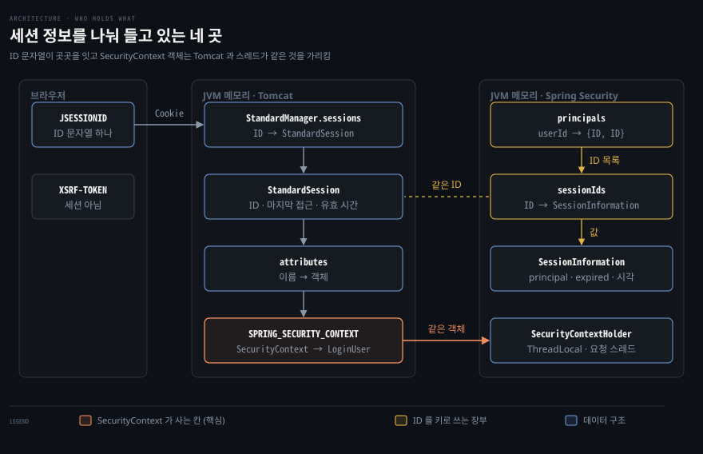

뒤 절에서 이 상자를 하나씩 엽니다. 먼저 Tomcat 안쪽 세 칸을, 다음에 쿠키가 지워지는 규칙을, 그다음에 Spring 쪽 두 곳을 봅니다.


## 세션은 연결이 아니라 Tomcat 메모리의 데이터 묶음입니다

> 브라우저가 들고 있는 것은 32자리 ID 쿠키 하나이고, 로그인 사용자 정보는 Tomcat JVM 메모리의 `StandardSession` 안에 있습니다.

로그인 응답에는 세션 쿠키를 심으라는 헤더가 실려 옵니다. 예제 앱에 로그인 요청을 보내 얻은 헤더입니다. ID 값은 앞 8자리만 적었습니다.

```pseudocode
POST /api/public/auth/login  →  200
Set-Cookie: JSESSIONID=DBB89ED9…; Path=/; HttpOnly; SameSite=Lax
```

`HttpOnly` 는 화면의 자바스크립트가 이 쿠키를 읽지 못하게 막습니다. `SameSite=Lax` 는 다른 사이트에서 시작된 하위 요청에 쿠키를 싣지 않게 합니다. `Path=/` 의 뜻은 다음 절에서 풉니다.

브라우저가 하는 일은 이후 요청마다 `Cookie: JSESSIONID=<값>` 을 붙이는 것뿐입니다. 사용자의 이름이나 역할은 쿠키에 없습니다.

사용자 정보는 서버 메모리에 있습니다. Tomcat 의 세션 관리자 `ManagerBase` 는 `sessions` 라는 맵을 들고 있습니다[^tomcat-session]. 타입은 `Map<String, Session>` 이고 실제 객체는 `ConcurrentHashMap` 입니다. 키가 세션 ID 이고 값이 `StandardSession` 입니다.

`StandardSession` 은 사용자 속성을 `attributes` 맵에 담습니다. 타입은 `ConcurrentMap<String, Object>` 입니다.

로그인 결과인 `SecurityContext` 를 이 속성 맵에 넣는 클래스는 `HttpSessionSecurityContextRepository` 입니다. Spring Security 가 제공합니다. 속성 이름은 `SPRING_SECURITY_CONTEXT` 입니다[^spring-security].

예제 앱에서 그 `SecurityContext` 안에는 `UsernamePasswordAuthenticationToken` 이 있습니다. 토큰의 주체는 `LoginUser(userId, email, userName)` 레코드이고, 세션에 들어가는 객체라서 `Serializable` 을 구현합니다. 별도 JVM 을 띄워 세션 두 개를 만들고 로그인 결과를 넣어 본 구조는 다음과 같습니다.

```pseudocode
StandardManager.sessions       ConcurrentHashMap, 키는 32자 ID, 값은 StandardSession
 └ StandardSession.attributes  ConcurrentHashMap
    └ SPRING_SECURITY_CONTEXT  SecurityContextImpl
       └ Authentication        UsernamePasswordAuthenticationToken (주체: LoginUser)
```

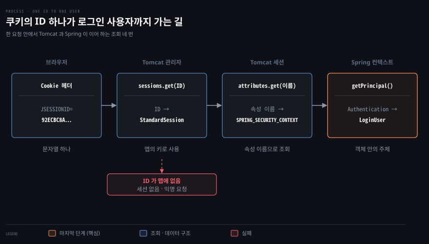

도식은 같은 요청이 ID 하나로 네 번 조회하는 순서입니다. 브라우저가 보낸 문자열이 `sessions` 맵의 키가 됩니다. 그 값인 세션이 속성 맵을 엽니다.

속성 맵에서 꺼낸 컨텍스트 안에 `LoginUser` 가 있습니다. 둘째 단계에서 ID 가 맵에 없으면 세션이 없는 익명 요청으로 끝납니다.

이 관찰은 실행 중인 앱의 힙을 들여다본 것이 아닙니다. 같은 버전의 Tomcat 과 Spring 클래스를 별도 JVM 에서 띄워 필드를 읽었습니다.

세션이 사라지는 길은 둘입니다. 하나는 요청이 올 때입니다. `isValid()` 가 마지막 접근 이후 흐른 시간을 최대 비활성 시간과 비교하고, 넘었으면 `expire(true)` 를 부릅니다.

다른 하나는 요청이 없을 때입니다. Tomcat 배경 작업이 `processExpires()` 로 전체 세션을 훑습니다. 기본은 `backgroundProcess` 호출 6번에 한 번입니다. `expire` 는 파기 이벤트를 알린 뒤 관리자 맵에서 자기를 뺍니다.

유효 시간은 `server.servlet.session.timeout` 이 정합니다. 이 값은 설정으로 바뀔 수 있으므로 이 문서의 결론은 특정 값에 기대지 않습니다.


## 쿠키는 이름·도메인·경로로 구분되므로 삭제 쿠키의 Path 가 맞아야 지워집니다

> `Path` 는 쿠키를 어떤 URL 경로의 요청에 붙여 보낼지 정하는 속성이고, 브라우저는 이름·도메인·경로가 모두 같아야 같은 쿠키로 봅니다.

`Path=/` 는 이 쿠키를 사이트의 모든 경로 요청에 붙이라는 뜻입니다. `Path=/api` 라면 요청 경로가 `/api` 나 `/api/…` 처럼 그 접두사로 시작할 때만 붙습니다. 이것이 RFC 6265 의 경로 일치 규칙입니다[^rfc6265].

예를 들어 요청 주소가 `/api/my/logout` 이고 쿠키의 `Path` 가 `/` 면 쿠키가 붙습니다. 쿠키의 `Path` 가 `/admin` 이면 붙지 않습니다.

문제는 쿠키를 지울 때 생깁니다. 서버가 쿠키를 지우는 방법은 이미 지난 만료 시각을 단 같은 이름의 쿠키를 보내는 것뿐입니다. 브라우저는 새로 받은 쿠키와 이름·도메인·경로가 모두 같은 기존 쿠키를 찾아 교체합니다.

경로가 다르면 다른 쿠키로 취급합니다. 원래 쿠키는 그대로 남습니다.

이 규칙을 curl 의 쿠키 저장소로 관찰했습니다. curl 은 브라우저가 아니지만 같은 RFC 6265 규칙으로 쿠키를 저장하고 요청에 싣습니다. 8099 포트에 임시 서버를 띄워 `Path=/` 로 심은 쿠키를 `Path=/api` 삭제 쿠키와 `Path=/` 삭제 쿠키로 차례로 지워 보았습니다.

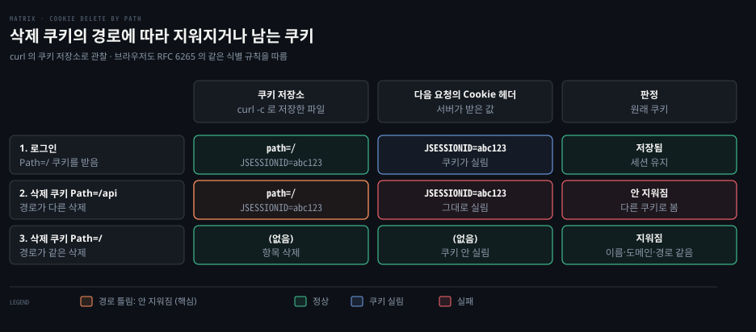

세 단계를 위에서 아래로 읽습니다. 1행에서 `Path=/` 로 받은 쿠키가 저장소에 들어갑니다. 2행에서 `Path=/api` 삭제 쿠키를 받아도 저장소의 항목이 그대로이고, 다음 요청에도 `Cookie: JSESSIONID=abc123` 이 실려 갑니다. 3행에서 `Path=/` 삭제 쿠키를 받아야 항목이 사라지고 다음 요청에 쿠키가 실리지 않습니다.

경로를 틀린 삭제 쿠키는 아무것도 지우지 못했습니다. 사용자는 로그아웃한 줄 알지만 세션 ID 쿠키는 계속 나갑니다.

예제 앱이 경로를 맞추는 방식은 이렇습니다. 세션 쿠키는 Tomcat 이 컨텍스트 경로를 `Path` 로 달아 만듭니다. 예제 앱의 컨텍스트 경로는 비어 있어서 `Path=/` 입니다.

삭제 쪽은 `CookieClearingLogoutHandler` 가 같은 경로를 만듭니다. 컨텍스트 경로가 비면 `/` 를 씁니다. 예제 앱의 비밀번호 변경 컨트롤러도 같은 식으로 삭제 쿠키를 만듭니다.

예제 앱의 로그아웃 응답에 실린 삭제 헤더는 다음과 같았습니다.

```pseudocode
Set-Cookie: JSESSIONID=; Expires=Thu, 01 Jan 1970 00:00:10 GMT; Path=/; SameSite=Lax
```

코드에서는 `setMaxAge(0)` 으로 지시했는데 응답에는 `Max-Age=0` 이 아니라 1970년의 `Expires` 만 나갑니다. Tomcat 의 `Rfc6265CookieProcessor` 가 `maxAge` 가 0 이면 `Expires` 에 과거 고정 시각을 쓰기 때문입니다. `Max-Age` 는 0 이 아닐 때만 붙습니다[^tomcat-cookie].

도메인 속성이 없는 쿠키는 만든 호스트에만 묶입니다. 도메인도 쿠키 식별자의 일부입니다. 예제 앱은 도메인을 지정하지 않아 기본 호스트에만 묶입니다.

| 확인한 것 | 원문 위치 |
|---|---|
| 삭제 쿠키 경로를 컨텍스트 경로 또는 `/` 로 만듦 | Spring `CookieClearingLogoutHandler.java` 50~53줄 |
| `maxAge` 0 이면 `Expires` 만 씀 | Tomcat `Rfc6265CookieProcessor.java` 141~151줄 |


## HttpSession, SessionRegistry, SecurityContextHolder 가 들고 있는 것

> 같은 사용자의 세션 정보라도 세 객체는 담는 내용, 키, 수명이 모두 달라서 사라지는 시점도 따로입니다.

| 곳 | 들고 있는 것 | 구조 | 생기는 때 | 사라지는 때 |
|---|---|---|---|---|
| Tomcat `HttpSession` | 속성 맵(`SPRING_SECURITY_CONTEXT` 등), 마지막 접근 시각 | `sessions` 맵: ID → `StandardSession` | 로그인에서 `saveContext`·`getSession` 이 부를 때 | `invalidate()`, 유효 시간 초과 |
| Spring `SessionRegistry` | ID 장부: 사용자별 ID 집합, ID별 정보 | `principals`, `sessionIds` 맵 | 로그인에서 `register` 를 부를 때 | 세션 파기 이벤트가 도착할 때 |
| `SecurityContextHolder` | `SecurityContext` 참조 하나 | 스레드 로컬 | 요청 중 처음 꺼낼 때 세션에서 복원 | 요청이 끝나는 `finally` |

### SessionRegistry 는 HttpSession 을 쥐지 않고 ID 문자열 장부만 듭니다

`SessionRegistryImpl` 은 맵 둘을 가집니다.

- `principals`: `ConcurrentMap<Object, Set<String>>` 타입이고, 사용자 하나가 가진 세션 ID 집합을 듭니다.
- `sessionIds`: `Map<String, SessionInformation>` 타입이고, ID 하나의 정보를 듭니다.

`SessionInformation` 의 필드는 `lastRequest`, `principal`, `sessionId`, `expired` 넷뿐입니다. `HttpSession` 에 대한 참조는 없습니다.

그래서 장부는 다른 사용자의 세션을 직접 지울 수 없습니다. 장부가 가진 것은 ID 문자열입니다. 그 ID 로 `HttpSession` 객체를 꺼낼 표준 방법이 서블릿에는 없습니다.

장부로 할 수 있는 일은 `expired` 를 `true` 로 표시하는 것까지입니다. [02-02](./02-02.SessionInformation·ConcurrentSessionFilter·LogoutFilter.md)의 지연 무효화 구조가 여기서 나옵니다.

장부의 키는 `LoginUser` 가 아니라 `Long userId` 입니다. 로그인 코드가 `registerNewSession(sessionId, userId)` 로 올리기 때문입니다. 이름이 바뀌면 `LoginUser` 레코드의 `equals` 가 달라져 같은 사람으로 잡히지 않습니다. 그래서 바뀌지 않는 숫자 ID 를 키로 씁니다.

별도 JVM 에서 사용자 1의 세션 둘과 사용자 2의 세션 하나를 올려 본 값입니다.

```pseudocode
principals[1 (Long)] = CopyOnWriteArraySet 크기 2
principals[2 (Long)] = CopyOnWriteArraySet 크기 1
sessionIds[…]        = SessionInformation(principal=1, expired=false, lastRequest 있음)
expireNow() 호출 뒤
getAllSessions(1, false) → 0건
getAllSessions(1, true)  → 2건
```

`getAllSessions(principal, false)` 는 만료 표시된 세션을 빼고 돌려줍니다. 한 번 `expireAll` 을 부른 사용자에게 다시 부르면 끊을 세션이 0건으로 잡히는 이유입니다.

장부에서 항목이 빠지는 길은 하나입니다. `SessionRegistryImpl.onApplicationEvent` 가 `SessionDestroyedEvent` 를 받으면 `removeSessionInformation` 을 부릅니다.

그 이벤트는 `HttpSessionEventPublisher` 가 만듭니다. 서블릿의 `sessionDestroyed` 를 Spring 이벤트로 바꿔 주는 클래스입니다. `SecurityConfig` 가 이 클래스를 빈으로 등록합니다. 빈이 없으면 세션이 파기돼도 장부에 ID 가 남습니다.

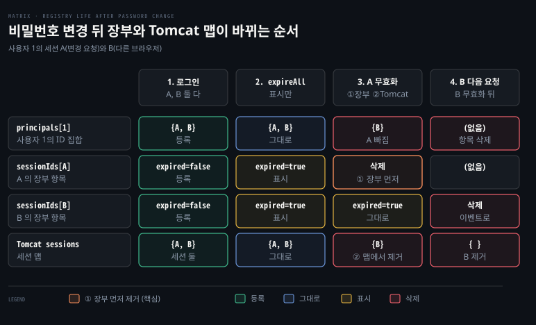

같은 두 세션 A, B 를 시점마다 다시 그렸습니다. 2열에서 `expireAll` 은 장부의 `expired` 만 `true` 로 바꾸고 Tomcat 맵은 그대로입니다. 3열에서 A 를 무효화하면 `invalidate()` 한 번 안에서 장부의 A 가 먼저 빠지고(주황 칸), 이어 Tomcat 맵에서 A 가 빠집니다. B 는 4열에서 다음 요청이 와서 무효화된 뒤에야 양쪽에서 사라집니다.

### SecurityContextHolder 는 요청 하나 동안의 스레드 로컬 참조입니다

`SecurityContextHolder` 는 `SecurityContext` 를 담고, `SecurityContext` 는 `Authentication` 을 담습니다. 아래는 Spring Security 공식 문서의 그림입니다.

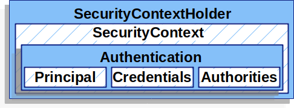

그림 출처: Spring Security 7.1.1 태그의 문서 그림 <https://github.com/spring-projects/spring-security/blob/7.1.1/docs/modules/ROOT/assets/images/servlet/authentication/architecture/securitycontextholder.png>

라이선스: Apache License 2.0. 원본을 수정하지 않고 가져왔습니다.

`ThreadLocalSecurityContextHolderStrategy` 는 `ThreadLocal<Supplier<SecurityContext>>` 하나를 가집니다. 스레드마다 따로 보이므로 다른 스레드에서는 비어 있습니다.

요청의 생애는 `SecurityContextHolderFilter` 가 감쌉니다. 요청이 오면 저장소에 "필요할 때 세션에서 꺼내라"는 지연 공급자를 맡깁니다. 체인이 끝나면 `finally` 에서 `clearContext` 를 부릅니다.

세션에서 꺼내는 일은 `HttpSessionSecurityContextRepository` 가 합니다. 처음 `getContext()` 가 불릴 때 `request.getSession(false)` 로 세션을 찾아 `SPRING_SECURITY_CONTEXT` 속성을 읽습니다. 세션이 없으면 비어 있는 컨텍스트가 됩니다.

여기서 눈여겨볼 것은 꺼낸 것이 사본이 아니라는 점입니다. 별도 JVM 에서 같은 `SecurityContext` 를 세션 속성과 스레드 로컬에 넣고 비교하니 두 참조가 같은 객체였습니다.

```pseudocode
같은 스레드에서 getContext().getAuthentication() != null    → true
다른 스레드에서 getContext().getAuthentication() != null    → false
스레드 로컬의 컨텍스트 == 세션 속성의 컨텍스트             → true
```

| 확인한 것 | 원문 위치 |
|---|---|
| `principals`, `sessionIds` 의 타입 | Spring `SessionRegistryImpl.java` 56줄, 59줄 |
| `SessionInformation` 의 필드 | Spring `SessionInformation.java` 43~49줄 |
| 파기 이벤트로 항목 삭제 | Spring `SessionRegistryImpl.java` 103~107줄 |
| 서블릿 이벤트를 Spring 이벤트로 | Spring `HttpSessionEventPublisher.java` 73~75줄 |
| 스레드 로컬 필드 | Spring `ThreadLocalSecurityContextHolderStrategy.java` 34줄 |
| 지연 공급자와 `finally` 에서 비움 | Spring `SecurityContextHolderFilter.java` 79줄, 84~86줄 |
| 세션 속성에서 읽기 | Spring `HttpSessionSecurityContextRepository.java` 145~148줄, 207~235줄 |


## 로그인 정보 지우기와 세션 지우기는 지우는 대상이 다릅니다

> `clearContext` 는 스레드 로컬의 참조만 비우고, 세션과 그 안의 인증 정보는 `invalidate` 가 지웁니다.

앞 절의 "같은 객체"가 중요해지는 곳이 여기입니다. 스레드 로컬과 세션 속성이 같은 `SecurityContext` 를 가리키므로, 어떤 동작이 어느 쪽 연결을 끊는지에 따라 결과가 달라집니다.

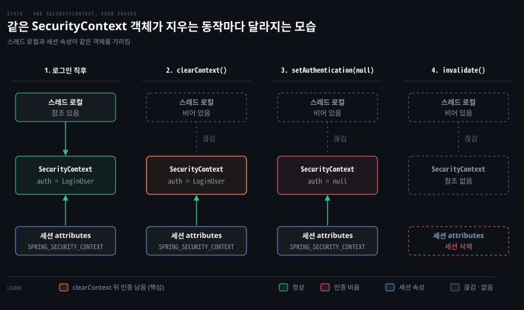

네 칸을 왼쪽부터 읽습니다. 2칸의 `clearContext()` 는 스레드 쪽 화살표만 끊고, 세션 속성이 아직 객체를 가리키며 인증도 그대로입니다(주황 칸). 3칸의 `setAuthentication(null)` 은 객체 안의 인증을 비웁니다. 4칸의 `invalidate()` 가 세션 속성을 지워 객체에 닿는 길이 모두 사라집니다.

세션 하나에 로그인 결과를 넣고 지우는 동작을 하나씩 해 가며 네 곳의 상태를 읽은 값이 아래 표입니다. 별도 JVM 에서 한 관찰입니다.

| 동작 | 스레드 로컬 인증 | 세션의 `SPRING_SECURITY_CONTEXT` 속성 | 그 속성 안의 인증 | Tomcat `sessions` 맵의 항목 |
|---|---|---|---|---|
| 로그인 직후 | 있음 | 있음 | 있음 | 있음 |
| `clearContext()` | 없음 | 있음 | 있음 | 있음 |
| `context.setAuthentication(null)` | 없음 | 있음 | 없음 | 있음 |
| `session.invalidate()` | 없음 | 사라짐 | 사라짐 | 없음 |

`clearContext()` 만으로는 세션에 아무 일도 일어나지 않습니다. 다음 요청이 오면 `SecurityContextHolderFilter` 가 같은 ID 의 세션에서 속성을 다시 꺼냅니다. 그래서 컨트롤러에서 `clearContext()` 만 부르고 끝내면 사용자는 로그인된 채로 남습니다.

이 결론은 지연 복원 구조에서 따라 나오는 것이고, 앱에 대고 실행해 확인하지는 않았습니다. 인증을 확실히 없애려면 세션 자체를 `invalidate()` 해야 합니다.

`SecurityContextLogoutHandler.logout` 이 이 세 가지를 모두 합니다. 순서는 이렇습니다.

1. 세션이 있으면 `invalidate()` 합니다. Tomcat 맵에서 항목이 빠집니다.
2. `clearContext()` 로 스레드 로컬을 비웁니다.
3. 꺼내 둔 컨텍스트의 `setAuthentication(null)` 로 인증도 지웁니다.
4. 빈 컨텍스트를 저장소에 저장합니다.

3번을 따로 하는 이유를 소스의 `setClearAuthentication` 설명은 동시 요청에서 생기는 문제를 막기 위해서라고만 적습니다. 같은 객체를 이미 들고 있는 다른 요청이 인증을 계속 쓰는 경우를 막는 장치로 읽을 수 있습니다.

세 번째 곳인 장부는 앞서 별도 JVM 관찰에서는 리스너가 없어 `invalidate()` 직후에도 남아 있었습니다. 하지만 `HttpSessionEventPublisher` 빈이 등록돼 있으면 `invalidate()` 안에서 리스너가 먼저 불려 장부에서 먼저 빠집니다. 앞 절의 장부 도식 3열이 그 순간입니다.

지우는 일은 세 곳에서 따로 일어납니다. 장부는 이벤트가 이어 줘야 따라옵니다. 실제 애플리케이션에서는 `HttpSessionEventPublisher` 빈이 이 이벤트를 전달합니다.

| 확인한 것 | 원문 위치 |
|---|---|
| `invalidate`, `clearContext`, `setAuthentication(null)`, 빈 컨텍스트 저장 | Spring `SecurityContextLogoutHandler.java` 74줄, 81줄, 83줄, 86줄 |
| 속성 맵과 항목 제거 | Tomcat `StandardSession.java` 647줄 |


## LogoutFilter 가 요청을 가로채면 컨트롤러는 호출되지 않습니다

> 가로챈다는 것은 필터가 URL 을 보고 직접 로그아웃을 처리한 뒤 응답을 끝내고 체인을 넘기지 않는다는 뜻입니다. 예제 앱에는 로그아웃 컨트롤러가 없습니다.

### 필터 체인에서 필터는 요청을 끝낼 수 있습니다

서블릿 필터는 요청이 컨트롤러까지 가는 길에 줄지어 선 검문소입니다. 필터 하나는 `chain.doFilter` 를 불러 다음으로 넘길 수도 있고, 부르지 않고 그 자리에서 응답을 끝낼 수도 있습니다. 아래는 Spring Security 공식 문서의 필터 체인 그림입니다.

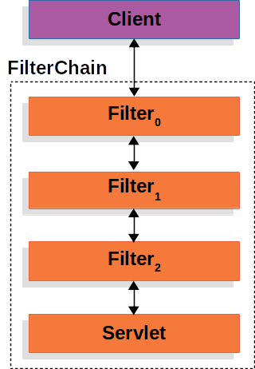

그림 출처: Spring Security 7.1.1 태그의 문서 그림 <https://github.com/spring-projects/spring-security/blob/7.1.1/docs/modules/ROOT/assets/images/servlet/architecture/filterchain.png>

라이선스: Apache License 2.0. 원본을 수정하지 않고 가져왔습니다.

### LogoutFilter 는 응답을 쌓고 체인을 넘기지 않습니다

`LogoutFilter` 의 핵심은 짧습니다.

```java
if (requiresLogout(request, response)) {
    Authentication auth = this.securityContextHolderStrategy.getContext().getAuthentication();
    this.handler.logout(request, response, auth);
    this.logoutSuccessHandler.onLogoutSuccess(request, response, auth);
    return;
}
chain.doFilter(request, response);
```

URL 이 로그아웃 주소와 맞으면 핸들러들을 돌립니다. 성공 핸들러가 응답을 쓰고 `return` 으로 끝납니다. `chain.doFilter` 가 불리지 않으므로 뒤에 있는 필터와 컨트롤러는 이 요청을 보지 못합니다.

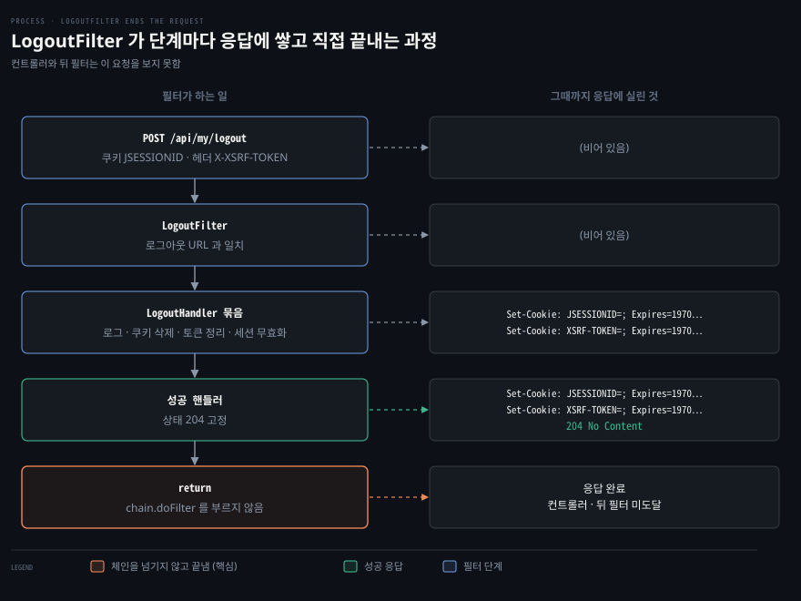

오른쪽 열이 같은 행까지 응답에 실린 것입니다. 3행의 핸들러 묶음이 삭제 쿠키 두 줄을 싣습니다. 4행에서 상태 204 가 붙고 5행의 `return` 이 응답을 완료합니다.

두 `Set-Cookie` 줄의 순서는 예제 앱 응답에서 읽은 그대로입니다.

맞지 않는 요청은 아래 줄의 `chain.doFilter` 로 그대로 넘어갑니다. 예제 앱에서 `POST /api/my/logout` 을 받는 컨트롤러 메서드는 없습니다. 필터 하나가 처음부터 끝까지 처리합니다.

처리 내용은 `SecurityConfig` 의 로그아웃 설정이 정합니다.

- 로그아웃 주소를 `/api/my/logout` 으로 정합니다.
- 로그를 남기는 `LogoutLogHandler` 를 더합니다.
- `deleteCookies("JSESSIONID")` 로 쿠키 삭제를 켭니다.
- 성공 응답을 204 로 고정합니다.

세션 무효화와 `SecurityContext`·CSRF 토큰 정리는 Spring 기본 핸들러가 처리합니다.

로그아웃 때 세션 쿠키를 지우는 주체는 `deleteCookies` 가 만드는 `CookieClearingLogoutHandler` 입니다. 이 핸들러는 요청 컨텍스트에 맞는 `Path` 와 `maxAge 0` 을 단 쿠키를 만들어 `response.addCookie` 로 응답에 싣습니다. 앞 절의 `Path` 규칙이 여기서 쓰입니다.

예제 앱에서 로그인한 세션으로 로그아웃을 부르고, 같은 ID 로 한 번 더 부른 응답입니다.

```pseudocode
POST /api/my/logout (살아 있는 세션)   → 204
   Set-Cookie: JSESSIONID=; Expires=Thu, 01 Jan 1970 00:00:10 GMT; Path=/; SameSite=Lax
   Set-Cookie: XSRF-TOKEN=; Expires=Thu, 01 Jan 1970 00:00:10 GMT; Path=/
GET  /api/my/account (파기된 ID)       → 401
POST /api/my/logout (파기된 ID)        → 204, 같은 삭제 쿠키 두 줄
```

이미 끝난 세션으로 불러도 똑같이 204 가 나옵니다. 화면은 결과와 상관없이 로그인 화면으로 가면 되므로 이 동작이 맞습니다. 이것이 [02-02](./02-02.SessionInformation·ConcurrentSessionFilter·LogoutFilter.md)가 다루는 필터 순서와 이어집니다.

한 가지 더 눈에 띈 것이 있습니다. 요청 캐시를 끄기 전에 관찰했을 때, 파기된 ID 로 보낸 `GET /api/my/account` 의 401 응답에도 새 `Set-Cookie: JSESSIONID=…` 가 따라왔습니다. 원인은 Spring Security 의 기본 `HttpSessionRequestCache` 가 돌아갈 원래 주소를 `SPRING_SECURITY_SAVED_REQUEST` 로 세션에 저장했기 때문이었습니다.

화면이 이동 경로를 직접 관리하므로 예제 앱은 `requestCache.disable()` 로 서버 요청 캐시를 껐습니다. 그 뒤 curl 로 보낸 로그인 전 401 응답에는 `JSESSIONID` 가 없었습니다.

| 확인한 것 | 원문 위치 |
|---|---|
| 일치하면 핸들러를 돌리고 `return` | Spring `LogoutFilter.java` 99~111줄 |
| 쿠키를 응답에 싣는 곳 | Spring `CookieClearingLogoutHandler.java` 78줄 |


## 네 장면에서 네 곳이 하는 일

> 로그인, 일반 요청, 비밀번호 변경, 로그아웃 네 장면에서 쿠키, Tomcat 맵, 장부, 스레드 로컬이 각각 무엇을 하는지 한눈에 봅니다.

비밀번호 변경에서 세션이 어떻게 갈리는지는 네 곳을 동시에 봐야 보입니다. 한 곳씩 읽으면 "지금 세션은 지우고 다른 세션은 표시만 한다"는 말이 어디서 어떻게 일어나는지 놓칩니다.

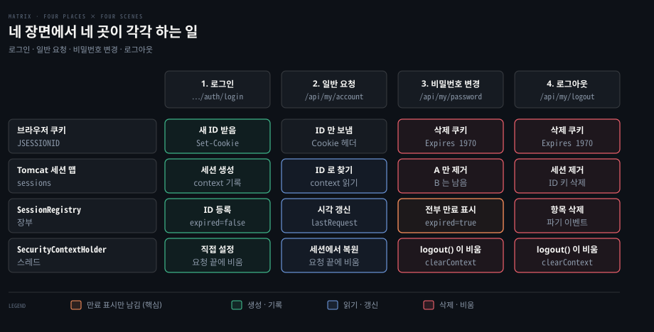

가로는 장면이고 세로는 앞 절에서 본 네 곳입니다. 칸마다 그 장면에서 그곳에 일어나는 일이 적혀 있습니다.

초록은 생성과 기록, 파랑은 읽기와 갱신, 빨강은 삭제와 비움입니다.

주황색 칸 하나가 비밀번호 변경에서 장부가 하는 일입니다. 세 번째 열을 가장 눈여겨보면 됩니다.

### 로그인

`SessionLogin.login` 이 네 가지를 차례로 합니다.

1. 로그인 전 세션이 있으면 `changeSessionId` 로 ID 만 바꿉니다.
2. CSRF 토큰을 새 값으로 바꿉니다.
3. 인증을 스레드 로컬에 두고 `saveContext` 로 세션 속성에 기록합니다.
4. `request.getSession().getId()` 를 장부에 올립니다.

로그인 응답은 새 ID 를 `Set-Cookie` 로 내려 줍니다.

### 일반 요청

브라우저는 ID 쿠키만 보냅니다. `SecurityContextHolderFilter` 가 세션에서 컨텍스트를 복원합니다. `ConcurrentSessionFilter` 는 장부에서 ID 를 찾아 만료 표시가 없으면 마지막 요청 시각을 갱신합니다(`ConcurrentSessionFilter.java` 150줄). 요청이 끝나면 스레드 로컬이 비워집니다.

### 비밀번호 변경

순서는 이렇습니다.

1. 컨트롤러가 `expireAll(userId)` 로 이 사람의 세션 전부에 만료 표시를 합니다.
2. 바로 이어 `SecurityContextLogoutHandler` 로 지금 요청의 세션만 그 자리에서 무효화합니다.
3. 삭제 쿠키를 응답에 싣습니다.

다른 브라우저의 세션은 Tomcat 메모리에 그대로 남습니다. 그 브라우저의 다음 요청에서 `ConcurrentSessionFilter` 가 만료 표시를 보고 끊습니다. 예제 앱은 만료 전략을 지정해 이때 401 을 돌려줍니다. 자세한 흐름은 [02-02](./02-02.SessionInformation·ConcurrentSessionFilter·LogoutFilter.md)의 도식이 그립니다.

### 로그아웃

앞 절 그대로입니다. 필터가 세션을 `invalidate()` 하고 삭제 쿠키 둘을 싣고 204 로 끝냅니다. 장부는 `invalidate()` 안에서 리스너가 먼저 불려 동기로 정리됩니다.


## CSRF 토큰은 세션이 아니라 쿠키에 있어서 세션이 사라져도 남습니다

> 예제 앱은 CSRF 토큰을 세션 속성이 아니라 `XSRF-TOKEN` 쿠키 기반으로 관리하므로, 세션이 끊긴 뒤에도 첫 로그인 POST 가 통과합니다.

CSRF 토큰 저장소는 `CookieCsrfTokenRepository.withHttpOnlyFalse()` 입니다. 토큰은 브라우저의 `XSRF-TOKEN` 쿠키에 있습니다. 화면의 자바스크립트가 이 값을 읽어 `X-XSRF-TOKEN` 헤더에 실어 보냅니다. 서버는 쿠키와 헤더의 값이 같은지 비교합니다.

토큰이 서버 세션 안에 없으므로 세션이 파기돼도 토큰 검증 구조 자체가 무너지지 않습니다. 비밀번호 변경은 세션만 무효화하므로 브라우저에 `XSRF-TOKEN` 쿠키가 그대로 남습니다. 반면 로그아웃은 `CsrfLogoutHandler` 가 `XSRF-TOKEN` 쿠키까지 함께 지웁니다. 하지만 화면이 로그인 페이지로 이동하면서 진입 요청(`GET /api/my/account` 401)을 보내면, `CsrfCookieFilter` 가 새 토큰을 내려 줍니다. 어느 쪽이든 새 로그인 POST 가 CSRF 토큰 때문에 막히지 않습니다.

예제 앱에서 `XSRF-TOKEN` 쿠키와 `X-XSRF-TOKEN` 헤더에 같은 임의 값을 실어 세션 없이 로그인하자 200 이 돌아왔습니다.

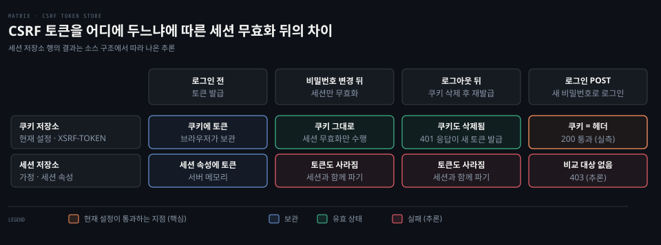

위 행이 현재 설정이고, 아래 행이 토큰을 세션 속성에 저장하는 저장소를 가정한 경우입니다. 세션 무효화 뒤(비밀번호 변경 · 로그아웃)와 로그인 POST 열에서 두 행이 갈립니다.

토큰을 세션 속성에 저장하는 저장소를 썼다면 어떻게 될까요?

파기된 세션과 함께 토큰이 사라집니다. 헤더 값과 맞출 대상이 없어져 403 이 되었을 것입니다. 이 답은 저장소 구조에서 따라 나오는 추론이고, 저장소를 바꿔 실행해 보지는 않았습니다.

로그인 성공 때 토큰을 새 값으로 바꾸는 일은 `SessionLogin` 이 직접 합니다. 토큰 저장소와 처리기가 어떻게 짝을 이루는지는 [02-01](./02-01.CsrfFilter·CookieCsrfTokenRepository·SecurityContextRepository.md)의 CSRF 절이 다룹니다.


## 서버가 여러 대가 되면 이 구조가 맞지 않습니다

> 세션 맵과 장부가 모두 한 JVM 의 메모리에 있어서, 요청이 다른 서버로 가면 그 서버는 세션도 장부도 모릅니다.

`sessions` 맵은 Tomcat 프로세스 하나의 `ConcurrentHashMap` 입니다. `principals`·`sessionIds` 장부도 한 프로세스의 `ConcurrentHashMap` 입니다.

서버가 두 대가 되면 A 서버에 로그인한 사용자의 요청이 B 서버로 갈 때 B 에는 ID 에 대응하는 세션이 없습니다. `expireAll` 로 표시한 만료도 그 서버의 장부에만 남습니다.

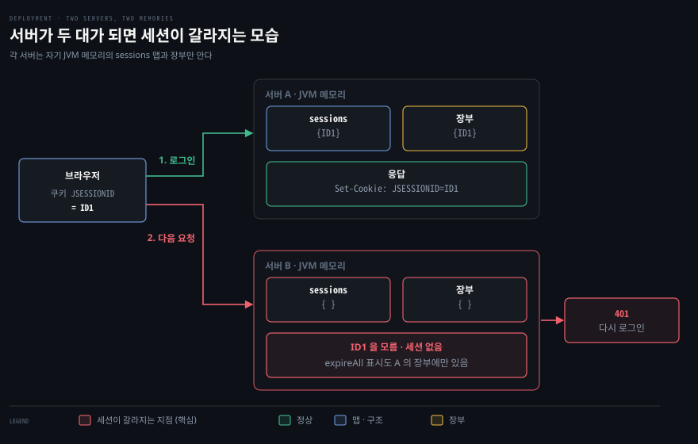

1번 로그인은 서버 A 의 맵과 장부에 ID1 을 남깁니다. 2번 다음 요청이 서버 B 로 가면 B 의 맵과 장부는 비어 있어 401 이 됩니다. 이 그림은 맵 구조에서 따라 나온 것이고 서버 두 대로 실행해 확인하지는 않았습니다.

서버가 두 대 이상으로 늘어나면 외부 세션 저장소(Spring Session 등)가 필요합니다. 대안 세 가지의 비교는 [02-02의 대안과 선택](./02-02.SessionInformation·ConcurrentSessionFilter·LogoutFilter.md#대안과-선택)이 다룹니다.


## 스스로 확인할 질문

> 본문의 핵심 인과를 스스로 점검할 수 있는 다섯 가지 질문입니다.

- 질문 1: 브라우저의 쿠키에는 무엇이 들어 있고, 로그인한 사용자의 이름과 역할은 서버의 어느 맵의 어느 칸에 있습니까?
- 질문 2: `SessionRegistry` 가 `HttpSession` 객체를 들고 있지 않다면 장부의 `expired` 표시로 할 수 있는 일과 할 수 없는 일은 각각 무엇입니까?
- 질문 3: 컨트롤러에서 `SecurityContextHolder.clearContext()` 만 부르고 응답을 끝내면 사용자의 다음 요청은 로그인된 상태입니까, 아닙니까? 그 이유를 세션 속성과 스레드 로컬의 관계로 설명해 보십시오.
- 질문 4: `POST /api/my/logout` 을 처리하는 컨트롤러 메서드가 없는데도 204 가 나가는 이유는 무엇이며, 세션 쿠키는 누가 어떤 경로로 지웁니까?
- 질문 5: 서버가 `Path=/` 로 심은 쿠키를 `Path=/api` 삭제 쿠키로 지우려 하면 쿠키는 지워집니까? 지워지지 않는다면 브라우저는 무엇을 근거로 다른 쿠키라고 판단합니까?


## 출처와 관련 문서

> 본문 도식과 관찰의 근거 위치, 관찰 방법, 관련 문서입니다.

### 도식 값과 원문 위치

`01-02.four-places.svg` 의 값입니다. 라이브러리 줄 번호는 Tomcat 11.0.24 와 Spring Security 7.1.1 태그의 소스 기준입니다.

| 도식의 값 | 원문 위치 |
|---|---|
| `StandardManager.sessions`, `ID → StandardSession` | Tomcat `ManagerBase.java` 147줄 |
| `StandardSession` 의 `attributes` | Tomcat `StandardSession.java` 112줄 |
| `SPRING_SECURITY_CONTEXT` | Spring `HttpSessionSecurityContextRepository.java` 92줄, 179줄 |
| `principals`: userId → {ID, ID} | Spring `SessionRegistryImpl.java` 56줄 |
| `sessionIds`: ID → `SessionInformation` | Spring `SessionRegistryImpl.java` 59줄 |
| `principal · expired · 시각` | Spring `SessionInformation.java` 43~49줄 |
| `SecurityContextHolder` 의 `ThreadLocal` | Spring `ThreadLocalSecurityContextHolderStrategy.java` 34줄 |
| `JSESSIONID`, `XSRF-TOKEN` 별도 쿠키 | 예제 앱 로그인 응답의 `Set-Cookie`, `CookieCsrfTokenRepository` |
| `같은 객체` 화살표 | 별도 JVM 관찰: 스레드 로컬 컨텍스트 == 세션 속성 컨텍스트 |

`01-02.four-scenes.svg` 의 값입니다.

| 도식의 값 | 원문 위치 |
|---|---|
| 새 ID 받음 `Set-Cookie`, ID 만 보냄 `Cookie 헤더` | 예제 앱 로그인·일반 요청의 헤더 관찰 |
| 삭제 쿠키 `Expires 1970` | 예제 앱 로그아웃 응답 관찰 |
| ID 로 찾기 `context 읽기`, 세션에서 복원 | Spring `HttpSessionSecurityContextRepository.java` 145~148줄, 207~235줄 |
| 세션 제거 `ID 키 삭제` | Tomcat `StandardSession.java` 647줄, 별도 JVM 관찰 |
| ID 등록 `expired=false` | Spring `SessionInformation.java` 49줄 |
| 시각 갱신 `lastRequest` | Spring `ConcurrentSessionFilter.java` 150줄 |
| 항목 삭제 `파기 이벤트` | Spring `SessionRegistryImpl.java` 103~107줄, `HttpSessionEventPublisher.java` 73~75줄 |
| 직접 설정, 요청 끝에 비움 | Spring `SecurityContextHolderFilter.java` 84~86줄 |
| `logout()` 이 비움 `clearContext` | Spring `SecurityContextLogoutHandler.java` 81줄 |

`01-02.lookup-path.svg` 의 값입니다.

| 도식의 값 | 원문 위치 |
|---|---|
| `Cookie 헤더`, `JSESSIONID=` | 예제 앱 로그인·일반 요청의 헤더 관찰 |
| `sessions.get(ID)` → `StandardSession` | Tomcat `ManagerBase.java` 147줄 |
| `attributes.get(이름)`, `SPRING_SECURITY_CONTEXT` | Tomcat `StandardSession.java` 112줄, Spring `HttpSessionSecurityContextRepository.java` 92줄, 213줄 |
| ID 가 맵에 없음, 세션 없음 · 익명 요청 | Spring `HttpSessionSecurityContextRepository.java` 145~148줄(`getSession(false)`), 파기된 ID 요청이 401 이던 관찰 |

`01-02.path-delete.svg` 의 값입니다.

| 도식의 값 | 원문 위치 |
|---|---|
| `path=/ · JSESSIONID=abc123`, 쿠키 저장소와 `Cookie` 헤더의 세 단계 | 임시 서버와 curl 쿠키 저장소 관찰 |
| 이름·도메인·경로가 같아야 같은 쿠키 | RFC 6265 5.1.4, 5.3 |

`01-02.registry-life.svg` 의 값입니다.

| 도식의 값 | 원문 위치 |
|---|---|
| 3열 A 무효화, Tomcat 맵에서 A 제거 | Spring `SecurityContextLogoutHandler.java` 74줄 |
| 4열 장부에서 A 삭제, `principals` 크기 2 → 1 | Spring `SessionRegistryImpl.java` 103~107줄, 별도 JVM 관찰 |
| 5열 B 의 다음 요청에서 무효화 | Spring `ConcurrentSessionFilter.java` 140~146줄 |

`01-02.context-states.svg` 의 값입니다.

| 도식의 값 | 원문 위치 |
|---|---|
| 네 단계의 스레드 로컬·속성·인증·Tomcat 맵 상태 | 별도 JVM 관찰(`AFTER clearContext()` 등) |
| `invalidate`, `clearContext`, `setAuthentication(null)` | Spring `SecurityContextLogoutHandler.java` 74줄, 81줄, 83줄 |

`01-02.logout-trace.svg` 의 값입니다.

| 도식의 값 | 원문 위치 |
|---|---|
| 일치하면 핸들러 실행 뒤 `return` | Spring `LogoutFilter.java` 99~111줄 |
| `Set-Cookie` 두 줄과 204 | 예제 앱 로그아웃 응답 관찰 |

`01-02.csrf-store.svg` 의 값입니다.

| 도식의 값 | 원문 위치 |
|---|---|
| 쿠키 저장소, 쿠키 = 헤더 → 200 | `CookieCsrfTokenRepository`, 예제 앱 로그인 POST 관찰 |
| 세션 저장소 행의 결과 | 구조에서 따라 나온 추론(실행하지 않음) |

`01-02.two-servers.svg` 의 값입니다.

| 도식의 값 | 원문 위치 |
|---|---|
| 서버마다 `sessions` 와 장부를 따로 가짐 | Tomcat `ManagerBase.java` 147줄, Spring `SessionRegistryImpl.java` 56줄, 59줄 |
| 서버 B 의 401 | 구조에서 따라 나온 추론(서버 두 대로 실행하지 않음) |

### 가져온 그림과 참고 자료

본문의 그림 중 `_assets/ext/` 의 두 장은 직접 그린 것이 아니라 Spring Security 7.1.1 태그의 문서 그림을 그대로 내려받은 것입니다. 저장소 라이선스는 Apache License 2.0 입니다. 출처 URL 과 라이선스는 각 그림 바로 아래에 적었습니다.

Tomcat 공식 문서의 `webapps/docs/images` 에는 세션 구조를 그린 그림이 없어(CORS 흐름도 한 장뿐) 가져오지 않았습니다.

블로그와 기술 글의 스크린샷은 저작권 때문에 복사하지 않았습니다. 이 문서가 기대는 외부 자료는 아래 공식 문서입니다.

- [Spring Security Reference: Servlet Authentication Architecture](https://docs.spring.io/spring-security/reference/servlet/authentication/architecture.html): `SecurityContextHolder`, `SecurityContext`, `Authentication` 의 관계를 설명합니다.
- [Spring Security Reference: Architecture](https://docs.spring.io/spring-security/reference/servlet/architecture.html): 서블릿 필터 체인과 필터가 체인을 끊을 수 있다는 점을 설명합니다.
- [Apache Tomcat 11 Manager Component](https://tomcat.apache.org/tomcat-11.0-doc/config/manager.html): 세션 관리자 `StandardManager` 의 속성과 동작을 설명합니다.

### 관찰 기록

관찰은 Spring Boot + Spring Security 7.1.1 + Tomcat 11.0.24로 구성한 예제 앱과 별도 JVM 테스트에서 진행했습니다. 예제 앱에는 로그인과 로그아웃 요청을 보내 응답 헤더를 읽었습니다.

세션 내부 구조 관찰은 같은 버전의 Tomcat·Spring 클래스를 별도 JVM 에서 띄워 필드를 읽는 방식으로 확인했습니다. `Path` 관찰은 임시 HTTP 서버와 curl 쿠키 저장소로 진행했습니다.

### 관련 문서

- [02-01 CsrfFilter·CookieCsrfTokenRepository·SecurityContextRepository](./02-01.CsrfFilter·CookieCsrfTokenRepository·SecurityContextRepository.md)
- [02-02 SessionInformation·ConcurrentSessionFilter·LogoutFilter](./02-02.SessionInformation·ConcurrentSessionFilter·LogoutFilter.md)

[^tomcat-session]: Apache Tomcat 11.0.24, `java/org/apache/catalina/session/ManagerBase.java` 와 `StandardSession.java`. <https://github.com/apache/tomcat/tree/11.0.24/java/org/apache/catalina/session>
[^spring-security]: Spring Security 7.1.1, `web/.../context/HttpSessionSecurityContextRepository.java`, `core/.../session/SessionRegistryImpl.java`, `web/.../authentication/logout/SecurityContextLogoutHandler.java`. <https://github.com/spring-projects/spring-security/tree/7.1.1>
[^tomcat-cookie]: Apache Tomcat 11.0.24, `java/org/apache/tomcat/util/http/Rfc6265CookieProcessor.java` 141~151줄. <https://github.com/apache/tomcat/blob/11.0.24/java/org/apache/tomcat/util/http/Rfc6265CookieProcessor.java>
[^rfc6265]: RFC 6265 HTTP State Management Mechanism, 경로 일치(5.1.4)와 쿠키 저장 규칙(5.3). <https://datatracker.ietf.org/doc/html/rfc6265>
