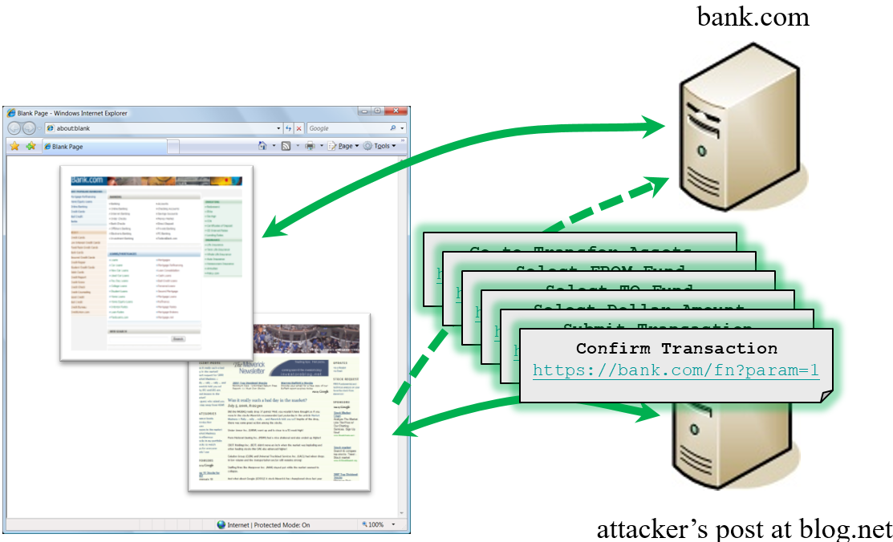
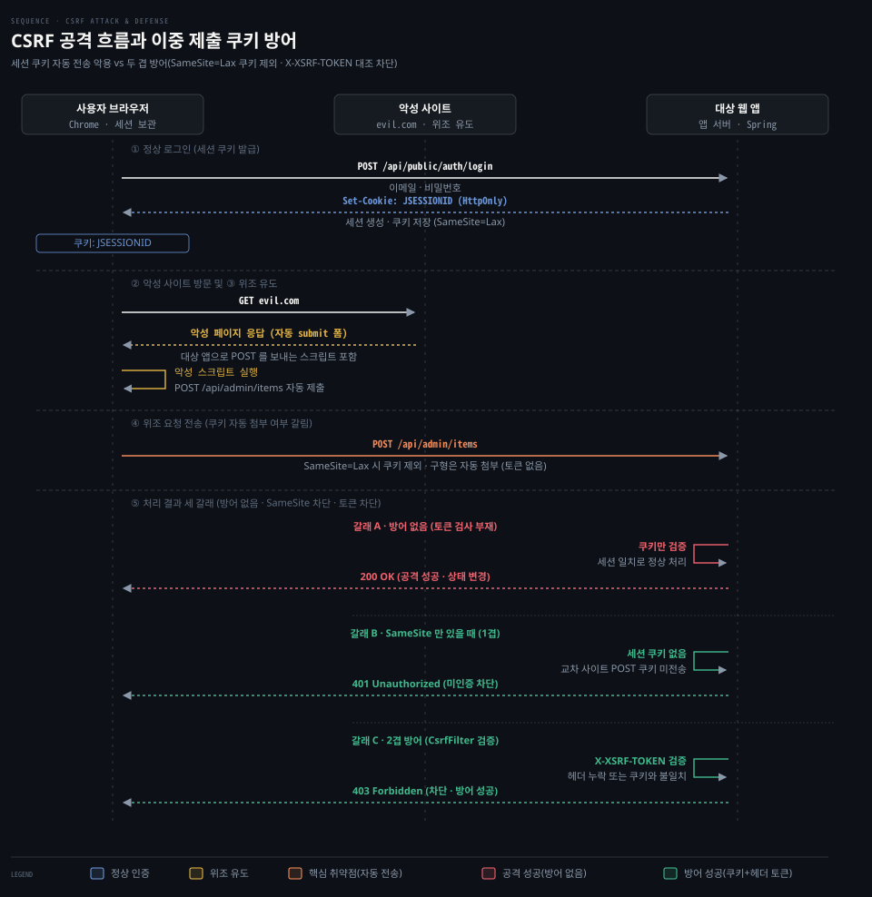
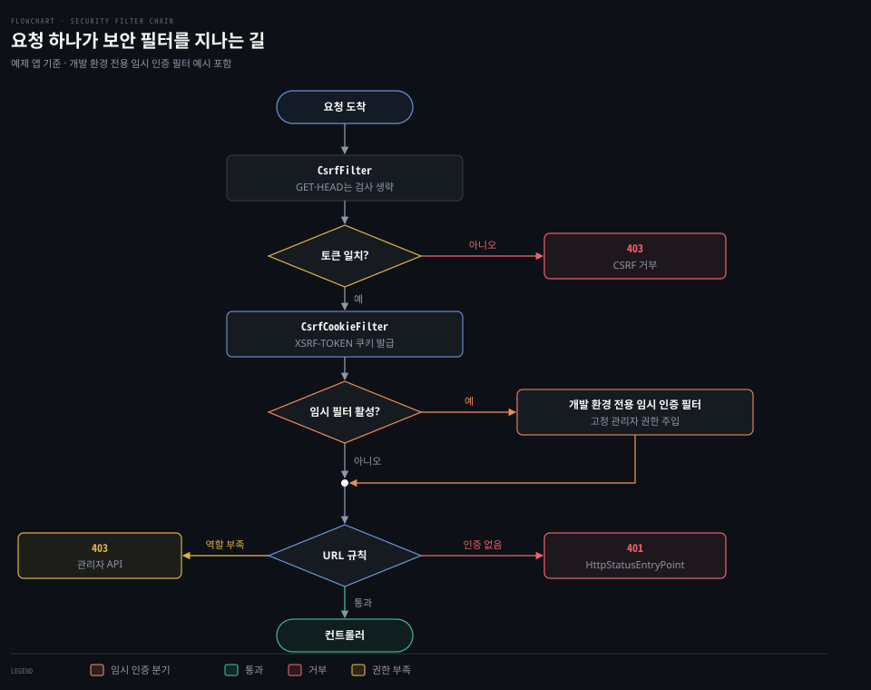
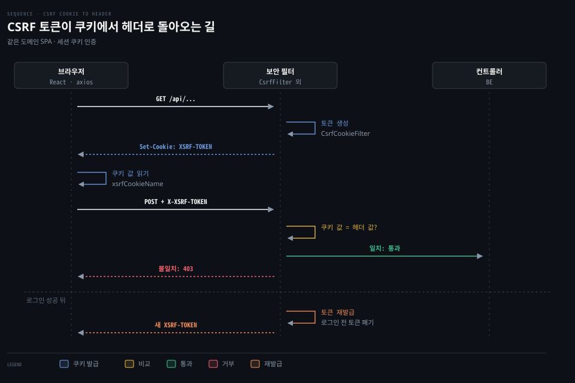
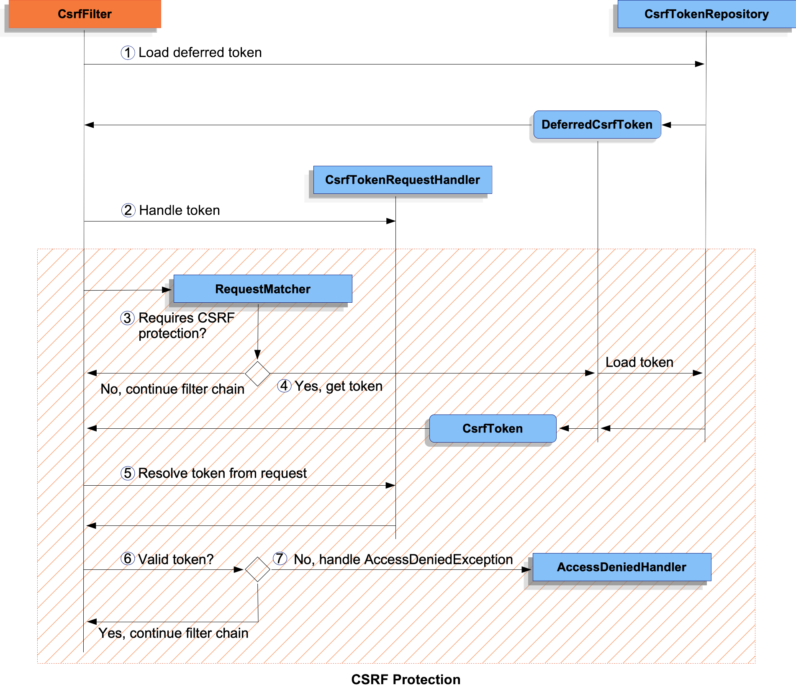
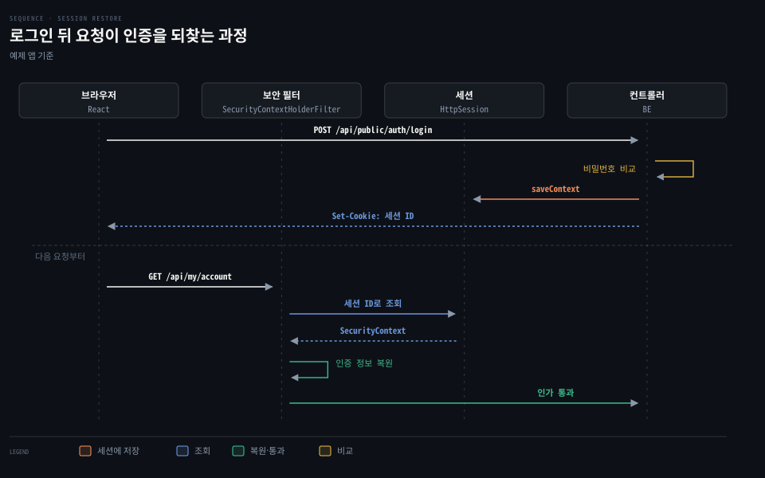

# CsrfFilter·CookieCsrfTokenRepository·SecurityContextRepository

---

> 세션 쿠키로 사용자를 기억하는 웹 앱은 브라우저의 쿠키 자동 전송 때문에 사이트 간 요청 위조(CSRF) 방어가 필수입니다. `CsrfFilter`·`CookieCsrfTokenRepository`·`SecurityContextRepository`가 요청 통과와 로그인 상태 유지를 어떻게 나누어 맡는지 설명합니다.

이 문서는 Spring Boot와 Spring Security 7.1.x 환경에서 폼 로그인 없이 JSON 로그인 API와 세션 쿠키 인증을 구성하는 구조를 다룹니다.

## 학습 목표와 범위

> 다 읽은 뒤 아래 네 가지를 코드 근거와 함께 말할 수 있으면 됩니다.

- 세션 쿠키 방식을 쓰면 왜 CSRF 방어가 함께 따라오는지 설명합니다.
- 요청 하나가 보안 필터 체인과 인가 규칙을 거쳐 컨트롤러, 401, 403 중 어디로 가는지 예측합니다.
- `XSRF-TOKEN` 쿠키와 `X-XSRF-TOKEN` 헤더가 짝을 이루는 이유와, `CsrfCookieFilter`가 없으면 무엇이 깨지는지 설명합니다.
- 폼 로그인을 끈 상태에서 로그인 컨트롤러가 직접 해야 하는 일 세 가지를 꼽습니다.

비밀번호 변경 시 기존 세션을 만료시키는 처리와 `LogoutFilter` 순서는 [02-02 편](./02-02.SessionInformation·ConcurrentSessionFilter·LogoutFilter.md)에서 다룹니다. 로그인 실패 응답과 시도 횟수 제한은 [03-01 편](./03-01.userNotFoundEncodedPassword·RemoteIpValve%C2%B7X-Forwarded-For.md)에서 다룹니다. 메서드 수준 보안(`@PreAuthorize`)과 일회성 인증 토큰 흐름은 이 문서에서 다루지 않습니다.

## 문제와 필요성

> 서버가 세션 쿠키로 사용자를 기억하면 브라우저가 쿠키를 자동으로 붙여 보내므로, 같은 설정 안에 CSRF 방어가 반드시 들어가야 합니다.

이 구조는 Nginx 한 대가 React 화면과 `/api`를 같은 도메인으로 내보내는 구성을 전제합니다. 화면과 API가 같은 도메인이면 서버가 발급한 세션 쿠키를 브라우저가 알아서 저장하고 매 요청에 실어 보냅니다. 화면 코드는 토큰을 따로 보관하거나 헤더에 붙일 필요가 없습니다. 세션 쿠키에 `HttpOnly`를 걸면 자바스크립트가 그 값을 읽을 수 없어서 화면에 스크립트가 주입돼도 세션 ID가 새지 않습니다.

편리함에는 대가가 있습니다. 브라우저는 요청을 누가 만들었는지 따지지 않고 쿠키를 붙입니다. 사용자가 앱에 로그인한 채 다른 사이트를 열었는데, 그 사이트가 앱의 `POST /api/admin/...`로 폼을 몰래 제출하면 세션 쿠키가 함께 갑니다. 서버 입장에서는 정상 사용자의 요청과 구분할 수 없습니다. 이것이 **CSRF**(Cross-Site Request Forgery, 사이트 간 요청 위조)입니다. 아래는 OWASP CSRFGuard 프로젝트가 설명하는 일반적인 CSRF 공격 개념도입니다.

그림 출처: OWASP CSRFGuard <https://github.com/OWASP/www-project-csrfguard/blob/master/assets/images/what_is_csrf_attacks_7.png>

라이선스: BSD 3-Clause License, Copyright (c) 2011, Eric Sheridan (<https://github.com/OWASP/www-project-csrfguard/blob/master/LICENSE>). 원본을 수정하지 않고 가져왔고, 라이선스 전문은 [owasp-csrfguard-LICENSE.txt](_assets/ext/owasp-csrfguard-LICENSE.txt)에 함께 둡니다.

세션 쿠키와 CSRF 토큰을 함께 쓰는 환경에서는 이 공격과 두 겹 방어가 다음과 같이 맞물립니다.

예제 앱(Spring Boot + Spring Security 7.1.x)의 세션 쿠키는 `SameSite=Lax`(`server.servlet.session.cookie.same-site: lax`)로 발급됩니다. 최신 브라우저는 다른 사이트에서 시작된 POST 요청에 이 쿠키를 싣지 않습니다.[^samesite] 그래서 방어는 두 겹으로 동작합니다.

1겹은 브라우저가 교차 사이트 POST에 쿠키를 싣지 않아 미인증으로 차단하는 `SameSite=Lax`입니다. 예제 앱에서는 `CsrfFilter`가 먼저라 실제 응답은 403입니다. 2겹은 SameSite를 지원하지 않는 브라우저나 같은 사이트의 다른 출처(서브도메인 등)에서 오는 위조까지 걸러내는 이중 제출 쿠키(`X-XSRF-TOKEN` 대조)입니다.

서버는 쿠키 말고 "이 화면이 직접 만든 요청"이라는 증거를 하나 더 요구합니다. 그 증거가 CSRF 토큰이고, Spring Security 7은 `csrf.spa()` 설정으로 이 방어를 켭니다. 이 설정의 핵심 조합은 HttpOnly 세션 쿠키와 `XSRF-TOKEN` 쿠키, `X-XSRF-TOKEN` 헤더의 대조입니다.

보안 설정에서는 `spa()` 한 줄 대신 같은 동작을 부품(`CsrfTokenRepository` 빈과 `SpaCsrfTokenRequestHandler`)으로 풀어 끼우기도 합니다. 로그인 컨트롤러가 필터와 같은 저장소 부품을 주입받아야 하거나, `spa()`가 쓰는 처리기가 Spring 내부 전용 클래스라 직접 꺼내 쓸 수 없을 때 이 방식을 씁니다.

## 한 요청이 지나는 길

> 요청은 CSRF 검사, CSRF 쿠키 발급, URL 인가 규칙을 차례로 지나 컨트롤러, 401, 403 중 한 곳에 도착합니다.

위에서 아래로 읽습니다. 마름모 셋이 요청이 어디로 갈지 정합니다. 코랄색 분기는 임시 인증 필터 예시입니다. 개발 초기에 인증 API 없이 테스트할 때 두며 실제 운영 체인에는 포함하지 않습니다.

Spring Security는 서블릿 필터 여러 개를 정해진 순서로 묶은 **필터 체인**으로 동작합니다. `SecurityFilterChain` 빈 설정 메서드가 그 체인을 조립합니다. 아래 단계는 도식의 상자와 마름모를 위에서부터 하나씩 풀어 쓴 것입니다.

### CsrfFilter — 상태를 바꾸는 요청만 검사합니다

`CsrfFilter`는 GET·HEAD·OPTIONS·TRACE 요청은 그냥 통과시키고 POST·PUT·PATCH·DELETE에서만 토큰을 비교합니다[^csrf]. 조회 요청은 서버 상태를 바꾸지 않으니 위조돼도 피해가 없다고 보는 것입니다. 비교에 실패하면 인가 단계까지 가지 않고 바로 403을 돌려줍니다.

이 검사는 URL 인가 규칙보다 앞에 있습니다. 그래서 인증 없이 열어 둔 공개 엔드포인트(`/api/public/**`)라도 POST 요청이라면 CSRF 토큰이 있어야 통과합니다. Swagger나 curl로 POST 요청을 보낼 때도 `X-XSRF-TOKEN` 헤더가 없으면 403을 받습니다.

### CsrfCookieFilter — 첫 응답부터 쿠키를 내려 줍니다

Spring Security 6부터 CSRF 토큰은 **지연 로딩**됩니다. 누군가 토큰 값을 실제로 꺼내 보기 전까지는 만들지도, 쿠키로 내려 주지도 않습니다[^csrf]. 서버가 HTML을 그리는 앱이라면 폼을 렌더링하면서 토큰을 꺼내므로 문제가 없습니다. 반면 SPA는 서버가 HTML을 그리지 않으니 아무도 토큰을 꺼내지 않고, 결국 쿠키가 한 번도 내려가지 않습니다. 화면은 첫 POST에서 실을 값이 없어 403을 받습니다.

`CsrfCookieFilter`는 `CsrfFilter` 바로 뒤에서 `csrfToken.getToken()`을 한 번 호출해 이 지연을 풉니다. 덕분에 아무 요청이나 한 번 보내면 응답에 `XSRF-TOKEN` 쿠키가 실립니다. `csrf.spa()`만으로는 이 일이 일어나지 않습니다. spring-security-config 7.1.1의 `spa()`는 쿠키 저장소와 요청 핸들러 두 가지만 바꾸고 토큰을 미리 꺼내지 않는다는 것을 jar의 바이트코드로 확인했습니다.

### 개발 환경 전용 임시 인증 필터를 둘 때의 위험

개발 초기에 로그인 API 없이 화면을 테스트하려고 `AnonymousAuthenticationFilter` 앞에 고정 관리자 인증 객체를 주입하는 임시 필터를 둘 수 있습니다. 하지만 이런 필터가 있는 체인에 `SessionManagementFilter`까지 있으면(예: `maximumSessions`를 켠 구성) 둘이 맞물려 인증이 필요 없는 공개 API 요청에도 세션을 생성하는 부작용이 생길 수 있습니다. 또한 인증 주입 필터는 `CsrfFilter` 뒤에 놓이므로 CSRF 검사는 건너뛰지 못하며, 로그인 기능이 구현되면 즉시 제거해 운영 환경에 남지 않게 해야 합니다.

### URL 인가 규칙 — 401과 403을 가릅니다

인가 규칙은 위에서부터 처음 맞는 줄 하나만 적용합니다.

| 경로 | 규칙 |
|------|------|
| `/api/public/**`, `/actuator/health`, Swagger | 누구나 |
| `/api/admin/**` | `ADMIN` 역할 |
| 그 밖의 모든 요청 | 인증된 사용자 |

막힌 요청에서 401과 403의 차이는 "누구인지 모르는가, 알지만 권한이 없는가"에서 납니다[^arch]. 인증 정보가 없는(익명) 사용자는 **인증 진입점**(authentication entry point)으로 넘어갑니다. SPA 백엔드에서는 진입점을 `HttpStatusEntryPoint(UNAUTHORIZED)`로 바꿔, 로그인 페이지로 리다이렉트하는 대신 401 상태 코드만 돌려줍니다. 화면은 401을 받으면 로그인 화면으로 보냅니다. 반대로 로그인은 했지만 역할이 모자라면 403입니다.

`formLogin`과 `httpBasic`을 둘 다 끈 것도 이 단계와 관련이 있습니다. 둘을 켜 두면 Spring이 `/login` 폼 페이지나 브라우저 기본 인증 팝업을 띄웁니다. SPA에서는 둘 다 쓸모가 없어서 끄고 로그인은 별도 컨트롤러 엔드포인트로 직접 구현합니다.

## CSRF 토큰이 쿠키와 헤더를 오가는 이유

> 서버는 같은 토큰을 쿠키와 헤더 두 곳에서 받아 비교합니다. 다른 사이트는 원래 도메인의 쿠키를 읽을 수 없으니 헤더를 채울 수 없다는 점을 이용합니다.

이 방식을 **이중 제출 쿠키**(double submit cookie)라고 부릅니다. 쿠키는 브라우저가 자동으로 보내지만 헤더는 화면 코드가 직접 넣어야 합니다. 그리고 브라우저의 동일 출처 정책 때문에, 다른 사이트의 스크립트는 원래 도메인의 쿠키 값을 읽을 수 없습니다. 공격 사이트는 쿠키를 "보내게" 만들 수는 있어도 같은 값을 헤더에 "적을" 수는 없습니다. 서버는 두 값이 같으면 정상 화면이 만든 요청으로 판단합니다.

같은 이유로 두 쿠키의 `HttpOnly` 설정이 반대입니다. 세션 쿠키는 스크립트가 읽을 일이 없으니 `HttpOnly`로 막습니다. `XSRF-TOKEN` 쿠키는 화면이 읽어서 헤더로 옮겨야 하므로 `HttpOnly`를 끕니다. `csrf.spa()`가 고르는 저장소가 바로 `CookieCsrfTokenRepository.withHttpOnlyFalse()`입니다[^spa].

`spa()`가 바꾸는 나머지 하나는 요청 핸들러입니다. Spring Security 6부터는 BREACH 공격을 막으려고 서버가 내보내는 토큰에 요청마다 다른 난수를 섞습니다[^csrf]. 그런데 SPA는 서버가 섞은 값이 아니라 쿠키에 든 원래 값을 헤더로 보냅니다. `spa()`의 핸들러는 헤더에 값이 있으면 원래 값끼리 비교하고 헤더가 없을 때(서버가 그린 폼의 파라미터)만 섞인 값을 풀어 비교합니다. 두 경로를 모두 받아 주는 셈입니다.

클라이언트 쪽에서는 HTTP 라이브러리(예: axios) 설정에 `xsrfCookieName: 'XSRF-TOKEN'`과 `xsrfHeaderName: 'X-XSRF-TOKEN'`을 지정합니다. 그러면 클라이언트가 요청마다 쿠키를 읽어 같은 값을 헤더에 넣습니다. 서버의 기본 쿠키·헤더 이름과 화면 설정이 정확히 같아야 하므로, 한쪽 이름만 바꾸면 모든 POST가 403이 됩니다.

점선 아래 "로그인 성공 뒤" 구간은 로그인 핸들러가 수행하는 토큰 재발급 단계입니다. 로그인하면 기존 토큰을 버리고 새 토큰을 내려 주어, 공격자가 로그인 전에 심어 둔 토큰을 로그인 뒤에도 쓰는 일을 막습니다.

로그인 컨트롤러는 로그인 전 세션이 있으면 먼저 ID를 교체합니다. 이어서 `CsrfAuthenticationStrategy`로 옛 토큰을 지우고 새 토큰을 예약한 다음 인증 정보를 저장합니다. 새 토큰은 지연 생성이라 한 번 꺼내야 로그인 응답에 실립니다. 응답에는 `Set-Cookie: XSRF-TOKEN=; Expires=Thu, 01 Jan 1970 00:00:10 GMT`와 새 값이 순서대로 두 줄 나가며 브라우저는 마지막 값을 남깁니다.

### CSRF 부품 셋 — 저장소·처리기·필터

보안 설정은 필터를 켜면서 저장소와 처리기를 끼우는 조립도이고, 처리기는 부품 하나입니다.

| 부품 | 클래스 | 맡은 질문 |
|---|---|---|
| 저장소 | `CookieCsrfTokenRepository` (Spring) | 토큰을 어디에 두나 → `XSRF-TOKEN` 쿠키, 서버는 저장하지 않음 |
| 처리기 | `SpaCsrfTokenRequestHandler` (커스텀 핸들러) | 요청에서 어떻게 꺼내 비교하나 → 헤더(`X-XSRF-TOKEN`)면 쿠키 값 그대로, 헤더가 없으면(폼) XOR 로 가린 값 |
| 필터 | `CsrfFilter` (Spring) | 언제 검사하나 → POST·PUT·PATCH·DELETE 마다, 다르면 403 |

서버가 기억하는 것은 없고 쿠키 값과 헤더 값이 같은지만 보므로, 다른 사이트가 쿠키 값을 읽을 수 없다는 브라우저 규칙(동일 출처 정책)이 방어의 근거입니다. 아래는 Spring Security 공식 문서가 설명하는 CSRF 처리 흐름입니다.

그림 출처: Spring Security <https://github.com/spring-projects/spring-security/blob/7.1.1/docs/modules/ROOT/assets/images/servlet/exploits/csrf-processing.png>

라이선스: Apache License 2.0. 원본을 수정하지 않고 가져왔습니다.

요청이 오면 `CsrfFilter`는 저장소에서 지연 토큰을 꺼내 핸들러에 전달한 뒤, 보호 대상 요청(POST 등)에 한해 실제 토큰과 요청의 토큰을 대조합니다. 검증에 통과하면 필터 체인을 계속 진행하고 실패하면 `AccessDeniedHandler`로 넘겨 403 응답으로 차단합니다.

## 로그인 뒤 인증이 유지되는 방식

> 로그인 컨트롤러가 인증 정보를 세션에 저장하면, 다음 요청부터는 보안 필터가 세션 쿠키로 그 정보를 다시 꺼냅니다.

### 무엇이 어디에 저장되나

| 주입받는 것 | 실제 클래스 | 실제 저장 위치 | 수명 |
|---|---|---|---|
| `SecurityContextRepository` | `DelegatingSecurityContextRepository` (Spring) — 아래 둘을 차례로 씀 | — | — |
| ┗ 요청 속성 저장소 | `RequestAttributeSecurityContextRepository` | 요청 객체 속성(Tomcat) | 이번 요청 하나(오류 페이지로 넘어가도 인증 유지) |
| ┗ 세션 저장소 | `HttpSessionSecurityContextRepository` | Tomcat 메모리 `HttpSession` 의 `SPRING_SECURITY_CONTEXT` 칸 | 세션 동안(유휴 만료 시점까지) |
| `CsrfTokenRepository` | `CookieCsrfTokenRepository` | 브라우저 쿠키 `XSRF-TOKEN` | 브라우저가 지울 때까지 |

두 저장소는 보안 설정의 `@Bean`으로 한 번 만들어져 필터 체인과 로그인 컨트롤러가 같은 객체를 주입받습니다.

예제 로그인 API는 `POST /api/public/auth/login`입니다. 인증 서비스는 이메일로 계정을 찾은 뒤 계정 상태보다 비밀번호를 먼저 비교합니다. 순서를 뒤집어 비활성 계정에 403을 먼저 주면, 없는 이메일은 늘 401이고 있는 이메일만 다른 응답을 받아 계정 존재가 드러나기 때문입니다. 없는 이메일도 더미 해시로 BCrypt 비교를 한 번 돌려 응답 시간까지 맞춥니다.

비밀번호가 맞으면 컨트롤러가 세 가지를 직접 처리합니다. 폼 로그인을 켰다면 Spring Security 필터가 해 줬을 일들입니다[^session].

| 순서 | 할 일 | 빠뜨리면 |
|------|------|---------|
| 1 | 세션 ID 교체 (`request.changeSessionId()`, 세션이 있을 때만) | 공격자가 미리 알려 준 세션 ID로 로그인하게 만드는 세션 고정 공격에 열림 |
| 2 | CSRF 토큰 재발급 (`CsrfAuthenticationStrategy`) | 로그인 전 토큰이 계속 유효 |
| 3 | 인증 정보 저장 (`SecurityContextRepository.saveContext`) | 로그인 응답은 200인데 다음 요청이 401 |

3번이 특히 놓치기 쉽습니다. Spring Security 6부터 `SecurityContextHolder`에 인증을 넣는 것만으로는 세션에 저장되지 않습니다. 저장소에 명시적으로 저장해야 다음 요청에서 꺼낼 수 있습니다.

점선 위는 로그인 요청 한 번, 아래는 그 뒤의 모든 요청입니다. 다음 요청에서 `SecurityContextHolderFilter`가 세션 쿠키의 ID로 `HttpSession`을 찾아 거기 저장된 `SecurityContext`를 꺼내 현재 요청의 인증으로 복원합니다. 그 뒤 인가 규칙은 임시 우회 필터 없이도 이 인증을 보고 요청을 통과시킵니다.

비밀번호 변경이 필요한 계정은 로그인해도 세션 없이 200 `{"result": "PASSWORD_CHANGE_REQUIRED"}`를 받을 수 있습니다. 변경 필요는 오류가 아니라 정상 흐름의 한 경우라서 예외가 아니라 결과 값으로 돌려주고 사용자가 비밀번호를 바꾼 뒤 다시 로그인하게 유도합니다. 정상 로그인된 화면은 로그인 응답 뒤 `GET /api/my/account`로 사용자 정보와 새 `XSRF-TOKEN` 쿠키를 함께 받습니다.

로그아웃은 컨트롤러 없이 Spring Security 설정만으로 끝낼 수 있습니다. `LogoutFilter`가 세션을 무효화하고 CSRF 토큰도 지우므로 화면은 다음 요청에서 새 `XSRF-TOKEN`을 받아야 합니다. 필터가 응답까지 끝내는 과정은 [01-02 편](./01-02.HttpSession·SessionRegistry·SecurityContextHolder.md)이 다룹니다.

## 역할과 ROLE_ 접두어

> DB에는 `ADMIN`처럼 접두어 없는 역할 코드를 두고, 보안 경계 한 곳에서만 `ROLE_`을 붙이고 뗍니다. 역할은 로그인 순간에 스냅샷으로 저장되므로 다시 로그인해야 바뀝니다.

컨트롤러는 `hasAnyRole('ADMIN', 'MANAGER')`처럼 쓰는데 DB의 역할 테이블에는 `ADMIN`이 그대로 들어 있는 경우가 흔합니다. 세션에는 `ROLE_ADMIN`이 들어 있어야 통과하므로, 접두어를 어디서 붙이는지 모르면 로그인 구현 뒤 403이 나는 원인을 찾기 어렵습니다.

Spring Security는 권한을 모두 `GrantedAuthority`의 문자열 하나로 다룹니다. 그중 `ROLE_`로 시작하는 것을 역할로 보고, 아닌 것은 세부 권한으로 구분합니다.

`hasRole`·`hasAnyRole`은 넘긴 이름 앞에 `ROLE_`을 자동으로 붙여 비교하고, `hasAuthority`는 문자열을 그대로 비교합니다. 그래서 `hasRole('ROLE_X')`처럼 접두어를 직접 넣으면 최근 버전은 예외를 던집니다.

spring-security-core 7.1.1의 `AuthorityAuthorizationManager`에 이 경우의 메시지가 들어 있는 것을 jar에서 확인했습니다. 메시지는 "ROLE_ is automatically prepended when using hasRole"라고 이유를 밝힙니다.

접두어가 DB와 API 응답으로 새지 않게 하려면 `ROLE_` 변환을 사용자 주체(`UserDetails` 등)나 권한 매퍼 경계 한 곳에 가둡니다.

| 방향 | 경계 지점 | 하는 일 |
|------|-----------|---------|
| DB → 세션 | 권한 변환 메서드 | 로그인 때 `ADMIN`을 `ROLE_ADMIN`으로 만들어 세션에 넣습니다 |
| 세션 → 응답 | 역할 코드 추출 메서드 | `ROLE_`로 시작하는 권한만 골라 접두어를 떼 응답의 역할 목록으로 돌려줍니다 |

접두어를 끄는 방법은 `GrantedAuthorityDefaults("")` 빈을 두는 것입니다. 그러면 권한 변환 로직과 테스트를 같이 고쳐야 하고, 역할과 세부 권한을 가르던 `ROLE_` 구분이 사라집니다. 그래서 기본값을 그대로 쓰는 편이 일반적입니다.

역할은 로그인 순간에 DB에서 읽어 세션에 넣은 스냅샷입니다. 로그인해 있는 동안 DB의 역할을 바꿔도 다시 로그인할 때까지 반영되지 않습니다.

관리자 경로(`/api/admin/**`)는 보안 설정의 URL 규칙과 컨트롤러의 `@PreAuthorize` 두 곳에서 막을 수 있습니다. 기능이 겹쳐도 둘 다 두면 컨트롤러가 URL 규칙에 기대지 않고 필요한 역할을 스스로 드러내며, 메서드마다 세분화할 수 있습니다.

## 대안과 선택

> 세션 대신 JWT를, 컨트롤러 로그인 대신 폼 로그인을 고를 수도 있습니다. 두 선택 모두 "같은 도메인 SPA"라는 배치 조건에서 갈립니다.

| 선택지 | 고른 것 | 고르지 않은 것과 이유 |
|--------|--------|---------------------|
| 인증 상태 보관 | 서버 세션 + HttpOnly 쿠키 | JWT를 `localStorage`에 두면 주입된 스크립트가 토큰을 읽을 수 있습니다. 강제 로그아웃·비밀번호 변경 시 다른 세션 끊기도 세션 쪽이 단순합니다 |
| 로그인 처리 | 컨트롤러가 JSON으로 받음 | `formLogin`은 폼 파라미터와 리다이렉트를 전제로 해서, JSON 응답·계정 존재 숨김·실패 횟수 저장을 넣으려면 핸들러를 여럿 갈아 끼워야 합니다 |
| CSRF 토큰 위치 | 쿠키 저장소(`spa()`) | 세션 저장소는 로그인 전 첫 요청에도 세션을 만들어야 하고, SPA가 토큰 값을 받을 별도 API가 필요합니다 |

세션 방식에도 비용이 있습니다. 서버가 두 대가 되면 한 서버에서 만든 세션을 다른 서버가 모릅니다. 그때는 Spring Session으로 세션을 공유 저장소에 두어야 하며, 단일 서버 메모리 세션의 한계는 [01-02 편](./01-02.HttpSession·SessionRegistry·SecurityContextHolder.md#서버가-여러-대가-되면-이-구조가-맞지-않습니다)에서 다룹니다.

## 스스로 확인할 질문

> 답이 막히면 괄호 안의 절로 돌아갑니다.

1. Swagger나 curl로 `POST /api/admin/users`를 `X-XSRF-TOKEN` 헤더 없이 보냈습니다. 응답 코드는 무엇이고, 어느 필터가 돌려줬나요? (한 요청이 지나는 길)
2. `CsrfCookieFilter`를 지우면 SPA의 첫 POST가 어떻게 되나요? `csrf.spa()`가 그 일을 대신하지 않는 이유는 무엇인가요? (CsrfCookieFilter)
3. 세션 쿠키는 `HttpOnly`인데 `XSRF-TOKEN` 쿠키는 왜 아닌가요? (CSRF 토큰이 쿠키와 헤더를 오가는 이유)
4. 로그인 컨트롤러가 `SecurityContextHolder`에 인증만 넣고 `saveContext`를 빠뜨렸습니다. 로그인 응답과 그다음 요청은 각각 어떻게 되나요? (로그인 뒤 인증이 유지되는 방식)
5. 비밀번호가 맞을 때만 계정 상태(비활성 403, 변경 필요 200)를 알려 주는 이유는 무엇인가요? (로그인 뒤 인증이 유지되는 방식)
6. CSRF 저장소·처리기·필터는 각각 어떤 질문을 맡고, 보안 설정은 그 셋과 어떤 관계인가요? (CSRF 토큰이 쿠키와 헤더를 오가는 이유)
7. 로그인해 있는 관리자의 DB 역할을 `USER`로 낮췄습니다. 그 사람이 다음 요청으로 `/api/admin/**`를 부르면 어떻게 되나요? `hasRole('ROLE_USER')`처럼 접두어를 직접 넣으면 무슨 일이 생기나요? (역할과 ROLE_ 접두어)

## 출처와 관련 문서

> Spring Security 동작은 공식 문서와 jar에서 확인했습니다.

- spring-security-config 7.1.1 jar — `CsrfConfigurer.spa()`와 `SpaCsrfTokenRequestHandler` 바이트코드(`javap`)로 `spa()`가 토큰을 미리 꺼내지 않음을 확인
- spring-security-core 7.1.1 jar — `AuthorityAuthorizationManager`가 `hasRole('ROLE_...')` 입력 시 예외를 던짐을 확인
- [세션 vs 토큰 — 상태 기반과 무상태 인증의 트레이드오프](../../../99_ETC/security/01_concepts/2026-05-29_세션%20vs%20토큰%20—%20상태%20기반과%20무상태%20인증의%20트레이드오프.md) — 세션 기반과 무상태 토큰 인증의 확장성·즉시 폐기·저장 비용 트레이드오프
- [Indusface (How CSRF Works)](https://www.indusface.com/wp-content/uploads/2024/01/how-does-CSRF-work-1.png) — 은행 계좌 이체 예시로 피해자 브라우저의 저장된 인증 쿠키를 이용해 공격자 계좌 송금을 유도하는 6단계 흐름도(상업용 블로그 그림, 라이선스 불명확으로 본문 미삽입·링크 참조)
- [PortSwigger (What is CSRF?)](https://portswigger.net/web-security/csrf) — 피해자 브라우저·공격자 사이트·취약한 웹 앱 간 위조 요청 전달 구조(PortSwigger 독점 저작권으로 다운로드하지 않고 링크와 개념만 참조)

[^csrf]: Spring Security Reference 7.0, "Cross Site Request Forgery (CSRF)" — 지연 로딩, BREACH 대응 난수, 안전한 메서드 제외. https://docs.spring.io/spring-security/reference/7.0/servlet/exploits/csrf.html
[^spa]: Spring Security 7.0 API, `CsrfConfigurer.spa()` — "cookie-based token repository and a custom request handler". https://docs.spring.io/spring-security/reference/7.0/api/java/org/springframework/security/config/annotation/web/configurers/CsrfConfigurer.html
[^arch]: Spring Security Reference 7.0, "Architecture" — `ExceptionTranslationFilter`가 인증 없음은 `AuthenticationEntryPoint`로, 권한 부족은 `AccessDeniedHandler`로 보냄. https://docs.spring.io/spring-security/reference/7.0/servlet/architecture.html
[^session]: Spring Security Reference 7.0, "Authentication Persistence and Session Management" — 직접 인증할 때 `SecurityContextRepository`에 명시적으로 저장해야 함. https://docs.spring.io/spring-security/reference/7.0/servlet/authentication/session-management.html
[^samesite]: MDN Web Docs, "SameSite cookies" — 교차 사이트 요청의 쿠키 전송 제한과 Lax 기본 동작. https://developer.mozilla.org/en-US/docs/Web/HTTP/Headers/Set-Cookie#samesite
