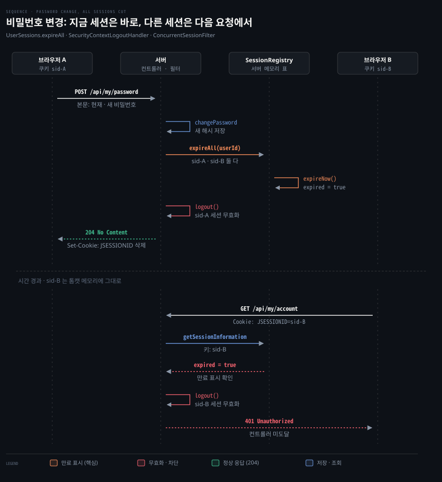
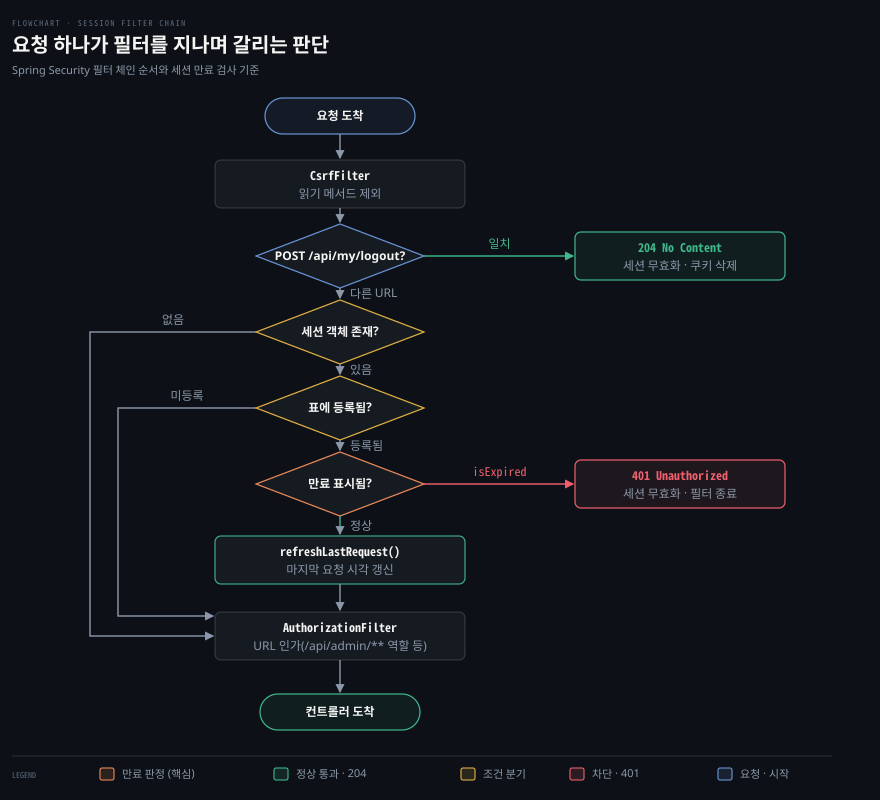
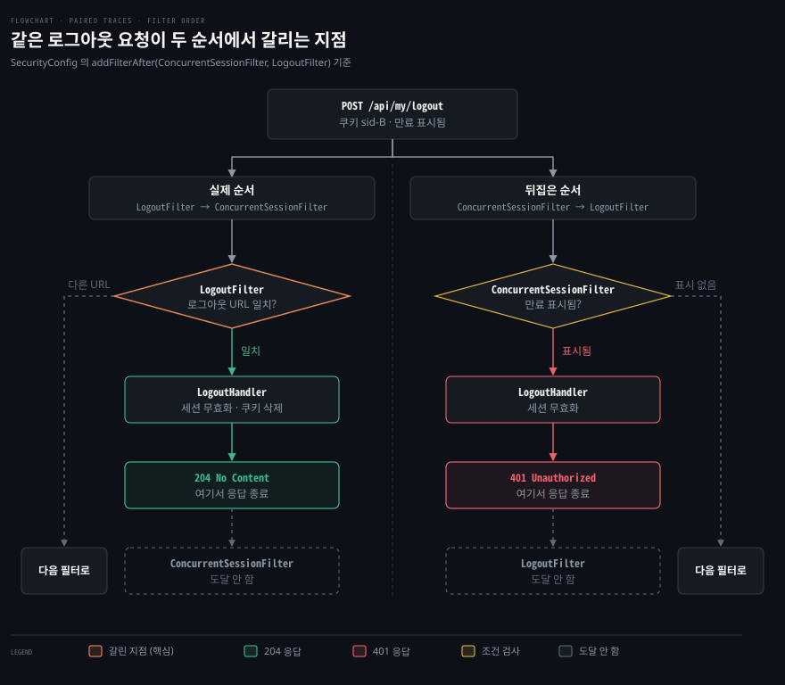
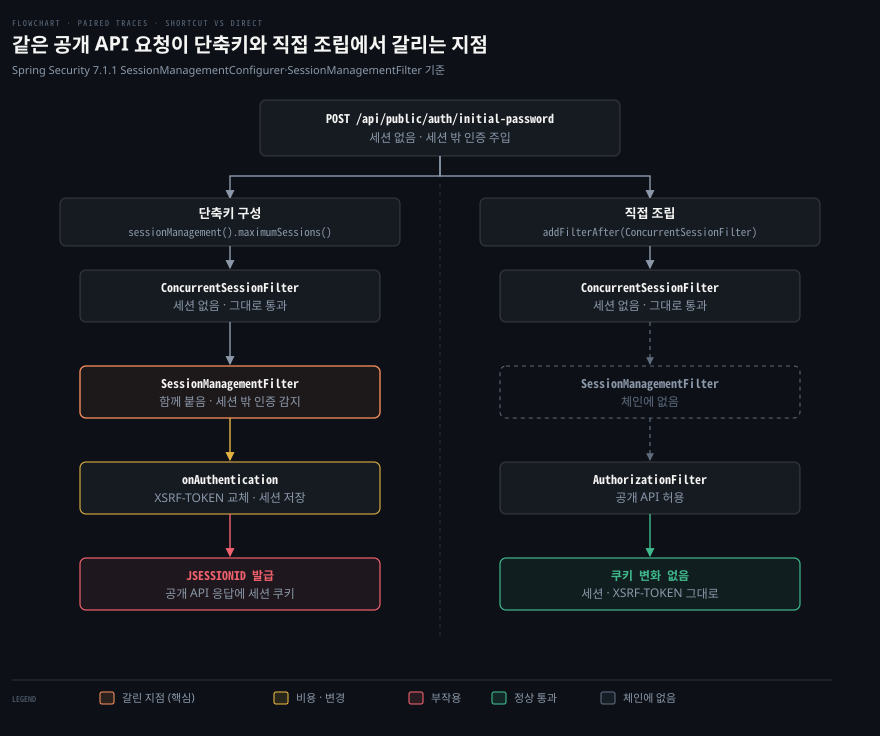

# SessionInformation·ConcurrentSessionFilter·LogoutFilter

---

> 서블릿 API에는 ID로 다른 세션을 즉시 지우는 메서드가 없어 `SessionRegistry`에 만료 표시를 남긴 뒤 다음 요청의 `ConcurrentSessionFilter`가 끊습니다. `LogoutFilter`를 `ConcurrentSessionFilter` 앞에 두어야 이미 만료된 세션으로 보낸 로그아웃도 401이 아니라 204로 끝납니다.

사용자가 로그인하면 서버 메모리에 세션 정보가 등록됩니다. 한 사용자가 여러 브라우저나 기기에서 동시에 작업할 수 있으므로, 비밀번호를 변경했을 때 이 세션을 포함해 그 사람의 모든 세션을 정리하는 기술이 필요합니다. 지금 요청의 세션은 그 자리에서 무효화하고, 다른 세션은 만료 표시를 남겨 그 세션의 다음 요청에서 끊습니다.

이 문서는 Spring Security 7.1.1과 예제 앱의 보안 필터 체인 구성을 바탕으로 작성했습니다. 세션 정보가 JVM 메모리 안에서 어떤 구조로 놓여 있는지는 [01-02](./01-02.HttpSession·SessionRegistry·SecurityContextHolder.md)가 다룹니다.

## 학습 목표와 범위

> 다 읽은 뒤 아래 네 가지를 코드 근거와 함께 말할 수 있으면 됩니다.

- `SessionRegistry`가 서버 메모리에서 관리하는 데이터 구조와 등록 시점을 설명합니다.
- 비밀번호 변경 시 다른 세션을 즉시 삭제하지 못하고 만료 표시만 남기는 서블릿 표준의 한계를 설명합니다.
- 요청이 들어왔을 때 `ConcurrentSessionFilter`가 세션 상태에 따라 분기하는 네 가지 판단 경로를 설명합니다.
- `LogoutFilter`와 `ConcurrentSessionFilter`의 배치 순서가 로그아웃 응답 코드에 미치는 영향을 비교합니다.

다중 서버 환경의 Redis 기반 분산 세션 클러스터링(Spring Session)이나 JWT 무상태 토큰 방식은 다루지 않습니다. 단일 서버 인메모리 세션 동시성 제어와 서블릿 필터 체인의 상호작용에 집중합니다.

## 문제와 필요성

> 비밀번호를 바꾼 뒤에도 다른 기기에 열려 있던 세션이 그대로 동작하면 계정 탈취 피해를 막을 수 없습니다.

웹 서비스 사용자는 사무실 PC뿐 아니라 다른 노트북이나 모바일 기기에서도 로그인합니다. 만약 특정 기기에서 비밀번호가 노출되어 사용자가 비밀번호를 변경했다면, 이전에 로그인해 둔 다른 기기의 세션은 즉시 무력화되어야 합니다. 그렇지 않으면 공격자가 이미 확보한 세션 쿠키로 계속 시스템을 조작할 수 있습니다.

하지만 백엔드 서버 입장에서는 특정 사용자의 세션 객체들을 한 번에 즉시 제거하기 어렵습니다. 서블릿 표준 API는 세션 ID 문자열만 가지고 다른 사용자의 세션 객체를 임의로 조회하거나 강제 삭제하는 기능을 제공하지 않기 때문입니다. 이 구조적 제약을 풀기 위해 서버 메모리의 세션 관리 표와 필터 체인의 검사 메커니즘을 조립해야 합니다.

## 서버 메모리의 세션 표와 표시의 원리

> 세션 저장소는 세션 객체 자체가 아니라 식별자 문자열과 만료 플래그만을 보관합니다.

위 도식처럼 브라우저 A가 비밀번호를 변경하면 서버는 이 사람의 모든 세션에 만료 표시를 하고, 브라우저 A의 세션만 그 자리에서 무효화합니다. 브라우저 B의 세션 객체는 그 즉시 메모리에서 삭제되지 않습니다. 브라우저 B가 다음 요청을 보낼 때 비로소 필터가 만료 표시를 보고 파기합니다.

Spring Security에서 이 표 역할을 담당하는 컴포넌트가 바로 `SessionRegistry`입니다. 기본 구현체인 `SessionRegistryImpl`은 서버 메모리 안에 맵 구조를 유지합니다. 세션 ID 문자열을 키로 하여 사용자 식별자(`principal`, 예제 앱에서는 `userId`), 만료 여부 표시(`expired`), 마지막 요청 시각(`lastRequest`)을 담은 `SessionInformation` 객체를 관리합니다. 맵 두 개로 이뤄진 이 표의 구조는 [01-02](./01-02.HttpSession·SessionRegistry·SecurityContextHolder.md)가 소스와 함께 설명합니다.

사용자가 로그인을 성공하면 `SessionLogin` 컴포넌트가 `userSessions.register(userId, sessionId)`를 호출해 이 표에 정보를 등록합니다. 로그인을 거치지 않은 익명 사용자의 임시 세션은 이 표에 올라가지 않습니다.

사용자가 `POST /api/my/password`로 비밀번호를 변경하면 컨트롤러는 `UserSessions.expireAll(userId)`를 호출합니다. 이 메서드는 해당 사용자의 세션 목록을 조회해 모든 세션에 `SessionInformation.expireNow()`를 실행합니다.

그다음 컨트롤러가 `SecurityContextLogoutHandler`로 지금 요청의 세션만 그 자리에서 무효화하고, 세션 쿠키 삭제를 응답에 싣습니다. 관리자가 계정을 초기화하거나 삭제할 때도 `expireAll(userId)`를 호출합니다. 이때는 지킬 세션이 없으므로 표시만 남깁니다.

여기서 중요한 사실은 다른 세션의 객체를 즉시 없애는 것이 아니라 만료 표시만 남긴다는 점입니다. `SessionRegistry`가 가진 정보는 세션 ID 문자열일 뿐이며, 서블릿 컨테이너가 관리하는 실제 세션 객체(`HttpSession`)를 쥐고 있지 않습니다. 서블릿 표준 사양에는 세션 ID만으로 임의의 `HttpSession`을 찾아내 강제로 파기(`invalidate`)하는 API가 없습니다.

따라서 실제 세션 객체의 파기는 해당 세션을 쥔 브라우저 B가 **다음 HTTP 요청을 보낼 때** 일어납니다. 브라우저 B가 요청을 보내면 보안 필터가 표를 확인하고 비로소 세션을 파기합니다.

만약 브라우저 B가 더 이상 아무 요청도 보내지 않고 창을 닫아버리면 어떻게 될까요? 이때는 서블릿 컨테이너의 기본 타임아웃 메커니즘이 작동합니다. `server.servlet.session.timeout` 설정이 정한 시간 동안 요청이 없으면 톰캣이 세션 객체를 메모리에서 제거합니다. 이때 발생하는 세션 파기 이벤트를 `HttpSessionEventPublisher`가 수신하여 Spring Security에 전달하고, `SessionRegistry` 표에서도 해당 세션 ID를 깨끗이 지웁니다.

## 필터를 지나는 요청과 판단 갈림길

> 들어오는 모든 요청은 세션의 존재와 만료 여부에 따라 네 갈래로 나뉘어 처리됩니다.

서버는 들어오는 요청마다 이 세션이 유효한지 아니면 이미 끊긴 상태인지 판별하지 못하면 올바른 인가 처리를 진행할 수 없습니다.

위 도식은 요청 하나가 보안 필터 체인을 통과할 때 만나는 분기점을 보여줍니다. 요청이 도착하면 `CsrfFilter`와 `LogoutFilter`를 거친 뒤 `ConcurrentSessionFilter`에서 세션의 상태를 네 가지 경로로 판정합니다.

`ConcurrentSessionFilter`는 요청마다 서블릿 요청 객체에서 세션을 검사하며 다음과 같이 동작합니다.

첫째, 요청에 세션 자체가 없는 경우(`req.getSession(false) == null`)입니다. 공개 API 요청이나 최초 접근이므로 아무런 제재 없이 다음 필터로 통과시킵니다.

둘째, 세션 객체는 존재하지만 `SessionRegistry` 표에 등록되어 있지 않은 경우입니다. 코드상 남겨 둔 통과 분기이며, 예제 앱에서는 요청 캐시를 끈 뒤로 로그인 전 세션이 생기지 않았습니다. 관리 대상이 아닌 세션이더라도 제재 없이 다음 필터로 그대로 통과시킵니다.

셋째, 세션이 표에 등록되어 있고 만료 표시가 된 경우(`info.isExpired() == true`)입니다. 이 경우가 바로 비밀번호 변경 등으로 차단된 세션입니다. 필터는 기본 로그아웃 핸들러(`SecurityContextLogoutHandler`)로 세션을 무효화하고, 만료 전략(`SessionInformationExpiredStrategy`)에 응답을 맡긴 뒤 필터 체인을 즉시 종료합니다. 컨트롤러나 비즈니스 로직까지 요청이 도달하지 않습니다.

예제 앱은 이 전략을 직접 지정해 `401 Unauthorized`를 돌려줍니다. 7.1.1의 기본 전략은 상태 코드를 설정하지 않고 세션이 만료됐다는 안내 문장만 본문에 쓰므로, 지정하지 않으면 401이 나오지 않습니다. 이 문서의 401은 모두 이 설정을 전제로 합니다.

넷째, 세션이 표에 있고 만료 표시가 없는 정상 상태인 경우입니다. 필터는 `sessionRegistry.refreshLastRequest()`를 호출해 마지막 요청 시각을 현재 시각으로 갱신한 뒤 요청을 다음 필터와 컨트롤러로 통과시킵니다.

## 필터 순서가 결정하는 로그아웃 응답

> 이미 끊긴 세션으로 로그아웃을 시도했을 때 오류가 나지 않으려면 필터 체인의 앞뒤 배치가 정확해야 합니다.

`SecurityConfig`에서 필터 체인을 조립할 때 등록 순서는 대단히 중요합니다. 현재 설정의 순서는 다음과 같습니다.

`… → CsrfFilter → LogoutFilter → ConcurrentSessionFilter → … → 컨트롤러`

`LogoutFilter`가 `ConcurrentSessionFilter`보다 앞자리에 위치합니다. 이 순서 덕분에 `POST /api/my/logout` 요청이 들어오면 `LogoutFilter`가 요청을 먼저 가로챕니다. 필터는 세션을 무효화하고 세션 쿠키를 삭제한 뒤 그 자리에서 `204 No Content` 응답을 내보내며 요청 처리를 끝냅니다. 체인 뒤쪽에 있는 `ConcurrentSessionFilter`로는 요청이 전달조차 되지 않습니다.

가로챈다는 말은 필터가 URL을 보고 직접 로그아웃을 처리한 뒤 `chain.doFilter`를 부르지 않고 끝낸다는 뜻입니다. 예제 앱에는 로그아웃 컨트롤러가 없고 필터 하나가 끝까지 처리합니다. 소스는 [01-02](./01-02.HttpSession·SessionRegistry·SecurityContextHolder.md)의 LogoutFilter 절이 보입니다.

도식은 만료 표시된 세션의 `POST /api/my/logout` 이 두 순서를 지나는 모습입니다. 왼쪽이 실제 순서입니다. `LogoutFilter` 가 URL 일치를 보고 로그아웃을 처리해 204 로 끝내며, `ConcurrentSessionFilter` 는 요청을 보지 못합니다.

오른쪽은 순서를 뒤집은 가정입니다. `ConcurrentSessionFilter` 가 먼저 만료 표시를 보고 401 로 끝내고, `LogoutFilter` 는 요청을 보지 못합니다. 같은 요청에 같은 세션 상태인데 갈린 곳은 첫 필터입니다.

이 배치가 중요한 이유는 이미 다른 기기에서 비밀번호가 바뀌어 만료 표시된 세션으로 로그아웃할 때 드러납니다. 만약 두 필터의 순서가 반대여서 `ConcurrentSessionFilter`가 앞에 있다면 심각한 사용자 경험 저하가 발생합니다. 사용자가 로그아웃 버튼을 눌렀을 때 `ConcurrentSessionFilter`가 먼저 만료 표시를 감지하고 401 오류를 던져버리기 때문입니다. 사용자는 정상적으로 로그아웃을 눌렀는데 화면에 인증 오류가 뜨는 혼란을 겪게 됩니다.

로그아웃은 인증 성공을 전제로 하지 않는 **멱등**(idempotent) 연산이어야 합니다. 이미 만료되었거나 존재하지 않는 세션으로 로그아웃 API를 여러 번 호출해도 서버는 항상 동일하게 `204 No Content`를 반환하고 세션 삭제 쿠키를 다시 내려주어야 합니다. 반면 로그인이 필요한 `GET /api/my/account`는 동일한 만료 세션으로 접근했을 때 `ConcurrentSessionFilter`에 의해 정상적으로 401 응답을 받습니다.

세션 쿠키를 삭제하는 응답에는 `Max-Age=0`이 아니라 `Expires=Thu, 01 Jan 1970 00:00:10 GMT`와 `Path=/`가 실립니다. 예제 앱 로그아웃 응답에서 확인한 헤더입니다. Tomcat이 `maxAge` 0을 그렇게 적는 이유와, 삭제 쿠키의 `Path`가 원래 쿠키와 같아야 지워지는 이유는 [01-02](./01-02.HttpSession·SessionRegistry·SecurityContextHolder.md)가 설명합니다.

## 단축키의 함정과 직접 조립의 이유

> 프레임워크가 제공하는 설정 편의 메서드가 환경별 특수 필터와 겹치면 공개 API를 오염시키는 부작용을 부릅니다.

프레임워크가 제공하는 간편한 한 줄 설정이 때로는 숨겨진 부작용을 일으켜 다른 필터와 충돌하는 문제를 부릅니다.

Spring Security에는 동시 세션을 제어하는 간편한 DSL 설정이 존재합니다. 흔히 `http.sessionManagement().maximumSessions(1)`과 같은 편의 메서드를 선언하여 동시 로그인을 제한하려고 시도합니다.

하지만 이 편의 메서드를 켜면 `ConcurrentSessionFilter`뿐만 아니라 `SessionManagementFilter`까지 함께 체인에 딸려 들어옵니다. 이 점이 로컬 개발 환경에서 예상치 못한 결함을 일으켰습니다.

로컬 환경에는 개발 편의를 위해 모든 요청에 임시 관리자 인증을 주입하는 개발 환경 전용 임시 인증 필터가 동작하고 있었습니다. `SessionManagementFilter`는 요청 처리 중 세션 외부에서 인증 객체가 주입된 것을 감지하면, 이를 새로운 로그인으로 판단하여 세션을 생성하고 CSRF 토큰을 교체해버립니다. 소스의 조건은 두 가지입니다. 세션 저장소에 이 요청의 컨텍스트가 없고, 지금 인증이 익명이 아니어야 합니다.

도식은 세션이 없고 세션 밖에서 인증이 주입된 공개 API 요청(예: 초기 비밀번호 변경 `POST /api/public/auth/initial-password`)이 두 구성을 지나는 모습입니다. 왼쪽 단축키 구성에서는 `SessionManagementFilter`가 함께 붙어 인증을 감지하고 토큰 교체와 세션 저장이 일어나 응답에 `JSESSIONID`가 실립니다. 오른쪽 직접 조립에는 그 필터가 체인에 없어 요청이 그대로 지나가며 쿠키가 바뀌지 않습니다.

그 결과 로그인하지 않은 사용자가 호출하는 공개 API(`/api/public/**`)에서도 불필요한 `JSESSIONID` 세션 쿠키가 발급되고 CSRF 토큰이 바뀌는 버그가 관측되었습니다. 로그인 성공 요청이라면 `SessionManagementFilter`와 `SessionLogin` 양쪽에서 교체가 일어나 토큰이 두 번 바뀌는 구조입니다.

이 결함은 단위 테스트 환경에서는 발견되지 않았습니다. 단위 테스트에는 로컬 전용 임시 인증 필터가 올라가지 않기 때문입니다. 애플리케이션 서버를 띄워 API를 호출하는 과정에서 비로소 관측되었습니다.

그 임시 인증 필터는 이후 지웠으므로, 같은 증상이 지금 코드에서도 재현되는지는 확인하지 않았습니다. 다만 소스의 두 조건은 그대로라서, 세션 밖에서 인증을 만드는 경로가 생기면 단축키는 같은 일을 할 것으로 봅니다.

`maximumSessions`를 켜면 Spring Security가 `SessionManagementFilter`를 자동으로 붙입니다. 이 필터를 끄려고 `requireExplicitAuthenticationStrategy(true)`를 명시하면 `IllegalStateException`으로 거부합니다. 7.1.1 소스의 `SessionManagementConfigurer`가 그렇습니다.

결국 예제 앱은 프레임워크의 자동 편의 메서드를 끄고, 진짜 필요한 핵심 부품인 `ConcurrentSessionFilter`만을 `LogoutFilter` 뒤에 수동 등록(`addFilterAfter`)하여 부작용을 해소했습니다.

## 대안과 선택

> 다중 세션 제어 방식에는 즉시 강제 종료, 분산 저장소, 지연 무효화라는 세 가지 접근법이 존재합니다.

서버가 여러 기기의 세션을 관리할 때 모든 상황을 한 번에 만족시키는 단일 해결책은 없습니다. 접근 방식마다 뚜렷한 한계와 트레이드오프가 따릅니다.

| 접근 방식 | 동작 메커니즘 | 장점 | 트레이드오프 | 선택 |
|---|---|---|---|---|
| 서블릿 세션 전수 순회 파기 | 톰캣 내부 매니저를 직접 조회해 대상 `HttpSession` 객체를 찾아 파기 | 만료 즉시 메모리에서 세션이 사라짐 | 서블릿 표준 API 미지원, WAS 엔진 종속성 발생, 동시성 락 비용 | 미채택 |
| Redis 기반 분산 세션 | 세션 상태를 외부 Redis 저장소에 두고 키 단위로 즉시 만료 | 서버 다중화 지원, 세션 저장소에서 즉시 삭제 가능 | 외부 인프라 구축 비용, 네트워크 지연 발생 | 추후 다중화 시 검토 |
| 인메모리 표 + 지연 무효화 | `SessionRegistry`에 만료 플래그만 기록하고 다음 요청 시 필터가 파기(지금 요청의 세션은 컨트롤러가 즉시 무효화) | 표준 서블릿 호환, 별도 인프라 불필요, 단순하고 명확한 구조 | 다음 요청 전까지 톰캣 세션 객체가 잔존함 | **선택** |

단일 백엔드 인스턴스로 동작하는 환경에서는 인메모리 `SessionRegistry`와 `ConcurrentSessionFilter`를 조합한 지연 무효화 방식이 가장 안정적이고 가볍습니다.

## 스스로 확인할 질문

> 본문에서 설명한 핵심 인과관계를 스스로 점검할 수 있는 세 가지 질문입니다.

- 질문 1: `UserSessions.expireAll`이 호출되었을 때 다른 브라우저의 `HttpSession` 객체는 톰캣 메모리에서 즉시 파기됩니까? 그렇지 않다면 정확히 어느 시점에 실제 파기가 일어납니까? 비밀번호를 바꾼 그 요청의 세션은 어떻게 됩니까?
- 질문 2: 이미 비밀번호가 변경되어 만료 표시가 붙은 세션 쿠키로 `POST /api/my/logout`을 호출했을 때와 `GET /api/my/account`를 호출했을 때 각각 어떤 상태코드를 받습니까? 그 결과가 갈라지는 필터 순서 상의 이유는 무엇입니까?
- 질문 3: `sessionManagement().maximumSessions()` 편의 설정을 썼을 때 공개 API에 세션이 생겼던 원인은 무엇이며, 이를 왜 `ConcurrentSessionFilter` 직접 등록으로 해결했습니까?

## 출처와 관련 문서

> 본문에서 다룬 내용의 코드 위치와 참고 자료입니다.

### 도식 값과 근거 코드 대조표

`02-02.filter-chain.svg`, `02-02.session-invalidation.svg` 의 값입니다. 공개 라이브러리 위치는 Spring Security 7.1.1 기준 소스 줄 번호입니다.

| 도식 식별자 / 값 | 의미 | 근거 소스 파일 | 라인 번호 |
|---|---|---|---|
| `SessionRegistry` | 인메모리 세션 표 빈 | Spring Security 7.1.1 `SessionRegistryImpl.java` | L56, L59 |
| `HttpSessionEventPublisher` | 서블릿 세션 파기 이벤트 전달 | Spring Security 7.1.1 `HttpSessionEventPublisher.java` | L73~75 |
| `logout()` (지금 세션 무효화) | `SecurityContextLogoutHandler` 로 즉시 무효화 | Spring Security 7.1.1 `SecurityContextLogoutHandler.java` | L74, L81 |
| 브라우저 B 의 401 | 만료 표시를 보고 무효화한 뒤 만료 전략 호출. 401 은 예제 앱이 지정한 전략의 값 | Spring Security 7.1.1 `ConcurrentSessionFilter.java` | L140~L146 |
| `sessionRegistry.refreshLastRequest` | 정상 세션의 시각 갱신 | Spring Security 7.1.1 `ConcurrentSessionFilter.java` | L150 |

`02-02.logout-order.svg` 의 값입니다.

| 도식의 값 | 원문 위치 |
|---|---|
| `POST /api/my/logout`, 쿠키 sid-B · 만료 표시됨 | 본문의 가정(만료 표시된 세션) |
| `LogoutFilter` 가 URL 일치로 로그아웃 처리 | Spring Security 7.1.1 `LogoutFilter.java` L99~L111 |
| `LogoutHandler` 세션 무효화 · 쿠키 삭제, `204 No Content` | Spring Security 7.1.1 `SecurityContextLogoutHandler.java` L74, L81, `CookieClearingLogoutHandler.java` L78, `HttpStatusReturningLogoutSuccessHandler.java` L67(204 는 예제 앱이 `NO_CONTENT` 로 지정) |
| `ConcurrentSessionFilter` 만료 표시됨 → 무효화 → `401 Unauthorized` | Spring Security 7.1.1 `ConcurrentSessionFilter.java` L140~L146(만료 전략 호출). 401 은 예제 앱이 지정한 전략의 값 |
| 실제 순서 `LogoutFilter → ConcurrentSessionFilter` | Spring Security 7.1.1 `FilterOrderRegistration.java` L88, L111, `HttpSecurity.java` L1822(`addFilterAfter`), L1831~1839(`addFilterAtOffsetOf`) |
| 뒤집은 순서 | 가정(코드에 없는 배치) |

`02-02.shortcut-trap.svg` 의 값입니다.

| 도식의 값 | 원문 위치 |
|---|---|
| `POST /api/public/auth/initial-password` | 공개 API 예시 |
| `sessionManagement().maximumSessions()` 가 `SessionManagementFilter` 를 붙임 | Spring Security 7.1.1 `SessionManagementConfigurer.java` L334, L399~L401, L418~L440 |
| 세션 밖 인증 감지, `onAuthentication`, 세션 저장 | Spring Security 7.1.1 `SessionManagementFilter.java` L96~L115 |
| `XSRF-TOKEN` 교체 | Spring Security 7.1.1 `CsrfConfigurer.java` L261~L263 |

### 관련 문서

- [02-01 CsrfFilter·CookieCsrfTokenRepository·SecurityContextRepository](./02-01.CsrfFilter·CookieCsrfTokenRepository·SecurityContextRepository.md)
- [03-01 userNotFoundEncodedPassword·RemoteIpValve·X-Forwarded-For](./03-01.userNotFoundEncodedPassword·RemoteIpValve·X-Forwarded-For.md)
- [01-02 HttpSession·SessionRegistry·SecurityContextHolder](./01-02.HttpSession·SessionRegistry·SecurityContextHolder.md)
