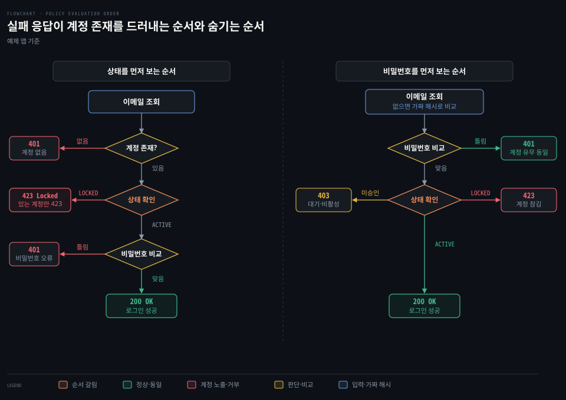
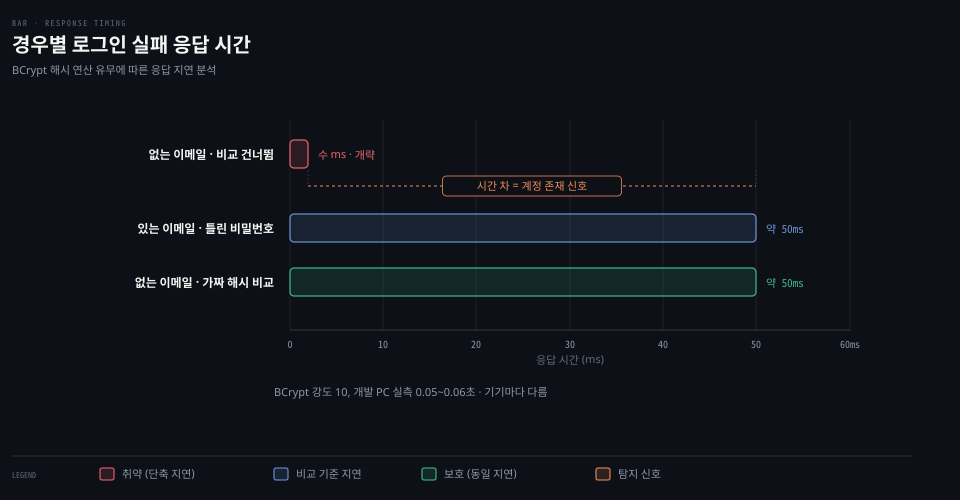
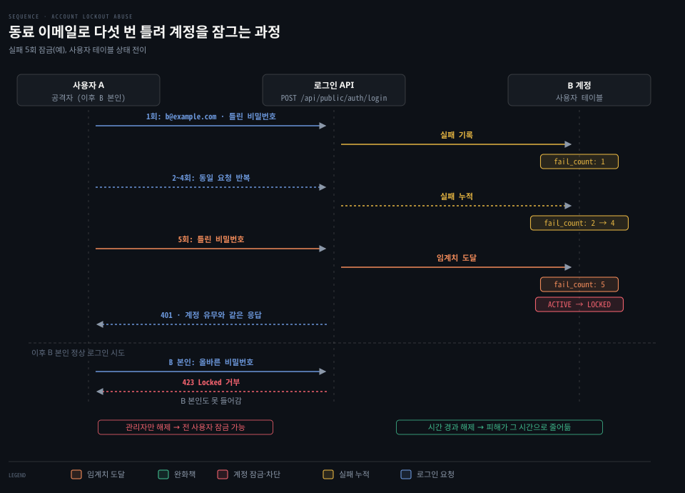
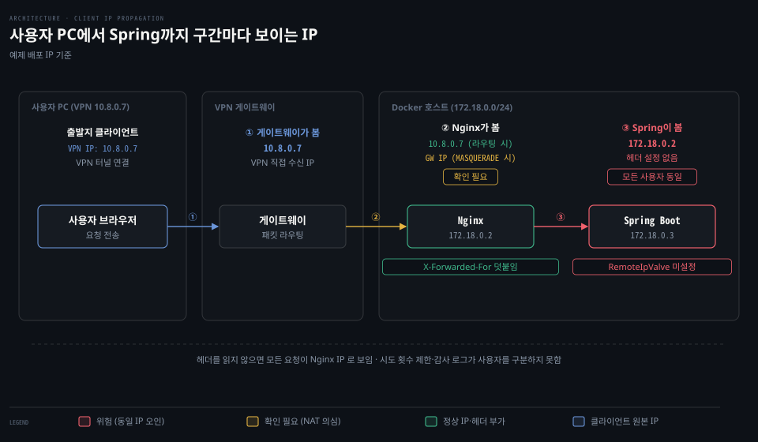
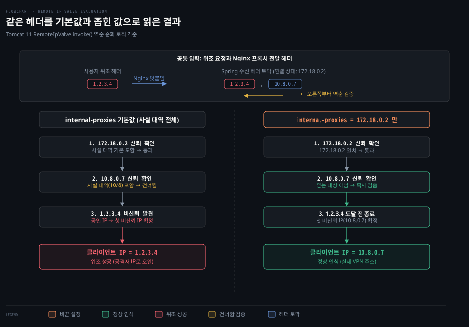

# userNotFoundEncodedPassword·RemoteIpValve·X-Forwarded-For

---

> 로그인 실패 응답은 검사 순서와 더미 해시 비교로 계정 존재를 숨겨야 하며, 프록시 뒤에서 시도 횟수를 제한할 때는 신뢰하는 프록시만 남긴 X-Forwarded-For 로 클라이언트를 식별해야 합니다.

로그인 실패 응답이 계정 존재를 드러내는 경로와 프록시 환경에서 시도 횟수를 제한하는 기준을 살펴봅니다.


## 학습 목표와 범위

> 로그인 실패 처리의 보안 취약점을 이해하고 안전한 시도 제한 구조를 도출합니다.

- 로그인 실패 응답 코드와 응답 시간이 계정 존재를 드러내는 원리를 설명합니다.
- 계정 잠금 정책이 서비스 거부 공격으로 역이용되는 경로와 그 한계를 분석합니다.
- NAT와 프록시 환경에서 요청 제한 기준(IP, 계정, 조합)의 트레이드오프를 비교합니다.
- Spring Boot와 Nginx 환경에서 X-Forwarded-For 헤더를 안전하게 신뢰하는 설정을 도출합니다.

세션 발급과 CSRF 방어 흐름은 [02-01 CsrfFilter·CookieCsrfTokenRepository·SecurityContextRepository](./02-01.CsrfFilter·CookieCsrfTokenRepository·SecurityContextRepository.md)에서 다룹니다. 비밀번호 변경 흐름과 실제 비즈니스 로직 구현 코드는 이 문서의 범위 밖입니다.


## 문제와 필요성

> 사내 시스템이라도 로그인 API의 응답 차이로 사용자 계정의 존재가 외부에 드러날 수 있습니다.

로그인 ID로 회사 이메일을 쓰는 서비스에서는 이름과 도메인 규칙이 정형화되어 외부에서도 주소를 쉽게 추측할 수 있습니다. 만약 로그인 API가 존재하지 않는 이메일과 비밀번호가 틀린 이메일을 서로 다르게 처리하면 공격자가 이 API를 검증 창구로 악용할 수 있습니다. 특정 이메일이 실제 사용자 계정인지 응답 차이로 확인하는 것입니다.

사내망 내부라고 해서 안전한 것은 아닙니다. 공격자는 외부 침입자에 국한되지 않으며 동료의 이메일은 사내 메신저나 조직도만 봐도 파악할 수 있습니다. 악의를 가진 내부자가 동료 계정의 존재를 확인하거나 공격 표적으로 삼을 수도 있습니다. 로그인 실패 응답은 어떤 상황에서도 계정의 존재 여부를 드러내지 않도록 설계해야 합니다.


## 실패 응답이 계정을 드러내는 길

> 계정 상태를 비밀번호보다 먼저 검사하면 실패 응답 코드만으로도 계정의 존재가 드러납니다.

로그인 요청을 처리할 때 이메일 존재 여부나 계정 상태를 먼저 확인하고 실패를 반환하면 보안 문제가 발생합니다. 상태를 먼저 검사하면 존재하는 계정과 존재하지 않는 계정이 서로 다른 HTTP 상태 코드를 받기 때문입니다.



위 도식의 왼쪽처럼 계정 상태를 먼저 검사하면 없는 계정은 401을 받지만 잠긴 계정은 비밀번호가 틀려도 423을 받습니다. 공격자는 비밀번호를 맞히지 못해도 423 응답을 확인하는 것만으로 해당 이메일이 시스템에 실재함을 알아챕니다. 사용자 테이블에 계정 상태(대기·활성·잠김·비활성)와 비밀번호 해시 컬럼이 따로 있더라도 검사 순서가 잘못되면 이 정보가 노출됩니다.

반면 도식의 오른쪽처럼 비밀번호 일치 여부를 계정 상태보다 먼저 검사하면 계정 노출을 막을 수 있습니다. 비밀번호가 틀리면 계정의 존재 여부나 잠금 상태와 무관하게 항상 401을 반환합니다. 계정 존재를 숨기려면 비밀번호가 일치한 뒤에만 423(잠금)이나 403(대기·비활성) 같은 상태 기반 거부를 반환하도록 순서를 잡아야 합니다.

| 검사 순서 | 이메일 없음 | 있는 계정 · 비밀번호 틀림 · ACTIVE | 있는 계정 · 비밀번호 틀림 · LOCKED | 비밀번호 맞음 · LOCKED |
|---|---|---|---|---|
| 상태 먼저 검사 | 401 | 401 | 423 | 423 |
| 비밀번호 먼저 검사 | 401 | 401 | 401 | 423 |

차이는 셋째 칸 하나이며, 상태를 먼저 보면 비밀번호를 몰라도 423 으로 계정이 드러납니다.


## 응답 시간도 응답이다

> 응답 코드와 본문이 같아도 암호화 연산 시간의 차이로 계정의 유무가 드러날 수 있습니다.

서버가 모든 실패에 동일하게 401 상태 코드와 같은 본문을 반환하더라도 암호화 연산에 걸리는 시간 차이로 계정 정보가 누출될 위험은 여전히 남습니다.



Spring Security의 `BCryptPasswordEncoder`는 기본 강도 10을 사용합니다. BCrypt는 무차별 대입 공격을 늦추기 위해 의도적으로 연산 비용을 높인 해시 알고리즘입니다. 개발 PC에서 `htpasswd -nbB -C 10` 명령으로 3회 실측했을 때 해시 1회당 약 0.05초에서 0.06초(약 50ms)가 걸렸습니다. 이 수치는 실행 기기의 성능에 따라 달라질 수 있습니다.

만약 데이터베이스에서 이메일을 찾지 못했을 때 BCrypt 검증을 건너뛰면 응답은 수 밀리초(ms) 안에 끝납니다. 이 수 ms는 실측값이 아닌 개략적인 추정치이지만 50ms 안팎이 걸리는 정상 해시 연산과 비교하면 확연한 시간 차이가 납니다. 공격자는 응답 시간을 측정해 계정의 유무를 추측할 수 있으며 이는 OWASP 인증 가이드에서도 경고하는 취약점입니다[^owasp-auth].

이 시간 차이를 메우려면 이메일이 조회되지 않더라도 가짜(더미) 해시를 대상으로 BCrypt 비교 연산을 한 번 수행해야 합니다. 대기 상태 계정도 마찬가지입니다. 이 계정은 비밀번호가 아직 설정되지 않아 해시 값이 비어 있습니다. 유효한 해시가 없더라도 동일하게 더미 해시와 비교해 항상 일정한 연산 시간을 소모하도록 맞춥니다.


## 계정 잠금과 그 역이용

> 연속 실패 시 계정을 잠그는 정책은 공격자가 동료 계정을 의도적으로 잠그는 서비스 거부 공격으로 역이용될 수 있습니다.

무차별 대입 공격을 막기 위해 흔히 쓰이는 방식은 로그인 실패가 일정 횟수 누적되면 계정을 잠그는 조치입니다. 예를 들어 실패 허용 횟수를 5회로 두고 사용자 테이블에 실패 횟수와 잠금 시각을 기록해 상태를 전환하는 구조가 대표적입니다.



하지만 계정 잠금 정책은 공격자에게 역이용당하기 쉽습니다. 사내 환경에서는 동료의 이메일을 쉽게 알 수 있습니다. 악의를 가진 사용자가 특정 동료의 이메일로 임의의 비밀번호를 5회 연속 입력하면 해당 계정은 즉시 잠겨 정상적인 업무가 불가능해집니다. 이를 부서 전체 이메일로 반복하면 조직 전체를 마비시키는 서비스 거부(DoS) 공격이 성립합니다[^owasp-auth].

관리자가 수동으로 풀어줄 때까지 영구히 잠그는 대신 일정 시간이 지나면 자동으로 풀리는 시간 경과 해제를 적용하면 피해를 다소 줄일 수는 있습니다. 그러나 잠겨 있는 시간 동안 정상 사용자가 겪는 업무 중단 피해는 여전히 남습니다.

이러한 부작용을 피하려면 계정을 직접 잠그는 대신 로그인 시도 횟수를 제한하는 방식으로 무차별 대입 공격을 늦출 수 있습니다.


## 시도 횟수는 무엇을 기준으로 세나

> 단일 IP나 계정만으로 시도 횟수를 제한하면 사내 네트워크 환경에서 정상 사용자가 함께 차단되는 문제가 발생합니다.

계정 잠금 대신 시도 횟수를 제한하기로 결정했다면 횟수를 측정할 기준을 정해야 합니다. 기준 후보로는 IP 주소, 대상 계정(이메일), 그리고 둘을 결합한 조합이 있습니다.



단순히 IP 주소만으로 요청 횟수를 제한하면 사내망과 프록시 구조에서 문제가 생깁니다. 사무실의 NAT 환경, 사내 프록시 서버, 또는 사내 VPN 게이트웨이 뒤에서는 수많은 사용자가 외부나 백엔드 서버에 같은 IP 하나로 연결됩니다. 한 사용자가 로그인을 반복해 한도에 도달하면 같은 사무실이나 VPN을 이용하는 다른 모든 사용자의 로그인 요청까지 차단되는 대가가 따릅니다.

반대로 계정(이메일)만을 기준으로 횟수를 세면 같은 종류의 역이용이 남습니다. 다만 막히는 시간이 제한 구간(예: 5분)으로 짧고, 잠금처럼 DB 에 남는 상태가 없어 시간이 지나면 저절로 풀립니다.

| 제한 기준 | 차단 방식 | 막는 공격 | 발생하는 대가 |
|---|---|---|---|
| IP 기준 | 동일 IP의 시도 횟수 제한 | 단일 출처의 무차별 대입 | NAT·VPN 환경에서 다수 사용자가 일괄 차단됨 |
| 계정 기준 | 특정 이메일의 시도 횟수 제한 | 특정 계정에 대한 분산 대입 | 공격자가 의도적으로 시도해 계정 로그인을 방해함 |
| IP와 계정 조합 | 특정 IP에서 특정 계정 시도 제한 | 특정 경로의 무차별 대입 | 다양한 IP로 분산 공격 시 방어 효과가 제한됨 |

실제 환경에서는 각 기준의 장단점을 따져보고 네트워크 토폴로지에 맞는 방식을 선택해야 합니다.

IP를 어떻게 알아내느냐와 센 횟수를 어디에 저장하느냐는 별개의 문제입니다. 단일 서버 환경에서는 서버 메모리에 카운터를 둘 수 있고, Redis 같은 공유 저장소는 백엔드를 2대 이상 띄울 때만 필요해집니다. 서버마다 따로 세면 실제 한도가 대수만큼 늘어나기 때문입니다. 서버가 재시작되면 메모리 카운터는 0으로 돌아가지만 제한 구간이 몇 분 단위로 짧으면 영향은 작습니다. 저장소를 바꿔도 IP를 확인하는 방식은 그대로입니다.


## X-Forwarded-For를 믿는 조건

> 클라이언트가 임의로 조작할 수 있는 X-Forwarded-For 헤더는 신뢰할 수 있는 프록시가 보증할 때만 유효합니다.

IP 주소를 기준으로 요청을 제한하려면 백엔드 서버가 실제 사용자의 IP를 정확히 알아내야 합니다. HTTP 요청에 담긴 `X-Forwarded-For` 헤더는 누구나 원하는 값으로 작성하거나 위조할 수 있습니다. 반면 TCP 소켓 연결에서 확인되는 상대방 IP(연결 IP)는 변조할 수 없습니다. 따라서 백엔드는 직접 연결된 상대가 신뢰하는 프록시일 때만 이 헤더 값을 믿어야 합니다.



- Spring Boot에서 `server.forward-headers-strategy`의 기본값은 `none`입니다. 이 값을 `native`로 설정하면 내장 톰캣의 `RemoteIpValve`가 헤더 해석을 전담합니다.[^spring-proxy] 그래서 코드는 헤더를 직접 파싱하지 않고, 신뢰할 프록시가 보낸 `X-Forwarded-For`를 밸브가 해석해 넣어 준 `request.getRemoteAddr()`를 읽습니다. 톰캣은 기본으로 `X-Forwarded-For`만 읽고 Nginx가 함께 보내는 `X-Real-IP`는 쓰지 않습니다.

### RemoteIpValve 의 헤더 해석 순서

톰캣의 `RemoteIpValve`는 TCP 연결 상대가 신뢰하는 프록시일 때만 헤더를 처리합니다. 그리고 헤더에 적힌 IP 목록을 오른쪽 끝에서부터 왼쪽으로 역순 탐색합니다.[^tomcat-valve]

```java
for (idx = remoteIpHeaderValue.length - 1; idx >= 0; idx--) {
    String currentRemoteIp = remoteIpHeaderValue[idx];
    remoteIp = currentRemoteIp;
    if (isInternalProxy(currentRemoteIp)) {
        // do nothing
    } else if (isTrustedProxy(currentRemoteIp)) {
        proxiesHeaderValue.addFirst(currentRemoteIp);
    } else {
        idx--;
        break;
    }
}
```

톰캣은 오른쪽부터 검사하면서 내부 프록시(internal proxy)로 등록된 IP는 건너뛰고 신뢰하는 프록시(trusted proxy)는 목록에 기록하며 계속 진행합니다. 그러다 프록시 목록에 포함되지 않는 첫 번째 IP를 만나면 그 값을 실제 클라이언트 IP로 확정하고 탐색을 종료합니다.

여기서 Spring Boot의 기본 설정값 때문에 두 가지 함정이 발생합니다. `spring-boot-tomcat`의 `server.tomcat.remoteip.internal-proxies` 기본값은 `10.0.0.0/8`, `172.16.0.0/12`, `192.168.0.0/16`을 비롯한 사설 IP 대역 전체입니다.

첫 번째 함정은 내부 사용자의 PC가 Nginx를 거치지 않고 백엔드에 직접 연결되더라도 사설 IP라는 이유로 헤더를 그대로 신뢰한다는 점입니다. 두 번째 함정은 Nginx를 정상적으로 거치더라도 발생합니다. Nginx가 덧붙인 사용자의 사설 VPN 주소까지 기본 사설 대역에 포함되어 건너뛰어집니다. 그러면 클라이언트가 애초에 위조해 보낸 가짜 IP가 최종 클라이언트 IP로 채택됩니다.

예를 들어 사용자의 실제 VPN 주소가 `10.8.0.7`이고 위조하려는 헤더 값이 `1.2.3.4`라고 가정해 봅니다. Nginx 컨테이너의 IP는 `172.18.0.2`이고 Spring 컨테이너의 IP는 `172.18.0.3`입니다. Nginx의 `$proxy_add_x_forwarded_for` 설정은 기존 헤더 뒤에 연결 IP를 덧붙이므로 백엔드로 전달되는 헤더는 `1.2.3.4, 10.8.0.7`이 됩니다[^nginx-xff].

기본 설정을 그대로 쓰면 Spring은 연결 상대인 Nginx(`172.18.0.2`)를 사설 IP로 보고 신뢰합니다. 그다음 헤더의 가장 오른쪽 값인 `10.8.0.7` 역시 사설 대역에 해당하므로 건너뜁니다. 결국 맨 왼쪽에 있던 `1.2.3.4`가 최종 클라이언트 IP로 결정되어 공격자의 위조가 성공합니다.

이 문제를 해결하려면 `internal-proxies`를 사설망 전체가 아니라 Nginx 컨테이너 IP 한 개(예: `172\.18\.0\.2`)로 좁혀야 합니다. 그러면 Nginx(`172.18.0.2`)만 프록시로 인정됩니다. 헤더의 `10.8.0.7`은 프록시 목록에 없으므로 탐색이 멈추고 실제 사용자의 IP인 `10.8.0.7`이 클라이언트 IP로 정확히 인식됩니다.

### 컨테이너 배포의 신뢰 IP 고정

리버스 프록시와 백엔드가 같은 서버에 있어도 백엔드가 보는 연결 IP는 `127.0.0.1`이 아닐 수 있습니다. 컨테이너 네트워크의 서비스 이름으로 연결하면 백엔드는 프록시 컨테이너의 IP를 봅니다. `127.0.0.1`로 충분한 경우는 프록시가 `127.0.0.1`로 백엔드에 붙을 때, 곧 둘 다 호스트 프로세스이거나 host 네트워크를 쓸 때뿐입니다. 신뢰 목록에 루프백을 두면 같은 기기에서 보낸 위조 헤더는 그대로 클라이언트 IP가 됩니다.

백엔드 설정은 헤더 해석을 켜는 줄과 믿을 프록시를 좁히는 줄 두 가지입니다.

```yaml
server:
  forward-headers-strategy: native          # RemoteIpValve 를 켠다
  tomcat:
    remoteip:
      internal-proxies: ${TRUSTED_PROXIES}  # 예: 172\.18\.0\.2 (Nginx 컨테이너 IP 한 개)
```

헤더 해석을 켜지 않으면 백엔드에는 모든 요청이 Nginx IP 하나로 보입니다. IP 기준 카운터를 모두가 함께 쓰게 되어, 한 사람이 한도만큼 틀리면 다른 사람의 로그인도 막힙니다.

컨테이너 IP는 다시 띄울 때 바뀔 수 있고, 네트워크를 다시 만들면 Docker가 대역을 새로 고를 수 있습니다. 그래서 compose 네트워크의 서브넷과 Nginx 컨테이너의 IP를 함께 고정합니다. 고른 대역이 사내망이나 기존 Docker 대역과 겹치지 않는지도 확인합니다.

```yaml
networks:
  app:
    ipam:
      config:
        - subnet: 172.18.0.0/24      # 대역을 고정한다
services:
  nginx:
    networks:
      app:
        ipv4_address: 172.18.0.2     # TRUSTED_PROXIES 에 넣는 값
```

`TRUSTED_PROXIES`에는 이 IP 한 개만 넣습니다. 대역 전체(`172.18.0.0/24`)를 넣으면 브리지 게이트웨이 `172.18.0.1`도 신뢰 프록시가 됩니다. 포트 전달이 출발지를 게이트웨이 주소로 바꾸는 환경에서는 Nginx가 `1.2.3.4, 172.18.0.1`처럼 덧붙입니다. 톰캣은 게이트웨이를 프록시로 보고 건너뛴 뒤 왼쪽의 위조값 `1.2.3.4`를 클라이언트 IP로 채택합니다.

macOS의 OrbStack에서 예제 앱으로 잰 결과가 그랬습니다. 맥과 VM에서 공개 포트로 보낸 요청은 Nginx에 이미 게이트웨이 IP로 도착해 접속자를 구분할 수 없었습니다. 같은 Docker 네트워크의 클라이언트 컨테이너는 각자의 IP가 남았습니다.

신뢰 범위를 바꿔 보면 대역 전체를 믿을 때는 위조값이 클라이언트 IP가 됐습니다. Nginx IP 하나만 믿자 위조값이 무시됐습니다. 리눅스 Docker에서 외부 PC가 붙는 경우는 확인하지 않았습니다.

백엔드 포트는 외부에 공개하지 않습니다. 신뢰 범위를 좁히면 직접 붙은 연결의 헤더가 무시됩니다. 여기에 포트까지 닫으면 Nginx를 건너뛰는 연결을 네트워크에서도 막습니다. 다만 OrbStack의 맥 호스트에서는 포트를 공개하지 않아도 컨테이너 IP로 접속됐습니다. VM에서는 접속되지 않았습니다.

Nginx 앞에 로드 밸런서나 리버스 프록시가 더 있으면 그 IP도 신뢰 대상에 넣어야 하며, 위조 위험도 같은 방식으로 따라옵니다.

배포한 뒤에는 다른 PC에서 틀린 로그인을 한도만큼 보냅니다. 그 PC만 429를 받고 내 PC는 정상 로그인되면 IP 구분이 되는 것입니다. 이어서 `X-Forwarded-For`에 가짜 IP를 실어 보내, 로그의 클라이언트 IP가 가짜 값이 아니라 실제 접속 IP로 남는지 확인합니다.


## 대안과 선택

> 무차별 대입 공격 방어 방식은 막으려는 공격 유형과 정상 사용자 오차단·네트워크 전제 조건을 함께 따져 선택합니다.

모든 무차별 대입 방어 방식은 공격 차단 범위와 정상 사용자 오차단 사이의 트레이드오프를 안고 있습니다.

| 방어 방식 | 막는 공격 | 지불하는 대가 | 적용 조건과 특징 |
|---|---|---|---|
| 계정 잠금 | 단일 계정에 대한 지속 대입 | 서비스 거부 공격으로 역이용됨 | DB에 실패 횟수와 잠금 상태를 저장하며 해제 정책이 함께 필요함 |
| IP 기준 제한 | 특정 IP 출처의 자동화 공격 | NAT·VPN 환경에서 다수 사용자가 함께 차단됨 | 프록시 구간에서 실제 클라이언트 IP가 보존되어야 유효함 |
| 계정 기준 제한 | 여러 IP로 분산된 대입 공격 | 특정 계정에 대한 로그인 차단 유발 | 제한 구간이 지나면 저절로 풀려 잠금보다 피해가 작고 서버 메모리만으로 구현 가능함 |
| IP와 계정 조합 | 특정 IP를 통한 특정 계정 공격 | 공격자가 프록시를 바꾸며 시도 시 방어 효과가 제한됨 | 식별 키 구조가 복잡해지지만 단일 기준보다 오차단 범위를 좁힐 수 있음 |

네트워크 구성상 클라이언트 IP가 NAT나 게이트웨이에 가려지면 IP 기준 제한이 정상 사용자까지 막습니다. 프록시 구간에서 실제 IP가 보존되는지 먼저 확인한 뒤 기준을 조합해야 합니다.


## 스스로 확인할 질문

> 본문에서 다룬 핵심 원리와 방어 설계를 스스로 점검하는 질문입니다.

1. 로그인 실패를 "이메일 없음"·"비밀번호 틀림"·"잠김"으로 나눠 알려 주면 무엇이 새어 나가나요?
2. 응답 코드와 메시지가 모두 같아도 계정 존재가 드러나는 경로는 무엇이고, 어떻게 막나요?
3. 계정 잠금을 사내 동료가 역이용하면 어떤 일이 생기고, 잠금 방식을 어떻게 바꾸면 피해가 줄어드나요?
4. 사무실 전체가 한 IP 로 보이는 구조에서 IP 기준 제한은 어떤 문제를 일으키나요?
5. 서버가 X-Forwarded-For 를 믿어도 되는 조건은 무엇이고, Spring Boot 기본값을 그대로 쓰면 왜 위험한가요?
6. 리버스 프록시와 컨테이너 네트워크 뒤에 있는 백엔드가 실제 클라이언트 IP를 얻으려면 프록시와 `internal-proxies`를 어떻게 설정해야 하나요?


## 출처와 관련 문서

> 본문 사실과 공식 명세의 근거 자료입니다.

- 관련 문서: [02-01 CsrfFilter·CookieCsrfTokenRepository·SecurityContextRepository](./02-01.CsrfFilter·CookieCsrfTokenRepository·SecurityContextRepository.md)
- 관련 문서: [proxy_set_header·option forwardfor](../../../02_os/docs/reverse-proxy/01-01.proxy_set_header·option%20forwardfor.md) (프록시가 `X-Forwarded-For`를 덧붙이거나 덮어쓰는 동작과 `realip` 신뢰 경계)
- 관련 문서: [리버스 프록시 앞단 층 — 규칙 고르기·전달 헤더 신뢰·건강 검사](../../../02_os/project/npg-lab/01-04.리버스%20프록시%20앞단%20층%20—%20규칙%20고르기·전달%20헤더%20신뢰·건강%20검사.md) (TCP 상대 주소와 헤더 주장의 경계, 홉별 독립 신뢰와 역추적 방식)

[^owasp-auth]: OWASP Cheat Sheet Series — Authentication Cheat Sheet. https://cheatsheetseries.owasp.org/cheatsheets/Authentication_Cheat_Sheet.html
[^spring-proxy]: Spring Boot Reference — Running Behind a Front-end Proxy Server. https://docs.spring.io/spring-boot/how-to/webserver.html#howto.webserver.use-behind-a-proxy-server
[^tomcat-valve]: Apache Tomcat 11 Configuration Reference — Remote IP Valve. https://tomcat.apache.org/tomcat-11.0-doc/config/valve.html#Remote_IP_Valve
[^nginx-xff]: Nginx Documentation — Module ngx_http_proxy_module $proxy_add_x_forwarded_for. https://nginx.org/en/docs/http/ngx_http_proxy_module.html#var_proxy_add_x_forwarded_for
