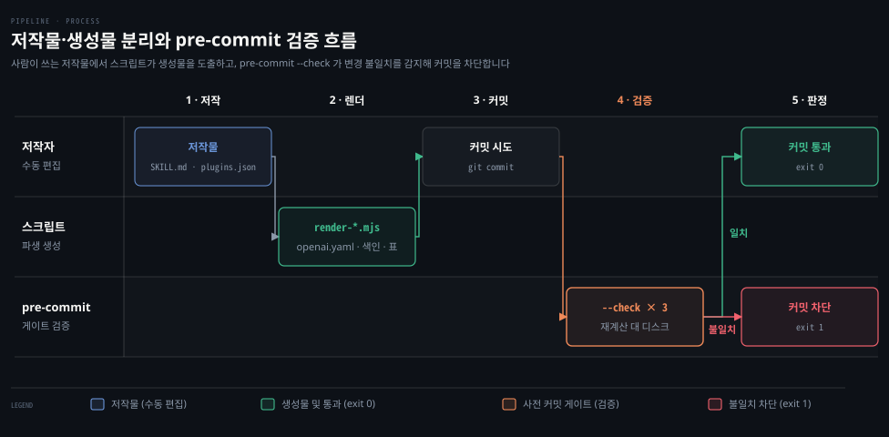
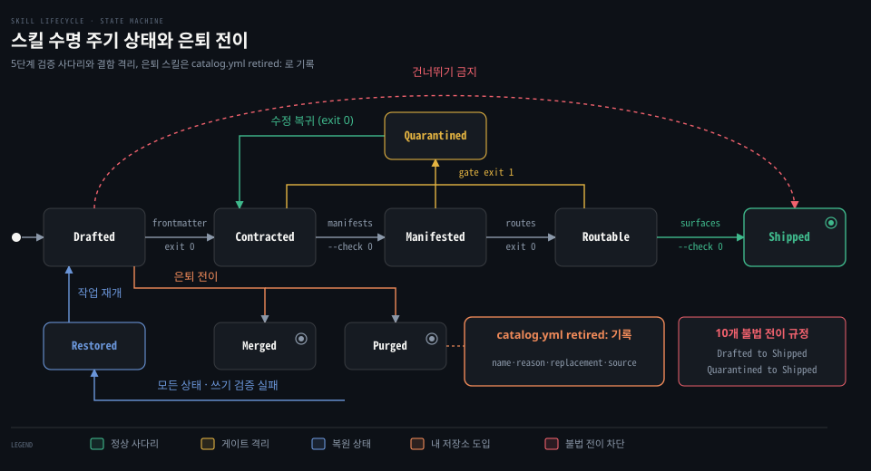
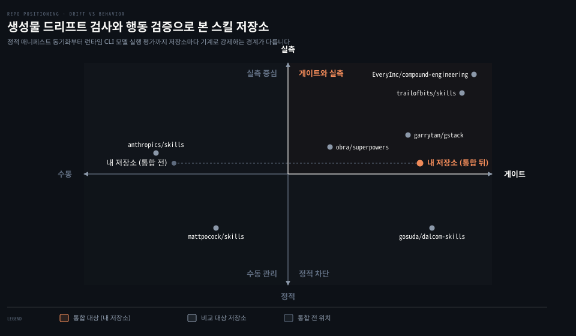
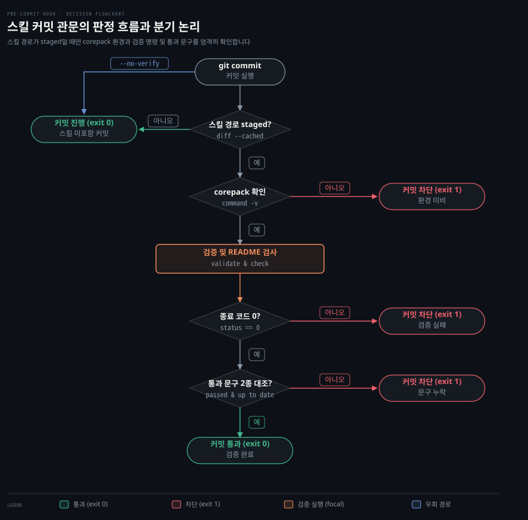

# dalcom-skills로 본 스킬 저장소 설계
---
> 스킬 저장소가 커질 때 어떤 결함이 조용히 쌓이는지, dalcom-skills 와 공개 저장소 여섯 곳이 그것을 어떻게 기계로 막는지, 그중 내 저장소에 옮긴 것을 정리합니다.

## 핵심 요약

> 검증이 통과해도 스킬 저장소는 건강하지 않을 수 있어서, 저작물과 생성물을 가르고 검사 규칙 자체를 시험하는 장치가 필요합니다.

스킬이 마흔여섯 개쯤 되면 사람의 눈과 단순한 정적 검사만으로는 결함이 조용히 쌓입니다. 내 저장소는 `validate:skills` 가 통과하는 상태에서도 빈틈이 남아 있었습니다. 은퇴한 스킬을 가리키는 고아 포인터, 손으로 쓴 README 의 어긋난 숫자, 시험에 한 번도 나오지 않은 검사 규칙이 있었습니다. 커밋 때 돌지 않는 검증과 줄 수만 보는 크기 상한도 남아 있었습니다.

이 문서는 그 다섯 빈틈을 먼저 푼 gosuda/dalcom-skills 의 구조 장치를 읽고, 같은 문제를 다르게 푼 공개 저장소 여섯 곳과 나란히 놓은 뒤, 내 저장소에 무엇을 어떻게 옮겼는지 적습니다. 옮긴 방식은 복사가 아니라 번역입니다.

dalcom 은 304개 스킬을 여러 실행 환경에 배포하는 저장소이고, 내 저장소는 조사 시점에 46개 스킬을 한 사람이 여러 세션으로 다루는 저장소이기 때문입니다.

| 절 | 답하는 질문 |
|---|---|
| 손으로 관리하던 스킬의 빈틈 | 검증이 통과하는데도 남아 있던 문제는 무엇이었나 |
| dalcom-skills 의 구조 | 그 문제를 dalcom 은 어떤 장치로 막는가 |
| dalcom 방식의 장점과 대가 | 그 장치는 무엇을 보장하고 무엇을 치르게 하며, 무엇을 옮기지 않았나 |
| 유명 스킬 저장소 여섯 곳 | 같은 문제를 다른 저장소는 어떻게 다르게 풀었나 |
| 내 스킬 저장소에 옮긴 것 | 무엇을 어떻게 옮겼고, 효과는 어디까지 확인했나 |

## 손으로 관리하던 스킬의 빈틈

> 스킬 수가 늘어나면 사람의 관리 역량과 단순한 정적 검사만으로는 은퇴 포인터, 문서 수치, 시험 없는 규칙, 커밋 누락, 토큰 한도 초과를 잡지 못하고 놓칩니다.

스킬 수가 마흔 개를 넘어서면 사람의 눈과 단순한 정적 검사만으로는 조용한 결함이 누적되는 사태를 막기 어렵습니다. 내 저장소는 조사 시점(main `503d235`)에 `.claude/skills/` 아래 스킬 46개를 `catalog.yml` 의 분류와 검증 규칙 25개로 관리하고 있었습니다. 규칙은 `scripts/skill-validation.mjs` 에 23개, `scripts/skill-security-validation.mjs` 에 2개 있습니다.

이때 `corepack yarn validate:skills` 명령은 같은 시점에도 통과를 보고했습니다. 하지만 검증 통과 판정이 곧 저장소의 건강함을 뜻하지는 않았습니다. 검증을 통과한 상태에서도 실제로는 다섯 가지 결함이 그대로 남아 있었습니다.

첫 번째 빈틈은 은퇴한 스킬을 가리키는 고아 참조였습니다. `quality-review` 의 설명문이 이미 `.claude/deprecated/` 로 빠진 `architecture-design` 을 가리키고 있었는데도 검증기는 경고하지 않았습니다. 설명문 속 스킬 이름이 실존하는지 대조하는 규칙이 없었기 때문입니다. 여기서 **포인터**(pointer)는 한 스킬의 설명문이 다른 스킬로 일을 넘기려고 적어 둔 참조를 뜻합니다. 모델은 이 포인터를 믿고 없는 스킬을 부르다가 실패합니다.

두 번째 빈틈은 문서 수치의 어긋남이었습니다.

사람이 직접 쓰는 **저작물**과 스크립트가 파생해 내는 **생성물**의 경계를 가르지 않아, 두 영역 사이에서 내용이 어긋나는 **드리프트**가 생겼습니다. 영어로는 각각 authored file, generated file, drift 입니다.

`.claude/skills/README.md` 는 손으로 쓴 문서여서 "47 skill packages"라고 적혔지만 실제 파일은 46개였습니다. "34 resident descriptions"라고 적혔지만 git 이 추적하는 스킬 가운데 모델이 호출할 수 있는 것은 22개였습니다. 카테고리별 숫자도 어긋나 Engineering 은 README 13개 대 catalog 14개, Personal 은 README 2개 대 catalog 4개로 갈렸습니다. 스킬을 더하거나 뺄 때 README 수치를 맞추는 장치가 없었습니다.

세 번째 빈틈은 시험을 거치지 않는 규칙이었습니다. 저장소 전체의 불변 조건을 확인해 규칙 위반이 커밋되는 것을 막는 검사 스크립트를 **게이트**(gate)라고 부릅니다. 그런데 `scripts/skill-validation.test.mjs` 에서 규칙 식별자 약 11개가 한 번도 나오지 않았습니다.

대표적인 예가 `nested-skill`, `missing-frontmatter`, `multiline-description` 입니다. `routing-text-too-long`, `duplicate-skill-catalog-entry`, `invalid-firing-cases` 도 마찬가지였습니다. 의도된 결함 픽스처(fixture)로 시험해 본 적이 없는 규칙은 정규식이 느슨해져 조용히 무력화돼도 알아챌 길이 없습니다.

네 번째 빈틈은 커밋 단계와 스킬 검증의 단절이었습니다. `.git/hooks/pre-commit` 은 git 추적 밖이어서 저장소 형상으로 관리되지 않았고, 하는 일도 시크릿 검사에 그쳤습니다. 검증 스크립트를 만들어 두어도 커밋 때 자동으로 돌지 않으니, 작업자가 빠뜨리면 깨진 상태가 이력에 그대로 실렸습니다.

다섯 번째 빈틈은 줄 수 기준에만 기댄 크기 제한이었습니다. 기존 상한은 500줄 하나뿐이었는데, `herdr-relay` 는 31KB, `writing-method` 는 20KB 에 달했습니다.

공식 문서에 따르면 긴 대화를 요약해 줄이는 과정인 컴팩션(compaction) 뒤에는 스킬마다 앞 5,000 토큰만 다시 붙고 합계는 25,000 토큰으로 제한됩니다. 단순한 줄 수 상한만으로는 이 제약 안에서 핵심 절차가 온전히 보존되는지 가늠하기 어려웠습니다.

이 다섯 빈틈은 스킬이 늘어날 때 수동 관리와 부분 검증이 맞닥뜨리는 전형적인 한계입니다. 다음 절에서는 dalcom-skills 가 같은 문제를 어떤 구조 장치로 막는지 봅니다.

## dalcom-skills 의 구조

> 스킬 304개를 22개 플러그인 체계로 운영하기 위해 dalcom-skills 가 구축한 구조 장치와 검증 규율을 살펴봅니다.

스킬이 수백 개로 늘어날 때 체계적인 구조 장치가 없으면 파일 불일치와 유령 참조가 걷잡을 수 없이 번집니다. dalcom-skills 는 플러그인 22개와 스킬 304개를 단일 트리 안에서 관리하며, 구조 장치는 여섯 가지입니다.

이 절은 앞의 다섯 빈틈과 맞닿은 다섯 장치를 보고, 여섯째인 수명 주기 상태 기계는 다음 절에서 옮기지 않은 원칙과 함께 봅니다.

### 디렉터리가 곧 레지스트리

스킬 이름을 별도 **레지스트리**(registry, 스킬 이름과 위치를 적어 둔 목록)에 따로 적어 두면 실제 디렉터리와 목록이 어긋납니다. 스킬을 만들거나 옮기거나 지울 때 목록을 같이 고치지 않으면 배포에서 스킬이 조용히 빠지거나 없는 경로를 찾는 오류가 납니다.

dalcom-skills 는 레지스트리 파일을 따로 두지 않고 디렉터리 배치 자체를 레지스트리로 삼습니다. 모든 스킬은 `plugins/<plugin>/skills/<slug>/SKILL.md` 한 곳에만 작성되며(슬러그 slug 는 스킬 식별자입니다), 그 경로가 소유 플러그인을 정합니다.

최상위 메타데이터인 `catalog/plugins.json` 은 22개 플러그인의 순번, 식별자, 표시 이름, 설명, 분류, 태그, 홈페이지, 디렉터리 경로를 담고 개별 스킬 이름은 열거하지 않습니다. 각 실행 환경이 `skills/` 의 직계 자식을 읽고 Cursor 만 더 깊이 내려가므로, 환경 사이 동작을 맞추려고 모든 스킬을 `skills/<slug>/` 1계층에 둡니다.

이 장치가 없으면 스킬을 더하거나 정리할 때마다 중앙 등록 파일, 플러그인별 매니페스트, 설정 파일을 사람이 대조해야 합니다. 300개가 넘으면 누락과 오탈자가 쌓여 환경마다 스킬 인식 범위가 갈라집니다. 디렉터리 구조를 유일한 원천으로 삼으면 앞 절의 README 숫자 불일치 같은 등록부 드리프트가 생길 자리가 줄어듭니다.

### 저작물과 생성물의 분리

하나의 저장소가 여러 에이전트 환경(Claude Code, Codex, Cursor, Grok, Kimi 등)을 지원하면 파생 파일이 대량으로 늘어납니다. 원본과 파생 파일의 경계가 흐려지면 작업자가 생성물을 고쳤다가 다음 자동화 실행 때 덮어써지거나, 원본만 고치고 파생본을 갱신하지 않아 배포 표면에 옛 내용이 남습니다.

dalcom-skills 는 사람이 쓰는 저작물과 스크립트가 만드는 생성물의 경계를 가릅니다. 스킬 본문인 `SKILL.md` 는 저작물이고, 그 헤더에서 `scripts/render-skill-manifests.mjs` 가 Codex용 `agents/openai.yaml` 매니페스트를 만듭니다. 전체 스킬 색인은 저작물인 디렉터리 구조에서 `scripts/render-skill-index.mjs` 가 작성합니다.

공통 기준 문서 `system-prompt-baseline.md` 를 6개 출력 스타일에 바이트 단위로 복제하는 일은 `scripts/sync-baseline.py` 가 맡습니다. 루트 `README.md` 에서는 22개 플러그인 표 영역만 `scripts/render-plugin-surfaces.mjs` 가 소유하고, 주변 산문은 사람이 쓰는 저작물로 남습니다.

pre-commit 훅인 `.pre-commit-config.yaml` 은 렌더 스크립트 세 개를 `--check` 플래그로 호출합니다. 세 개는 `render-plugin-surfaces`, `render-skill-manifests`, `render-skill-index` 입니다. 기본 모드는 디스크에 파일을 씁니다. `--check` 모드는 원본에서 다시 계산한 결과와 디스크의 실제 내용을 비교하고, 어긋나면 종료 코드 1로 커밋을 막습니다.

`sync-baseline.py` 는 훅에서 `--check` 없이 호출됩니다. 어긋난 출력 스타일을 다시 써 넣은 뒤 종료 코드 1로 끝나 커밋을 멈추고 다시 스테이징하게 합니다. 이 장치 덕분에 앞서 본 README 수치 드리프트와 파생 파일 배포 누락을 커밋 전에 걸러냅니다.

### 결함을 심은 게이트 시험

검사 스크립트가 커밋 검증을 통과시켰다고 해서 그 스크립트가 결함을 잘 잡는다고 단정할 수 없습니다. 정규식이 느슨해지거나 파서가 잘못되어 검사기가 조용히 고장 나면, 아무것도 검출하지 못하고 항상 성공(exit 0)을 반환하는 거짓 합격이 생깁니다.

dalcom-skills 는 게이트가 결함을 실제로 잡는지 증명하려고 검사 스크립트 안에 의도된 결함 픽스처를 심고 `--self-test` 플래그로 스스로 검증하게 했습니다. 예컨대 `scripts/check-skill-frontmatter.py` 는 닫히지 않은 따옴표, 필수 키 누락 같은 고의적 결함 19개와 정상 대조 5개를 `CASES` 목록에 품고 있습니다. 픽스처는 모두 24개이고, 셀프테스트가 결함이 전부 포착되는지 대조합니다.

경로 검사기 `scripts/check-skill-routes.mjs` 도 실존하지 않는 스킬을 가리키는 댕글링 포인터 두 개를 합성 데이터로 주입한 뒤 정확히 그 둘만 골라내는지 확인합니다.

또 `.pre-commit-config.yaml` 은 모든 로컬 검사 훅과 셀프테스트 훅에 `pass_filenames: false` 와 `always_run: true` 를 줍니다. 보통의 git 훅은 변경된 파일만 넘겨받지만, dalcom-skills 는 어떤 파일이 바뀌었든 매 커밋마다 저장소 전체를 검사하고 게이트 자체의 결함 포착 능력도 매번 다시 증명합니다.

이 장치가 없으면 검사 로직이 깨져도 결함이 방치됩니다. 세 번째 빈틈이었던 시험 없는 규칙은 고의 결함 픽스처로 풀고, 네 번째 빈틈이었던 커밋 단절은 `always_run: true` 전수 검사로 통제합니다.

### 포인터와 은퇴 기록

스킬 설명문에는 다른 스킬로 일을 넘기는 포인터가 자주 남습니다. 가리키는 스킬의 이름을 바꾸거나 다른 스킬로 합치면서 설명문을 함께 고치지 않으면 없는 스킬을 가리키는 고아 링크가 남습니다.

dalcom-skills 는 포인터 문법을 정적 분석으로 전수 검사합니다. `scripts/check-skill-routes.mjs` 는 정규식으로 `Not for <x>: use <slug>` 패턴을 뽑아, 가리키는 슬러그가 실제 스킬 디렉터리로 있는지 대조합니다. 없으면 즉시 오류를 보고해 배포 전에 깨진 링크를 막습니다.

수명이 다해 삭제되거나 다른 스킬로 흡수된 스킬의 행방은 `CHANGELOG.md` 의 `### Retired` 영역에 적습니다. 예컨대 `finish-it-now` 가 `do-it-now` 로 승계되었다는 식의 대체 관계를 기록으로 남깁니다.

이 검사와 기록이 없으면 스킬을 정리할 때마다 죽은 참조가 남고, 폐기된 스킬이 어디로 통합됐는지 알 수 없습니다. dalcom-skills 는 정적 경로 검사와 은퇴 이력을 결합해, 첫 번째 빈틈의 `architecture-design` 포인터 오류 같은 유령 참조를 배포 전에 막습니다.

### 본문 골격과 종료 상태

본문의 구조가 통일되지 않으면 모델은 어느 시점에 멈추고 무엇을 돌려줘야 하는지 판단하지 못해 과정 나열만 늘어놓습니다. 프런트매터에 임의의 키를 허용하면 도구마다 해석이 달라져 호환성이 깨집니다.

dalcom-skills 는 프런트매터 허용 키를 다섯 개로만 제한합니다. 목록은 `scripts/check-skill-frontmatter.py` 의 `ALLOWED_KEYS` 에 선언되어 있습니다. 허용 키는 `name`, `description`, `disable-model-invocation`, `argument-hint`, `allowed-tools` 입니다. 본문 골격은 게이트가 강제하지 않고 관례로 이어집니다.

`plugins/dstack-core/skills/ci-fix/SKILL.md` 와 `plugins/dstack-core/skills/code-review/SKILL.md` 처럼 마지막 절에 `## What you hand back` 을 두는 스킬이 있습니다. 이 절은 호출자에게 반환할 구체적 필드와 터미널 상태를 못박습니다. 고정 커밋에서 세면 스킬 304개 중 129개가 이 절을 두고, 그중 127개는 이 절이 마지막 `##` 절입니다. 이 절을 강제하는 게이트나 규칙 문서는 별도로 확인되지 않았습니다.

비정상 상황에 대비해 멈추는 분기를 적는 절을 둔 스킬도 있습니다. `## When to stop instead` 로 시작하는 절이 13개(그중 1개는 `## When to stop instead of pushing through`)이고 `## When it goes wrong` 절이 7개입니다.

종료 상태와 중단 조건이 없으면 에이전트는 끝났을 때 무엇을 보고해야 하는지 몰라 장황하게 말하거나, 상위 에이전트가 필요한 정보를 받지 못합니다. 스킬의 초안 작성부터 폐기까지 거치는 수명 주기는 다음 절에서 봅니다.

## dalcom 방식의 장점과 대가

> 중앙 집중 검사 체계가 주는 일관성과 그 유지 비용, 그리고 내 저장소가 사정에 맞춰 고른 절충을 살펴봅니다.

### 기계가 맡는 일관성

스킬이 수십 개에서 수백 개로 늘면 디렉터리, 목록 색인, 에이전트별 매니페스트를 손으로 대조하기 어렵습니다. 이름을 바꾸거나 위치를 옮길 때마다 일부 플랫폼 설정에 옛 경로가 남고, 문서 안의 호출 포인터가 깨져 런타임 오류가 납니다.

dalcom-skills 는 디렉터리 구조를 레지스트리로 삼고 저작물과 생성물을 기계로 가릅니다. pre-commit 훅이 렌더 스크립트 세 개를 `--check` 모드로 돌려 바이트 단위 드리프트를 커밋 전에 잡습니다. `scripts/check-skill-routes.mjs` 는 `Not for <x>: use <slug>` 구문이 가리키는 스킬이 실존하는지 전수 검사합니다.

이 장치 덕에 작업자는 수치, 표, 포인터의 동기화를 일일이 기억하지 않아도 됩니다. 304개 규모에서도 사람이 신경 쓰지 않는 사이 배포 표면이 어긋나거나 깨진 링크가 릴리스에 섞일 위험이 줄어듭니다. 대가도 있습니다. 원본 서식이 바뀌면 파서와 렌더 스크립트를 함께 고쳐야 하고, 검사기가 조용히 고장 나지 않게 하려면 `scripts/check-skill-frontmatter.py` 의 24개 픽스처 같은 의도된 결함 사례를 계속 관리해야 합니다. 검사 도구를 검증하는 도구를 유지하는 이중 관리가 일관성의 값입니다.

### 매 커밋 전체 검사의 비용

수정된 파일만 검사하면 변경 범위 밖의 생성물이나 상호 참조의 균열을 작업 시점에 잡기 어렵습니다. 다른 파일에서 스킬 이름을 바꿨는데 그 스킬을 가리키던 설명문은 수정되지 않아 검사를 통과하고, 깨진 참조가 저장소 이력에 스며듭니다.

dalcom-skills 는 앞 절의 「결함을 심은 게이트 시험」에서 본 `always_run: true` 와 `pass_filenames: false` 로 어떤 커밋에서도 저장소 전체를 검사합니다. 덕분에 부분 변경으로 인한 불일치가 저장소에 들어오지 않지만, 오탈자 한 줄을 고치는 커밋도 304개 스킬과 생성기를 전부 실행하는 지연을 치릅니다.

내 저장소(`feat/dalcom-integration`)는 이 `always_run: true` 방침을 그대로 옮기지 않았습니다. 단일 체크아웃에서 여러 세션이 동시에 일하고 메모리나 실험 로그만 커밋하는 세션도 많기 때문입니다. 스킬과 무관한 커밋까지 전수 검사로 막으면 다른 세션이 대기 병목을 겪습니다.

그래서 `scripts/git-hooks/pre-commit-skills.sh` 는 스킬 관련 경로가 staged 일 때만 `validate:skills` 와 `render:skills-readme --check` 를 돌립니다. 경로 목록은 「스킬 변경을 막아 세우는 커밋 관문」에 있습니다.

계획 단계에서 넣으려던 미러 검사(`sync-skills --check`)도 pre-commit 에서 뺐습니다. `.codex/` 와 `.agents/` 는 git 이 추적하지 않는 로컬 산출물이고 post-commit 훅이 다시 만들기 때문에, 커밋 시점에 검사할 대상이 아니라고 보았습니다. 검사가 실패하거나 도구가 없을 때의 동작은 처음 구현의 통과 허용(fail-open)에서 차단(fail-closed)으로 바꿨으며, 자세한 내용은 「스킬 변경을 막아 세우는 커밋 관문」에서 봅니다.

내 저장소는 전체 검사의 정밀함보다 동시 작업의 흐름을 지키는 쪽을 택했습니다.

### 혼자 서는 문서와 2층 구조

스킬이 실행 도중 다른 문서나 동료 스킬을 찾아 읽게 하면 런타임 참조가 분산되고 모델의 맥락이 흐트러집니다. 참조 대상이 지워지거나 바뀌면 에이전트가 지시를 잃고 탈선하거나, 도구 호출 연쇄가 길어져 과업 범위를 벗어납니다.

dalcom-skills 는 `plugins/dstack-core/skills/writing-for-agents/SKILL.md` 에서 문서가 단독으로 서야 한다는 원칙을 세웠습니다. 완성된 문서는 워크플로우에 필요한 안전, 권한, 실행, 검증 규칙을 스스로 다 적어야 하고 런타임에 다른 스킬이나 외부 파일로 모델을 보내서는 안 됩니다. 문서 하나 안에서 임무를 끝낼 수 있으니 외부 변화에 흔들리지 않습니다.

대신 질문 기법, 인수인계 규약, 안전 점검 절차 같은 공통 내용이 수십 개 스킬에 복제되고, 공유 절차 하나를 고칠 때마다 복제본을 찾아 고쳐야 하는 부담이 따릅니다.

내 저장소는 반대로 의도적으로 2층 구조를 씁니다. 슬래시 명령으로 들어가는 얇은 진입 스킬 `grill-me`, `handoff` 가 절차를 담은 스킬 `grilling`, `handoff-note` 를 이름으로 가리켜 실행합니다. mattpocock/skills 도 같은 2층 구조이며, 진입 스킬 `grill-me` 본문에 `Call the Skill tool with "grilling"` 이라고 적어 Skill 도구로 부릅니다([grill-me/SKILL.md#L7](https://github.com/mattpocock/skills/blob/a496f55/skills/productivity/grill-me/SKILL.md#L7)). 절차를 한 곳에만 두니 규칙을 고칠 때 파일 하나만 갱신하면 모든 진입 경로에 반영됩니다.

대신 참조 대상이 없으면 세션이 멈출 수 있어서, 설명문 안의 백틱 포인터가 실존 스킬을 가리키는지 정적으로 확인하는 `broken-skill-pointer` 게이트로 이 위험을 보완했습니다. 독립성과 단일 원본 사이에서 두 저장소가 반대 방향을 고른 셈입니다.

### 기록만 한 교리 다섯

dalcom-skills 의 규율 가운데 내 저장소 사정과 맞지 않아 규칙으로 옮기지 않고 근거만 남긴 것을 이 문서에서는 **교리**라 부릅니다. 304개 스킬을 통제하는 데는 유용하지만, 조사 시점에 46개 스킬을 한 사람이 다루던 환경에서는 병목과 마찰이 됩니다. 다섯 가지가 있습니다.

첫째는 결함 클래스를 재현한 뒤 완전히 제거하고 임시 호환 계층을 남기지 말라는 공격형 작업 원칙입니다. dalcom-skills 는 `AGENTS.md` 와 `system-prompt-baseline.md` 로 모든 호출부를 한 번에 옮기고 **심**(shim, 기존 호출부 호환을 임시로 유지하는 매개 코드)을 남기지 말라고 요구합니다. 내 저장소는 `CLAUDE.md` 와 규칙 문서에 외과적 변경과 단순함 우선 원칙이 이미 있습니다.

호출부를 한꺼번에 뜯어고치는 공격형 원칙은 "요청 범위만 고친다"와 부딪혀서 규칙으로 강제하지 않고 기록만 했습니다.

둘째는 모든 안전과 실행 규칙을 한 문서에 적어야 한다는 단독 문서 원칙입니다. 위에서 본 2층 구조가 이 원칙과 반대 방향이라서 도입하지 않았습니다.

셋째는 pre-commit 에서 모든 검사를 무조건 실행하는 `always_run: true` 입니다. 앞서 본 대로 동시 세션과 비스킬 커밋이 많아서 스킬 경로가 staged 일 때만 검사합니다.

넷째는 프런트매터 허용 키를 5개(`name`, `description`, `disable-model-invocation`, `argument-hint`, `allowed-tools`)로 제한하는 규칙입니다. 내 저장소는 `when_to_use` 처럼 Claude Code 가 읽는 키를 더 쓰고 그 키의 문장도 라우팅 신호라서, 키를 다섯 개로 줄이면 그 신호가 사라집니다. 대신 설명문 안 백틱 포인터를 실존 스킬과 대조하는 검사를 가져왔습니다.

다섯째는 수명 주기 상태 기계입니다. dalcom-skills 는 `docs/specs/skill-lifecycle.md` 에서 스킬의 생애를 9개 상태와 10개 전이 가드로 통제합니다.

- 사다리는 초안 작성 Drafted, 계약 충족 Contracted, 매니페스트 생성 Manifested, 라우팅 검증 Routable, 출시 Shipped 의 다섯 단계입니다.
- 예외 상태는 결함 격리 Quarantined, 쓰기 검증이 실패해 체크포인트 바이트를 되돌려 놓은 복원 Restored, 통합 Merged, 영구 삭제 Purged 입니다. 격리된 스킬은 결함을 고치면 Contracted 로 돌아갑니다.

검증을 건너뛴 출시, 은퇴한 슬러그의 부활, 판정 없는 폐기 같은 전이 10개를 불법으로 규정해 검사받지 않은 스킬이 출시되지 않게 하는 구조입니다.

수백 개 스킬을 여러 사람이 병렬로 고친다면 이런 상태 기계가 필요할 수 있지만, 조사 시점에 46개 스킬을 한 사람이 다루던 내 저장소에서는 진입 장벽만 높인다고 판단했습니다. 그래서 내 저장소는 전체 상태 기계를 따라 하지 않고 폐기된 스킬로 향하는 고아 포인터를 막는 장치만 골랐습니다.

`catalog.yml` 에 `retired:` 항목을 두어 은퇴한 스킬을 기록합니다. 필드는 식별자 `name`, 사유 `reason`, 대체 스킬 `replacement`, 원문 보관 경로 `source` 네 개입니다.

첫 은퇴 사례로 `architecture-design` 을 등록해, 설명문(`description`·`when_to_use`)이 이를 가리키면 `broken-skill-pointer` 오류가 나게 했습니다. 상태 기계를 유지하는 비용 없이 은퇴 링크의 무결성을 얻은 것입니다.

## 유명 스킬 저장소 여섯 곳

> 규모와 생태계가 다른 공개 저장소 여섯 곳이 무엇을 기계로 지키는지 dalcom-skills 와 나란히 놓고 봅니다.

스킬이 수십 개로 늘어나면 파일명 오타, 깨진 경로 참조, 플랫폼 매니페스트 사이의 버전 어긋남이 조용히 번집니다. 사람의 눈으로 막는 데는 한계가 있어서, 어떤 규칙을 지속적 통합(CI)이나 pre-commit 에서 실패로 규정하느냐가 저장소의 안정성을 가릅니다.

dalcom-skills 한 곳만 보면 그 장치가 유일한 표준처럼 보이지만, 다른 여섯 곳과 놓으면 드리프트 검사와 행동 평가를 어디까지 자동화할지 저마다 다르게 골랐다는 점이 드러납니다.

| 저장소 | 스킬 수 | 라이선스 | 핵심 장치 |
|---|---|---|---|
| (기준) gosuda/dalcom-skills | 304 | Apache-2.0 | 플러그인별 폴더 격리, 디렉터리 자동 탐색, pre-commit 결함 주입 자가 시험 게이트 |
| anthropics/skills | 19 | 루트 LICENSE 없음, 스킬 폴더별 Apache-2.0 및 소스공개 혼합 | 500줄 크기 권고, skill-creator 평가 하네스 번들링, 설명문 자동 최적화 도구 |
| mattpocock/skills | 38 | MIT | 역할별 5대 버킷 디렉터리, 도구 호출 지시문 명시, 매니페스트 버전 동기화 스크립트 |
| obra/superpowers | 15 | MIT | 20,000 바이트 미만 상한 테스트, references 하위 분리, 12개 파일 버전 불일치 감지 |
| EveryInc/compound-engineering | 36 | MIT | 상대 경로 참조 무결성 테스트, 8,000 바이트 상한 게이트, 로컬 다중 CLI 블라인드 채점 |
| garrytan/gstack | 62 | MIT | 템플릿에서 호스트 10곳용 문서 생성, CI 바이트 일치 검사, 카빙 가드와 섹션 로딩 검증 |
| trailofbits/skills | 95 | CC-BY-SA-4.0 | 검사기 자가 시험 게이트, 도구 호출 트랜스크립트와 제안 글 분리 채점, 500줄 초과 경고 |

차이는 드리프트 검사와 행동 평가 두 축에서 가장 선명하게 갈립니다. anthropics/skills 는 저장소 차원의 CI 와 정적 검사 게이트를 두지 않습니다. garrytan/gstack 은 템플릿과 렌더링 결과의 바이트 불일치를 CI 에서 차단합니다. EveryInc 는 여러 플랫폼 매니페스트 사이의 버전을 대조합니다. trailofbits 는 Claude 용 `plugin.json` 과 `marketplace.json` 의 이름·버전·설명을 대조하고 `.codex-plugin`·`.opencode-plugin` 같은 다른 플랫폼 폴더는 오류로 막습니다.

**행동 평가**는 스킬이 모델에 주입됐을 때 의도대로 불리고 작동하는지 재는 절차이며, 저장소 사이의 격차가 가장 넓은 영역입니다. dalcom-skills 와 mattpocock/skills 는 고정 커밋의 파일 목록에서 모델을 실제로 돌려 스킬 동작을 재는 평가 하네스를 찾을 수 없습니다.

### anthropics/skills

스킬 안내가 길면 컨텍스트를 차지해 토큰 비용이 늘고, 설명문이 부정확하면 엉뚱한 때 불리거나 필요할 때 불리지 않습니다.

skill-creator 본문은 `SKILL.md` 를 500줄 아래로 두라고 권합니다.

한도에 가까우면 참조 파일로 한 단계 나누고, 300줄을 넘는 참조 파일에는 목차를 넣으라고 안내합니다([SKILL.md#L90-L98](https://github.com/anthropics/skills/blob/ca45fc4/skills/skill-creator/SKILL.md#L90-L98)).

같은 폴더에 평가 하네스를 번들해 같은 프롬프트를 스킬 주입 여부로 나누어 대조하게 합니다([SKILL.md#L169-L186](https://github.com/anthropics/skills/blob/ca45fc4/skills/skill-creator/SKILL.md#L169-L186)). 하네스는 테스트를 돌리는 틀입니다.

언어 모델 하위 프로세스로 설명문을 자동 최적화하는 `improve_description.py` 도 둡니다([L2-L5](https://github.com/anthropics/skills/blob/ca45fc4/skills/skill-creator/scripts/improve_description.py#L2-L5)).

루트에는 LICENSE 가 없고, 스킬 19개 중 18개 폴더에 `LICENSE.txt` 가 있습니다(`doc-coauthoring` 은 없습니다).

README 는 대다수 스킬이 Apache-2.0 이지만 `docx`·`pdf`·`pptx`·`xlsx` 넷은 소스공개라고 밝힙니다([README.md#L20](https://github.com/anthropics/skills/blob/ca45fc4/README.md#L20), [docx/LICENSE.txt#L1-L3](https://github.com/anthropics/skills/blob/ca45fc4/skills/docx/LICENSE.txt#L1-L3)). 소스공개는 코드는 보이나 재배포나 상용 수정에 제약이 있는 라이선스를 뜻합니다. 그래서 이 넷은 다른 프로젝트로 옮기거나 상용 제품에 넣기 어렵습니다.

내 저장소는 발동만 재는 `scripts/skill-firing-eval.mjs` 를 두고 스킬 유무를 대조하는 절차를 `skill-creator` 에 넣었습니다. 설명문을 자동으로 다시 쓰는 도구는 옮기지 않았습니다.

### mattpocock/skills

상대 경로나 슬래시 명령을 본문에 문자열로만 적으면 모델이 다른 스킬을 부르지 못해 실행이 멈춥니다. 사람이 직접 입력해야 할 대화형 도구를 모델이 마음대로 실행하면 토큰과 부작용이 낭비됩니다.

다른 스킬이 필요하면 `Call the Skill tool with "<skill-name>"` 라는 호출 지시문을 본문에 적어 호출 성공률을 높입니다([invocation.md#L16](https://github.com/mattpocock/skills/blob/a496f55/.agents/invocation.md#L16)). 사람이 직접 실행할 스킬에는 `disable-model-invocation: true` 를 주고 설명문을 사람이 읽을 한 줄로 줄입니다([invocation.md#L5-L6](https://github.com/mattpocock/skills/blob/a496f55/.agents/invocation.md#L5-L6)).

스킬은 일상 코드 작업, 비코드 워크플로우, 거의 쓰지 않는 도구, 공개 베타, 은퇴의 다섯 버킷 디렉터리로 나눕니다([CLAUDE.md#L1-L9](https://github.com/mattpocock/skills/blob/a496f55/CLAUDE.md#L1-L9)). 승격된 스킬만 매니페스트에 올립니다.

버전은 릴리스 워크플로가 `npm run version` 으로 맞춥니다. 이 명령은 `changeset version` 에 이어 `sync-plugin-version.mjs` 를 돌려 `plugin.json` 에 `package.json` 의 버전을 다시 씁니다([sync-plugin-version.mjs#L2-L4](https://github.com/mattpocock/skills/blob/a496f55/scripts/sync-plugin-version.mjs#L2-L4)). `--check` 옵션은 두 버전이 다르면 종료 코드 1을 냅니다. 이 옵션은 `package.json` 에 `check-plugin-version` 스크립트로 올라 있지만 고정 커밋의 워크플로와 훅 설정은 부르지 않습니다.

사람이 고를 스킬 이름을 보여 주는 라우터 스킬 `ask-matt` 도 있습니다([invocation.md#L18](https://github.com/mattpocock/skills/blob/a496f55/.agents/invocation.md#L18)).

라이선스는 MIT 입니다([LICENSE#L1-L3](https://github.com/mattpocock/skills/blob/a496f55/LICENSE#L1-L3)).

내 저장소는 2층 구조와 `disable-model-invocation: true` 를 받아들이고 `catalog.yml` 에 `retired:` 를 두었습니다. 스킬 폴더를 버킷으로 나누지는 않았는데, `.claude/skills/` 는 직계 자식만 발견되어 중첩하면 스킬이 사라지기 때문입니다.

### obra/superpowers

obra 는 컴팩션 뒤 Claude Code 가 스킬 문서를 20,000자에서 잘라 다시 붙인다고 보고하고(#2481) 이를 상한의 근거로 삼습니다([test-skill-size.sh#L4-L5](https://github.com/obra/superpowers/blob/2ce8aa1/tests/skill-size/test-skill-size.sh#L4-L5)). 잘린 뒷부분은 모델이 파일을 다시 읽지 않으면 사라지고, 그 안의 안전 규칙과 절차도 함께 잃습니다. 지금 공식 문서는 스킬마다 앞 5,000 토큰을 다시 붙인다고 적습니다.

모든 `SKILL.md` 를 20,000 바이트 미만으로 묶는 검사 `tests/skill-size/test-skill-size.sh` 를 운영합니다([test-skill-size.sh#L4-L24](https://github.com/obra/superpowers/blob/2ce8aa1/tests/skill-size/test-skill-size.sh#L4-L24)). 상시 필요한 핵심 규칙만 본문에 남기고 세부 절차와 예시는 `references/` 로 빼서 필요할 때만 읽게 합니다.

`tests/claude-code/` 는 `claude -p` 헤드리스 세션을 띄워 스킬이 로드되고 모델이 그것을 따르는지 시험합니다([README.md#L7](https://github.com/obra/superpowers/blob/2ce8aa1/tests/claude-code/README.md#L7)).

여러 실행 환경의 버전 드리프트는 `scripts/bump-version.sh --check` 가 열두 개 파일을 대조해 잡습니다([bump-version.sh#L141-L147](https://github.com/obra/superpowers/blob/2ce8aa1/scripts/bump-version.sh#L141-L147)). 대조 대상은 `.version-bump.json` 에 선언된 `package.json`, 플랫폼 매니페스트, 마켓플레이스 파일 등입니다([.version-bump.json#L2-L15](https://github.com/obra/superpowers/blob/2ce8aa1/.version-bump.json#L2-L15)).

라이선스는 MIT 입니다([LICENSE](https://github.com/obra/superpowers/blob/2ce8aa1/LICENSE)).

내 저장소는 이 상한을 바이트가 아니라 토큰 추정 5,000 초과 경고(`skill-over-compaction-budget`)로 바꿔 옮겼습니다. 자세한 내용은 「토큰 기준 크기 경고」에 있습니다.

### EveryInc/compound-engineering

스킬이 다른 스킬 폴더의 파일을 `../sibling-skill/...` 로 참조하면 결합이 강해져 개별 배포가 어렵습니다. Codex 처럼 프롬프트 주입 한계가 8,000 바이트인 환경에서는 그보다 긴 문서의 뒷부분이 실리지 않습니다.

폴더 경계를 넘는 참조는 `tests/skill-conventions.test.ts` 가 막습니다([L529-L534](https://github.com/EveryInc/compound-engineering-plugin/blob/121a3bd/tests/skill-conventions.test.ts#L529-L534)). 행동은 별도 API 키 없이 PATH 에 이미 설치된 CLI(`claude`, `codex`, `grok`)를 격리 워크스페이스에서 띄워 잽니다. 비용은 그 CLI 가 쓰는 요금제로 나갑니다.

8,000 바이트 상한은 고정입니다. 이미 넘은 스킬만 예외 목록 `OVER_BUDGET` 에 두며, 새 스킬을 목록에 넣지 말라고 주석에 적어 둡니다([L9-L10](https://github.com/EveryInc/compound-engineering-plugin/blob/121a3bd/tests/codex-skill-prompt-budget.test.ts#L9-L10), [L41-L44](https://github.com/EveryInc/compound-engineering-plugin/blob/121a3bd/tests/codex-skill-prompt-budget.test.ts#L41-L44)).

목록에 없는 스킬이 상한을 넘으면 시험이 실패합니다. 상한 안으로 들어온 스킬이 목록에 남아 있어도 실패합니다. 그래서 목록은 줄어드는 쪽으로만 움직이는데, 이런 방식을 래칫 다운(ratchet down)이라 부릅니다([L89](https://github.com/EveryInc/compound-engineering-plugin/blob/121a3bd/tests/codex-skill-prompt-budget.test.ts#L89)).

셀 드라이버와 페르소나 대화로 블라인드 채점을 합니다([README.md#L3-L5](https://github.com/EveryInc/compound-engineering-plugin/blob/121a3bd/tests/skill-eval-cell/README.md#L3-L5), [L37](https://github.com/EveryInc/compound-engineering-plugin/blob/121a3bd/tests/skill-eval-cell/README.md#L37)). 블라인드 채점은 평가 대상의 신원을 가리고 결과만 보고 채점하는 방식입니다.

다중 플랫폼 매니페스트 드리프트는 CI 에서 `scripts/release/validate.ts` 로 차단합니다([validate.ts#L48-L53](https://github.com/EveryInc/compound-engineering-plugin/blob/121a3bd/scripts/release/validate.ts#L48-L53), [ci.yml#L115](https://github.com/EveryInc/compound-engineering-plugin/blob/121a3bd/.github/workflows/ci.yml#L115)).

라이선스는 MIT 입니다([LICENSE](https://github.com/EveryInc/compound-engineering-plugin/blob/121a3bd/LICENSE)).

내 저장소는 8,000 바이트 상한 대신 토큰 추정 경고를 두었고, 다중 CLI 를 띄워 채점하는 셀 드라이버 하네스는 옮기지 않았습니다. 대신 `check:skill-load` 로 실제 CLI 가 읽은 스킬 목록을 디스크와 대조합니다.

### garrytan/gstack

호스트마다 스킬 문서를 복사해 고치면 내용이 어긋납니다. 상세 안내를 처음부터 다 읽히면 토큰이 낭비되고, 본문을 무턱대고 줄이면 필수 기능이 빠집니다.

스킬마다 원본 템플릿(`SKILL.md.tmpl`, 분할 섹션은 `sections/*.md.tmpl`)을 두고 호스트 10곳용 `SKILL.md` 를 일괄 생성합니다. CI 는 git 이 추적하는 Claude 용 `SKILL.md` 가 생성 결과와 바이트까지 같은지 `git diff --exit-code` 로 확인합니다. 나머지 호스트 9곳은 생성 성공 여부만 봅니다([skill-docs.yml#L30-L46](https://github.com/garrytan/gstack/blob/b617445/.github/workflows/skill-docs.yml#L30-L46), [skill-check.ts#L147-L149](https://github.com/garrytan/gstack/blob/b617445/scripts/skill-check.ts#L147-L149)).

카빙(carving)에는 스켈레톤 상한(`maxSkeletonBytes`)과 전체 하한(`minUnionBytes`)을 강제하는 가드가 있습니다([carve-guards.ts#L85-L88](https://github.com/garrytan/gstack/blob/b617445/test/helpers/carve-guards.ts#L85-L88)). 카빙은 상시 읽는 스켈레톤과 필요할 때 읽는 세부 섹션을 나누는 구조입니다.

실제 모델을 돌려 필요한 시점에 섹션 문서를 로드하는지 확인하는 `test/carve-section-loading.test.ts` 도 운영합니다([L1-L4](https://github.com/garrytan/gstack/blob/b617445/test/carve-section-loading.test.ts#L1-L4)). 라이선스는 MIT 입니다([LICENSE#L1-L3](https://github.com/garrytan/gstack/blob/b617445/LICENSE#L1-L3)).

내 저장소는 README 표를 `catalog.yml` 로 생성하고 `render:skills-readme --check` 로 어긋남을 잡습니다. 스킬 본문은 템플릿에서 컴파일하지 않고 손으로 씁니다.

### trailofbits/skills

검사 스크립트나 채점 도구가 조용히 고장 나면 결함이 있어도 통과시킵니다. 행동 평가가 모델의 그럴듯한 답변 문장만 보면 실제 파일 수정이나 도구 호출이 맞았는지 가리지 못합니다.

메타데이터 검증기와 인터페이스 검사기가 심은 결함을 실제로 잡는지 보이는 자가 시험(`--self-test`)을 빌드와 검증 전에 필수로 돌립니다([Makefile#L18-L29](https://github.com/trailofbits/skills/blob/2be6433/Makefile#L18-L29)). 런타임 eval 채점자까지 자가 시험에 묶어 평가 도구 자체를 점검합니다([Makefile#L31-L38](https://github.com/trailofbits/skills/blob/2be6433/Makefile#L31-L38)).

행동 평가는 실제로 수행된 도구 호출 트랜스크립트와 모델의 제안 글을 나눠 채점합니다([run-evals.sh#L7-L12](https://github.com/trailofbits/skills/blob/2be6433/plugins/git-cleanup/evals/run-evals.sh#L7-L12)). 500줄을 넘는 `SKILL.md` 에는 경고를 냅니다([validate_plugin_metadata.py#L77](https://github.com/trailofbits/skills/blob/2be6433/.github/scripts/validate_plugin_metadata.py#L77), [L988-L993](https://github.com/trailofbits/skills/blob/2be6433/.github/scripts/validate_plugin_metadata.py#L988-L993)).

라이선스는 CC-BY-SA-4.0 입니다([LICENSE#L1](https://github.com/trailofbits/skills/blob/2be6433/LICENSE#L1)). 동일조건변경허락 조항이 있어, 수정하거나 파생 저작물을 만들어 공개하려면 같은 CC-BY-SA 4.0 이나 이후 판, 호환 라이선스를 적용해야 합니다.

Apache-2.0 이나 MIT 를 유지하려는 저장소로 옮길 때는 재사용 범위를 가려야 합니다.

내 저장소는 규칙마다 fixture 가 있는지 강제하는 메타 테스트로 검사기가 무력화되는 일을 막습니다. 도구 실행과 답변을 나눠 채점하는 하네스는 옮기지 않았습니다.

## 내 스킬 저장소에 옮긴 것

> 외부 저장소의 방대한 장치를 그대로 복제하지 않고, 단일 작업자와 동시 세션 환경에 필요한 핵심 검증 장치만 선별하여 옮겼습니다.

스킬 저장소의 문제는 규모와 협업 방식에 따라 다릅니다. dalcom-skills 는 304개 스킬을 여러 실행 환경에 배포하는 저장소이고, 내 저장소는 조사 시점에 한 사람이 46개 스킬을 단일 체크아웃에서 여러 세션으로 다뤘습니다. 수명 주기 교리와 전체 검사를 그대로 가져오면 메모리 기록이나 문서 커밋까지 막힙니다.

그래서 플러그인을 통째로 설치하지 않고, 조용한 회귀를 막는 장치 열한 가지를 골라 내 사정에 맞게 옮기고 사용 가이드 하나를 더했습니다.

표의 커밋은 작업 브랜치의 짧은 SHA 이며, 병합 커밋으로 합치므로 main 에 그대로 남습니다.

| 옮긴 것 | 막는 빈틈 | 커밋 |
|---|---|---|
| 포인터 검사와 은퇴 기록 | 깨진 스킬 이름 참조와 삭제된 스킬 호출 차단 | `edc7e7a` `634bbf2` |
| 생성물과 저작물의 분리 | 스킬 수와 분류 표 수동 갱신 누락 및 설명문 어긋남 방지 | `9cfbab9` `43cf2b9` `e70d63f` `06b27c0` |
| 생성물 드리프트 검사 | 미러 디렉터리와 정본 간 불일치 방지 | `672645f` `b8b453b` |
| 결함을 심은 게이트 시험 | 검증 규칙 추가 시 시험 픽스처 누락 방지 | `8fad247` |
| 커밋 관문 스크립트 | 결함이 있는 스킬과 불일치 문서의 커밋 차단 | `5799291` `36c2585` `ec9dc33` |
| 토큰 기준 크기 경고 | 프롬프트 컨텍스트 초과 및 압축 예산 잠식 방지 | `20393a9` |
| 크기 초과 본문 재배치 | 핵심 워크플로우가 앞쪽 5,000 토큰 밖으로 밀려나는 결함 방지 | `87c2ab3` `230bfa6` `2ae5333` |
| 행동 평가와 근접 오답 | 스킬 수정에 따른 발동 누락과 오발동 검출 누락 방지 | `03bf82a` `6b11f3f` `62ee70b` `dd78b2a` |
| 종료 상태 표준화 | 에이전트 작업 완료 상태의 모호성 해소 | `32ad389` `7e366e1` |
| 스킬 본문 관례 보강 | 인수인계 시 맥락 유실 및 불변 조건 없는 영구 기록 방지 | `edcb0d8` `bdf3726` |
| dalcom 핵심 스킬 넷 | 스킬 중복과 공백 및 세션 메모리 오염 방치 방지 | `fb4160f` `43cbad2` `3e4a633` `45e4cdc` `de977ed` `236390d` `2eb4171` `90a37f0` `13051f6` |
| 사용 가이드 및 연쇄 표 | 스킬 호출 조합 누락 방지 | `7c31636` |

### 스킬 변경을 막아 세우는 커밋 관문

자동 검증 관문이 없으면 문법 오류가 있거나 설명문이 깨진 스킬이 이력에 섞여 들어갑니다. 반대로 모든 커밋에 전체 검증을 강제하면 작업 로그나 메모리 파일만 기록하려는 동시 세션까지 오래 기다립니다. `scripts/git-hooks/pre-commit-skills.sh` 는 스테이징된 파일 경로를 먼저 봅니다.

다음 경로가 하나라도 포함될 때만 검증 파이프라인을 돌립니다.

- 스킬 디렉터리: `.claude/skills/`, `.claude/rules/`, `.claude/agents/`
- 발동 평가 경로: `evals/skill-firing/`
- 관련 스크립트: `scripts/skill-*`, `validate-skills`, `render-skills-*`, `sync-skills`

스킬과 무관한 파일만 커밋하는 세션은 지연 없이 통과합니다.

관문은 fail-closed 로 동작합니다. corepack 명령을 찾을 수 없거나 검증 명령이 0이 아닌 코드로 끝나면 커밋을 차단합니다. 2026년 10월 31일 실측에서 노드 버전이 18.12 미만이면 yarn 이 사용법 오류(Usage Error)를 찍고도 종료 코드 0을 돌려주어 검증이 조용히 빠지는 현상이 관찰되었습니다.

그래서 관문 스크립트는 종료 코드뿐 아니라 명령 출력(표준 출력과 표준 오류를 합친 것)에 `Skill validation passed` 와 `generated regions are up to date` 두 통과 문구가 실제로 찍혔는지도 대조합니다. 급할 때는 `git commit --no-verify` 로 우회할 수 있습니다.

### 생성되는 README와 어긋남 방지

스킬을 추가하거나 은퇴시킬 때마다 README 의 스킬 수와 목록을 손으로 고치면 수치와 실제 목록이 어긋납니다. 그래서 `.claude/skills/README.md` 는 메타데이터 정본인 `catalog.yml` 에서 스킬 총수와 카테고리별 표를 생성합니다.

문서 전체를 스크립트로 덮어쓰면 사람이 쓴 사용 가이드와 개념 설명이 지워집니다. 그래서 스크립트는 표지 주석 사이 영역만 다시 쓰고 바깥 산문은 저작물로 보존합니다. 커밋 시점에는 `render:skills-readme --check` 가 README 와 카탈로그가 한 글자라도 다르면 빌드를 실패시킵니다. 다만 `--check` 는 작업 트리를 보므로, README 를 다시 생성만 하고 스테이징하지 않아도 통과합니다. 생성한 README 를 함께 스테이징하는 일은 사람이 챙겨야 하며, 이것이 현재 구조의 알려진 한계입니다.

### 포인터 게이트와 은퇴 기록

스킬 설명문에서 다른 스킬의 슬러그를 가리킬 때 대상 스킬이 지워지거나 이름이 바뀌면 없는 도구를 부르려는 결함이 생깁니다. 모델은 설명문에 적힌 식별자를 보고 도구를 고르므로 잘못된 이름이 남으면 호출 실패로 이어집니다. `broken-skill-pointer` 규칙은 설명문 안 백틱 식별자가 실제 파일 시스템에 있는 스킬이나 에이전트인지 검사해 빠진 대상을 가려냅니다. 검사하는 곳은 프런트매터의 `description` 과 `when_to_use` 둘뿐이고, 본문과 규칙 문서 속 슬러그는 이 규칙이 보지 않습니다.

완전히 사라진 스킬뿐 아니라 일부러 폐기한 스킬을 다루려고 `catalog.yml` 에 은퇴(retired) 목록을 두었습니다. 첫 항목이 `architecture-design` 입니다. 은퇴 목록에 오른 이름은 백틱 없이 평문으로 써도 검증 오류가 납니다. 기기마다 설치 여부가 다른 플러그인 스킬(`plugin:skill`)은 문법 형태만 대조합니다. 은퇴 기록을 dalcom 은 CHANGELOG 에 두지만, 내 저장소는 `catalog.yml` 에 둡니다.

### 토큰 기준 크기 경고

스킬 파일이 커지면 프롬프트에 주입될 때 컨텍스트를 차지하고, 컴팩션에서 핵심 지침이 잘려 나갑니다. 줄 수나 바이트로는 모델이 쓰는 토큰 비용을 가늠하기 어렵습니다.

스킬 다섯 개를 `claude -p` 로 실측해 바이트당 약 0.48 토큰이라는 계수를 얻었고, 이를 바탕으로 5,000 토큰을 넘으면 경고하는 `skill-over-compaction-budget` 검사를 넣었습니다. error 가 아니라 warn 입니다.

통합 커밋 `06b27c0` 기준으로, git 이 추적하는 스킬 가운데 크기 경고는 네 개가 그대로 남아 있습니다. `herdr-relay` 약 14,868 토큰, `writing-method` 약 9,608 토큰, `skill-creator` 약 9,306 토큰, `herdr-project` 약 5,156 토큰입니다. 재배치는 경고를 지우는 일이 아니라 핵심 절차 제목을 앞 5,000 토큰 안에 두는 일이고, 손댄 것은 `writing-method` 와 `skill-creator` 둘뿐입니다.

`writing-method` 는 하네스 지도 표를 맨 뒤로 옮겼고, 그 대가로 학습 방법론 소관 절이 앞 창 밖으로 다시 나갔습니다. `skill-creator` 는 앞쪽에 「작성 순서 요약」을 두었습니다.

파일을 쪼개거나 내용을 지우지는 않았고, `herdr-relay` 와 `herdr-project` 는 손대지 않았습니다.

### 근접 오답 평가와 신규 스킬

새 스킬을 추가하거나 설명문을 바꾸면 다른 스킬의 발동 영역을 침범하거나 엉뚱한 질문에 반응하는 오발동이 생깁니다. 매번 전체 평가를 돌리면 비용이 크므로, `skill-firing-eval --changed [base]` 가 바뀐 스킬과 관련된 사례만 골라 돌립니다. 스킬이 불리지 않아야 할 비슷한 프롬프트를 확인하려고 바뀐 스킬 15개마다 근접 오답 사례(`expectNoSkill`)를 더해 15건이 됐습니다. `check:skill-load` 는 실제 CLI 가 읽은 스킬 목록을 디스크와 대조합니다.

이 평가 체계 위에서 dalcom-skills 의 스킬 네 가지를 들여왔습니다. 스킬 사이의 간극을 찾는 `skill-gap-finder`, 중복 스킬을 정리하는 `dedup-skills`, 설명을 미세 조정하는 `retune`, 메모리를 정리하는 `memory-clean` 입니다. 모두 슬래시 전용(`disable-model-invocation: true`)이고 한국어로 옮겼으며, 다른 스킬이 필요하면 Read 로 읽습니다.

각 스킬의 참고 절에 원본 링크, 업스트림 고정 커밋 `9b992b4`, Apache-2.0 고지를 적었습니다. `memory-clean` 은 메모리 폴더를 git 이 추적하므로 스냅숏 기준을 git 으로 바꿨고, 감사 스크립트는 `plugin-audit.py` 의 HIGH 판정이 0 인 것만 옮겼습니다.

### 발동률 측정 결과와 평가의 한계

스킬 장치를 정비한 뒤 모델이 스킬을 제대로 부르는지 발동 평가로 확인했습니다. main 기준선은 30개 사례를 3회씩 잰 90회 가운데 87회 성공(87/90)이었고 통합 브랜치는 84회 성공(84/90)이었습니다. `tdd-slug` 는 3회 중 3회 성공에서 1회 성공으로 낮아졌으나, 같은 시각 5회 재측정에서는 main 과 통합 브랜치 모두 5회 중 2회로 같았습니다. `tdd-slug` 는 이번 작업에서 설명문을 바꾸지 않은 스킬입니다.

`domain-modeling-term`, `why-commit-rationale`, `relay-gate-content-approval` 은 3회 중 3회에서 2회로 낮아졌고, `benchmark-firing-claim` 은 3회 중 1회에서 3회로 높아졌습니다. 바뀐 사례의 실패는 스킬 없이 직접 답한 경우였습니다. 예외로 `relay-gate-content-approval` 한 건은 스킬이 발동한 뒤 내용 승인 전에 릴레이 스크립트를 실행했습니다.

바뀌지 않은 `learning-review-cards` 는 두 브랜치 모두 2/3 이었고 실패한 1회는 `writing-method` 대신 `learning-method` 를 골랐습니다. 라우터를 끈 `writing-method` 사례는 3건 × 3회에서 9/9 였습니다.

기준선의 회차 간 변동 폭 밖으로 떨어진 사례는 없었습니다. 다만 이것이 변경이 발동률을 떨어뜨리지 않았다는 증명은 아닙니다.

이 평가에는 한계가 있습니다. 평가는 발동만 재고 스킬이 불린 뒤의 동작은 재지 않습니다. `tdd-slug` 가 3/3 에서 1/3 으로 떨어졌다가 5회 재측정에서 2/5 대 2/5 로 같아졌듯, 3회 측정은 변동이 커서 작은 차이를 가려내지 못합니다. 사례 파일이 30건에서 45건으로 바뀌어 `--changed` 가 설계대로 사례를 고르지 않아(exit 2) 같은 30건을 3회씩 전체 실행했고, 근접 오답 15사례는 기준선이 없어 비교에서 뺐습니다. 첫 전체 실행 두 번은 계정의 5시간 한도에 걸려 무효로 했습니다.

## 정리

> 다섯 빈틈은 장치 하나씩이 맡게 됐고, 남은 일은 크기 경고와 평가의 한계입니다.

처음의 다섯 빈틈은 이제 각각 한 장치가 맡습니다. 은퇴한 스킬을 가리키는 포인터는 `broken-skill-pointer` 규칙과 `catalog.yml` 의 `retired:` 기록이 막습니다. README 의 어긋난 숫자는 `catalog.yml` 에서 생성하는 표와 `render:skills-readme --check` 가 잡습니다.

시험 없는 규칙은 규칙마다 fixture 를 요구하는 메타 테스트가, 커밋 때 돌지 않던 검증은 스킬 경로가 staged 일 때 fail-closed 로 동작하는 pre-commit 관문이 맡습니다. 줄 수만 보던 크기 상한은 토큰 추정 5,000 을 넘으면 경고하는 `skill-over-compaction-budget` 으로 바뀌었습니다.

남은 일도 있습니다. 통합 커밋 `06b27c0` 기준으로 크기 경고는 네 개가 그대로이고, 재배치는 `writing-method` 와 `skill-creator` 에서만 했습니다. 생성한 README 를 스테이징하지 않아도 관문이 통과하는 한계도 남아 있습니다. dalcom 의 수명 주기 상태 기계, `always_run` 전수 검사, 프런트매터 키 제한, 단독 문서 원칙, 공격형 작업 원칙은 내 사정과 맞지 않아 기록만 했습니다.

발동률 측정은 스킬이 불렸는지만 재고 불린 뒤의 동작은 재지 않습니다. 3회 측정은 변동이 커서, 87/90 대 84/90 은 기준선 변동 폭 밖으로 떨어진 사례가 없었다는 데까지만 말할 수 있고 변경이 발동률에 영향을 주지 않았다는 증명은 되지 못합니다.

## 관련 문서

> 스킬 기능 자체와 하네스·평가의 개념편을 이어서 읽을 수 있습니다.

- [Skills](../claude-code/03-01.Skills.md): 설명문 로딩과 `disable-model-invocation` 같은 호출 제어를 설명하므로, 이 문서의 포인터와 발동 평가가 무엇을 전제하는지 확인할 때 읽습니다.
- [Harness Engineering](../../02-02.Harness%20Engineering%20—%20모델을%20감싸는%20오케스트레이션%20층.md): 스킬과 컨텍스트 관리를 하네스의 한 부분으로 다루므로, 컴팩션 예산과 가드레일을 개념 쪽에서 이해할 때 읽습니다.
- [Evaluation · Test Harness](../../02-09.Evaluation%20·%20Test%20Harness%20—%20비결정적%20시스템을%20채점하기.md): 비결정적 시스템의 회귀 테스트와 채점을 다루므로, 발동률 측정의 변동과 한계를 읽을 때 기준이 됩니다.

## 참고

> 이 문서가 읽은 저장소 일곱 곳의 고정 커밋과 라이선스, 그리고 원재료입니다. 본문의 줄 링크는 같은 커밋을 가리킵니다.

- [gosuda/dalcom-skills `9b992b4`](https://github.com/gosuda/dalcom-skills/tree/9b992b4): Apache-2.0. 스킬 넷을 옮긴 원본입니다.
- [anthropics/skills `ca45fc4`](https://github.com/anthropics/skills/tree/ca45fc496a3436251f191354091d557da31c15b5): 루트 LICENSE 없음, 스킬 19개 중 18개 폴더에 `LICENSE.txt`. 많은 스킬이 Apache-2.0 이고 `docx`·`pdf`·`pptx`·`xlsx` 는 소스공개 라이선스입니다.
- [mattpocock/skills `a496f55`](https://github.com/mattpocock/skills/tree/a496f5513d4a4cf889bc48e189e579f4b0bdf6aa): MIT.
- [obra/superpowers `2ce8aa1`](https://github.com/obra/superpowers/tree/2ce8aa15d05bd57213e6f746f953aafb7ded7a8b): MIT.
- [EveryInc/compound-engineering-plugin `121a3bd`](https://github.com/EveryInc/compound-engineering-plugin/tree/121a3bd60d296be72b2d3c0b08131b7b08fadc5a): MIT.
- [garrytan/gstack `b617445`](https://github.com/garrytan/gstack/tree/b61744517cc35b3109f06a54d64857be27f60c4e): MIT.
- [trailofbits/skills `2be6433`](https://github.com/trailofbits/skills/tree/2be6433b39e009cd2b6fd3be1895f6b1faa5af9a): CC BY-SA 4.0. 수정해 공개하면 같은 라이선스 계열을 적용해야 합니다.
- 원재료: `~/claude/.claude/contexts/dalcom-skills-structure.md`. 이 문서는 그 조사 기록을 바탕으로 썼습니다.

