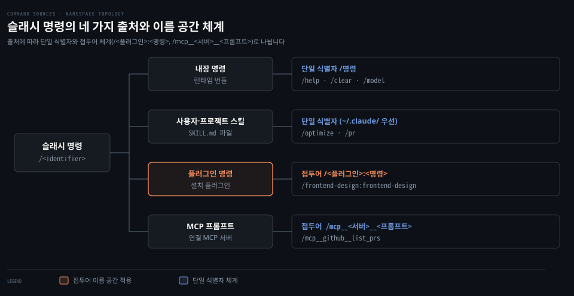
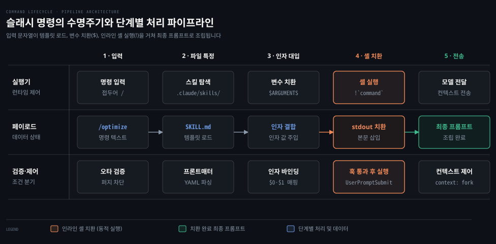

# Slash Commands
---
> 슬래시 명령은 대화형 세션에서 Claude Code의 동작을 제어하고 반복 작업을 줄이는 단축 입력 체계입니다. 내장 기능 제어부터 사용자 정의 스킬, 플러그인 확장, 외부 MCP 프롬프트까지 일관된 명령줄 인터페이스로 다룹니다.


## 핵심 요약

> 슬래시 명령은 단순한 편의 기능을 넘어 대화 흐름을 지휘하고 자동화 절차를 주입하는 통로입니다. 내장 명령은 세션과 모델 상태를 바꾸고, 스킬과 플러그인은 재사용할 수 있는 지침을 컨텍스트에 공급합니다.

터미널 기반 개발 환경에서는 복잡한 요구사항을 매번 자연어로 서술하기 어렵습니다. 슬래시 명령은 슬래시(`/`) 접두어로 시작하는 단축 지시어입니다. 대화 도중 모델에게 길게 서술하지 않고도 환경을 즉시 제어할 수 있습니다. 모델 교체, 세션 분기, 컨텍스트 압축, 권한 확인이 한 줄 입력으로 끝납니다. 반복해서 쓰는 프롬프트 묶음이나 워크플로 지침도 명령어로 등록해 호출합니다.

사용자 정의 명령 체계는 스킬 시스템으로 일원화되었습니다. 기존에 커맨드 폴더(`.claude/commands/`)에 두던 파일은 하위 호환성을 위해 유지됩니다. 하지만 새로 작성하는 워크플로는 스킬 디렉터리(`.claude/skills/`) 방식을 권장합니다. 스킬 방식을 쓰면 보조 스크립트나 참조 문서를 폴더 단위로 묶을 수 있습니다. 이름이 겹치면 스킬이 이전 명령보다 먼저 선택됩니다.

| 하고 싶은 일 | 쓸 명령 또는 설정 |
|------|------|
| 세션 대화 비우고 처음부터 시작 | `/clear` (별칭: `/reset`, `/new`) |
| 모델과 사고 깊이 설정 | `/model`, `/effort` |
| 대화 분기 후 독립 백그라운드 작업 실행 | `/fork [지시문]` (v2.1.212+) |
| 현재 대화를 보존하며 하위 에이전트 실행 | `/subtask <작업>` (v2.1.212+) |
| 세션 전체에 걸친 달성 목표 등록 | `/goal <목표 내용>` (v2.1.139+) |
| 캐시를 보존하면서 작업 디렉터리 이동 | `/cd <경로>` (v2.1.169+) |
| 미커밋 변경 사항 패널 확인 | `/diff` (v2.1.260+) |
| 코드 정리 전용 검토 실행 | `/simplify` (v2.1.154+) |
| 결함 탐색 및 정밀 코드 리뷰 | `/code-review` (별칭: `/review`) |
| 프로젝트 반복 작업 자동화 스킬 생성 | `.claude/skills/<이름>/SKILL.md` |
| 부작용 있는 명령의 자동 호출 차단 | 프론트매터에 `disable-model-invocation: true` |


## 이 문서의 기준

> 원문 저장소 커밋 188f468과 Claude Code v2.1.302 기준 기술 문서를 바탕으로 정리했습니다. 이후 공식 문서와 설치본 2.1.310 으로 사실을 대조해 고쳤습니다.

새로운 CLI 도구를 배울 때는 기능이 명시된 문서의 기준 시점을 먼저 파악해야 합니다. 이 문서는 luongnv89/claude-howto 저장소의 슬래시 명령 문서 스냅숏을 바탕으로 작성했습니다. 기준 커밋은 2026년 10월 20일 배포된 188f468 버전입니다. 원문은 Claude Code v2.1.302 버전까지의 공식 문서 변경 이력과 릴리스 노트를 포괄합니다.

슬래시 명령 체계는 버전 업데이트에 따라 세부 옵션과 키 바인딩이 빠르게 바뀝니다. 특히 포크와 서브태스크 명령의 역할 교체(v2.1.212)가 있었습니다. 오타 명령의 에러 반환 정책(v2.1.236)과 명령 체계의 스킬 통합도 중요한 변화입니다. 사용하는 CLI 버전을 `claude --version`으로 확인하시기 바랍니다. 세션 안에서 `/help`나 `/` 자동완성 목록을 대조하는 습관도 권장합니다.


## 슬래시 명령의 출처

> 슬래시 명령은 내장 기능, 사용자 정의 스킬, 설치된 플러그인, 외부 MCP 서버라는 네 가지 경로에서 공급됩니다. 모든 명령은 동일한 입력 창에서 실행되지만 출처에 따라 우선순위와 이름 공간 규칙이 갈립니다.

세션을 운영하다 보면 수많은 명령 후보가 나타나 어디서 온 기능인지 혼란스러울 때가 있습니다. 세션 프롬프트 입력창에서 `/`를 입력하면 자동완성 목록에 수십 가지 후보가 뜹니다. 겉보기에는 모두 같은 슬래시 명령으로 보입니다. 하지만 내부적으로는 성격과 출처가 서로 다른 네 가지 계통으로 구성됩니다. 각 계통의 출처와 이름 규칙을 파악해 두면 충돌을 막고 필요한 기능을 쉽게 찾을 수 있습니다.

### 네 가지 명령 계통

첫째는 Claude Code 실행기 자체에 내장된 내장 명령입니다. 대화 세션의 컨텍스트를 지우거나(`/clear`) 모델을 바꾸는(`/model`) 기능이 대표적입니다. 현재 디렉터리의 형상 차이를 확인하는(`/diff`) 런타임 제어 기능도 포함됩니다. 내장 명령은 별도의 파일이나 설정을 추가하지 않아도 모든 세션에서 즉시 사용 가능합니다.

둘째는 프로젝트나 사용자 환경에 맞춤 정의한 **스킬**(skill, 작업 절차와 메타데이터를 묶은 실행 단위)입니다. 과거에는 커스텀 명령이라는 이름으로 분리되어 있었습니다. 현재는 스킬 시스템으로 통합되었습니다. 사용자는 `.claude/skills/<이름>/SKILL.md` 파일에 지침과 메타데이터를 기술합니다. 이를 통해 `/optimize`나 `/pr` 같은 고유한 명령어를 만들어 복잡한 작업을 한 단어로 호출합니다.

셋째는 플러그인이 제공하는 명령입니다. 팀이나 커뮤니티가 패키징한 플러그인을 설치하면 전용 명령들이 세션에 자동으로 등록됩니다. 예를 들어 프론트엔드 디자인 플러그인을 설치하면 디자인 검토 관련 명령이 세션에 로드됩니다.

넷째는 모델 컨텍스트 프로토콜(MCP) 서버가 노출하는 프롬프트입니다. 세션에 연결된 GitHub, Jira, PostgreSQL 같은 외부 MCP 서버는 클라이언트가 호출할 수 있는 프롬프트 템플릿을 제공합니다. Claude Code는 이 프롬프트들을 슬래시 명령 형태로 노출합니다. 덕분에 터미널 안에서 외부 도구 기반 프롬프트를 직관적으로 실행할 수 있습니다.

### 명령 이름 공간과 식별 규칙

출처가 서로 다른 명령들이 한 화면에 모이므로 이름 충돌을 피하기 위한 고유 규칙이 적용됩니다. 일반적인 사용자 정의 스킬이나 내장 명령은 `/이름` 형태의 단일 식별자를 사용합니다. 반면 플러그인 명령과 MCP 프롬프트는 출처를 드러내는 접두어를 붙입니다.

플러그인 명령은 기본적으로 `/플러그인명:명령명` 형식을 따릅니다. 예를 들어 `frontend-design` 플러그인의 명령은 `/frontend-design:frontend-design`으로 호출합니다. 현재 세션에 등록된 다른 명령들과 이름이 겹치지 않는다면 축약형인 `/명령명`으로도 실행할 수 있습니다.

MCP 프롬프트는 `/` 메뉴에 `/<서버이름>:<프롬프트이름> (MCP)` 형식으로 표시되고, `/mcp__<서버이름>__<프롬프트이름>` 형식으로 입력해도 실행됩니다. 예를 들어 GitHub MCP 서버가 제공하는 풀 리퀘스트 목록 조회 프롬프트는 `/mcp__github__list_prs`라는 슬래시 명령으로 실행할 수 있습니다. 인자가 필요한 프롬프트라면 `/mcp__github__pr_review 456`처럼 명령 뒤에 공백을 두고 인자를 전달합니다.

### 탐색 순서와 로드 우선순위

명령을 탐색할 때는 디렉터리 위치에 따른 명확한 우선순위가 작동합니다. 시스템은 현재 프로젝트의 로컬 스킬 경로인 `.claude/skills/`를 확인합니다. 사용자 홈 디렉터리의 전역 경로인 `~/.claude/skills/`도 함께 탐색합니다.

레거시 커맨드 경로(`.claude/commands/`)도 동일한 순서로 스캔합니다. 만약 프로젝트 로컬 스킬과 사용자 홈 스킬의 이름이 같다면 사용자 홈 스킬이 실행됩니다. 공식 문서가 정한 우선순위는 엔터프라이즈, 개인(사용자 홈), 프로젝트 순이기 때문입니다.




## 자주 쓰는 내장 명령

> 내장 명령은 런타임 환경과 세션 상태를 조작하는 60개 이상의 단축어로 구성됩니다. 목적에 맞게 범주를 나누어 핵심 명령의 사용법과 최신 동작 변경 사항을 숙지하는 것이 중요합니다.

세션을 능숙하게 다루려면 어떤 내장 명령이 준비되어 있는지 체계적으로 파악해야 합니다. Claude Code는 세션 제어, 모델 파라미터 조정, 변경 사항 검토, 백그라운드 작업 분기 등 다채로운 내장 명령을 갖추고 있습니다. 번들로 제공되는 내장 스킬을 포함하면 공식 명령 표 기준으로 120개 안팎입니다. 전체 목록은 터미널에서 `/`를 치고 검색할 수 있습니다. 일상적인 개발 작업에서 자주 쓰는 핵심 명령들을 범주별로 묶어 두면 작업 속도가 빨라집니다.

| 범주 | 대표 명령 | 주요 기능과 특징 |
|------|------|------|
| 세션 및 대화 관리 | `/clear`, `/compact`, `/resume`, `/export` | 대화 초기화, 컨텍스트 압축, 이전 세션 재개(백그라운드 지원), 대화 내역 내보내기 |
| 모델 및 추론 튜닝 | `/model`, `/effort`, `/fast`, `/advisor` | 모델 선택, 사고 깊이(low~max) 및 Ultracode 설정, 고속 모드 전환, 어드바이저 모델 연동 |
| 작업 분기와 실행 | `/fork`, `/subtask`, `/goal`, `/btw` | 독립 백그라운드 세션 복제, 서브에이전트 태스크 위임, 세션 완결 목표 등록, 맥락 격리 임시 질문 |
| 코드 검토 및 차이 | `/diff`, `/code-review`, `/simplify` | 실시간 diff 패널 표시, PR 및 브랜치 정밀 결함 리뷰, 구조 개선 전용 정리 리뷰 |
| 환경 및 진단 도구 | `/cd`, `/add-dir`, `/doctor`, `/skill-doctor` | 캐시 보존 디렉터리 이동, 작업 디렉터리 추가, 설치 환경 진단, 미사용 스킬 비용 분석 |

### 대화와 작업 흐름 제어

세션의 맥락을 관리할 때 가장 기본이 되는 명령은 `/clear`와 `/compact`입니다. 작업이 일단락되었을 때는 `/clear`를 실행해 대화 기록을 비우고 캐시를 초기화합니다. 이전 맥락을 유지하면서 토큰 사용량만 줄이고 싶을 때는 `/compact [지침]`을 전달합니다. 중요한 정보만 남기고 대화를 요약 압축합니다. v2.1.216부터는 압축에 실패할 경우 조용히 넘어가지 않고 오류 메시지를 화면에 띄웁니다.

작업의 병렬 분기와 관련해서는 v2.1.212에서 일어난 역할 변경을 주의해야 합니다. `/fork`는 현재 대화 상태를 복사해 독립된 백그라운드 세션을 생성합니다. 복제된 세션은 코드 수정을 시작하기 전에 자체 워크트리를 생성하도록 격리 지침을 받습니다(v2.1.221+). 반면 부모 대화의 컨텍스트를 상속받아 하위 작업을 처리하고 결과를 돌려받는 기능은 `/subtask <작업>` 명령으로 분리되었습니다.

세션 전체의 완결 기준을 고정할 때는 v2.1.139에 도입된 `/goal <목표>`를 씁니다. 목표를 등록하면 상태 표시줄에 경과 시간, 턴 수, 사용 토큰을 실시간 추적하는 오버레이 패널이 나타납니다. 모델은 목표가 완료될 때까지 여러 턴에 걸쳐 작업을 주도합니다. 백그라운드 작업이 30분 이상 멈춰 있으면 모델이 상태를 점검해 사용자에게 보고합니다(v2.1.234+).

작업 도중 맥락을 흐리지 않고 질문을 던질 때는 `/btw [질문]`을 씁니다. 모델이 본 작업을 진행하는 동안 메인 컨텍스트를 오염시키지 않는 임시 질문 창을 열어 줍니다. 인자 없이 `/btw`만 입력하면 직전에 나누었던 임시 질문 대화를 다시 열어 줍니다(v2.1.212+).

### 코드 검토와 품질 관리

코드 변경 사항을 검토할 때는 목적에 따라 세분화된 명령을 골라 씁니다. 터미널 전체 화면 렌더러 환경에서 `/diff`를 실행하면 대화창 옆에 나란히 유지되는 전용 패널이 열립니다(v2.1.260+). 파일 수정이나 셸 명령이 발생할 때마다 패널이 자동으로 갱신되어 변경 줄 수를 실시간으로 감시할 수 있습니다.

코드의 결함을 찾아낼 때는 `/code-review` 명령을 사용합니다(별칭 `/review`). 현재 작업 트리의 diff뿐만 아니라 특정 PR 번호나 브랜치 경로를 넘겨 리뷰를 수행할 수 있습니다. 결함을 자동으로 수정하는 `--fix` 플래그나 GitHub PR에 인라인 댓글을 작성하는 `--comment` 플래그를 지원합니다. 보고할 결함 개수의 한도를 제어하는 `--max-findings` 옵션도 제공됩니다(v2.1.288+).

반면 코드 정리에 집중하고 싶다면 `/simplify`를 씁니다(v2.1.154+). 이 명령은 버그를 찾는 대신 코드 재사용, 구조 단순화, 효율성 개선을 목적으로 코드를 다듬습니다. 결함 추적과 단순 리팩터링의 목적이 서로 다르기 때문에 두 명령이 분리되어 운영됩니다.

### 모델과 환경 튜닝

모델의 사고 수준을 결정하는 `/effort` 명령은 대화형 슬라이더를 통해 `low`, `medium`, `high`, `xhigh`, `max` 단계를 선택합니다. 고난도 설계나 복잡한 버그 추적에는 `xhigh`나 `max`를 지정합니다. 슬라이더 안에는 동적 워크플로를 지휘하는 **Ultracode**(동적 워크플로 제어 모드) 토글도 포함되어 있습니다.

작업 디렉터리를 변경할 때는 셸의 `cd`를 직접 실행하기보다 내장 명령인 `/cd <경로>`를 사용하는 편이 좋습니다(v2.1.169+). Claude Code 세션 안에서 `/cd`를 호출하면 프롬프트 캐시의 온기를 깨뜨리지 않고 작업 디렉터리를 이동합니다. 덕분에 다음 턴의 추론 지연과 토큰 비용을 크게 아낄 수 있습니다.

세션 환경을 점검할 때는 진단 도구를 적극 활용합니다. `/doctor`는 설치 상태의 건강도를 점검합니다. `/doctor prompt-audit`은 오래된 모델용 프롬프트 패턴을 감사해 개선점을 찾아 줍니다(v2.1.283+). `/skill-doctor`는 로드된 스킬 중 쓰이지 않는 스킬과 컨텍스트 토큰 비용을 분석해 플러그인 관리자의 통계 탭에 보여 줍니다(v2.1.252+).


## 사용자 명령에서 스킬로

> 사용자 정의 명령은 스킬 시스템으로 일원화되었습니다. 기존의 단일 파일 기반 커맨드 방식은 여전히 하위 호환성을 유지하지만, 확장성과 컨텍스트 제어 측면에서 스킬 방식을 사용하는 것이 유리합니다.

명령어 파일이 늘어나다 보면 관련 스크립트와 참조 문서를 함께 관리하기가 점점 버거워집니다. 초기 Claude Code에서는 `.claude/commands/` 디렉터리에 마크다운 파일을 만들어 개인이나 프로젝트 전용 슬래시 명령을 등록했습니다. 그러나 복잡한 작업을 자동화하려면 프롬프트 본문 외에도 예시 템플릿과 보조 스크립트를 함께 패키징해야 합니다. 이에 따라 앤트로픽은 사용자 명령을 스킬 체계로 완전히 흡수 통합했습니다.

### 명령과 스킬의 통합 배경

기존 커맨드 방식은 파일 하나(`.claude/commands/<이름>.md`)에 모든 지침을 담아야 했습니다. 보조 스크립트나 참조 규격을 분리하기 어려웠습니다. 모델 호출 여부나 서브에이전트 격리 같은 제어는 지금 커맨드 파일에서도 `name`·`paths`를 뺀 같은 프론트매터로 설정할 수 있습니다.

스킬 시스템(`.claude/skills/<이름>/SKILL.md`)은 디렉터리 기반 구조를 채택해 이러한 한계를 해결했습니다. 스킬 폴더 안에 보조 참조 파일이나 실행 스크립트를 두고 필요할 때만 읽어 들이는 점진적 공개가 가능해졌습니다. 또한 Claude가 상황에 맞춰 스킬을 스스로 호출할 수 있게 되었습니다. 반대로 사용자가 직접 슬래시 명령으로만 실행하도록 통제하는 옵션도 제공됩니다.

### 기존 파일 동작과 우선순위

기존에 작성해 둔 `.claude/commands/` 파일들은 별도의 수정 없이 그대로 동작합니다. 시스템은 사용자가 `/명령`을 입력했을 때 스킬 디렉터리와 기존 커맨드 디렉터리를 모두 검색해 실행 대상을 찾습니다.

동일한 이름을 가진 스킬과 레거시 커맨드가 동시에 존재할 경우 스킬이 항상 우선권을 갖습니다. 예를 들어 `.claude/commands/review.md`와 `.claude/skills/review/SKILL.md`가 함께 있다면 Claude Code는 스킬 버전을 로드합니다. 따라서 기존 명령을 업그레이드하려면 새로운 스킬 디렉터리를 만들어 자연스럽게 덮어쓰도록 유도하면 됩니다.

| 구분 | 레거시 커맨드 | 스킬 (권장 표준) |
|------|------|------|
| 파일 위치 | `.claude/commands/<이름>.md` | `.claude/skills/<이름>/SKILL.md` |
| 보조 자산 포함 | 단일 파일로 제한 | 폴더 내 스크립트, 템플릿, 참조 문서 번들 가능 |
| 모델 자동 호출 | 지원 (`disable-model-invocation`으로 제어) | 지원 (설정에 따라 자동 호출 또는 사용자 전용 선택) |
| 실행 격리 | `context: fork` 지원 (같은 프론트매터) | `context: fork`를 통한 독립 서브에이전트 격리 지원 |
| 우선순위 | 낮음 | 동일 이름 충돌 시 항상 우선 |

### 스킬 전환으로 얻는 이점

기존 커맨드를 스킬로 이전하는 작업은 단순합니다. `.claude/commands/<이름>.md` 파일의 내용을 새로 만든 `.claude/skills/<이름>/SKILL.md` 경로로 복사하면 완료됩니다.

이러한 이전 과정을 거치면 프론트매터를 통해 다양한 제어를 적용할 수 있습니다. 모델이 불필요하게 스킬을 호출하지 못하도록 `disable-model-invocation: true`를 지정할 수 있습니다. 복잡한 분석 작업을 별도의 서브에이전트 컨텍스트에서 돌리도록 `context: fork`를 선언할 수도 있습니다. 대형 프로젝트에서 컨텍스트 낭비를 줄이고 도구 오남용을 통제하는 든든한 기반이 마련됩니다.


## 명령이 처리되는 흐름

> 슬래시 명령이 입력되면 입력 검증, 메타데이터 해석, 동적 셸 치환, 변수 주입이라는 단계적 처리 파이프라인을 거칩니다. 각 단계의 실행 시점과 훅 연동 구조를 이해해야 명령의 동작 이상을 정확히 진단할 수 있습니다.

사용자가 슬래시 명령을 입력했을 때 내부에서 무슨 일이 일어나는지 알아야 디버깅이 쉬워집니다. 사용자가 터미널에서 슬래시 명령을 입력하고 Enter를 누르면, 단순한 텍스트 전송 이상의 복잡한 전처리 과정이 진행됩니다. 이 수명주기는 파일 시스템 탐색에서 시작해 최종적으로 모델에게 보낼 프롬프트를 조립하는 단계로 이어집니다.



### 입력 해석과 오타 검증

프롬프트 입력창의 첫 글자가 `/`로 시작하면 실행기는 이를 슬래시 명령으로 인식합니다. 사용자가 입력한 식별자를 기반으로 활성화된 내장 명령, 프로젝트 및 전역 스킬, 플러그인, MCP 프롬프트 목록을 순서대로 스캔합니다.

과거 버전에서는 명령을 잘못 입력했을 때 이름이 가장 비슷한 명령을 퍼지 매칭으로 임의 실행하곤 했습니다. 하지만 v2.1.236부터는 명확하지 않은 오타나 현재 세션에서 사용할 수 없는 명령이 입력되면 자동으로 추측해 실행하지 않습니다. 즉시 오류를 반환하도록 정책이 바뀌었습니다. 모호하지 않은 접두어나 미리 정의된 정식 별칭만 정상적으로 실행됩니다.

### 셸 명령과 변수 치환 순서

명령 파일이 특정되면 실행기는 상단의 YAML 프론트매터를 파싱해 권한과 실행 옵션을 추출합니다. 본문 안에 포함된 동적 문법들은 엄격한 순서에 따라 순차적으로 평가됩니다.

가장 먼저 사용자가 명령 뒤에 덧붙인 인자들이 `$ARGUMENTS`, `$0`, `$1` 같은 변수 자리에 글자 그대로 대입됩니다. 그 다음에 백틱과 느낌표 기호로 감싼 인라인 셸 명령어(`` !`command` ``)가 로컬 셸에서 실행됩니다. 그 표준 출력은 프롬프트 본문의 해당 위치에 치환됩니다. 프로젝트 루트의 절대 경로를 가리키는 `${CLAUDE_PROJECT_DIR}` 환경 변수(v2.1.196+)와 `@파일경로` 형식의 파일 본문 임베딩도 이 단계에서 함께 해석됩니다. <!-- 확인 필요: `${CLAUDE_PROJECT_DIR}`·`@파일경로` 의 해석 시점은 공식 문서·설치본에서 찾지 못함 -->

그래서 셸 명령 안에 `$ARGUMENTS` 를 쓰면 인자가 이미 들어간 명령이 실행됩니다. 2.1.310 에서 본문에 `` !`echo '<$ARGUMENTS>'` `` 를 둔 스킬을 `hello` 인자로 부르자 `<hello>` 가 나왔습니다. 작은따옴표 안이라 셸 변수 확장은 일어날 수 없으니, 셸 실행 전에 글자가 대입된 것입니다. 같은 실험에서 `!` 바로 앞에 `[` 처럼 공백이 아닌 글자가 붙으면 셸 명령이 실행되지 않았습니다.

### 훅 실행과 프롬프트 확장

동적 치환 단계에서 주의할 점은 사용자 프롬프트 제출 훅과의 실행 순서 관계입니다. v2.1.299 릴리스 기준에 따르면, 사용자가 입력을 제출했을 때 발생하는 `UserPromptSubmit` **훅**(hook, 특정 사건에 맞춰 실행되는 제어 스크립트)은 명령 파일이 펼쳐지기 전에 먼저 실행됩니다.

만약 해당 훅이 특정 조건에 의해 프롬프트 제출을 차단하면 본문 안에 선언된 `` !`command` `` 셸 명령은 아예 실행되지 않습니다. 셸 치환을 통해 시스템 상태를 변경하거나 로그를 남기려는 시도는 프롬프트 제출 검사를 통과한 뒤에만 작동합니다. 모든 치환이 완료되면 최종 완성된 프롬프트가 현재 세션이나 분기된 서브에이전트의 컨텍스트로 전달됩니다.


## 명령 만들기

> 프론트매터 설정과 인자 변수, 동적 컨텍스트 치환을 결합하면 안정적이고 재사용성 높은 맞춤 명령을 작성할 수 있습니다. 부작용이 따르는 작업은 모델의 자율 호출을 막고 필요한 도구 권한만 명시적으로 열어 줍니다.

팀에서 자주 반복되는 지침이 있다면 슬래시 명령으로 규격화하는 것이 유리합니다. 새로운 슬래시 명령을 제작할 때는 프로젝트 루트 아래에 `.claude/skills/<명령이름>/SKILL.md` 파일을 생성합니다. 명령의 기본 동작과 실행 조건은 파일 시작 부분의 YAML 프론트매터에 정의합니다. 본문에는 모델이 수행할 구체적인 단계와 지침을 기술합니다.

### 기본 구조와 메타데이터

스킬 마크다운 파일은 메타데이터 헤더와 작업 지시문 본문으로 나뉩니다. 프론트매터에 적는 필드들은 모델이 스킬을 언제 어떻게 사용할지 결정하는 기준이 됩니다.

```yaml
---
name: commit
description: 변경 사항을 분석하여 관례에 맞는 커밋 메시지를 생성하고 커밋합니다.
argument-hint: [커밋 메시지]
allowed-tools: Bash(git add:*), Bash(git status:*), Bash(git commit:*), Bash(git diff:*)
disable-model-invocation: true
---
```

주요 필드의 역할은 다음과 같습니다. `name`은 슬래시 명령의 이름(`/commit`)이 됩니다. 생략할 경우 디렉터리 이름을 따릅니다. `description`은 명령의 목적과 실행 조건을 명시하며 모델이 용도를 파악할 때 참조합니다. `argument-hint`는 자동완성 시 사용자에게 기대 인자 형식을 안내합니다. `allowed-tools`는 승인 팝업 없이 허용할 도구를 지정합니다. `context: fork`를 설정하면 독립된 서브에이전트에서 명령을 격리 실행할 수 있습니다.

| 프론트매터 키 | 설명 | 기본값 |
|------|------|------|
| `name` | 명령 이름 (`/이름` 으로 호출) | 폴더 이름 |
| `description` | 명령의 기능과 트리거 조건 설명 | 본문 첫 비어있지 않은 줄 |
| `argument-hint` | 자동완성 시 표시할 인자 힌트 | 없음 |
| `allowed-tools` | 권한 확인 없이 허용할 도구 목록 | 세션 기본값 상속 |
| `model` | 특정 실행 모델 지정 | 세션 기본 모델 상속 |
| `disable-model-invocation` | `true` 설정 시 모델 자동 호출 차단 (사용자 전용) | `false` |
| `user-invocable` | `false` 설정 시 `/` 메뉴에서 숨김 | `true` |
| `context` | `fork` 설정 시 독립 서브에이전트에서 실행 | 없음 (현재 세션) |
| `agent` | `context: fork` 사용 시 에이전트 종류 | `general-purpose` |
| `hooks` | 스킬 실행 시 세션에 등록할 훅 이벤트 | 없음 |

### 인자와 동적 컨텍스트 주입

명령을 호출할 때 뒤따르는 추가 입력값은 사전 정의된 변수를 통해 본문에 주입합니다. 전달된 전체 인자 문자열을 통째로 받으려면 `$ARGUMENTS`를 씁니다. 공백으로 구분된 개별 인자를 위치별로 참조하려면 `$0`, `$1`, `$2`를 사용합니다.

```markdown
# 코드 리뷰 명령

인자로 전달된 대상 PR #$0 번을 $1 우선순위로 검토합니다.

## 대상 파일
@src/index.js

## 현재 저장소 상태
- 현재 브랜치: !`git branch --show-current`
- 변경 파일 요약: !`git status -s`
```

위 예시처럼 `@` 기호를 사용하면 특정 파일의 내용을 프롬프트에 직접 포함할 수 있습니다. `` !`git status -s` ``와 같이 인라인 셸을 지정하면 명령이 호출되는 즉시 로컬 명령어를 실행합니다. 그 결과 텍스트가 프롬프트에 실시간으로 삽입됩니다. 모델은 정적인 지침뿐 아니라 최신 환경 정보를 즉시 반영한 상태에서 추론을 시작합니다.

### 부작용 제어와 도구 허용

파일 변경, 빌드 실행, 배포처럼 외부 환경에 영구적인 영향을 주는 명령을 만들 때는 `disable-model-invocation: true` 설정을 적극적으로 써야 합니다. 이 옵션을 켜면 모델이 대화 흐름 중에 자율적으로 해당 스킬을 호출하지 못합니다. 오직 사용자가 입력창에서 직접 슬래시 명령으로 호출할 때만 실행됩니다.

`allowed-tools` 속성을 사용해 명령이 사용할 수 있는 도구 범위를 좁히는 것도 중요합니다. `Bash(git *)`나 `Bash(npm test)`처럼 특정 도구의 안전한 명령 패턴만 화이트리스트로 지정합니다. 원치 않는 위험한 셸 명령이 실행되는 사고를 방지할 수 있습니다.

### 실전 명령 예제 살펴보기

실제 원문 저장소의 커밋 명령(`commit.md`)을 살펴보면 이러한 요소들이 어떻게 결합되는지 명확히 알 수 있습니다. 이 명령은 현재 작업 트리의 상태를 읽어 관례에 맞는 커밋 메시지를 만들고 직접 커밋을 생성합니다.

```markdown
---
allowed-tools: Bash(git add:*), Bash(git status:*), Bash(git commit:*), Bash(git diff:*)
argument-hint: [메시지]
description: 작업 맥락을 바탕으로 깃 커밋을 생성합니다.
disable-model-invocation: true
---

## 현재 작업 맥락
- 작업 트리 상태: !`git status`
- 변경 내용 차이: !`git diff HEAD`
- 현재 브랜치: !`git branch --show-current`
- 최근 커밋 내역: !`git log --oneline -10`

## 수행할 작업
위의 변경 사항을 종합적으로 분석해 단일 깃 커밋을 작성하십시오.

인자로 전달된 메시지가 있다면 해당 메시지를 사용하십시오: $ARGUMENTS

인자가 없다면 변경 사항을 분석하여 다음 커밋 규칙에 맞춰 작성하십시오.
- feat: 새로운 기능 추가
- fix: 버그 수정
- docs: 문서 변경
- refactor: 코드 리팩터링
- test: 테스트 코드 추가
- chore: 빌드 및 유지보수 작업
```

이 구성은 사용자가 인자로 커밋 메시지를 주었을 때와 주지 않았을 때의 동작을 깔끔하게 분기합니다. 셸 명령으로 최신 diff를 프롬프트에 주입하므로 모델이 환각에 빠지지 않고 정확한 커밋 메시지를 작성합니다.


## 운영 팁과 문제 해결

> 슬래시 명령을 운영하다 보면 파일 경로 인식 누락, 셸 명령 실행 차단, 이름 공간 충돌 같은 문제와 마주치게 됩니다. 올바른 작성 규칙을 준수하고 체계적인 점검 절차를 거치면 오류를 빠르게 해결할 수 있습니다.

자동화 명령을 도입한 뒤 예상치 못한 동작 오류로 작업 흐름이 끊기는 경우가 있습니다. 슬래시 명령은 팀의 개발 생산성을 크게 높여 주는 도구입니다. 하지만 잘못 구성된 명령은 컨텍스트를 불필요하게 낭비하거나 실행 도중 멈추는 원인이 됩니다. 원문에서 제시하는 모범 사례와 대표적인 오류 상황별 해결책을 정리합니다.

### 권장 패턴과 금지 항목

효과적인 슬래시 명령을 만들기 위해서는 몇 가지 원칙을 지켜야 합니다. 한 번 쓰고 버릴 단발성 작업은 명령으로 만들지 말고 일반 대화로 처리해야 합니다. 지나치게 복잡한 분기 로직을 마크다운 안에 모두 구겨 넣기보다는 간결한 지침 위주로 구성하고 필요한 경우 외부 스크립트로 분리하는 것이 좋습니다.

| 권장하는 작업 (Do) | 피해야 할 작업 (Don't) |
|------|------|
| 명확하고 행동 중심적인 이름 부여 | 일회성 작업에 대한 불필요한 명령 생성 |
| 호출 조건을 구체적으로 명시한 `description` 작성 | 마크다운 본문에 복잡한 비즈니스 로직 하드코딩 |
| 단일 목적에 집중된 간결한 명령 설계 | API 키나 패스워드 등 민감 정보 포함 |
| 부작용이 있는 명령에 `disable-model-invocation` 적용 | `description` 필드를 비워두거나 생략 |
| 동적 상태 수집 시 `!` 인라인 셸 활용 | 모델이 현재 파일 상태를 알고 있다고 가정 |
| 보조 스크립트와 템플릿을 스킬 디렉터리로 구성 | 모든 지침과 데이터를 단일 파일에 나열 |

### 명령 미인식과 충돌 해결

새로 만든 슬래시 명령이 `/` 입력창에 나타나지 않거나 실행되지 않는다면 파일 경로와 메타데이터를 확인해야 합니다. 파일이 프로젝트 루트의 `.claude/skills/<이름>/SKILL.md` 또는 `~/.claude/skills/<이름>/SKILL.md`에 위치하는지 점검합니다.

프론트매터의 `name` 값이 폴더 이름과 일치하는지도 확인 대상입니다. 만약 프론트매터에 `user-invocable: false`가 설정되어 있다면 사용자의 `/` 자동완성 메뉴에서 숨겨집니다. 세션이 켜진 상태에서 디렉터리에 새 스킬 파일을 추가했다면 `/reload-skills` 명령(v2.1.152+)을 실행합니다. 세션을 재시작하지 않고도 즉시 스킬 목록을 다시 스캔할 수 있습니다. 스킬과 기존 커맨드가 충돌할 때는 스킬이 우선하므로 불필요한 과거 커맨드 파일을 정리해 주는 것이 깔끔합니다.

### 셸 치환 오류와 권한 거부

인라인 셸(`` !`command` ``)을 선언했는데 출력이 프롬프트에 들어가지 않는다면 실행 환경의 권한 설정을 점검해야 합니다. 세션이 도구 권한을 엄격하게 통제하고 있다면 셸 실행이 사용자 승인을 기다리며 멈추거나 차단될 수 있습니다. 필요하다면 프론트매터의 `allowed-tools`에 대상 명령 패턴을 명시합니다. 빈번한 승인 팝업을 줄이려면 `/fewer-permission-prompts` 명령을 실행해 최근 도구 호출 이력을 분석하고 안전한 화이트리스트를 추가할 수 있습니다(v2.1.111+). <!-- 확인 필요: 공식 문서·설치본에서 찾지 못함 -->

v2.1.299부터 적용된 훅 수명주기에 따라 `UserPromptSubmit` 훅이 입력을 거부하지 않았는지도 확인해야 합니다. MCP 기반 명령에서 `/mcp__github__get_issue` 같은 도구 접근이 거부된다면 권한 설정 파일의 MCP 구문 규칙을 확인합니다. v2.1.299부터는 `mcp__github` 규칙이 `github__x` 같은 하위 변형을 더 이상 포괄하지 않습니다. 정확한 서버 식별자 또는 `mcp__github__*` 형태의 와일드카드를 지정해야 정상 작동합니다.
