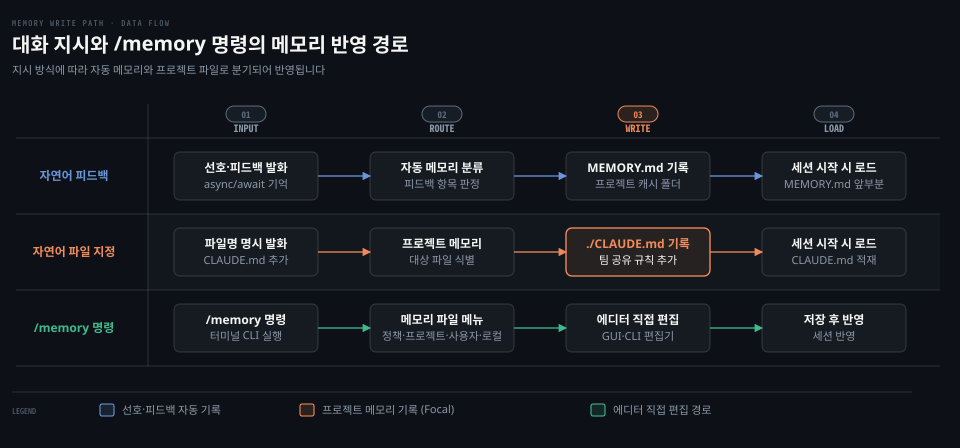
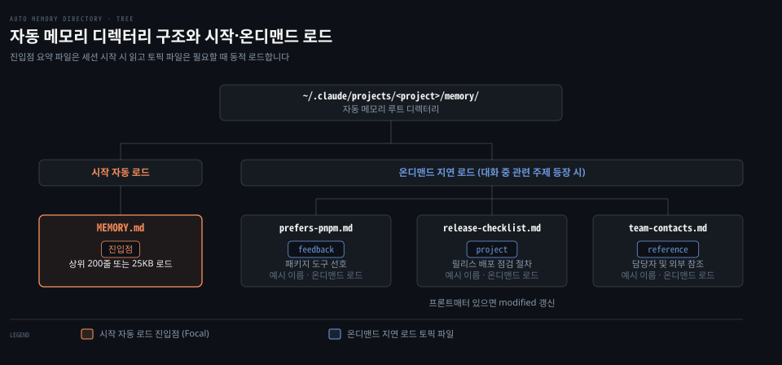

# Memory
---
> Claude Code 세션 전반에 걸쳐 작업 규칙과 프로젝트 맥락을 지속시키는 메모리 구조를 정리합니다. 여러 경로의 CLAUDE.md 가 병합되는 원리와 자동 메모리의 동작 방식, 설정 파일과의 상호작용을 함께 설명합니다.


## 핵심 요약

> 여러 경로의 CLAUDE.md 는 컨텍스트에 순서대로 이어 붙고 자동 메모리와 모듈 규칙이 작업 맥락을 보완합니다.

Claude Code 의 메모리는 단일 파일이 아니라 조직 정책, 사용자 기본값, 프로젝트 표준, 개인 설정을 아우르는 다층 구조로 동작합니다. 핵심 원리는 상위 설정이 하위 설정을 덮어쓰는 대체 방식이 아니라, 모든 메모리 파일이 하나의 컨텍스트로 순서대로 결합된다는 사실입니다. 사용자가 직접 작성하는 지침 파일 외에도 대화 중 피드백을 기록하는 자동 메모리와 경로별 모듈 규칙이 함께 맞물려 세션 전반의 작업 일관성을 지켜 줍니다.

| 작업 목적 | 권장 수단 | 동작 위치 |
|------|------|------|
| 팀 공통 코딩 표준 유지 | `./CLAUDE.md` 또는 `./.claude/CLAUDE.md` | 프로젝트 루트(git 추적) |
| 팀원과 공유하지 않는 개인 프로젝트 설정 | `./CLAUDE.local.md` | 프로젝트 루트(git 제외) |
| 모든 프로젝트에 공통 적용할 개인 습관 | `~/.claude/CLAUDE.md` | 사용자 홈 디렉터리 |
| 특정 파일 경로에만 적용할 규칙 분리 | `.claude/rules/*.md` (`paths` 지정) | 프로젝트 또는 사용자 규칙 폴더 |
| 대화 중 학습한 피드백 자동 누적 | Auto Memory (`MEMORY.md`) | 프로젝트별 메모리 캐시 폴더 |
| 타 도구와 공유하는 프로젝트 표준 | `AGENTS.md` | 프로젝트 루트(v2.1.277+) |
| 프로젝트 메모리 뼈대 새로 생성 | `/init` | 대화형 세션 내부 |
| 메모리 파일 편집기로 열어 직접 수정 | `/memory` | 대화형 세션 내부 |


## 이 문서의 기준

> 원문 luongnv89/claude-howto 저장소의 커밋 188f468 과 Claude Code 버전 2.1.302 기술 내용을 기준으로 정리했습니다.

공식 문서와 릴리스 노트에 기술된 각 기능의 도입 버전 표기를 원문 그대로 유지했습니다. 메모리 관리 기능은 버전 2.1.59 의 자동 메모리부터 버전 2.1.216 의 GUI 에디터 비차단 편집까지 꾸준히 확장되었습니다. 버전 2.1.277 의 AGENTS.md 기본 탐색과 버전 2.1.288 및 2.1.293 의 모듈 규칙 감지도 원문 표기 그대로 담았습니다. <!-- 확인 필요: 공식 문서·설치본에서 찾지 못함 -->

2026-10-26 에 별도 검증 창이 공식 문서(code.claude.com/docs)와 설치본 2.1.310 으로 사실을 대조해 틀린 곳을 고쳤고, 찾지 못한 사실에는 `확인 필요` 주석을 남겼습니다. 사용 중인 환경의 버전에 따라 일부 세부 동작이나 지원 플래그가 다를 수 있습니다. 특히 게이트웨이나 폐쇄망 환경에서는 원격 설정 배포 방식에 차이가 발생할 수 있으므로 실행 환경의 버전을 먼저 확인하시기 바랍니다.


## 메모리 계층

> 여러 위치의 CLAUDE.md 파일은 앞선 내용을 덮어쓰지 않고 컨텍스트 안에 순서대로 이어 붙습니다.

대화 세션이 종료되면 이전 맥락이 사라지기 때문에 팀 컨벤션과 아키텍처 규칙을 매번 다시 설명해야 하는 문제가 생깁니다. 여러 설정 파일이 충돌할 때 어떤 내용이 우선하는지 모르면 모델이 엉뚱한 규칙을 따르는 혼란을 겪게 됩니다.


### 컨텍스트 연결 원리

Claude Code 의 메모리 계층은 일반적인 프로그래밍의 변수 오버라이드와 다르게 동작합니다. 상위 범위 파일이 하위 범위를 대체하지 않습니다. 범위가 넓은 파일부터 구체적인 파일까지 순서대로 프롬프트 컨텍스트에 덧붙는 **연결**(concatenation) 방식을 취합니다.

나중에 로드된 파일이 앞선 파일의 내용을 물리적으로 지우지 않습니다. 모델이 프롬프트 뒤쪽에 위치한 문맥에 더 강하게 집중하는 특성을 활용해 구체적인 지침이 우선적인 효과를 내도록 유도합니다. 만약 상위 파일과 하위 파일에 상반된 지시를 동시에 적어 두면 모델이 두 지침 사이에서 갈등을 일으킬 수 있으므로 범위를 명확히 나누어야 합니다.

### 파일 위치와 탐색 순서

세션이 시작될 때 Claude Code 는 가장 넓은 범위인 조직 정책부터 사용자의 현재 작업 위치까지 순서대로 파일을 읽어 들입니다. 로드 순서는 다음과 같습니다.

첫째는 관리자 정책 메모리입니다. 조직 차원에서 공통 적용하는 보안 정책이나 표준 규칙을 담으며 개발자가 임의로 제외할 수 없습니다. macOS 경로는 `/Library/Application Support/ClaudeCode/CLAUDE.md` 입니다. Linux 와 WSL 은 `/etc/claude-code/CLAUDE.md` 입니다. Windows 는 `C:\Program Files\ClaudeCode\CLAUDE.md` 에 위치합니다.

별도 파일 대신 `managed-settings.json` 안의 `claudeMd` 키에 지침 문자열을 직접 담아 배포할 수도 있습니다. 이 키는 조직 관리 정책에서만 유효하며 사용자나 프로젝트 설정에 적으면 무시됩니다.

둘째는 사용자 규칙과 사용자 메모리입니다. `~/.claude/rules/*.md` 의 모듈식 규칙들이 먼저 실립니다. <!-- 확인 필요: 공식 문서·설치본에서 찾지 못함 --> 이어서 `~/.claude/CLAUDE.md` 에 적힌 개인 개발 선호 사항이 컨텍스트에 추가됩니다. 모든 프로젝트에 일관되게 적용하고 싶은 코드 서식이나 답변 양식을 여기에 둡니다.

셋째는 프로젝트 규칙과 프로젝트 메모리입니다. 프로젝트 루트의 `./.claude/rules/*.md` 가 먼저 적재됩니다. <!-- 확인 필요: 공식 문서·설치본에서 찾지 못함 --> 이어서 `./CLAUDE.md` 또는 `./.claude/CLAUDE.md` 가 로드됩니다. 팀 저장소에 커밋되어 모든 팀원이 공유하는 표준 아키텍처와 빌드 규칙이 이 계층에 속합니다.

넷째는 로컬 프로젝트 메모리인 `./CLAUDE.local.md` 입니다. 팀 공통 규칙 위에 덧씌우는 개발자 개인의 프로젝트 설정이며, 팀 저장소에 올라가지 않도록 반드시 `.gitignore` 에 등록해 두어야 합니다.

### 디렉터리 상향 탐색과 하위 디렉터리 지연 로드

Claude Code 는 세션을 실행한 현재 작업 디렉터리를 기준으로 상위 디렉터리를 거슬러 올라가며 메모리 파일을 찾습니다. 예컨대 `foo/bar/` 폴더에서 세션을 시작하면 `foo/CLAUDE.md` 가 먼저 읽히고 그 뒤에 `foo/bar/CLAUDE.md` 가 덧붙습니다. 실행 위치에 더 가까운 파일이 컨텍스트의 더 뒤쪽에 배치됩니다.

반대로 현재 작업 디렉터리의 하위 폴더에 있는 `CLAUDE.md` 나 `CLAUDE.local.md` 파일은 세션 시작 시점에 즉시 로드되지 않습니다. 모델이 작업 도중 해당 하위 디렉터리 내부의 파일을 읽거나 수정하는 시점에 맞추어 필요한 순간 컨텍스트로 불러옵니다.

| 범위 | 파일 위치 | 로드 시점 | 공유 대상 | 적합한 내용 |
|------|------|------|------|------|
| 관리자 정책 | `/Library/Application Support/ClaudeCode/CLAUDE.md` 등 | 세션 시작 1순위 | 조직 전체 | 보안 규정, 사내 라이선스 준수 수칙 |
| 사용자 규칙 | `~/.claude/rules/*.md` | 세션 시작 2순위 | 개인 전체 | 개인 선호 언어별 기본 코딩 스타일 |
| 사용자 메모리 | `~/.claude/CLAUDE.md` | 세션 시작 3순위 | 개인 전체 | 선호 에디터, 설명 방식, 개인 작업 습관 |
| 프로젝트 규칙 | `./.claude/rules/*.md` | 세션 시작 4순위 | 프로젝트 팀 | 모듈별 코딩 규약, 검증 스키마 조건 |
| 프로젝트 메모리 | `./CLAUDE.md` 또는 `./.claude/CLAUDE.md` | 세션 시작 5순위 | 프로젝트 팀 | 빌드 명령어, 아키텍처 지침, 공통 기술 스택 |
| 로컬 메모리 | `./CLAUDE.local.md` | 세션 시작 6순위 | 개인 프로젝트 | 로컬 테스트 계정, 개인 디버깅 플래그 |
| 하위 디렉터리 | `./sub-module/CLAUDE.md` | 하위 파일 접근 시 | 프로젝트 팀 | 특정 서브 모듈 전용 엔드포인트 규칙 |


## 시작과 명령

> /init 명령으로 메모리 뼈대를 생성하고 /memory 명령으로 에디터에서 직접 수정합니다.

프로젝트에 맞는 메모리 구조를 빈 파일에서 맨땅에 작성하려면 필요한 양식을 빠뜨리기 쉽습니다. 세션 중에 나온 새로운 결정을 메모리에 반영하고 싶어도 파일 경로를 일일이 찾지 못해 갱신이 막히기도 합니다.



### /init 을 통한 초기 템플릿 생성

`/init` 은 프로젝트 루트에 `CLAUDE.md` 파일을 생성하고 기본 구조를 잡아 주는 대화형 명령입니다. 프로젝트의 기술 스택, 빌드 및 테스트 명령어, 코드 스타일, 깃 워크플로 같은 핵심 골격을 표준 양식으로 채워 줍니다.

새로운 대화형 인터페이스를 지원하는 환경에서는 환경 변수를 지정해 단계별 질의응답 흐름을 진행할 수 있습니다.

```bash
CLAUDE_CODE_NEW_INIT=1 claude
/init
```

이 옵션을 켜면 Claude Code 가 `CLAUDE.md`, 스킬, 훅 가운데 무엇을 만들지 먼저 질문한 뒤 프로젝트 내부 파일들을 분석해 해당 파일들을 작성합니다.

### /memory 를 통한 직접 편집

`/memory` 명령은 현재 프로젝트에 연결된 메모리 파일 목록을 보여 주고 기본 에디터를 띄워 수정할 수 있게 합니다.

터미널에서 `/memory` 를 실행하면 관리자 정책, 프로젝트 메모리, 사용자 메모리, 로컬 프로젝트 메모리 중 수정할 대상을 선택하는 메뉴가 나타납니다. <!-- 확인 필요: 공식 문서·설치본에서 찾지 못함 --> 원하는 대상을 선택하면 시스템 기본 편집기가 열립니다.

버전 2.1.216 부터는 VS Code 나 텍스트 편집기 같은 그래픽 에디터로 파일이 열릴 때 세션이 멈추지 않고 비차단 방식으로 동작합니다. 편집기를 열어 둔 상태에서도 터미널 세션에서 계속 질문을 던질 수 있습니다. 다만 Vim 이나 Nano 같은 터미널 편집기로 열었을 때는 편집을 마치고 빠져나올 때까지 터미널 제어권이 편집기에 머뭅니다.

수정을 마치고 파일을 저장하면 Claude Code 가 갱신된 메모리 내용을 세션에 다시 반영합니다. <!-- 확인 필요: 공식 문서·설치본에서 찾지 못함 -->

### 기억 지시와 과거 방식의 폐지

작업 도중 모델에게 규칙을 기억해 달라고 요청할 때 사용하는 표현에 따라 저장 대상이 달라집니다.

대화창에 "비동기 함수에는 async 와 await 를 쓰라고 기억해 줘" 처럼 요청할 수 있습니다. 그러면 Claude Code 는 이 지시를 사용자 전용 자동 메모리(`MEMORY.md`)에 기록합니다. 반대로 팀원과 공유하는 프로젝트 메모리에 추가하고 싶다면 "이 규칙을 CLAUDE.md 에 추가해 줘" 라고 파일명을 직접 밝혀야 합니다.

과거 버전에서 지원하던 샵(`#`) 접두사 한 줄 입력 방식은 폐지되었습니다. `# 항상 strict mode 를 사용할 것` 처럼 입력해도 더 이상 메모리에 반영되지 않습니다. 한 줄 메모리를 남길 때도 자연어 대화로 지시하거나 `/memory` 로 에디터를 열어 입력해야 합니다.

### @path 를 통한 외부 문서 임포트

`CLAUDE.md` 내부에서는 골뱅이(`@`) 기호를 접두사로 붙여 다른 파일의 내용을 불러올 수 있습니다. 중복 작성을 피하고 기존 문서를 참조할 때 유용합니다.

```markdown
# 프로젝트 아키텍처 지침
전체 구조는 @docs/architecture.md 문서를 따릅니다.
API 스키마 규칙은 @docs/api-standards.md 파일을 참고합니다.
개인 지침은 @~/.claude/custom-instructions.md 에서 불러옵니다.
```

임포트 기능은 상대 경로와 홈 디렉터리 기준 절대 경로를 모두 지원합니다. 상대 경로는 현재 세션의 작업 폴더가 아니라 임포트 선언이 적힌 그 파일의 위치를 기준으로 해석됩니다.

임포트는 최대 4단계 깊이까지 재귀적으로 동작합니다. 외부 디렉터리의 파일을 처음 불러올 때는 보안을 위해 신뢰 여부를 묻는 대화 상자가 뜹니다. 마크다운의 인라인 코드나 코드 블록 내부에 적힌 `@path` 문자열은 임포트로 평가되지 않으므로 예제 코드를 안전하게 적을 수 있습니다.


## 규칙 파일과 제외

> 경로별 모듈 규칙과 AGENTS.md 및 제외 설정을 활용해 불필요한 컨텍스트 낭비를 줄입니다.

모든 코딩 규칙을 단일 CLAUDE.md 파일에 몰아넣으면 관련 없는 작업에서도 컨텍스트 토큰을 낭비하고 모델의 지시 준수율이 떨어집니다. 대규모 모노레포에서는 하위 패키지의 상충하는 규칙들이 섞여 개발자가 원하지 않는 결과가 나오기도 합니다.

### 경로별 모듈 규칙 시스템

Claude Code 는 `.claude/rules/` 디렉터리 아래에 여러 마크다운 파일을 나누어 담는 모듈식 규칙 체계를 지원합니다. 전체 파일에 적용할 규칙과 특정 디렉터리에만 적용할 규칙을 물리적으로 분리할 수 있습니다.

규칙 파일의 프론트매터에 `paths` 키를 지정하면 특정 글로브 패턴에 매칭되는 파일에만 해당 규칙이 적용됩니다.

```markdown
---
paths: src/api/**/*.ts
---

# API 모듈 규칙
- 모든 엔드포인트 입력값은 Zod 스키마로 검증합니다.
- 예외 발생 시 표준 응답 포맷을 따릅니다.
```

`paths` 선언이 없는 규칙 파일은 세션 시작 시 무조건 로드됩니다. 반면 `paths` 가 지정된 규칙 파일은 모델이 매칭되는 경로의 파일을 읽거나 생성하거나 편집할 때 지연 로드됩니다.

버전 2.1.288 부터는 Write 와 Edit 도구의 파일 수정을 감지하여 경로 규칙을 불러옵니다. <!-- 확인 필요: 공식 문서·설치본에서 찾지 못함 --> 버전 2.1.293 부터는 단일 파일 대상의 Bash 읽기 명령도 감지합니다. `cat`, `head`, `tail`, `sed -n`, `grep` 실행 시 해당 규칙을 컨텍스트에 추가합니다.

규칙 폴더는 하위 디렉터리 구조를 재귀적으로 탐색하므로 `rules/api/`, `rules/db/` 처럼 분야별로 정리할 수 있습니다. 여러 프로젝트에서 공통 규칙을 심볼릭 링크로 연결해 재사용하는 것도 가능합니다. 프로젝트 외부에서 심볼릭 링크로 연결된 규칙이나 설정 폴더는 버전 2.1.284 기준 외부 임포트 승인 창을 통해 사용자 동의를 거칩니다.

### AGENTS.md 지원과 비활성화 함정

`AGENTS.md` 는 다양한 인공지능 코딩 도구가 공통으로 인식할 수 있도록 고안된 표준 프로젝트 지침 파일입니다. Claude Code 는 버전 2.1.277 부터 이 파일을 별도 임포트 선언 없이 프로젝트 지침으로 직접 읽어 들입니다.

기본 모드인 `claude-md-or-agents-md` 에서는 작업 경로에 `CLAUDE.md` 계열 파일이 없을 때만 `AGENTS.md` 가 활성화됩니다.

여기서 흔히 빠지는 함정이 있습니다. 프로젝트에 `AGENTS.md` 만 두고 쓰던 개발자가 개인 설정을 위해 `./CLAUDE.local.md` 를 생성할 수 있습니다. 이때 Claude Code 가 이를 프로젝트 지침으로 인식하여 기존 `AGENTS.md` 의 로드를 완전히 차단해 버립니다. 로컬 오버라이드를 만든 직후 프로젝트 지침이 사라진 것처럼 보인다면 이 충돌이 원인입니다.

사용자 폴더의 `~/.claude/CLAUDE.md` 나 관리자 정책 파일은 이 차단 검사에 영향을 주지 않습니다.

동작 방식을 바꾸려면 `/config` 대화창이나 설정 파일의 플러그인 옵션에서 동작 모드를 변경할 수 있습니다.

```json
{
  "pluginConfigs": {
    "agents-md@builtin": {
      "options": {
        "instructionFiles": "claude-md-and-agents-md"
      }
    }
  }
}
```

지원 값은 네 가지입니다. 기본값 외에 두 파일을 모두 읽는 `claude-md-and-agents-md` 가 있습니다. `CLAUDE.md` 만 읽는 `claude-md` 와 정책만 읽는 `managed-only` 도 지원합니다. 이 설정은 사용자 설정이나 관리자 설정에 적어야 유효하며 프로젝트 내부 설정에 적으면 반영되지 않습니다.

구버전 환경이거나 원격 게이트웨이 설정으로 플러그인이 비활성화된 경우에는 `CLAUDE.md` 안에서 `@AGENTS.md` 를 직접 임포트해 주어야 합니다.

### claudeMdExcludes 를 통한 불필요한 메모리 차단

거대한 모노레포 환경에서는 현재 작업과 무관한 하위 서비스나 외부 라이브러리 폴더의 `CLAUDE.md` 까지 읽혀 컨텍스트가 오염될 수 있습니다. `claudeMdExcludes` 설정을 사용하면 지정한 경로의 지침 파일을 로드 대상에서 제외할 수 있습니다.

```json
{
  "claudeMdExcludes": [
    "**/packages/legacy-service/CLAUDE.md",
    "**/vendor/**/CLAUDE.md"
  ]
}
```

패턴 매칭은 절대 경로를 기준으로 검사하므로 프로젝트 상대 경로를 지정할 때는 반드시 앞부분에 `**/` 와일드카드를 붙여 주어야 정상적으로 제외됩니다.


## 설정 파일 계층

> 설정 파일 계층은 메모리와 달리 상위 단계가 하위 단계 값을 완전히 대체합니다.

메모리 파일과 설정 파일의 우선순위 동작 방식을 혼동하면 원하는 설정이 적용되지 않는 문제가 발생합니다. 메모리 파일은 모든 계층이 누적되어 합쳐지지만 설정 파일은 상위 계층이 하위 계층을 덮어쓰기 때문입니다.

### 5단계 설정 우선순위

환경 설정 파일(`settings.json`)은 우선순위 규칙에 따라 높은 단계의 값이 낮은 단계 값을 대체합니다.

우선순위 계층은 높은 순서대로 다음과 같습니다.

1. 관리자 설정: `managed-settings.json` 및 OS 정책(plist, 레지스트리)이며 개별 사용자가 바꿀 수 없습니다.
2. CLI 명령행 인자: 세션 실행 시 전달하는 임시 실행 옵션입니다.
3. 로컬 프로젝트 설정: `.claude/settings.local.json` 에 위치하며 개인별 프로젝트 오버라이드를 담습니다. git 에서 제외합니다.
4. 프로젝트 설정: `.claude/settings.json` 에 위치하며 팀 전체가 공유하도록 git 에 커밋합니다.
5. 사용자 설정: `~/.claude/settings.json` 에 위치하며 개인의 전역 기본값을 정의합니다.

관리자 설정에서는 기본 파일 외에 `managed-settings.d/` 디렉터리에 독립된 JSON 파일들을 조각 형태로 배치할 수 있습니다. 이 파일들은 알파벳 순서대로 병합되며 단순 값은 덮어쓰고 배열은 중복을 제거해 합치며 객체는 깊은 병합을 수행합니다. 이는 설정 전용 메커니즘이며 메모리 파일에는 적용되지 않습니다.

예외적으로 실행 권한 규칙인 `allow`, `ask`, `deny` 는 덮어쓰지 않습니다. 모든 스코프의 규칙이 하나로 병합되어 평가됩니다.

버전 2.1.119 부터 `/config` 로 변경한 값은 일회성으로 끝나지 않습니다. `~/.claude/settings.json` 에 영구 저장되어 이후 세션에도 유지됩니다.

### 주요 운영 설정 항목

설정 파일에서 자주 다루는 보관 주기와 기여 표기 항목은 다음과 같습니다.

`cleanupPeriodDays` 는 `~/.claude/` 아래에 저장되는 세션 데이터 보관 일수를 지정합니다. 트랜스크립트, 체크포인트 스냅샷(`file-history/`), 작업 계획, 셸 스냅샷이 대상입니다. 기본값은 30일입니다. 원문 기준 `~/.claude/checkpoints/` 폴더는 존재하지 않습니다. 체크포인트 데이터는 `file-history/` 에서 관리됩니다. 보관 기간이 지난 파일은 프로그램 시작 시 자동으로 정리됩니다.

```json
{
  "cleanupPeriodDays": 14,
  "attribution": {
    "commit": "",
    "pr": ""
  },
  "voice": {
    "enabled": true
  },
  "prUrlTemplate": "https://git.corp.example.com/{owner}/{repo}/merge_requests/{number}"
}
```

`attribution.commit` 과 `attribution.pr` 은 커밋 메시지와 풀 리퀘스트 본문 하단에 자동으로 붙는 협업 서명을 제어합니다. 빈 문자열(`""`)을 주면 해당 서명이 숨겨집니다. 버전 2.1.281 부터는 `"attribution": false` 로 서명을 한 번에 끌 수도 있습니다. 과거에 쓰이던 `includeCoAuthoredBy` 플래그는 폐지되었습니다.

`voice.enabled` 는 음성 받아쓰기(`/voice`) 기능의 활성화 여부를 결정하며 구버전 키인 `voiceEnabled` 를 대체합니다.

`prUrlTemplate` 은 사내 깃랩이나 자체 리뷰 플랫폼을 위한 링크 템플릿 설정입니다(버전 2.1.119 기준). `{host}`, `{owner}`, `{repo}`, `{number}`, `{url}` 치환자를 사용할 수 있습니다.


## Auto Memory

> 사용자가 교정한 피드백과 작업 선호를 Claude가 자동 메모리 폴더에 실시간으로 기록합니다.

작업 과정에서 주고받은 피드백이나 개인적인 작업 선호를 매번 수동으로 메모리 파일에 적는 일은 번거롭습니다. 반대로 모델이 불필요한 코드베이스 세부 구현까지 메모리에 무작정 기록하면 정작 중요한 사용자 선호가 묻히는 한계가 생깁니다.



### 자동 메모리의 동작 원리와 기록 기준

자동 메모리(Auto Memory)는 Claude Code 가 사용자와 대화하면서 알게 된 사실을 프로젝트별 전용 디렉터리에 스스로 기록해 두는 기능입니다.

모델은 코드베이스를 읽어서 바로 알 수 있는 정보는 자동 메모리에 적지 않습니다. 디렉터리 구조나 클래스 상속 관계, 특정 버그를 해결한 코드 패치 내역 등은 코드에 이미 드러나 있으므로 메모리 저장 대상에서 제외합니다.

대신 코드만 보고는 알 수 없는 외적 지식을 기록합니다. 사용자 피드백, 선호하는 패키지 매니저, 테스트 작성 스타일, 릴리스 절차 등이 여기에 해당합니다. 정보는 네 가지 유형(`user`, `feedback`, `project`, `reference`)으로 분류되어 저장됩니다.

### 디렉터리 구조와 부분 로드

기본 저장 위치는 `~/.claude/projects/<project>/memory/` 폴더입니다.

진입점인 `MEMORY.md` 파일과 세부 주제를 다루는 개별 토픽 파일들로 구성됩니다. 세션 시작 시 컨텍스트 낭비를 막기 위해 `MEMORY.md` 앞부분 200줄 또는 25KB 까지만 먼저 로드합니다.

개별 토픽 파일들은 시작 시점에 읽히지 않고, 세션 진행 중 관련 주제가 대화에 등장할 때 필요한 순간에만 온디맨드로 로드됩니다.

파일 상단에 YAML 프론트매터가 있으면 모델이 수정할 때마다 `modified` 필드를 갱신합니다. ISO 8601 형식의 타임스탬프로 변경 시점을 추적합니다(버전 2.1.214 기준).

### 활성화 제어와 워크트리 공유

자동 메모리 기능은 버전 2.1.59 이상에서 기본적으로 켜져 있습니다.

기능을 끄고 싶다면 설정 파일에 `"autoMemoryEnabled": false` 를 지정하거나 세션 중 `/memory` 메뉴에서 토글할 수 있습니다. 셸 환경 변수를 통해 제어하는 것도 가능합니다.

```bash
# 세션에서 자동 메모리 비활성화
CLAUDE_CODE_DISABLE_AUTO_MEMORY=1 claude

# 최소 모드에서도 자동 메모리 강제 활성화
CLAUDE_CODE_DISABLE_AUTO_MEMORY=0 claude
```

버전 2.1.74 부터는 `autoMemoryDirectory` 설정을 통해 자동 메모리가 저장되는 폴더를 임의의 절대 경로로 변경할 수 있습니다. 설정 파일의 모든 스코프에서 지정할 수 있으며 동기화 폴더나 공유 볼륨으로 저장 위치를 옮길 때 유용합니다.

동일한 깃 저장소에서 파생된 모든 워크트리와 서브디렉터리는 단일 자동 메모리 디렉터리를 공유합니다. 따라서 워크트리를 바꾸어가며 작업하더라도 한쪽에서 교정한 피드백이 다른 워크트리 세션에 즉시 공유됩니다.

서브에이전트 역시 `memory` 필드로 독자적인 영역(`user`, `project`, `local`)을 할당받아 영구 메모리를 유지합니다.


## 추가 디렉터리

> --add-dir 로 연 외부 폴더의 CLAUDE.md 를 읽으려면 전용 환경 변수를 함께 켜야 합니다.

워크트리나 외부 디렉터리를 참조할 때 단순히 디렉터리 접근 권한만 열어두면 그 폴더에 적힌 CLAUDE.md 지침을 모델이 읽지 못하는 문제가 발생합니다.

스킬 저장소를 별도 폴더에 두고 `--add-dir` 로 연결하는 구성을 예로 들어 봅니다. 이 경우 스킬 목록만 세션에 들어오고 해당 폴더의 `CLAUDE.md` 와 규칙 파일은 기본적으로 로드되지 않습니다.

외부 폴더의 메모리 지침까지 세션에 포함시키려면 반드시 실행 전에 전용 환경 변수를 켜 주어야 합니다.

```bash
CLAUDE_CODE_ADDITIONAL_DIRECTORIES_CLAUDE_MD=1 \
  claude --add-dir /path/to/shared-config
```

이 환경 변수가 주어져야 추가 디렉터리의 `CLAUDE.md` 가 현재 작업 디렉터리의 메모리와 함께 로드됩니다. 워크트리 세부 실행 옵션과 `--settings` 를 활용한 메모리 폴더 교체는 [./01-01.CLI reference.md](./01-01.CLI%20reference.md) 에 정리되어 있습니다.


## 실전 예와 운영

> CLAUDE.md 는 200줄 이내로 간결하게 유지하고 검증 지시 대신 목표와 사실을 적어야 합니다.

오래된 프로젝트일수록 규칙이 무분별하게 추가되어 CLAUDE.md 파일이 비대해지고 모델의 주의력이 분산되는 문제가 자주 나타납니다. 특히 과거 권장 사항이었던 과도한 검증 독려 문구는 최신 모델에서 불필요한 토큰 낭비와 응답 지연을 초래합니다.

### 200줄 이내 유지 원칙과 분리 방안

`CLAUDE.md` 파일은 모든 대화 세션의 컨텍스트에 무조건 포함됩니다. 파일이 커질수록 현재 작업과 무관한 지침들이 프롬프트 공간을 차지하면서 모델의 주의력을 떨어뜨리고 지시 준수 성공률을 낮춥니다.

실무적인 기준선은 단일 CLAUDE.md 파일을 200줄 이내로 유지하는 것입니다. 200줄을 초과해도 파일 자체는 전부 로드되지만 내용이 많아질수록 모델이 세부 규칙을 놓치는 빈도가 늘어납니다.

문서가 길어질 때는 억지로 문장을 줄이기보다 성격에 맞는 전용 저장소로 내용을 분리해야 합니다.

복잡한 절차나 단계별 워크플로는 스킬(Skill)로 만들어 필요할 때만 호출하도록 위임합니다. 특정 파일 형식이나 하위 디렉터리에만 국한되는 규칙은 `.claude/rules/*.md` 에 넣고 `paths` 프론트매터를 걸어 둡니다. 참고용 예제 코드나 방대한 스키마 명세는 스킬 하위의 `references/` 폴더에 두고 필요 시점에만 읽히도록 격리합니다. 개발자 개인의 취향은 자동 메모리가 알아서 관리하도록 맡겨 둡니다.

한 가지 주의할 점은 `@path` 임포트가 파일을 정리하는 용도일 뿐 컨텍스트 크기를 줄여 주지는 못한다는 사실입니다. 임포트된 파일은 세션 시작 시점에 그대로 본문에 펼쳐지므로, 실제 토큰 낭비를 줄이려면 경로별 규칙 파일로 분리해야 합니다. `/doctor` 를 실행하면 버전 2.1.206 에 추가된 점검이 메모리 비대화 여부를 검사하고 정리 방안을 추천합니다.

### 검증 독려 문구의 작성 금지

과거 가이드에서는 "반드시 테스트를 실행하라" 거나 "두 번 점검하라" 는 검증 독려 문구를 권장하기도 했습니다.

하지만 Claude Opus 5 나 Fable 5 같은 최신 모델에서는 이런 독려 문구가 **과도한 검증**(over-verification)을 유발합니다. <!-- 확인 필요: 공식 문서·설치본에서 찾지 못함 --> 모델이 이미 정확하게 작성한 코드를 불필요하게 다시 확인하고 반복 검증하느라 작업 턴과 토큰을 소모하며 응답을 지연시킵니다.

앤트로픽은 Claude 5 세대를 도입하면서 시스템 프롬프트의 80% 이상을 덜어냈지만 작업 품질의 저하가 없음을 확인했습니다. <!-- 확인 필요: 공식 문서·설치본에서 찾지 못함 --> 메모리를 작성할 때도 검증 절차를 일일이 나열해 다그치지 말고, 도달해야 할 목표를 명확히 진술한 뒤 모델의 판단에 맡기는 편이 효과적입니다.

"통합 테스트 실행 시 로컬 도커 데몬이 켜져 있어야 합니다" 처럼 모델이 추론할 수 없는 물리적 사실 정보만 남겨야 합니다. 단순 주의 환기성 문구는 삭제하는 편이 좋습니다.

### 실전 프로젝트 메모리 예시

다음은 일반적인 웹 서비스 프로젝트의 `./CLAUDE.md` 예시입니다.

```markdown
# 프로젝트 개발 지침

## 기술 스택과 아키텍처
- 런타임: Node.js LTS, TypeScript strict mode
- 데이터베이스: PostgreSQL, Redis 캐시
- 전체 구조는 @docs/architecture.md 문서를 따릅니다.

## 코딩 표준
- 모든 식별자는 camelCase 를 사용하며 파일명은 kebab-case 로 작성합니다.
- 예외 처리는 try-catch 블록으로 감싸며 원인 에러를 반드시 로깅합니다.
- 단위 테스트는 Jest 를 사용하며 파일명 뒤에 .test.ts 를 붙입니다.

## 자주 쓰는 명령어
- 개발 서버 실행: npm run dev
- 전체 테스트: npm test
- 린트 검사: npm run lint
- 마이그레이션 적용: npm run migrate
```

### 웹 메모리와 Claude Code 메모리 비교

웹 환경과 로컬 터미널 환경의 메모리 체계는 운영 방식에서 뚜렷한 차이를 보입니다.

| 기능 항목 | Claude 웹 및 데스크톱 | Claude Code (CLAUDE.md 및 자동 메모리) |
|------|------|------|
| 메모리 종합 주기 | 24시간 단위 자동 종합 | 세션 시작 시 즉시 로드 및 실시간 기록 |
| 프로젝트 간 공유 | 모든 프로젝트에서 전역 공유 | 프로젝트 단위 격리 및 git 기반 형상 관리 |
| 팀 협업 지원 | 공유 프로젝트 공간 기반 | git 저장소 커밋을 통한 팀 동기화 |
| 내용 검색과 열람 | 웹 설정 메뉴 내 검색 지원 | `/memory` 및 파일 시스템 직접 열람 |
| 직접 편집 방식 | 대화창 설정 메뉴에서 수정 | 에디터를 통한 마크다운 파일 직접 편집 |
| 영속성 보장 | 클라우드 계정 기반 영구 보관 | 로컬 디스크 및 버전 관리 시스템 보관 |

웹 환경은 24시간 주기로 대화를 취합하여 거대한 개인 프로필을 합성합니다. <!-- 확인 필요: 공식 문서·설치본에서 찾지 못함 --> 반면 Claude Code 는 로컬 파일 시스템에 기반하여 프로젝트별 규칙과 개인 선호를 분리하여 관리합니다. 팀 표준은 프로젝트 `CLAUDE.md` 에 적고 개인 습관은 자동 메모리에 맡기는 이원화 운영이 효과적입니다.
