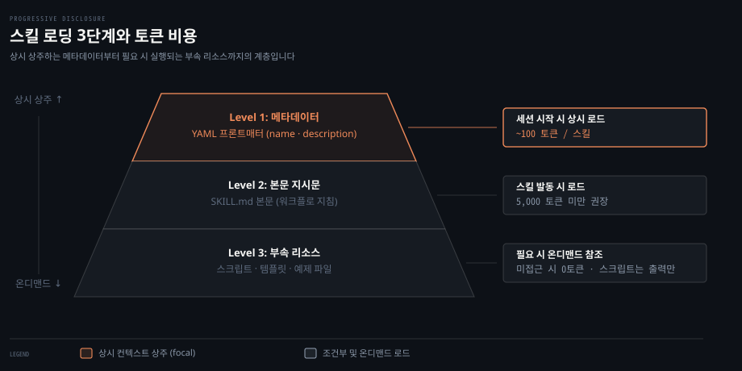
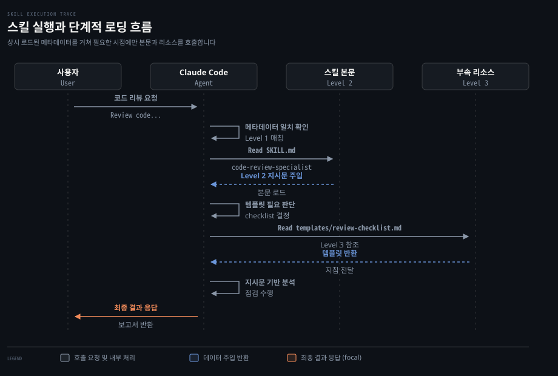
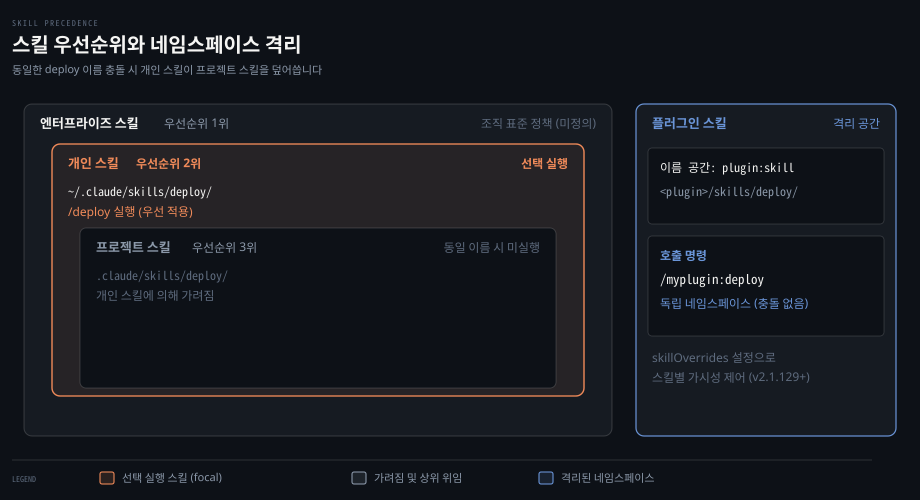
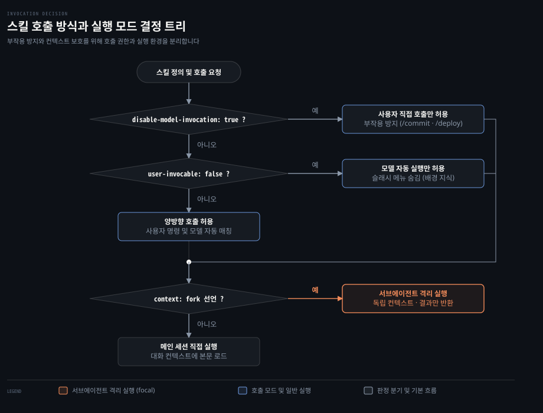

# Skills
---
> Claude Code의 스킬 체계, 점진적 공개를 통한 컨텍스트 비용 관리, SKILL.md 작성법과 호출 제어 정책을 정리합니다.


## 핵심 요약

> 스킬은 파일시스템 기반의 재사용 가능한 전문 역량 단위로, 필요한 시점에만 세부 지침을 불러와 컨텍스트 낭비를 방지합니다.

개발 작업을 진행할 때마다 동일한 도메인 지침과 검증 절차를 프롬프트에 반복해서 입력하는 것은 번거롭습니다. 그렇다고 모든 규칙을 CLAUDE.md에 몰아넣으면 매 대화 턴마다 컨텍스트 공간이 낭비됩니다.

스킬은 점진적 공개 방식을 사용해 시작할 때는 이름과 설명만 올립니다. 실제 호출될 때만 본문과 참조 파일을 읽습니다. 사용자가 직접 슬래시 명령으로 부를 수도 있고 모델이 대화 흐름을 보고 스스로 골라 실행할 수도 있습니다.

| 하고 싶은 일 | 쓸 설정이나 기능 |
|------|------|
| 도메인 지침을 필요할 때만 불러오기 | 기본 스킬 구조 (`SKILL.md`) |
| 배포나 커밋 같은 위험 작업의 자동 실행 막기 | `disable-model-invocation: true` |
| 배경 지식을 슬래시 메뉴에서 숨기기 | `user-invocable: false` |
| 대화창 오염 없이 백그라운드 탐색 수행하기 | `context: fork`, `agent: Explore` |
| 외부 스크립트 실행 결과를 프롬프트에 주입하기 | `` !`command` `` 문법 |
| 특정 도구 권한을 묻지 않고 승인하기 | `allowed-tools` |
| 팀 전체가 공유할 작업 절차 저장하기 | `.claude/skills/<이름>/SKILL.md` |
| 개인 작업 환경에만 스킬 두기 | `~/.claude/skills/<이름>/SKILL.md` |
| 내장 번들 스킬 숨기기 | `disableBundledSkills: true` |
| 셸 주입 실행 차단하기 | `disableSkillShellExecution: true` |


## 이 문서의 기준

> luongnv89/claude-howto 저장소의 188f468 커밋 스냅숏을 기준으로 삼았습니다.

원문 문서는 2026년 10월 20일 푸시된 188f468 커밋입니다. 원문이 기술한 Claude Code 기준 버전은 v2.1.302입니다.

원문 기준 지원 모델은 Claude Fable 5, Opus 5, Sonnet 5, Sonnet 4.6, Opus 4.8, Haiku 4.5를 포함합니다. 2026-10-26 에 별도 검증 창이 공식 문서(code.claude.com/docs)와 설치본 2.1.310 으로 사실을 대조해 틀린 곳을 고쳤고, 찾지 못한 사실에는 `확인 필요` 주석을 남겼습니다. 버전 차이에 따라 일부 세부 동작이나 기본값이 다를 수 있습니다.


## Progressive Disclosure

> 점진적 공개는 정보를 한꺼번에 올리지 않고 3단계로 나누어 필요한 순간에만 컨텍스트에 싣는 설계 원칙입니다.

대규모 언어 모델을 쓸 때 가장 큰 병목은 한정된 컨텍스트 윈도우와 토큰 비용입니다. 프로젝트에 필요한 수십 가지 워크플로와 스타일 가이드를 세션 시작 시점에 모두 주입하면 정작 실제 작업에 쓸 공간이 줄어듭니다. 또한 모델에게 주어지는 지침이 지나치게 길어지면 주의 집중도가 떨어져 규칙을 놓치는 문제가 발생합니다.

스킬은 **점진적 공개**(progressive disclosure, 필요에 따라 단계적으로 정보를 노출하는 방식) 아키텍처를 도입해 이 문제를 해결합니다. 모델에게는 스킬의 존재와 목적만 먼저 알리고 작업에 필요한 순간에만 단계적으로 세부 정보를 로드합니다.



### 3단계 로딩 구조

스킬 시스템의 정보 로딩은 명확히 구분된 3단계 계층을 따릅니다.

첫째 계층은 시작 시점에 항상 로드되는 **메타데이터**(Level 1 Metadata)입니다. `SKILL.md` 상단의 YAML 프론트매터에서 추출한 `name`, `description`, `when_to_use` 정보가 여기에 해당합니다. 스킬 하나당 약 100토큰 안팎을 차지합니다. 모델은 이 메타데이터를 시스템 프롬프트의 스킬 목록을 통해 보고 있다가 사용자의 질문이 어떤 스킬의 역할과 맞닿아 있는지 판단합니다.

둘째 계층은 스킬이 발동될 때 로드되는 **지시문**(Level 2 Instructions)입니다. 모델이 스킬을 실행하기로 결정하거나 사용자가 슬래시 명령으로 호출하면 비로소 `SKILL.md`의 본문 전체를 읽어 대화 컨텍스트에 넣습니다. 지시문은 구체적인 작업 단계와 규칙을 담으며 대개 5,000토큰 미만으로 유지하도록 권장됩니다.

셋째 계층은 작업 도중 필요할 때만 참조하는 **부속 리소스**(Level 3+ Resources)입니다. 스킬 디렉터리에 포함된 템플릿 문서, 예제 파일, 실행 스크립트가 여기에 속합니다. 부속 리소스는 스킬 본문이 로드될 때도 컨텍스트에 바로 들어오지 않습니다. 모델이 지시문을 따르다가 특정 템플릿 파일을 읽거나 터미널 도구로 파이썬 스크립트를 직접 실행할 때만 처리됩니다. 스크립트 코드 자체를 컨텍스트에 싣지 않고 실행 결과만 받아오므로 토큰 비용을 절감할 수 있습니다.



### 컨텍스트 예산과 토큰 비용 관리

메타데이터만 올린다고 해서 비용이 완전히 무료인 것은 아닙니다. 등록된 스킬이 수십 개로 늘어나면 매 대화 턴마다 모든 스킬의 설명이 프롬프트에 실려 누적 비용이 커집니다.

Claude Code는 이를 제어하기 위해 스킬 설명에 **설명 예산**(description budget)을 둡니다. 스킬 메타데이터 전체가 차지할 수 있는 길이는 기본적으로 전체 컨텍스트 윈도우의 1퍼센트로 제한됩니다. 계산 실패 시 대체 상한선은 8,000자입니다. 개별 스킬 차원에서도 `description`과 `when_to_use`를 합친 길이가 1,536자를 넘어가면 목록에서 말줄임표로 잘립니다.

등록된 스킬이 너무 많아 총합 예산을 넘기면 일부 스킬의 설명이 생략될 수 있습니다. 이때도 스킬 이름은 누락되지 않지만 설명이 잘리면 모델의 자동 매칭 정확도가 떨어집니다. 이 한도는 환경 변수 `SLASH_COMMAND_TOOL_CHAR_BUDGET`을 지정해 늘릴 수 있습니다. 개별 설명 상한은 `skillListingMaxDescChars` 설정으로 조정할 수 있습니다.


## 스킬 종류와 위치

> 스킬은 엔터프라이즈, 개인, 프로젝트, 플러그인의 4개 계층에 위치하며 상위 범위가 하위 범위를 덮어씁니다.

팀원마다 각자 다른 방식으로 스킬을 작성하거나 같은 이름의 스킬을 정의하면 어떤 설정이 우선할지 혼선이 생깁니다. 일관된 작업 표준을 유지하려면 스킬이 어디에 저장되고 어떤 순서로 적용되는지 알아야 합니다.

| 종류 | 저장 위치 | 범위 | 공유 방식 | 주 용도 |
|------|----------|------|----------|---------|
| 엔터프라이즈 | 중앙 관리형 설정 정책 | 조직 전체 | 중앙 배포 | 조직 표준 및 보안 규칙 |
| 개인 | `~/.claude/skills/<이름>/SKILL.md` | 사용자 개인 | 미공유 | 개인 맞춤 워크플로 |
| 프로젝트 | `.claude/skills/<이름>/SKILL.md` | 작업 프로젝트 | Git 버전 관리 | 프로젝트 전용 빌드 및 리뷰 절차 |
| 플러그인 | `<플러그인>/skills/<이름>/SKILL.md` | 활성화된 환경 | 플러그인 패키지 | 독립적인 확장 기능 번들 |



### 이름 충돌과 우선순위

서로 다른 위치에 같은 이름을 가진 스킬이 있으면 우선순위 규칙에 따라 하나만 실행됩니다. 우선순위는 **엔터프라이즈 > 개인 > 프로젝트** 순서입니다.

사용자의 홈 디렉터리 `~/.claude/skills/deploy/`와 현재 프로젝트의 `.claude/skills/deploy/`에 모두 스킬이 존재한다면 개인 스킬이 실행됩니다. 프로젝트 규칙보다 개인 환경 설정이 우선하도록 설계되어 있기 때문입니다. 플러그인 스킬의 경우 `플러그인명:스킬명` 꼴의 고유 네임스페이스를 부여받으므로 기존 스킬 이름과 충돌하지 않습니다.

스킬의 덮어쓰기 순서 자체를 바꿀 수는 없습니다. 하지만 v2.1.129부터 동작하는 `skillOverrides` 설정을 쓰면 특정 스킬의 노출 방식을 세밀하게 조정할 수 있습니다. 이는 우선순위 변경이 아니라 스킬별 가시성 제어입니다.

`skillOverrides`는 설정 파일에서 스킬 이름을 키로 두고 네 가지 값 중 하나를 지정합니다. `on`은 기본값으로 이름과 설명을 모델에 보이고 슬래시 메뉴에도 표시합니다. `name-only`는 모델에게 이름만 알리고 세부 설명은 숨기며 슬래시 메뉴에는 남깁니다. `user-invocable-only`는 모델로부터 숨기고 사용자의 슬래시 메뉴에만 표시합니다. `off`는 모델과 슬래시 메뉴 양쪽 모두에서 스킬을 완전히 비활성화합니다.

대화형 `/skills` 메뉴에서 스킬 상태를 변경하면 이 내용이 `.claude/settings.local.json`에 기록됩니다. 플러그인 스킬은 이 설정의 영향을 받지 않으며 `/plugin` 명령으로 관리합니다.

### 자동 발견과 동적 재스캔

Claude Code는 실행 중인 폴더 구조를 파악해 스킬을 자동으로 발견합니다.

모노레포처럼 하위 디렉터리가 나뉜 환경에서는 작업 중인 파일 경로에 맞추어 중첩된 스킬 디렉터리를 탐색합니다. `packages/frontend/src/` 아래 파일을 수정하고 있다면 `packages/frontend/.claude/skills/` 디렉터리에 있는 스킬을 찾아 목록에 포함합니다.

저장소 루트의 스킬과 하위 패키지의 스킬 이름이 같다면 둘 다 로드됩니다. 루트에 `deploy`가 있고 하위 패키지에도 `deploy`가 있다면 `/deploy`는 루트 스킬을 실행하고 `/packages/frontend:deploy`는 하위 패키지 스킬을 실행합니다.

외부 디렉터리를 연동하는 `--add-dir` 옵션을 사용해 추가한 디렉터리의 `.claude/skills/`도 자동으로 로드됩니다. 이 디렉터리는 실시간 파일 감시가 동작하므로 세션을 재시작하지 않아도 파일 수정 사항이 즉시 반영됩니다.

파일 변경이 실시간으로 감지되지 않을 때는 v2.1.152에서 추가된 `/reload-skills` 슬래시 명령을 실행해 모든 스킬 디렉터리를 다시 읽을 수 있습니다. 훅 시스템을 쓰는 경우 `SessionStart` 훅에서 `reloadSkills: true`를 반환하도록 구성해 세션이 시작될 때마다 자동으로 스킬 목록을 갱신할 수도 있습니다.

v2.1.133부터는 서브에이전트의 스킬 탐색 동작도 개선되었습니다. 이전 버전에서는 서브에이전트가 자체 내장된 스킬만 볼 수 있어 메인 세션과의 연속성이 끊겼습니다. v2.1.133 이후로는 서브에이전트도 Skill 도구를 통해 프로젝트, 개인, 플러그인 스킬 카탈로그를 메인 세션과 동일하게 조회할 수 있습니다.

### 기본 내장 번들 스킬

Claude Code는 별도의 설치나 설정 없이 바로 사용할 수 있는 번들 스킬을 자체 제공합니다.

| 번들 스킬 | 설명 및 특징 |
|-----------|-------------|
| `/batch <지시문>` | Git 워크트리를 활용해 대규모 병렬 변경 작업을 오케스트레이션합니다. |
| `/claude-api` | Claude API 레퍼런스를 로드하며 관련 패키지 임포트 시 자동 활성화됩니다. |
| `/dataviz` | 차트와 대시보드 설계 지침을 주며 색상 팔레트 검증기를 실행합니다 (v2.1.198). |
| `/debug [설명]` | 디버그 로그를 읽어 현재 세션의 문제 원인을 추적합니다. |
| `/deep-research <질문>` | 웹 검색을 병렬 수행하고 보고서를 쓰는 내장 워크플로입니다 (v2.1.218부터 직접 호출만 허용). |
| `/fewer-permission-prompts` | 트랜스크립트를 분석해 자주 쓰는 읽기 도구의 권한 허용 목록을 프로젝트 `.claude/settings.json`에 추가합니다. |
| `/loop [주기] [프롬프트]` | 지정한 간격으로 프롬프트를 반복 실행합니다 (예: `/loop 5m 배포 상태 점검`). |
| `/run` | 프로젝트 앱을 실행해 변경 결과를 확인합니다 (v2.1.145). <!-- 확인 필요: 공식 문서·설치본에서 찾지 못함 --> |
| `/run-skill-generator` | 프로젝트에 맞춤화된 `/run`, `/verify` 스킬을 생성합니다 (v2.1.145). <!-- 확인 필요: 공식 문서·설치본에서 찾지 못함 --> |
| `/code-review [effort]` | diff의 버그를 검토합니다. 백그라운드 서브에이전트로 동작합니다 (v2.1.218). |
| `/simplify` | 재사용성과 구조 단순화 관점의 정리를 수행하고 수정안을 적용합니다 (v2.1.154). |
| `/verify` | 단순 테스트를 넘어 앱을 빌드·실행해 정상 동작을 검증합니다 (v2.1.145, v2.1.215부터 직접 호출). <!-- 확인 필요: 공식 문서·설치본에서 찾지 못함 --> |

만약 프로젝트나 개인 스킬에 `verify`라는 이름의 스킬을 정의해 두면 Claude Code는 커밋을 생성하기 직전에 이 검증 스킬을 자동으로 실행합니다. 단 문서나 테스트만 수정한 커밋은 제외됩니다(v2.1.286).

내장 번들 스킬이 불필요하다면 설정 파일에 `disableBundledSkills: true`를 추가합니다. 환경 변수 `CLAUDE_CODE_DISABLE_BUNDLED_SKILLS=1`을 지정해도 모델로부터 완전히 감출 수 있습니다(v2.1.169).


## SKILL.md 작성

> 스킬은 프론트매터와 마크다운 본문으로 구성되며 부속 파일과 동적 컨텍스트를 결합해 정교한 동작을 만듭니다.

스킬 지침을 하나의 파일에 마구잡이로 적어 넣으면 본문이 비대해져 모델이 규칙을 놓치거나 토큰이 낭비되는 문제가 생깁니다. 체계적인 디렉터리 구조와 명확한 프론트매터 설계를 갖추어야 안정적인 스킬을 만들 수 있습니다.

### 디렉터리 구성과 필수 파일

스킬은 하나의 폴더 안에 관련 리소스를 모아 두는 구조를 가집니다.

```markdown
my-skill/
├── SKILL.md           # 필수 메인 지침 문서
├── templates/         # 모델이 채워 넣을 출력 템플릿
│   └── output.md
├── examples/          # 기대 형식과 결과물 예시
│   └── sample.md
├── references/        # 도메인 지식, 스펙 문서
│   └── spec.md
└── scripts/           # 모델이 실행할 수 있는 자동화 스크립트
    └── validate.sh
```

`SKILL.md`는 필수 파일입니다. 이 파일의 내용이 모델에게 직접 전달되는 중심 프롬프트입니다.

### 프론트매터 설정 필드

`SKILL.md` 상단에는 YAML 형식의 프론트매터를 선언해 스킬의 메타데이터와 실행 환경을 정의합니다. 모든 프론트매터 필드는 선택 사항입니다. 가장 중요한 권장 필드는 `description`입니다.

| 필드 | 설명 |
|------|------|
| `name` | 스킬 식별자입니다. 생략하면 폴더명을 씁니다. 소문자·숫자·하이픈 조합 64자 이하가 권장됩니다. 256자 초과나 숨은 문자·`<`·`>`·낱칸 공백이 아닌 공백 포함 시 로드가 거부됩니다. <!-- 확인 필요: 256자 상한은 공식 문서·설치본에서 찾지 못함 --> `anthropic-skills`, `synced`는 예약어입니다. |
| `description` | 스킬 역할과 사용 시점을 기술합니다. 모델의 자동 호출 판단에 가장 중요한 기준입니다. `when_to_use`와 합쳐 1,536자까지 목록에 반영됩니다. |
| `when_to_use` | 스킬이 발동되어야 할 추가 상황입니다. `description` 끝에 붙습니다. |
| `argument-hint` | 슬래시 메뉴 자동 완성에 표시할 인자 힌트입니다 (예: `"[파일명] [형식]"`). |
| `disable-model-invocation` | `true`면 모델의 자동 실행을 막고 사용자의 `/이름` 호출만 허용합니다. |
| `user-invocable` | `false`면 사용자의 `/` 자동 완성 메뉴에서 숨기고 모델의 내부 판단 호출만 허용합니다. |
| `allowed-tools` | 스킬 실행 중 확인 창 없이 즉시 실행을 허용할 도구 목록입니다. |
| `disallowed-tools` | 스킬 실행 중 사용을 차단할 도구 목록입니다 (v2.1.152). |
| `model` | 스킬 수행 시 강제로 적용할 모델입니다 (예: `opus`, `sonnet`). |
| `effort` | 생각 깊이를 재정의합니다 (`low`, `medium`, `high`, `xhigh`, `max`). |
| `context` | `fork`로 지정하면 독립된 서브에이전트 컨텍스트에서 실행합니다. |
| `agent` | `context: fork` 사용 시 위임할 서브에이전트 유형입니다 (예: `Explore`, `Plan`). |
| `background` | 서브에이전트 스킬의 백그라운드 실행 여부입니다. 기본값은 `true`입니다 (v2.1.218). |
| `shell` | 동적 명령과 스크립트 실행에 쓸 셸입니다 (`bash` 기본값 또는 `powershell`). |
| `hooks` | 스킬 발동 시 세션에 등록할 훅 이벤트입니다. 세션 종료 시까지 유지됩니다. |
| `paths` | 특정 파일 경로를 다룰 때만 활성화하도록 제한하는 글로브 패턴입니다. |
| `arguments` | 스킬이 수신할 매개변수 이름 선언입니다. 최대 64개까지 지원됩니다 (v2.1.301). |
| `metadata` | 버전이나 작성자 등 사용자 정의 자유 키-값 맵입니다. |
| `license` | 스킬 라이선스 식별자입니다 (예: `MIT`). |
| `compatibility` | 스킬 호환성 설명 문자열입니다 (최대 500자). |

v2.1.218부터는 불리언 필드에 `true`/`false` 외에도 대소문자 구분 없이 `yes`/`no`, `on`/`off`, `1`/`0`을 적을 수 있습니다.

### 참조형과 작업형 콘텐츠

스킬 본문에 담기는 내용은 목적에 따라 두 가지 유형으로 나뉩니다.

첫째는 **참조형 콘텐츠**(Reference Content)입니다. 코드베이스의 설계 규약, 아키텍처 원칙, 스타일 가이드 등 모델이 기존 작업을 진행하면서 준수해야 할 배경 지식을 제공합니다. 주로 대화 세션의 컨텍스트 안에서 인라인으로 동작합니다.

```yaml
---
name: api-conventions
description: 이 코드베이스의 REST API 설계 규칙과 오류 응답 표준을 안내합니다.
---

API 엔드포인트를 작성할 때는 다음 규칙을 준수합니다.
1. 자원 경로는 복수형 명사를 사용합니다.
2. 오류 응답은 공통 ProblemDetails 형식을 따릅니다.
3. 요청 본문 유효성 검증을 필수로 포함합니다.
```

둘째는 **작업형 콘텐츠**(Task Content)입니다. 단위 테스트 생성, 배포 수행, 코드 리뷰 등 구체적인 작업 순서와 절차를 단계별로 안내합니다. 사용자가 특정 시점에 슬래시 명령으로 직접 호출하는 작업에 적합합니다.

```yaml
---
name: deploy-prod
description: 프로덕션 환경에 애플리케이션을 안전하게 배포합니다.
context: fork
disable-model-invocation: true
---

프로덕션 배포 절차를 실행합니다.
1. 테스트 스위트 전체를 수행합니다.
2. 프로덕션 빌드 아티팩트를 생성합니다.
3. 배포 타깃 서버로 전송하고 상태를 확인합니다.
```

### 부속 파일과 상대 경로

스킬 지침이 길어지면 `SKILL.md` 본문이 비대해져 관리가 어려워집니다. 권장 사항은 `SKILL.md` 본문을 500줄 이내로 유지하고 상세한 스펙이나 큰 예제는 부속 디렉터리로 분리하는 것입니다.

분리된 부속 파일은 마크다운 링크 문법을 사용해 상대 경로로 참조합니다. 세부 체크리스트를 분리했다면 본문에 `[리뷰 체크리스트](templates/review-checklist.md)` 형태로 적어 둡니다.

부속 파일은 점진적 공개의 Level 3에 해당합니다. 모델이 실제로 그 내용이 필요하다고 판단해 도구로 읽기 전까지는 컨텍스트 토큰을 소모하지 않습니다.

### 문자열 치환 변수

스킬 본문에서는 실행 시점에 결정되는 동적 값을 변수 형태로 참조할 수 있습니다.

| 변수 | 치환 내용 |
|------|-----------|
| `$ARGUMENTS` | 슬래시 명령 호출 시 전달된 전체 인자 문자열 |
| `$ARGUMENTS[N]` 또는 `$N` | 0부터 시작하는 N번째 특정 인자값 |
| `${CLAUDE_SESSION_ID}` | 현재 실행 중인 대화 세션의 고유 식별자 |
| `${CLAUDE_SKILL_DIR}` | 해당 스킬의 `SKILL.md`가 위치한 절대 디렉터리 경로 |
| `${CLAUDE_PROJECT_DIR}` | 프로젝트 루트의 절대 경로 (`allowed-tools`에서도 사용 가능, v2.1.196) <!-- 확인 필요: v2.1.196 은 공식 문서·설치본에서 찾지 못함 --> |
| `${CLAUDE_EFFORT}` | 현재 설정된 생각 깊이 수준 (`low`, `medium`, `high`, `xhigh`, `max`, v2.1.120) |
| `` !`command` `` | 셸 명령을 실행하고 그 표준 출력을 프롬프트에 인라인 삽입 |

GitHub 이슈를 처리하는 스킬이라면 지침 본문에 `이슈 $ARGUMENTS 번의 변경 요구사항을 분석합니다.`라고 적어 둡니다. 사용자가 터미널에서 `/fix-issue 104`를 입력하면 `$ARGUMENTS` 자리가 `104`로 치환되어 모델에 전달됩니다.

여러 스킬을 연이어 호출하는 스킬 중첩(stacking)도 지원됩니다. v2.1.199부터는 `/write-tests /fix-issue 123`처럼 프롬프트 맨 앞에 여러 개의 슬래시 스킬을 적을 수 있습니다. 첫 번째 스킬을 포함해 최대 6개까지 선행 스킬을 순서대로 로드하고 뒤따르는 인자(`123`)를 각 스킬에 공통 전달합니다.

중첩 과정에서 포크 서브에이전트로 지정된 스킬을 만나면 확장이 중단됩니다. 같은 스킬이 중복 호출될 경우 v2.1.202부터는 내용이 중복 추가되지 않고 단일화됩니다.

### 동적 컨텍스트 주입

`` !`command` `` 문법은 스킬 지침이 모델에게 전송되기 전에 로컬 머신에서 셸 명령을 먼저 실행하고 그 출력 결과를 텍스트 본문에 즉시 끼워 넣는 기능입니다.

```markdown
## 현재 브랜치 변경 사항
- 최근 커밋 로그: !`git log -n 5 --oneline`
- 작업 트리 diff: !`git diff --stat`
```

명령은 사용자의 환경에서 즉시 실행됩니다. 모델은 명령 자체가 아니라 명령이 만들어낸 결과 텍스트만 보게 됩니다. 따라서 모델이 셸 도구를 여러 번 호출해 정보를 수집하는 불필요한 턴을 절약할 수 있습니다. 기본 실행 셸은 `bash`이며 프론트매터에 `shell: powershell`을 지정하면 파워셸을 사용합니다.

v2.1.299부터는 `UserPromptSubmit` 훅이 동적 명령 확장보다 먼저 실행됩니다. 만약 해당 훅이 프롬프트 제출을 차단하면 백틱 안에 명시된 느낌표 셸 명령도 실행되지 않습니다.


## 호출 제어

> 스킬은 실행 주체와 격리 수준에 따라 자동 호출, 수동 호출, 서브에이전트 위임 방식을 선택합니다.

모든 스킬을 모델이 자율적으로 실행하도록 허용하면 코드 수정이나 원격 배포처럼 부작용이 큰 작업이 원치 않는 시점에 실행될 위험이 있습니다. 어떤 작업을 모델의 판단에 맡기고 어떤 작업을 사람의 통제 아래 둘지 명확한 경계를 설정해야 합니다.



### 모델 자동 실행 차단

프론트매터의 기본 설정 상태에서는 사용자와 모델 모두 스킬을 호출할 수 있습니다. 모델의 자율 호출을 막으려면 `disable-model-invocation: true`를 지정합니다.

```yaml
---
name: deploy
description: 프로덕션 환경에 애플리케이션을 배포합니다
disable-model-invocation: true
---
```

이 설정이 적용되면 모델은 자신이 먼저 이 스킬을 발동시키지 못합니다. 사용자가 프롬프트에서 `/deploy` 명령을 명시적으로 입력했을 때만 실행됩니다.

부작용을 동반하는 모든 작업에는 이 필드를 사용하는 것이 안전합니다. 커밋 생성, 원격 푸시, 프로덕션 배포, 외부 메신저 알림 발송과 같은 작업은 코드가 준비되었다고 모델이 독단적으로 판단해 실행해서는 안 됩니다.

### 사용자 직접 실행 숨김

반대로 사용자의 슬래시 메뉴에는 노출하지 않고 모델만 참고하도록 만들고 싶다면 `user-invocable: false`를 지정합니다.

```yaml
---
name: legacy-architecture-context
description: 레거시 결제 모듈의 설계 제약과 데이터베이스 연동 규칙을 설명합니다
user-invocable: false
---
```

사용자가 `/`를 입력했을 때 나오는 자동 완성 목록이 너무 많은 스킬로 어지러워지는 것을 방지할 수 있습니다. 배경 지식이나 규약 문서처럼 사용자가 직접 실행하는 행위가 아니라 모델이 질문에 답할 때 문맥으로 참고해야 하는 지침에 적합합니다.

### 서브에이전트 격리 실행

무거운 탐색 작업이나 긴 분석 작업은 메인 대화 세션의 컨텍스트를 빠르게 채워 버립니다. `context: fork`를 선언하면 스킬이 독립된 서브에이전트에서 실행됩니다.

```yaml
---
name: deep-code-analysis
description: 코드베이스 전체의 아키텍처 패턴을 심층 분석합니다
context: fork
agent: Explore
background: true
---
```

포크된 스킬은 메인 세션과 분리된 독립 컨텍스트 윈도우를 부여받습니다. 서브에이전트는 스킬 본문을 작업 지시로 받아 별도의 환경에서 조사와 분석을 마친 뒤 최종 요약 결과만 메인 대화창에 반환합니다.

함께 사용하는 `agent` 필드는 어떤 전문 서브에이전트를 띄울지 결정합니다. 읽기 전용 코드베이스 조사는 `Explore`, 구현 계획 수립은 `Plan`, 모든 도구를 고루 쓰는 작업은 `general-purpose`를 선택합니다.

v2.1.218부터 `context: fork`가 지정된 스킬의 `background` 기본값은 `true`입니다. 백그라운드에서 조용히 실행되므로 사용자는 메인 세션에서 다른 작업을 계속 이어갈 수 있습니다. 만약 서브에이전트의 진행 과정을 실시간으로 보며 기다려야 한다면 `background: false`를 주어 포그라운드로 실행합니다.

v2.1.145 이전 버전에서는 `context: fork` 스킬이 드물게 무한 재호출 루프에 빠지는 현상이 있었습니다. 포크 스킬을 제작하거나 운용할 때는 v2.1.145 이상 버전을 사용하는 것이 권장됩니다.

### 도구 사용 권한 제어

스킬이 실행되는 동안 모델이 특정 도구를 자주 사용해야 한다면 권한 승인 창이 반복해서 뜨는 것이 번거로울 수 있습니다.

`allowed-tools` 필드에 도구 이름을 쉼표로 적어 두면 스킬이 활성화된 동안 해당 도구에 대해 사용자 승인 확인을 건너뜁니다. 예를 들어 `allowed-tools: Read, Grep, Glob` 또는 `allowed-tools: Bash(npm test)`처럼 특정 도구와 인자 패턴을 지정할 수 있습니다.

반대로 v2.1.152부터는 `disallowed-tools` 필드가 추가되었습니다. 스킬이 동작하는 동안 특정 도구의 사용을 명시적으로 차단하여 안전성을 강화할 수 있습니다. 읽기 전용 분석 스킬에 `disallowed-tools: Write, Edit`을 선언하면 모델이 실수로 코드를 고치는 일을 원천 방지할 수 있습니다.

세션 전체 차원에서 특정 스킬의 권한을 통제할 수도 있습니다. `/permissions` 설정에서 거부 규칙에 `Skill`을 추가하면 모델의 모든 스킬 호출이 차단됩니다. 세부적으로 `Skill(commit)`만 허용하거나 `Skill(deploy *)`를 차단하는 식의 규칙 지정도 가능합니다.


## 다른 기능과의 경계

> 스킬, 서브에이전트, MCP, 훅, CLAUDE.md는 각각 호출 시점과 컨텍스트 유지 방식이 다릅니다.

에이전트 확장 기능이 많아질수록 특정 작업에 스킬, 서브에이전트, MCP 중 무엇을 써야 할지 결정하기 혼란스러워집니다. 각 기능의 호출 시점과 컨텍스트 유지 방식을 비교해 최적의 도구를 선택해야 합니다.

| 기능 | 호출 주체 및 시점 | 주요 역할 및 적합한 용도 |
|------|------------------|--------------------------|
| **스킬** | 모델 자동 실행 또는 사용자 `/이름` 호출 | 재사용 가능한 작업 절차, 도메인 전문 지식, 점진적 로딩 |
| **슬래시 명령** | 사용자 직접 `/이름` 호출 | 사용자 단축 명령 (현재는 스킬 시스템으로 완전 통합됨) |
| **서브에이전트** | 메인 에이전트의 작업 위임 | 독립된 컨텍스트 윈도우에서의 격리된 태스크 수행 |
| **메모리 (CLAUDE.md)** | 세션 시작 시 항상 로드 | 프로젝트 전반의 영구 컨텍스트, 빌드 명령, 핵심 규약 |
| **MCP** | 모델의 필요에 따른 실시간 도구 호출 | 데이터베이스, 외부 API, 사내 서비스 등 외부 시스템 연동 |
| **훅** | 사건 발생 시 결정론적 자동 실행 | 도구 실행 전후 검증, 프롬프트 전처리 등 정해진 부작용 처리 |

### 역할 선택 기준

어떤 확장 방식을 선택해야 할지 고민될 때는 다음 네 가지 기준을 점검합니다.

첫째, 모든 대화에서 항상 알고 있어야 하는 규칙인가를 따집니다. 프로젝트 언어 버전, 패키지 매니저, 테스트 실행 명령처럼 세션마다 반드시 필요한 기본 지식은 `CLAUDE.md`에 두어야 합니다. 반면 특정 모듈을 리팩토링할 때만 필요한 지침이나 배포 절차처럼 가끔 쓰이는 지식은 `스킬`로 분리해야 컨텍스트를 아낄 수 있습니다.

둘째, 사람의 개입 없이 사건 기반으로 즉시 실행되어야 하는 결정론적 검증인가를 봅니다. 커밋을 만들기 전에 정적 분석기를 돌리거나 특정 파일이 편집된 직후 포맷터를 실행하는 작업은 모델의 판단을 기다릴 필요가 없습니다. 이런 결정론적 부작용은 `훅`에 맡깁니다.

셋째, 외부 시스템과의 실시간 데이터 교환이 필요한가를 확인합니다. 사내 이슈 트래커 조회, 데이터베이스 쿼리 실행, 브라우저 조작 같은 작업은 `MCP` 서버를 통해 도구 형태로 열어 주는 것이 적합합니다.

넷째, 작업 과정에서 대화창 컨텍스트가 대량으로 소비되는가를 판단합니다. 코드베이스 전수 조사나 복잡한 리팩토링 계획 수립처럼 수십 개의 파일을 읽어야 하는 작업은 `서브에이전트`를 띄우거나 스킬에 `context: fork`를 주어 메인 대화 세션을 깨끗하게 유지해야 합니다.

과거에 별도로 존재하던 사용자 정의 슬래시 명령(`.claude/commands/`)은 스킬 시스템으로 통합되었습니다. 기존 경로의 명령 파일도 `name`·`paths`를 뺀 같은 프론트매터를 지원하며 정상 동작합니다. 동일한 이름으로 명령과 스킬이 공존할 경우 스킬이 우선 실행됩니다. 신규 작성 시에는 스킬 시스템을 사용하는 것이 원칙입니다.


## 관리·공유·보안

> 스킬을 팀 및 커뮤니티와 공유할 때는 저장소 전략과 함께 코드 실행 보안 위협을 철저히 점검해야 합니다.

검증되지 않은 외부 스킬을 무심코 도입하면 악의적인 프롬프트나 스크립트 실행으로 시스템 보안이 침해될 위험이 발생합니다. 스킬의 공유 경로를 정리하고 안전한 운용 방침을 세워야 합니다.

### 팀 저장소와 개인 환경 공유

스킬을 팀원과 공유하는 가장 표준적인 방법은 프로젝트 루트의 `.claude/skills/` 디렉터리에 넣고 Git으로 커밋하는 것입니다. 팀원이 저장소를 풀(pull)받는 즉시 별도의 설치 과정 없이 동일한 스킬을 사용할 수 있습니다. 팀 공통의 코딩 스타일 검사나 배포 가이드가 여기에 적합합니다.

여러 프로젝트에서 개인적으로 반복 사용하는 스킬은 `~/.claude/skills/` 디렉터리에 복사해 둡니다. 파이썬이나 셸 스크립트가 포함되어 있다면 실행 권한(`chmod +x`)이 제대로 부여되어 있는지 확인해야 합니다.

더 넓은 조직이나 외부 커뮤니티에 스킬을 배포할 때는 플러그인 패키지 구조를 활용합니다. 플러그인의 `skills/` 폴더에 스킬을 패키징하면 플러그인 마켓플레이스를 통해 손쉽게 배포하고 버전을 관리할 수 있습니다.

### 악성 스킬 감사와 셸 주입 방어

스킬은 모델에게 구체적인 행동 지침을 제공하며 시스템 명령을 실행할 권한도 가질 수 있습니다. 검증되지 않은 출처에서 스킬을 내려받는 것은 신뢰할 수 없는 소프트웨어를 컴퓨터에 직접 설치하는 것과 같습니다.

악의적으로 작성된 스킬은 모델을 조종해 민감한 파일을 읽어 외부에 유출하거나 위험한 셸 명령을 실행할 수 있습니다. 외부 스킬을 들여올 때는 반드시 다음 세 가지를 확인해야 합니다.

첫째, 스킬 디렉터리 안의 모든 파일과 스크립트를 직접 열어 내용을 검토합니다.
둘째, 외부 URL에서 추가 코드를 다운로드하거나 실행하는 구문이 있는지 확인합니다.
셋째, `allowed-tools`에 과도한 도구 권한이 부여되어 있지 않은지 점검합니다.

스킬의 `` !`command` `` 동적 치환 기능은 프롬프트가 모델에 도달하기 전에 임의의 셸 명령을 실행할 수 있는 통로가 됩니다. 공유 엔터프라이즈 환경이나 폐쇄망 CI 러너처럼 보안이 엄격한 환경에서는 v2.1.91에 도입된 `disableSkillShellExecution` 설정을 켜는 것이 권장됩니다.

```json
{
  "disableSkillShellExecution": true
}
```

이 설정이 활성화되면 스킬 내부의 `` !`command` `` 구문은 실행되지 않고 `[shell command execution disabled by policy]`라는 고정 문자열로 치환됩니다. 스킬 본연의 지침 전달 기능은 유지하면서 셸 명령 주입 공격 표면만 차단할 수 있습니다.

### 오픈 표준과 생태계 도구

스킬 명세는 Claude Code 독점 형식이 아니라 여러 AI 도구에서 함께 쓰이는 Agent Skills 오픈 표준(agentskills.io)을 기반으로 합니다.

표준 명세에서는 `name`, `description`, `license`, `compatibility`, `metadata`, `allowed-tools` 필드가 통용됩니다. Claude Code는 여기에 호출 제어나 서브에이전트 포크 같은 고급 기능을 덧붙여 지원합니다.

스킬을 본격적으로 운용하기 시작하면 체계적인 관리가 필요해집니다. 원문 저자는 일상적으로 검증된 스킬 모음집인 `luongnv89/skills`와 스킬 관리 도구인 `luongnv89/asm`(Agent Skill Manager)을 추천합니다. `asm link` 명령을 사용하면 파일을 매번 복사하지 않고도 개발 중인 스킬을 여러 프로젝트에 연결해 테스트할 수 있습니다.


## 운영 팁과 문제 해결

> 스킬 발동 실패의 대부분은 모호한 설명에서 비롯되며 체계적인 진단 도구로 비용과 누락을 추적할 수 있습니다.

스킬을 만들어 두고도 모델이 제때 쓰지 못하거나 엉뚱한 상황에 발동되어 작업이 꼬이는 문제가 자주 발생합니다. 작성 단계에서의 실천 규칙과 문제 발생 시의 진단 순서를 정리합니다.

### 효과적인 작성 실천 규칙

스킬의 품질을 높이려면 다음 원칙을 지켜야 합니다.

첫째, 설명문(`description`)을 구체적으로 쓰고 실제 트리거 키워드를 포함합니다. "문서 처리를 돕습니다" 같은 모호한 문장은 피해야 합니다. "PDF 파일에서 텍스트와 표를 추출하고 양식을 채웁니다. 사용자가 PDF, 양식 작성, 문서 추출을 언급할 때 사용합니다"처럼 무엇을 하는지와 언제 써야 하는지를 사용자가 실제로 입력할 법한 자연어 단어로 명확히 적어 줍니다.

둘째, 스킬 하나는 단 하나의 명확한 역량에 집중시킵니다. 여러 역할을 한 스킬에 몽땅 몰아넣으면 모델이 발동 조건을 혼동하게 됩니다.

셋째, `SKILL.md` 본문은 500줄 이내로 간결하게 유지합니다. 긴 규약이나 거대한 예제는 `references/`나 `templates/`로 분리하여 필요할 때만 참조하도록 유도합니다.

넷째, 실제 개발 시나리오를 바탕으로 자동 호출과 직접 호출을 모두 테스트합니다. 의도한 대로 키워드에 반응하는지 확인하고 도구 실행 권한이 알맞게 설정되었는지 점검합니다.

### 발동 문제 해결

스킬이 기대한 대로 동작하지 않을 때의 증상별 조치 방법입니다.

| 증상 | 주 원인 | 조치 방법 |
|------|---------|-----------|
| 모델이 스킬을 전혀 쓰지 않음 | 설명문의 트리거 키워드 부족 | 사용자가 질문에 쓸 법한 구체적 명사와 동사를 `description`에 보강합니다. |
| 스킬 목록에 나타나지 않음 | 파일 경로 또는 YAML 문법 오류 | 경로가 `~/.claude/skills/<이름>/SKILL.md`인지 확인하고 프론트매터의 들여쓰기와 하이픈 구분을 점검합니다. |
| 스킬이 너무 자주 잘못 발동됨 | 설명문의 범위가 지나치게 넓음 | 설명의 조건을 좁히거나 `disable-model-invocation: true`를 주어 수동 실행 전용으로 전환합니다. |
| 스크립트 실행이 실패함 | 파일 실행 권한 누락 | 대상 스크립트에 `chmod +x` 권한이 부여되어 있는지 확인합니다. |
| 등록한 스킬 일부가 보이지 않음 | 컨텍스트 설명 예산 초과 | `/doctor`로 목록의 컨텍스트 비용을 확인하고 미사용 스킬을 정리하거나 예산 환경 변수를 조정합니다. |

스킬이 호출되지 않을 때는 터미널 대화창에서 "사용 가능한 스킬이 무엇인가요?"라고 질문해 Claude가 해당 스킬을 인식하고 있는지 먼저 확인합니다. 목록에 잘 나온다면 요청 프롬프트를 스킬 설명문 속 단어와 비슷하게 바꾸어 다시 시도해 봅니다. 그래도 되지 않는다면 `/스킬명` 형태로 직접 호출해 본문 지시문 자체에 논리 오류가 없는지 검증합니다.

스킬 이름이 기존 번들 스킬과 겹치지 않는지도 확인해야 합니다. 예를 들어 코드 리뷰 스킬을 `code-review`라는 폴더명으로 만들면 내장 번들 스킬과 충돌하므로 `code-review-specialist`처럼 구체적인 접미사를 붙이는 것이 안전합니다.

### 예산 초과와 스킬 닥터 활용

설치된 스킬이 지나치게 많아지면 설명 예산(기본 8,000자 또는 컨텍스트의 1퍼센트)을 초과하여 일부 스킬의 설명이 목록에서 조용히 빠질 수 있습니다.

세션 안에서 `/doctor` 명령을 실행하면 스킬 목록의 컨텍스트 비용을 확인할 수 있고, 예산 초과 경고는 `--debug`로 켠 디버그 로그에 남습니다.

v2.1.252부터는 `/skill-doctor` 도구가 추가되었습니다. 이 명령을 실행하면 현재 등록된 스킬들 중 실제로 쓰이지 않는 스킬이 무엇인지, 각 스킬의 메타데이터가 얼마만큼의 컨텍스트 비용을 소모하고 있는지를 한눈에 분석해 줍니다. 사용 빈도가 낮은 스킬은 `skillOverrides` 설정에서 가시성을 `off`로 끄거나 삭제하여 컨텍스트 윈도우를 최적화할 수 있습니다.
