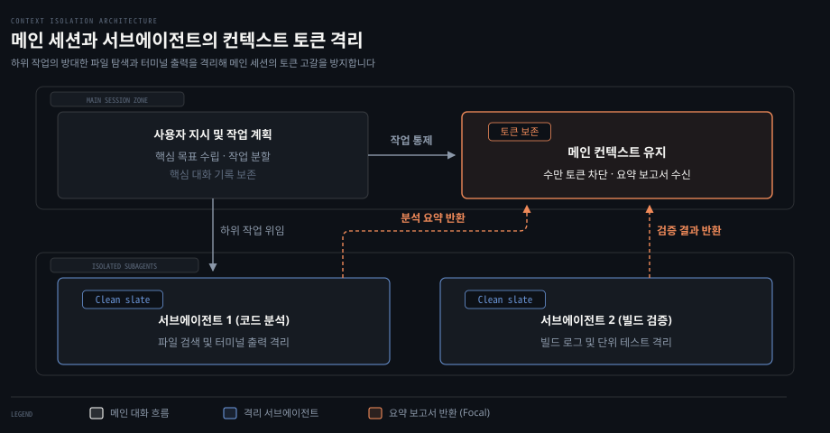
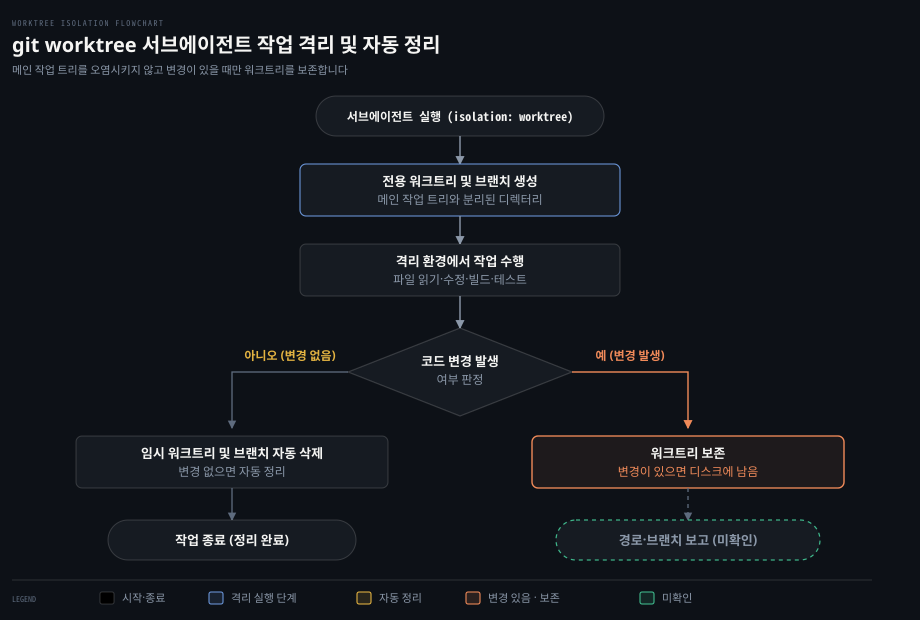
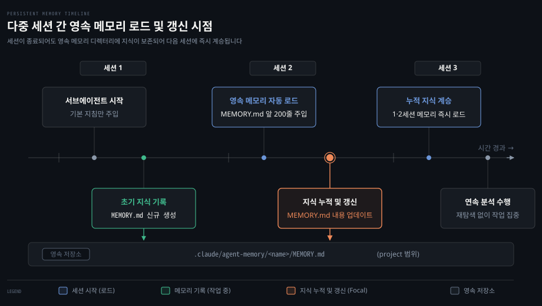

# Subagents
---
> Claude Code 가 복잡한 작업을 독립된 컨텍스트 윈도우와 전용 도구를 갖춘 하위 에이전트에게 위임하는 서브에이전트 기능의 설정과 동작 원리를 정리합니다. 기본 내장 에이전트부터 사용자 정의 에이전트, 백그라운드 실행, 워크트리 격리, 영속 메모리, 그리고 Agent Teams 와의 차이점까지 다룹니다.


## 핵심 요약

> 서브에이전트는 메인 대화의 컨텍스트 오염을 막고 전용 프롬프트와 제한된 도구로 작업을 격리해 수행하는 하위 에이전트입니다.

메인 세션에서 수많은 파일을 탐색하고 긴 명령 출력을 확인하면 컨텍스트 토큰이 빠르게 소진됩니다. 중요한 초기 지시사항이나 대화 흐름이 뒤로 밀려나 잊히는 컨텍스트 오염 현상도 발생합니다. **서브에이전트**(subagent, 독립된 작업 공간과 프롬프트를 갖춘 하위 에이전트)는 필요한 작업 맥락만 넘겨받아 깨끗한 새 컨텍스트에서 동작합니다. 하위 작업에서 많은 토큰을 쓰더라도 최종 결과만 압축해 돌려주므로 메인 세션의 토큰 자원을 보존합니다.

작업 성격에 따라 전용 모델, 도구 허용 목록, 권한 모드, 백그라운드 실행 여부를 조합할 수 있습니다. 변경 사항을 안전하게 검증하도록 별도의 git 워크트리를 연결하거나, 세션이 끝나도 유지되는 영속 메모리를 부여해 지식을 누적할 수도 있습니다.

| 하고 싶은 일 | 쓸 것 |
|------|------|
| 메인 세션 컨텍스트를 아끼며 코드베이스 탐색 | 내장 Explore 에이전트 또는 읽기 전용 에이전트 |
| 긴 조사나 구현 작업을 세션 차단 없이 비동기 수행 | `background: true` 또는 `Ctrl+B` 단축키 |
| 이전 작업 맥락을 유지한 채 후속 작업 이어가기 | 에이전트 재개(`resume agent <agentId>`) |
| 현재 대화 기록과 캐시를 복제해 대안 탐색 | 포크 모드(`/subtask` 명령 또는 `subagent_type: "fork"`) |
| 원본 코드를 건드리지 않고 독립 브랜치에서 구현 | `isolation: worktree` 설정 |
| 세션이 바뀌어도 유지되는 작업 노트 축적 | 영속 메모리(`memory: user \| project \| local`) |
| 상위 세션이 호출 가능한 하위 에이전트 제한 | `tools: Agent(worker, researcher)` 문법 |
| 에이전트끼리 메일박스로 메시지를 주고받으며 협업 | Agent Teams (`CLAUDE_CODE_EXPERIMENTAL_AGENT_TEAMS=1`) |


## 이 문서의 기준

> luongnv89/claude-howto 커밋 188f468과 원문이 밝힌 Claude Code v2.1.302 버전을 기준으로 정리했습니다.

이 문서는 luongnv89/claude-howto 저장소의 커밋 188f468을 바탕으로 작성했습니다. 원문 문서가 반영한 기준 버전은 Claude Code v2.1.302입니다.

2026-10-26 에 별도 검증 창이 공식 문서(code.claude.com/docs)와 설치본 2.1.310 으로 사실을 대조해 틀린 곳을 고쳤고, 찾지 못한 사실에는 `확인 필요` 주석을 남겼습니다. 버전별 동작 변화는 원문에 기록된 서술을 그대로 반영했습니다.


## 서브에이전트가 푸는 문제

> 메인 대화창에 쌓이는 방대한 중간 산출물을 격리해 토큰 고갈을 방지하고 작업별 전문성을 높입니다.

복잡한 소프트웨어 개발 작업을 한 번의 대화 세션에서 전부 처리하려고 하면 여러 기술적 한계에 부딪힙니다. 소스 코드 수십 개를 열람하고 긴 빌드 로그나 테스트 오류 출력을 대화창에 그대로 쏟아붓는 방식이 대표적입니다. 이러한 접근은 모델의 집중력을 떨어뜨리고 작업 품질을 저하시킵니다.

### 컨텍스트 오염과 토큰 고갈 방지

대형 언어 모델의 컨텍스트 윈도우는 크기가 정해진 자원입니다. 메인 세션에서 파일 탐색, 로그 확인, 테스트 재실행 같은 중간 과정을 모두 거치면 컨텍스트 윈도우가 빠르게 잠식됩니다. 초기에 입력했던 사용자 요구사항이나 설계 제약 조건이 뒤로 밀려나 무시되거나, 자동 압축 과정에서 세부 맥락이 사라지는 문제가 나타납니다.

서브에이전트는 부모 세션의 방대한 대화 기록을 일체 넘겨받지 않고 깨끗한 새 컨텍스트에서 출발합니다. 하위 작업에서 수만 토큰에 달하는 소스 코드와 터미널 출력을 검토하더라도 그 결과는 요약된 보고서 형태로 메인 세션에 반환됩니다. 덕분에 메인 세션은 핵심 대화 흐름과 최종 산출물에 집중할 수 있습니다.



### 전문화된 시스템 프롬프트와 도구 제한

하나의 범용 시스템 프롬프트에 모든 작업 지침을 담으면 규칙 충돌이 일어나기 쉽습니다. 예를 들어 보안 검사 규칙, 성능 최적화 요령, 문서 작성 서식을 한곳에 모아 두면 모델이 개별 규칙의 우선순위를 혼동합니다. 서브에이전트를 활용하면 특정 작업 영역에 최적화된 시스템 프롬프트를 독립적으로 부여할 수 있습니다.

도구 접근 권한도 세밀하게 통제할 수 있습니다. 단순히 코드를 읽고 분석만 해야 하는 작업에 파일 쓰기나 셸 실행 도구를 열어 두면 예상치 못한 변경이 발생할 위험이 있습니다. 서브에이전트에 읽기 전용 도구만 부여하면 원본 코드를 손상시키지 않는 안전한 분석 환경이 보장됩니다.

### 서브에이전트 적용 기준

서브에이전트를 생성하고 구동하는 과정에는 시스템 프롬프트 초기화와 모델 호출에 따른 지연 시간이 발생합니다. 단순한 작업까지 무조건 서브에이전트로 넘기면 작업 속도가 느려지고 불필요한 비용이 듭니다. 작업의 범위와 복잡도를 고려해 적절한 실행 방식을 골라야 합니다.

| 상황 | 서브에이전트 사용 여부 | 이유 |
|------|------|------|
| 여러 파일에 걸친 복잡한 기능 구현 | 권장 | 단계별 작업 격리와 컨텍스트 오염 방지 |
| 방대한 코드베이스 검색 및 분석 | 권장 | 대량의 파일 검색 결과 격리 |
| 병렬로 실행할 수 있는 독립 하위 작업 | 권장 | 다중 에이전트 동시 처리를 통한 효율화 |
| 코드 품질 검사나 보안 취약점 점검 | 권장 | 전용 검사 지침과 읽기 전용 도구 적용 |
| 간단한 오타 수정이나 한두 줄 변경 | 비권장 | 초기화 지연 시간으로 인한 비효율 |
| 즉각적인 단답형 질의응답 | 비권장 | 추가 에이전트 호출 없이 메인 세션에서 처리 |


## 정의 파일

> 마크다운 문서의 YAML 프론트매터로 도구와 모델을 설정하고 본문에 시스템 프롬프트를 적어 정의합니다.

서브에이전트는 마크다운 파일 하나로 정의됩니다. 파일 상단의 YAML 프론트매터에는 이름, 설명, 사용할 모델, 허용 도구 같은 실행 구성을 지정합니다. 프론트매터 아래의 본문은 해당 에이전트가 수행할 작업 방식과 지침을 담은 시스템 프롬프트로 사용됩니다.

### 에이전트 파일의 저장 위치와 우선순위

서브에이전트 정의 파일은 관리 범위에 따라 여러 위치에 저장할 수 있습니다. 동일한 이름을 가진 에이전트가 여러 경로에 존재하면 우선순위가 높은 정의가 선택됩니다.

| 우선순위 | 구분 | 저장 경로 | 적용 범위 |
|------|------|------|------|
| 1 (최상위) | 관리형 설정 | 관리형 정책 설정 | 조직 전체 |
| 2 | CLI 정의 | `--agents` 플래그 (JSON 형식) | 해당 세션 한정 |
| 3 | 프로젝트 에이전트 | `.claude/agents/<name>.md` | 현재 프로젝트 |
| 4 | 사용자 에이전트 | `~/.claude/agents/<name>.md` | 모든 프로젝트 |
| 5 (최하위) | 플러그인 에이전트 | 플러그인 `agents/` 디렉터리 | 플러그인 로드 시 |

모노레포처럼 하위 디렉터리마다 `.claude/` 설정이 중첩된 환경에서는 작업 디렉터리에 가장 가까운 정의가 우선권을 가집니다(v2.1.178 기준).

에이전트 이름은 영문 소문자와 하이픈을 조합해 작성합니다. 대소문자나 밑줄, 공백 차이는 동일한 에이전트로 정규화되어 처리됩니다(v2.1.140 기준). 단, 이름에 콜론 기호를 넣으면 거부됩니다. 콜론은 플러그인 네임스페이스 식별자로 예약되어 있기 때문입니다.

### 프론트매터 설정 필드

에이전트의 동작 특성은 프론트매터의 다양한 필드를 통해 제어됩니다. 모든 필드는 필수 항목인 `name`과 `description`을 제외하면 선택적으로 지정할 수 있습니다.

| 필드 | 필수 | 설명 |
|------|------|------|
| `name` | 필수 | 고유 식별자입니다. 소문자와 하이픈을 사용하며 콜론은 금지됩니다. |
| `description` | 필수 | 에이전트의 역할과 호출 조건입니다. 자동 위임을 유도할 때 핵심 기준이 됩니다. |
| `tools` | 선택 | 허용할 도구 목록입니다. 쉼표로 구분하며 생략하면 모든 도구를 상속합니다. |
| `disallowedTools` | 선택 | 명시적으로 사용을 금지할 도구 목록입니다. |
| `model` | 선택 | 사용할 모델입니다. `sonnet`, `opus`, `haiku`, 특정 모델 ID, `inherit` 중 선택합니다. |
| `permissionMode` | 선택 | 권한 모드입니다. `default`, `acceptEdits`, `dontAsk`, `bypassPermissions`, `plan`, `auto`를 지원합니다. |
| `maxTurns` | 선택 | 에이전트가 수행할 수 있는 최대 대화 턴 수입니다. |
| `skills` | 선택 | 시작 시점에 컨텍스트로 미리 로드할 스킬 목록입니다. 최대 32개까지 지원합니다. |
| `mcpServers` | 선택 | 해당 서브에이전트에서 사용할 MCP 서버 목록입니다. |
| `hooks` | 선택 | 서브에이전트 실행 중에만 동작할 수명주기 훅입니다. |
| `memory` | 선택 | 세션을 넘어 유지할 영속 메모리 범위로 `user`, `project`, `local` 중 하나를 지정합니다. |
| `background` | 선택 | 백그라운드 작업으로 강제 실행할지 여부입니다. 기본적으로 이미 백그라운드로 실행됩니다. |
| `effort` | 선택 | 추론 깊이 수준으로 `low`, `medium`, `high`, `xhigh`, `max` 중 선택합니다. |
| `isolation` | 선택 | `worktree`로 설정하면 독립된 git 워크트리를 생성해 작업합니다. |
| `initialPrompt` | 선택 | 에이전트가 메인 세션으로 시작될 때 자동으로 실행할 첫 프롬프트입니다. |
| `color` | 선택 | 작업 목록과 트랜스크립트에서 에이전트를 식별할 색상입니다. |
| `omitClaudeMd` | 선택 | `true` 설정 시 CLAUDE.md 규칙 파일을 로드하지 않고 실행합니다(v2.1.271+). |
| `autoCompactWindow` | 선택 | 컨텍스트 자동 압축을 메인 대화보다 이른 시점에 시작합니다(v2.1.296+). |

에이전트가 사용하는 모델은 환경 변수로도 제어할 수 있습니다. `CLAUDE_CODE_SUBAGENT_MODEL`을 지정하면 기본 서브에이전트 모델이 변경됩니다. v2.1.251부터는 에이전트 파일의 `model:` 설정이 환경 변수보다 우선하도록 변경되었습니다. 환경 변수로 프론트매터 설정까지 덮어쓰려면 `CLAUDE_CODE_SUBAGENT_MODEL_FORCE=1`을 함께 설정해야 합니다(v2.1.257+).

```yaml
---
name: code-auditor
description: Security and quality auditor. Use PROACTIVELY to review changes.
tools: Read, Grep, Glob
model: sonnet
permissionMode: acceptEdits
effort: high
---

당신은 코드 품질과 보안을 점검하는 전문 감사관입니다.
수정된 파일의 변경점을 분석하고 잠재적인 결함과 개선안을 제시하십시오.
파일을 직접 수정하거나 임의의 명령을 실행해서는 안 됩니다.
```

### CLI 를 통한 일회성 정의

별도의 마크다운 파일을 생성하지 않고 특정 실행 세션에서만 임시로 쓸 서브에이전트를 만들 때는 `--agents` 플래그를 사용합니다. JSON 형식으로 에이전트 명세를 전달합니다.

```bash
claude --agents '{
  "quick-reviewer": {
    "description": "Reviews code changes for syntax and obvious logic errors.",
    "prompt": "You are a fast code reviewer. Review given diffs concisely.",
    "tools": ["Read", "Grep", "Glob"],
    "model": "haiku"
  }
}'
```

CLI 옵션으로 정의된 에이전트는 프로젝트나 사용자 디렉터리의 에이전트보다 높은 우선순위를 가집니다. 단일 실행 환경에서 기존 설정을 일시적으로 대체할 때 유용합니다. v2.1.243부터는 JSON 형식이 잘못되었거나 정의 필드가 올바르지 않으면 무시하지 않고 오류 메시지를 출력하며 실행을 중단합니다.

### 내장 서브에이전트 목록

Claude Code 에는 별도 설정 없이도 즉시 활용할 수 있는 내장 서브에이전트가 포함되어 있습니다. 특정 기능이나 모드가 활성화될 때 자동으로 호출됩니다.

| 에이전트 이름 | 적용 모델 | 주요 역할과 특징 |
|------|------|------|
| `general-purpose` | 상위 세션 상속 | 복잡한 다단계 작업, 탐색과 코드 수정을 모두 수행 |
| `Plan` | 상위 세션 상속 | 계획 모드에서 코드베이스를 조사하기 위해 자동 호출, 읽기 전용 도구 사용 |
| `Explore` | 상위 세션 상속 (Opus 상한) | 코드베이스 탐색 전용 에이전트, 빠른 검색부터 정밀 분석까지 3단계 지원 |
| `claude` | 상위 세션 상속 | 특정 유형에 속하지 않는 작업을 처리하는 기본 캐치올 에이전트 |
| `statusline-setup` | Sonnet | `/statusline` 명령 실행 시 상태 표시줄을 설정하는 전용 에이전트 |
| `claude-code-guide` | Haiku | Claude Code 사용법과 기능 질문에 빠르고 저렴하게 답변 |

Explore 에이전트는 코드 수정 없이 코드베이스 구조를 파악할 때 사용됩니다. 세 단계의 탐색 깊이를 지원합니다. 빠른 패턴 검색을 위한 `quick`, 균형 잡힌 기본 탐색을 수행하는 `medium`, 포괄적으로 살피는 `very thorough` 중에서 선택합니다. 내장 Plan 과 Explore 에이전트가 불필요하다면 `CLAUDE_CODE_DISABLE_EXPLORE_PLAN_AGENTS=1` 환경 변수로 비활성화할 수 있습니다(v2.1.198).

### 에이전트 관리와 claude agents 명령어

새로운 서브에이전트를 구성할 때는 Claude 에게 생성을 요청하는 방식이 좋습니다. 원하는 역할과 권한 범위를 설명하면 Claude 가 적절한 프론트매터를 갖춘 `.claude/agents/<name>.md` 파일을 자동으로 만들어 줍니다. 과거에 제공되던 `/agents` 대화형 위저드 명령은 v2.1.198에서 제거되었습니다.

터미널에서 실행하는 `claude agents` 명령어는 에이전트 설정 목록을 출력하는 도구가 아닙니다. 비동기 세션들의 실행 상태를 모니터링하는 에이전트 뷰(Agent View) 화면을 엽니다(v2.1.139+). 스크립트에서 세션 상태를 조회할 때는 `claude agents --json` 옵션을 활용합니다. 등록된 서브에이전트 목록을 확인하려면 프로젝트나 사용자 디렉터리의 `.claude/agents/` 폴더를 직접 조회하거나 Claude 에게 질문해야 합니다.


## 호출과 연결

> 자동 위임과 명시적 호출을 지원하며 작업 식별자를 통한 세션 재개와 백그라운드 비동기 실행이 가능합니다.

서브에이전트는 사용자가 직접 지목해 부를 수도 있고, 메인 에이전트가 대화 맥락을 판단해 자율적으로 작업을 넘길 수도 있습니다. 실행 중인 작업을 백그라운드로 전환하거나 이전 컨텍스트를 그대로 유지한 채 작업을 이어가는 유연한 호출 구조를 갖추고 있습니다.

### 자동 위임과 명시적 호출

메인 세션은 사용자가 요청한 작업 내용을 분석한 뒤 에이전트 정의 파일의 `description` 필드와 비교합니다. 요청을 처리하기에 적합한 서브에이전트가 존재한다고 판단되면 사용자 개입 없이도 하위 작업을 위임합니다. 설명문에 `use PROACTIVELY` 같은 문구를 포함해 두면 모델이 위임 여부를 판단할 때 적극적으로 하위 에이전트를 호출합니다.

사용자가 대화 중에 특정 에이전트를 지정해 작업을 맡길 수도 있습니다. 자연어로 에이전트 이름을 언급하면 위임 여부는 Claude 가 판단하고, `@` 접두사를 붙여 호출하면 자동 위임 판단을 거치지 않고 지정된 에이전트가 강제로 실행됩니다.

```markdown
> @"code-reviewer (agent)" 최근 변경된 인증 로직을 검토해 줘
> test-runner 서브에이전트를 사용해서 실패하는 테스트를 분석해 줘
```

세션 전체를 특정 에이전트의 역할과 관점으로 구동하는 방법도 지원됩니다. CLI 실행 시 `claude --agent <name>` 옵션을 붙일 수 있습니다. 또는 설정 파일에 `"agent": "<name>"` 키를 추가해도 됩니다. 메인 세션 자체가 해당 에이전트의 프롬프트와 설정을 기반으로 시작됩니다.

### 순차 호출과 에이전트 재개

복잡한 작업 흐름을 처리할 때는 여러 서브에이전트를 순차적으로 이어 부르는 방식을 사용합니다. 한 에이전트의 분석 결과를 다음 에이전트의 작업 입력으로 연결하는 형태입니다. 예를 들어 코드 분석 에이전트에게 성능 병목 지점을 찾게 한 뒤, 그 결과를 전달받아 최적화 구현 에이전트를 구동할 수 있습니다.

서브에이전트가 호출되면 고유한 작업 식별자인 `agentId`가 발급됩니다. 한 번 종료된 서브에이전트라도 이 식별자를 사용하면 이전 대화 컨텍스트를 그대로 유지한 채 작업을 다시 시작할 수 있습니다.

```markdown
> resume agent abc123 그리고 권한 검사 로직도 동일한 기준으로 검토해 줘
```

에이전트 재개 기능은 장시간 진행되는 대규모 조사 작업이나 여러 단계에 걸친 리팩토링에서 큰 도움이 됩니다. 매번 처음부터 코드베이스 맥락을 다시 설명하지 않아도 되므로 토큰 낭비 없이 연속적인 피드백을 주고받을 수 있습니다.

### 백그라운드 실행과 비동기 제어

v2.1.198부터 서브에이전트는 기본적으로 백그라운드에서 동작합니다. 하위 작업이 실행되는 동안 메인 세션이 멈추지 않으므로 사용자는 메인 대화창에서 다른 작업을 계속 이어갈 수 있습니다. 하위 에이전트가 작업을 마치면 메인 세션에 알림이 전달되고 최종 결과가 취합됩니다.

인라인 동기 실행으로 전환되는 것을 원치 않는다면 프론트매터에 `background: true`를 명시합니다. 이렇게 설정하면 백그라운드 실행이 강제됩니다. 포그라운드로 돌고 있는 서브에이전트 작업은 대화창에서 `Ctrl+B`를 눌러 언제든 백그라운드로 전환할 수 있습니다.

실행 중인 모든 백그라운드 작업을 즉시 중단하고 싶을 때는 `Ctrl+X Ctrl+K` 단축키를 사용합니다. 오작동으로 인한 의도치 않은 중단을 방지하기 위해 3초 안에 해당 키를 두 번 입력해야 중단이 확정됩니다. 백그라운드 작업 기능 자체를 비활성화해야 하는 환경이라면 `CLAUDE_CODE_DISABLE_BACKGROUND_TASKS=1` 환경 변수를 지정합니다.

백그라운드에서 동작 중인 서브에이전트가 사전에 승인되지 않은 도구 권한을 필요로 하면 메인 세션 대화창에 권한 요청 프롬프트가 나타납니다. 이때 화면에는 어떤 서브에이전트가 어떤 권한을 요구하고 있는지가 명확히 표시되어 안전하게 승인 여부를 결정할 수 있습니다.

### 포크 모드로 분기 탐색하기

깨끗한 백지 상태로 시작하는 일반 서브에이전트와 달리, 포크 에이전트는 분기 시점의 부모 세션 상태를 그대로 복제해 실행됩니다. 시스템 프롬프트, 도구 목록, 모델 설정은 물론 직전까지의 대화 이력과 프롬프트 캐시까지 고스란히 상속받습니다.

포크 모드는 기존 컨텍스트를 잃지 않으면서 위험 부담이 있는 대안 설계를 실험하거나 가설을 검증할 때 적합합니다. 대화창에서 `/subtask <작업 내용>` 명령을 입력하면 현재 대화 상태를 복제한 포크 서브에이전트가 즉시 백그라운드에서 실행됩니다(v2.1.212+).

포크 모드는 v2.1.117에서 도입된 이후 v2.1.232부터 대화형 세션에서 기본 활성화되었습니다. v2.1.302부터는 비대화형 실행 모드(`claude -p`)와 SDK 환경에서도 기본으로 켜집니다. 포크 서브에이전트 내부에서 또 다른 포크 에이전트를 중첩 생성하는 것은 허용되지 않습니다. 보안이나 비용 통제를 위해 포크 모드를 완전히 차단하려면 권한 거부 설정에 `Agent(fork)`를 등록합니다.


## 격리와 기억

> 워크트리로 코드 변경을 격리하고 영속 메모리로 지식을 누적하며 중첩 깊이를 제한해 폭주를 막습니다.

하위 에이전트에게 코드 수정 권한을 부여하면 기존 작업 트리가 망가지거나 불필요한 충돌이 발생할 위험이 있습니다. 또한 에이전트가 재실행될 때마다 이전 세션의 경험을 잊어버리는 문제나, 하위 에이전트가 무제한으로 파생되어 시스템을 마비시키는 위험도 관리해야 합니다.

### git worktree 를 통한 파일 시스템 격리

서브에이전트 정의에 `isolation: worktree` 설정을 추가하면 메인 작업 트리와 분리된 전용 git 워크트리와 독립 브랜치가 자동으로 생성됩니다. 에이전트는 자신만의 격리된 디렉터리에서 파일을 읽고 수정하며 빌드를 수행합니다.

에이전트가 작업을 완료했을 때 코드를 전혀 수정하지 않았다면 임시 워크트리와 브랜치는 흔적 없이 자동 정리됩니다. 반대로 파일 수정이나 추가가 발생했다면 작업이 끝난 후 생성된 워크트리 경로와 브랜치 이름이 메인 에이전트에게 보고됩니다. <!-- 확인 필요: 공식 문서·설치본에서 찾지 못함 --> 개발자는 메인 작업 공간에서 변경 내용을 직접 검토한 후 병합 여부를 결정할 수 있습니다.



```yaml
---
name: feature-experimenter
isolation: worktree
description: Implements experimental features in an isolated git worktree.
tools: Read, Write, Edit, Bash, Grep, Glob
---

실험적인 기능을 구현하고 테스트를 수행하십시오.
작업은 독립된 워크트리에서 안전하게 진행되므로 기존 코드베이스를 걱정하지 않고 자유롭게 시도하십시오.
```

### 세션을 넘나드는 영속 메모리

일반 서브에이전트는 작업이 끝나면 대화 내용이 소멸합니다. 반복적인 분석이나 연구 작업을 맡는 에이전트는 이전 세션에서 파악한 지식과 메모를 유지할 수 있어야 효율적입니다. 프론트매터의 `memory` 필드를 지정하면 세션이 종료되어도 유지되는 영속 메모리 디렉터리가 연결됩니다.

| 메모리 범위 | 저장 디렉터리 | 주요 용도 |
|------|------|------|
| `user` | `~/.claude/agent-memory/<name>/` | 모든 프로젝트에서 공유되는 개인 작업 메모 |
| `project` | `.claude/agent-memory/<name>/` | 프로젝트 저장소에 커밋되어 팀과 공유되는 지식 |
| `local` | `.claude/agent-memory-local/<name>/` | 버전 관리에 포함되지 않는 로컬 프로젝트 메모 |

영속 메모리가 설정된 에이전트가 시작되면 메모리 디렉터리 안의 `MEMORY.md` 파일 앞 200줄이 시스템 프롬프트로 자동 주입됩니다. 또한 `Read`, `Write`, `Edit` 도구가 자동으로 활성화됩니다. 메모리 디렉터리 안에 새 파일을 만들거나 기존 메모를 갱신할 수 있습니다.



### 중첩 깊이와 동시 실행 제한

서브에이전트가 하위 작업을 위해 또 다른 서브에이전트를 생성하는 중첩 호출은 강력하지만 자원 고갈과 비용 폭증을 초래할 수 있습니다. 과거 v2.1.212에서 도입되었던 세션당 200개 생성 제한은 v2.1.224에서 완전히 제거되었습니다. 현재는 세션 전체 누적 개수 대신 동시 실행 수와 중첩 깊이를 제한하는 규칙이 적용됩니다.

동시 실행 가능한 서브에이전트 수는 `CLAUDE_CODE_MAX_CONCURRENT_SUBAGENTS` 환경 변수로 통제되며 기본값은 20개입니다. 하위 생성 중첩 깊이는 `CLAUDE_CODE_MAX_SUBAGENT_SPAWN_DEPTH` 환경 변수로 지정되며 기본값은 3단계입니다(v2.1.219+). 깊이 한계에 도달하면 포크 모드를 제외한 일반 에이전트 생성 도구가 회수되어 추가적인 에이전트 생성이 차단됩니다.

메인 스레드 에이전트(`claude --agent <name>`)가 호출할 수 있는 서브에이전트의 종류를 제한할 수도 있습니다. `tools` 필드에 `Agent(worker, researcher)`처럼 허용할 하위 에이전트 목록을 작성합니다. 지정된 목록에 없는 에이전트는 호출할 수 없습니다. 단, 이 제한 문법은 메인 세션으로 동작할 때만 유효하며, 서브에이전트 정의 내부에 적힌 괄호 목록은 무시됩니다.


## 보안과 관측

> 플러그인 에이전트의 권한 상승을 차단하고 출력 스캔과 분산 추적 헤더로 동작을 감시합니다.

외부 플러그인을 통해 들여온 서브에이전트가 악의적인 동작을 수행하거나 권한을 탈취하는 행위를 방지해야 합니다. 또한 수많은 하위 에이전트가 비동기로 실행될 때 비용 발생 내역과 작업 흐름을 투명하게 추적할 수 있는 관측 체계가 필요합니다.

### 플러그인 서브에이전트의 보안 제약

플러그인 패키지에 포함된 서브에이전트는 보안을 위해 일부 프론트매터 설정 필드의 사용이 엄격히 금지됩니다. 임의 셸 명령을 실행하는 `hooks` 필드, 외부 서비스와 연결되는 `mcpServers` 필드, 권한 확인을 건너뛰는 `permissionMode` 필드는 플러그인 에이전트 정의에서 쓸 수 없습니다.

이러한 제한을 통해 외부 플러그인이 사용자의 보안 승인 절차를 우회하거나 시스템 권한을 임의로 승격하는 공격을 차단합니다. 플러그인이 제공하는 에이전트는 오직 상위 세션이 허용한 안전한 테두리 안에서만 동작할 수 있습니다.

### 프롬프트 인젝션 방어와 출력 스캔

서브에이전트가 외부 웹 문서를 수집하거나 검증되지 않은 소스 코드를 분석하다 보면 악의적인 프롬프트 주입 공격을 마주칠 수 있습니다. 분석 내용 안에 시스템 제어 토큰을 위장한 텍스트가 포함되어 상위 세션을 조종하려는 시도가 대표적입니다.

v2.1.210부터는 서브에이전트가 상위 세션에 전달하는 최종 보고서에 대해 자동 출력 스캔이 적용됩니다. <!-- 확인 필요: v2.1.210 은 공식 문서·설치본에서 찾지 못함 --> 가짜 시스템 태그나 조작된 대화 턴, 권한 우회 플래그가 감지되면 백슬래시를 넣거나 안내 마커를 달아 무력화합니다.

```markdown
[harness: subagent output matched instruction-shaped pattern(s): ...]
```

상위 세션은 중립화된 마커를 보고 해당 내용을 실행 지시문이 아니라 단순한 보고 내용으로 안전하게 해석합니다. 이 스캔 기능은 기본 활성화되어 있으며 별도의 해제 옵션이 제공되지 않습니다. <!-- 확인 필요: 공식 문서·설치본에서 찾지 못함 --> 정상적인 기술 문서 작성 중 플래그 이름이 인용되더라도 오탐으로 마커가 붙을 수 있으나 이는 보안을 위한 정상 동작입니다.

### 관측성과 분산 추적 식별자

v2.1.139부터 서브에이전트가 외부로 전송하는 모든 API 요청에는 분산 추적용 전용 HTTP 헤더 두 가지가 자동으로 첨부됩니다.

| 헤더 이름 | 설명 |
|------|------|
| `x-claude-code-agent-id` | 해당 API 요청을 보낸 서브에이전트의 고유 UUID |
| `x-claude-code-parent-agent-id` | 이 서브에이전트를 호출한 부모 에이전트의 UUID |

이 식별자들은 OpenTelemetry 스팬 속성으로도 기록됩니다. `agent_id` 및 `parent_agent_id` 항목으로 매핑됩니다. 이를 활용하면 전체 API 비용 중 어떤 서브에이전트가 과도한 토큰을 소비하고 있는지 추적할 수 있습니다. 복잡하게 연결된 에이전트 호출 트리를 사후에 시각화하여 디버깅하는 것도 가능합니다. 로컬 세션의 상세 실행 기록은 `~/.claude/projects/{project}/{sessionId}/subagents/` 경로 아래에 jsonl 파일로 보관됩니다.


## Agent Teams 와의 경계

> 서브에이전트는 결과를 상위에 보고하는 종속 구조이고 Agent Teams 는 메일박스로 상호 소통하는 동등한 협업 구조입니다.

다중 에이전트 환경을 구축할 때 서브에이전트와 Agent Teams 의 차이점을 명확히 이해해야 합니다. 두 기능 모두 여러 AI 인스턴스를 활용하지만 협업 구조와 통신 방식에서 근본적인 차이가 있습니다.

서브에이전트는 부모 에이전트가 자식 에이전트에게 특정 작업을 할당하고 그 결과를 보고받는 수직적 위임 모델입니다. 서브에이전트들끼리는 서로의 존재를 알지 못하며 직접 메시지를 주고받을 수 없습니다. 모든 결과는 상위 에이전트에게 취합되어 전달됩니다.

반면 Agent Teams 는 팀 리더와 여러 팀원 에이전트들이 공유 작업 목록과 메일박스를 통해 수평적으로 소통하는 동등한 협업 모델입니다. 팀원들은 작업 의존 관계를 자동으로 확인하며 서로에게 직접 메시지를 전달할 수 있습니다.

| 구분 | 서브에이전트 (Subagents) | 에이전트 팀 (Agent Teams) |
|------|------|------|
| 위임 모델 | 부모가 작업을 맡기고 결과를 수직 취합 | 팀 리더가 분배하고 팀원들이 수평 협업 |
| 컨텍스트 유지 | 작업마다 새 컨텍스트 생성 후 결과만 요약 | 팀원 각자가 세션 동안 독립 컨텍스트 유지 |
| 상호 통신 | 에이전트 간 직접 통신 불가 (상위 보고만 가능) | 공유 메일박스를 통한 에이전트 간 직접 메시징 |
| 조정 방식 | 상위 세션이 순차 또는 병렬로 통제 | 공유 작업 목록과 자동 의존성 관리를 통한 자율 처리 |
| 세션 재개 | `agentId` 기반 세션 재개 지원 | 인프로세스 팀원의 세션 재개 미지원 |
| 기능 상태 | 정식 기능 (기본 지원) | 실험적 기능 (`CLAUDE_CODE_EXPERIMENTAL_AGENT_TEAMS=1`) |

서브에이전트는 명확히 격리된 단일 하위 작업이나 대규모 코드 검색을 처리할 때 가장 적합합니다. 반면 서로 다른 구성 요소를 개발하며 인터페이스를 조율해야 하는 대규모 프로젝트에는 Agent Teams 가 유리합니다. 구체적인 팀 구성과 화면 분할 제어는 [Session Management·Git Worktrees·Agent Teams·Remote Control](./05-04.Session%20Management·Git%20Worktrees·Agent%20Teams·Remote%20Control.md) 편에서 다룹니다.


## 운영 팁

> 프롬프트에 구체적인 검사 절차와 출력 형식을 명시하고 도구 접근 권한을 최소화해 오동작을 줄입니다.

서브에이전트가 의도한 대로 작업을 완수하게 하려면 프롬프트 작성과 도구 설계에서 몇 가지 원칙을 지켜야 합니다. 검증된 예제 에이전트 구성을 참고하면 실무에 필요한 에이전트를 손쉽게 구축할 수 있습니다.

### 프롬프트 작성과 도구 최소화 원칙

시스템 프롬프트는 모호한 수식어를 피하고 에이전트가 수행해야 할 구체적인 작업 순서를 명시해야 합니다. 작업이 시작되었을 때 어떤 도구를 먼저 실행하고, 어떤 파일을 중점적으로 검토해야 하는지 절차를 안내하면 실행 효율이 높아집니다. 최종 보고서의 출력 서식을 항목별로 지정해 두면 상위 세션이 결과를 취합하기 수월해집니다.

```markdown
작업 절차:
1. git diff 명령을 실행해 최근 수정된 파일 목록을 확인합니다.
2. 수정된 파일의 변경점을 한 줄씩 검토합니다.
3. 발견된 문제점마다 파일명, 줄 번호, 문제 분류, 수정 방안을 형식에 맞춰 보고합니다.
```

도구 권한은 반드시 필요한 최소한으로만 설정해야 합니다. 단순 검토 에이전트에 불필요하게 파일 쓰기나 셸 실행 권한을 주면 검토 과정에서 코드를 임의로 변경하는 부작용이 생길 수 있습니다. 읽기 전용 작업에는 Read, Grep 도구만 열어 두는 것이 안전합니다.

### 원문 예제 서브에이전트 9종

원문 저장소의 `04-subagents` 디렉터리에는 다양한 개발 상황에 맞춰 설계된 9가지 실전 예제 에이전트가 수록되어 있습니다. 각각의 목적에 맞게 도구 권한과 시스템 프롬프트가 정교하게 조율되어 있습니다.

| 에이전트 이름 | 주요 역할 및 목적 | 부여된 도구 | 기본 모델 | 주요 검사 및 작업 내용 |
|------|------|------|------|------|
| `clean-code-reviewer` | 클린 코드 원칙 준수 검사 | Read, Grep, Glob, Bash | 상속 | 함수 길이, 변수 네이밍, 주석 적절성, 단일 책임 원칙 |
| `code-reviewer` | 종합 코드 품질 및 유지보수성 검토 | Read, Grep, Glob, Bash | 상속 | 보안 취약점, 성능 병목, 코드 가독성, 테스트 누락 여부 |
| `data-scientist` | SQL 쿼리 최적화 및 데이터 분석 | Bash, Read, Write | sonnet | BigQuery 질의 작성, 집계 최적화, 통계 인사이트 도출 |
| `debugger` | 오류 원인 분석 및 최소 수정 | Read, Edit, Bash, Grep, Glob | 상속 | 스택 트레이스 추적, 오류 재현 단계 규명, 핵심 수정안 도출 |
| `documentation-writer` | 기술 문서 및 API 가이드 작성 | Read, Write, Grep | 상속 | API 엔드포인트 명세, 아키텍처 정리, 코드 주석 보강 |
| `implementation-agent` | 신규 기능의 엔드투엔드 전체 구현 | Read, Write, Edit, Bash, Grep, Glob | 상속 | 사양서 분석, 신규 코드 작성, 파일 편집, 빌드 및 테스트 |
| `performance-optimizer` | 성능 병목 지점 식별 및 최적화 | Read, Edit, Bash, Grep, Glob | 상속 | 알고리즘 복잡도 개선, 메모리 누수 방지, 캐싱 전략 적용 |
| `secure-reviewer` | 읽기 전용 보안 취약점 감사 | Read, Grep | 상속 | 인증 결함, 인가 누락, 데이터 노출, 인젝션 공격 검사 |
| `test-engineer` | 테스트 전략 수립 및 자동화 테스트 작성 | Read, Write, Bash, Grep | 상속 | 단위 및 통합 테스트 작성, 엣지 케이스 점검, 커버리지 확보 |

이 예제 에이전트들은 프로젝트 루트의 `.claude/agents/` 디렉터리에 마크다운 파일로 저장해 즉시 활용할 수 있습니다. 각 에이전트의 구체적인 프롬프트 작성법과 세부 프로세스는 원문 저장소의 예제 파일들을 참고하여 프로젝트 성격에 맞게 조정할 수 있습니다.
