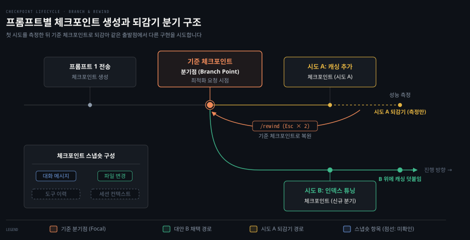
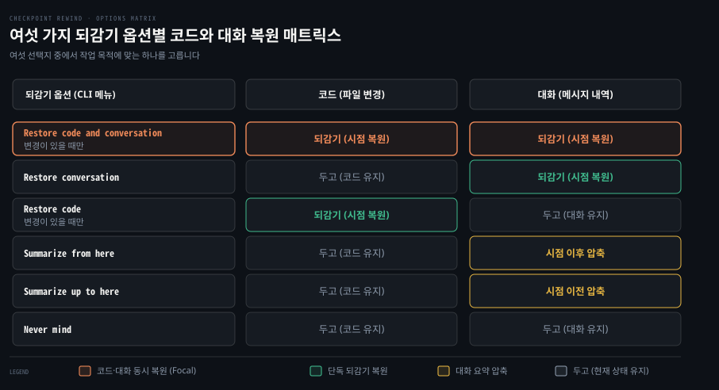
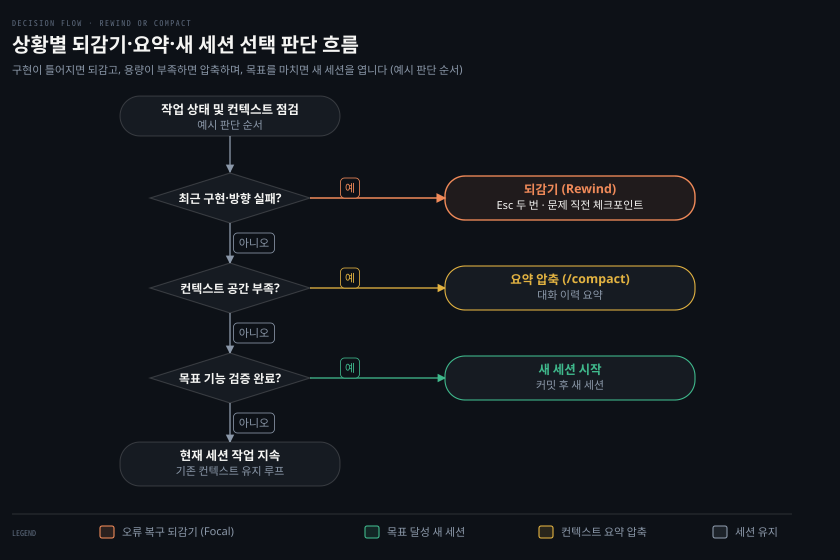

# Checkpoints
---
> 프롬프트마다 자동으로 기록되는 세션 스냅숏을 살펴보고, 코드와 대화를 원하는 시점으로 되감아 실험하고 복구하는 방법을 다룹니다.


## 핵심 요약

> 대화와 코드 상태를 특정 시점으로 되돌려 위험한 시도를 검증하고 실패를 복구합니다.

Claude Code는 사용자가 프롬프트를 보낼 때마다 대화 내역과 파일 변경 사항을 묶어 체크포인트로 자동 저장합니다. 개발자가 별도로 저장 시점을 지정하거나 명령어를 입력하지 않아도 작업 이력이 보존됩니다. 따라서 새로운 라이브러리를 도입하거나 대규모 구조 변경을 시도하다가 실패하더라도 즉시 이전 상태로 깨끗하게 되돌릴 수 있습니다.

되감기 인터페이스는 코드와 대화를 함께 되돌리는 방식뿐 아니라, 대화 기록만 지우거나 파일 변경만 취소하는 등 여섯 가지 선택지를 제공합니다. 긴 디버깅 과정에서 컨텍스트 창이 가득 찼을 때는 특정 시점 전후의 대화를 요약본으로 압축하여 메모리 공간을 확보할 수도 있습니다. 다만 셸 명령어로 지운 파일이나 서브에이전트가 단독으로 수정한 내역은 체크포인트로 복구되지 않으므로 영구 보존에는 버전 관리 도구를 함께 써야 합니다.

| 하고 싶은 일 | 쓸 것 |
|------|------|
| 체크포인트 목록 열기 | `Esc` 두 번 누르기 또는 `/rewind` |
| 코드와 대화를 모두 되감기 | 되감기 메뉴에서 Restore code and conversation 선택 |
| 코드는 두고 대화만 되감기 | 되감기 메뉴에서 Restore conversation 선택 |
| 대화는 두고 파일 변경만 되감기 | 되감기 메뉴에서 Restore code 선택 |
| 특정 시점 이후의 대화를 압축하기 | 되감기 메뉴에서 Summarize from here 선택 |
| 특정 시점 이전의 대화를 압축하기 | 되감기 메뉴에서 Summarize up to here 선택 |
| 코드 스냅숏 자동 저장 끄기 | 설정 `fileCheckpointingEnabled: false` |
| 보존 기간 조정하기 | 설정 `cleanupPeriodDays` |


## 이 문서의 기준

> 원문 저장소의 188f468 커밋과 공식 문서를 기준으로 정리했습니다.

이 문서는 원문 저장소의 커밋 188f468(2026년 10월 20일 기준)에 포함된 체크포인트 가이드와 예제 문서를 바탕으로 작성했습니다. 원문이 명시한 대상 버전은 Claude Code v2.1.302 및 v2.1.220입니다. 원문에서 기능 도입 시점을 특정한 버전 번호는 원문 표기를 그대로 남겼습니다. 2026-10-26 에 별도 검증 창이 공식 문서(code.claude.com/docs)와 설치본 2.1.310 으로 사실을 대조해 틀린 곳을 고쳤고, 찾지 못한 사실에는 `확인 필요` 주석을 남겼습니다.

체크포인트 기능의 세부 설정 키와 단축키 및 내부 동작 방식은 도구 업데이트에 따라 바뀔 수 있습니다. 사용 중인 환경에서 동작이 어긋난다면 먼저 CLI 도움말이나 공식 배포 문서를 대조해 보시기 바랍니다.


## 체크포인트가 푸는 문제

> 별도의 수동 백업 없이도 대화와 파일 상태를 안전한 기준점으로 되돌립니다.



인공지능 에이전트와 협업하여 소프트웨어를 개발할 때는 예기치 않은 코드 훼손에 항상 대비해야 합니다. 모델이 지시를 잘못 해석하여 멀쩡하던 함수를 삭제하거나, 라이브러리 버전을 임의로 바꾸어 전체 빌드가 깨지는 일이 자주 발생하기 때문입니다. 이러한 위험을 피하려고 매번 수동으로 Git 커밋을 만들거나 작업 디렉터리를 복사해 두는 방식은 작업 흐름을 끊고 번거로움을 낳습니다.

Claude Code는 이러한 불편을 해결하기 위해 **체크포인트**(checkpoint, 대화 내용과 수정된 파일 및 실행 컨텍스트를 함께 기록한 시점 스냅숏)를 제공합니다. 사용자가 프롬프트를 전송할 때마다 시스템이 자동으로 직전 상태의 스냅숏을 기록해 둡니다. 덕분에 개발자는 실패에 대한 부담 없이 과감한 리팩터링이나 실험적 기능을 마음껏 시도할 수 있습니다.

### 스냅숏에 기록되는 정보

체크포인트는 단순히 수정한 코드 파일만 저장하는 백업 도구가 아닙니다. 모델과 나눈 대화 맥락과 작업 환경 정보를 포괄하는 복합 스냅숏입니다. 구체적으로 아래 네 가지 요소가 한 세트로 묶여 디스크에 보관됩니다.

- 주고받은 모든 대화 메시지 내역
- 세션 진행 중 수정되거나 생성된 파일 변경 내역
- 세션 안에서 호출된 도구 사용 이력 <!-- 확인 필요: 공식 문서·설치본에서 찾지 못함 -->
- 모델이 참조하고 있던 세션 컨텍스트 정보 <!-- 확인 필요: 공식 문서·설치본에서 찾지 못함 -->

이처럼 파일 변경과 대화 기록이 함께 저장되기 때문에, 나중에 특정 시점으로 되돌아갔을 때 모델도 그 시점의 지식과 맥락을 그대로 이어받아 작업을 계속할 수 있습니다.

### 자동 생성과 보존 방식

체크포인트는 사용자가 명시적인 저장 명령을 내리지 않아도 자동으로 생성됩니다. 사용자가 대화창에 새로운 프롬프트를 입력하여 전송하는 순간마다 새 체크포인트가 만들어집니다.

이렇게 생성된 체크포인트는 메모리에만 머무르지 않고 대화 세션 데이터와 함께 로컬 디스크에 영구 저장됩니다. 따라서 작업 도중 터미널을 닫거나 컴퓨터를 재부팅한 뒤 나중에 세션을 재개하더라도 이전 체크포인트 목록이 그대로 보존됩니다. 생성된 체크포인트는 기본 30일 동안 보존되며, 기간이 지나면 디스크 공간 확보를 위해 자동으로 정리됩니다.

### 분기점을 통한 다각도 탐색

체크포인트는 오류 복구뿐 아니라 여러 대안을 나란히 실험할 때 **분기점**(branch point, 여러 구현 방식을 비교하기 위해 탐색을 시작하는 기준 체크포인트) 역할을 합니다.

하나의 기능에 대해 여러 가지 설계 방식이 떠오를 때, 개발자는 기준 체크포인트에서 첫 번째 방식을 시도해 봅니다. 결과가 만족스럽지 않거나 다른 방식과 비교하고 싶다면 즉시 기준 체크포인트로 **되감기**(rewind, 작업 공간과 대화를 특정 체크포인트 상태로 되돌리는 동작)를 실행합니다. 그런 다음 깨끗한 상태에서 두 번째 방식을 구현하여 두 결과의 성능과 구조를 객관적으로 비교할 수 있습니다.


## 되감기

> 단축키나 명령어로 목록을 열고 작업 목적에 맞는 복원 방식을 선택합니다.



에이전트가 잘못된 코드를 작성했거나 다른 설계를 시도해 보고 싶다면 작업 상태를 원하는 과거 시점으로 되돌려야 합니다. Claude Code는 복잡한 절차 없이 단축키나 슬래시 명령어 하나로 체크포인트 브라우저를 열어 즉시 복원 작업을 수행할 수 있게 지원합니다.

### 인터페이스 호출 방법

체크포인트 브라우저에 접근하는 방법은 두 가지입니다.

첫 번째 방법은 키보드 단축키를 이용하는 것입니다. 입력창이 비어 있을 때 `Esc` 키를 빠르게 두 번 누르면 화면에 체크포인트 탐색 인터페이스가 나타납니다.

두 번째 방법은 대화 입력창에 슬래시 명령어를 입력하는 것입니다. `/rewind` 명령어를 입력하고 실행하면 단축키와 동일한 브라우저 화면이 표시됩니다. 같은 동작을 수행하는 별칭 명령어로 `/checkpoint`와 `/undo`도 지원합니다.

화면에 열린 체크포인트 목록에는 세션에서 보낸 프롬프트가 나열되고, 프롬프트마다 파일 변경 수가 함께 표시됩니다. 방향키로 원하는 시점을 고르면 세부 복원 방식을 묻는 메뉴가 나타납니다.

### 여섯 가지 되감기 옵션

되감기 메뉴에서는 단순한 파일 복구를 넘어 대화 맥락과 파일 상태를 조합하는 여섯 가지 선택지를 제공합니다.

1. **Restore code and conversation**: 파일과 대화 내역을 모두 해당 체크포인트 시점으로 되돌립니다. 잘못된 방향으로 진행된 작업을 완전히 백지화하고 해당 시점부터 다시 시작하고 싶을 때 사용합니다.
2. **Restore conversation**: 대화 기록만 해당 시점으로 되감고, 현재 디스크에 작성된 코드 파일은 그대로 유지합니다. 코드는 원하는 대로 완성되었으나 모델과의 대화 과정이 너무 장황해졌거나 질문을 다른 방식으로 다시 던지고 싶을 때 적합합니다.
3. **Restore code**: 대화 기록은 현재 상태까지 전부 남겨 두고 파일 변경 사항만 해당 체크포인트 상태로 되돌립니다. 모델과 나눈 문제 분석이나 설계 논의 내용은 그대로 보존하면서, 실패한 코드 구현만 취소하고 다른 방식으로 작성을 지시할 때 효과적입니다.
4. **Summarize from here**: 선택한 체크포인트 시점부터 현재까지의 대화를 인공지능이 생성한 요약본으로 압축합니다. 이전 대화는 온전히 유지되면서 긴 탐색 과정만 압축되므로 컨텍스트 창 공간을 대폭 확보할 수 있습니다. 디스크의 파일은 전혀 변경되지 않으며, 원본 메시지 전문은 세션 트랜스크립트 파일에 안전하게 보존됩니다. 요약 시 특정 주제에 집중하도록 추가 지시를 전달할 수도 있습니다.
5. **Summarize up to here**: 선택한 체크포인트 이전의 모든 과거 대화를 요약본으로 압축하고, 선택 시점 이후의 최근 대화는 원본 그대로 유지합니다. 초반 탐색 배경은 간략히 줄이고 최근 작업 맥락을 세밀하게 유지하고 싶을 때 사용합니다. 디스크 파일은 변경되지 않으며 이전 메시지도 트랜스크립트에 남습니다.
6. **Never mind**: 아무것도 바꾸지 않고 메시지 목록으로 돌아갑니다.

### 복원 직후 입력창 상태

복원 방식을 선택한 직후 대화 입력창의 상태도 옵션에 따라 다르게 동작합니다.

Restore conversation이나 Summarize from here를 선택하면, 사용자가 선택했던 바로 그 체크포인트의 원래 프롬프트 내용이 대화 입력창에 자동으로 채워집니다. 사용자는 기존에 입력했던 프롬프트를 약간 수정하여 다시 전송하거나, 완전히 새로운 지시로 바꾸어 재시도할 수 있습니다. 반면 Summarize up to here를 선택하면 세션 대화의 가장 마지막 위치에 머무르며 입력창은 빈 상태로 남습니다.

### clear 명령과의 경계 완화

버전 v2.1.191 이전에는 `/clear` 명령어로 화면을 비우면 이전 대화와 상태가 영구적으로 격리되어 다시 돌아갈 수 없었습니다. 하지만 v2.1.191 이후부터는 `/clear`가 더 이상 되돌릴 수 없는 절대적 장벽으로 동작하지 않습니다.

같은 Claude Code 프로세스 안이라면 대화를 비운 이후에도 `/rewind` 목록 맨 위에 `/resume <session-id> (previous session)` 항목이 나타납니다. 이 항목을 고르면 `/clear` 이전 대화를 재개할 수 있습니다. 실수로 대화를 비웠거나 이전 세션의 코드 변경 내역이 다시 필요해진 경우라도, `/clear` 경계를 넘어 이전 시점으로 안전하게 되감을 수 있습니다.


## 보존과 설정

> 별도 구성 없이 기본 활성화되며 보존 기한과 파일 스냅숏 생성 여부를 설정합니다.

자동으로 쌓이는 체크포인트가 디스크 용량을 지나치게 차지하지 않을지, 또는 파일 스냅숏 기능을 끄거나 유지 기간을 조절할 수는 없는지 고민이 생길 수 있습니다. 기본 동작은 별도 설정 없이 작동하지만, 프로젝트 요구에 맞춰 스냅숏 생성 여부와 보존 기한을 직접 관리할 수 있습니다.

### 핵심 설정 항목

체크포인트 동작 방식을 조정하고 싶다면 프로젝트 또는 사용자 설정 파일에 아래 두 가지 키를 선언할 수 있습니다.

```json
{
  "fileCheckpointingEnabled": true,
  "cleanupPeriodDays": 30
}
```

첫 번째 설정인 `fileCheckpointingEnabled`는 파일 편집 도구가 실행되기 직전에 파일 스냅숏을 미리 생성할지 결정하는 항목입니다 (원문 기준 기본값 `true`, v2.1.119+ 필요). <!-- 확인 필요: 공식 문서·설치본에서 찾지 못함 --> 이 값이 켜져 있어야 `/rewind` 실행 시 코드를 이전 시점으로 복원할 수 있습니다. 만약 파일 복원 기능이 필요 없거나 스냅숏 생성 비용을 줄이고 싶다면 이 값을 `false`로 지정합니다.

이 설정은 대화형 설정 메뉴인 `/config`에서 **Rewind code (checkpoints)**라는 이름으로도 표시됩니다. 설정 파일을 직접 수정하는 대신 환경 변수 `CLAUDE_CODE_DISABLE_FILE_CHECKPOINTING`을 설정하여 동일하게 끌 수도 있습니다.

두 번째 설정인 `cleanupPeriodDays`는 세션 대화 기록과 체크포인트 스냅숏을 디스크에 유지할 기간을 일 단위로 지정하는 항목입니다 (기본값 `30`). 기본값인 30일이 지나면 만료된 세션과 체크포인트가 백그라운드에서 정리됩니다.

### 100개 스냅숏 유지 규칙

체크포인트 보존에서 반드시 유의해야 할 제한이 하나 있습니다. Claude Code는 디스크 공간의 무제한 증가를 방지하기 위해 파일 스냅숏을 **최근 100개의 체크포인트**까지만 보관합니다.

보존 기간인 30일이 아직 지나지 않았더라도, 하나의 세션에서 프롬프트가 누적되어 체크포인트가 100개를 넘어서면 100개보다 오래된 스냅숏 파일은 자동으로 디스크에서 삭제됩니다. 스냅숏이 삭제된 오래된 체크포인트로는 코드 복원이 불가능해질 수 있으므로, 중요한 전환점마다 버전 관리 도구에 변경 사항을 확정해 두는 습관이 필요합니다.

### 캐시 정리 주기의 일원화

버전 v2.1.117부터 `cleanupPeriodDays` 설정의 적용 범위가 대폭 확장되었습니다. 예전에는 세션 기록과 체크포인트 위주로 적용되던 보존 기한이 디스크 전반의 다양한 임시 캐시 폴더를 관리하는 공통 주기로 쓰이게 되었습니다.

구체적으로 아래와 같은 디스크 경로들이 `cleanupPeriodDays`에 지정된 기간에 맞춰 함께 정리됩니다.

- 세션 체크포인트 스냅숏
- `~/.claude/tasks/` 아래 보관된 영구 태스크 목록
- `~/.claude/shell-snapshots/` 아래 캡처된 셸 환경 스냅숏
- `~/.claude/backups/` 아래 보관된 설정 백업 (단, 최신 5개는 항상 유지)
- 세션 트랜스크립트, 파일 변경 이력(`file-history/`), 계획 문서(`plans/`), 디버그 로그(`debug/`), 복사 캐시(`paste-cache/`)

이처럼 단 하나의 설정 값으로 작업 환경 전반의 임시 파일들을 일관되게 정리해 주므로, 개발자가 수동으로 여러 디렉터리를 찾아다니며 오래된 캐시를 지우지 않아도 디스크 공간이 깔끔하게 유지됩니다.


## 한계와 git

> 셸 명령이나 외부 편집 변경은 잡지 못하므로 영구 보존은 버전 관리에 맡깁니다.

체크포인트는 세션 안에서 빠르게 코드를 실험하고 복구하는 데 최적화되어 있지만, 파일시스템의 모든 변화를 완벽하게 감지하는 만능 백업 도구는 아닙니다. 도구의 한계를 명확히 이해하지 못하면 되감기를 실행했을 때 예기치 못한 데이터 유실이나 불일치를 겪을 수 있습니다.

### 체크포인트가 추적하지 못하는 변경

체크포인트는 Claude Code 내부의 파일 편집 도구를 거쳐 일어난 수정만 스냅숏으로 기록합니다. 따라서 아래와 같은 경로로 발생한 변경은 체크포인트로 복원할 수 없습니다.

첫째, Claude 가 파일 편집 도구로 고친 적 없는 파일을 Bash 도구의 터미널 명령어로 조작하면 추적되지 않습니다. 예를 들어 에이전트가 셸에서 `rm`, `mv`, `cp` 명령어를 실행하여 파일을 지우거나 옮기거나 덮어쓴 경우, 체크포인트는 해당 파일의 이전 내용을 복원해 주지 못합니다.

둘째, Claude Code 외부에서 발생한 변경은 현재 세션이 고친 파일이 아니라면 감지되지 않습니다. 에이전트와 대화하는 도중 개발자가 직접 외부 편집기에서 코드를 수정하거나, 외부 터미널에서 스크립트를 실행해 파일을 바꾼 내역은 스냅숏에 잡히지 않습니다.

셋째, 서브에이전트가 단독으로 수정한 파일은 추적 대상에서 제외됩니다. 메인 세션이 서브에이전트를 띄워 작업을 위임했을 때, 서브에이전트가 편집한 파일은 메인 세션의 체크포인트에 기록되지 않으므로 `/rewind`를 실행해도 되돌아가지 않고 그대로 남습니다. 다만 포그라운드에서 동작하는 `context: fork` 속성의 스킬이 수정한 내역은 예외적으로 메인 세션과 동일하게 추적되어 안전하게 복원됩니다.

넷째, 심볼릭 링크나 하드 링크가 걸린 경로입니다. 버전 v2.1.216부터 `/rewind`는 추적 경로가 심볼릭 링크나 하드 링크를 통해 연결된 경우 링크 대상을 따라가서 파일을 덮어쓰거나 지우지 않고 안전하게 건너뜁니다. 복원이 끝난 뒤 링크 경로로 인해 건너뛴 파일 수가 화면에 보고됩니다.

### Git과 체크포인트의 역할 분담

체크포인트는 Git을 대체하는 도구가 아니라 상호 보완하는 안전장치입니다. 두 도구는 기록 대상, 지속성, 작동 속도 면에서 분명한 차이를 지닙니다.

| 비교 기준 | Git | 체크포인트 |
|------|------|------|
| 관리 범위 | 파일시스템 전체 상태와 디렉터리 구조 | 대화 메시지와 도구가 직접 수정한 파일 |
| 지속 기간 | 저장소에 영구 보존 | 세션 기반 및 설정 기한 (기본 30일) |
| 기록 단위 | 개발자가 명시적으로 작성하는 커밋 | 사용자 프롬프트 전송마다 자동 생성 |
| 복원 속도 | 브랜치 전환 및 리셋 과정 수반 | 단축키와 메뉴 선택으로 즉각 복원 |
| 협업 공유 | 원격 저장소를 통해 팀원과 공유 가능 | 로컬 세션 내부에서만 동작 |

두 도구를 효과적으로 조합하려면 역할 경계를 분명히 나누어야 합니다. 세부 구현을 다듬거나 디버깅하는 일상적인 작업 루프에서는 자동 체크포인트에 기대어 부담 없이 빠르게 실험합니다. 반면 여러 테스트를 통과하고 안정성이 검증된 결과물은 즉시 Git 커밋으로 확정하여 기록을 남깁니다. 중요한 리팩터링을 시작하기 전에도 먼저 깨끗한 Git 상태를 만들어 두면, 설령 체크포인트 범위를 벗어나는 셸 명령어 실수가 발생하더라도 이전 커밋으로 안전하게 복구할 수 있습니다.


## 언제 되감는가

> 가설 검증 실패와 컨텍스트 오염에 맞춰 되감기와 요약 및 세션 분리를 선택합니다.



체크포인트로 언제든 이전 상태로 돌아갈 수 있다는 사실을 알더라도, 실제 작업 흐름에서 정확히 어떤 순간에 되감기를 실행해야 하는지 판단하기 어려울 수 있습니다. 대표적인 세 가지 상황에서 최적의 작업 패턴을 살펴봅니다.

### 다중 접근법 비교

어떤 문제를 해결할 때 최선의 구현 방식이 무엇인지 미리 알기 어려운 경우가 많습니다. 이때 체크포인트를 활용하면 위험 없이 여러 방식을 구현해 보고 성능이나 가독성을 비교할 수 있습니다.

예를 들어 API 응답 지연을 줄이기 위해 최적화 작업을 진행한다고 해 봅시다. 최적화 요청을 보내면 기준 체크포인트가 자동으로 생성됩니다. 첫 번째 시도로 Redis 캐싱 계층을 추가해 성능을 측정한 뒤, 기준 체크포인트로 Restore code and conversation을 실행하여 코드를 원상 복구합니다. 이어서 두 번째 시도로 데이터베이스 인덱스 추가와 N+1 쿼리 튜닝을 적용해 보고 지연 시간을 측정합니다. 세 번째 시도로 응답 압축과 CDN 설정을 시도해 볼 수도 있습니다.

각각의 측정 결과를 비교한 뒤 가장 효과가 좋았던 두 번째 체크포인트로 다시 되감아, 그 위에 캐싱 설정을 덧붙여 최종 최적화 코드를 완성합니다. 이처럼 브랜치 포인트를 중심으로 여러 방식을 왕복하면서 최선의 구현을 찾아갈 수 있습니다.

### 안전한 리팩터링과 장애 복구

기존 시스템의 설계를 대대적으로 바꾸는 작업에서도 체크포인트가 유용합니다. 예를 들어 사용자 인증 모듈을 JWT 기반으로 전면 리팩터링하는 작업을 모델에게 지시했다고 해 봅시다.

모델이 여러 소스 코드를 대대적으로 수정한 뒤 전체 테스트를 실행했는데, 기존 OAuth 연동과 세션 만료 처리가 모두 깨져 수십 개의 테스트가 실패하는 상황이 발생할 수 있습니다. 꼬여 버린 코드를 모델에게 다시 고치라고 지시하면 코드가 더 복잡하게 엉키는 경우가 많습니다.

이때 지체 없이 `Esc` 두 번을 눌러 리팩터링 지시 직전의 체크포인트로 돌아갑니다. Restore code and conversation을 선택하면 깨끗했던 이전 상태로 즉시 복구됩니다. 그런 다음 한 번에 모든 모듈을 바꾸는 대신 계층별로 나누어 점진적으로 변경하도록 프롬프트를 다시 작성하여 안전하게 리팩터링을 마칠 수 있습니다.

### 컨텍스트 오염과 대화 관리

대화가 길어지면 모델의 컨텍스트 창이 서서히 가득 차게 됩니다. 컨텍스트 사용량이 임계치에 가까워지면 모델은 초반에 전달받은 시스템 제약이나 코딩 컨벤션을 잊어버리고 엉뚱한 코드를 생성하기 시작합니다. 겉으로는 정상적으로 동작하는 것처럼 보여도 품질이 심각하게 떨어진 결과물을 내놓을 위험이 큽니다.

원문 가이드에서는 이러한 컨텍스트 상태를 모니터링하는 도구로 `cc-context-stats`를 소개합니다. 이 도구는 작업 안전도에 따라 컨텍스트 구간을 여러 단계(현재 README 기준 여섯 단계)로 구분하여 상태 표시줄에 보여 줍니다. 설계와 구현에 안전한 녹색 구간, 새 구조 설계를 피해야 하는 노란색 구간, 작업을 서둘러 마무리하고 정리해야 하는 주황색 구간 등이 차례로 나타납니다.

컨텍스트 오염이 감지되었을 때는 상황에 따라 세 가지 대처 방안 중 하나를 골라야 합니다.

- **되감기(Rewind)**: 최근 몇 번의 대화가 완전히 잘못된 방향으로 흘러갔거나 실패한 디버깅 로그로 가득 찼다면, 문제가 시작되기 직전 체크포인트로 되감아 불필요한 대화와 코드를 완전히 잘라냅니다.
- **요약 압축(Summarize from here / up to here 또는 /compact)**: 코드는 올바르게 작성되었지만 대화 이력이 길어져 컨텍스트가 부족해질 수 있습니다. 이때는 체크포인트 메뉴에서 Summarize 옵션을 선택하거나 `/compact` 명령을 실행합니다. 앞선 시행착오와 긴 출력 결과를 요약본으로 축약하여 컨텍스트 공간을 즉시 확보할 수 있습니다.
- **새 세션 시작**: 현재 목표로 하던 기능 개발이나 버그 수정이 모두 끝나고 검증까지 완료되었다면, 되감기나 요약으로 세션을 질질 끌지 말고 작업을 커밋한 뒤 완전히 새로운 세션을 열어 깨끗한 컨텍스트에서 다음 작업을 시작합니다.


## 운영 팁과 문제 해결

> 되감기 전 수정 대상을 점검하고 100개 스냅숏 제한과 외부 도구 간섭에 대비합니다.

체크포인트를 일상적인 개발 루틴에 안정적으로 정착시키려면 몇 가지 운영 수칙과 발생 가능한 오류 상황에 대한 대처법을 알아 두어야 합니다.

### 실무 운영 모범 사례

첫째, 되감기를 실행하기 전에 브라우저 화면에 표시된 프롬프트와 파일 변경 수를 차분히 확인하시기 바랍니다. 특히 작업이 빠르게 진행되는 세션에서는 비슷한 시점에 여러 체크포인트가 생성되므로, 엉뚱한 시점으로 되감아 작성 중이던 코드를 실수로 날리지 않도록 주의해야 합니다.

둘째, 여섯 가지 복원 메뉴의 차이를 명확히 이해하고 상황에 맞춰 골라야 합니다. 코드 변경만 취소하고 대화 기록은 남겨서 실패 원인을 분석하고 싶다면 Restore code를 쓰고, 반대로 코드는 유지한 채 지시문만 고쳐 다시 묻고 싶다면 Restore conversation을 선택합니다.

셋째, 대규모 파일 이동이나 일괄 삭제 작업이 포함되어 있다면 셸 명령어를 실행하기 전에 반드시 Git에 커밋하거나 변경 사항을 따로 백업해 둡니다. 앞서 살펴보았듯이 셸 명령어로 지워진 파일은 체크포인트로 되살릴 수 없기 때문입니다.

넷째, 장시간 이어지는 세션에서는 100개 스냅숏 제한을 염두에 두어야 합니다. 중요한 구현 단계가 끝날 때마다 Git 커밋을 만들어 두면, 세션이 길어져 100개 이전의 체크포인트 스냅숏이 삭제되더라도 언제든 안정적인 커밋 시점으로 돌아갈 수 있습니다.

### 자주 발생하는 문제와 해결 방법

체크포인트 기능을 사용하다가 마주칠 수 있는 대표적인 문제와 해결 방법은 다음과 같습니다.

#### 체크포인트를 찾지 못하는 문제

- 원인 1: 세션이나 체크포인트 보존 기간이 만료되었을 수 있습니다. 설정 파일의 `cleanupPeriodDays`가 너무 짧게 지정되어 있지 않은지 확인합니다 (기본값: 30일).
- 원인 2: 프롬프트 누적으로 인해 100개 스냅숏 제한을 초과했을 수 있습니다. Claude Code는 가장 최근 100개의 스냅숏만 유지하므로, 100회 이전의 오래된 체크포인트는 스냅숏이 정리되어 복원 대상에서 빠집니다.
- 원인 3: 로컬 디스크 공간이 부족하여 스냅숏 파일이 정상적으로 쓰이지 못했을 수 있습니다. <!-- 확인 필요: 공식 문서·설치본에서 찾지 못함 --> 작업 디스크의 여유 공간을 점검합니다.

#### 되감기 복원이 실패하는 문제

- 원인 1: Claude Code 외부 편집기에서 수정한 파일 내용과 충돌이 발생했을 수 있습니다. <!-- 확인 필요: 공식 문서·설치본에서 찾지 못함 --> 외부 도구에서 열려 있는 편집 창의 저장 상태를 확인하고 작업 공간을 정리한 뒤 다시 시도합니다.
- 원인 2: 복원 대상 경로 중에 심볼릭 링크나 하드 링크가 포함되어 있을 수 있습니다. v2.1.216 이후 버전에서는 링크 대상 파일의 덮어쓰기를 자동으로 건너뛰므로, 링크로 연결된 파일은 직접 수동으로 점검해야 합니다.
- 원인 3: 로컬 저장소 내부의 체크포인트 메타데이터 파일이 예기치 못한 비정상 종료 등으로 손상되었을 수 있습니다. <!-- 확인 필요: 공식 문서·설치본에서 찾지 못함 --> 실패한 시점 바로 직전이나 직후의 다른 체크포인트를 선택하여 복원을 시도합니다.
