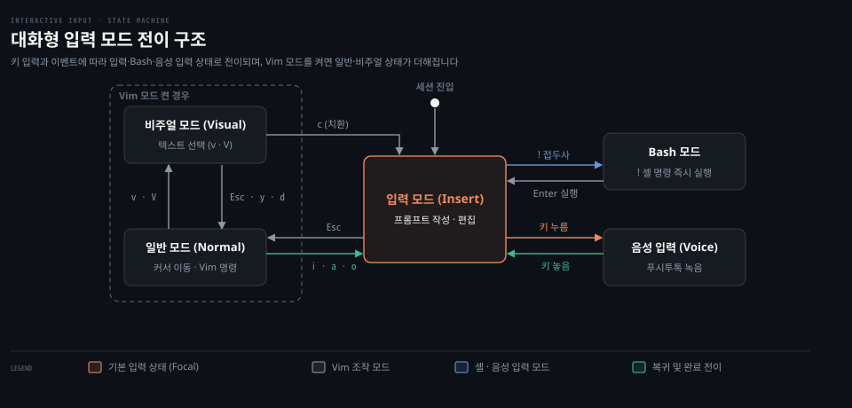
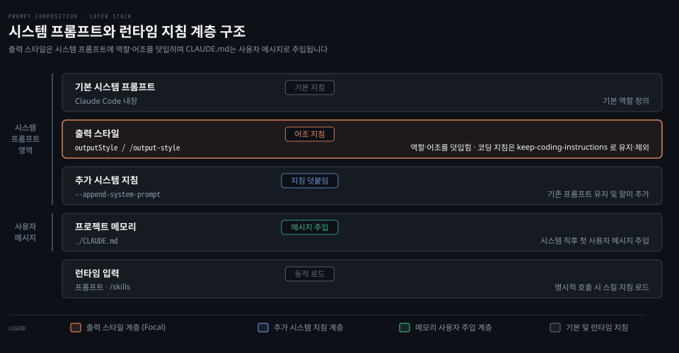
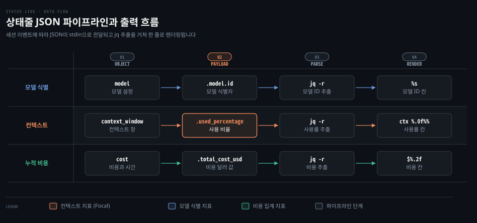
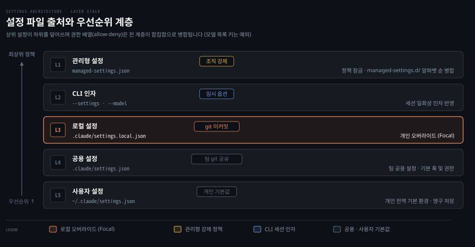

# Interactive Features·Output Styles·Status Line·Settings
---
> Claude Code 대화형 세션에서 입력을 돕는 단축키와 입력 모드, 모델 응답의 성격을 규정하는 출력 스타일, 실시간 터미널 관측을 위한 상태줄과 전체 화면 모드, 외부 시스템 연결 표면, 설정 파일 계층과 엔터프라이즈 관리형 설정을 정리합니다.


## 핵심 요약
> 대화형 환경의 편의 기능과 세션 제어 방식, 시스템 프롬프트 수준의 출력 조정, 그리고 개인과 조직 차원의 다계층 설정 구조를 함께 이해해야 도구를 안전하고 효율적으로 다룰 수 있습니다.

대화형 세션은 터미널에서 개발자와 모델이 협력하는 기본 접점입니다. 반복 입력을 줄여 주는 키 바인딩과 여러 줄 입력, 작업 상태를 보존하는 작업 목록과 프롬프트 제안은 작업 속도를 높여 줍니다. 모델의 작업 성향은 출력 스타일을 통해 시스템 프롬프트 단계에서 교정할 수 있으며 하단 상태줄과 전체 화면 모드로 토큰과 비용 소모를 실시간으로 감시할 수 있습니다. 개인 작업 환경과 조직 보안 요구는 사용자 설정부터 관리형 드롭인 파일까지 이어지는 계층 구조를 통해 조율됩니다.

| 하고 싶은 일 | 쓸 것 |
|---|---|
| 대화 중 모델 전환이나 권한 모드 변경 | 단축키 `Option+P`, `Shift+Tab` 또는 `/config` |
| 긴 프롬프트를 줄바꿈하여 작성 | `\` + Enter 또는 Option+Enter, Shift+Enter |
| 셸 명령어를 즉시 실행하고 결과를 대화에 반영 | `! <명령어>` (Bash 모드) |
| 컨텍스트 압축 뒤에도 작업 진행 목록 유지 | 작업 목록 (`Ctrl+T`, `CLAUDE_CODE_TASK_LIST_ID`) |
| 모델 응답 어조와 역할 변경 | 출력 스타일 (`/output-style`, `outputStyle` 설정) |
| 세션 하단에 모델명, 컨텍스트 사용량, 누적 비용 노출 | 상태줄 (`/statusline`, `statusLine` 설정 스크립트) |
| tmux 등 분할 화면에서 깜빡임 없는 전체 화면 구동 | 전체 화면 모드 (`/tui fullscreen`, `CLAUDE_CODE_NO_FLICKER=1`) |
| 외부 메시지를 세션으로 실시간 수신 | 채널 플러그인 (`--channels`, `allowedChannelPlugins`) |
| 브라우저 화면 검증 및 웹 요소 탐색 | Chrome 연동 (`--chrome`, `/chrome`) |
| 조직 전체에 우회 권한 금지 및 허용 모델 강제 | 관리형 설정 (`managed-settings.json`, `managed-settings.d/`) |


## 이 문서의 기준
> 원문 커밋 188f468(2026-10-20)의 스냅숏 내용을 바탕으로 작성했으며, 이후 공식 문서와 설치본 2.1.310 으로 사실을 대조해 고쳤습니다.

이 문서는 luongnv89/claude-howto 저장소의 커밋 188f468에 포함된 09-advanced-features 문서를 토대로 작성했습니다. 원문에는 v2.1.83부터 v2.1.302까지 다양한 시점에 도입된 기능과 환경 변수, 설정 키가 함께 기술되어 있습니다. 옵션을 직접 켜고 끄며 동작을 다시 시험하지는 않았습니다. 원문 저자가 정리한 스펙과 릴리스 노트로 구성한 뒤, 공식 문서와 설치본 2.1.310 으로 사실을 대조해 고쳤습니다.

따라서 사용하는 Claude Code 버전이 다르거나 배포 환경이 다를 경우 일부 명령어 문법이나 기본 설정값이 다르게 동작할 수 있습니다. 특정 키나 명령어가 원문 설명과 일치하지 않는다면 `claude --help`나 `/config --help`, 또는 사내 공식 가이드를 먼저 대조해 보아야 합니다.


## 대화형 기능
> 세션 진입 후 프롬프트를 주고받는 과정에서 입력을 제어하고 작업 흐름을 끊지 않도록 돕는 다양한 단축키와 입력 모드가 제공됩니다.

터미널 기반 대화 환경에서는 마우스 없이 키보드만으로 다양한 상태를 제어할 수 있어야 작업 흐름이 끊기지 않습니다. Claude Code는 편집 편의를 위한 단축키 체계, 사용자 맞춤 키 바인딩, 여러 줄 입력, Vim 모드, Bash 모드, 그리고 대화 맥락을 보존하는 작업 목록을 지원합니다.



### 단축키와 입력 제어
터미널 입력창에서는 표준적인 GNU Readline 단축키와 세션 제어를 위한 전용 단축키가 동작합니다. 이전 명령어 탐색, 입력 취소, 백그라운드 전환 등을 즉각 실행할 수 있습니다.

| 단축키 | 동작 설명 |
|---|---|
| `Ctrl+C` | 현재 입력 또는 모델 생성 취소 |
| `Ctrl+D` | Claude Code 세션 종료 |
| `Ctrl+G` | 외부 편집기에서 프롬프트 또는 계획(Plan) 편집 |
| `Ctrl+L` | 화면 다시 그리기 (v2.1.238부터 `/clear` 동작이 제거되고 순수 재출력만 수행) |
| `Ctrl+O` | 상세 출력(Verbose) 켜기/끄기 (모델의 추론 과정 확인) |
| `Ctrl+R` | 명령어 히스토리 역방향 검색 (v2.1.129+ 기준 전체 프로젝트 대상, 창 내부에서 `Ctrl+S`로 현재 프로젝트 한정) |
| `Ctrl+T` | 작업 목록(Task List) 뷰 열기/닫기 |
| `Ctrl+B` | 실행 중인 작업을 백그라운드로 전환 |
| `Esc+Esc` | 코드 및 대화 되돌리기(Rewind) |
| `Shift+Tab` / `Alt+M` | 권한 모드 순환 전환 |
| `Option+P` / `Alt+P` | 모델 선택 창 호출 |
| `Option+T` / `Alt+T` | 확장 사고(Extended Thinking) 켜기/끄기 |
| `Option+O` / `Alt+O` | 빠른 모드(`/fast`) 전환 |
| `Ctrl+X` `Ctrl+K` | 백그라운드 서브에이전트 전체 정지 |
| `Ctrl+Enter` (또는 `Ctrl+X` `Ctrl+S`) | 대기열 메시지 즉시 전송 (v2.1.281+부터 실행 중인 도구와 서브에이전트가 취소되지 않고 백그라운드로 이동) |
| `Ctrl+S` | 작성 중인 프롬프트 임시 보관(Stash), 다시 누르면 복원 |
| `Ctrl+_` | 프롬프트 입력창의 마지막 변경 실행 취소(Undo) |
| `:` | 단어 시작 위치에서 이모지 자동완성 호출 (v2.1.217+) |

한 줄 편집에는 표준 단축키를 씁니다. 줄 시작 이동(`Ctrl+A`)과 줄 끝 이동(`Ctrl+E`), 줄 잘라내기(`Ctrl+K`, `Ctrl+U`)를 지원합니다. 단어 삭제(`Ctrl+W`), 붙여넣기(`Ctrl+Y`), 자동완성(`Tab`), 히스토리 탐색(`↑ / ↓`)도 쓸 수 있습니다.

### 사용자 키 바인딩 설정
기본 제공되는 단축키가 셸이나 터미널 멀티플렉서와 충돌할 때는 `/keybindings` 명령으로 사용자 설정을 수정할 수 있습니다. 이 명령을 실행하면 `~/.claude/keybindings.json` 파일이 열립니다(v2.1.18+).

```json
{
  "$schema": "https://www.schemastore.org/claude-code-keybindings.json",
  "bindings": [
    {
      "context": "Chat",
      "bindings": {
        "ctrl+e": "chat:externalEditor",
        "ctrl+u": null,
        "ctrl+k ctrl+s": "chat:stash"
      }
    },
    {
      "context": "Confirmation",
      "bindings": {
        "ctrl+a": "confirm:yes"
      }
    }
  ]
}
```

특정 기본 단축키를 비활성화하려면 바인딩 값을 `null`로 지정합니다. 키 바인딩은 UI 맥락별로 격리되어 적용됩니다. 주요 맥락으로는 Chat, Confirmation, Global, Autocomplete, HistorySearch, Settings, Tabs, Help 등이 있으며 전체 27개 맥락이 제공됩니다.

연속 키를 조합하는 코드 체계도 지원합니다. 예를 들어 `"ctrl+k ctrl+s"`는 Ctrl+K를 누른 뒤 Ctrl+S를 차례로 누르는 동작을 의미합니다. 키 이름은 대소문자를 구분하지 않으므로 Shift 조합은 `shift+k`처럼 명시합니다. 인터럽트(`Ctrl+C`)와 종료(`Ctrl+D`)는 시스템 보호를 위해 재정의할 수 없는 예약 키로 묶여 있습니다. tmux의 접두어인 `Ctrl+B`나 프로세스 일시중단 키인 `Ctrl+Z`처럼 터미널 도구와 겹칠 위험이 있는 키는 환경에 맞추어 변경하는 편이 안전합니다.

### 여러 줄 입력과 Bash 모드
복잡한 요구사항이나 코드를 프롬프트에 직접 붙여넣을 때는 여러 줄 입력이 필요합니다. 입력 줄 끝에서 역슬래시(`\`)를 입력한 후 Enter를 누르거나 Option+Enter, Shift+Enter, `Ctrl+J`를 누르면 줄바꿈이 이루어집니다. 별도의 종료 표시자 없이 내용을 모두 작성한 후 Enter를 누르면 전체 내용이 한 번에 전송됩니다.

별도의 터미널 창을 띄우지 않고 셸 명령을 즉시 실행하려면 느낌표(`!`)로 시작하는 Bash 모드를 사용합니다.

```bash
! npm test
! git status
! cat package.json
```

v2.1.193부터 Bash 모드에서 파일 경로 자동완성이 지원되어 경로를 입력하는 도중 `Tab` 키로 대상 파일을 찾을 수 있습니다. v2.1.186부터 `!` 명령어의 실행 결과가 Claude의 컨텍스트로 전달되고 모델이 이에 대해 응답합니다. 모델 응답 없이 결과만 컨텍스트에 담고 싶다면 설정 파일에서 `respondToBashCommands` 값을 `false`로 지정합니다.

### Vim 모드 조작
키보드 중심의 빠른 편집을 선호하는 사용자를 위해 Vi/Vim 입력 체계가 제공됩니다. 독립 슬래시 명령이었던 `/vim`은 폐지되었으며 `/config` 메뉴의 "Editor / Vim mode" 항목이나 `~/.claude/settings.json`의 `editorMode: "vim"` 설정을 통해 활성화합니다.

Vim 모드에서는 Esc 키로 일반 모드에 진입합니다. 입력 모드는 i, a, o 키로 시작하며 비주얼 모드는 v나 V 키로 전환합니다.

| 구분 | 조작 키 | 동작 설명 |
|---|---|---|
| 기본 이동 | `h`, `j`, `k`, `l` | 좌, 하, 상, 우 커서 이동 |
| 단어 이동 | `w`, `b`, `e` | 다음 단어 시작, 이전 단어 시작, 단어 끝 이동 |
| 줄 이동 | `0`, `$` | 현재 줄의 맨 앞, 맨 끝 이동 |
| 문서 이동 | `gg`, `G` | 입력 텍스트 전체의 시작, 끝 이동 |
| 괄호 이동 | `%` | 짝이 맞는 괄호로 이동 (v2.1.301+, `d`, `c`, `y`와 조합 가능) |
| 텍스트 오브젝트 | `iw`, `aw` | 단어 내부 선택, 공백 포함 단어 선택 |
| 따옴표 오브젝트 | `i"`, `a"` | 큰따옴표 안쪽 선택, 따옴표 포함 선택 |
| 괄호 오브젝트 | `i(`, `a(` | 소괄호 안쪽 선택, 괄호 포함 선택 |

비주얼 모드(v2.1.118+)에서는 글자 단위 선택(`v`)과 줄 단위 선택(`V`)이 가능하며 선택 영역은 입력창에서 강조 표시됩니다. 이 상태에서 복사(`y`), 삭제(`d`), 치환(`c`) 명령을 직관적으로 수행할 수 있습니다.

### 작업 목록과 프롬프트 제안
복잡한 프로젝트를 장시간 수행하면 대화 컨텍스트가 한도에 도달하여 이전 기록이 요약 및 압축됩니다. **작업 목록**(task list, 컨텍스트 압축 뒤에도 유지되는 할 일 목록)은 세션 내에서 해결해야 할 작업들을 구조화하여 압축 후에도 목표를 유지하도록 돕습니다.

세션 도중 `Ctrl+T`를 누르면 작업 목록 화면이 토글됩니다. 세션 간에 동일한 작업 목록을 공유해야 할 때는 환경 변수를 설정합니다.

```bash
export CLAUDE_CODE_TASK_LIST_ID=my-project-sprint-3
```

이 환경 변수를 지정하면 지정된 식별자 경로에 작업 목록이 기록되어 여러 터미널 창이나 팀 동료 세션이 같은 작업 항목을 추적할 수 있습니다.

한편 **프롬프트 제안**(prompt suggestion, 이전 맥락을 바탕으로 명령어를 자동 추천하는 기능)은 사용자의 Git 변경 이력과 현재 대화 상황을 분석하여 유용한 후속 명령을 추천합니다. 추천된 내용은 입력창 하단에 흐린 회색 텍스트로 나타납니다. 제안된 내용이 적절하다면 `Tab`(또는 `→`)으로 입력창에 채운 뒤 `Enter`로 실행할 수 있습니다. 프롬프트 제안 기능이 불필요하다면 환경 변수 `CLAUDE_CODE_ENABLE_PROMPT_SUGGESTION=false`를 주어 끌 수 있습니다.

### 스크린 리더 접근성
시각 보조 도구를 사용하는 환경을 위해 스크린 리더 전용 일반 텍스트 렌더링 모드(v2.1.208+)가 지원됩니다. 복잡한 터미널 커서 제어와 색상 코드를 걷어내고 순수 텍스트 위주로 화면을 출력합니다.

```bash
claude --ax-screen-reader
# 또는 환경 변수
export CLAUDE_AX_SCREEN_READER=1
```

설정 파일에 영구 반영하려면 `settings.json`에 `"axScreenReader": true`를 선언하면 됩니다.


## Output Styles
> 출력 스타일은 모델이 가진 지식이 아니라 응답의 어조, 역할, 구조화 방식을 규정하는 시스템 프롬프트 변경 기능입니다.

개발을 진행하다 보면 매 턴마다 "핵심만 간단히 답해 달라"거나 "설계를 교육적으로 설명해 달라"는 요구를 반복하기 쉽습니다. **출력 스타일**(output style, 모델의 어조와 기본 역할을 규정하는 설정)은 매번 프롬프트를 덧붙이지 않고도 모델의 기본 행동 양식을 전환할 수 있도록 지원합니다.



### 시스템 프롬프트 변경 원리
출력 스타일은 사용자가 전달하는 일반 메시지가 아니라 시스템 프롬프트 영역을 직접 수정합니다. 따라서 프로젝트의 코딩 규칙이나 아키텍처 지식을 전달하는 `CLAUDE.md`와는 명확히 구분됩니다. `CLAUDE.md`는 시스템 프롬프트 뒤에 사용자 메시지 형태로 주입되는 반면 출력 스타일은 시스템 프롬프트 자체의 역할 정의를 바꿉니다.

| 기능 | 동작 방식 | 주된 사용 시점 |
|---|---|---|
| 출력 스타일 | 시스템 프롬프트를 직접 교체하거나 수정 | 매 턴 일관된 어조, 역할, 응답 형식을 지정하고 싶을 때 |
| `CLAUDE.md` | 시스템 프롬프트 뒤에 사용자 메시지로 주입 | 프로젝트 규칙, 빌드 명령, 코딩 컨벤션을 항상 인지시킬 때 |
| `--append-system-prompt` | 기존 시스템 프롬프트를 유지하면서 뒤에 추가 | 단일 실행 시 일회성 지침을 시스템 수준에서 덧붙일 때 |
| 서브에이전트 | 독자적인 시스템 프롬프트와 도구 셋으로 실행 | 별도 권한이나 역할을 가진 독립 작업자를 띄울 때 |
| 스킬 | 명시적 호출 시 특정 작업 지침을 로드 | 재사용 가능한 워크플로우나 템플릿을 실행할 때 |

스타일 파일은 세션 시작 시점에 읽힙니다. 따라서 스타일 파일을 새로 만들거나 고쳤다면 세션을 다시 시작해야 반영되며, 세션 도중 다른 스타일로 바꾸면 v2.1.251부터 다음 메시지부터 적용됩니다.

### 기본 제공 스타일 종류
Claude Code에는 개발 상황에 맞춰 선택할 수 있는 5가지 빌트인 스타일이 준비되어 있습니다.

| 스타일 | 동작 특징 |
|---|---|
| `Default` | 소프트웨어 엔지니어링 작업을 효율적으로 완료하도록 조율된 기본 시스템 프롬프트 |
| `Proactive` | 일상적인 결정에서 멈추지 않고 합리적인 가정을 세워 즉시 실행. 자율성이 높지만 권한 모드를 바꾸지는 않으므로 승인 창은 그대로 유지 |
| `Explanatory` | 단계 사이에 "Insight" 블록을 추가하여 코드 구현 배경과 설계 패턴을 상세히 설명 |
| `Learning` | 협업 기반 학습 모드. 통찰을 공유하면서 사용자가 직접 작성할 수 있도록 `TODO(human)` 주석을 남김 |
| `Concise` (v2.1.237+) | 장황한 서론과 진행 설명을 생략하고 결과물 위주로 직결. 작업 완성도는 유지하되 설명 문맥만 제거 |

### 스타일 선택과 전환 방법
스타일을 변경할 때는 대화형 메뉴인 `/config`에서 "Output style"을 선택하거나 슬래시 명령어 `/output-style <스타일이름>`을 입력합니다. 인자 없이 `/output-style`만 입력하면 현재 적용된 스타일과 사용 가능한 스타일 목록이 나타납니다.

```bash
/output-style Concise
```

원문에 따르면 `/output-style` 명령은 v2.1.73에서 지원 중단되고 v2.1.91에서 제거되었다가 v2.1.269에서 다시 복귀했습니다. <!-- 확인 필요: 공식 문서·설치본에서 찾지 못함 (v2.1.91 제거) --> 설정 메뉴를 거치지 않고 직접 설정 파일에 반영하고 싶다면 `.claude/settings.local.json` 또는 `~/.claude/settings.json`에 다음 키를 추가합니다.

```json
{
  "outputStyle": "Explanatory"
}
```

### 사용자 정의 스타일 작성
팀 고유의 어조나 업무 성격에 맞춰 새로운 출력 스타일을 정의할 수 있습니다. 사용자 정의 스타일은 Markdown 파일에 프론트매터를 선언하여 만듭니다.

저장 위치는 세 단계로 나뉩니다.
- 사용자 수준: `~/.claude/output-styles/`
- 프로젝트 수준: `.claude/output-styles/`
- 관리 정책 수준: 시스템 관리형 설정 폴더 내부의 `.claude/output-styles/`

프로젝트 스타일은 현재 작업 디렉터리부터 저장소 루트까지 존재하는 모든 `.claude/output-styles/`에서 로드됩니다. v2.1.178부터 하위 디렉터리와 상위 디렉터리에 동일한 이름의 스타일이 존재하면 현재 작업 디렉터리에 더 가까운 스타일이 우선권을 갖습니다.

```markdown
---
name: Diagrams first
description: Lead every explanation with a diagram
keep-coding-instructions: true
---

When explaining code, architecture, or data flow, start with a Mermaid diagram
showing the structure, then explain in prose.
```

| 프론트매터 키 | 목적 | 기본값 |
|---|---|---|
| `name` | 스타일 이름 (지정하지 않으면 파일명 사용) | 파일명 |
| `description` | `/config` 선택 메뉴에 표시될 설명 | 없음 |
| `keep-coding-instructions` | 기본 소프트웨어 개발 지침을 유지할지 여부 | `false` |
| `force-for-plugin` | 플러그인 전용. 플러그인 활성화 시 사용자의 설정을 덮어쓰고 강제 적용 | `false` |

`keep-coding-instructions: true` 설정은 중요한 분기점입니다. 소통 방식만 바꾸고 코딩 작업은 정상 수행해야 한다면 이 값을 `true`로 두어야 합니다. 반면 기술 글 작성 도우미나 데이터 분석처럼 소프트웨어 코딩 지침 자체가 불필요한 역할이라면 이를 생략하여 시스템 프롬프트 토큰을 절약합니다.

### 적용 범위와 토큰 영향
출력 스타일은 메인 대화 세션에만 적용됩니다. 별도의 시스템 프롬프트를 가지고 동작하는 서브에이전트에는 사용자 정의 스타일이 전파되지 않습니다. 다만 부모 세션의 시스템 프롬프트를 온전히 물려받는 세션 복제(fork)의 경우에는 예외적으로 스타일이 유지됩니다.

토큰 비용 측면에서는 스타일에 추가 지침이 포함될수록 초기 입력 토큰이 증가합니다. 다만 첫 번째 요청 이후에는 프롬프트 캐싱이 적용되므로 입력 토큰 비용의 상당 부분이 완화됩니다. 반면 Explanatory나 Learning 스타일은 답변 내용 자체가 길어지도록 유도하므로 출력 토큰 소모량이 늘어날 수 있습니다.


## Status Line·TUI
> 상태줄 스크립트를 통해 세션 비용과 컨텍스트 소모를 실시간 관측할 수 있으며, 전체 화면 TUI 모드로 터미널 깜빡임을 방지할 수 있습니다.

장시간 에이전트를 운용할 때는 누적 API 비용과 남은 컨텍스트 용량을 투명하게 파악해야 작업 중단이나 예산 초과를 방지할 수 있습니다. Claude Code는 사용자 지정 스크립트를 연결하여 하단에 상태를 표시하는 **상태줄**(status line, 세션 하단에 실행 정보를 실시간으로 띄우는 줄) 기능과, 분할 창 환경에서 화면 깨짐을 줄여 주는 전체 화면 TUI 모드를 제공합니다.



### 상태줄 동작 원리와 설정
상태줄은 외부 명령어나 스크립트를 세션 시작·새 응답 메시지·`/compact`·모드 전환 같은 이벤트마다(300ms 디바운스, 선택적으로 `refreshInterval` 주기) 실행하여 그 표준 출력 결과를 터미널 맨 아랫줄에 렌더링하는 방식으로 동작합니다. 대화형 명령어 `/statusline`을 입력하거나 설정 파일에 직접 스크립트 경로를 지정합니다.

```json
{
  "statusLine": {
    "type": "command",
    "command": "~/.claude/statusline.sh",
    "padding": 0
  }
}
```

상태줄 기능을 쓰려면 작업 공간 신뢰 승인이 필요합니다. Claude Code는 상태줄 명령어를 호출할 때 세션 상태 JSON 객체를 표준 입력으로 전달합니다. 터미널 너비에 맞게 문자열을 정렬할 수 있도록 v2.1.153부터 COLUMNS와 LINES 환경 변수도 함께 제공됩니다.

### 상태줄 JSON 입력 필드
표준 입력으로 전달되는 JSON에는 세션 식별자, 활성 모델, 비용, 컨텍스트 상태, Git 작업 공간 정보 등이 포함되어 있습니다.

| 분류 | 주요 제공 필드 |
|---|---|
| 세션 정보 | `session_id`, `session_name`, `prompt_id`, `transcript_path`, `cwd`, `version` |
| 모델 설정 | `model.id`, `output_style.name`, `effort.level`, `fast_mode`, `thinking.enabled` |
| 에이전트/입력 | `agent.name`, `vim.mode` |
| 비용과 시간 | `cost.total_cost_usd`, `cost.total_duration_ms`, `cost.total_api_duration_ms`, `cost.total_lines_added` |
| 컨텍스트 창 | `context_window.context_window_size`, `current_usage`, `remaining_percentage`, `total_input_tokens`, `used_percentage` |
| 요청 제한 | `rate_limits.five_hour.used_percentage`, `rate_limits.five_hour.resets_at` |
| 작업 공간 | `pr.number`, `pr.review_state`, `workspace.project_dir`, `workspace.added_dirs`, `workspace.git_worktree`, `workspace.repo.host` |
| 워크트리 | `worktree.name`, `branch`, `path`, `original_branch`, `original_cwd` |

### 상태줄 스크립트 작성 예시
아래는 표준 입력으로 넘어오는 JSON 데이터를 `jq` 도구로 파싱하여 모델명, 컨텍스트 사용률, 누적 비용을 한 줄로 요약해 출력하는 셸 스크립트 예시입니다.

```bash
#!/bin/bash
# ~/.claude/statusline.sh — 모델명, 컨텍스트 사용률, 비용 출력
input=$(cat)
model=$(echo "$input" | jq -r '.model.id')
used=$(echo "$input" | jq -r '.context_window.used_percentage')
cost=$(echo "$input" | jq -r '.cost.total_cost_usd')

printf '%s | ctx %.0f%% | $%.2f' "$model" "$used" "$cost"
```

스크립트가 출력한 문자열은 세션 입력창 바로 아래에 고정되어 실시간으로 갱신되므로 별도의 명령어를 입력하지 않고도 자원 소비 현황을 모니터링할 수 있습니다.

### 전체 화면 TUI 모드와 포커스 뷰
v2.1.110에 도입된 전체 화면 TUI 모드는 터미널 멀티플렉서나 창 분할 환경에서 화면이 밀리거나 깜빡거리는 현상을 제거하도록 설계되었습니다.

```bash
# 세션 내부에서 전환
/tui fullscreen
/tui default

# 세션 시작 시 전체 화면 모드로 실행
CLAUDE_CODE_NO_FLICKER=1 claude
```

전체 화면 모드에서는 화면 자동 스크롤 여부를 제어할 수 있습니다. 새로운 출력이 나올 때 자동으로 맨 아래로 이동하지 않도록 하려면 `/config`나 설정 파일에서 `autoScrollEnabled` 값을 `false`로 지정합니다.

`/focus` 명령을 사용하면 불필요한 부가 정보를 가리고 가장 중요한 대화 내용에만 집중할 수 있는 포커스 뷰가 토글됩니다. `Ctrl+O` 단축키는 상세 로그와 일반 로그 간의 전환을 담당하며 포커스 뷰 전환은 독립된 `/focus` 명령어로 분리되었습니다.


## 입력과 연결 표면
> 음성 입력, 외부 이벤트 수신 채널, 브라우저 조작, 데스크톱 앱 연계 등 터미널을 넘어 다양한 환경과 상호작용하는 확장 인터페이스를 제공합니다.

Claude Code는 터미널 키보드 입력에 머무르지 않고 음성 녹음, 메신저 이벤트 푸시, 웹 브라우저 검증, 네이티브 GUI 앱과의 연계를 아우르는 폭넓은 입출력 연결 표면을 갖추고 있습니다.

### 음성 입력
프롬프트를 직접 타이핑하기 어려운 상황이거나 장문의 아이디어를 빠르게 전달하고 싶을 때 **음성 입력**(Voice Dictation)을 사용할 수 있습니다. 세션 내에서 `/voice` 명령으로 활성화합니다.

푸시투톡 방식으로 동작합니다. 지정된 키를 누르는 동안 음성을 녹음하고 키를 놓으면 텍스트로 변환해 입력창에 넣으며, `Enter`를 눌러야 전송됩니다(`voice.autoSubmit: true`면 자동 전송). 음성 텍스트 변환은 20개 언어를 지원하며 Claude.ai 계정 인증을 거칩니다. 단축키는 `/keybindings` 설정을 통해 변경할 수 있습니다.

### 채널 연동
외부 서비스의 실시간 이벤트를 받는 통로가 **채널**(channels, 외부 이벤트 수신용 통로)입니다. 채널은 MCP 서버를 매개로 외부 서비스의 실시간 이벤트를 실행 중인 세션 내부로 밀어 넣어 주는 연구 미리보기 기능입니다. 기존처럼 주기적으로 API를 조회하는 폴링 방식이 아니라 이벤트가 발생할 때마다 세션으로 즉시 전달됩니다.

```bash
# 시작 시 채널 플러그인 구독
claude --channels plugin:telegram@claude-plugins-official

# 여러 소스 동시 구독
claude --channels plugin:discord@claude-plugins-official plugin:telegram@claude-plugins-official
```

텔레그램, 디스코드, iMessage, 커스텀 웹훅과의 연결을 지원합니다. v2.1.128부터 Pro/Max OAuth 인증 외에도 콘솔 API 키 인증 방식에서도 채널 기능을 사용할 수 있게 되었습니다. 조직 차원에서는 보안 통제를 위해 엔터프라이즈 관리형 설정을 통해 승인된 채널 플러그인 목록만 허용할 수 있습니다.

```json
{
  "channelsEnabled": true,
  "allowedChannelPlugins": [
    { "marketplace": "claude-plugins-official", "plugin": "discord" },
    { "marketplace": "claude-plugins-official", "plugin": "telegram" }
  ]
}
```

### Chrome 브라우저 연동
Chrome 연동은 로컬에 설치된 Chrome 또는 Microsoft Edge 브라우저와 통신하여 웹 페이지를 제어하고 디버깅하는 기능입니다(v2.0.73+, Claude in Chrome 확장 v1.0.36+ 필요). <!-- 확인 필요: 공식 문서·설치본에서 찾지 못함 (v2.0.73) -->

```bash
# CLI 실행 시 활성화
claude --chrome

# 세션 내부에서 활성화
/chrome
```

브라우저의 로그인 세션 상태를 공유하므로 사내 인증이 필요한 내부 관리 도구나 웹 애플리케이션 화면도 검증할 수 있습니다. 실시간 콘솔 로그 확인, DOM 요소 검사, 폼 입력 검증, 화면 상호작용의 GIF 녹화 등을 수행할 수 있습니다. Claude는 가시적인 브라우저 창에서 작업을 진행하며 로그인 화면이나 캡차를 마주치면 작업을 일시 중지하고 사용자에게 수동 입력을 요청합니다.

사이트 접근 권한은 Chrome 확장의 팝업 메뉴에서 사이트별로 승인하거나 회수할 수 있습니다. 주의할 점으로 WSL 환경이나 Bedrock, Vertex 같은 서드파티 클라우드 프로바이더 환경에서는 지원되지 않습니다. 보안상의 이유로 v2.1.290부터 프로젝트 설정 파일에서는 Chrome 연동을 활성화할 수 없으며 실행 옵션(`--chrome`), 명령(`/chrome`), 또는 사용자 전역 설정(`~/.claude/settings.json`)을 통해서만 켤 수 있습니다.

### 데스크톱 앱 연계
터미널 세션의 작업을 그래픽 환경에서 이어가고 싶을 때는 `/desktop` 명령으로 세션을 Claude Code 데스크톱 앱으로 넘길 수 있습니다. 데스크톱 앱은 macOS와 Windows 환경을 지원합니다.

데스크톱 앱은 다음과 같은 차별화된 기능을 제공합니다.
- 시각적 Diff 뷰: 파일 단위의 변경 내역을 그래픽으로 비교하고 코드 줄 단위로 피드백을 남기면 모델이 이를 반영하여 수정합니다.
- 앱 미리보기: `.claude/launch.json`에 정의된 개발 서버를 실행하고 내장 브라우저로 렌더링을 확인합니다.
- 병렬 세션 관리: Git 워크트리를 자동으로 격리하여 여러 작업 세션을 사이드바에서 동시에 운용합니다.
- 외부 커넥터 연계: GitHub PR 모니터링, Slack 채널 알림, Linear 이슈 추적, Notion 문서 조회 등의 커넥터를 연결하여 맥락을 확장합니다.


## Settings
> 사용자 개인 설정부터 저장소 공용 설정까지 다계층 구조로 관리되며, 환경 변수와 대화형 명령으로 유연하게 덮어쓸 수 있습니다.

Claude Code의 동작 방식은 여러 경로의 설정 파일과 환경 변수를 통해 세밀하게 조정됩니다. 개인 환경에 맞춘 편의 설정과 프로젝트 팀 차원에서 공유해야 하는 필수 정책을 분리하여 관리할 수 있습니다. 세부적인 설정 계층 구조와 메모리 파일과의 상호작용 순서는 [02-02.Memory](./02-02.Memory.md)를 참고할 수 있습니다.



### 설정 파일 위치와 우선순위
설정 파일은 적용 범위에 따라 네 계층으로 나뉩니다.

1. **사용자 설정**: `~/.claude/settings.json` (개인 전역 환경)
2. **프로젝트 설정**: `.claude/settings.json` (Git 저장소에 커밋되어 팀이 공유)
3. **로컬 프로젝트 설정**: `.claude/settings.local.json` (Git에 커밋하지 않는 로컬 전용)
4. **관리형 설정**: 운영체제 시스템 디렉터리의 `managed-settings.json` (엔터프라이즈 정책)

설정은 상위 계층의 값을 하위 계층이 덮어쓰는 방식으로 병합됩니다. 다만 엔터프라이즈 관리형 설정에서 잠근 항목이나 `modelPicker`처럼 병합 대신 관리형·`--settings`·사용자 설정 중 가장 높은 계층의 값이 목록 전체를 정하고 프로젝트·로컬 설정은 무시되는 일부 키는 예외 규칙을 따릅니다.

### 핵심 설정과 JSON 구조
기본적인 설정 파일에서는 권한 모드(`permissions`), 사전/사후 훅(`hooks`) 등을 선언합니다.

```json
{
  "permissions": {
    "defaultMode": "manual",
    "allow": ["Bash(git log:*)", "Read"],
    "deny": ["Bash(rm -rf:*)"]
  },
  "hooks": {
    "PreToolUse": [
      { "matcher": "Edit", "hooks": [{ "type": "command", "command": "~/.claude/hooks/eslint-fix.sh" }] }
    ],
    "Stop": [
      { "hooks": [{ "type": "command", "command": "~/.claude/hooks/notify.sh" }] }
    ]
  }
}
```

원문에 따르면 MCP 서버 정의는 `settings.json`의 키가 아닙니다. MCP 서버는 프로젝트 루트의 `.mcp.json` 파일에 정의해야 정상적으로 로드됩니다.

### 대화형 동작 제어 설정 키
개인 사용자의 대화 편의와 세션 상호작용을 제어하는 주요 설정 키들은 다음과 같습니다.

| 설정 키 | 설명과 기본 동작 |
|---|---|
| `askUserQuestionTimeout` | 사용자 질문 다이얼로그의 무응답 자동 진행 대기 시간. v2.1.200부터 자동 진행이 기본 해제되었으므로 타임아웃을 복구할 때 지정 |
| `enableArtifact` | 산출물(Artifact) 생성 도구 활성화 여부 제어 (v2.1.196+) <!-- 확인 필요: 공식 문서·설치본에서 찾지 못함 (v2.1.196) --> |
| `crossSessionInbound` | 다른 세션에서 들어오는 메시지 수신 처리 방식 (`accept`, `hold`, `refuse`). 더 엄격한 단계만 덮어쓰기 가능 (v2.1.224+) |
| `dialogExpiry` | 원격 클라이언트(Remote Control·SDK 호스트)로 전달된 다이얼로그와 보류된 세션 간 메시지 승인 다이얼로그의 응답 기한 (기본값 `"5m"`, `"60s"`, `"10m"`, `"never"` 지원, v2.1.224+) |
| `modelPicker` | `/model` 선택 메뉴에 노출할 모델 목록과 라벨 커스텀. 계층 간 병합되지 않고 관리형·`--settings`·사용자 설정 중 가장 높은 계층의 값이 목록 전체를 정하며 프로젝트·로컬 설정은 무시됨 (v2.1.243+) |
| `promptCacheTtl` | 메인 대화 세션의 프롬프트 캐시 유지 시간 지정 (v2.1.243+) |
| `subagentPromptCacheTtl` | 서브에이전트 요청의 프롬프트 캐시 유지 시간 지정 (v2.1.243+) |
| `modelPricing` | 사내 계약 단가를 등록하여 `/cost` 및 텔레메트리에 정가 대신 계약가 반영 (관리형 설정 전용, v2.1.243+) |
| `keybindingFlavor` | v2.1.261부터 사용 중단되어 효과 없음. 항상 Readline 규칙을 따름 |
| `spellcheck` | 프롬프트 입력창의 맞춤법 검사 활성화. 프로젝트 설정에서는 무시되며 사용자 설정, `--settings`, 관리형 설정에서만 로드됨 (v2.1.235+) |
| `bashOutputMaxChars` | Bash 명령 성공 출력 인라인 수신 글자 수 제한 (최대 128K 글자). 초과 시 파일로 저장되고 요약만 전달됨 (v2.1.261+) |
| `taskOutputMaxChars` | v2.1.277에서 `TaskOutput` 도구가 제거되고 일반 `Read` 도구로 대체됨에 따라 현재는 동작하지 않는 키 |
| `maxEffortLevel` | 모델의 추론 깊이(Effort Level) 상한 지정 (v2.1.267+) |
| `bashEditDiffEnabled` | Bash 명령으로 변경된 파일의 Diff를 실행 결과에 포함 (v2.1.269+) |
| `syncClaudeAiSkills` / `syncClaudeAiPlugins` | Claude.ai 계정에 활성화된 스킬과 플러그인의 터미널 자동 동기화 여부 (`false` 지정 시 동기화 차단, v2.1.275+) |
| `fallbackModel` | 주 모델 장애 또는 용량 초과 시 순차적으로 시도할 대체 모델 목록 (최대 3개, v2.1.166+ 대화형 세션 지원) |

<!-- 확인 필요: taskOutputMaxChars 와 BASH_MAX_OUTPUT_LENGTH 의 최신 버전 내 잔존 유효성 대조 필요 -->

### 환경 변수 오버라이드
설정 파일의 내용을 임시로 바꾸거나 CI/CD 자동화 스크립트에서 동작을 강제할 때는 환경 변수를 사용합니다.

```bash
# 세션 모델 및 새 세션 기본 모델
export ANTHROPIC_MODEL=claude-opus-4-8
export ANTHROPIC_DEFAULT_MODEL=claude-opus-4-8

# 사고 토큰 및 추론 수준
export MAX_THINKING_TOKENS=16000
export CLAUDE_CODE_EFFORT_LEVEL=high

# 기능 토글
export CLAUDE_CODE_DISABLE_AUTO_MEMORY=1
export CLAUDE_CODE_DISABLE_BACKGROUND_TASKS=1
export CLAUDE_CODE_ENABLE_PROMPT_SUGGESTION=false
export CLAUDE_AX_SCREEN_READER=1

# 프롬프트 캐싱 및 세션 제어
export ENABLE_PROMPT_CACHING_1H=1
export CLAUDE_CODE_TASK_LIST_ID=team-shared-task
export CLAUDE_CODE_MAX_WEB_SEARCHES_PER_SESSION=200
```

`ANTHROPIC_MODEL`처럼 환경 변수가 설정 파일의 대응 키보다 먼저 읽히는 항목이 있으므로(우선순위는 키마다 다름) 특정 세션만 다른 모델이나 리소스 한도로 실행할 때 유용합니다.

<!-- 확인 필요: CLAUDE_CODE_ENABLE_TASKS 와 CLAUDE_CODE_ENABLE_TODO_TOOLS 의 동작 범위 및 버전별 우선순위 대조 필요 -->

### 설정 관리 명령어
터미널 세션 도중 설정을 점검하거나 변경할 때는 `/config` 명령을 사용합니다. 대화형 설정 메뉴가 열려 모델, 추론 활성화 여부, 권한 모드, 출력 스타일 등을 스페이스바나 엔터키로 토글할 수 있습니다(v2.1.183+).

메뉴를 띄우지 않고 명령줄 인라인에서 즉시 설정을 바꿀 수도 있습니다(v2.1.181+, 키 목록을 보여 주는 `/config --help`는 v2.1.183+).

```bash
/config thinking=false
/config --help
```

이 인라인 문법은 대화형 세션뿐만 아니라 비대화형 모드(`-p`)나 원격 제어 세션에서도 동일하게 작동합니다.


## Managed Settings
> 엔터프라이즈 환경에서 관리자가 중앙 정책을 배포하여 위험한 권한을 잠그고 모델 사용 범위를 강제하는 메커니즘입니다.

기업 환경에서는 보안과 비용 통제를 위해 개발자가 임의로 권한을 우회하거나 고비용 모델을 남용하지 못하도록 중앙에서 통제해야 할 필요가 있습니다. **관리형 설정**(managed settings, 조직 단위로 강제하는 중앙 배포 정책)은 운영체제 수준의 정책 배포 도구나 시스템 설정 디렉터리를 통해 조직의 정책을 단단하게 적용합니다.

### 엔터프라이즈 배포 방식
플랫폼별로 엔터프라이즈 관리 도구와 연계할 수 있는 네이티브 배포 방식을 지원합니다.

| 플랫폼 | 배포 수단 | 도입 버전 |
|---|---|---|
| macOS | 관리형 Plist 파일 (MDM 프로파일 연동) | v2.1.51+ |
| Windows | 윈도우 레지스트리 (Windows Registry / GPO) | v2.1.51+ |
| Linux 및 공통 | 시스템 고정 경로의 `managed-settings.json` | v2.1.51+ <!-- 확인 필요: 공식 문서·설치본에서 찾지 못함 --> |
| 공통 모듈화 | `managed-settings.d/` 디렉터리 드롭인 | v2.1.83+ |

관리형 설정은 사용자 홈 디렉터리나 프로젝트 디렉터리가 아니라 시스템 관리자 권한이 필요한 보호된 경로에 위치합니다.
- macOS: `/Library/Application Support/ClaudeCode/`
- Linux: `/etc/claude-code/`
- Windows: `C:\Program Files\ClaudeCode\`

### 드롭인 설정 디렉터리
v2.1.83부터 시스템 디렉터리 아래 `managed-settings.d/` 폴더를 생성하고 여러 개의 JSON 파일을 나누어 배치하는 드롭인 방식을 지원합니다.

```bash
/etc/claude-code/managed-settings.d/
  00-org-defaults.json
  10-team-policies.json
  20-project-overrides.json
```

파일 이름의 알파벳 순서대로 설정을 순차 병합하므로 전사 기본 정책 위에 개발팀 정책을 얹는 모듈형 구성이 가능합니다.

### 관리형 설정 키와 제어 범위
관리형 설정에서 다루는 주요 통제 항목은 다음과 같습니다.

| 관리형 설정 키 | 통제 목적과 동작 |
|---|---|
| `permissions.disableBypassPermissionsMode` | `"disable"`로 설정하여 사용자가 권한 확인을 완전히 건너뛰는 우회 모드를 켜지 못하도록 차단 |
| `availableModels` | 사용자가 `/model` 메뉴에서 선택할 수 있는 허용 모델 목록을 특정 모델로 한정 |
| `enforceAvailableModels` | `true` 설정 시 기본 모델조차도 `availableModels` 목록 안에 포함되어야 함. 포함되지 않으면 허용 목록의 첫 번째 모델로 강제 강등 (v2.1.175+) |
| `allowedChannelPlugins` | 사내에서 승인된 채널 플러그인 목록만 허용 |
| `autoMode.environment` | 자동 모드 실행 시 신뢰할 수 있는 인프라 및 환경 제약 지정 |
| `workflowSizeGuideline` | 권고용 동적 워크플로우 크기 지침을 지정하며(어느 설정 파일에서든 가능) 설정 시 `/config` 메뉴에서 해당 행 숨김 (v2.1.219+) |
| `wslInheritsWindowsSettings` | Windows 호스트의 정책을 WSL 리눅스 셸 내부의 Claude Code로 자동 상속 (v2.1.118+) |
| `parentSettingsBehavior` | SDK 환경에서 상위 프로세스 설정과의 병합 규칙 결정 (`"first-wins"` 또는 `"merge"`, v2.1.133+) |
| `modelPricing` | 계약된 할인 단가를 등록하여 비용 보고 정확도 유지 (v2.1.243+) |

특히 `enforceAvailableModels`가 켜져 있으면 사용자의 로컬 설정이나 프로젝트 설정으로 허용 모델 목록을 임의로 확장할 수 없습니다.

### 플랫폼별 설정 파일 예시
macOS 환경에서 MDM 도구로 배포하는 Plist 형식의 관리형 설정 예시입니다.

```xml
<?xml version="1.0" encoding="UTF-8"?>
<!DOCTYPE plist PUBLIC "-//Apple//DTD PLIST 1.0//EN"
  "http://www.apple.com/DTDs/PropertyList-1.0.dtd">
<plist version="1.0">
<dict>
  <key>permissions</key>
  <dict>
    <key>disableBypassPermissionsMode</key>
    <string>disable</string>
  </dict>
  <key>availableModels</key>
  <array>
    <string>claude-sonnet-4-6</string>
    <string>claude-haiku-4-5</string>
  </array>
</dict>
</plist>
```

Linux나 크로스 플랫폼 환경에서는 `/etc/claude-code/managed-settings.json`에 동일한 구조를 JSON으로 선언하여 배포할 수 있습니다.

```json
{
  "permissions": {
    "disableBypassPermissionsMode": "disable"
  },
  "availableModels": [
    "claude-sonnet-4-6",
    "claude-haiku-4-5"
  ],
  "enforceAvailableModels": true
}
```

이와 같이 구성된 관리형 정책은 개별 사용자의 실행 옵션이나 저장소 로컬 설정보다 항상 최상위에서 우선 적용되어 전사적인 보안과 거버넌스를 보장합니다.
