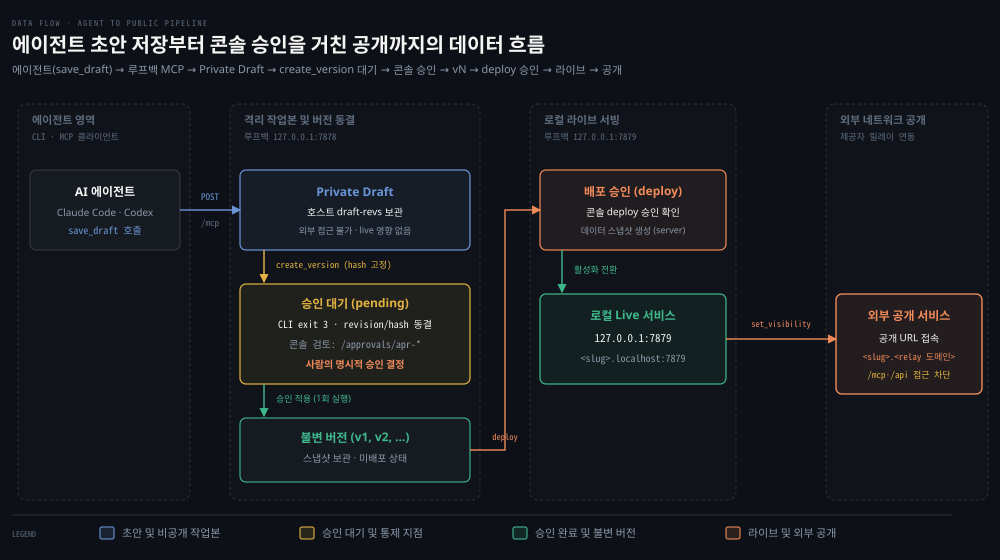
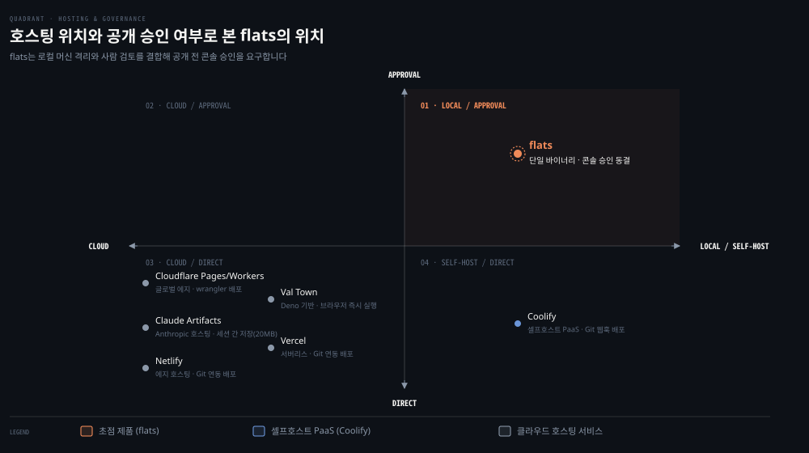

# What is Flats·비교 제품

---

> 이 문서는 에이전트가 생성한 웹 애플리케이션·문서·시각화 결과물을 로컬 기계에서 안전하게 호스팅하는 단일 Go 바이너리 flats의 문제의식과 설계 구조를 밝히고, 기존 클라우드 플랫폼 및 아티팩트 도구들과의 차별점과 한계를 비교 분석하는 개론 문서입니다.

## 학습 목표와 범위

> 학습 뒤에 검증할 수 있는 핵심 질문과 문서의 다룸 범위를 규정합니다.

1. 에이전트가 작성한 코드와 데이터의 호스팅 위치 및 승인 권한 부재가 야기하는 보안 위험을 설명할 수 있습니다.
2. flats가 제공하는 네 가지 콘텐츠 유형의 특성과 수명주기 모델(Version 모델과 Revision 모델)의 차이를 비교할 수 있습니다.
3. 로컬 격리, 사람 콘솔 승인, 명시적 네트워크 제공자 통제, 에이전트 인터페이스라는 네 가지 핵심 차별점과 각 설계의 현실적 한계를 제시할 수 있습니다.
4. Claude Artifacts, Cloudflare Pages·Workers, Vercel, Netlify, Val Town, Coolify와 flats의 기술 스택 및 거버넌스 차이를 비교표로 판단할 수 있습니다.
5. 학습 문서, 단일 HTML 시각화, 대시보드, 에이전트 결과물 공개라는 네 가지 실제 요구사항에 부합하는 적정 콘텐츠 유형을 선택할 수 있습니다.

이 문서는 flats의 기본 문제의식과 제품군 비교, 용도별 선택 기준을 다룹니다. WebAssembly 및 QuickJS 런타임의 상세 내부나 reverse tunnel 프로토콜 구현은 후속 장으로 넘깁니다.

기준 커밋 3abe537 (v0.11.0, 2026-10-17)

## 1. 문제: 에이전트가 만든 산출물을 어디에 둘 것인가

> 에이전트가 작성한 코드·데이터·비밀값을 외부 호스팅에 올릴 때 발생하는 기계 통제권 상실과 무단 공개 위험을 설명합니다.

Claude Code, Codex, Cursor 같은 현대 코딩 에이전트는 프롬프트 몇 줄로 동작하는 웹 프런트엔드, 대시보드, 경량 백엔드 API, 대화형 문서를 신속하게 만들어 냅니다. 에이전트가 결과물을 완성한 직후 개발자는 보관 딜레마에 부딪힙니다. 에이전트가 작성한 실행 가능한 애플리케이션을 안전하게 띄우고 지속해서 조회할 마땅한 인프라를 찾기 어렵기 때문입니다.

가장 흔한 선택지는 Vercel, Netlify, Cloudflare Pages 같은 상용 클라우드 호스팅 서비스입니다. 이들 서비스에 애플리케이션을 배포하면 소스 코드와 데이터베이스, API 인증 키 같은 비밀값이 외부 인프라에 상주합니다. 중앙 집중식 호스팅 서비스의 컨트롤 플레인은 외부 플랫폼 운영사의 통제 아래에 있으므로 데이터 주권이 훼손될 위험이 있습니다. flats의 README는 이에 반대되는 원칙으로 소스 코드, SQLite 데이터베이스, 영구 파일, 암호화된 비밀키를 개발자 자신의 기계에 로컬로 보관할 것을 제시합니다(`README.md:38-43`).

더 심각한 문제는 에이전트에게 부여되는 배포 권한의 통제력 상실입니다. 에이전트에게 배포 CLI나 API 토큰을 제공하면 사람이 소스 코드의 안전성을 검토하기 전에 에이전트가 임의로 배포 명령을 실행해 전 세계 인터넷에 산출물을 즉시 공개해 버릴 수 있습니다. 에이전트 워크플로우에 사람이 개입해 승인하는 게이트웨이가 없다면 민감 정보 누출을 막지 못합니다.

Claude Artifacts 같은 도구는 격리된 샌드박스와 세션 간 지속 저장소(유료 플랜 기준 개인·공유 저장소 최대 20MB)를 제공하지만 모든 연산이 Anthropic 클라우드 인프라 위에서 동작합니다. 내 기계의 로컬 파일시스템이나 로컬 독립 SQLite 데이터베이스와 직접 연동되지 않고 개발자의 로컬 도구 환경과 직접 결합해 운영하기도 어렵습니다.

flats는 이러한 통제권 상실과 고립 문제를 풀려고 출발했습니다. 외부 호스팅 업체의 중앙 제어 계층을 완전히 배제합니다("No hosted Flats control plane"). 로컬 우선 설계를 따라 개발자 자신의 개인용 기계를 에이전트 산출물의 영구 보관소로 삼습니다(`README.md:38-43`).

## 2. 산출물 형태에 따라 왜 수명주기가 달라져야 하는가

> 산출물 유형별로 변경 주체와 배포 통제 요구가 다른 이유와 네 가지 콘텐츠 모델을 설명합니다.

에이전트가 만든 산출물은 한 가지 형태가 아닙니다. 몇 주 동안 다듬어야 하는 웹 애플리케이션도 있고, 한 번 공유하고 끝나는 시각화 차트나 실시간으로 고쳐 쓰는 메모 문서도 있습니다. 모든 산출물에 똑같이 엄격한 배포 승인을 요구하면 개발 속도가 떨어집니다. 반대로 모든 산출물을 즉시 라이브에 반영하면 운영 사고가 발생합니다.

flats는 이 문제를 풀려고 산출물을 네 가지 콘텐츠 유형으로 나누고 유형마다 맞는 수명주기 모델을 배정합니다(`README.md:45-53`, `docs/spec/content-models.md:9-21`). 외부 데이터베이스나 별도의 데몬 없이 단 하나의 Go 실행 파일로 웹 콘솔, 로컬 서빙 엔진, CLI, REST API, MCP 엔드포인트를 구동합니다(`README.md:38-39`).

1. **웹사이트**(Website, `flat`): 정적 자산 묶음이거나 QuickJS WebAssembly 환경에서 동작하는 JavaScript 서버 앱, 또는 WASI preview1 서버 앱입니다. 데이터베이스와 지속적인 파일 스토리지를 갖춘 웹 서비스를 구성할 때 사용합니다.
2. **페이지**(Page, `page`): 번들된 자산과 단 하나의 `index.html` 진입점을 갖는 단일 HTML 문서입니다. 대화형 차트, 분석 보고서, 시각화 그래픽처럼 별도의 백엔드 코드나 데이터 저장이 필요 없는 독립 결과물에 적합합니다.
3. **문서**(Document, `docs`): 사람과 AI 에이전트가 실시간으로 함께 읽고 수정하는 라이브 Markdown 문서입니다. 복잡한 버전 관리나 배포 승인 절차 없이 저장하는 즉시 로컬 백그라운드 워커에서 실행됩니다.
4. **디자인**(Design, `design`): 화면 레이아웃, 랜딩 페이지 시안, 포스터, 클릭 가능한 프로토타입 아트보드를 배치하는 대화형 캔버스입니다. 변경 사항이 즉시 화면에 반영되며 캔버스 전체 단위의 리비전 이력을 보존합니다.

| 콘텐츠 유형 | 주 용도 | 반영 및 승인 방식 | 데이터 스토리지 |
|---|---|---|---|
| **Website** (`flat`) | 정적 웹사이트 및 QuickJS/WASI 샌드박스 서버 앱 | 초안 저장 및 미리보기 → 버전 생성 승인 → 배포 승인 | 로컬 SQLite (`env.DB`), 로컬 파일 (`env.FILES`) (JS server) |
| **Page** (`page`) | 단일 HTML 시각화, 차트, 인터랙티브 리포트 | 초안 저장 및 미리보기 → 버전 생성 승인 → 배포 승인 | 없음 (정적 단일 HTML 및 번들 자산) |
| **Document** (`docs`) | 실시간 협업 Markdown 문서 | 저장 즉시 실행 (초안·버전 단계 없음) | 내장 문서 앱 전용 SQLite |
| **Design** (`design`) | HTML 아트보드 캔버스 및 클릭 프로토타입 | 저장 즉시 실행 (전체 캔버스 리비전 자동 생성) | 캔버스 프로젝트 및 애셋 파일 |

수명주기 관리 방식으로 보면 네 콘텐츠 유형은 두 데이터 모델로 갈립니다(`docs/spec/content-models.md:9-21`). 웹사이트와 페이지는 **버전 모델**(Version model)을 따릅니다. 에이전트가 비공개 초안을 작성하고 운영자가 단계별로 승인해 릴리스합니다. 문서와 디자인이 따르는 **리비전 모델**(Revision model)에서는 사람과 에이전트가 실시간으로 함께 편집하고 모든 변경이 즉각 라이브 상태에 반영됩니다.

두 모델의 전이 상태와 스냅샷 관리 메커니즘은 01장 후속 편(`01-03.Version model.md`, `01-04.Revision model.md`)에서 자세히 다룹니다.

## 3. flats의 네 가지 차별점과 현실적 한계

> 로컬 단일 바이너리, 운영자 승인 통제, 명시적 공개, 에이전트 통합이라는 차별점과 각 설계가 안고 있는 한계를 밝힙니다.

기존 클라우드 PaaS나 중앙 호스팅 도구와 구별되는 flats의 설계 축은 네 가지입니다. 차별점마다 에이전트 중심 워크플로우에 맞춘 장점이 있지만 로컬 아키텍처 특유의 한계도 함께 따라옵니다.

첫째, 자기 기계 호스팅과 단일 CGO-free Go 바이너리 구조입니다(`README.md:38-39`). 외부 C 라이브러리 링크가 전혀 없는 순수 Go 바이너리로 빌드되어 macOS와 Linux 환경에서 즉시 실행됩니다. 소스 코드와 SQLite 파일은 로컬 디스크에만 머뭅니다. 시크릿 값 역시 로컬 비밀키(`<data>/secret.key`)로 AES-256-GCM 봉인되어 안전하게 저장됩니다(`docs/design.md:460-461`).

내 기계가 꺼지면 로컬에서 실행 중인 사이트와 서비스도 함께 꺼집니다. 상시 가용성을 유지하려면 계속 켜져 있는 홈 서버나 워크스테이션이 필요합니다.

둘째, 공개 전 사람의 명시적 콘솔 승인 통제입니다(`docs/design.md:470-482`). 에이전트는 독단으로 버전 생성이나 버전 삭제, 라이브 배포, 롤백, 데이터 스냅샷 복원, 공개 가시성 전환, 사이트 삭제를 수행하지 못합니다(`docs/design.md:472-476`). 모든 변경 요청은 파라미터를 고정한 채 `pending_approval` 상태로 멈추며 CLI는 종료 코드 3을 반환합니다(`README.md:93-108`).

운영자가 로컬 웹 콘솔(`http://127.0.0.1:7878`)에서 검토 링크를 열고 승인해야만 해당 동작이 1회 실행됩니다. 승인 대기 중에 초안이 변경되면 이전 승인은 무효(`stale_approval`)가 되어 잘못된 변경이 배포되지 않습니다.

위 도식은 에이전트 초안이 외부 공개 엔드포인트에 도달하기까지의 데이터 흐름을 보여줍니다. 에이전트가 `save_draft`로 저장한 초안은 비공개 격리 영역에 머뭅니다. `create_version` 승인을 거쳐야 비로소 불변 버전(`vN`)이 생성됩니다.

이후 `deploy` 승인을 받아야 `127.0.0.1:7879` 라이브 서비스로 활성화됩니다. 마지막에는 허용된 네트워크 제공자와 가시성 변경 승인을 거쳐야 외부 접속 URL이 열립니다.

승인 체계에도 분명한 보안 한계가 있습니다. flats의 승인은 사람이 결정했다는 사실을 암호학적으로 증명하지 못합니다(`docs/design.md:514-525`). 루프백 콘솔 포트(`127.0.0.1:7878`)는 요청 헤더를 근거로 로컬 프로세스를 신뢰합니다.

호스트 OS 셸 권한이 있는 에이전트는 콘솔 HTTP 요청을 위조해 스스로 승인할 수 있습니다. flats의 승인 엔진은 MCP나 CLI 표면을 사용하는 에이전트를 통제하는 방어선입니다. 운영자 권한으로 실행되는 임의 코드까지 막지는 못합니다(`docs/design.md:514-525`).

셋째, Private 기본 정책과 명시적으로 허용된 네트워크 제공자입니다(`README.md:228-253`). 설치 직후에는 오직 `127.0.0.1` 로컬 루프백만 활성화됩니다. 호스트 설정과 개별 사이트 설정에서 모두 허가받은 제공자(Portal, Tailscale 등)만 외부 경로를 엽니다.

Tailscale 사설망을 허용했더라도 인터넷 공개인 Funnel이 저절로 켜지지 않습니다. 외부 공개는 별도의 승인과 제공자 활성화를 모두 거쳐야 합니다. 다만 외부 릴레이 서버에 장애가 생기면 공개 경로가 단절될 수 있습니다.

넷째, AI 에이전트를 위한 퍼스트클래스 연동 표면입니다(`README.md:156-173`). Claude Code, Codex, Cursor 등 주요 에이전트 도구가 플러그인(`flats mcp`)이나 루프백 MCP 엔드포인트(`http://127.0.0.1:7878/mcp`)로 직접 연결됩니다. 에이전트는 `check_client`, `guide`, `get_runtime_reference` 도구를 호출해 런타임 규약을 스스로 파악합니다.

## 4. 대안 도구들과의 비교: 클라우드 종속과 승인 통제의 한계

> Claude Artifacts, Cloudflare, Vercel, Netlify, Val Town, Coolify와 flats의 호스팅 위치·런타임·데이터 저장·승인 메커니즘을 대조합니다.

에이전트가 만든 애플리케이션과 문서를 배포할 때 직면하는 가장 큰 문제는 도구마다 호스팅 위치와 데이터 통제 수준이 완전히 다르다는 점입니다. 무작정 기존 클라우드 배포 서비스를 선택하면 데이터 종속이나 예기치 않은 무단 공개 위험을 피하기 어렵습니다. 주요 대안 도구의 공식 기술 문서를 바탕으로 기술 차이를 비교합니다. 비교 축은 호스팅 위치, 서버 코드 런타임, 데이터 저장 방식, 공개 전 사람 승인 여부, 에이전트 연동 인터페이스, 외부 계정 필요 여부입니다.

| 도구 | 호스팅 위치 | 서버 코드 런타임 | 데이터 저장 | 공개 전 사람 승인 | 에이전트 연동 | 외부 계정 |
|---|---|---|---|---|---|---|
| **flats** | 내 기계 (macOS, Linux 단일 바이너리) | QuickJS on WebAssembly, WASI preview1 | 로컬 SQLite (`env.DB`), 로컬 영구 파일 (`env.FILES`) (JS server) | 필수 (콘솔 승인 대기, 파라미터 동결) | 내장 MCP (`/mcp`), 로컬 CLI, REST API | 불필요 |
| **Claude Artifacts** | Anthropic 클라우드 | Anthropic 인프라에서 실행 (Cloud code execution 필요), 로컬 FS·SQLite 접근 없음 | 세션 간 지속 저장소 (개인·공유 저장소 최대 20MB, Free 제외) | 없음 (비공개 생성 후 사용자가 공유 메뉴로 직접 공개) | Claude 웹·데스크톱, Claude Code | 필수 |
| **Cloudflare Pages / Workers** | Cloudflare 글로벌 에지 네트워크 | V8 Isolate (`workerd`, `fetch(request, env)` 형식) | Cloudflare D1 (서버리스 SQLite), KV, R2 | 없음 (`wrangler deploy` 시 즉시 배포, 분리 배포 지원) | Wrangler CLI, Cloudflare API, 공식 MCP | 필수 |
| **Vercel** | Vercel 클라우드 (글로벌 에지) | Node.js, Bun, Python, Go, Rust, Ruby, Edge Runtime 등 | Marketplace Postgres(Neon 등), Vercel Blob 등 관리형 스토리지 | 없음 (`vercel --prod` 또는 PR 병합 시 즉시 배포) | Vercel CLI, REST API, Vercel MCP | 필수 |
| **Netlify** | Netlify 글로벌 에지 네트워크 | Node.js 서버리스 함수, Deno 기반 Edge Functions | Netlify Blobs, Netlify DB(관리형 Postgres) 등 | 없음 (`netlify deploy --prod` 시 즉시 배포) | Netlify CLI, REST API, 공식 MCP | 필수 |
| **Val Town** | Val Town 클라우드 | Deno / TypeScript 서버리스 함수 (`val`) | 내장 SQLite (`https://esm.town/v/std/sqlite`), Blob 스토리지 | 없음 (코드 저장 시 즉시 활성화, Townie Normal 모드는 쓰기 전 확인) | Val Town API, 공식 MCP, Townie 에이전트 | 필수 |
| **Coolify** | 자체 서버 / VPS (셀프호스트 Docker) | Docker 컨테이너, Nixpacks, Railpack 등 | 호스트 볼륨 마운트 컨테이너 DB (PostgreSQL, SQLite 등) | 없음 (Git 웹훅 또는 대시보드 배포 클릭) | REST API (에이전트 전용 MCP 미확인) | 불필요 (셀프호스트 기준) |

Cloudflare Workers의 서버 코드와 flats의 JavaScript 핸들러는 인터페이스 모양이 같습니다. 두 플랫폼 모두 `export default { async fetch(request, env) }` 모듈 형식을 공유합니다(`README.md:185-193`).

하지만 데이터베이스 바인딩 동작은 다릅니다. Cloudflare D1은 비동기 네트워크 인터페이스(`await env.DB.prepare(...).all()`)로 응답합니다. flats의 `env.DB`는 QuickJS 샌드박스 내부의 동기식 API(`exec`, `query`)로 결과를 즉시 반환합니다.

Claude Artifacts는 Anthropic 클라우드 인프라에서 Cloud code execution을 바탕으로 렌더링합니다. 세션 간 지속 저장소(개인·공유 저장소 최대 20MB)를 제공하지만 flats처럼 개발자 기계의 로컬 파일시스템이나 로컬 독립 SQLite 데이터베이스에 직접 접근할 수는 없습니다.

위 사분면 도식은 호스팅 위치와 공개 전 승인 통제라는 두 축 위에서 각 도구의 위치를 보여줍니다. 가로축은 클라우드와 로컬을 가르고 세로축은 승인 필수 여부를 가릅니다.

대부분의 상용 클라우드와 PaaS는 좌하단(클라우드 호스팅 및 즉시 배포)에 모여 있습니다. flats는 우상단(로컬 머신 격리와 사람 승인 결합)에 있고 공개 전 콘솔 승인을 요구합니다.

| 도식 상의 항목 값 | 기술적 위치의 원문 근거 |
|---|---|
| flats (우상단: 로컬 머신, 승인 필수) | `README.md:38-39` (단일 Go 바이너리, 로컬 호스팅), `docs/design.md:470-482` (모든 배포·버전 생성·공개에 사람 승인 강제) |
| Coolify (우하단: 자체 서버/셀프호스트, 승인 없음) | Coolify 공식 문서 (자체 VPS 호스팅 지원, Git 푸시 시 웹훅을 통한 즉시 배포 구조, 셀프호스트 인프라 기준) |
| Cloudflare Pages/Workers (좌하단: 클라우드, 승인 없음) | Cloudflare 공식 문서 (글로벌 네트워크 호스팅, `wrangler deploy` 실행 시 즉시 프로덕션 배포) |
| Claude Artifacts (좌하단: 클라우드, 승인 없음) | `docs/research/claude-artifacts-design.md:114-127` (Design 타입 관찰, 2026-10-14: Anthropic 호스팅, 저장 시 즉시 버전화 및 승인 단계 부재), Anthropic 공식 가이드 (비공개 생성 후 사용자 UI 공유) |
| Vercel (좌하단: 클라우드, 승인 없음) | Vercel 공식 문서 (Vercel 인프라 호스팅, `vercel --prod` 또는 PR 병합 시 즉시 라이브 배포) |
| Netlify (좌하단: 클라우드, 승인 없음) | Netlify 공식 문서 (Netlify 인프라 호스팅, `netlify deploy --prod` 실행 시 즉시 라이브 배포) |
| Val Town (좌하단: 클라우드, 승인 없음) | Val Town 공식 문서 (Val Town 서버리스 호스팅, 웹 에디터 저장 시 엔드포인트 즉시 활성화) |

## 5. 내 상황에 맞는 용도별 콘텐츠 유형 선택과 걸림돌

> 네 가지 대표 사용 시나리오에 따른 추천 콘텐츠 유형과 실제 운영 시 마주치는 제약 사항을 제시합니다.

실제 작업 환경에서 에이전트와 협업하다 보면 어떤 유형을 골라야 할지 결정하기 어려운 순간이 옵니다. 정적 페이지로 충분한 작업에 과도하게 서버 flat을 구성하거나 실시간 협업 문서가 필요한 자리에 버전 모델을 들이면 불필요한 승인 대기와 관리 비용이 생깁니다.

### 학습 Markdown 문서 작성과 보관

- **추천 유형**: Document (`docs`)
- **선택 이유**: 저장하는 즉시 라이브 상태에 반영되어 바로 브라우저로 열람할 수 있습니다(`docs/spec/content-models.md:87-105`). 번거로운 버전 생성이나 배포 승인 절차가 전혀 없습니다. 개발자와 AI 에이전트가 Markdown 문서를 실시간으로 빠르게 편집하고 피드백을 주고받는 데 최적입니다. 로컬 실측(2026-10-15, v0.9.1) 결과 저장 명령에서 서버의 실행 완료 로그(`document saved and running`)까지 약 3초가 걸렸습니다.
- **주의할 걸림돌**: Document는 배포 단위 버전 모델이 아니라 리비전 모델로 동작합니다. 릴리스 버전을 관리하는 대신 flat 전체 리비전을 골라 롤백하거나 보존(pin)하는 구조입니다(`docs/spec/content-models.md:104-117`). 문서를 Public 상태로 전환한 뒤에는 에이전트나 사용자가 문서를 수정하는 즉시 외부 방문자에게도 변경 내용이 보입니다(`README.md:60-64`).

### 단일 HTML 시각화 및 인터랙티브 리포트 공유

- **추천 유형**: Page (`page`)
- **선택 이유**: 단일 `index.html` 파일과 이에 딸린 차트 라이브러리(Chart.js, D3 등)나 스타일 자산을 하나의 번들로 깔끔하게 묶어 호스팅할 수 있습니다. 웹사이트처럼 Private Draft와 버전 승인 단계를 거치므로 에이전트가 코드를 완성할 때까지 안전하게 미리 볼 수 있습니다.
- **주의할 걸림돌**: Page 유형은 서버 측 코드 실행이나 데이터베이스 바인딩을 지원하지 않습니다. 동적인 백엔드 계산이나 데이터 영구 저장이 필요한 대시보드에는 맞지 않습니다. 쓰임새는 클라이언트 브라우저에서 완결되는 정적 결과물로 한정됩니다.

### 데이터베이스를 갖춘 소규모 사이트와 대시보드 구축

- **추천 유형**: Website (`flat`, `kind: server`)
- **선택 이유**: `flats.json`에 `{"kind":"server"}`를 선언하면 QuickJS WebAssembly 샌드박스에서 로컬 SQLite 데이터베이스(`env.DB`)를 활용할 수 있습니다(`README.md:177-202`). 영구 문자열 파일 스토리지(`env.FILES`)도 함께 지원합니다. 배포를 승인할 때마다 배포 직전의 데이터 스냅샷이 자동으로 생성됩니다(`docs/spec/content-models.md:51-53`). 다만 일반 롤백(`rollback`)은 코드만 되돌립니다. 이전 데이터 상태까지 되돌리려면 별도의 승인 요청(`--restore-data`, `restore_data`)을 거쳐야 합니다(`README.md:213-215`).
- **주의할 걸림돌**: Node.js 표준 라이브러리는 지원하지 않고 브라우저 표준 Web API(Web Crypto, WebSocket, fetch)와 내장 SQLite API만 제공합니다. npm 패키지를 사용하려면 배포 전에 모든 의존성을 단일 JS 파일로 미리 번들링해야 합니다. 아웃바운드 `fetch`는 운영자가 명시적으로 허가한 HTTP(S) origin(스킴·호스트·포트)으로만 전송할 수 있습니다(`README.md:200-201`).

### 에이전트 산출물을 안전하게 검토한 뒤 외부에 공개

- **추천 유형**: Website 또는 Page (Version model)
- **선택 이유**: 에이전트가 코드를 여러 차례 수정하더라도 비공개 초안(Private Draft)에만 기록되고 운영 중인 라이브 환경에는 아무런 영향을 주지 않습니다. `create_version`과 `deploy` 요청마다 운영자가 웹 콘솔에서 변경된 파일과 해시를 직접 확인하고 승인 버튼을 눌러야만 배포가 성립합니다.
- **네트워크 보안과 관측 사실**: Portal 공개 주소에서 내부 관리 경로에 접근하면 GET `/mcp`와 `/api/flats`는 404 Not Found로 응답합니다. POST `/mcp` 요청 역시 본문 `method not allowed`(정적 핸들러의 POST 거절)로 반환됩니다(로컬 실측(2026-10-16, v0.9.1)). 릴레이를 거쳐 외부에서 접속하면 관리 인터페이스가 분리되고 외부 URL은 `<slug>.<relay 도메인>` 형태로 제공됩니다.

## 6. 전체 구조 학습 방향과 이 시리즈의 장 지도

> flats의 내부 아키텍처와 구현 원리를 체계적으로 탐구하기 위한 7개 장의 학습 로드맵을 안내합니다.

flats 시리즈는 7개의 장으로 구성됩니다. 사용법 나열에 그치지 않고 로컬 우선 에이전트 호스팅 플랫폼이 갖추어야 할 시스템 아키텍처와 보안 원리를 추적하는 것이 목표입니다.

00장 지도는 진입 단계입니다. flats가 해결하려는 문제의식과 외부 도구와 구별되는 차별점을 조망한 뒤 단일 Go 바이너리 내부의 프로세스 레이아웃과 패키지 간 의존성 지도를 탐색합니다.

01장 콘텐츠와 수명주기의 두 핵심 축은 Version 모델과 Revision 모델입니다. 이 축을 중심으로 불변 버전의 생성, CAS 기반 해시 검증, 에디터 리비전 보존 메커니즘을 상세히 분석합니다.

02장 서버 런타임에서는 WebAssembly 위에서 구동되는 QuickJS 임베디드 인터프리터가 어떻게 격리되는지 봅니다. WASI preview1 명령의 표준 입출력 인터페이스와 `env.DB`와 `env.FILES`를 뒷받침하는 로컬 스토리지 엔진의 동작 원리도 이 장에서 다룹니다.

03장 원격 접속은 사설망에 갇힌 로컬 flats 인스턴스를 외부 클라이언트와 안전하게 잇는 방법을 추적합니다. 대상은 8가지 네트워크 제공자의 생명주기와 portal-tunnel 역방향 터널링 릴레이 연동 구조입니다.

에이전트가 호출하는 36개 MCP 도구의 제어 흐름부터 DNS rebinding 공격을 차단하는 호스트 가드, 콘솔 CSRF 방어선, 운영자 승인 엔진이 보장하는 불변식까지는 04장 에이전트와 보안에서 검증합니다.

05장 운영은 macOS launchd 및 Linux systemd 환경의 무중단 서비스 관리, 호스트 백업과 데이터 마이그레이션 절차, 디스크 쿼터 및 서비스 관리 정책을 정리합니다(유휴 문서 워커 자원 회수는 후속 v0.11.1 #132에서 추가되었습니다).

06장 리뷰는 flats 코드베이스 전반의 구조적 장점과 설계 결함 후보를 짚어 봅니다. 실제 벤치마크 계측 결과를 바탕으로 로컬 에이전트 런타임이 기술적으로 어떻게 진화했는지도 평가합니다.

## 리뷰 노트

> 코드 분석 및 문서 검토 과정에서 확인한 설계 특이점과 불일치 사항입니다.

- `docs/design.md:514-525`: 로컬 콘솔(`127.0.0.1:7878`)은 특정 요청 헤더만 검사하며 별도 비밀번호 인증이 없습니다. 호스트 OS 셸 권한이 있는 에이전트는 curl 명령으로 헤더를 위조해 스스로 승인할 수 있습니다. 사람 승인 보장은 암호학적 증명이 아니며 프로세스 격리에 의존하는 신뢰 모델입니다.
- `README.md:185-193` vs Cloudflare Workers API: flats의 JavaScript 서버 flat은 Workers의 모듈 문법을 차용했습니다. 하지만 `env.DB` 메서드는 비동기 Promise가 아니라 QuickJS 동기식 함수(`exec`, `query`)로 동작합니다. Cloudflare D1 코드를 flats에서 실행하려면 쿼리 호출부를 동기식으로 고쳐야 합니다.
- `docs/spec/content-models.md:57-62`: 호스트 기본값으로 설정된 버전 쿼터(20개)가 가득 차면 신규 버전 생성 요청이 거부됩니다. 오래된 버전을 자동으로 정리하는 기능은 없습니다. 운영자가 콘솔에서 이전 버전을 직접 삭제하거나 에이전트가 삭제 승인을 요청해야 하므로 운영 부담이 발생할 수 있습니다.

## 자가 점검 질문

1. **질문 1**: 에이전트가 작성한 웹 애플리케이션을 Vercel이나 Cloudflare 같은 상용 클라우드에 배포할 때 발생하는 보안 및 데이터 주권 위험은 무엇이며 flats는 이를 어떻게 방어합니까?
2. **질문 2**: flats의 네 가지 콘텐츠 유형(Website, Page, Document, Design)을 두 가지 수명주기 모델(Version 모델, Revision 모델)로 분류하고 각 모델의 승인 요구사항 차이를 설명하십시오.
3. **질문 3**: flats의 `create_version` 승인 요청 시 `--revision`과 `--hash`를 함께 고정하는 이유와, 승인 대기 중 초안(Draft)이 수정되었을 때의 동작을 설명하십시오.
4. **질문 4**: flats의 콘솔 승인 메커니즘이 "사람이 결정했다"는 사실을 암호학적으로 증명하지 못하는 근본적인 이유와, 공식 문서가 제시하는 완화 방안은 무엇입니까?

## 출처와 관련 문서

- [gosuda/flats GitHub 저장소](https://github.com/gosuda/flats/tree/3abe537): 기준 커밋 3abe537 (v0.11.0, 2026-10-17)
- [Anthropic Help: What are Artifacts and how do I use them?](https://support.anthropic.com/en/articles/9487310-what-are-artifacts-and-how-do-i-use-them): Claude Artifacts 공식 가이드
- [Cloudflare Workers Documentation](https://developers.cloudflare.com/workers/): Cloudflare Workers 모듈 런타임 및 D1 바인딩
- [Vercel Documentation](https://vercel.com/docs): Vercel 배포 수명주기 및 서버리스 아키텍처
- [Netlify Documentation](https://docs.netlify.com/): Netlify 호스팅 및 배포 워크플로우
- [Val Town Documentation](https://docs.val.town/): Val Town 서버리스 런타임 및 내장 SQLite 스토리지
- [Coolify Documentation](https://coolify.io/docs): 셀프호스트 오픈소스 PaaS 아키텍처
- [00-02.Concepts.md](00-02.Concepts.md): flats의 프로세스 레이아웃과 패키지 의존 관계
- [01-01.Immutable artifact·content hash·SQLite WAL.md](01-01.Immutable%20artifact%C2%B7content%20hash%C2%B7SQLite%20WAL.md): Version 모델과 Revision 모델의 CAS 상태 전이 세부

## 정답 (자답 후 펼치기)

1. **정답 1**: 상용 클라우드에 배포하면 소스 코드, 데이터베이스, 환경 변수 비밀값이 타인의 클라우드 인프라에 상주합니다. 에이전트에게 배포 토큰이 부여된 경우에는 사람의 검토 없이 즉시 전 세계에 공개될 수 있습니다. flats는 로컬 머신에 데이터를 격리하고 에이전트의 모든 버전 생성·배포·공개 요청을 `pending_approval` 상태로 동결합니다. 운영자의 명시적 콘솔 승인을 강제해 무단 공개를 원천 차단합니다.
2. **정답 2**: Website와 Page는 Version 모델을 따릅니다. 격리된 Private Draft에서 작업한 뒤 버전 생성(`create_version`)과 배포(`deploy`)마다 각각 명시적 콘솔 승인이 필요합니다. Document와 Design이 따르는 Revision 모델에서는 별도의 초안이나 배포 승인 없이 저장 즉시 라이브에 반영됩니다. 단, 두 모델 모두 가시성 변경(비공개에서 공개, 또는 공개에서 비공개 양방향 모두, `set_visibility`)이나 flat 자체를 삭제할 때는 반드시 운영자의 콘솔 승인이 필요합니다.
3. **정답 3**: 승인 요청 시점의 파일 내용과 리비전을 정확히 동결하기 위함입니다. 승인 대기 중에 에이전트나 사용자가 초안을 새로 수정하더라도 이미 제출된 승인 요청의 동결 해시와 불일치하게 되므로 오래된 승인(`stale_approval`)으로 자동 처리되어 잘못된 코드가 배포되는 사고를 방지합니다.
4. **정답 4**: flats의 로컬 콘솔(`127.0.0.1:7878`)은 루프백 주소와 특정 요청 헤더를 신뢰하며 별도의 비밀번호나 다중 요소 인증을 요구하지 않기 때문입니다. 에이전트에게 호스트 OS의 셸 접근 권한이 있다면 임의의 HTTP 요청을 직접 전송해 스스로 승인을 적용할 수 있습니다. 공식 문서는 신뢰할 수 없는 에이전트를 별도의 OS 사용자 계정이나 격리된 머신에서 실행하여 MCP/API 통로로만 접속하도록 격리할 것을 권고합니다. 또한 Tailscale ACL이나 NetBird 정책을 설정하여 운영자의 브라우저 기기만 콘솔 도메인에 접근하도록 통제합니다(`docs/design.md:522-525`).
