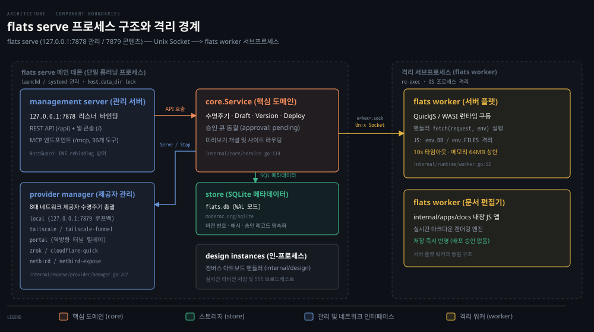
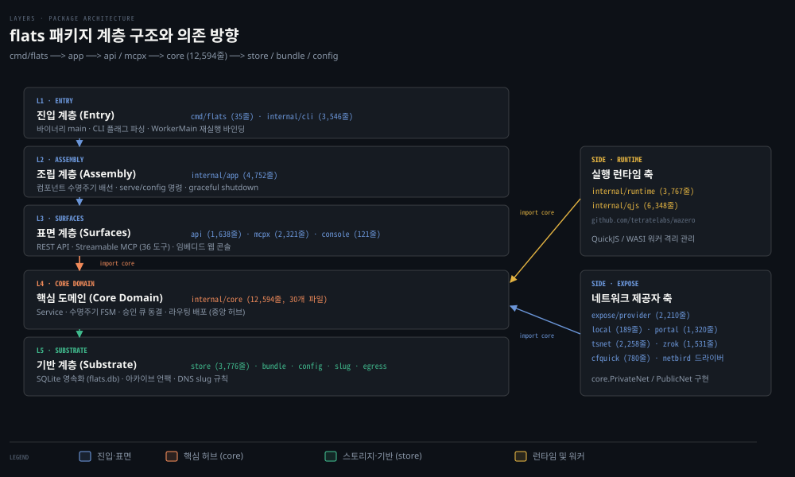

# Concepts

---

> 이 문서는 flats 코드베이스를 처음 읽거나 사용할 때 마주치는 핵심 용어와 개념, `flats serve` 단일 프로세스 내부의 컴포넌트 구성, 패키지 간의 단방향 의존 구조, 그리고 요청이 관통하는 두 가지 경로를 다루는 개념 안내서입니다.

## 학습 목표와 범위

> flats 의 핵심 용어와 수명주기 상태, 내부 프로세스 레이아웃과 패키지 의존 관계, 에이전트와 방문자 요청 흐름을 이해하고 코드로 추적할 수 있습니다.

1. flat, slug, type·kind, Draft·version, approval, worker 등 핵심 개념의 정의와 도입 이유를 설명할 수 있습니다. 각 개념의 구현 위치(`internal/core`, `internal/store` 등)를 코드로 추적할 수 있습니다.
2. Version model(Draft→Version→Deploy→Rollback)과 Revision model(저장 즉시 반영)의 차이와 각 모델이 적용되는 콘텐츠 유형의 불변 제약을 구분할 수 있습니다.
3. `flats serve` 단일 데몬 안에서 동작하는 내부 5개 컴포넌트와 자식 프로세스 `flats worker`(총 6개 항목)의 격리 관계를 프로세스 구조도로 제시할 수 있습니다.
4. `cmd/flats`에서 시작해 `internal/app`, 표면 패키지(`api`, `mcpx`), `internal/core`, 기반 패키지(`store`, `bundle`)로 이어지는 단방향 의존성과 `core` 중심 설계의 트레이드오프를 평가할 수 있습니다.
5. 에이전트의 MCP 도구 호출 경로(`127.0.0.1:7878/mcp`)와 방문자의 웹 요청 경로(`127.0.0.1:7879`)가 거치는 단계별 핵심 함수를 대조할 수 있습니다.

이 문서는 flats 의 정적 구조와 용어 체계, 패키지 지도를 다룹니다. `flats serve`의 구체적인 부팅과 정상 종료 순서는 운영 편(`05-01`)으로 넘깁니다. worker 메모리 격리는 런타임 편(`02-02`), 터널 수립은 03장, 승인 세부 흐름은 04-04 편에서 다룹니다.

기준 커밋 3abe537 (v0.11.0, 2026-10-17)

## 1. 용어 지도

> flats 의 10대 핵심 용어의 정의와 도입 이유, 구현 위치를 정리합니다.

flats 소스코드나 명령줄 도구를 처음 열면 flat, slug, Draft, revision, version, deploy, approval, provider 등 비슷해 보이는 단어들이 쏟아집니다. 이 용어들의 경계와 책임을 명확히 세우지 않으면 왜 Draft 저장은 승인 없이 즉시 수행되는데 version 생성은 승인을 거쳐야 하는지, 왜 Document 유형에는 deploy 단계가 없는지 혼란을 겪기 쉽습니다.

- **flat**과 **slug**: **flat**은 flats 호스트가 독립적으로 호스팅하고 격리하는 최소 작업 단위입니다. 웹사이트, 단일 HTML 페이지, 마크다운 문서 묶음, 디자인 캔버스가 모두 flat에 속합니다. 각 flat을 고유하게 식별하는 소문자 이름을 **slug**라고 부릅니다. 여러 독립 사이트를 단일 호스트 머신에서 서비스하려면 충돌 없는 도메인 라벨과 데이터 폴더 식별자가 필요합니다. slug는 RFC 1035 규격 호환을 위해 3자 이상 54자 이하의 소문자 영숫자와 단일 하이픈 규칙을 따릅니다. 최대 길이를 54자로 제한한 이유는 미리보기용 난수 서브도메인 접미사(`-` 및 8자리 영숫자)가 붙었을 때 단일 DNS 라벨 한도인 63바이트를 넘지 않게 하려는 것입니다(`internal/slug/slug.go:13-44`). 전체 flat을 관리하는 중앙 서비스 구조체는 `internal/core/service.go:114`의 `Service`입니다.

- **type**과 **kind**: **type**은 flat의 콘텐츠 데이터 모델 형식(`flat`, `docs`, `page`, `design`)을 결정하며 **kind**는 실행 방식(`static`, `server`)을 가리킵니다. 순수 정적 파일 호스팅과 QuickJS/WASI 엔진 기반 백엔드 서비스는 격리 수준과 프로세스 수명주기가 완전히 다릅니다. flats는 flat을 최초 생성할 때 type을 영구 고정하며 이후 다른 형식으로 변경하려는 요청을 엄격히 거부합니다(`internal/core/flattype.go:13-15` `ErrTypeChange`). type 상수는 `internal/contenttype/contenttype.go:7-10`에 정의되어 있고 실행 모드인 kind 규격은 `docs/design.md` 「Manifest」에 명시되어 있습니다.

- 두 콘텐츠 모델 (**Version model**과 **Revision model**): flats는 콘텐츠의 협업 성격에 따라 두 가지 상호 배타적인 데이터 모델을 제공합니다(`docs/spec/content-models.md:9-21`). 웹사이트(`flat`)와 페이지(`page`)는 에이전트가 완성도를 높여 빌드한 뒤 사람이 검토 후 공개해야 하므로 Version model을 따릅니다. 사람과 에이전트가 실시간으로 문장을 수정하는 문서(`docs`)와 캔버스(`design`)는 즉각적인 피드백이 핵심이라 Revision model을 따릅니다. 이 모델에서는 배포 승인 절차 없이 수정 사항이 즉시 live에 반영됩니다.

- **Draft**, **version**, **deploy**, **live**, **preview**: Version model의 상태 전이 단계들입니다. **Draft**는 배포되지 않은 작업 복사본으로 항상 비공개로 유지됩니다(`internal/core/lifecycle.go:1734` `SaveDraft`, `docs/spec/content-models.md:24`). **version**은 승인을 거쳐 확정 번호(`v1`, `v2`, ...)를 부여받은 불변 스냅샷입니다(`internal/core/lifecycle.go:1686` `CreateVersion`). **deploy**는 특정 version을 실제 서빙 대상인 **live** 상태로 승격하는 원자적 활성화 작업입니다(`internal/core/service.go:1337` `Deploy`). **preview**는 임의의 난수 호스트(`http://<slug>-<8자리>.localhost:7879`)에 띄우는 임시 엔드포인트입니다(`internal/core/service.go:1988` `OpenPreview`). 방문자 트래픽과 격리된 상태에서 특정 버전이나 Draft를 검증합니다. 문서 flat은 이 단계들을 건너뛰고 `internal/core/document.go:207`의 `SaveDocument`를 거쳐 즉시 live로 반영됩니다.

- **approval** (승인): 버전 생성, 배포, 롤백, 데이터 복원, 공개 범위 변경, flat 삭제처럼 서비스에 큰 영향을 미치는 작업을 대기 상태(`pending`)로 묶어 두는 객체입니다. 에이전트나 API 호출이 임의로 서비스를 외부에 노출하거나 데이터를 되돌리지 못하도록 막는 안전장치입니다. 승인 요청 시점의 대상 revision, hash, base_version, expected_live, visibility, providers 등이 동결됩니다(`docs/design.md` 「Approvals」). 검토 도중 Draft가 변경되면 승인 집행 시점에 `stale_approval` 충돌 오류를 내며 실행이 거부됩니다. 로컬 실측(2026-10-18)에서도 `create-version` 요청 시 종료 코드 3과 함께 `http://127.0.0.1:7878/approvals/apr-...` 승인 URL이 반환되고 요청 시점의 모든 파라미터가 동결됨이 확인되었습니다. 승인 집행은 `internal/core/service.go:1875`의 `Decide` 메서드가 담당합니다.

- **two listeners** (**management listener** vs **local listener**): flats 데몬이 바인딩하는 두 개의 분리된 로컬 TCP 리스너입니다. **management listener**는 관리용 REST API, MCP 엔드포인트(`/mcp`), 웹 콘솔을 서빙하는 기본 `127.0.0.1:7878` 포트입니다(`internal/config/config.go:82`). **local listener**는 실제 호스팅되는 콘텐츠 웹사이트와 문서를 서빙하는 기본 `127.0.0.1:7879` 포트입니다(`internal/config/config.go:84`). 관리 권한 엔드포인트와 일반 방문자 웹 페이지를 동일한 오리진과 포트에 서빙하면 악성 웹 스크립트나 외부 사이트가 DNS rebinding이나 교차 출처 요청으로 관리자 권한을 탈취할 수 있습니다. flats는 두 포트를 분리하고 Host 헤더를 엄격히 검증합니다. 로컬 실측(2026-10-18)에서도 두 포트가 루프백 상에서 완전히 독립된 HTTP 서버로 기동됨을 확인했습니다.

- **provider**, **grant**, **visibility**: **provider**는 콘텐츠를 외부에 노출하는 네트워크 제공자입니다(`README.md:228-253`). 8개 제공자(`local`, `tailscale`, `portal`, `zrok` 등)를 지원합니다. **grant**는 개별 flat의 제공자 사용 권한이며 **visibility**는 공개 범위(`private` vs `public`)입니다. 모든 flat은 비공개로 시작합니다. 호스트가 허용하고 flat에 grant가 부여된 상태에서 운영자 승인을 거쳐야 외부로 공개됩니다(`internal/core/service.go:1730` `SetVisibility`).

- **worker**: 동적 서버 flat(`kind: server`)이나 문서 편집기 코드를 실행하는 독립 자식 프로세스입니다(`cmd/flats/main.go:17` `cli.Worker = runtime.WorkerMain`). QuickJS 엔진이나 WASI 코드가 오작동해도 메인 데몬(SQLite, 라우터)이 멈추지 않도록 OS 프로세스로 격리합니다(`internal/runtime/worker.go:52` `WorkerMain`). 로컬 실측(2026-10-18)에서도 실행 중인 문서 2개에서 정확히 2개의 `flats worker` 자식 프로세스가 기동되어 소켓 통신함을 확인했습니다.

## 2. 한 프로세스 안의 구성

> 단일 flats serve 프로세스 트리의 6대 구성요소(내부 5개 컴포넌트와 자식 프로세스 워커)의 격리 배치를 분석합니다.

단일 실행 파일 하나로 전체 시스템을 운영할 때 각 컴포넌트의 책임과 프로세스 경계가 어떻게 나뉘는지 살펴봅니다. `flats serve` 명령을 실행하면 여러 개의 마이크로서비스나 외부 데이터베이스 컨테이너 없이 단 하나의 실행 파일이 백그라운드 데몬으로 기동됩니다.

`docs/design.md` 「Process layout」에 정의된 프로세스 트리는 5개의 내부 구성요소와 1개의 자식 프로세스군(총 6개 항목)으로 나뉩니다.

1. **`core.Service` (`internal/core`)**: flat의 메타데이터, Drafts, 버전 생성, 배포, 롤백, 미리보기 호스트 개설, 승인 큐 동결, 리비전 이력을 총괄하는 핵심 도메인 허브입니다. 모든 비즈니스 규칙과 불변 조건이 이 서비스 계층에서 집중 처리됩니다.
2. **`store` (`internal/store`)**: SQLite 기반 메타데이터 저장소입니다. CGO 의존성이 없는 순수 Go SQLite 드라이버(`modernc.org/sqlite`)를 사용하며 동시 읽기 성능을 위해 WAL(Write-Ahead Logging) 모드로 `<data>/flats.db` 파일을 관리합니다.
3. **`provider manager` (`internal/expose/provider`)**: 8개 네트워크 제공자의 등록과 수명주기를 통제합니다. 로컬 루프백부터 Tailscale, NetBird, Portal, zrok 등을 지원합니다.
4. **`management server`**: 루프백 주소 `127.0.0.1:7878` 및 설정된 콘솔 도메인에 바인딩되는 관리 HTTP 서버입니다. REST API(`/api`), 콘솔 API(`/console/api`), 에이전트용 MCP 엔드포인트(`/mcp`), 그리고 웹 관리 콘솔(`/`)을 하나의 멀티플렉서에서 제공합니다(`internal/app/serve.go:548-555`).
5. **`design instances` (`internal/design`)**: 인-프로세스 핸들러입니다. 캔버스 기반 HTML 아트보드를 실시간 렌더링하고 편집 이벤트를 중계합니다.
6. **`server-flat workers` (`internal/runtime`)**: `flats worker` 자식 프로세스들입니다. 동적 서버 flat 버전이나 실행 중인 마크다운 문서마다 1개씩 할당됩니다. 메인 바이너리 자체를 인자(`worker`)와 함께 재실행(re-exec)하여 띄우며 메인 프로세스와는 비공개 유닉스 도메인 소켓(`w<hex>.sock`)으로 통신합니다.

호스트는 기동될 때 `<data>/flats.lock` 파일 락을 획득하고 기존 flat 상태를 복원합니다. 종료 신호를 받으면 5초간 관리 서버를 드레인하고 워커와 네트워크를 안전하게 닫습니다. 이 시작과 종료의 구체적인 절차는 운영 편(`05-01`)에서 다룹니다.

위 도식은 단일 `flats serve` 데몬이 메타데이터와 관리 엔드포인트를 내부 메모리에 품고 서버 플랫과 문서는 독립 워커로 격리하는 구조를 보여줍니다. 관리 통신(`127.0.0.1:7878`)과 콘텐츠 통신(`127.0.0.1:7879`)이 포트 수준에서 분리됩니다. 동적 런타임은 유닉스 소켓으로 메인 데몬과 안전하게 연결됩니다.

## 3. 패키지 지도와 의존 방향

> Go 패키지들의 import 관계를 통해 `core` 중심의 단방향 아키텍처와 패키지별 규모를 파악합니다.

flats는 복잡한 호스팅 시스템이지만 순환 참조 없이 단일 바이너리로 컴파일됩니다. 소프트웨어 아키텍처가 유지보수 가능하려면 상위 정책이 하위 세부 구현에 휘둘리지 않아야 합니다.

`go list -f '{{.ImportPath}} {{.Imports}}' ./...` 명령으로 패키지 관계를 직접 확인했습니다. 모든 컴포넌트가 중앙의 `internal/core`를 향해 모여드는 명확한 단방향 계층 구조를 이룹니다.

1. **진입 계층**: `cmd/flats`는 바이너리의 `main` 진입점으로 단 35줄로 구성됩니다. 플래그 처리 패키지 `internal/cli`, 런타임 조립 패키지 `internal/app`, 워커 실행 루틴 `internal/runtime`만을 참조합니다.
2. **조립 계층**: `internal/app`은 전체 시스템의 부트스트랩과 의존성 주입을 담당하는 오케스트레이터입니다. `api`, `core`, `expose/*`, `mcpx`, `runtime`, `store`, `console`, `apps/docs`를 모두 import하여 하나의 완성된 호스트 서버로 조립합니다.
3. **표면 계층**: 외부 요청을 가장 먼저 맞이하는 프로토콜 어댑터들입니다. REST API를 제공하는 `internal/api`(1,638줄), Streamable HTTP MCP를 제공하는 `internal/mcpx`(2,321줄), 그리고 정적 웹 UI 에셋을 서빙하는 `internal/console`(121줄)이 여기에 속합니다.
4. **핵심 도메인**: `internal/core`는 30개 파일(일반 빌드 29개, 테스트 빌드 태그 1개 포함), 총 12,594줄에 달하는 flats의 중심 엔진입니다. `core`는 상위 계층인 `api`, `mcpx`, `console`, `app`을 전혀 import하지 않습니다. 구체적인 워커 프로세스 관리 패키지인 `runtime`조차 import하지 않고 `RuntimeSpec`과 `Instance` 인터페이스를 자체 선언하여 의존성을 역전시킵니다.
5. **실행 런타임 축**: `internal/runtime`(3,767줄)은 `core`의 런타임 인터페이스를 구현하며 QuickJS 바인딩 패키지인 `internal/qjs`(6,348줄)와 WebAssembly WASI 엔진인 `wazero`를 구동합니다.
6. **네트워크 제공자 축**: `internal/expose/provider`(2,210줄)와 어댑터들(`local`, `portal`, `tsnet` 등)이 속합니다. `core.PrivateNet`과 `core.PublicNet` 인터페이스를 구현합니다. 어댑터들(`local`, `portal`, `tsnet`)은 내부 패키지 중 오직 `core`에만 의존합니다.
7. **기반 계층**: `internal/store`(3,776줄)는 순수 SQLite 데이터베이스 입출력만을 전담하며 `core`에 의존하지 않습니다. `internal/bundle`(1,769줄), `internal/config`(1,693줄), `internal/design`(2,244줄)이 하위 기반을 이룹니다. 여기에 `internal/egress`(399줄), `internal/site`(208줄), `internal/slug`(66줄)가 최하위 유틸리티로 붙습니다.

패키지별 비테스트(non-test) Go 소스 코드 줄 수를 직접 측정한 결과는 아래 표와 같습니다:

| 패키지 경로 | 파일 수 | 비테스트 줄 수 | 주요 역할 및 책임 |
|---|---|---|---|
| `cmd/flats` | 1 | 35 | 바이너리 진입점, 서브커맨드 라우팅 및 WorkerMain 연결 |
| `internal/cli` | 11 | 3,546 | CLI 서브커맨드 구현, 플래그 파싱, 터미널 출력 포맷팅 |
| `internal/app` | 10 | 4,752 | 호스트 기동(`Serve`), 설정 조립, 시그널 처리 및 graceful shutdown |
| `internal/api` | 5 | 1,638 | 관리용 REST API 핸들러, JSON 인코딩, HostGuard 보안 필터 |
| `internal/mcpx` | 11 | 2,321 | Streamable HTTP MCP 서버 구현, 36개 에이전트 도구 디스패치 |
| `internal/console` | 1 | 121 | 임베디드 웹 관리 콘솔 SPA 정적 파일 서빙 |
| `internal/core` | 30* | 12,594 | 도메인 모델, Draft/버전 FSM, 승인 큐 동결, 사이트 라우팅 허브 |
| `internal/store` | 14 | 3,776 | SQLite 스키마 마이그레이션, WAL 쿼리, 리비전/버전 영속화 |
| `internal/runtime` | 7 | 3,767 | 워커 서브프로세스 스폰, 유닉스 소켓 리버스 프록시, 수명 관리 |
| `internal/qjs` | 16 | 6,348 | wazero 기반 WASI 환경에서 QuickJS C 엔진 실행 및 JS 바인딩 |
| `internal/expose/provider` | 3 | 2,210 | 8개 네트워크 제공자 레지스트리 및 통합 인터페이스 제어 |
| `internal/expose/tsnet` | 4 | 2,258 | Tailscale 임베디드 노드(`tsnet`) 라이브러리 연동 및 인증 |
| `internal/expose/portal` | 2 | 1,320 | Portal SDK 연동, 역방향 터널링 및 공개 라우트 제어 |
| `internal/expose/zrok` | 3 | 1,531 | OpenZiti zrok REST SDK 연동 및 셰어 생성 |
| `internal/expose/cfquick` | 1 | 780 | Cloudflare Quick Tunnel 연동 및 임시 공개 도메인 발급 |
| `internal/expose/local` | 1 | 189 | 루프백 `*.localhost` Host 헤더 기반 서브도메인 라우터 |
| `internal/bundle` | 3 | 1,769 | tar/zip 아카이브 압축 해제, 파일 제한 검증, 콘텐츠 해시 계산 |
| `internal/config` | 3 | 1,693 | `config.json` 스키마 정의, 기본값 설정 및 유효성 검증 |
| `internal/design` | 6 | 2,244 | 캔버스 아트보드 파싱, 실시간 SSE 브로드캐스트, 리비전 관리 |
| `internal/egress` | 1 | 399 | 워커의 아웃바운드 HTTP 요청 검증, 사설망 IP 대역 접근 차단 |
| `internal/site` | 1 | 208 | 정적 파일 서빙(`Static`), SPA 라우팅 폴백, ETag 계산 |
| `internal/slug` | 1 | 66 | flat slug 바이트 루프 검증(`slug.go:24-47`), 미리보기 8자리 난수 호스트명 생성 |

\* `internal/core` 파일 수에는 테스트 빌드 전용 파일(`lifecycle_hooks_testbuild.go`, `//go:build lifecycle_testhooks`) 1개가 포함되어 있으며, 일반 빌드 기준은 29개 파일입니다.

단방향 구조의 이점은 핵심 규칙과 불변 조건이 `core` 패키지 한곳에 모여 무결성이 보장된다는 점입니다. 반면 그 대가로 `core` 패키지 크기가 12,594줄로 팽창합니다. `Service` 구조체가 락 관리, 상태 캐시, 이벤트 발행, 스토리지 입출력 등 수많은 책임을 한 몸에 짊어지는 결합도 집중 현상이 발생합니다.

위 도식은 진입점 `cmd/flats`에서 시작해 조립 계층 `app`, 표면 계층 `api`/`mcpx`, 중앙 `core`와 기반 스토리지 계층으로 이어지는 수직 스택을 보여줍니다. 모든 외부 인터페이스와 실행 런타임, 네트워크 제공자가 `core`의 상위 계층 역할을 하며 역방향 참조 없이 단방향으로 의존하는 구조를 확인할 수 있습니다.

## 4. 요청 하나가 지나가는 길 두 개

> 에이전트의 관리 MCP 호출과 일반 방문자의 웹 브라우징 요청이 코드베이스를 관통하는 두 가지 경로를 단계별 함수로 추적합니다.

관리자 권한을 가진 에이전트와 일반 방문자의 트래픽은 동일한 프로세스로 들어옵니다. flats 호스트로 들어오는 모든 트래픽은 목적에 따라 완전히 다른 두 개의 네트워크 리스너와 패키지 경로를 통과합니다. 에이전트가 호출하는 관리 명령과 방문자가 웹 사이트를 열어보는 콘텐츠 요청이 소스코드 상에서 구체적으로 어떻게 흘러가는지 추적합니다.

### (a) 에이전트의 MCP 호출 경로 (`127.0.0.1:7878/mcp`)

1. **HTTP 진입**: 에이전트가 관리 포트 `http://127.0.0.1:7878/mcp`로 JSON-RPC 도구 호출 요청(예: `create_version`)을 전송합니다. 관리 리스너의 라우팅 테이블(`internal/app/serve.go:550` `mux.Handle("/mcp", mcpx.Handler(svc, ...))`)이 요청을 받습니다.
2. **호스트 검증 및 파싱**: `internal/api/guard.go:15`의 `HostGuard`가 DNS rebinding 공격을 막기 위해 요청의 `Host` 헤더가 실제 허용된 관리자 주소 목록에 있는지 검증합니다. 통과하면 `internal/mcpx/mcpx.go:31`의 `mcp.NewStreamableHTTPHandler`가 JSON-RPC 본문을 파싱합니다.
3. **MCP 도구 디스패치**: 등록 함수(`internal/mcpx/tools.go:27` `register`)로 등록된 36개 도구 중 일치하는 핸들러(`internal/mcpx/tools.go:48` `t.createVersion`)로 제어가 넘어갑니다.
4. **도메인 수명주기 진입**: 핸들러는 `internal/core/lifecycle.go:1686`의 `s.CreateVersion`을 호출합니다. 메서드는 `s.lockStorageCtx(ctx, flat)`를 호출해 flat 단위의 스토리지 락을 획득합니다.
5. **파라미터 동결**: 메서드 내부에서 저장된 Draft(`s.st.GetDraft`)를 읽어 요청의 revision/hash와 대조합니다. 값이 다르면 `stale approval` 충돌 오류를 반환합니다(`internal/core/lifecycle.go:1702-1711`). 일치하면 `internal/core/lifecycle.go:1730`에서 `s.requestFrozen`(`internal/core/lifecycle.go:148`)을 호출해 `create_version` 액션과 파라미터를 동결한 승인 객체를 생성합니다.
6. **SQLite 영속화**: `internal/store/store.go:831`의 `s.st.InsertApproval`이 호출되어 SQLite 데이터베이스의 `approvals` 테이블에 `status = 'pending'` 상태로 레코드를 INSERT합니다.
7. **응답 회신**: 에이전트에게 승인이 필요하다는 상태(`pending_approval`)와 함께 운영자 승인 URL(`http://127.0.0.1:7878/approvals/apr-...`)이 담긴 응답이 반환됩니다. CLI에서 직접 호출하면 종료 코드 3(exit 3)이 반환됩니다.

### (b) 방문자의 콘텐츠 요청 경로 (`<slug>.localhost:7879`)

1. **소켓 수신**: 일반 방문자 브라우저가 `http://<slug>.localhost:7879/`로 HTTP GET 요청을 전송합니다. 콘텐츠 전용 리스너(`internal/app/serve.go:398` `local.Listen(cfg.Host.LocalAddr)`)가 TCP 연결을 수락합니다.
2. **로컬 서브도메인 라우팅**: `internal/expose/local/local.go:53`의 `Net.ServeHTTP`가 `Host` 헤더에서 `.localhost` 접미사를 제거하고 앞단의 `<slug>` 문자열을 추출합니다. 등록된 호스트 테이블(`n.hosts[label]`)에서 일치하는 엔트리를 찾아 다음 핸들러로 전달합니다.
3. **사이트 핸들러 및 레이트 리밋**: `internal/core/service.go:503`의 `s.siteHandler` 클로저가 실행됩니다. 초당 요청 제한(`lf.limiter.allow()`)을 확인하고 통과하면 원자적 포인터(`lf.cur.Load()`)를 읽어 현재 배포된 활성 인스턴스(`deployed`)를 가져옵니다.
4. **콘텐츠 형식별 분기**:
   - **정적 flat (`kind: static`)**: `internal/core/service.go:497`에 따라 `internal/site/static.go:66`의 `Static.ServeHTTP`가 호출됩니다. 파일 시스템의 버전 디렉터리(`versions/<n>/`)에서 `index.html` 파일을 읽어 캐시 헤더(ETag)와 함께 브라우저로 200 OK를 응답합니다.
   - **서버 flat (`kind: server`) 또는 문서 (`docs`)**: `internal/runtime/manager.go:524`의 `instance.ServeHTTP`가 호출됩니다. 인스턴스에 내장된 `httputil.ReverseProxy`(`in.proxy`)가 격리된 유닉스 도메인 소켓(`in.sock`, 형태: `w<hex>.sock`)으로 HTTP 요청을 포워딩합니다.
5. **격리 서브프로세스 실행**: 소켓 건너편에서 대기하던 `flats worker` 서브프로세스(`internal/runtime/worker.go:52` `WorkerMain`)가 요청을 수신합니다. JS 서버 플랫은 QuickJS 엔진(`internal/qjs`) 내부의 JS 핸들러(`export default { fetch(request, env) }`)를 실행합니다. WASI 서버 플랫은 요청 JSON을 stdin으로 받고 stdout으로 JSON을 돌려주는 명령을 실행합니다(`README.md:206-209`). 처리된 HTTP 응답 바이트는 유닉스 소켓을 거쳐 브라우저로 반환됩니다. (워커 프로세스 내부의 세부 버퍼 할당 및 스트리밍 파이프라인은 미확인)

## 5. 이 시리즈의 장과 패키지 대응 표

> 향후 이어질 각 장의 주제와 주로 분석하게 될 flats 내부 패키지들의 매핑 관계를 제시합니다.

방대한 소스코드를 처음 읽는 개발자라면 어느 패키지부터 살펴볼지 정해야 합니다. flats 시리즈 전체를 체계적으로 학습하도록 각 장에서 다루는 주제와 소스코드 패키지 간의 대응 관계를 아래 표로 정리합니다.

| 장 번호 | 장 주제 | 주요 분석 대상 패키지 | 핵심 파일 및 역할 |
|---|---|---|---|
| **00장** | 지도와 기본 개념 | `cmd/flats`, `internal/app` | 아키텍처 개요, 제품 위치 비교(`00-01`), 10대 개념 및 패키지 지도(`00-02`) |
| **01장** | 콘텐츠와 수명주기 | `internal/core`, `internal/store`, `internal/bundle`, `internal/contenttype` | Version vs Revision 모델, Draft/버전/배포 FSM, 문서 실시간 편집 |
| **02장** | 서버 런타임 | `internal/runtime`, `internal/qjs`, `internal/egress` | `flats worker` 서브프로세스 수명주기, QuickJS/WASI 격리, `env.DB`·`env.FILES`, 아웃바운드 차단 |
| **03장** | 원격 접속 제공자 | `internal/expose/*` (`provider`, `local`, `portal`, `tsnet`, `cfquick`, `zrok`) | 8대 네트워크 제공자 수명주기, Tailscale 노드 할당, Portal 역방향 터널링 |
| **04장** | MCP·에이전트 연동과 보안 | `internal/mcpx`, `internal/api`, `internal/console` | 36개 MCP 도구, 파라미터 동결 승인 모델, HostGuard/DNS rebinding 방어 |
| **05장** | 호스트 운영 | `internal/config`, `internal/app`, `internal/selfupdate`, `internal/launchd`, `internal/systemd` | 단일 바이너리 부팅 및 셧다운 드레인, 설정 마이그레이션, 백업 및 무중단 업데이트 |
| **06장** | 코드 리뷰 | 전체 패키지 종합 | 품질 6대 속성 평가, 테스트 스위트 실측, 아키텍처 트레이드오프 및 기여 기회 |

## 리뷰 노트

> 코드 분석 과정에서 확인한 slug 길이 제약의 배경과 승인 모델의 보안 한계입니다.

- `internal/slug/slug.go:10-15`: slug 최대 길이가 54자로 제한된 이유는 미리보기 접미사(`-` 및 8자리 영숫자) 때문입니다. 둘을 합쳤을 때 RFC 1035의 단일 DNS 라벨 63바이트 한도를 넘지 않도록 맞춘 수치입니다(54 + 9 = 63). 상수는 13-15행(`MinLen 3`, `MaxLen 54`, `RandomLen 8`), 그 배경은 10-11행 주석에 명시되어 있습니다. 긴 도메인에 익숙한 사용자가 긴 slug를 넘기면 클라이언트 검증 단계에서 즉시 실패합니다.
- `internal/core/lifecycle.go:1730` 및 `internal/core/service.go:1875`: 승인 객체는 생성 시점의 모든 파라미터를 동결합니다(`requestFrozen`). 하지만 `docs/design.md` 「Approvals」가 밝히듯 호스트 머신의 권한은 HTTP 헤더(`Host`, `Origin`, `X-Flats-Console`)로만 판별합니다. 로컬 쉘 권한을 가진 에이전트는 콘솔 헤더를 모방해 스스로 승인을 집행할 수 있습니다. flats의 승인은 외부 웹 브라우저나 순수 MCP 도구 에이전트를 방어하는 경계선입니다.
- `internal/config/config.go:82,84`: 관리용 리스너와 콘텐츠 리스너 기본값은 각각 `127.0.0.1:7878`, `127.0.0.1:7879`입니다. 포트 분리는 보안상 유용한 격리입니다. 다만 사용자가 설정을 바꿀 때 두 포트를 같게 지정하면 바인드 충돌이 일어납니다(검증 단계의 상호 배타성 검사는 미확인).

## 자가 점검 질문

1. Version model(웹사이트, 페이지)과 Revision model(문서, 디자인)의 상태 전이 차이와, flats가 한 번 생성된 flat의 `type` 변경을 `ErrTypeChange`로 영구 거부하는 설계적 이유는 무엇입니까?
2. `flats serve`가 단일 바이너리로 기동되면서도 서버 flat(`kind: server`)을 메인 프로세스 내부에서 돌리지 않고 `flats worker` 자식 프로세스로 분기(re-exec)하여 유닉스 소켓으로 중계하는 격리 목적은 무엇입니까?
3. 관리자 리스너(`127.0.0.1:7878`)와 콘텐츠 리스너(`127.0.0.1:7879`)가 포트 레벨에서 분리된 이유를 DNS rebinding 및 Same-Origin Policy 방어 관점에서 설명하십시오.
4. 패키지 의존 구조에서 `internal/core`가 상위의 `api`, `mcpx`, `app`은 물론 `runtime`의 구체 구현조차 import하지 않는 단방향 의존성을 유지함으로써 얻는 이점과 그로 인해 발생하는 대가는 무엇입니까?

## 출처와 관련 문서

- [Flats Design Specification](https://github.com/gosuda/flats/blob/3abe537/docs/design.md): 프로세스 레이아웃, 승인 모델, 매니페스트 규격
- [Flats Content Data Models](https://github.com/gosuda/flats/blob/3abe537/docs/spec/content-models.md): Version model과 Revision model 상세 명세
- [Flats Lifecycle Core Contract](https://github.com/gosuda/flats/blob/3abe537/docs/lifecycle-core-contract.md): Draft, Version, Deployment 수명주기 전이 규칙
- [Flats Network Provider Lifecycle](https://github.com/gosuda/flats/blob/3abe537/docs/network-provider-lifecycle.md): 8개 네트워크 제공자 수명주기 및 어댑터 규격
- [00-01.What is Flats·비교 제품.md](00-01.What%20is%20Flats·비교%20제품.md): flats 탄생 배경 및 상용 호스팅/PaaS 서비스와의 비교
- [01-01.Immutable artifact·content hash·SQLite WAL.md](01-01.Immutable%20artifact·content%20hash·SQLite%20WAL.md): 두 가지 콘텐츠 저장 모델의 세부 트랜잭션 분석
- [02-01.WebAssembly·WASI·QuickJS·sandbox.md](02-01.WebAssembly·WASI·QuickJS·sandbox.md): `flats worker` 프로세스 격리와 QuickJS/WASI 런타임

## 정답 (자답 후 펼치기)

1. **정답 1**: Version model은 에이전트가 Private Draft에 작업한 뒤 운영자의 명시적 승인을 거쳐 불변 버전(`v1`, `v2`, ...)으로 동결하고 별도의 배포 승인을 통해 live로 승격합니다. 반면 Revision model은 사람과 에이전트의 실시간 편집이 주 목적이므로 승인이나 배포 단계 없이 저장 즉시 live에 반영되고 전체 flat 리비전이 자동으로 기록됩니다. 첫 저장 시 type을 고정하는 이유는 두 모델의 저장 구조와 런타임 제어 방식이 완전히 다르기 때문입니다. 버전 관리 테이블과 리비전 블롭 스토어는 상호 배타적입니다. 실행 도중 type이 바뀌면 메타데이터 무결성과 동시성 제어가 깨집니다.
2. **정답 2**: QuickJS 엔진이나 WASI 코드는 사용자가 작성한 동적 애플리케이션 코드를 실행합니다. 사용자 코드를 메인 프로세스 내부 고루틴으로 돌리면 메모리 누수나 무한 루프 발생 시 데몬 전체가 중단됩니다. SQLite와 관리 엔드포인트까지 함께 크래시를 겪습니다. OS 프로세스로 격리하면 메모리나 타임아웃 상한에 걸려도 그 요청만 504 Gateway Timeout이나 500 오류로 끝납니다. 해당 워커와 메인 데몬은 중단 없이 계속 동작하여 안전합니다(`internal/runtime/worker.go:398-403`, 로컬 실측 2026-10-18).
3. **정답 3**: 웹 브라우저의 Same-Origin Policy(동일 출처 정책)는 프로토콜, 호스트, 포트의 조합으로 보안 경계를 설정합니다. 관리 엔드포인트(`/api`, `/mcp`, 콘솔)와 호스팅되는 사용자 웹 사이트가 동일한 포트에서 서비스된다면, 사용자가 호스팅한 사이트의 악성 자바스크립트가 브라우저 권한을 악용해 관리자 API로 CSRF 공격을 감행하거나 콘솔 세션을 탈취할 수 있습니다. 공격자가 제어하는 외부 도메인의 DNS를 `127.0.0.1`로 변경하는 DNS rebinding 공격도 발생할 수 있습니다. 포트를 물리적으로 분리하고 관리 서버에 `HostGuard` 필터를 두어 `Host` 헤더가 실제 루프백 관리 주소인지 매 요청마다 검증함으로써 이 공격을 방어합니다.
4. **정답 4**: `internal/core`가 외부 통신 프로토콜(`api`, `mcpx`)과 구체적인 런타임 엔진(`runtime`)을 직접 참조하지 않고 인터페이스를 선언해 제어권을 역전시킴으로써 얻는 이점은 핵심 수명주기와 비즈니스 규칙의 독립성입니다. 새로운 에이전트 프로토콜이 추가되거나 관리 UI가 개편되어도 core의 핵심 비즈니스 규칙을 다시 작성하지 않고 재사용할 수 있습니다. 그 대가로 `core` 패키지에 모든 상태 제어와 트랜잭션 책임이 몰립니다. 코드 줄 수가 12,594줄에 달할 정도로 비대해지고 `Service` 구조체가 시스템 전체의 락과 상태를 관리하는 거대한 모놀리식 허브가 됩니다.
