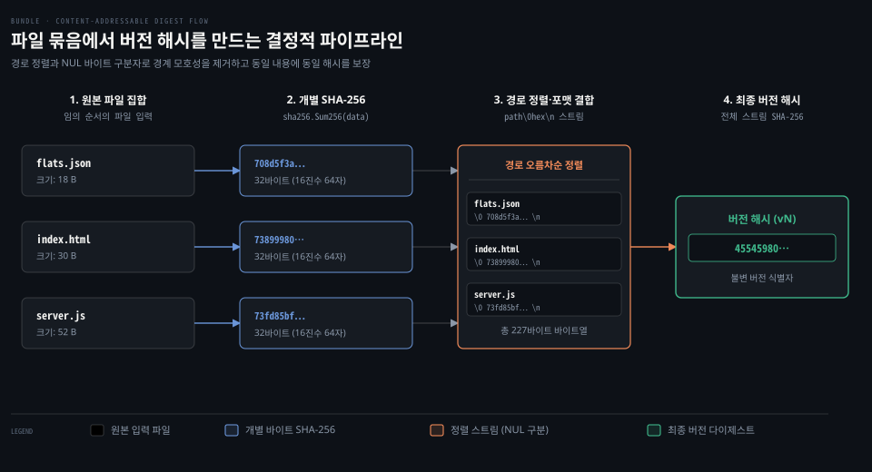
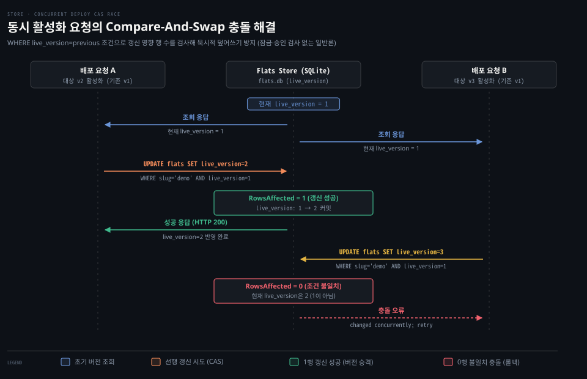

# Immutable artifact·content hash·SQLite WAL

---

> 배포 단위가 불변으로 격리되어야 하는 이유와 파일 묶음의 암호학적 내용 지문 생성 원리, 동시 배포 충돌을 차단하는 원자적 compare-and-swap 갱신, 그리고 SQLite WAL 모드의 동시성 및 복제 안전성 메커니즘을 다룹니다.

## 학습 목표와 범위

> 불변 산출물의 원리와 묶음 해시의 결정론적 계산, compare-and-swap 을 통한 배포 포인터 갱신, SQLite WAL 의 동시성 및 복제 안전성 요건을 이해하고 설명할 수 있습니다.

1. 배포 단위를 제자리에서 수정하지 않고 불변으로 누적해야 하는 이유를 롤백 안전성, 변경 감사, 환경 재현성 관점에서 설명할 수 있습니다.
2. FIPS 180-4 SHA-256 알고리즘과 경로 정렬 및 NUL 구분자를 결합해 디렉터리 묶음의 고유한 내용 지문을 계산하고 경계 모호성을 제거하는 원리를 분석할 수 있습니다.
3. Compare-And-Swap(CAS) 메커니즘을 활용해 동시 배포 요청 사이에서 `live_version` 포인터를 원자적으로 전이시키고 갱신 손실을 차단하는 SQL 제어 방식을 도식으로 추적할 수 있습니다.
4. SQLite 의 Rollback Journal 과 WAL 모드의 동시성 차이, 보조 파일(`-wal`, `-shm`)의 역할을 설명할 수 있습니다.
5. `synchronous=NORMAL` 의 내구성 범위와 라이브 데이터베이스 백업 시 `VACUUM INTO` 가 보장하는 일관성 및 한계를 비교할 수 있습니다.

이 문서는 불변 배포와 파일 묶음 해시, SQLite 동시성의 기반 원리를 다룹니다. 번들 매니페스트와 버전 모델(`01-02.bundle·manifest.md`, `01-03.Version model.md`)은 후속 편에서 다룹니다. 인스톨러의 전체 업그레이드 수명주기(`05-02.install·upgrade·backup.md`) 역시 다음 편으로 넘깁니다.

기준 커밋 3abe537 (v0.11.0, 2026-10-17)


## 1. 불변 산출물 (Immutable Artifact)

> 배포 단위를 제자리에서 수정하지 않고 고유 식별자를 가진 읽기 전용 단위로 누적해야 시스템의 재현성과 감사 가능성이 유지됩니다.

서버 운영 환경에서 소스 코드나 정적 파일을 배포할 때 가장 흔히 겪는 사고는 부분 배포(Torn deployment)입니다. 실행 중인 디렉터리에 새 파일들을 직접 덮어쓰거나 rsync 로 동기화하는 방식에서는 네트워크 순단이나 프로세스 비정상 종료가 일어나는 즉시 이전 버전과 새 버전의 파일이 뒤섞입니다. 이때 일부 요청은 구버전 자바스크립트를 읽고 신버전 API 엔드포인트를 호출하여 알 수 없는 런타임 장애를 일으킵니다. "현재 서비스 중인 코드가 지난주에 배포된 그 코드와 정확히 일치하는가"를 사후에 증명하기도 어렵습니다.

이 문제를 근본적으로 해결하는 설계가 **불변 산출물**(Immutable Artifact)입니다. 불변 산출물이란 배포 단위를 한 번 패키징해 검증을 마친 뒤에는 그 바이트와 내부 파일 집합을 결코 제자리에서 수정하지 않는 것을 뜻합니다. 코드나 리소스의 변경이 필요할 때는 기존 산출물을 수정하는 대신 완전히 새로운 식별자를 부여받은 독립 산출물을 생성하여 저장소에 누적합니다.

컨테이너 표준인 OCI Image Format Specification 의 디스크립터 명세(`descriptor.md`)는 이러한 불변 배포 단위의 원리를 규정합니다. OCI 사양에서 각 레이어와 매니페스트는 가변 태그 대신 내용 바이트의 해시를 바탕으로 한 콘텐츠 주소 지정 다이제스트(`sha256:<hex>`)로 식별됩니다.

산출물 내용이 1비트라도 바뀌면 다이제스트 자체가 달라집니다. 동일한 다이제스트를 가리키는 산출물은 언제 어디서 조회하더라도 바이트 단위로 동일함이 보장됩니다.

배포 단위를 덮어쓰지 않고 새 번호와 다이제스트로 쌓으면 롤백 안전성과 변경 감사, 재현성 면에서 엔지니어링 이점이 생깁니다.

1. **무중단 롤백(Rollback) 안전성**: 이전 버전의 산출물이 디스크나 객체 저장소에 온전히 보존되어 있습니다. 신규 배포 직후 결함이 감지되면 복잡한 복원 작업 없이 서비스의 활성 포인터만 즉시 이전 버전으로 되돌려 서비스 장애 시간을 최소화할 수 있습니다.
2. **엄격한 변경 감사(Auditability)**: 데이터베이스 배포 이력에 기록된 버전 번호와 콘텐츠 다이제스트를 대조해 당시 어떤 파일들이 배포되었는지 사후에 정확하게 검증할 수 있습니다.
3. **결정론적 재현성(Reproducibility)**: 스테이징 환경에서 검증을 마친 불변 산출물 바이트를 프로덕션 환경에 그대로 배포하므로 빌드 머신의 환경 차이나 패키지 의존성 변경으로 인한 예기치 못한 드리프트가 원천 차단됩니다.


## 2. 콘텐츠 해시 (Content Hash)

> 파일 내용과 디렉터리 구조를 고정 길이의 암호학적 지문으로 축약해 위변조를 검증하고 경계 모호성을 제거합니다.

배포 대상 파일들이 변경되었는지 확인하려고 파일 수정 시각(`mtime`)이나 파일 크기를 비교하는 것은 안전하지 않습니다. 수정 시각은 단순 복사나 아카이브 압축 해제 과정에서 쉽게 왜곡되며 바이트가 바뀌어도 우연히 파일 크기가 같을 수 있습니다. 내용의 진위를 판별하려면 데이터의 모든 바이트를 반영하는 수학적 지문이 필요합니다.

미국 국립표준기술연구소의 FIPS 180-4 규격은 암호학적 해시 알고리즘으로 SHA-256 을 정의합니다. SHA-256 은 임의 길이의 바이트 입력을 256비트 고정 다이제스트로 변환합니다. 역상 저항성과 충돌 저항성을 갖추어 서로 다른 두 입력이 같은 다이제스트를 만들어내는 것이 계산상 불가능합니다.

단일 파일의 해시는 파일의 전체 바이트 스트림을 SHA-256 함수에 통과시켜 간단히 얻을 수 있습니다. 그러나 웹사이트나 서버 애플리케이션은 단일 파일이 아니라 여러 파일(`flats.json`, `index.html`, `server.js` 등)과 디렉터리 경로 구조로 구성됩니다. 이 파일 묶음 전체의 무결성을 단 하나의 지문으로 표현하려면 **묶음 해시**(Bundle Hash)가 필요합니다.

단순히 파일 내용들을 차례대로 이어붙여 해시를 계산하면 디렉터리 순회 순서와 파일 경계에서 문제가 생깁니다.

첫째는 파일 시스템의 디렉터리 순회 순서 문제입니다. 리눅스나 맥OS, 윈도우 등 운영체제와 파일 시스템마다 디렉터리 항목을 읽는 순서가 다릅니다. 동일한 파일들이라도 읽는 순서가 바뀌면 전체 해시가 달라집니다. 묶음 해시를 구성할 때는 모든 파일 경로를 반드시 사전순(Lexicographical order)으로 정렬해야 합니다.

둘째는 경계 모호성(Boundary Ambiguity)으로 인한 해시 충돌 위험입니다. 구분자 없이 경로와 파일 내용을 단순 결합하면 경계가 다른 서로 다른 파일 조합이 동일한 입력 바이트열을 형성할 수 있습니다. 예를 들어 경로와 내용을 구분 없이 이어붙이는 방식을 가정해 보겠습니다.

- 구성 1: 경로가 `ab` 이고 내용이 `cd` 인 파일 1개 → 결합 바이트열 `abcd`
- 구성 2: 경로가 `a` 이고 내용이 `bcd` 인 파일 1개 → 결합 바이트열 `abcd`

두 구성은 파일 이름과 내용이 전혀 다르지만 결합된 바이트열이 `abcd` 로 동일하여 같은 해시를 출력합니다.

이러한 모호성을 없애기 위해 표준 파일 경로에 결코 포함될 수 없는 **NUL 바이트**(`\0`)를 구분자로 사용합니다. 각 파일의 내용을 먼저 SHA-256(64자리 16진수)으로 축약한 뒤 `경로\0파일해시\n` 형태로 줄 단위 표준화(Canonical representation)를 수행합니다. 경로 뒤에 NUL 바이트가 위치하고 그 뒤에 고정 길이 64자의 16진수 해시와 개행 문자가 이어지므로 파일 경계가 수학적으로 명확히 분리됩니다. 어떤 경로 조합에서도 충돌이 생기지 않습니다.

터미널 환경에서는 `shasum -a 256` 명령으로 이러한 해시 파이프라인을 직접 확인할 수 있습니다. 예를 들어 원본 파일이 아래 3개라고 가정하겠습니다.

- `flats.json` (18바이트): `{"kind":"server"}\n`
- `index.html` (30바이트): `<!doctype html><h1>Flats</h1>\n`
- `server.js` (52바이트): `export default { fetch: () => new Response("ok") };\n`

개별 파일의 SHA-256 은 `flats.json` 이 `708d5f3a…`, `index.html` 이 `73899980…`, `server.js` 가 `73fd85bf…` 입니다. 경로를 오름차순 정렬한 뒤 `경로\0해시\n` 포맷으로 묶어 파이프라인을 실행하면 아래 출력을 확인할 수 있습니다:

```bash
printf 'flats.json\0%s\nindex.html\0%s\nserver.js\0%s\n' \
  708d5f3a233e0cd1b585b124fe5cf99e43b4144e32ee3c0cbc35fc66ecc324f5 \
  738999802adf5d3225cbfc095e0fc5170046b70404ef2e021c899a591efa300c \
  73fd85bf4eceabead815b6c90b3dab03be50598e0620562ade38dda608187c09 | shasum -a 256
45545980c9fe58f483441e347ed2fc7e4bfa58cd0b4be49ca8dc45752167c258  -
```

규격화된 227바이트의 스트림에서 최종 버전 해시 `45545980…` 이 도출됩니다.



위 데이터 흐름 도식에서 임의의 원본 파일들은 개별 SHA-256 계산과 사전순 경로 정렬, NUL 바이트 구분자 포맷팅을 거칩니다. 그렇게 227바이트의 단일 스트림으로 결합된 후 최종 256비트 버전 해시로 수렴합니다. 파일 순서나 경로 경계의 모호성이 사전에 제거되므로 어떤 환경에서 빌드하더라도 파일 내용이 같으면 정확히 동일한 버전 다이제스트가 산출됩니다.


## 3. compare-and-swap 갱신

> 읽었던 기존 버전 번호가 그대로 유지되고 있을 때만 새 버전으로 교체하여 동시 배포의 갱신 손실을 방지합니다.

여러 명의 개발자나 자동화 빌드 에이전트가 동시에 실행 중인 서비스에 배포를 시도할 때 경합 조건(Race condition)이 발생할 수 있습니다. 운영 중인 서비스가 현재 `live_version = 1` 상태라고 가정하겠습니다. 작업자 A 는 검증을 마치고 버전 2 를 배포하려 하고, 작업자 B 는 별도의 기능 수정을 마치고 버전 3 을 배포하려 합니다.

데이터베이스에 조건 없는 단순 덮어쓰기 쿼리를 전송하면 아래 순서로 일이 틀어집니다.

1. 작업자 A 가 현재 활성 버전이 1임을 확인하고 버전 2 로 승격을 준비합니다.
2. 작업자 B 도 현재 활성 버전이 1임을 확인하고 버전 3 으로 승격을 준비합니다.
3. 작업자 A 가 `UPDATE flats SET live_version = 2 WHERE slug = 'demo'` 를 실행하여 버전 2 가 활성화됩니다.
4. 직후에 작업자 B 가 `UPDATE flats SET live_version = 3 WHERE slug = 'demo'` 를 실행합니다.

작업자 B 의 쿼리는 작업자 A 가 방금 활성화한 버전 2 를 그대로 덮어씁니다. 작업자 B 는 자신이 버전 1을 대체했다고 믿지만 실제로는 작업자 A 가 공들여 배포한 버전 2 가 배포되자마자 소리 없이 사라집니다. 이 현상을 **갱신 손실**(Lost Update)이라고 부릅니다.

이 동시성 문제를 잠금 없이 안전하게 차단하는 메커니즘이 **Compare-And-Swap**(CAS, 비교 후 교환)입니다. CAS 의 기본 원리는 "내가 읽었던 그 값이 데이터베이스에 그대로 유지되고 있을 때만 변경을 수행한다"는 단일 원자적 조건 연산입니다.

관계형 데이터베이스 SQL 에서는 이를 `WHERE` 조건절에 기준 버전 번호를 명시하고 영향받은 행 수(Rows Affected)를 검사하는 패턴으로 구현합니다:

```sql
UPDATE flats
SET live_version = :new_version, updated_at = :now
WHERE slug = :slug AND live_version = :previous_version;
```

이 쿼리가 실행되면 데이터베이스 엔진은 원자적 데이터베이스 쓰기 잠금 하에서 `WHERE` 조건절을 평가합니다.

1. 현재 저장된 `live_version` 이 요청자가 읽었던 `:previous_version` 과 같다면 행이 1개 갱신되고 엔진은 `RowsAffected = 1` 을 반환합니다. 요청자는 배포가 성공했음을 확신하고 트랜잭션을 커밋합니다.
2. 다른 요청이 먼저 완료되어 `live_version` 이 이미 바뀌었다면 `WHERE` 절을 만족하는 행이 존재하지 않습니다. 아무 행도 변경되지 않고 `RowsAffected = 0` 이 반환됩니다.

일반적인 웹 API 설계에서는 영향 행 수가 1이 아닐 때 충돌 오류(HTTP 409 Conflict)를 반환합니다.

하지만 flats 내부 저장소의 CAS 실패 오류(`internal/store/store.go:689`, `internal/store/lifecycle.go:410`)는 평문 문자열입니다. 센티넬 에러를 감싸지 않으므로 일반 배포 API 에서는 HTTP 500(`internal/api/api.go:267`)으로 응답합니다. server flat 배포는 이를 `DeployError` 로 포장하여 HTTP 422(`internal/api/api.go:251-252`)를 돌려줍니다.

실제 승인 기반 배포는 이 단계 이전에 충돌을 거릅니다. `internal/core/lifecycle.go:894` 의 `expected_live` 불일치 검사가 먼저 동작하여 `ErrStaleApproval` 과 함께 HTTP 409 로 처리됩니다.



위 시퀀스 도식은 인메모리 잠금이나 승인 상태 검사가 없다고 가정한 일반론적 CAS 시퀀스입니다. 요청 A 와 요청 B 는 모두 기존 `live_version = 1` 을 기준으로 갱신을 시도합니다. 선행한 요청 A 의 UPDATE 는 `live_version = 1` 조건에 부합하여 1행을 변경하고 성공합니다. 반면 후행한 요청 B 는 이미 2로 바뀐 데이터베이스 상태로 인해 0행이 매칭되어 즉시 충돌 오류로 차단됩니다. flats 의 실제 3계층 방어선은 §6 에서 다룹니다.


## 4. SQLite 트랜잭션과 WAL

> WAL 모드는 로그 파일에 변경분을 선행 기록하여 동시 읽기와 쓰기를 허용하고 파일 복사의 위험을 방지합니다.

임베디드 파일 데이터베이스인 SQLite 에 동시 요청이 몰릴 때 시스템이 멈추거나 파일이 손상되는 사고가 발생할 수 있습니다. 전통적인 모드에서는 데이터베이스에서 트랜잭션을 커밋하는 동안 파일 전체에 배타적 락(EXCLUSIVE lock)이 걸려 모든 읽기 작업이 대기해야 했습니다. 프로세스가 실행 중인 상태에서 데이터베이스 파일을 무심코 OS 명령어(`cp`, `rsync`)로 복사하면 그 파일이 손상되는 문제도 있습니다.

SQLite 공식 문서(`wal.html`, `lang_transaction.html`)에 따르면 SQLite 의 저널링 모드는 전통적인 Rollback Journal 과 WAL(Write-Ahead Log)로 구분됩니다.

롤백 저널 모드에서는 트랜잭션이 시작되면 변경 전의 원본 페이지들을 저널 파일(`<db>-journal`)에 먼저 복사해 둔 뒤 메인 데이터베이스 파일(`<db>`)의 페이지를 직접 수정합니다. 트랜잭션이 커밋되면 저널 파일을 삭제하고 롤백 시에는 저널 파일의 원본 페이지를 메인 파일로 덮어씁니다. 이 구조에서는 변경 사항을 메인 파일에 반영하고 커밋하는 동안 배타적 잠금이 유지되어 읽기 트랜잭션이 메인 파일에 접근할 수 없습니다. 즉 커밋 단계에서 읽는 쪽과 쓰는 쪽이 서로를 차단합니다.

반면 SQLite 3.7.0 에서 도입된 WAL 모드는 정반대로 동작합니다. 메인 데이터베이스 파일은 그대로 둔 채 트랜잭션이 발생할 때마다 새로 변경된 페이지들을 별도의 로그 파일인 `<db>-wal` 뒤에 순차적으로 덧붙입니다.

WAL 모드가 활성화되면 데이터베이스 파일 옆에 두 개의 보조 파일이 함께 운용됩니다.

- `<db>-wal`: 커밋된 트랜잭션의 변경 페이지들이 순차적으로 기록되는 선행 쓰기 로그 파일입니다.
- `<db>-shm`: WAL 파일 내부의 페이지 위치를 빠르게 검색하기 위한 공유 메모리 인덱스 파일(Shared-Memory File)입니다. 여러 프로세스가 메모리 매핑(`mmap`)으로 WAL 인덱스를 조회하여 디스크 탐색 없이도 원하는 페이지가 WAL 에 있는지 메인 DB 에 있는지 즉각 판별합니다.

이 구조 덕분에 WAL 모드에서는 읽는 쪽과 쓰는 쪽이 서로를 차단하지 않습니다. 읽기 트랜잭션은 시작 시점의 WAL 프레임 번호를 기준으로 스냅샷 격리를 유지합니다. 쓰기 트랜잭션이 WAL 파일 끝에 새 프레임을 덧붙이더라도 읽기 작업은 방해받지 않습니다. 다만 파일 잠금 규칙상 동시에 쓰기를 수행하는 트랜잭션은 한 번에 하나로 제한됩니다.

WAL 파일이 계속 커지는 것을 방지하려면 WAL 에 쌓인 최신 페이지들을 메인 데이터베이스 파일로 복사하여 반영해야 합니다. 이 동기화 작업을 **체크포인트**(Checkpoint)라고 부릅니다. SQLite 는 기본적으로 WAL 파일이 1,000페이지에 도달하면 자동으로 체크포인트를 수행합니다(`SQLITE_DEFAULT_WAL_AUTOCHECKPOINT`). 필요 시 `PRAGMA wal_checkpoint` 명령어로 수동 체크포인트를 트리거할 수도 있습니다. 데이터베이스에 연결된 모든 프로세스가 정상 종료되면 SQLite 는 마지막 체크포인트를 완결하고 `-wal` 과 `-shm` 파일을 정리합니다.

성능과 안정성의 균형을 위해 자주 사용되는 설정이 `PRAGMA synchronous = NORMAL` 입니다. SQLite 공식 문서(`pragma.html#pragma_synchronous`)에 따르면 WAL 모드에서 `synchronous = NORMAL` 은 매 커밋마다 `fsync` 를 부르지 않습니다. 쓰기 변경분은 OS 캐시에 남기며 디스크 동기화는 체크포인트 시점과 WAL 헤더 작성 시에만 수행합니다.

이 설정을 쓰면 디스크 쓰기 병목이 크게 줄어듭니다. 애플리케이션 프로세스가 비정상 종료되더라도 OS 커널 캐시가 보존되어 트랜잭션 일관성이 유지됩니다. 다만 운영체제 커널 패닉이나 갑작스러운 서버 전원 차단(Power loss)이 일어나면 마지막 체크포인트 이후 커밋된 트랜잭션들이 롤백될 수 있는 시간 창(Window)이 존재합니다.

서버 프로세스가 데이터베이스를 열어둔 상태에서 운영체제의 복사 명령어로 데이터베이스 파일을 복제하면 데이터가 손상됩니다.

1. **최신 데이터 누락**: 최근 커밋된 트랜잭션들은 메인 파일이 아니라 `<db>-wal` 파일에 들어 있으므로 메인 파일만 복사하면 최근 데이터가 모두 유실됩니다.
2. **시점 불일치**: 메인 파일과 `<db>-wal` 파일을 차례대로 복사하면 두 파일을 복사하는 사이에 쓰기나 체크포인트가 발생하여 두 파일의 페이지 번호와 트랜잭션 시점이 어긋납니다.
3. **찢어진 페이지(Torn page)**: 4KB 크기의 데이터베이스 페이지가 디스크에 기록되는 도중에 복사 명령이 해당 블록을 읽어가면 페이지의 앞부분은 과거 데이터이고 뒷부분은 새 데이터가 됩니다. 이렇게 찢어진 페이지가 생성되면 파일 자체가 영구적으로 손상됩니다.

실행 중인 데이터베이스에서 안전한 백업을 수행하려면 반드시 SQLite 의 온라인 백업 API 나 `VACUUM INTO` 명령(`lang_vacuum.html#vacuuminto`)을 사용해야 합니다.

`VACUUM INTO 'backup.db'` 쿼리는 원본 DB 의 읽기 트랜잭션 스냅샷을 기반으로 조각 모음된 독립 백업 파일을 순차 기록합니다. WAL 모드에서는 읽기 트랜잭션이 쓰기 트랜잭션을 막지 않습니다. 다만 체크포인트는 독자가 열려 있는 동안 해당 프레임 뒤로 지연됩니다. flats 의 실제 사용(`internal/store/migrate.go:331-336`)은 서빙용 데이터베이스를 열기 전 기동 단계이므로 경합할 쓰기 자체가 없습니다.

다만 공식 문서(`lang_vacuum.html#vacuuminto`)가 밝히듯 백업 도중 전원 차단이나 프로세스 강제 종료가 발생하면 대상 파일이 불완전하게 남을 수 있습니다(synchronous 가 NORMAL/FULL 일 때 완료 후 fsync 수행). 정상 완료된 백업 파일은 롤백 저널 모드의 독립 파일이므로 보조 파일 없이 안전하게 복원됩니다.


## 5. 흔한 오해

> 정적 해시와 배포의 동일성, 그리고 WAL 모드에서의 백업 방식에 대해 자주 발생하는 오해를 바로잡습니다.

단순한 정적 파일 호스팅이라도 분산 환경이나 다중 에이전트가 개입하면 사소한 오해로 배포가 깨지거나 데이터가 유실됩니다.

첫째, "콘텐츠 해시가 같으면 완전히 동일한 배포다"라는 생각은 오해입니다.

파일 묶음의 콘텐츠 해시는 번들에 포함된 파일들의 상대 경로와 바이트 내용만을 검증합니다.

하지만 실제 배포 단위에는 파일 내용 외에도 여러 요소가 결합됩니다.

배포 시점에 캡처된 환경 변수 스냅샷(`internal/core/service.go:1352` `captureEnvironment`)이 결합됩니다. 공개 범위와 연계 제공자, 그리고 빌드 시점 Git 메타데이터(커밋 SHA 및 dirty 플래그, `internal/store/lifecycle.go:401`)도 함께 묶입니다. 번들 해시가 같더라도 배포 시점의 환경 변수나 메타데이터가 다르면 실제 서비스 동작은 완전히 달라질 수 있습니다.

반면 워커의 메모리와 타임아웃 제약은 호스트 바이너리 상수입니다. 워커 메모리 상한은 1024 Wasm 페이지인 64 MiB 로 지정됩니다. 이는 `internal/runtime/protocol.go:28` 의 `DefaultMemoryPages`(`spec.pages` `:74-79`)로 강제됩니다. 미지정 시 기본값은 `internal/qjs/runtime.go:35` 를 따릅니다. 핸들러 타임아웃 역시 10초 상수를 씁니다(`internal/runtime/protocol.go:27` `DefaultTimeout`).

이 값들은 버전 행에 기록되지 않습니다. 호스트 바이너리를 업그레이드하여 상수가 바뀌면 동일한 해시와 버전 행을 가진 아티팩트라도 런타임 제약 조건이 달라집니다.

둘째, "WAL 모드에서도 단일 파일 데이터베이스의 특성이 유지되므로 메인 DB 파일 하나만 복사해 백업하면 된다"라는 생각은 잘못되었습니다.

WAL 모드에서 데이터베이스의 최신 변경분은 메인 데이터베이스 파일이 아니라 `<db>-wal` 파일에 기록됩니다. 체크포인트가 수행되기 전까지 메인 파일은 과거 상태의 페이지만을 담고 있습니다. 메인 파일 하나만 복사하면 가장 최근에 커밋된 핵심 데이터가 모두 누락됩니다. 반드시 프로세스를 정상 종료하여 동기화를 확인하거나 `VACUUM INTO` 같은 내장 스냅샷 명령을 사용해야 합니다.

셋째, "Compare-And-Swap 은 락(Lock) 없이 동작하므로 데이터베이스 잠금이 전혀 발생하지 않는다"라는 오해입니다.

CAS 는 애플리케이션 레벨에서 비관적 락을 피하고 낙관적 동시성 제어를 달성하는 패턴입니다. 하지만 데이터베이스 엔진 내부에서는 `UPDATE` 문을 실행하는 순간 동안 데이터베이스 단위의 배타적 쓰기 락이 체결됩니다. SQLite 에는 행이나 테이블 단위 잠금이 없고 데이터베이스 단위 쓰기 잠금 하나만 존재합니다. WAL 모드에서도 쓰기 작업은 한 번에 하나의 트랜잭션만 수행할 수 있습니다. 동시 쓰기 요청이 몰리면 락 대기 타임아웃(`busy_timeout`) 범위 내에서 순차적으로 직렬화되어 실행됩니다.


## 6. flats 에서는

> flats 가 불변 버전 모델과 콘텐츠 해시, CAS 갱신, SQLite WAL 을 실제 코드에서 어떻게 구현하고 있는지 확인합니다.

원격 호스팅이나 단일 바이너리 환경에서는 여러 에이전트와 사용자가 동시에 배포를 요청하면 일관성이 깨지거나 갱신이 누락되기 쉽습니다. flats 코드베이스는 불변성과 결정론적 무결성, 그리고 원자적 갱신 규칙을 명확한 코드로 강제합니다.

1. **버전 해시 계산 (`internal/bundle/bundle.go:695-701`, `docs/design.md`)**:
   flats 는 번들 디렉터리의 파일 목록에서 내용 지문을 산출할 때 `internal/bundle/bundle.go:695` 의 `Hash` 함수를 호출합니다:
   ```go
   // Hash returns the content hash of a file list.
   func Hash(files []File) string {
   	h := sha256.New()
   	for _, f := range files {
   		sum := sha256.Sum256(f.Data)
   		fmt.Fprintf(h, "%s\x00%x\n", f.Path, sum)
   	}
   	return hex.EncodeToString(h.Sum(nil))
   }
   ```
   각 파일의 바이트를 `sha256.Sum256(f.Data)` 로 계산한 뒤 `bundle.go:699` 에서 `fmt.Fprintf(h, "%s\x00%x\n", f.Path, sum)` 포맷으로 NUL 바이트 구분자와 16진수 해시, 개행 문자를 기록합니다.

   여기서 `Hash` 함수 자체는 정렬을 수행하지 않고 슬라이스 순회만 수행합니다. 대신 파일 수집기인 `collector.result()` (`internal/bundle/bundle.go:384`)가 `sort.Slice` 로 파일 목록을 사전순 정렬하여 반환합니다.

   디렉터리 기록기인 `write()` (`internal/bundle/bundle.go:717-763`)는 이 정렬된 목록을 받아 `bundle.go:762` 에서 `Hash(files)` 를 호출합니다. 문서 리비전 생성 경로 역시 `internal/core/docsrev.go:205` 에서 자체적으로 사전 정렬을 보장합니다.
   공식 설계 문서 `docs/design.md` 「Model and flows」의 `Version model` 에서도 이를 명시합니다: "content hash (SHA-256 over sorted `path NUL sha256` lines)".

2. **불변 버전 모델 (`docs/design.md`)**:
   공식 문서 `docs/design.md` 「Model and flows」는 버전의 절대 불변성을 다음과 같이 규정합니다:
   "Versions never change, are never deleted automatically and their numbers are never reused."
   사용자가 초안을 저장(`save-draft`)하면 `draft-revs/` 디렉터리에 불변 리비전으로 저장되며 라이브 서비스에는 영향을 주지 않습니다. 관리자 승인을 거쳐 `create-version` 이 실행되면 해당 초안 파일들이 `versions/<n>` 디렉터리에 동결되고 메타데이터 데이터베이스의 `versions` 테이블에 새 행으로 등록됩니다. 한 번 배정된 버전 번호는 수정되거나 재사용되지 않습니다.

3. **동시 덮어쓰기 방어의 세 계층**:
   flats 는 동시 배포 시 활성 포인터가 유실되지 않도록 세 겹의 방어선을 순서대로 적용합니다.

   첫째, **인메모리 잠금 직렬화**: 배포 적용 시작 시 `lockStorage(slug)` (`internal/core/storage_lifecycle.go:199-206`)를 호출합니다. flat 별 뮤텍스(`internal/core/service.go:266-270`)를 쥐어 동일 flat 의 동시 배포 시도를 메모리에서 먼저 직렬화합니다.

   둘째, **승인 상태 대조 (Stale Approval 차단)**: 승인 시점의 활성 버전(`expected_live`)이 현재 DB 의 버전과 다르면 쿼리 실행 전에 차단합니다. `mismatch()` (`internal/core/lifecycle.go:665-667`)를 호출해 오류를 냅니다. `ErrConflict` 와 `ErrStaleApproval` (`internal/core/lifecycle.go:894-895`, `:696-697`)을 함께 반환하여 HTTP 409 로 거부합니다. 승인과 적용 사이에 다른 배포가 끼어들어 구버전 승인이 덮어쓰는 사고를 막습니다.

   셋째, **데이터베이스 CAS 최후 방어선**: 승인 검사를 통과한 뒤라도 데이터베이스 계층에서 `WHERE slug=? AND live_version=?` 조건으로 영향 행 수를 검사합니다.

   새 버전 저장과 동시 공개(publish) 경로에서는 `internal/store/lifecycle.go:395` 의 `CommitPublished` 가 404번째 줄에서 UPDATE 를 실행합니다:
   ```go
   res, err := tx.ExecContext(ctx, `UPDATE flats SET live_version=?,updated_at=? WHERE slug=? AND live_version=?`, v.Number, unix(now), v.Flat, previous)
   if err != nil {
   	return err
   }
   n, _ := res.RowsAffected()
   if n != 1 {
   	return errors.New("live version changed concurrently")
   }
   ```
   `lifecycle.go:408-410` 은 영향 행 수가 1이 아니면 오류를 내고 롤백합니다.

   이미 저장된 버전의 배포나 롤백 경로(`internal/core/service.go:1379-1383`)에서는 `internal/store/store.go:678` 의 `SetLive` 메서드가 684번째 줄에서 동일 쿼리를 실행합니다. 직후 `store.go:688-690` 에서 `if n, _ := res.RowsAffected(); n == 0` 조건을 확인하여 충돌 시 `fmt.Errorf("flat %q changed concurrently; retry", flat)` 에러를 반환합니다.

4. **WAL 및 동시성 pragma 설정 (`internal/store/store.go:318,322,333-345`)**:
   flats 메타데이터 저장소는 기동 시 `internal/store/store.go:318` 에서 명시적인 DSN pragma 옵션과 함께 데이터베이스를 엽니다:
   ```go
   db, err := sql.Open("sqlite", fileURI(path)+"?_pragma=foreign_keys(1)&_pragma=journal_mode(WAL)&_pragma=busy_timeout(5000)&_pragma=synchronous(NORMAL)")
   ```
   외래키 제약조건 활성화(`foreign_keys(1)`), 저널 모드 WAL 설정(`journal_mode(WAL)`), 쓰기 경합 시 5초 대기(`busy_timeout(5000)`), 그리고 동기화 최적화(`synchronous(NORMAL)`)를 구성합니다.
   동시에 `store.go:322` 에서 `db.SetMaxOpenConns(1)` 설정을 적용하여 메타데이터 쓰기 커넥션을 단일 커넥션으로 직렬화합니다.
   전원 차단 시의 데이터 유실 창을 닫기 위해 `internal/store/store.go:333-345` 에 `Sync` 메서드를 제공합니다:
   ```go
   // Sync makes every committed transaction durable. The database uses WAL with
   // synchronous=NORMAL, where a commit can still roll back after a power loss
   // until the next checkpoint syncs it; a complete checkpoint ends that window.
   func (s *Store) Sync(ctx context.Context) error {
   	var busy, frames, checkpointed int
   	if err := s.db.QueryRowContext(ctx, "PRAGMA wal_checkpoint(FULL)").Scan(&busy, &frames, &checkpointed); err != nil {
   		return fmt.Errorf("checkpoint database: %w", err)
   	}
   	if busy != 0 {
   		return errors.New("checkpoint database: another connection kept it busy")
   	}
   	return nil
   }
   ```
   `PRAGMA wal_checkpoint(FULL)` 을 호출해 WAL 의 모든 프레임을 메인 파일로 완전히 반영함으로써 영속성을 확정합니다.

5. **백업과 마이그레이션 함의 (`docs/configuration.md`, `internal/store/migrate.go:336`)**:
   공식 문서 `docs/configuration.md` 의 `Versions` 절 아래 `flats.db` 항목은 스키마 마이그레이션 전 백업 정책을 규정합니다:
   "Before migrating an existing database Flats writes `backups/flats.v<N>.<time>.db` with `VACUUM INTO`; if that fails, it does not migrate."
   실제 구현인 `internal/store/migrate.go:336` 에서 `_, err = db.ExecContext(ctx, "VACUUM INTO ?", target)` 구문을 실행합니다. 이 백업은 서빙용 데이터베이스를 열기 전 기동 단계에서 읽기 전용 연결로 안전하게 스냅샷 파일을 생성합니다(`internal/store/store.go:316-318`, `internal/store/migrate.go:331-336`).
   이어서 `internal/store/migrate.go:238-240` 주석은 복원 시 주의점을 짚습니다. `VACUUM INTO` 백업은 롤백 저널 모드로 복원되므로 마이그레이션 전에 `useWAL()` 로 WAL 모드 전환을 마쳐야 함을 다음 주석으로 명시합니다:
   ```go
   // In rollback-journal mode (a database restored from a VACUUM INTO backup)
   // it would leave a hot journal that only a writer can recover, and every
   // later start would fail its read-only probe.
   ```
   로컬 실측(2026-10-16, v0.9.1)에서도 Flats 서버가 정상 종료된 상태의 데이터 디렉터리를 점검했을 때 메인 DB 파일만 남아 있고 `-wal` 과 `-shm` 보조 파일이 깨끗하게 정리되었음을 확인했습니다.

6. **이어지는 본편**:
   이 개념들은 후속 편으로 이어집니다. 파일 번들과 매니페스트 규약은 `01-02.bundle·manifest.md` 에서 다룹니다. 불변 초안과 버전 전이 모델은 `01-03.Version model.md` 에서 다룹니다. 마지막으로 인스톨러 업그레이드와 백업 절차는 `05-02.install·upgrade·backup.md` 에서 연결합니다.


## 리뷰 노트

> flats 코드베이스와 공식 문서를 분석하는 과정에서 확인한 세부 구현 특징과 설계 의문점입니다.

- `internal/bundle/bundle.go:695` 의 `Hash(files []File)` 함수 자체는 내부에서 파일 목록을 정렬하지 않고 슬라이스 순회만 수행합니다. 공식 문서 `docs/design.md` 는 정렬을 필수 규약으로 명시합니다. 실제 운영 경로인 `collector.result()` (`internal/bundle/bundle.go:384`)도 `sort.Slice` 로 사전 정렬을 보장합니다. 다만 `Hash` 함수를 직접 호출하는 테스트나 외부 코드가 정렬되지 않은 슬라이스를 넘기면 서로 다른 해시가 생성될 여지가 있습니다.
- `internal/store/lifecycle.go:408-410` 과 `internal/store/store.go:688-690` 의 CAS 실패 검사 조건 표현이 서로 다릅니다. `lifecycle.go` 는 `if n != 1` 로 단일 행 갱신을 엄격하게 단언하고, `store.go` 는 `if n == 0` 으로 실패를 검사합니다. flats 테이블에서 slug 와 live_version 조합은 유일하므로 두 검사가 실질적으로 동일하게 동작하지만 코드 스타일의 일관성 측면에서는 차이가 있습니다.
- `internal/store/store.go:322` 의 `db.SetMaxOpenConns(1)` 설정: SQLite WAL 모드는 동시 다중 읽기를 지원합니다. 하지만 Flats 메타데이터 DB 는 커넥션을 1개로 제한합니다. 트래픽이 적은 환경에서 동시성 잠금 충돌을 차단하려는 의도로 풀이됩니다(추정, 주석 `metadata traffic is small` 기반).


## 자가 점검 질문

1. **질문 1**: 디렉터리 내의 파일들을 묶어 단일 버전 해시를 계산할 때, 파일 내용의 해시만 결합하지 않고 경로의 사전순 정렬과 NUL 바이트(`\0`) 구분자를 반드시 포함해야 하는 암호학적 이유를 설명하십시오.
2. **질문 2**: 두 배포 요청이 동일한 이전 버전(`previous=1`)을 읽었을 때, Compare-And-Swap SQL 쿼리가 갱신 손실을 차단하는 원리를 영향받은 행 수(`RowsAffected`)로 서술하십시오.
3. **질문 3**: SQLite WAL 모드의 `synchronous = NORMAL` 환경에서 프로세스 충돌과 하드웨어 전원 차단 시 보장되는 내구성의 차이를 비교하십시오.
4. **질문 4**: 실행 중인 SQLite WAL 데이터베이스를 운영체제 `cp` 명령어로 복사할 때 데이터 손실이나 손상이 발생하는 원인을 설명하고, Flats 가 마이그레이션 백업에 `VACUUM INTO` 를 사용하는 이유를 서술하십시오.


## 출처와 관련 문서

- [FIPS 180-4: Secure Hash Standard (SHS)](https://csrc.nist.gov/pubs/fips/180-4/upd1/final): SHA-256 암호학적 해시 알고리즘 규격
- [OCI Image Format Specification: Descriptor](https://github.com/opencontainers/image-spec/blob/main/descriptor.md): 콘텐츠 주소 지정 다이제스트(Content-Addressable Digest) 명세
- [SQLite: Write-Ahead Logging (WAL)](https://www.sqlite.org/wal.html): WAL 모드의 동작 원리, 보조 파일 및 체크포인트 구조
- [SQLite: PRAGMA synchronous](https://www.sqlite.org/pragma.html#pragma_synchronous): 동기화 모드별 내구성 및 디스크 플러시 동작 규격
- [SQLite: VACUUM INTO](https://www.sqlite.org/lang_vacuum.html#vacuuminto): 라이브 데이터베이스 스냅샷 백업 명령 및 한계
- `01-02.bundle·manifest.md`: 파일 번들 패키징 및 매니페스트 검증 규약
- `01-03.Version model.md`: 불변 초안(Draft)과 버전 전이 수명주기
- `05-02.install·upgrade·backup.md`: 설치기 기반 업그레이드 및 백업 복원 절차


## 정답 (자답 후 펼치기)

1. **정답 1**: 운영체제 및 파일 시스템마다 `readdir` 의 순회 순서가 달라 정렬하지 않으면 동일한 파일 내용이라도 환경에 따라 전혀 다른 묶음 해시가 생성됩니다. 경로와 내용 사이에 구분자가 없으면 경로 `ab` + 내용 `cd` 와 경로 `a` + 내용 `bcd` 가 동일한 바이트열 `abcd` 로 축약되어 해시 충돌(경계 모호성)도 일어납니다. 경로명에 쓰일 수 없는 NUL 바이트를 구분자로 두고 각 파일 해시를 고정 포맷으로 결합해야 레코드 경계가 엄격히 분리됩니다.
2. **정답 2**: SQL 쿼리 `UPDATE flats SET live_version = :new WHERE slug = :slug AND live_version = :previous` 는 원자적 데이터베이스 쓰기 잠금 하에서 실행됩니다. 먼저 도달한 요청 A 는 `live_version = 1` 조건을 만족하여 행을 갱신하고 `RowsAffected = 1` 을 얻어 성공합니다. 그 직후 도달한 요청 B 는 이미 `live_version` 이 갱신되었으므로 `WHERE` 조건을 만족하는 행이 0개가 되어 `RowsAffected = 0` 을 반환받습니다. 애플리케이션이 이 반환값을 확인해 0행일 경우 즉시 롤백하고 충돌 에러를 반환함으로써 덮어쓰기를 방지합니다.
3. **정답 3**: `synchronous = NORMAL` 설정에서 SQLite 는 매 트랜잭션 커밋마다 디스크로 물리 플러시(`fsync`)를 하지 않고 OS 커널 캐시에 기록을 유지합니다. 따라서 애플리케이션 프로세스가 비정상 종료되더라도 커널 캐시가 보존되어 데이터 유실이 없습니다. 하지만 하드웨어 전원 차단이나 OS 커널 패닉이 발생하면 디스크에 기록되지 않은 커널 캐시 데이터가 유실되므로 마지막 체크포인트 이후 커밋된 트랜잭션이 롤백될 수 있습니다.
4. **정답 4**: WAL 모드에서 최신 커밋 데이터는 메인 DB 파일이 아니라 `<db>-wal` 파일에 기록되므로 메인 DB 파일만 복사하면 최신 데이터가 누락됩니다. 메인 DB 와 WAL 파일을 순차적으로 복사해도 복사 도중 체크포인트나 쓰기가 발생해 두 파일의 트랜잭션 시점이 어긋나거나 4KB 페이지가 찢겨 기록되는 손상(Torn Page)이 발생합니다. `VACUUM INTO` 는 데이터베이스 엔진 내부에서 읽기 트랜잭션 스냅샷을 획득하여 조각 모음된 독립 단일 데이터베이스 백업 파일을 생성합니다. WAL 모드에서는 읽기 트랜잭션이 동시 쓰기를 막지 않지만(체크포인트는 지연될 수 있습니다) flats 는 서빙 전 기동 단계에서 읽기 전용 연결로 실행하여 경합을 차단합니다. 다만 백업 도중 전원 차단이나 비정상 종료가 일어나면 대상 파일이 불완전할 수 있는 한계(`lang_vacuum.html#vacuuminto`)가 있으므로 완료 상태를 점검해야 합니다.
