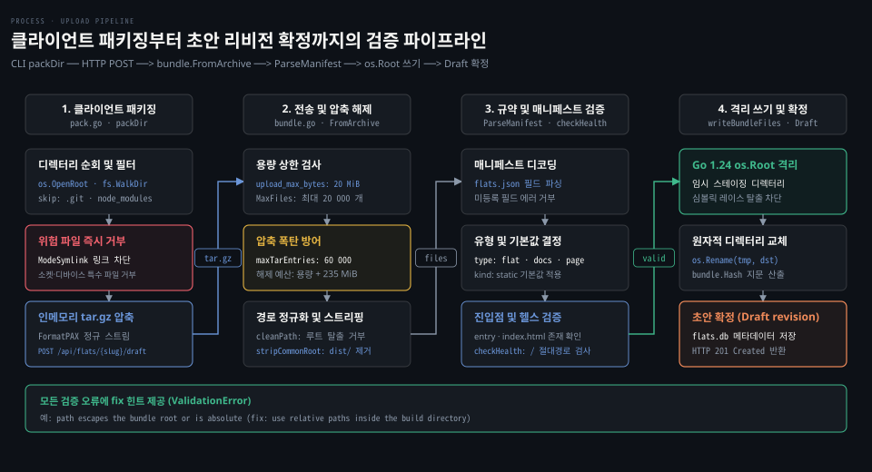
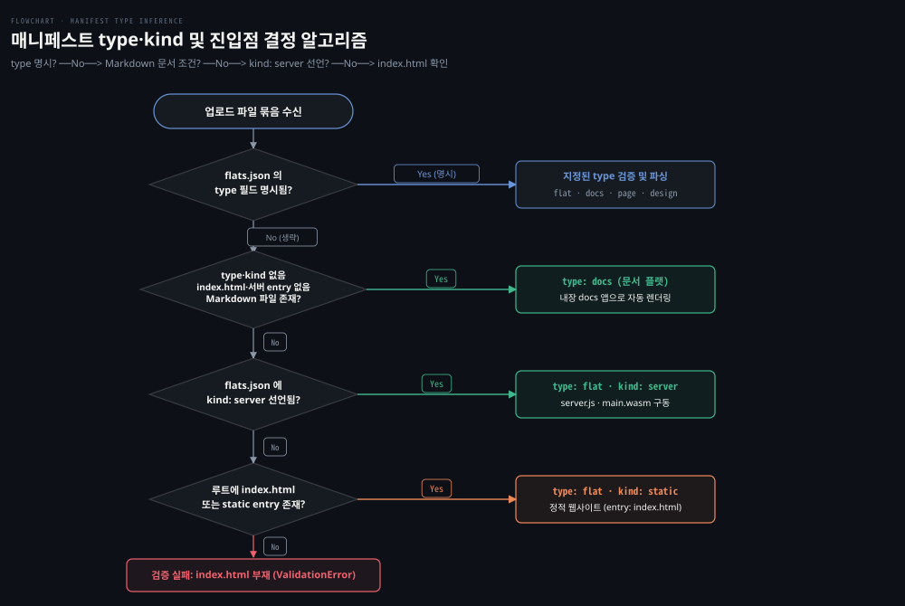

# bundle·manifest

---

> 에이전트가 생성한 디렉터리를 배포 산출물로 수용할 때 발생하는 보안 위협과 이를 차단하는 클라이언트 및 서버의 다계층 검증 규약, 매니페스트(flats.json) 해석 및 유형 추론 규칙, 그리고 Go 1.24 os.Root 기반 격리 쓰기와 정적 검사(Lint) 메커니즘을 다룹니다.

## 학습 목표와 범위

> 번들 패키징과 서버 측 다계층 검증, 매니페스트 해석 및 정적 검사의 전 과정을 이해하고 설명할 수 있습니다.

1. 에이전트가 생성한 디렉터리를 서버에 그대로 업로드할 때 발생하는 보안 위협(심볼릭 링크 외부 유출, 압축 폭탄, 디렉터리 순회 탈출, 이름 충돌)의 원인을 분석하고 flats 가 이를 차단하는 원리를 설명할 수 있습니다.
2. 클라이언트 측 `packDir` 함수가 정규 파일만 선별해 `tar.gz` 로 묶고 운영체제 메타데이터를 제외하며 git 메타데이터를 추출하는 절차를 분석할 수 있습니다.
3. 서버 측 `FromArchive` 함수가 파일 수(`MaxFiles = 20000`)와 엔트리 수(`maxTarEntries = 60000`)를 단계별로 검증하는 원리를 설명할 수 있습니다. 또한 약 235 MiB 의 해제 용량 예산과 `cleanPath` 및 `stripCommonRoot` 로 경로를 정규화하는 과정을 분석할 수 있습니다.
4. `flats.json` 매니페스트의 허용 필드 디코딩과 미등록 필드 거부 규칙, 그리고 매니페스트가 생략되었을 때 `type`·`kind`·`entry` 속성을 결정론적으로 추론하는 흐름을 도식으로 추적할 수 있습니다.
5. Go 1.24 `os.Root` 기반 격리 쓰기 메커니즘이 심볼릭 레이스 공격을 차단하는 원리와, `bundle.Lint` 및 Page 전용 `externalData` 함수가 제공하는 비차단(non-blocking) 경고의 역할을 평가할 수 있습니다.

이 문서는 파일 묶음의 패키징과 매니페스트 검증, 정적 검사 규약을 다룹니다. 배포 산출물의 불변성과 묶음 해시(`bundle.Hash`)의 수학적 지문 계산 원리는 앞선 `01-01.Immutable artifact·content hash·SQLite WAL.md` 편에서 다룹니다. 초안(Draft)에서 정식 버전(Version)으로 넘어가는 전이 및 승인 수명주기는 후속 편인 `01-03.Version model.md` 에서 다룹니다.


## 1. 문제: 에이전트 산출물 수용의 위협

> 로컬 디렉터리를 검증 없이 서버의 호스팅 산출물로 수용하면 파일 유출, 서비스 거부, 시스템 덮어쓰기 위험이 발생합니다.

인공지능 코딩 에이전트가 로컬 디렉터리에 애플리케이션 코드를 작성할 때 생성된 결과물 안에는 순수한 웹 자산만 들어있지 않습니다. 패키지 의존성 디렉터리(`node_modules`), 로컬 git 변경 추적 메타데이터(`.git`), 맥OS 메타데이터(`.DS_Store`, `__MACOSX`) 같은 부산물이 뒤섞입니다. 사용자의 빌드 도구나 에이전트의 실수로 개발자의 홈 디렉터리나 민감한 비밀키 파일을 가리키는 **심볼릭 링크**(Symbolic link)가 출력 디렉터리 내부에 포함될 수 있습니다.

이러한 로컬 폴더를 검증 없이 원격 또는 로컬 호스팅 프로세스에 그대로 복사하거나 서빙하면 네 가지 보안 위협에 노출됩니다:

1. **외부 파일 유출(Path Escape via Symlink)**: 빌드 산출물 내부 심볼릭 링크가 `/etc/passwd` 나 SSH 키, `.env` 파일을 가리킬 수 있습니다. 웹 서버가 이 링크를 따라가 서빙하면 호스트의 기밀 정보가 외부에 그대로 유출됩니다.
2. **자원 고갈과 서비스 거부(Resource Exhaustion)**: 에이전트가 수만 개의 자바스크립트 모듈이나 대용량 미디어를 쏟아내면 호스트의 저장 공간과 아이노드(inode)가 고갈됩니다.
3. **압축 폭탄(Decompression Bomb)**: 클라이언트는 전송 비용 절감을 위해 압축 아카이브(`tar.gz`, `zip`)를 전송합니다. 이때 악의적인 압축 파일을 수신하면 수 킬로바이트 데이터가 해제 시 수십 기가바이트 메모리를 잠식할 수 있습니다.
4. **경로 탐색 및 덮어쓰기(Directory Traversal and Collision)**: 파일 경로에 `../` 상위 디렉터리 탐색 문자가 있으면 호스트 파일이 덮어쓰일 수 있습니다. 동일 경로 파일이 중복 수록되면 압축 해제 도구에 따라 결과가 달라져 빌드 일관성이 파괴됩니다.

공식 설계 문서 `docs/design.md` 의 「Manifest」 끝 Uploads 문단은 이러한 위협을 통제하기 위한 상한선을 명시합니다. flats 는 클라이언트 패키징과 서버 아카이브 수신 양쪽에서 동일한 거부 규칙을 적용합니다. 에이전트가 작성한 폴더에서 안전한 정규 파일만을 추출하고 링크·특수 파일·경로 탈출·한도 초과 등 업로드 규칙이 거부하는 항목을 차단합니다.

기준 커밋 3abe537 (v0.11.0, 2026-10-17)


## 2. 클라이언트 쪽 포장 (Client Packaging)

> 클라이언트 CLI 단계에서 위험 파일과 부산물을 먼저 걸러내지 않으면 불필요한 네트워크 낭비와 원격 검증 실패가 발생합니다.

로컬 디렉터리를 사전 검증 없이 서버로 전송하면 대역폭이 낭비되고 실패 원인을 즉시 파악하기 어렵습니다. flats CLI 는 로컬 파일 시스템을 순회할 때 먼저 **패키지 포장 필터**(Packaging filter)를 돌려 배포에 불필요한 메타데이터를 제외합니다. 보안 위험을 가진 파일을 발견하는 즉시 로컬에서 작업을 중단합니다.

클라이언트의 진입점은 `internal/cli/pack.go:45` 에 구현된 `packDir` 함수입니다. 이 함수는 Go 1.24 의 `os.OpenRoot` 를 호출해 로컬 디렉터리의 기준 루트를 열고 `fs.WalkDir` 를 사용해 디렉터리 트리를 순회합니다.

순회 과정에서 `internal/cli/pack.go:28` 의 `skipEntry` 함수가 호출되어 업로드 대상이 아닌 파일과 폴더를 선별합니다:

```go
// skipEntry reports names that never belong in an upload. It matches the
// server's own skip list so local and remote counts agree.
func skipEntry(name string, dir bool) bool {
	switch {
	case name == ".git", name == "__MACOSX":
		return true
	case dir && name == "node_modules":
		return true
	case !dir && (name == ".DS_Store" || strings.HasPrefix(name, "._")):
		return true
	}
	return false
}
```

`skipEntry` 는 `.git` 과 `__MACOSX` 항목을 만나면 디렉터리 여부와 무관하게 건너뜁니다. `node_modules` 항목은 디렉터리일 때만 건너뛰어 수만 개의 의존성 파일이 아카이브에 포함되지 않도록 `fs.SkipDir` 를 반환합니다. 파일 항목 중에서는 맥OS 가 생성하는 `.DS_Store` 와 리소스 포크 파일인 `._*` 접두사 파일을 제외합니다. 제외된 항목의 수는 `st.Skipped` 카운터에 기록됩니다.

이어지는 파일 속성 검사에서 정규 파일이 아닌 항목은 거부됩니다 (`pack.go:73-78`):

```go
if d.Type()&fs.ModeSymlink != 0 {
	return fmt.Errorf("%s is a symbolic link; uploads cannot contain links (copy the target into the build output instead)", rel)
}
if !d.Type().IsRegular() {
	return fmt.Errorf("%s is not a regular file; remove it from the build output", rel)
}
```

`pack.go:40-44` 주석이 밝히듯 심볼릭 링크를 허용하면 빌드 디렉터리 외부의 기밀 파일이 공개 사이트로 끌려들어 갈 수 있으므로 클라이언트는 링크를 발견하는 즉시 에러를 반환하고 중단합니다. 소켓이나 네임드 파이프, 디바이스 파일 같은 특수 파일 역시 정규 파일이 아니므로 거부됩니다.

정규 파일은 `safedir.OpenRegular` 를 호출해 심볼릭 링크 레이스 없이 파일을 안전하게 열고 `tar.FormatPAX` 포맷의 정규 파일 헤더(`tar.TypeReg`)를 구성해 인메모리 `gzip.Writer` 스트림에 기록합니다. 누적 파일 크기가 서버의 업로드 상한(`limit`)을 초과하면 패키징 도중에 에러를 반환합니다.

패키징과 함께 클라이언트는 작업 폴더의 버전 관리 상태를 추적합니다. `internal/cli/pack.go:137` 의 `detectGit` 함수는 현재 디렉터리의 git 저장소 정보를 조회합니다.

git 훅 내부에서 실행될 때 상위 저장소를 가리키는 환경 변수(`GIT_DIR`, `GIT_WORK_TREE` 등)를 목록에서 제거하고 잠금 충돌을 막기 위해 `GIT_OPTIONAL_LOCKS=0` 옵션을 부여합니다. 그 후 `git rev-parse HEAD` 로 커밋 해시를 읽고 `git status --porcelain` 으로 작업 트리의 수정 여부(`Dirty`)를 확인합니다.

로컬 실측(2026-10-18)에서 `flats save-draft rt-probe <dir>` 명령을 실행했을 때 클라이언트는 다음 결과를 표준 출력에 표시했습니다:

```bash
Saved Private Draft revision 1 of rt-probe: 2 files, 1.0 kB, git 2884b0d (dirty) (type flat)
Current version is unchanged. Request approval for this saved content with `flats create-version rt-probe --revision 1 --hash 158b8a0d…`, or preview with `flats preview rt-probe`.
Took 399ms (pack 13ms, upload 643 B, server round trip 5ms)
```

패키징에 13ms 가 소요되었고 압축된 643바이트 스트림의 루프백 HTTP 요청·응답 왕복에 5ms 가 소요되었음을 확인할 수 있습니다.

한 가지 주의할 점은 숨김 폴더 처리입니다. 로컬 실측(2026-10-15, v0.9.1)에서 디렉터리 내부의 에이전트 작업 숨김 폴더가 Draft 에 그대로 포함되었습니다. v0.11.0 소스의 `skipEntry` 에도 `.git` 과 `__MACOSX` 외의 일반 숨김 이름 규칙은 존재하지 않습니다. 에이전트의 작업 디렉터리가 빌드 출력 디렉터리 내부에 남아있다면 그대로 패키징되므로 주의가 필요합니다.


## 3. 서버 쪽 다계층 검증 (Server Multi-layer Validation)

> 클라이언트의 자체 검증을 신뢰하지 않고 서버 수신부에서 크기, 파일 수, 압축 폭탄, 경로 탈출을 독립적으로 엄격히 재검증합니다.

보안 아키텍처에서 클라이언트의 사전 검증은 편의 장치일 뿐 보안 경계가 될 수 없습니다. 악의적인 공격자나 오작동하는 MCP 클라이언트는 `packDir` 를 우회하여 조작된 `tar.gz` 나 `zip` 바이트를 서버 HTTP 엔드포인트에 직접 전송할 수 있습니다. 그래서 flats 서버는 HTTP 수신 단계부터 아카이브 해제 단계까지 다중 방어막을 구축합니다.

클라이언트가 전송한 아카이브는 `internal/api/api.go:118` 에 등록된 `POST /flats/{slug}/draft` 라우트로 들어와 `s.saveContent` 핸들러에 전달됩니다. 핸들러는 `internal/bundle/bundle.go:211` 의 `FromArchive` 함수를 호출하여 아카이브 바이트를 검증합니다.

서버는 다섯 단계에 걸쳐 검증합니다.

첫째는 **수신 바이트 제한**입니다. 서버는 호스트 설정의 `upload_max_bytes` 값을 업로드 상한으로 적용합니다 (기본값 20971520 바이트 = 20 MiB, 로컬 실측(2026-10-18) `flats config show` 확인). `internal/bundle/bundle.go:220` 에서 서버는 `io.LimitReader` 를 사용해 본문 스트림을 `lim.MaxBytes + lim.MaxBytes/4 + 1<<20` (약 26 MiB) 바이트로 제한합니다. 이 크기를 넘는 요청은 아카이브 디코딩을 시작하기도 전에 거부됩니다.

둘째는 **아카이브 포맷 감지**입니다 (`bundle.go:228-248`). 수신된 바이트의 매직 넘버를 검사하여 `PK\x03\x04` 또는 `PK\x05\x06`(빈 zip)으로 시작하면 zip 디코더(`readZip`)를 실행합니다(`bundle.go:229`). `0x1f, 0x8b` 로 시작하면 gzip 디코더를, 그 외의 경우에는 표준 tar 디코더(`readTar`)를 실행합니다.

셋째는 **압축 폭탄 방어**입니다. gzip 으로 압축된 tar 아카이브는 해제 시 막대한 메모리를 소모할 수 있습니다. `internal/bundle/bundle.go:45-64 (발췌)` 는 용량 예산을 정의합니다:

```go
// MaxFiles bounds the number of files in one version.
const MaxFiles = 20000

const (
	maxTarEntries = 3 * MaxFiles
	tarEntryOverhead = 4 << 10
	tarOverhead = maxTarEntries*tarEntryOverhead + 1<<20
)
```

`MaxFiles` 는 한 버전이 가질 수 있는 최대 파일 수이며 `20000` 개로 제한됩니다. tar 아카이브 내부에는 파일 외에도 디렉터리 엔트리와 건너뛰는 파일들이 포함될 수 있으므로 전체 엔트리 상한인 `maxTarEntries` 는 파일 수의 3배인 `60000` 개로 지정됩니다. 엔트리당 헤더와 속성 오버헤드(`tarEntryOverhead`) 4 KiB 를 감안하여 계산된 압축 해제 허용 오버헤드(`tarOverhead`)는 약 235 MiB(`60000 * 4096 + 1048576 = 246,808,576` 바이트)입니다.

`bundle.go:240` 에서 gzip 스트림의 해제 한도를 `budget := lim.MaxBytes + overhead` 로 감싸서 제한합니다. 압축을 푸는 도중 스트림이 이 예산을 초과하면 `bundle.go:203` 의 `expansionError` 에러를 반환하여 압축 폭탄 공격을 차단합니다:

```go
func expansionError(budget int64) error {
	return &ValidationError{Problems: []Problem{{
		Message: fmt.Sprintf("archive expands to more than %d bytes of tar data", budget),
		Fix:     "pack only the build output, without node_modules, .git or other files the upload skips, or use `flats save-draft <slug> <dir>`",
	}}}
}
```

넷째는 **경로 정규화와 탈출 차단**입니다. `internal/bundle/bundle.go:142` 의 `cleanPath` 함수는 각 파일 경로의 역슬래시(`\`)를 슬래시(`/`)로 변환하고 선행 `./` 를 제거합니다. 경로가 `/` 로 시작하는 절대 경로이거나 NUL 바이트(`\x00`)를 포함하거나 `.` 또는 `..` 세그먼트를 포함하여 루트를 벗어나는 경우 유효하지 않은 경로로 판정합니다.

다섯째는 **파일 수집과 래핑 폴더 스트리핑**입니다. `c.addFile` (`bundle.go:160`)은 중복 파일명을 탐지하고 `MaxFiles`(20,000개)를 넘지 않는지 검사하며 개별 파일 데이터를 읽어 들입니다.

수집이 끝난 후 `internal/bundle/bundle.go:390` 의 `stripCommonRoot` 함수가 실행되어 루트에 `flats.json` 이나 index 파일이 없는 경우를 검사합니다. 아카이브 내 모든 파일이 `dist/` 나 `build/` 같은 단일 최상위 디렉터리로 감싸져 있다면 해당 접두사를 벗겨 산출물 루트에 바로 위치시킵니다(`bundle.go:388-389`).

아카이브 외에도 로컬 디렉터리를 직접 읽는 `FromDir` (`bundle.go:325`)과 MCP 도구가 사용하는 인메모리 파일 목록 파서인 `FromFiles` (`bundle.go:365`) 역시 동일한 `cleanPath` 와 수집기 검증을 거칩니다.



위 도식은 클라이언트의 `packDir` 에서 생성된 `tar.gz` 아카이브가 루프백 HTTP 요청으로 서버에 수신된 후 용량과 엔트리 수 검사를 거쳐 정규화된 `File` 슬라이스로 변환되는 데이터 흐름을 보여줍니다.


## 4. 매니페스트 규약과 유형 추론 (Manifest and Type Inference)

> flats.json 선언을 통해 배포 유형을 확정하며, 설정이 누락되어도 파일 구성을 분석해 type(docs/flat)을 추론하고 kind 는 기본 static 으로 결정합니다.

업로드된 파일 묶음에 명시적인 설정 파일이 없으면 서버는 이것이 정적 웹사이트인지 백엔드 애플리케이션인지 알 수 없습니다. flats 는 루트 디렉터리의 선택적 매니페스트 파일인 `flats.json` (`internal/bundle/bundle.go:43` 의 `ManifestName`)에서 이 정보를 읽습니다.

매니페스트 디코딩을 담당하는 `internal/bundle/bundle.go:549` 의 `decodeManifest` 함수는 엄격한 스키마 검사를 수행합니다. 허용된 필드 목록은 `internal/bundle/bundle.go:543` 에 정의된 8개로 제한됩니다:

- `type`: 최상위 배포 유형 (`flat`, `docs`, `page`, `design`)
- `name`: 사이트의 사람이 읽을 수 있는 이름
- `kind`: 플랫의 런타임 종류 (`static`, `server`)
- `entry`: 진입점 파일 경로 (정적의 경우 `index.html`, 서버의 경우 `server.js` 등)
- `spa`: 미등록 경로 요청 시 엔트리 HTML 을 응답할지 여부 (`true` / `false`)
- `not_found`: 커스텀 404 에러 페이지 경로 (예: `404.html`)
- `health`: 헬스체크 URL 경로 (기본값 `/`)
- `screenshot`: 콘솔 썸네일 이미지 경로 (예: `screenshot.png`)

`decodeManifest` 는 JSON 객체에 이 8개 이외의 알 수 없는 필드가 포함되어 있으면 즉시 에러를 반환합니다. 개발자의 오타를 돕기 위해 필드명에 대소문자 차이나 하이픈(`-`)을 사용한 경우(예: `NOT_FOUND`, `not-found`) 수정 힌트(`fix`)를 생성합니다. `strings.EqualFold` 와 `strings.ReplaceAll(k, "-", "_")` 로 대조하여(`bundle.go:594`) 올바른 소문자 스네이크케이스 필드명을 제안합니다. 단, 카멜케이스인 `notFound` 등은 `_` 가 없어 제안 대상이 되지 않습니다.

flats 의 모든 검증 실패는 `internal/bundle/bundle.go:85-104` 의 `ValidationError` 구조체로 수집됩니다. 각 항목은 경로(`Path`), 원인 메시지(`Message`), 해결 지침(`Fix`)을 담은 `Problem` 객체로 표현됩니다. 코드에서 실제 반환되는 문자열 예시입니다:

```bash
upload rejected:
- index.html: static flat has no index.html at the root (fix: make sure the archive root is the build output directory (it must contain index.html), or set "entry" in flats.json)
```

매니페스트가 아예 없거나 일부 필드가 생략되었을 때 `internal/bundle/bundle.go:421` 의 `parseManifest` 함수는 추론 알고리즘을 실행합니다 (`docs/design.md` 「Manifest」 type 항목 반영):

1. **docs 유형 추론 (`bundle.go:438-450`)**: `type` 과 `kind` 가 명시되지 않았고 루트에 `index.html` 이나 서버 엔트리가 없는 상태를 검사합니다. 이때 유효한 커스텀 정적 엔트리 없이 `index.md` 나 `README.md` 가 존재하면 `type = docs` 로 자동 판정합니다.
2. **기본 flat 유형 할당 (`bundle.go:451-456`)**: 위의 조건에 해당하지 않고 `type` 이 생략되었으면 기본값인 `type = flat` 으로 설정합니다.
3. **전용 유형 파서 분기 (`bundle.go:460-467`)**:
   - `page`: `parsePage` (`bundle.go:843`)를 실행합니다. 페이지는 단 하나의 HTML 문서만을 허용합니다. `spa`, `not_found`, 커스텀 `health` 필드는 금지됩니다. 번들 내에 두 번째 HTML 파일이 존재하면 `bundle.go:870` 에 따라 `"a page has one HTML document; this is a second one"` 에러를 반환하고 거부합니다.
   - `design`: `parseDesignShell` (`bundle.go:892`)을 실행합니다. 디자인 플랫의 파일은 별도의 리비전 저장소에 저장되므로 매니페스트 외의 파일이 번들에 포함되면 거부합니다.
   - `docs`: `parseDocs` (`bundle.go:916`)를 실행합니다. 마크다운 파일은 최대 128개, 개별 파일 최대 1 MiB, 마크다운 총합 4 MiB 이하로 제한됩니다. 이 4 MiB 총합 한도는 업로드 시에만 적용되며 이전 리비전 복원 시에는 건너뜁니다(`bundle.go:418-420`, `:955` 의 `!historical`). 헬스체크 경로는 `/_docs/healthz` 로 강제됩니다.
4. **flat 유형의 kind 및 entry 결정 (`bundle.go:468-503`)**:
   - `kind` 의 기본값은 `static` 입니다 (`design.md:136`, `bundle.go:477-479`). 서버 플랫으로 구동하려면 반드시 `flats.json` 에 `"kind": "server"` 를 명시해야 합니다.
   - `serverEntries`(`server.js`, `main.wasm` 등)로 kind 를 추측하는 동작(`bundle.go:468-476`)은 매니페스트 문법이 깨졌을 때를 위한 예외적 폴백입니다. 정상 매니페스트나 매니페스트 부재 시에는 파일 목록에 `server.js` 가 있어도 `kind` 생략 시 `kind = static` 으로 처리됩니다. 이 경우 루트에 `index.html` 이 없으면 `"static flat has no index.html at the root"` 검증 에러로 거부됩니다.
   - `kind: server` 가 명시된 경우 엔트리가 비어있으면 `serverEntries` 파일 목록을 탐색해 자동으로 엔트리를 채웁니다(`bundle.go:485-492`). 그래도 없으면 `"server flat has no entry"` 에러를 반환합니다.
   - `kind: static` (기본값)인 경우 엔트리가 비어있으면 기본값인 `index.html` 로 지정하며 루트에 `index.html` 이 없으면 검증 에러를 반환합니다.
5. **헬스체크 경로 검증 (`bundle.go:671` `checkHealth`)**:
   헬스체크 경로는 반드시 단일 슬래시(`/`)로 시작하는 절대 URL 경로여야 하며 프래그먼트(`#`)나 공백, 비ASCII 문자를 포함할 수 없습니다.



위 순서도는 `flats.json` 의 선언 유무와 번들 내부 파일 구성을 대조하여 최종 `type`, `kind`, `entry` 를 결정하는 분기 로직을 나타냅니다.


## 5. 원자적 격리 쓰기와 해시 (Atomic Isolated Write and Hash)

> Go 1.24 os.Root API 로 디렉터리 탈출을 방어하고 임시 스테이징 디렉터리를 원자적으로 교체해 배포 일관성을 유지합니다.

매니페스트 검증을 통과한 파일들을 호스트 파일 시스템의 버전 디렉터리에 기록할 때도 레이스 컨디션 위험이 있습니다. 악의적인 로컬 프로세스가 쓰기 작업 도중 대상 디렉터리를 심볼릭 링크로 교체하는 공격(Time-of-check to time-of-use symlink race)을 감행하면 파일이 엉뚱한 시스템 디렉터리에 생성될 수 있습니다. 수천 개의 파일을 쓰는 도중 쓰기 오류가 발생하거나 프로세스가 비정상 종료되면 불완전하게 기록된 깨진 버전 디렉터리가 외부에 노출될 수 있습니다.

flats 는 이 문제를 해결하려고 `internal/bundle/bundle.go:706` 의 `Write` 함수에서 3단계 방어 기법을 적용합니다:

첫째, **경로 정규형 재검증**입니다. `internal/bundle/bundle.go:765` 의 `canonicalWriteFiles` 함수는 쓰기 직전 파일 경로를 검사합니다. 각 경로가 이미 정규형인지(`p == f.Path`), 그리고 `filepath.IsLocal` 인지 대조합니다. 정규형과 다르거나(`p != f.Path`) 루트를 탈출하는 경로는 임의로 고치지 않고 즉시 거부합니다(`bundle.go:772-775`).

둘째, **Go 1.24 `os.Root` 기반 격리 쓰기**입니다 (`bundle.go:790-806`):

```go
// writeBundleFiles writes only through an os.Root opened on the fresh staging
// directory. Even if a caller supplies a hostile path or a local race replaces
// a directory with a symlink, the kernel-backed root cannot escape tmp.
func writeBundleFiles(root *os.Root, files []File) error {
	for _, f := range files {
		name := filepath.FromSlash(f.Path)
		if dir := filepath.Dir(name); dir != "." {
			if err := root.MkdirAll(dir, 0o755); err != nil {
				return err
			}
		}
		if err := root.WriteFile(name, f.Data, 0o444); err != nil {
			return err
		}
	}
	return nil
}
```

flats 는 최종 대상 디렉터리(`dst`)에 직접 파일을 쓰지 않고 부모 디렉터리 아래에 임시 숨김 디렉터리(`os.MkdirTemp(parent, "."+filepath.Base(dst)+".tmp-")`)를 생성합니다. 그런 다음 디렉터리 기준 파일 격리를 제공하는 Go 1.24 신규 표준 라이브러리인 `os.OpenRoot` 를 호출해 임시 디렉터리 전용 `os.Root` 핸들을 엽니다 ([Go 1.24 os.Root 공식 문서](https://pkg.go.dev/os#Root)).

모든 디렉터리 생성(`root.MkdirAll`)과 파일 기록(`root.WriteFile`)은 이 `os.Root` 인터페이스를 거쳐서만 수행됩니다. 파일 생성 권한은 `0444` (읽기 전용)로 지정되어 생성 즉시 쓰기가 잠깁니다.

`os.Root` 구현은 각 경로 성분별로 디렉터리 파일 디스크립터 기반 시스템 콜(`openat` 등과 `O_NOFOLLOW` 플래그)을 활용합니다. 심볼릭 링크를 검증하여 임시 디렉터리 외부 파일이 침범당하지 않도록 가둡니다. 다만 공식 문서에 명시되어 있듯 기준 디렉터리 내부에 마운트된 bind mount 나 `/proc`, 특수 장치 파일 접근까지 차단하지는 않는 한계가 있습니다.

셋째, **원자적 디렉터리 교체(Atomic Rename)**입니다. 모든 파일이 성공적으로 기록되고 `root.Close()` 가 호출되면 `os.Rename(tmp, dst)` 함수로 목적지 디렉터리를 원자적으로 교체합니다. 중간에 에러가 발생하면 지연 실행 함수(`defer`)가 `os.RemoveAll(tmp)` 를 호출해 잔여 파일을 삭제하므로 부분 기록(Torn write)이 방지됩니다.

다만 `write()` 와 `writeBundleFiles` 는 개별 파일이나 디렉터리에 fsync 를 호출하지 않습니다. 그래서 `os.Rename` 이 방어하는 대상은 쓰기 도중의 에러나 프로세스 비정상 종료 시 불완전한 상태가 노출되는 일입니다. 전원 장애를 견디는 영속적 내구성까지 보장하지는 않습니다.

디렉터리 작성이 완료되면 `internal/bundle/bundle.go:695` 의 `Hash` 함수가 파일 목록의 SHA-256 지문을 계산합니다. 사전 정렬된 파일 경로와 NUL 바이트 구분자(`경로\0파일해시\n`)를 결합해 해시를 계산합니다. 이 해시는 `01-01.Immutable artifact·content hash·SQLite WAL.md` 편에서 다룬 배포본의 불변성을 보장하는 고유 콘텐츠 주소가 됩니다.


## 6. 정적 검사 (Static Linting)

> 검증을 통과한 산출물에 대해 런타임 결함과 보안 위험을 감지하는 정적 검사를 수행하고 비차단 경고로 개선 힌트를 안내합니다.

매니페스트 문법이 올바르고 정규 파일로만 구성되어 있더라도 웹 애플리케이션 내부 코드에 잠재적인 런타임 오류나 자원 낭비 요소가 포함되어 있을 수 있습니다. 예를 들어 외부 CDN 스크립트의 버전을 고정하지 않아 CDN 변경에 따라 웹사이트가 깨지거나 로컬 파일 경로가 어긋나 404 에러가 발생할 수 있습니다.

flats 는 MCP 저장 도구로 초안을 저장하거나 디자인을 생성할 때 저장 완료 후 정적 휴리스틱 검사를 실행합니다. 이때 호출되는 진입점은 `internal/mcpx/tools.go:647` 및 `internal/mcpx/design.go:117` 이며 `internal/bundle/lint.go:32` 의 `Lint` 함수를 호출합니다.

반면 CLI `save-draft` 경로인 `internal/api/api.go:394-416` 의 `saveContent` 핸들러에는 `Lint` 호출이 없습니다. 로컬 실측(2026-10-18) 출력에서도 린트 경고가 나타나지 않습니다. 정적 검사의 검사 대상과 판단 기준을 항목별로 정리합니다:

1. **비차단 경고 원칙 (Non-blocking Warnings)**:
   `Lint` 함수의 반환 타입은 `[]Problem` 입니다. `ValidationError` 와 달리 Lint 문제는 업로드를 거부(Reject)하거나 저장을 차단하지 않습니다. `internal/mcpx/tools.go:656` 에 명시된 대로 `"Warnings (%d, non-blocking; the Draft was saved)..."` 문구와 함께 저장을 완료한 뒤 에이전트에게 개선 힌트 목록을 돌려줍니다.
2. **외부 리소스 버전 고정 검사 (`lint.go:337,364,407`)**:
   HTML 파일 내의 `<script>` 와 `<link>` 태그를 파싱하여 외부 URL(`externalURL`)을 검사합니다. npm 패키지 CDN(jsDelivr, unpkg, esm.sh, Skypack, JSPM 등, `lint.go:357`, `:410-447`)은 `npmPackages` 로 검사합니다. 패키지 세그먼트 자체에 `@version` 이 고정되어 있는지 대조합니다. cdnjs 같은 일반 CDN 은 경로 세그먼트의 버전(예: `/18.3.1/`)이나 파일명 규칙으로 판정합니다(`lint.go:360-363`). `@latest` 나 `@18`, `^1.0.0` 처럼 유동적인 태그를 사용하면 CDN 최신 릴리스에 따라 동작이 바뀔 수 있으므로 `@18.3.1` 처럼 명확한 버전을 고정하고 서브리소스 무결성(SRI) 해시를 추가하도록 경고합니다.
3. **누락된 로컬 파일 참조 검사 (`lint.go:460` `missing`)**:
   HTML 파일 내부의 상대 경로 하이퍼링크나 이미지, 스크립트 참조가 실제 번들 내에 존재하는 파일인지 대조합니다. 번들에 없는 파일을 가리키고 있으면 사용자에게 404 에러 발생 위험을 사전에 경고합니다.
4. **대용량 이미지 경고 (`lint.go:61-63`)**:
   번들에 포함된 이미지가 `MaxImageBytes`(1 MiB, `lint.go:19`)를 초과하면 웹 브라우저 방문자가 매번 대용량 데이터를 다운로드해야 하므로 WebP 나 AVIF 로 리인코딩하고 크기를 줄이도록 권고합니다.
5. **Page 전용 외부 데이터 통신 검사 (`internal/bundle/pagelint.go:34` `externalData`)**:
   `type: page` 인 산출물에는 전용 검사가 추가됩니다. 페이지는 정적으로 격리되어 언제 어디서나 오프라인에서도 동일하게 재현되는 독립 문서여야 합니다. `pagelint.go:19-21` 의 정규표현식은 렌더링 시점의 외부 데이터 요청을 탐지합니다. `fetch`, `new EventSource`, `new WebSocket`, `d3.json`, `Papa.parse`, `XMLHttpRequest.open` 호출이 검사 대상입니다. 외부 서버로부터 실시간 데이터를 긁어와 렌더링하면 외부 서비스 장애 시 페이지가 깨지고 버전 스냅샷이 화면 내용을 보장할 수 없게 되므로 외부 통신을 경고합니다.


## 7. 한계와 실패

> 코드베이스에서 직접 확인한 제약 사항과 검증 실패 조건, 반환 오류 메시지를 정리합니다.

flats 코드베이스를 분석하여 확인한 번들 검증의 한계와 실패 조건을 아래 표로 정리합니다.

| 검증 상황 | 결과 메시지 및 fix 힌트 | 코드 위치 |
|---|---|---|
| 업로드 내 심볼릭 링크 포함 | `links are not allowed (fix: copy the target file into the build instead of linking it)` | `internal/bundle/bundle.go:286` |
| 특수 파일(소켓·파이프·디바이스) 포함 | `special files are not allowed (fix: include only regular files and directories)` | `internal/bundle/bundle.go:288` |
| 파일 경로의 번들 루트 탈출 | `path escapes the bundle root or is absolute (fix: use relative paths inside the build directory)` | `internal/bundle/bundle.go:163` |
| 아카이브 내 동일 파일 경로 중복 | `file appears twice in the archive (fix: remove the duplicate entry)` | `internal/bundle/bundle.go:170` |
| 번들 정규 파일 개수 상한 초과 | `upload has more than 20000 files` | `internal/bundle/bundle.go:174` |
| tar 전체 엔트리 수 상한 초과 | `archive has more than 60000 entries, counting directories and skipped files (fix: pack only the build output...)` | `internal/bundle/bundle.go:274` |
| gzip 압축 해제 용량 예산 초과 | `archive expands to more than %d bytes of tar data (fix: pack only the build output...)` | `internal/bundle/bundle.go:205` |
| flats.json 에 허용되지 않은 필드 작성 | `unknown field %q (fix: remove it; the allowed fields are ...)` | `internal/bundle/bundle.go:598` |
| 정적 플랫 루트에 index.html 부재 | `static flat has no index.html at the root (fix: make sure the archive root is the build output directory...)` | `internal/bundle/bundle.go:525` |
| 서버 플랫 진입점 스크립트 누락 | `server flat has no entry (fix: set "entry" to the handler script (e.g. "server.js") or Wasm module)` | `internal/bundle/bundle.go:496` |
| Page 유형에 2개 이상의 HTML 파일 포함 | `a page has one HTML document; this is a second one (fix: inline this content into the page's entry...)` | `internal/bundle/bundle.go:870` |
| Docs 마크다운 파일 1 MiB 초과 | `Markdown exceeds 1 MiB (fix: split or shorten the document to at most 1 MiB)` | `internal/bundle/bundle.go:949` |
| Docs 마크다운 문서 128개 초과 | `docs bundle exceeds 128 documents (fix: reduce the bundle to at most 128 Markdown files)` | `internal/bundle/bundle.go:953` |
| Docs 마크다운 총합 4 MiB 초과 | `Markdown total exceeds 4 MiB (fix: reduce the documents to at most 4 MiB combined)` | `internal/bundle/bundle.go:956` |


## 리뷰 노트

> flats 코드베이스와 공식 문서를 분석하는 과정에서 확인한 세부 구현 특징과 설계 의문점입니다.

- `pack.go:28` 의 `skipEntry` 와 `bundle.go:190` 의 `skipName` 간 건너뛰기 규칙에 사소한 차이가 있습니다. `pack.go` 의 `skipEntry` 는 `dir && name == "node_modules"` 조건을 두어 디렉터리인 경우에만 `node_modules` 를 제외합니다. 반면 서버 측 `bundle.go` 의 `skipName` 은 경로 세그먼트 중 하나라도 `"node_modules"` 와 일치하면 파일인지 디렉터리인지 가리지 않고 건너뜁니다. 일반적인 빌드 산출물 환경에서는 문제가 되지 않지만 두 함수의 건너뛰기 기준이 완전히 대칭적이지는 않습니다.
- 숨김 폴더 처리 정책: `skipEntry` 와 `skipName` 은 `.git` 과 `__MACOSX` 만을 명시적으로 건너뜁니다. 로컬 실측(2026-10-15, v0.9.1)에서 디렉터리 내 에이전트 작업 숨김 폴더가 Draft 에 포함되었습니다. v0.11.0 소스에서도 `.vscode`, `.idea`, `.agent` 같은 일반 숨김 폴더를 제외하는 규칙이 존재하지 않습니다. 에이전트가 작업 폴더 내부에 임시 디렉터리를 생성할 경우 그대로 배포 산출물에 포함될 수 있어 이것이 의도된 동작인지 설계 확인이 필요합니다 (설계 의도 확인 필요, 결함 단정 금지).
- `bundle.go:695` 의 `Hash` 함수는 인자로 전달된 `files` 슬라이스를 내부에서 사전순 정렬하지 않습니다. 상위 호출자인 `collector.result` (`bundle.go:384`)가 `sort.Slice` 로 사전 정렬을 보장합니다. 하지만 `Hash` 함수를 독립적으로 호출하는 외부 코드에서는 호출자가 정렬을 보장해야 동일한 해시가 유지됩니다 (01-01 편 리뷰 노트와 동일 맥락).
- 정적 검사(`Lint`)의 한계: `bundle.Lint` 는 브라우저의 실제 DOM 트리를 평가하지 않습니다. `internal/bundle/lint.go:30-31` 주석처럼 정규표현식과 토큰 파서 기반의 휴리스틱이므로 동적 변수 URL 은 감지하지 못합니다.


## 자가 점검 질문

1. **질문 1**: 에이전트가 빌드 산출물 내부에 호스트의 비밀키를 가리키는 심볼릭 링크를 생성했을 때 flats 클라이언트와 서버가 이 링크를 단계별로 차단하는 구체적인 메커니즘을 서술하십시오.
2. **질문 2**: 수십 기가바이트로 팽창하는 압축 폭탄을 flats 서버가 어떻게 차단하는지 설명하십시오. `upload_max_bytes`, `maxTarEntries`, `tarOverhead` 상수의 계산 수치를 근거로 제시하십시오.
3. **질문 3**: `flats.json` 매니페스트가 생략된 디렉터리를 업로드했을 때 서버가 `type` 을 `docs` 와 `flat` 으로 추론하고 `kind` 를 기본 `static` 으로 결정하는 규칙과 진입점 검증 순서를 서술하십시오.
4. **질문 4**: Go 1.24 의 `os.Root` API 가 임시 디렉터리 쓰기 과정에서 심볼릭 레이스 공격을 방어하는 원리와, 최종 디렉터리 배치에 `os.Rename` 을 사용하는 이유를 설명하십시오.
5. **질문 5**: `type: page` 플랫에서 2개 이상의 HTML 파일을 금지하고 자바스크립트 렌더링 중 외부 오리진 데이터 호출을 감지하여 경고하는 엔지니어링 이유를 설명하십시오.


## 출처와 관련 문서

- [Go os.Root 공식 문서](https://pkg.go.dev/os#Root): Go 1.24 에 도입된 운영체제 파일 시스템 루트 격리 핸들 사양
- `docs/design.md` 「Manifest」: 매니페스트 스키마 및 업로드 제약 규격
- `docs/content-types.md`: flats 의 콘텐츠 유형(flat, docs, page, design) 규격
- `01-01.Immutable artifact·content hash·SQLite WAL.md`: 불변 산출물과 묶음 해시, SQLite 동시성 원리
- `01-03.Version model.md`: 초안(Draft)과 정식 버전(Version) 상태 전이 및 승인 수명주기


## 정답 (자답 후 펼치기)

1. **정답 1**: 클라이언트 단계에서는 `packDir` (`internal/cli/pack.go:73`)가 `fs.WalkDir` 순회 도중 `d.Type()&fs.ModeSymlink != 0` 을 감지하여 즉시 업로드를 중단하고 에러를 반환합니다. 클라이언트를 우회해 조작된 아카이브가 전송되어도 서버가 차단합니다. 서버 `readTar` (`internal/bundle/bundle.go:285`)가 `tar.TypeSymlink` 헤더를 감지해 `"links are not allowed"` 오류를 기록하고 거부합니다. 마지막으로 파일 쓰기 단계에서도 Go 1.24 `os.Root` 격리가 적용되어 심볼릭 링크를 통한 루트 탈출이 차단됩니다.
2. **정답 2**: 서버는 먼저 `LimitReader` 로 HTTP 업로드 본문 크기 자체를 `upload_max_bytes` (기본 20 MiB)에 약간의 마진을 더한 크기로 제한합니다. 아카이브 해제 시에는 전체 엔트리 수를 `maxTarEntries = 60000` (최대 파일 수 20,000개의 3배)개로 제한하여 무한 디렉터리 생성을 차단합니다. `gzip` 해제 스트림도 `budget := lim.MaxBytes + overhead` (20 MiB + 약 235 MiB = 약 255 MiB)로 제한합니다. 해제 바이트가 예산을 넘는 즉시 `expansionError` 를 발생시켜 메모리 고갈을 방지합니다.
3. **정답 3**: 첫째, `type` 과 `kind` 가 모두 없고 루트에 `index.html` 과 서버 엔트리 후보 파일이 없으면서 마크다운 파일(`index.md`, `README.md` 등)이 존재하면 `type = docs` 로 자동 추론합니다. 둘째, 그렇지 않고 `type` 이 생략되면 기본값인 `type = flat` 으로 지정합니다. 셋째, `flat` 유형에서 `kind` 의 기본값은 `static` 입니다. 서버 플랫으로 실행하려면 `flats.json` 에 반드시 `kind: server` 가 명시되어야 합니다(생략 시 파일 목록에 `server.js` 가 있어도 `static` 으로 처리되어 `index.html` 부재 에러로 거부됩니다). `kind: server` 가 명시되었을 때만 `entry` 생략 시 `serverEntries`(`server.js`, `main.wasm` 등)에서 엔트리를 자동 탐색합니다.
4. **정답 4**: 일반 파일 쓰기 함수(`os.WriteFile`)는 공격자가 부모 디렉터리를 중간에 심볼릭 링크로 교체할 경우 임의의 시스템 위치에 쓰기를 수행할 위험이 있습니다. Go 1.24 `os.OpenRoot` 로 연 `*os.Root` 핸들은 디렉터리 상대 연산(`openat` 등)과 링크 검증으로 파일 작업을 대상 디렉터리 안에 가둡니다. 다만 내부 마운트나 장치 파일 접근까지 막지는 못합니다. 임시 디렉터리에 쓰기를 마친 뒤 `os.Rename` 으로 교체해 쓰기 오류나 비정상 종료 시 불완전한 산출물이 노출되는 일을 방지합니다. 단, `fsync` 를 부르지 않으므로 전원 장애 내구성을 뜻하지는 않습니다.
5. **정답 5**: Page 는 배포된 시점의 단일 HTML 문서 상태 그대로 동결되어 독립적으로 렌더링되는 단일 뷰 산출물입니다. 여러 HTML 이 존재하면 단일 뷰 스냅샷이라는 정의가 무너지므로 두 번째 HTML 을 거부합니다. 또한 렌더링 도중 외부 오리진으로 `fetch` 나 `WebSocket` 을 연결하여 데이터를 가져오면 외부 API 서버 변경이나 네트워크 단절에 따라 화면 내용이 달라질 수 있습니다. 이 경우 버전 다이제스트가 화면의 재현성을 온전히 보장하기 어려워지므로 정적 린터가 비차단 경고로 이를 안내합니다.
