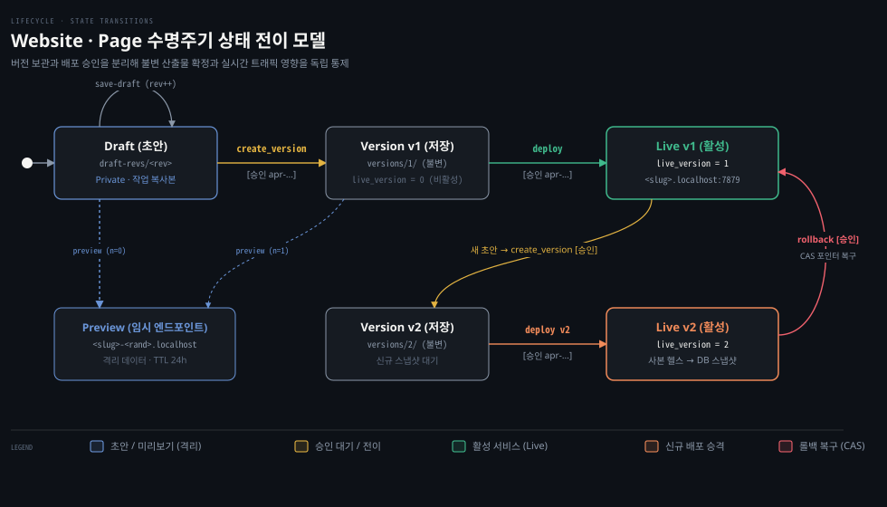
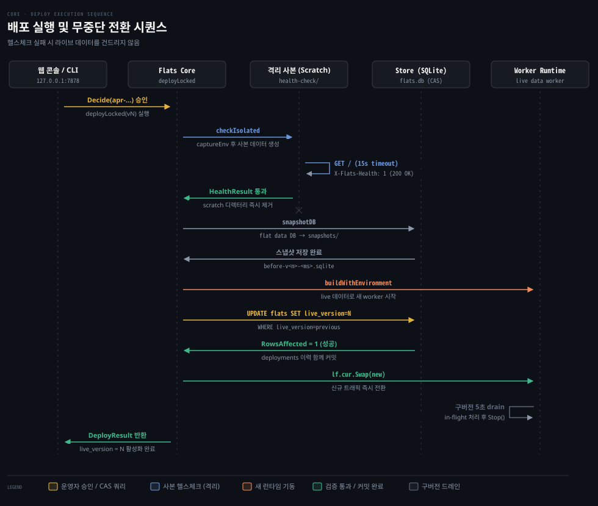

# Version model

---

> Website 와 Page 가 초안(Draft)에서 출발해 불변 버전(Version)으로 승인 및 보관되고, 격리 사본 헬스체크와 DB 스냅샷을 거쳐 안전하게 배포(Deploy) 및 롤백(Rollback)되는 수명주기 전이 모델을 다룹니다.

## 학습 목표와 범위

> flats 의 Version model 이 채택한 4단계 수명주기, 버전 생성과 배포를 별도 승인으로 분리한 배경, 배포 시점의 격리 사본 헬스체크와 무중단 포인터 전환, 데이터 보존 및 롤백 원리를 이해하고 설명할 수 있습니다.

1. Website 와 Page 가 Draft → Version → Deploy → Rollback 수명주기를 거치며 상태를 전이하는 전체 흐름을 설명할 수 있습니다.
2. 불변 산출물 보관(`create_version`)과 실시간 트래픽 활성화(`deploy`)를 단일 단계로 합치지 않고 각각 독립된 승인 객체로 분리한 시스템 안전성 근거를 분석할 수 있습니다.
3. 배포 실행(`deployLocked`) 시 사본 데이터 헬스체크, DB 스냅샷, 실데이터 런타임 시작, 원자적 CAS 포인터 교체, 5초 드레인의 5단계 순서와 장애 시 잔존 상태를 서술할 수 있습니다.
4. "데이터는 버전이 아니라 flat 의 것"이라는 원칙 아래 일반 롤백과 `--restore-data` 데이터 복원의 동작 차이를 비교할 수 있습니다.
5. 임시 미리보기(Preview)의 난수 오리진 격리 메커니즘과 데이터 사본 생성 원리를 실제 CLI 및 코드 경로로 추적할 수 있습니다.

이 문서는 Website 와 Page 에 적용되는 Version model 의 전이 규칙과 배포 엔진을 다룹니다. 파일 번들과 매니페스트 규약(`01-02.bundle·manifest.md`) 및 불변 산출물과 SQLite CAS 기초(`01-01.Immutable artifact·content hash·SQLite WAL.md`)에서 다룬 개념은 필요한 범위에서만 참조합니다. 승인 시스템의 토큰 검증과 콘솔 내부 메커니즘은 04-04 편(예정)에서 상세히 다룹니다.

기준 커밋 3abe537 (v0.11.0, 2026-10-17)


## 1. 문제와 모델

> 배포 단위가 작성 즉시 외부에 노출되거나 불완전한 상태로 라이브 서버에 반영되면 서비스 장애와 데이터 손상이 발생합니다.

웹사이트나 백엔드 서버 앱을 운영할 때 가장 위험한 순간은 작업 중인 코드가 검증 없이 실서비스 환경에 직접 쓰이는 상황입니다. 에이전트나 개발자가 여러 파일을 수정하는 도중 네트워크 접속이 일어나면 미완성 스크립트나 구버전 정적 자산이 뒤섞여 방문자에게 전달됩니다. SQLite 데이터베이스나 파일 스토리지를 쓰는 동적 서버 앱이라면 스키마 마이그레이션을 검증하지 않은 코드가 곧바로 운영 데이터에 쓰기를 시도하다가 데이터베이스를 복구 불가능한 상태로 망가뜨릴 수 있습니다.

flats 는 이 문제에 대응하려고 콘텐츠 성격에 따라 두 가지 상호 배타적인 모델을 제공합니다(`docs/spec/content-models.md`). 사람이 문서를 실시간으로 편집하는 `docs` 와 `design` 은 승인 없이 즉시 반영되는 Revision model 을 따릅니다. 반면 완성도 검증과 운영 통제가 필수적인 웹사이트(`flat`)와 정적 단일 페이지(`page`)는 **Version model** 을 따릅니다(`docs/design.md` 「Model and flows」 Version model). flat 은 최초 저장 시 결정된 타입을 영구 유지하므로 수명주기 도중 모델이 바뀌지 않습니다.

Version model 은 콘텐츠의 상태를 4단계로 나눠 격리합니다:

1. **초안 (Draft)**: 저장 명령을 실행할 때마다 번들 유효성을 검사하고 번호가 매겨진 불변 초안 리비전(`draft-revs/<revision>`)을 생성합니다. 초안은 항상 비공개(Private) 상태이며 라이브 서비스에 영향을 주지 않습니다.
2. **버전 (Version)**: 사람이 승인한 `create_version` 작업에 의해서만 확정 번호(`versions/<n>`)와 고유 내용 해시를 부여받습니다. 이 단계에서는 파일을 보관할 뿐 라이브 포인터를 바꾸거나 서버 런타임을 구동하지 않습니다.
3. **배포 (Deploy)**: 사람이 승인한 활성화 요청에 따라 해당 버전의 격리 사본 헬스체크를 수행합니다. 운영 데이터를 스냅샷한 뒤 원자적 CAS(Compare-And-Swap)로 라이브 포인터를 전환합니다.
4. **롤백 (Rollback)**: 장애 발생 시 이전에 배포되었던 저장 버전으로 즉시 되돌립니다. 기본 롤백은 라이브 데이터를 보존합니다. 명시적으로 요청하면 배포 직전 스냅샷으로 데이터를 복원합니다.

버전 생성과 배포를 별도의 승인 단계로 나눈 이유는 위험 경계가 서로 다르기 때문입니다(`docs/lifecycle-core-contract.md` 「Content and publication」). 버전 저장은 불변 아카이브를 만드는 작업이므로 외부 트래픽이나 운영 데이터에 부작용을 일으키지 않습니다(`LiveData: "untouched"`). 배포는 기존 프로세스를 교체하고 운영 데이터베이스에 새 코드를 연결하는 고위험 변경입니다. 두 단계를 나눠 두면 개발자와 에이전트는 산출물을 먼저 동결해 두고 별도의 운영 검토를 거쳐 원하는 시점에 무중단으로 실서비스에 반영할 수 있습니다.




## 2. 직접 써 보기

> 새로 작성한 코드를 배포하려면 CLI 에서 어떤 명령을 어떤 순서로 입력해야 하는지 명확한 절차가 필요합니다.

명령 순서는 헷갈리기 쉽습니다. 공식 README 문서(`README.md:83-112`)는 웹사이트를 배포하는 기본 명령 순서로 `save-draft`, `create-version`, `deploy` 세 단계를 안내합니다.

실제 CLI 동작을 보려고 로컬 실측(2026-10-18)에서 `rt-probe` 라는 slug 로 초안을 저장합니다:
```bash
flats save-draft rt-probe <dir>
```

로컬 실측(2026-10-18)에서 `save-draft` 명령을 실행하면 저장 결과와 다음에 실행할 명령이 출력됩니다(`internal/cli/commands.go:149`):
```markdown
Saved Private Draft revision 1 of rt-probe: 2 files, 1.0 kB, git 2884b0d (dirty) (type flat)
Current version is unchanged. Request approval for this saved content with `flats create-version rt-probe --revision 1 --hash 158b8a0d…`, or preview with `flats preview rt-probe`.
Took 399ms (pack 13ms, upload 643 B, server round trip 5ms)
```

출력 메시지가 직접 지시하는 `flats create-version` 명령을 그대로 실행합니다:
```bash
flats create-version rt-probe --revision 1 --hash 158b8a0d…
```

이 명령을 내리면 CLI 는 즉시 종료 코드 **3** 을 반환하고 승인 대기 URL 을 출력합니다. 로컬 실측(2026-10-18)에서 확인한 동작입니다. `README.md:106-108` 은 `flats deploy` 도 승인 대기 시 종료 코드 3을 반환한다고 안내합니다:
```markdown
Status: pending_approval
Approval needed: http://127.0.0.1:17878/approvals/apr-…
```

로컬 실측 주소의 포트 17878(관리 콘솔)과 17879(웹 호스팅)는 테스트용 임시 호스트 값이며 기본값은 각각 7878 과 7879 입니다.

`flats --json approvals` 로 대기 중인 승인을 조회하면 요청 파라미터가 동결되어 있습니다. 대상 revision 과 hash, base_version, expected_live 등이 그대로 보존됩니다.

로컬 실측(2026-10-18)에서 인위적으로 다른 해시 값을 지정해 호출하면 충돌이 발생합니다. 종료 코드 1 과 함께 `error: conflict: stale approval: draft hash changed` 가 출력됩니다. 승인 대기 중에 새 작업 파일로 Draft rev 2 를 저장하더라도 이미 접수된 rev 1 승인 요청은 동결된 내용 그대로 대기열(`pending`)에 유지됩니다.

배포 전 동작을 검증하고 싶다면 승인 전이라도 미리보기를 띄울 수 있습니다:
```bash
flats preview rt-probe
```
로컬 실측(2026-10-18)에서 미리보기 엔드포인트는 `http://rt-probe-ef4n465g.localhost:17879` 처럼 매 실행마다 서로 다른 8자리 난수 서브도메인으로 열립니다. CLI 에는 "closes on the next deploy or after 24h without visits" 라는 수명주기 안내가 함께 출력됩니다.

여기서부터의 버전 생성 승인과 배포 완료는 README 절차(실측 아님)의 안내 흐름입니다(로컬 실측 환경에서는 쓰기 부작용을 막으려고 승인을 실제로 결정하지 않고 대기 상태로 두었습니다).

웹 콘솔(`http://127.0.0.1:17878`, 기본값 7878)에서 버전 생성을 승인하면 불변 `v1` 이 디스크에 기록됩니다. 아직 실제 사이트가 라이브 상태가 된 것은 아닙니다.

서비스는 배포 명령을 실행하고 그 요청까지 승인해야 시작됩니다:
```bash
flats deploy --flat rt-probe --version 1
```

이 배포 요청을 콘솔에서 최종 승인하면 `http://rt-probe.localhost:17879`(기본 포트 환경에서는 `http://rt-probe.localhost:7879`) 주소에서 웹사이트가 활성화됩니다. 로컬 실측(2026-10-15~16, v0.9.1)에서 원본 소스 디렉터리의 파일을 직접 수정하더라도 이미 생성된 Page 의 Draft·미리보기 응답 해시와 live 문서에는 반영되지 않습니다. 원본 디렉터리는 저장 시점의 입력일 뿐 서빙 대상이 아닙니다. 새로운 `save-draft` 와 승인 배포를 거칠 때만 변경 사항이 교체됩니다. Flats 데몬을 재시작하더라도 저장된 Draft 와 대기 중인 승인은 SQLite 에 보존됩니다.


## 3. 초안 (Draft)

> 에이전트의 빈번한 작업 저장을 수용하면서도 동시 수정 충돌을 방지하기 위해 낙관적 동시성 검사와 자동 정리 정책을 적용합니다.

초안 저장은 외부 서비스 영향 없이 파일 집합을 디스크에 적재하는 관문입니다. CLI 나 MCP 도구가 `save_draft` 를 호출하면 `internal/core/lifecycle.go:1734` 의 `SaveDraft` 메서드가 진입점이 됩니다:

```go
// SaveDraft is the explicit Draft save facade with optimistic revision checking.
func (s *Service) SaveDraft(ctx context.Context, flat string, files []bundle.File, meta SaveMeta, expectedRevision int, via Via) (store.Version, error) {
	meta.CheckRevision = true
	meta.ExpectedRevision = expectedRevision
	return s.SaveVersion(ctx, flat, files, meta, via)
}
```

내부 구현인 `internal/core/lifecycle.go:1259` 의 `saveDraftLocked` 는 리비전 채번부터 오래된 초안 정리까지 네 단계를 차례로 처리합니다:

1. **리비전 번호 채번 및 낙관적 동시성 제어**: `s.st.NextDraftRevision` 으로 다음 초안 리비전 번호를 획득합니다(`:1264`). 호출자가 `ExpectedRevision` 을 지정했다면 현재 저장된 초안 번호와 대조합니다. 다를 경우 `ErrConflict` 를 반환하고 즉시 거절합니다(`:1275-1277` `if meta.ExpectedRevision != current`). 여러 에이전트가 동시에 같은 flat 에 초안을 덮어쓰는 사고를 막는 장치입니다.
2. **불변 디렉터리 기록**: 초안 파일들은 `flats/<slug>/draft-revs/<revision>` 경로에 저장됩니다(`:97` `draftRevDir`). 번들 유효성 검증과 SHA-256 내용 해시 계산(`bundle.Write`)을 마친 뒤 메타데이터를 `draft_revisions` 테이블에 기록합니다(`:1299`).
3. **Draft 포인터 갱신**: 현재 활성 초안을 가리키는 `drafts` 테이블의 레코드가 최신 리비전 번호와 해시를 가리키도록 갱신합니다(`:1315-1322`). 가장 최근 저장된 버전(`latestVersion`, `:1305-1309`)과 해시가 같다면 `dirty` 플래그를 `false` 로 설정합니다.
4. **오래된 초안 프루닝 (Pruning)**: `internal/core/lifecycle.go:1335` 의 `pruneDraftRevisions` 메서드를 호출해 디스크 공간을 회수합니다. 이때 모든 구버전 초안을 무조건 지우는 것이 아니라 핀(Pin) 보호 규칙을 적용합니다:
   - 현재 최신 초안 리비전(`keep`)은 삭제되지 않습니다(`:1336`).
   - 대기열에 머물러 있는 승인(`status IN ('pending', 'applying')`)이 참조하는 초안 리비전은 보호됩니다(`:1346-1352`).
   - 현재 열려 있는 초안 미리보기(`target == "draft"`)가 바라보는 리비전도 보호됩니다(`:1355-1360`).
   - 보호 대상이 아닌 초안 디렉터리만 `os.RemoveAll` 로 디스크에서 삭제하고 데이터베이스에 프룬(`Pruned`) 상태로 마킹합니다(`:1372-1374`).

불변 리비전을 따로 두고 보호 대상만 골라 남기기 때문에 승인 검토나 미리보기가 진행 중인 초안은 후속 작업이 들어와도 그대로 남습니다.


## 4. 버전 만들기

> 작업 복사본에 불과한 초안을 영구 배포 단위로 승격하려면 승인을 통한 파라미터 동결과 쿼터 검증이 선행되어야 합니다.

초안(Draft)은 작업 복사본일 뿐 영구 배포 단위가 아닙니다. 초안을 배포 가능한 불변 스냅샷으로 승격하려면 `CreateVersion`(`internal/core/lifecycle.go:1686`)을 호출해야 합니다.

`CreateVersion` 은 직접 버전을 생성하지 않고 `RequestCreateVersion`(`:1939`)과 동일하게 `requestFrozen`(`:148`)을 불러 승인 객체를 발행합니다:

1. **상태 불일치 검증**: 현재 초안의 리비전이나 내용 해시가 호출 인자와 다르면 `ErrConflict` 및 `ErrStaleApproval` 을 반환합니다(`:1706-1711`). 검토자가 승인하려는 초안 내용과 에이전트가 요청한 바이트가 1비트라도 어긋나는 것을 방지합니다.
2. **버전 쿼터 검사**: `internal/core/version.go:30` 의 `checkVersionQuota` 메서드는 현재 저장된 버전 개수가 호스트 상한(기본 20개, 로컬 실측 `system.version_quota 20`)에 도달했는지 확인합니다. 초과 시 생성을 거부합니다.
3. **매개변수 동결**: `requestFrozen`(`:148`)은 대상 slug, revision, hash, base_version, expected_live, providers 등을 결합합니다. 이를 바탕으로 SHA-256 멱등성 키(`idempotency_key`)를 계산하고 `apr-<12자리 난수>` 식별자를 가진 승인 행을 삽입합니다. 승인 메커니즘의 세부는 04-04 편(예정)에서 다룹니다.

운영자가 콘솔에서 승인을 결정하면 내부적으로 `internal/core/lifecycle.go:737` 의 `saveVersionFromDraft` 가 실행됩니다:

1. **디스크 쿼터 검사**: `internal/core/version.go:45` 의 `checkVersionDiskQuota` 로 초안 크기(`rev.Size`)를 합산한 총 디스크 사용량이 한도를 넘지 않는지 검증합니다.
2. **버전 번호 채번 및 디렉터리 복사**: `s.st.NextVersionNumber` 로 다음 정수 번호 `N` 을 할당합니다. `flats/<slug>/versions/<N>` 경로를 `os.RemoveAll` 로 정리한 뒤 초안 디렉터리의 전체 파일을 `copyTree` 로 복사합니다(실패하면 디렉터리를 정리하지만 원자적 복사는 아님, `:759-765`).
3. **쿼터 재검증**: 복사 도중 쿼터 설정이 줄었을 가능성에 대비해 `checkVersionQuota` 와 `checkVersionDiskQuota` 를 다시 검사합니다(`:781-787`).
4. **버전 커밋**: `store.CommitVersion`(`internal/store/lifecycle.go:420`)을 호출해 `versions` 테이블에 행을 추가합니다. 이때 `DataImpact: "none"`, `HealthData: "not_run"`, `LiveData: "untouched"` 메타데이터가 기록되고 라이브 포인터(`live_version`)는 바뀌지 않습니다.

불필요해진 이전 버전은 `internal/core/version.go:87` 의 `DeleteVersion` 으로 삭제할 수 있습니다. 현재 서비스 중인 `live_version` 은 삭제 대상에서 보호됩니다.


## 5. 배포

> 검증을 통과한 불변 산출물이 있더라도 실서비스 전환 과정에서 트래픽 중단이나 데이터 오염이 발생하면 배포는 실패로 이어집니다.

전환 도중 트래픽이 끊기거나 데이터가 오염되면 전체 시스템이 마비됩니다. flats 에서 저장된 버전을 실제 트래픽이 유입되는 활성 상태로 승격하는 과정은 `Deploy`(`internal/core/service.go:1337`)와 `deployLocked`(`:1344`)가 담당합니다.

승인 적용 시(`applyActivateApproval`, `internal/core/lifecycle.go:890`), 헬스체크 전에 승인에 동결된 `expected_live` 와 현재 live(`f.LiveVersion`)를 대조합니다(`:894-895`).

라이브 버전이 달라졌다면 `mismatch()`(`:665-667`)로 `ErrConflict`·`ErrStaleApproval`(HTTP 409, `internal/api/api.go:246-250`)을 내고 즉시 중단합니다. 이 검증을 통과해야 `deployLocked`(`:924`)가 호출되어 본격적인 배포 파이프라인에 진입합니다.

동적 서버 플랫과 정적 사이트는 모두 서비스 안정성을 지키려고 같은 5단계를 거칩니다:

1. **격리 사본 데이터 헬스체크 (`internal/core/lifecycle.go:1223` `checkIsolated`)**:
   배포 대상 버전이 정상 동작하는지 보려고 먼저 환경 변수를 캡처하고(`internal/core/service.go:1352` `captureEnvironment`) 임시 디렉터리(`health-check/`)를 만듭니다. 서버 flat 인 경우 운영 데이터베이스와 파일 스토리지를 이 임시 경로로 복사합니다(`:1228`). 임시 디렉터리를 바라보는 런타임을 구동하고 `healthCheck`(`internal/core/service.go:1255`)를 실행합니다.
   - 요청 경로는 매니페스트의 `health` 속성(기본값 `/`)을 사용하며 타임아웃은 15초입니다(`:1250` `healthTimeout = 15 * time.Second`).
   - 요청 시 `X-Flats-Health: 1` 헤더를 보내고 HTTP 2xx 또는 3xx 응답을 받으면 성공으로 판정합니다(`:1299`). 응답 본문은 시크릿 마스킹 후 최대 300바이트까지 기록됩니다(`:1294-1298`).
   - 검사가 끝나면 임시 런타임 인스턴스를 즉시 정지하고 사본 디렉터리를 삭제합니다(`:1226`, `:1238`). 헬스체크가 실패하면 배포는 즉시 중단되고 운영 데이터는 손상 없이 보존됩니다(`Data: dataIsolated`).

2. **운영 데이터베이스 스냅샷 (`internal/core/data.go:201` `snapshotDB`)**:
   헬스체크를 통과하면 배포 직전 시점의 라이브 SQLite 데이터베이스를 `VACUUM INTO`(`:117-127`)로 복사해 `snapshots/before-v<n>-<ms>.sqlite` 파일로 저장합니다(`:201`, `:231` `snapshotAs`). 파일 스토리지 스냅샷과 함께 보존 정책에 따라 오래된 스냅샷은 자동 정리됩니다(`:266` `pruneSnapshots`).

3. **라이브 데이터로 새 런타임 기동 (`internal/core/service.go:1366` `buildWithEnvironment`)**:
   실제 운영 데이터 디렉터리(`s.dataDirOf(slugName)`)를 마운트해 새 버전의 `flats worker` 자식 프로세스나 정적 핸들러를 시작합니다. 이 시점에 런타임 기동이 실패하면 배포 오류를 반환하고 라이브 데이터에 쓰기 시도가 있었을 가능성을 알립니다(`LiveData: "runtime_may_write"`).

4. **원자적 CAS 포인터 교체 (`internal/core/service.go:1376` `activate`)**:
   배포 적용은 flat 별 mutex 를 획득한 상태에서 진행됩니다(`internal/core/service.go:266-270` `s.lock(slug)`). 앞선 승인 적용 시점에 `expected_live` 검증을 거쳤더라도 최후 방어선으로 메타데이터 DB 트랜잭션 안에서 `store.SetLive`(`internal/store/store.go:678`)를 실행합니다:
   ```sql
   UPDATE flats SET live_version=?, updated_at=? WHERE slug=? AND live_version=?
   ```
   `WHERE live_version = previous` 조건이 일치할 때만 1행이 갱신됩니다(`RowsAffected = 1`). 두 배포 요청이 동시에 발생해 이미 다른 버전이 활성화되었다면 0행이 반환되어 `"flat %q changed concurrently; retry"` 평문 에러가 발생합니다(`:689`). server flat 인 경우 코어 서비스가 이를 `&DeployError`(HTTP 422, `internal/core/service.go:1388-1389`, `internal/api/api.go:251-252`)로 감쌉니다. 그 외 타입은 HTTP 500 을 반환합니다(`:267`). 실패 시 새로 기동된 인스턴스를 즉시 정지시킵니다. 동일 트랜잭션 내에서 `deployments` 이력 테이블에 신규 배포 기록이 함께 추가됩니다.

5. **구버전 핸들러 5초 드레인 (`internal/core/service.go:1397-1409`)**:
   `lf.cur.Swap(d)` 로 내부 핸들러 포인터를 원자적으로 교체해 이후 들어오는 모든 신규 HTTP 요청을 새 버전으로 즉시 라우팅합니다. 이전 버전 인스턴스는 즉시 강제 종료하지 않고 백그라운드 고루틴에서 5초간 대기합니다:
   ```go
   timer := time.NewTimer(5 * time.Second)
   defer timer.Stop()
   select {
   case <-timer.C: // drain in-flight requests
   case <-s.stop:  // shutdown must stop every instance before releasing data ownership
   }
   old.inst.Stop()
   ```
   이미 처리 중이던 진행 중(In-flight) 요청이 정상적으로 끝날 수 있도록 보장한 뒤 리소스를 회수합니다. 마지막으로 해당 flat 에 열려 있던 모든 임시 미리보기 엔드포인트를 정리합니다(`:1415` `dropPreviews`).




## 6. 롤백과 데이터 복원

> 배포 후 결함이 발견되었을 때 실서비스 데이터를 보존하면서 코드를 되돌릴지 스냅샷 시점까지 데이터를 원복할지 명확히 선택해야 합니다.

신규 버전 배포 후 예상치 못한 결함이 발견되면 `Rollback`(`internal/core/service.go:1434`)을 호출해 이전 버전으로 서비스를 복구할 수 있습니다.

flats 설계에서 가장 중요한 원칙 중 하나는 "데이터는 버전이 아니라 flat 의 것"이라는 점입니다(`docs/design.md` Rollback 항목, `README.md:213-215`). 버전 디렉터리(`versions/<N>/`)에는 정적 파일과 코드만 담기고 SQLite DB 와 파일 스토리지는 flat 루트 아래의 `data/` 디렉터리에 독립적으로 존재합니다. 버전이 변경되거나 롤백되더라도 운영 데이터는 유지되는 것이 기본 동작입니다.

롤백은 데이터까지 되돌리는지에 따라 두 가지로 나뉩니다:

1. **일반 롤백 (`Rollback`, `restoreData = false`)**:
   코드를 이전 버전으로 되돌립니다(`:1434`). 대상 버전 번호를 지정하지 않으면(`to = 0`) 현재 라이브 직전에 서비스되었던 버전 번호를 이력에서 자동으로 찾아 지정합니다(`:1472` `previousLive`). 내부적으로는 대상 버전을 파라미터로 삼아 `deployLocked` 를 `kind: "rollback"` 으로 호출합니다(`:1462`). 라이브 데이터베이스는 그대로 유지한 채 이전 코드를 담은 런타임만 새로 시작해 포인터를 전환합니다.

2. **데이터 복원 롤백 (`RollbackWithData`, `restoreData = true`)**:
   잘못된 신규 버전이 운영 데이터베이스 스키마를 망가뜨렸거나 잘못된 데이터를 대량으로 기록한 경우 코드와 데이터를 함께 되돌려야 합니다(`:1443`).
   - `RollbackWithData` 는 `requestRollback`(`internal/core/lifecycle.go:227`)을 불러 `action: "rollback"` 승인에 `restore_data: true` 파라미터를 담아 요청합니다(`:270`).
   - 복원 대상 스냅샷은 현재 라이브 버전이 배포되기 직전에 생성되었던 스냅샷 파일입니다(`:1464` `liveSnapshot`). (현재 라이브 버전 아래에서 과거의 임의 스냅샷 데이터만 되돌릴 때는 별도의 진입점인 `RestoreSnapshot`(`internal/core/service.go:1484`, `action: "restore_data"`)을 사용합니다.)
   - 승인 후 실행되는 `restoreLocked`(`:1524`)는 먼저 대상 버전을 해당 스냅샷의 임시 사본에서 시험 기동(`trialRun`)해 헬스체크를 통과하는지 확인합니다(`:1542`). 검증되지 않은 스냅샷으로 라이브 서비스가 중단되는 사고를 방지합니다.
   - 헬스체크를 통과하면 현재 라이브 런타임을 멈추고(`503 Service Unavailable` 일시 반환) 복원 작업 직전의 현재 DB 를 `before-v<to>` 스냅샷으로 임시 백업합니다(`:1558`).
   - 비정상 종료 시 복원을 롤백할 수 있도록 원자적 저널(`restore-journal.json`)을 기록한 뒤(`:1566`) `installSnapshot`(`internal/core/data.go:324`)으로 스냅샷 데이터를 `data/` 경로로 복원합니다.
   - 복원 데이터로 대상 버전 런타임을 띄우고 라이브 포인터를 전환합니다. 도중에 장애가 발생하면 `undo()` 함수가 실행되어 임시 백업해 둔 스냅샷을 원상 복구하고 이전 런타임을 다시 깨웁니다(`:1573-1586`).

서버가 복원 도중 전원 차단 등으로 비정상 종료될 수 있습니다. 이때 재기동 시점에 `internal/core/data.go:369` 의 `recoverRestoreJournals` 가 `restore-journal.json` 을 읽습니다. 미완료된 데이터 교체를 감지하면 백업본 스냅샷으로 원복합니다.


## 7. 미리보기

> 배포 승인을 내리기 전에 실제 브라우저와 네트워크 환경에서 올바르게 동작하는지 확인하지 못하면 결함이 실서비스에 그대로 유출됩니다.

실제 브라우저와 네트워크에서 확인하지 않은 결함은 실서비스로 그대로 새어 나갈 수 있습니다. flats 는 배포 전에 동작을 검증하도록 미리보기(Preview) 기능을 제공합니다(`internal/core/service.go:1988` `OpenPreview`).

미리보기는 대상 선택, 호스트, 데이터, 개수 제한, 수명에서 라이브 서비스와 다르게 동작합니다:

- **대상 유연성**: `n = 0` 을 지정하면 현재 작업 중인 초안(`Draft`)을 대상으로 미리보기를 엽니다(`:2000`, `internal/core/lifecycle.go:1378` `openDraftPreviewLocked`). `n > 0` 을 지정하면 특정 저장 버전(`versions/<n>`)을 대상으로 엽니다.
- **별도 난수 호스트 격리**: `s.previewHost`(`:2011`)는 `http://<slug>-<8자리난수>.localhost:7879` 형태의 임의 호스트명을 발급합니다. 브라우저의 동일 출처 정책(Same-Origin Policy)에 따라 라이브 사이트(`http://<slug>.localhost:7879`)와 쿠키, 로컬 스토리지, 오리진 저장소가 격리됩니다.
- **데이터 격리 (Data Isolation)**: 동적 서버 플랫은 라이브 데이터를 직접 바라보지 않습니다. 대신 `flats/<slug>/previews/<host>` 경로에 라이브 데이터베이스와 파일 스토리지의 전체 사본을 복사해 마운트합니다(`:2021`, `README.md:215` "Preview data is isolated from live data"). 미리보기에서 데이터를 수정하거나 삭제해도 실서비스 운영 데이터에는 영향이 없습니다.
- **동시성 및 쿼터 제한**: 리소스를 무분별하게 점유하지 못하도록 한 flat 당 동시에 열 수 있는 미리보기 개수는 최대 5개로 제한됩니다(`:1985` `const maxPreviews = 5`, `:2008`). 데이터 복사본 생성 시 flat 의 디스크 쿼터를 초과하면 생성이 거부됩니다(`:2015-2019`).
- **수명주기와 만료**: 미리보기는 기본적으로 비공개(Private)로 유지됩니다. 설정된 TTL(기본 24시간, 로컬 실측 `system.preview_ttl_seconds 86400`) 동안 방문이 없으면 자동 종료됩니다. 해당 flat 에 신규 배포(`Deploy`)가 성공하는 즉시 종료되고 사본 데이터 디렉터리가 삭제됩니다.

Page 도 Website 와 같은 Version model 을 공유합니다. Draft 에서 Version 생성과 배포를 거치는 수명주기 전이도 같습니다. 다만 서버 실행 코드를 포함할 수 없고 순수 HTML 정적 자산만 호스팅하므로 런타임 자식 프로세스 기동이나 DB 스냅샷 절차 없이 가볍게 동작합니다(`internal/core/page.go:41` `CreatePage`).


## 8. 한계와 실패 경로

> flats 코드가 명시적으로 거절하거나 복구하는 주요 실패 경로와 그 영향 범위를 정리합니다.

코드베이스 전반에서 확인한 라이프사이클 실패 경로를 원인, 결과 상태, 코드 위치로 나눠 정리합니다:

| 상황 | 원인 및 조건 | 결과 및 시스템 상태 | 코드 위치 |
| :--- | :--- | :--- | :--- |
| **초안 동시 저장 충돌** | `meta.ExpectedRevision` 이 현재 DB 의 `draft.Revision` 과 불일치 | `ErrConflict` 반환, 새 초안 저장 거부, 기존 초안 보존 | `internal/core/lifecycle.go:1276` |
| **버전 개수 쿼터 초과** | 저장된 버전 수가 호스트 상한(기본 20개)에 도달 | `ErrConflict` + `ErrVersionQuota` 반환, `create_version` 요청 거절 | `internal/core/version.go:30-43` |
| **초안 해시 불일치** | `create_version` 인자의 `--hash` 가 현재 초안 해시와 다름 | `ErrConflict` / `ErrStaleApproval` 반환, 버전 생성 거절 | `internal/core/lifecycle.go:1710` |
| **격리 사본 헬스체크 실패** | 헬스체크 요청이 15초 초과 타임아웃 또는 HTTP 비정상 코드 반환 | 배포 중단, `DeployError` 반환, 라이브 서비스 및 데이터 보존 (`Data: dataIsolated`) | `internal/core/lifecycle.go:1254`<br>`internal/core/service.go:1250, 1299` |
| **DB 스냅샷 생성 실패** | 배포 직전 WAL/DB 스냅샷 복사 도중 I/O 또는 잠금 오류 | `ErrSnapshotFailed` 반환, 새 런타임 기동 중단, 라이브 보존 (`LiveData: untouched`) | `internal/core/service.go:1362`<br>`internal/core/data.go:201` |
| **라이브 런타임 기동 실패** | 새 버전 worker 기동 중 구문 오류 또는 메모리 초과 발생 | 배포 중단, 구버전 계속 서비스, 라이브 데이터 쓰기 시도 가능성 경고 (`LiveData: runtime_may_write`) | `internal/core/service.go:1369` |
| **동시 배포 CAS 경합** | `SetLive` 실행 시 `WHERE live_version = previous` 불일치 | 0행 갱신, 새 worker 정지, 평문 에러("changed concurrently; retry") 발생, server flat 은 `DeployError`(422) 반환 (실제로는 선행 승인 적용 시의 `ExpectedLive` 409 와 mutex 가 먼저 차단) | `internal/store/store.go:688-690`<br>`internal/core/service.go:1385-1390` |
| **미리보기 개수 초과** | 활성화된 미리보기가 5개 이상인 상태에서 신규 미리보기 요청 | `ErrConflict` ("5 previews are already open; close one first") 반환 | `internal/core/service.go:2009` |
| **미리보기 디스크 쿼터 초과** | 사본 데이터 생성 시 flat 디스크 쿼터를 초과 | `ErrConflict` 반환, 미리보기 기동 거부 | `internal/core/service.go:2018` |
| **동일 버전 롤백 시도** | 롤백 대상 버전이 현재 이미 서비스 중인 `LiveVersion` 과 동일 | `ErrConflict` ("version %d is already live") 반환 | `internal/core/service.go:1459` |
| **정리된 버전 롤백 시도** | `restoreLocked` 실행 시 대상 버전이 `v.Pruned` 상태이거나 스냅샷 파일 누락 | `ErrConflict` ("was pruned by the retention policy") 반환(Version model 번들은 자동 정리되지 않음: `internal/core/service.go:1121-1123`) 또는 스냅샷 `ErrNotFound` | `internal/core/service.go:1532-1536` |
| **복원 도중 비정상 충돌** | `restoreLocked` 실행 도중 프로세스 비정상 종료 발생 | 재기동 시 `recoverRestoreJournals` 가 백업본 스냅샷을 원복 복구 | `internal/core/data.go:369` |


## 리뷰 노트

> 코드베이스와 문서를 대조 분석하는 과정에서 확인한 구현 특이점과 설계 관찰점입니다.

- `internal/core/lifecycle.go:1335-1376` 의 `pruneDraftRevisions` 는 초안을 저장할 때마다(`:1331`) 즉시 실행됩니다. 최신 리비전(`keep`), 대기·적용 중인 승인(`pending`, `applying`), 그리고 열린 초안 미리보기(`target == "draft"`)가 참조하는 리비전만 `pinned` 맵에 넣어 보호합니다. 여기에 해당하지 않는 이전의 모든 초안 리비전은 개수 한도 없이 `os.RemoveAll` 로 즉시 삭제(`Pruned`)합니다. (100개 한도는 Revision model 의 `revision_quota` 이며 Version model 의 초안에는 적용되지 않습니다.)
- `internal/core/service.go:1366-1370` 의 배포 실패 처리 구조: 새 런타임 시작(`buildWithEnvironment`) 단계는 이미 라이브 데이터 디렉터리를 직접 마운트한 상태에서 수행됩니다. 여기서 에러가 발생하면 배포는 중단되고 구버전 서비스가 유지되지만 시작 직후 실패하기 전까지 라이브 DB 에 일부 쓰기가 발생했을 가능성이 남아 `LiveData: "runtime_may_write"` 로 보고됩니다. 배포 전 `checkIsolated` 사본 헬스체크는 바로 이 런타임 시작 시점의 데이터 오염 위험을 미리 막으려고 필수로 둔 단계입니다.
- `internal/core/service.go:1402-1405` 의 구버전 드레인 타이머(5초)는 상수로 설정되어 있습니다(`timer := time.NewTimer(5 * time.Second)`). 웹소켓이나 긴 HTTP 스트리밍 연결이 5초 이상 지속되는 경우 5초 후 `old.inst.Stop()` 에 의해 연결이 강제 종료될 수 있습니다(추정, 장기 실행 연결용 별도 연장 옵션 없음).
- 현재 라이브 버전이 1번이고 과거 다른 배포 이력이 없는 상태에서 `flats rollback` 을 인자 없이 실행할 수 있습니다. 이때 `previousLive`(`:1472`)는 이전 배포 버전을 찾지 못합니다. 그 결과 `ErrNotFound` 기반의 충돌 에러("there is no available earlier deployed version to roll back to")를 반환합니다.


## 자가 점검 질문

1. **질문 1**: flats 의 Version model 에서 버전 생성(`CreateVersion`)과 배포(`Deploy`)를 분리하고 각각 독립적인 승인을 요구하는 아키텍처적 이유는 무엇입니까?
2. **질문 2**: 배포 실행 함수인 `deployLocked` 가 라이브 데이터 디렉터리로 새 런타임을 구동하기 전에 임시 디렉터리(`health-check/`)에 데이터 사본을 복사해 `checkIsolated` 헬스체크를 먼저 수행하는 이유는 무엇입니까?
3. **질문 3**: 두 개의 동시 배포 요청이 발생했을 때 `store.SetLive` 가 라이브 버전 포인터를 갱신하는 SQL 쿼리에서 Compare-And-Swap(CAS) 메커니즘을 적용하여 덮어쓰기 손실을 차단하는 원리는 무엇입니까?
4. **질문 4**: "데이터는 버전이 아니라 flat 의 것"이라는 원칙에서 일반 롤백(`flats rollback`)과 데이터 복원 롤백(`flats rollback --restore-data`)의 데이터베이스 처리 차이는 무엇입니까?
5. **질문 5**: 미리보기(`flats preview`) 엔드포인트가 라이브 서비스 엔드포인트와 분리되어 브라우저 보안 및 운영 데이터 격리를 달성하는 두 가지 핵심 메커니즘은 무엇입니까?


## 출처와 관련 문서

- [flats GitHub Repository (v0.11.0, 3abe537)](https://github.com/gosuda/flats/tree/3abe537): flats 공식 소스코드 저장소
- [flats Design Specification: Model and flows](https://github.com/gosuda/flats/blob/3abe537/docs/design.md): Version model 및 승인 체계 공식 설계 문서
- [flats Content Models Specification](https://github.com/gosuda/flats/blob/3abe537/docs/spec/content-models.md): 콘텐츠 유형별 수명주기 모델 규격
- [flats Lifecycle Core Contract](https://github.com/gosuda/flats/blob/3abe537/docs/lifecycle-core-contract.md): 코어 라이프사이클 상태 머신 및 데이터 격리 계약
- `01-01.Immutable artifact·content hash·SQLite WAL.md`: 불변 산출물, 콘텐츠 해시 계산, SQLite CAS 원자성 원리
- `01-02.bundle·manifest.md`: 파일 번들 패키징 및 매니페스트 규약
- `04-04.Approval engine·console.md` (예정): 승인 엔진 상태 머신 및 콘솔 제어 상세 메커니즘


## 정답 (자답 후 펼치기)

1. **정답 1**: 초안 저장은 에이전트나 작업자가 빈번하게 파일을 저장하는 비공개 작업이므로 외부 영향이 없습니다. 버전 생성은 검증된 불변 스냅샷 아카이브(`versions/<n>/`)를 디스크에 확정하는 작업으로 라이브 트래픽이나 운영 데이터를 건드리지 않습니다(`LiveData: untouched`). 반면 배포는 기존 실행 프로세스를 교체하고 운영 데이터베이스에 새 코드를 연결하는 고위험 작업입니다. 두 단계를 분리하면 산출물을 먼저 동결해 둔 뒤 운영자가 독립적으로 위험을 평가하고 배포 시점을 통제할 수 있습니다.
2. **정답 2**: 새 런타임 구동 시 문법 오류, 모듈 로딩 실패, 또는 데이터베이스 마이그레이션 결함이 발생하면 운영 데이터가 직접 오염되거나 손상될 위험이 있습니다. 사본 데이터를 쓰는 임시 격리 환경에서 먼저 HTTP GET 헬스체크(15초 타임아웃, 2xx/3xx 응답)를 통과해야만 라이브 데이터베이스 스냅샷 및 실제 기동 단계로 넘어갑니다. 이 순서가 실서비스 데이터의 안전을 지킵니다.
3. **정답 3**: 배포 적용 시 가장 먼저 승인 적용 단계(`applyActivateApproval`)에서 `ExpectedLive` 를 검증합니다(`internal/core/lifecycle.go:894-895`). 불일치 시 `ErrConflict`+`ErrStaleApproval`(HTTP 409)로 구버전 기준 승인의 진입을 차단합니다. 이어 flat 별 mutex 락(`s.lock(slug)`) 보호 아래 헬스체크와 스냅샷을 거칩니다. 최후 방어선으로 `UPDATE flats SET live_version = ?, updated_at = ? WHERE slug = ? AND live_version = ?` CAS 쿼리가 원자적 트랜잭션 내에서 실행됩니다. 선행 배포 요청이 성공하면 1행이 갱신되고 직후 도달한 후행 요청은 조건 불일치로 `RowsAffected` 가 0이 됩니다. 이때 `store.SetLive` 는 평문 에러("flat %q changed concurrently; retry")를 반환합니다. server flat 인 경우 코어 서비스가 이를 `DeployError`(HTTP 422)로 감싸고 새 인스턴스를 즉시 중지시켜 덮어쓰기를 차단합니다.
4. **정답 4**: flats 에서 데이터는 특정 버전이 아니라 flat 자체에 귀속됩니다. 일반 롤백은 라이브 데이터(`data/`)를 그대로 보존한 채 이전 버전의 코드 런타임만 실행하여 포인터를 교체합니다. 반면 `--restore-data` 플래그를 동반한 데이터 복원 롤백은 현재 운영 데이터를 임시 백업한 뒤 해당 라이브 버전이 배포되기 직전에 생성되었던 SQLite/파일 스냅샷을 `data/` 디렉터리에 덮어써서 코드와 데이터를 함께 과거 시점으로 되돌립니다.
5. **정답 5**: 첫째, 미리보기는 `http://<slug>-<8자리난수>.localhost:7879` 와 같이 매번 독립된 임의의 서브도메인을 발급받아 호스팅되므로 브라우저 동일 출처 정책(SOP)에 의해 라이브 사이트의 쿠키 및 웹 스토리지와 분리됩니다. 둘째, 동적 서버 플랫의 경우 라이브 데이터를 직접 마운트하지 않고 `flats/<slug>/previews/<host>` 경로에 라이브 데이터의 사본 스냅샷을 생성하여 격리 실행하므로 미리보기 중의 데이터 변경이 실서비스에 영향을 주지 않습니다.
