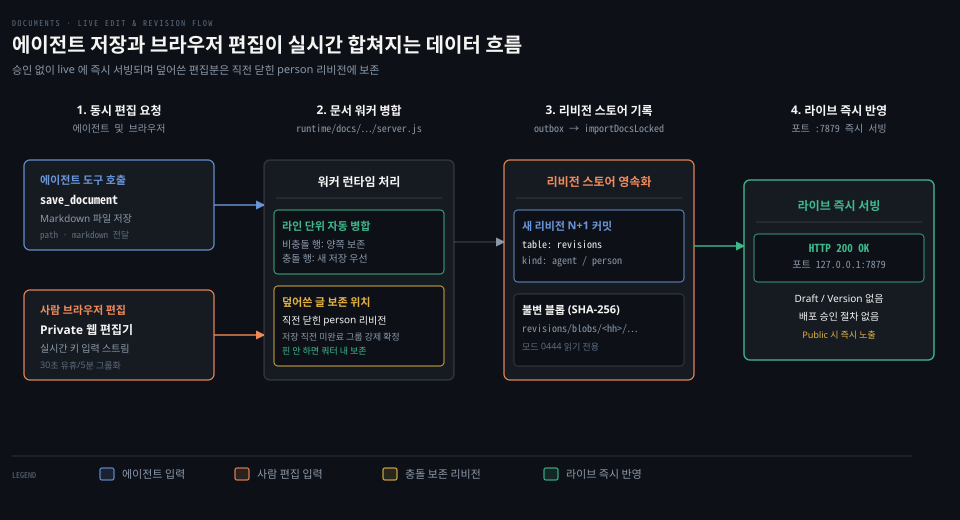
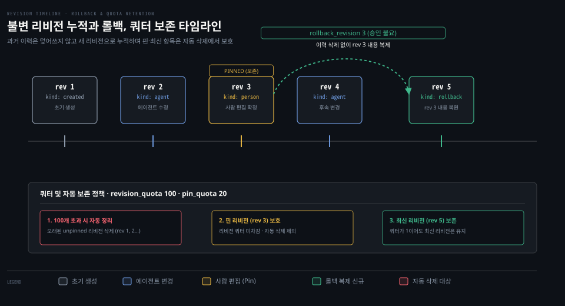

# Revision model

---

> 실시간 협업 문서와 디자인 캔버스에서 배포 승인과 초안 단계를 생략하고 저장 즉시 라이브에 반영하는 이유, 충돌 편집본을 안전하게 보존하는 전체 리비전 스토어, 무승인 롤백 및 자동 쿼터 보존 메커니즘을 다룹니다.

## 학습 목표와 범위

> Revision model 의 동작 원리와 즉시 반영 메커니즘, 충돌 텍스트의 불변 리비전 보존, 내장 자바스크립트 문서 편집기 런타임, 그리고 호스트 레벨의 리비전 스토어와 롤백 제어를 이해하고 설명할 수 있습니다.

1. 사람과 에이전트가 문장이나 아트보드를 실시간으로 협업할 때 배포 승인 루프가 초래하는 지연 문제를 분석하고 `docs` 와 `design` 유형이 Version model 대신 Revision model 을 채택한 배경을 설명할 수 있습니다.
2. `flats save-document` 및 `update_document` 호출이 배포 승인 없이 즉시 라이브 엔드포인트(`127.0.0.1:7879`)에 서빙되는 흐름과 프로세스 기동 방식을 실측 증거로 제시할 수 있습니다.
3. 브라우저 편집 중에 에이전트가 텍스트를 저장할 때 발생하는 라인 단위 병합 규칙과, 덮어써진 사람의 이전 편집분이 직전 `person` 리비전에 보존되는 원리를 도식으로 추적할 수 있습니다.
4. 내장 문서 편집기(`internal/apps/docs`)가 QuickJS 기반 워커 프로세스에서 동적 서버 앱 형태로 실행되며 호스트 프로세스와 SQLite outbox 로 동기화되는 런타임 레이아웃을 분석할 수 있습니다.
5. 디자인 캔버스(`internal/design`)의 세대 검사(`checkGen`) 동시성 제어를 분석할 수 있습니다. 호스트 메타데이터와 SHA-256 블롭 스토어의 무승인 롤백 및 쿼터 정리 파이프라인도 타임라인으로 설명할 수 있습니다.

이 문서는 문서(`docs`)와 디자인(`design`) flat 에 적용되는 Revision model 을 다룹니다. 웹사이트와 단일 정적 페이지의 배포 승인 및 불변 초안 수명주기는 `01-03.Version model.md` 에서 다룹니다. 호스트 데몬 부팅과 서비스 운영 절차는 `05-01` 편으로 넘깁니다.

기준 커밋 3abe537 (v0.11.0, 2026-10-17)


## 1. 문제와 모델

> 실시간 대화형 협업에서 배포 승인 절차가 만드는 지연 문제를 살펴보고 저장 즉시 라이브에 반영하면서도 안전성을 보장하는 Revision model 의 설계 규칙을 분석합니다.

사람과 AI 에이전트가 문서 문단을 함께 고치거나 캔버스 아트보드를 배치할 때 가장 큰 장애물은 승인 지연입니다.

웹사이트를 배포하는 Version model 에서는 초안을 저장한 뒤 버전을 만들려고 승인을 요청합니다. 승인된 버전을 라이브로 승격할 때도 다시 승인을 거칩니다. 오타 교정이나 사소한 위치 변경마다 콘솔 승인을 거친다면 실시간 피드백 루프는 지속될 수 없습니다.

flats 는 이 문제를 풀려고 협업 성격이 강한 콘텐츠에 **Revision model**(리비전 모델)을 적용합니다(`docs/design.md` 「Model and flows」, `docs/spec/content-models.md:89-101`).

에이전트나 사용자가 보기에 마크다운 문서와 캔버스 아트보드에는 비공개 초안, 확정 버전, 미리보기, 배포 승인 단계가 노출되지 않습니다. 내부적으로는 번들이 바뀌는 저장마다 다음 running version 이 생성되고 live 버전 포인터가 전진합니다(`docs/internal/docs-app.md:10-18`). 사람이나 에이전트가 문서를 저장하거나 텍스트를 고치는 즉시 라이브 콘텐츠가 갱신되어 방문자에게 노출됩니다.

배포 승인 단계를 없앤 대신 flats 에는 시스템을 지키는 안전장치가 들어 있습니다:

1. **전체 flat 단위 불변 리비전**: 개별 파일 단위가 아니라 flat 에 속한 모든 문서와 에셋을 단일 불변 스냅샷인 **리비전**(Revision)으로 묶어 저장합니다(`docs/spec/content-models.md:114-121`).
2. **승인 없는 즉시 롤백**: 에이전트가 실수로 내용을 망가뜨렸을 때 관리자 콘솔 승인 없이 `rollback_revision` 도구로 과거 리비전의 전체 상태를 즉시 새 리비전으로 복제 복원합니다.
3. **핀(Pin) 지정**: 영구 보존해야 하는 주요 작업 이정표는 `pin_revision` 으로 고정해 자동 삭제 대상에서 제외합니다.
4. **이중 쿼터 자동 정리**: 보존 개수를 제한하는 리비전 쿼터(기본 100개)와 핀 쿼터(기본 20개)를 두어 디스크 낭비를 막습니다(`docs/spec/content-models.md:122-132`).

여기서 주의할 보안 경계가 하나 있습니다. 한 번 공개(Public) 상태로 승인된 flat 은 이후의 모든 수정 사항이 전 세계 인터넷 방문자에게 바로 노출됩니다(`README.md:60-64`). 에이전트가 라이브 텍스트를 수정할 때마다 반환값에 `public_notice` 경고가 붙는 이유입니다. flat 의 공개 범위를 private 에서 public 으로 바꾸거나 flat 자체를 삭제하는 일은 사정이 다릅니다. 실수로 외부 노출을 일으킬 수 있으므로 모든 flat 유형에서 반드시 운영자 콘솔 승인을 거쳐야 합니다.


## 2. 직접 써 보기

> 명령줄 도구로 마크다운 문서를 직접 저장해 보고, 버전 생성이나 배포 승인 절차 없이 즉시 워커 프로세스가 기동되어 서빙되는 동작을 실측으로 확인합니다.

실제 CLI 환경에서 문서를 저장하며 Version model 과 무엇이 다른지 확인해 봅니다. 로컬 실측(2026-10-18)에서는 `index.md` 파일 하나만 담은 디렉터리를 대상으로 문서를 저장했습니다:

```bash
flats save-document doc-probe ./doc-dir
```

명령은 콘솔에 아래 출력을 돌려주고 종료 코드 0으로 바로 끝났습니다:

```bash
Saved document doc-probe; it is running now (private) at http://doc-probe.localhost:17879. Documents have no publish step.
```

출력 메시지가 명시하듯 문서는 배포(publish) 단계를 갖지 않습니다. 승인 요청 대기나 외부 노출 버전 번호 없이 호출 즉시 호스트 리스너 포트(`127.0.0.1:17879`)에서 라이브 상태로 활성화되었습니다. 내부적으로는 번들이 바뀐 저장이 다음 실행 버전으로 기록되고 live 포인터가 갱신됩니다(`docs/internal/docs-app.md:10-13`).

프로세스 테이블을 보면 메인 `flats serve` 데몬 아래에 `flats worker` 자식 프로세스 1개가 곧바로 새로 기동되었습니다. 해당 주소로 HTTP 요청을 보내면 바로 `200 OK` 와 함께 렌더링된 HTML 웹 문서가 돌아옵니다.

과거 버전을 대상으로 한 로컬 실측(2026-10-15, v0.9.1)에서도 같은 규칙을 확인할 수 있습니다. `type: docs` flat 을 만든 뒤 CLI 에서 버전 조회(`flats versions <slug>`)를 시도하면 시스템은 아래 오류를 반환하며 작업을 명시적으로 거부합니다:

```bash
error: invalid request: documents have no versions, drafts, previews or publishing; …
```

문서 flat 은 외부 버전 번호 관리 체계에 편입되지 않습니다. 로컬 실측(2026-10-15, v0.9.1)에서는 문서 수정 저장 1회 기준 약 3초(첫 저장은 워커 기동 포함 약 5초) 뒤 백그라운드 워커에 반영되어 서빙되었습니다.


## 3. Document 저장과 라이브 편집

> 실시간 협업 중 에이전트의 텍스트 갱신과 파일 저장이 처리되는 내부 제어 함수, 라인 단위 병합 규칙, 그리고 덮어쓴 편집본이 보존되는 메커니즘을 분석합니다.

브라우저에서 사용자가 글을 쓰는 중에 에이전트가 문서를 저장하거나 일부 문단을 수정할 때 변경 충돌을 어떻게 통제하는지 살펴봅니다. 문서 내용을 읽고 수정하는 핵심 진입점은 `internal/core/document.go` 에 있습니다.

```go
// GetDocument prefers the running docs version, including collaborative edits.
// It never starts a worker just to read an unpublished Draft.
func (s *Service) GetDocument(ctx context.Context, slugName, doc string) (Document, error) {
	return s.getDocument(ctx, slugName, doc, -1)
}
```

`GetDocument` (`internal/core/document.go:107`)는 현재 실행 중인 문서 워커의 활성 메모리에서 최신 마크다운 원문을 읽어옵니다. 초안을 읽으려고 워커를 기동하지 않으며 사람들의 실시간 타이핑 내용까지 포함한 텍스트를 반환합니다.

`GetDocumentBlocks` (`internal/core/document.go:114`)는 에이전트가 특정 문단만 골라 고칠 수 있도록 문서를 빈 줄 기준으로 블록화하고 블록마다 암호학적 해시를 제공합니다. `#` 헤딩 라인과 코드 블록은 항상 독립 블록으로 분리되며 최대 1,000개 블록 단위로 페이징됩니다.

텍스트 부분 수정은 `UpdateDocument` (`internal/core/document.go:416`)가 맡습니다. 1회 호출당 1개에서 최대 32개(`MaxDocumentEditOps = 32`)의 연산(`ops`)을 전달할 수 있습니다:

- `replace`: 특정 문자열을 정확히 찾아 치환합니다.
- `replace_block`, `delete_block`: 블록 해시를 지정해 블록 전체를 교체하거나 삭제합니다.
- `insert`: 지정한 블록의 앞(`before`), 뒤(`after`), 또는 섹션 끝(`section_end`)에 새 블록을 삽입합니다.

연산은 순서대로 적용되고 전부 반영 또는 전부 취소(All-or-Nothing) 원칙을 따릅니다. 도중에 연산 하나라도 실패하면 문서 전체가 이전 상태로 롤백됩니다. 클라이언트가 읽은 시점의 문서 지문(`if_hash`)이나 블록 해시가 다른 사람의 편집으로 달라졌다면 `edit_conflict` 오류를 반환하고 아무것도 바꾸지 않습니다.

문서 전체를 덮어쓰거나 번들을 통째로 교체할 때는 `SaveDocument` (`internal/core/document.go:207`)를 호출합니다. 시스템은 크기와 파일 수 한도를 검증하고(`internal/bundle/bundle.go:916-957`) 오류가 나면 복구 안내 문구를 보정합니다(`internal/core/document.go:356-364`):

- **개별 문서 한도**: 단일 마크다운 파일은 최대 1 MiB 를 초과할 수 없습니다(`internal/bundle/bundle.go:948`).
- **전체 문서 수 한도**: 하나의 문서 flat 은 최대 128개의 마크다운 파일만 포함할 수 있습니다(`internal/bundle/bundle.go:952`).
- **총 마크다운 용량 한도**: 모든 문서를 합친 용량은 4 MiB 이하여야 합니다(`internal/bundle/bundle.go:955`).
- **호출 속도 제한**: 라이브 편집 요청은 초당 10회(`documentEditRate = 10`)로 제한되며 초과 시 `unavailable` 을 반환합니다.

사람이 브라우저에서 편집하는 중에 에이전트가 `save_document` 로 새 문서를 저장하면 시스템은 라인 단위(line-by-line) 자동 병합을 수행합니다(`docs/content-types.md:142-144`). 서로 겹치지 않는 행과 인접한 사람의 수정본은 유지되며 동일한 행이 충돌하면 새로 저장된 에이전트의 텍스트가 우선권을 갖습니다. 결합된 문서가 16,000행을 초과하는 등 병합 한계를 벗어나면 병합을 포기하고 저장된 내용으로 전체를 대체합니다(`docs/spec/content-models.md:145-148`).

flats 는 덮어써진 사람의 이전 글, 곧 충돌 텍스트를 담을 별도의 임시 테이블이나 쓰레기통을 두지 않습니다. 대신 저장이나 에이전트 쓰기가 적용되기 직전에 브라우저에서 열려 있던 사람들의 편집 그룹을 즉시 강제 마감해 하나의 완전한 `person` 리비전으로 커밋합니다(`docs/spec/content-models.md:133-135`).

덮어쓰기 직전의 텍스트는 모두 직전 리비전 번호에 보존됩니다. 핀으로 고정하지 않은 리비전은 `revision_quota`(기본 100개) 한도 안에서 보존되므로 과거 리비전을 조회하거나 되돌릴 수 있습니다(`docs/revision-store.md:155-158`).



위 도식은 에이전트의 문서 저장(`save_document`)과 사람의 브라우저 편집이 문서 워커(`server.js`)로 들어와 병합되는 과정을 보여줍니다. 충돌로 덮어써진 사람의 이전 텍스트는 직전 `person` 리비전에 영속화됩니다. 새 리비전 `N+1` 은 SQLite 와 블롭 스토어에 기록되는 즉시 포트 `:7879` 라이브 환경에서 승인 없이 서빙됩니다.


## 4. 문서 편집기가 도는 방식

> 독립된 자식 프로세스로 격리 실행되는 내장 자바스크립트 문서 앱의 런타임 레이아웃과 호스트 동기화 루프를 분석합니다.

문서 flat 은 Go 바이너리 내부에서 정적으로 마크다운을 렌더링하는 구조가 아닙니다. flats 실행 파일 안에는 브라우저 협업 기능을 갖춘 독립 웹 애플리케이션(`internal/apps/docs`)이 내장되어 있습니다(`docs/internal/docs-app.md:9-24`).

`internal/apps/docs/embed.go` 는 컴파일 시점에 빌드된 자바스크립트 자산들을 Go 바이너리에 임베드합니다:

```go
//go:embed dist
var dist embed.FS

// Entry is the server module, relative to FS().
const Entry = "server.js"

// ContentModule is the generated module core writes next to the app files.
const ContentModule = "content.js"
```

호스트는 문서 flat 을 구동할 때 일반 서버 플랫(`kind: server`)과 똑같이 독립된 `flats worker` 자식 프로세스를 띄웁니다(`docs/internal/docs-app.md:12`). 데이터 디렉터리 아래에는 읽기 전용 런타임 구조를 생성합니다:

```markdown
<data>/runtime/docs/<app-hash[:12]>-<content-hash[:16]>/
  server.js, ...      내장 협업 앱 코드 (모드 0444)
  content.js          문서 원문 및 메타데이터를 담은 생성 모듈
```

새 번들이 저장되어도 호스트는 기존 워커를 바로 교체하지 않고 격리된 데이터 사본에서 헬스체크(`/_docs/healthz`)부터 수행합니다(`docs/internal/docs-app.md:14-16`). 헬스체크를 통과해야만 실행 중인 버전을 원자적으로 전환합니다. 헬스체크가 실패하면 저장은 즉시 거부되고 실행 중이던 문서의 텍스트는 그대로 보존됩니다.

로컬 실측(2026-10-18)에서도 임시 호스트의 `runtime/docs/<id>/` 경로에 `server.js`, `content.js`, `mermaid-asset.js` 등의 파일이 생긴 것을 확인했습니다. 운영 호스트 문서 워커는 해당 디렉터리와 자체 데이터베이스(`flats/<slug>/data/db.sqlite`, `-wal`, `-shm`)를 열어 통신합니다.

워커 내부에서 일어난 편집 이벤트는 outbox 를 거쳐 호스트의 리비전 스토어로 전달됩니다. 워커는 자체 로컬 데이터베이스의 outbox 테이블에 변경 이력을 기록합니다. 호스트 프로세스는 이 기록을 아래 경로로 임포트합니다:

1. **저장 및 편집 직후**: `SaveDocument` 나 `UpdateDocument` 가 성공하면 즉시 동기화가 일어납니다. `syncDocsLocked` (`internal/core/docsrev.go:247`)와 `importDocsLocked` (`internal/core/docsrev.go:256`)를 호출합니다.
2. **백그라운드 티커**: `TickDocs` (`internal/core/docsrev.go:609`)가 15초마다 실행 중인 모든 문서의 락을 확인해 동기화와 임포트를 주기적으로 수행합니다.
3. **읽기 시점 동기화**: 이력 조회나 롤백 요청이 들어오면 최대 2초 간격으로 outbox 를 먼저 비워 최신 상태를 맞춥니다.

워커가 별도 프로세스로 격리되어 있으므로 브라우저 자바스크립트 협업 엔진이나 워커가 비정상 종료(crash)되더라도 flats 메인 serve 프로세스는 함께 종료되지 않습니다.[^idle-worker]

[^idle-worker]: 후속 패치인 v0.11.1(2026-10-17)에서는 장시간 요청이 없는 유휴 문서 워커 프로세스를 자동으로 잠재우고 요청 시 다시 깨우는 기능(#132)이 추가되었습니다.


## 5. Design (캔버스 협업 모델)

> HTML 아트보드를 실시간으로 배치하고 편집하는 디자인 캔버스의 프로세스 내 실행 방식과 세대 검사 기반 동시성 제어를 분석합니다.

웹 문서와 달리 여러 화면이 2차원 공간에 나열된 디자인 캔버스는 동시 수정을 어떻게 조율할까요? 디자인(`type: "design"`)은 복수의 HTML 아트보드를 다룹니다(`docs/content-types.md:470-482`).

디자인은 아키텍처에서 문서와 결정적으로 다릅니다. 디자인은 QuickJS 워커 프로세스를 띄우지 않고 flats 호스트 프로세스 내부의 Go 핸들러(`internal/design`)에서 직접 실행됩니다(`docs/design.md` 「Designs」). 런타임 디렉터리를 만들거나 프로세스 간에 통신하는 비용이 없어 가볍게 동작합니다.

디자인의 생명주기는 `internal/core/design.go` 에서 제어됩니다:

- `CreateDesign` (`internal/core/design.go:375`): 초기 `canvas.json` 과 시작 아트보드를 담아 리비전 1(`created`)을 생성합니다. 껍질 번들(`flats.json {"type":"design"}`)을 라이브로 바로 등록합니다.
- `WriteDesign` (`internal/core/design.go:742`): 에이전트가 `save_design` 을 호출할 때 실행됩니다. 1회의 쓰기 호출은 정확히 1개의 `agent` 리비전으로 기록됩니다. 사람의 미확정 편집이 열려 있다면 먼저 `person` 리비전으로 닫은 뒤 에이전트 변경분을 커밋합니다.
- `ApplyDesignOp` (`internal/core/design.go:1141`): 브라우저 사용자가 요소를 이동하거나 텍스트를 수정할 때 호출되는 세부 연산 처리기입니다.

디자인 데이터 모델의 중심은 캔버스 레이아웃 메타데이터를 담은 `canvas.json` 입니다(`internal/design/canvas.go:16` `IndexPath = "canvas.json"`). flats 는 이 파일의 최대 용량을 256 KiB 로 제한합니다(`internal/design/canvas.go:19` `MaxIndexBytes = 256 << 10`). 전체 디자인은 최대 512개의 파일만 가질 수 있으며 경로 세그먼트는 8단계 이하로 제한됩니다(`docs/content-types.md:527-533`).

여러 사람이 동시에 브라우저에서 아트보드를 편집할 때 생기는 갱신 유실(Lost Update)은 `internal/design/ops.go` 의 세대 검사(`checkGen`) 메커니즘이 막습니다:

```go
func checkGen(path string, f File, gen int64) error {
	if f.Gen != gen {
		return fmt.Errorf("%w: %s was replaced", ErrStale, path)
	}
	return nil
}
```

디자인 스토어는 파일마다 단조 증가하는 고유 세대 번호(`Gen`)를 부여합니다. 사용자가 브라우저에서 수정을 시도하면 자신이 읽었던 시점의 세대 번호와 현재 스토어의 세대 번호를 대조합니다. 에이전트 쓰기나 롤백으로 파일이 교체되었다면 세대 번호가 맞지 않아 `ErrStale` 에러와 함께 연산이 거부됩니다.

브라우저 사용자의 자잘한 마우스 드래그나 타이핑 이벤트가 그때마다 리비전을 만들지는 않습니다. 이벤트는 편집자별 그룹으로 묶여 있다가 그 사용자가 30초 동안 입력을 멈추거나 그룹이 시작된 지 5분이 지나면 하나의 `person` 리비전으로 확정 저장됩니다(`docs/spec/content-models.md:106-108`).


## 6. revision store

> SQLite 메타데이터 스키마와 내용 주소 지정 블롭 저장소, 이중 쿼터 자동 정리, 그리고 무승인 롤백의 원자적 동작을 추적합니다.

승인 없이 즉시 반영되는 수정본과 롤백 이력을 영속화하고 추적하는 곳은 `internal/store/content.go` 의 전용 테이블군입니다(`docs/revision-store.md:25-56`).

```sql
CREATE TABLE IF NOT EXISTS revisions (
  flat TEXT NOT NULL REFERENCES flats(slug) ON DELETE CASCADE ON UPDATE CASCADE,
  number INTEGER NOT NULL,
  created_at INTEGER NOT NULL,
  kind TEXT NOT NULL,
  authors TEXT NOT NULL,
  message TEXT NOT NULL,
  rollback_of INTEGER,
  pinned INTEGER NOT NULL DEFAULT 0,
  changes TEXT NOT NULL,
  files INTEGER NOT NULL,
  size INTEGER NOT NULL,
  PRIMARY KEY (flat, number)
);

CREATE TABLE IF NOT EXISTS revision_files (
  flat TEXT NOT NULL,
  number INTEGER NOT NULL,
  path TEXT NOT NULL,
  hash TEXT NOT NULL,
  size INTEGER NOT NULL,
  PRIMARY KEY (flat, number, path),
  FOREIGN KEY (flat, number) REFERENCES revisions(flat, number) ON DELETE CASCADE ON UPDATE CASCADE
);
```

`revisions` (`internal/store/content.go:109`) 테이블은 `(flat, number)` 를 기본키로 삼습니다. 종류(`kind`: `created`, `agent`, `person`, `rollback`, `recovered`), 작성자 목록, 롤백 원본 번호(`rollback_of`), 핀 고정 여부(`pinned`)를 기록합니다. 개별 파일의 경로와 SHA-256 해시는 `revision_files` (`internal/store/content.go:123`)에 따로 저장됩니다.

실제 파일 바이트 데이터는 데이터베이스 본문이 아니라 파일 시스템의 불변 블롭 저장소에 저장됩니다(`docs/revision-store.md:58-79`):

```markdown
flats/<slug>/design/blobs/<hh>/<sha256>      디자인 블롭 (모드 0444)
flats/<slug>/revisions/blobs/<hh>/<sha256>   문서 블롭 (모드 0444)
```

내용 주소 지정(Content-Addressable) 방식이라 내용이 같은 파일은 디스크에 단 1벌만 저장되고 여러 리비전이 해시 포인터로 공유합니다. 새 파일은 임시 디렉터리(`tmp/`)에 기록되고 `fsync` 된 뒤 원자적 rename 으로 블롭 디렉터리에 배치됩니다.

리비전이 끝없이 쌓여 디스크를 채우는 일은 이중 쿼터 정책이 막습니다(`docs/revision-store.md:151-170`). 기본 설정값은 로컬 실측(2026-10-18)의 `flats config show` 결과에서 확인할 수 있습니다:

- `system.revision_quota`: 기본 100개. 핀되지 않은(unpinned) 리비전의 최대 유지 개수입니다.
- `system.pin_quota`: 기본 20개. 핀으로 고정할 수 있는 최대 리비전 수입니다.

트랜잭션이 커밋될 때마다 `retainTx` 가 실행됩니다. 이 함수는 핀으로 고정되지 않고(`pinned = 0`) 롤백 진행 중 보호 락(`content_holds`)도 걸리지 않은 리비전을 가장 오래된 것부터 자동으로 삭제합니다. 최신 리비전은 쿼터가 1로 설정되어 있어도 절대 삭제되지 않습니다.

과거 상태로 되돌리는 롤백(`RollbackRevision`, `internal/core/design.go:1293`)은 과거 이력을 지우거나 덮어쓰지 않습니다. 대상 리비전 R 의 모든 파일 상태를 그대로 읽어와 새로운 리비전(예: rev 5)으로 커밋합니다(`rollback_of = R`). 덕분에 롤백 자체를 다시 롤백할 수도 있습니다.

문서를 롤백할 때는 대상 리비전이 쿼터 정리로 삭제되지 않도록 `content_holds` 테이블에 락을 등록해 안전성을 보장합니다(`internal/core/docsrev.go:692` `rollbackDocs`).

더 이상 참조되지 않는 불변 블롭 파일은 `SweepDesignBlobs` (`internal/core/design.go:1691`)가 10분 주기로, 또는 리비전 삭제 직후에 백그라운드에서 정리합니다. 정리 전에는 `PRAGMA wal_checkpoint(FULL)` 를 먼저 실행해 메타데이터 커밋이 디스크에 완전히 반영되었는지 확인합니다. 그런 다음 10분 이상 지난 고아 블롭만 안전하게 삭제합니다.



위 도식은 리비전 1부터 4까지 쌓인 상태에서 `rollback_revision 3` 명령으로 과거 이력을 훼손하지 않고 리비전 5로 복원하는 타임라인을 보여줍니다. 쿼터 한도(100개)를 넘으면 핀으로 보호된 리비전 3과 최신 리비전 5는 그대로 보존되고 오래된 일반 리비전부터 차례대로 정리됩니다.


## 7. Version model 과 비교

> 웹사이트 중심의 Version model 과 실시간 협업 중심의 Revision model 의 구조적 차이를 7대 비교 항목과 코드 근거로 대조합니다.

운영자가 통제하는 정적 사이트 배포와 실시간 협업 문서는 라이프사이클 설계가 다릅니다. flats 의 두 콘텐츠 데이터 모델은 개발 철학과 협업 방식에서 서로 다른 제약을 둡니다(`docs/spec/content-models.md:12-20`).

| 비교 항목 | Version model (`flat`, `page`) | Revision model (`docs`, `design`) | 공식 근거 |
| :--- | :--- | :--- | :--- |
| **적용 목적** | 완성도 검증 후 배포하는 웹사이트 및 보고서 | 사람과 에이전트가 실시간 협업하는 문서와 디자인 | `docs/spec/content-models.md:14` |
| **작업 복사본** | 비공개 초안 (Private Draft) | 라이브 콘텐츠 자체 (Live content) | `docs/spec/content-models.md:16` |
| **이력 관리 단위** | 단조 증가 버전 번호 (`v1`, `v2`, `v3`, ...) | 전체 flat 스냅샷 리비전 (Revision) | `docs/spec/content-models.md:17` |
| **콘텐츠 변경 승인** | 버전 생성 및 배포 시 운영자 콘솔 승인 필수 | 배포 승인 없음 (저장 즉시 라이브 반영) | `internal/core/document.go:207`, `internal/core/design.go:742` |
| **미리보기 격리** | 임시 서브도메인 기반 독립 미리보기 지원 | 미리보기 엔드포인트 거부 (`refusal.invalid`) | `docs/internal/docs-app.md:16`, `docs/content-types.md:599` |
| **데이터 스냅샷** | 배포 직전 SQLite 무중단 백업 스냅샷 생성 | 데이터 스냅샷 생성 안 함 (불변 블롭 공유) | `docs/internal/docs-app.md:15`, `docs/revision-store.md:58` |
| **되돌리기 방식** | 이전 버전 재배포 승인 (`deploy vN`) | 새 리비전 복제 생성 (`rollback_revision`) | `internal/core/design.go:1293`, `internal/core/docsrev.go:692` |
| **공개 뒤 수정 노출** | 새 버전을 승인 배포하기 전까지 비공개 유지 | Public 상태에서는 저장 즉시 전 세계 노출 | `README.md:60-64`, `internal/core/document.go:527` |
| **이력 보존 정책** | 수동 삭제 전까지 보존 (버전 쿼터 초과 시 생성 거부) | 오래된 미고정 리비전 자동 삭제 (Pin 영구 보존) | `docs/revision-store.md:151-170` |

flats 는 운영자의 통제가 필수적인 프로덕션 웹사이트에는 엄격한 승인과 데이터 스냅샷을 강제합니다. 민첩한 작성이 필요한 문서와 디자인에는 승인 없는 즉각성과 불변 리비전 스토어를 제공합니다. 두 요구는 상반되지만 단일 바이너리 안에서 함께 처리됩니다.


## 8. 한계와 실패

> Revision model 을 도입하거나 운영할 때 코드베이스에서 확인된 기술적 제약과 잠재적 실패 조건을 정리합니다.

1. **문서 번들 규모 한계 (`internal/bundle/bundle.go:948-956`)**:
   단일 마크다운 문서는 1 MiB, 번들 내 전체 문서는 128개 및 4 MiB 총합 용량을 넘을 수 없습니다. 대규모 기술 문서나 위키를 호스팅하려 하면 번들 검증 단계에서 `docs bundle exceeds 128 documents` 오류가 발생하며 저장이 거부됩니다.
2. **라인 단위 병합 실패 및 강제 덮어쓰기 (`docs/spec/content-models.md:146`)**:
   에이전트 저장 시점의 결합된 문서가 16,000행을 초과하는 등 병합 크기 한계를 넘으면 시스템은 라인 병합을 포기하고 저장된 내용으로 전체 문서를 대체합니다. 사람의 편집본은 직전 `person` 리비전에 보존되지만 작업 중이던 화면에서는 일시적인 내용 증발이 발생할 수 있습니다.
3. **디자인 파일 수 및 인덱스 용량 제약 (`internal/design/canvas.go:19`, `docs/content-types.md:533`)**:
   디자인 캔버스는 최대 512개의 파일만 허용하며 캔버스 레이아웃을 기술하는 `canvas.json` 은 256 KiB 이하로 제한됩니다. 복잡한 벡터 아트보드 수백 개를 단일 캔버스에 배치하면 인덱스 크기 초과로 쓰기가 거부됩니다.
4. **리비전 생성 지연 및 경계 형성 (`docs/spec/content-models.md:107`, `docs/internal/docs-app.md:411, 502-503`)**:
   브라우저 사용자의 편집은 워커 데이터베이스에 지속적으로 커밋(`ack`)되지만 호스트 리비전 스토어(`revisions` 테이블)에는 30초 유휴 또는 5분 경과 시점에 그룹이 마감된 뒤 outbox 를 거쳐 영속화됩니다. 이 때문에 사람이 실시간으로 타이핑하는 동안에는 개별 리비전 번호가 바로 부여되지 않고 그룹 마감 시점에 단일 `person` 리비전으로 묶여 기록됩니다. 급작스러운 전원 차단 시 미마감 편집본의 유실 여부는 확인되지 않았습니다(워커 로컬 DB에 커밋된 뒤 ack 반환).
5. **라이브 편집 요청 본문 및 레이트 리밋 제약 (`internal/core/document.go:69, 75`)**:
   `update_document` 호출은 요청 본문 512 KiB, 갱신 결과 256 KiB 이하로 제한되며 플랫당 초당 10회의 호출 빈도를 초과하면 즉시 `unavailable` 에러가 반환됩니다.
6. **블롭 스위프의 지연 정리 (`docs/revision-store.md:270-292`)**:
   리비전이 삭제되어도 디스크의 블롭 파일은 곧바로 지워지지 않고 10분 주기의 스위퍼를 기다려야 합니다. 스위퍼 실행 시점에 `PRAGMA wal_checkpoint(FULL)` 가 완료되지 않으면 안전을 위해 해당 flat 의 블롭 정리를 건너뛰므로 디스크 회수가 일시적으로 지연될 수 있습니다.


## 리뷰 노트

> flats 코드베이스와 공식 문서를 분석하는 과정에서 확인한 세부 구현 특징과 설계 의문점입니다.

- `internal/core/design.go:1293` 의 `RollbackRevision` 함수는 slug 타입을 확인해 `docs` 면 `s.rollbackDocs` 로 위임하고 `design` 이면 직접 롤백합니다. `PinRevision` (`internal/core/design.go:1378`)과 `ListRevisions` (`internal/core/design.go:1438`)도 `internal/core/design.go` 에 위치합니다. 이들은 `s.catchUpDocs` 로 문서 워커 outbox 를 사전 임포트한 뒤 동일한 `revisions` 테이블을 조회합니다. 두 콘텐츠 타입의 리비전 스토어가 `design.go` 에 밀접하게 결합되어 있습니다.
- `internal/core/document.go:356-364` 의 한도 초과 오류 처리 로직: `saveVersionLocked` 에서 반환된 에러의 문자열 포함 여부(`strings.Contains`)로 문제를 식별하여 힌트 메시지(`Fix`)를 교체합니다. 구조화된 에러 타입 대신 문자열 매칭에 의존하므로 하위 패키지의 에러 서식이 바뀌면 안내 메시지가 누락될 가능성이 있습니다.
- `internal/core/docsrev.go:692` 의 `rollbackDocs` 함수는 롤백 대상 리비전이 쿼터 정리로 삭제되는 것을 막기 위해 `content_holds` 테이블에 락 행을 삽입합니다. 이 보호 메커니즘은 핀 쿼터를 소모하지 않으며 롤백 완료 후 outbox 임포트 트랜잭션에서 원자적으로 제거됩니다. 승인 없이 롤백과 리비전 정리가 동시 다발적으로 일어나는 환경에서 데이터 무결성을 유지하려는 방어 장치입니다.


## 자가 점검 질문

1. **질문 1**: 문서(`docs`)와 디자인(`design`) flat 이 Version model 의 불변 초안(Draft) 및 배포(deploy) 승인 단계를 배제하고 Revision model 을 채택한 협업적 이유를 서술하십시오.
2. **질문 2**: 사람이 브라우저에서 마크다운을 타이핑하고 있는 도중에 에이전트가 `save_document` 로 새 문서를 저장할 때, 충돌하는 텍스트가 병합되는 규칙과 덮어써진 사람의 이전 편집본이 영속적으로 보존되는 위치를 설명하십시오.
3. **질문 3**: 문서 flat 이 일반 정적 웹사이트와 달리 `flats worker` 독립 자식 프로세스를 기동하여 실행되는 이유와, 런타임 디렉터리(`<data>/runtime/docs/<id>/`)에 생성되는 핵심 자바스크립트 파일들의 역할을 분석하십시오.
4. **질문 4**: Revision model 에서 과거 이력으로 되돌리는 롤백(`rollback_revision`)이 과거 리비전 행을 덮어쓰거나 수정하지 않고 원자성을 유지하는 방식을 데이터베이스 레코드와 블롭 관점에서 서술하십시오.


## 출처와 관련 문서

- [Flats 공식 저장소](https://github.com/gosuda/flats/tree/3abe537): Flats v0.11.0 원본 소스코드
- `docs/design.md`: 시스템 설계 아키텍처 및 콘텐츠 모델 개요
- `docs/spec/content-models.md`: Version model 과 Revision model 의 전체 사양 규격
- `docs/content-types.md`: 문서(`docs`) 및 디자인(`design`) flat 의 도구 계약과 작성 규칙
- `docs/revision-store.md`: 리비전 스토어 스키마, 블롭 관리 및 쿼터 보존 규격
- `docs/internal/docs-app.md`: 내장 문서 앱의 런타임 레이아웃 및 워커 통합 상세
- `00-02.Concepts.md`: Flats 의 10대 핵심 개념 및 프로세스 아키텍처
- `01-01.Immutable artifact·content hash·SQLite WAL.md`: 불변 배포 단위와 SQLite WAL 동시성 메커니즘
- `01-03.Version model.md`: 불변 초안과 승인 기반 버전 전이 라이프사이클


## 정답 (자답 후 펼치기)

1. **정답 1**: 사람과 에이전트가 실시간으로 대화하며 문장을 다듬거나 아트보드를 배치하는 대화형 협업에서는 수초 단위의 즉각적인 시각적 피드백이 필수적입니다. 오타 교정이나 사소한 문단 변경마다 초안 저장, 버전 생성 승인, 배포 승인의 2단계 운영자 결정을 거치면 협업 루프가 단절됩니다. 그래서 저장이 즉시 라이브에 반영되는 Revision model 을 채택하고 그로 인한 위험은 전체 flat 불변 리비전 스냅샷, 승인 없는 즉시 롤백, 핀 고정, 자동 쿼터 정리 메커니즘으로 통제합니다.
2. **정답 2**: 텍스트는 라인 단위(line-by-line)로 자동 병합됩니다. 겹치지 않는 행과 인접한 사람의 편집본은 그대로 보존되며 동일한 행이 충돌하면 새로 저장된 에이전트의 텍스트가 우선권을 갖습니다. 덮어써진 사람의 이전 편집본은 유실되지 않습니다. 저장 직전 열려 있던 사람들의 편집 그룹이 강제로 마감되면서 생성된 직전 `person` 리비전에 보존되고, 핀하지 않은 리비전은 쿼터(기본 100개) 한도 내에서 유지됩니다.
3. **정답 3**: 문서 flat 은 단순 정적 파일 호스팅이 아니라 브라우저 사용자 간 실시간 동시 편집과 WebSocket 통신을 중계하는 내장 자바스크립트 협업 웹 앱(`internal/apps/docs`)을 구동하기 때문입니다. QuickJS 런타임 환경에서 동작하는 `server.js` 는 서버 역할을 맡아 생성된 `content.js` 모듈에서 초기 문서 원문과 버전 해시 메타데이터를 로드해 서비스합니다. 이 앱을 독립 워커 프로세스로 격리해 두었으므로 스크립트 오작동이나 충돌이 발생해도 메인 serve 프로세스는 함께 종료되지 않습니다.
4. **정답 4**: 롤백은 과거 리비전을 수정하거나 이력을 잘라내지 않습니다. 복원 대상 리비전 R 의 모든 파일 목록과 SHA-256 해시를 참조하는 새 리비전을 생성하여 `revisions` 테이블에 추가합니다(`rollback_of = R`). 파일 바이트는 블롭 스토어에 이미 불변 상태로 보존되어 있어 바이트 복제 없이 메타데이터 레코드만 추가됩니다.
