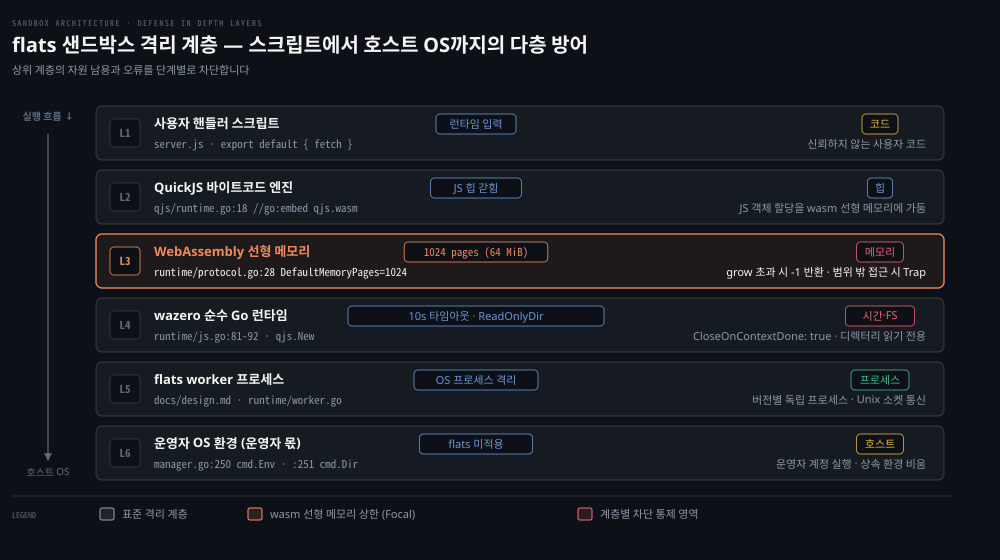
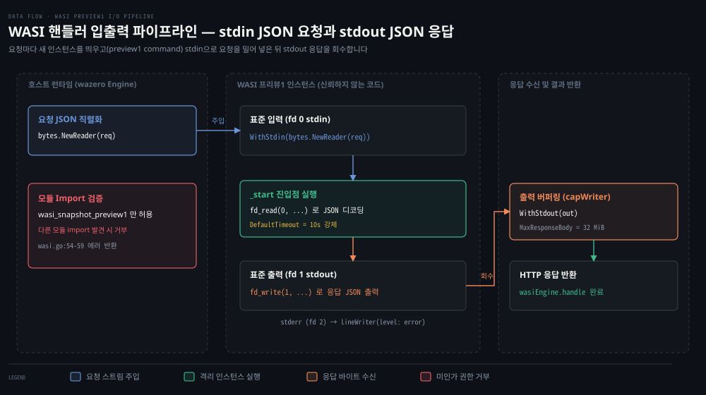

# WebAssembly·WASI·QuickJS·sandbox

---

> 이 문서는 인공지능 에이전트가 작성한 임의의 서버 코드를 개발자의 로컬 머신에서 안전하게 실행하기 위해 통제해야 할 시스템 자원과, WebAssembly 및 WASI preview1의 격리 원리, 그리고 QuickJS 엔진을 wasm 내부에서 구동하는 flats 샌드박스의 다층 방어 구조를 다루는 기초 개념 문서입니다.


## 학습 목표와 범위

> 신뢰하지 않는 코드 실행의 위험 요소를 파악하고 WebAssembly 명세와 WASI capability 모델, 그리고 가상 머신 기반 다층 방어 구조를 이해합니다.

1. 신뢰하지 않는 코드 실행 시 보호해야 할 5대 자원(메모리·시간·파일시스템·네트워크·환경 변수)과 4단계 격리 계층(언어 런타임·wasm 샌드박스·OS 프로세스·사용자 계정)의 방어 범위를 비교하고 설명할 수 있습니다.
2. WebAssembly Core Specification(§2.5 Modules, §2.5.5 Memories, §2.3.12 Limits)에 정의된 선형 메모리와 64 KiB 페이지 크기를 설명할 수 있습니다. import 기반 권한 모델과 memory.grow/trap 메커니즘의 작동 원리도 함께 제시할 수 있습니다.
3. WASI preview1의 capability 기반 모델을 추적할 수 있습니다. POSIX 전역 경로 탐색을 배제하고 파일시스템·네트워크·호스트 ABI 없이 표준 입출력 스트림(stdin/stdout/stderr), 시계, 난수, flat 환경 변수만을 주입해 I/O를 제한하는 방식을 설명할 수 있습니다.
4. QuickJS 엔진을 wasm으로 빌드하여 Go 런타임(wazero) 내에서 실행할 때 JavaScript 힙이 선형 메모리에 갇히는 구조와 V8 isolate, OS 프로세스, 컨테이너 격리의 특성 차이를 비교할 수 있습니다.

이 문서는 WebAssembly 가상 머신과 WASI 입출력의 기초 원리를 다룹니다. 복수 worker 수명 관리는 후속 편(`02-02.worker process·manager.md`)에서 다룹니다. SQLite/FILES 연동(`02-03.fetch handler·env.DB·env.FILES·WebSocket.md`)과 네트워크 제어(`02-04.WASI handler·egress·env·secrets.md`)도 이어지는 편으로 넘깁니다.

기준 커밋 3abe537 (v0.11.0, 2026-10-17)


## 1. 신뢰하지 않는 코드의 실행과 격리 계층

> 외부 에이전트가 생성한 코드는 악의적 의도가 없더라도 자원 고갈이나 시스템 침해를 유발할 수 있으므로 단계별 통제 수단이 필요합니다.

내 컴퓨터에서 서버 핸들러를 돌려야 하는 상황을 가정해 보겠습니다. 이 핸들러는 개발자가 직접 한 줄씩 검토하며 작성한 코드가 아니라 대규모 언어 모델이나 자율 에이전트가 실시간으로 합성한 코드입니다. 이 코드는 정상적인 비즈니스 로직을 수행할 수도 있지만 버그로 인해 메모리를 무한히 할당하거나 무한 루프에 빠질 수 있습니다. 최악의 경우 로컬 파일시스템의 SSH 비밀키를 읽어 외부로 전송하거나 호스트 환경 변수에 담긴 클라우드 인증 토큰을 탈취하려 들 수도 있습니다.

이러한 위험을 방어하려면 실행 환경이 다섯 가지 핵심 자원을 통제해야 합니다.

1. **메모리(Memory)**: 단일 요청이 과도한 메모리를 점유하여 호스트 머신 전체의 운영체제가 OOM(Out of Memory) 상태에 빠지지 않도록 물리적 상한을 강제해야 합니다.
2. **시간(CPU Time)**: `while (true) {}`와 같은 무한 루프나 과도한 연산이 CPU 코어를 영구히 독점하지 못하도록 엄격한 실행 시간제한(Timeout)을 걸어야 합니다.
3. **파일시스템(Filesystem)**: 호스트의 임의 경로(`/etc/passwd`, `~/.ssh/id_rsa`, 프로젝트 소스 코드 등)에 대한 읽기 및 쓰기 접근을 차단하고 허용된 작업 공간만 격리해 제공해야 합니다.
4. **네트워크(Network)**: 인가되지 않은 외부 임의 IP나 사설망 내부 주소(AWS 메타데이터 서비스 `169.254.169.254` 등)로 아웃바운드 소켓 연결을 여는 일을 통제해야 합니다.
5. **호스트 환경 변수(Environment)**: 운영자의 셸 세션에 로드된 시스템 비밀값이나 토큰이 실행 중인 자식 코드에 무단 상속되지 않아야 합니다.

이러한 자원들을 보호하려고 소프트웨어 공학에서는 여러 계층의 격리 수단을 발전시켜 왔습니다.

| 격리 층 | 주요 통제 수단 | 방어 범위와 한계 |
|---|---|---|
| **언어 런타임** (Node.js vm, Python restricted) | 전역 객체 숨김, 스코프 제한 | 동일 프로세스 힙 공유, C++ 애드온이나 프로토타입 오염을 통한 탈출 취약점 존재 |
| **wasm 샌드박스** (wazero, wasmtime) | 선형 메모리 경계, import 함수 제어 | 호스트 시스템 콜 직접 호출 불가, CGO 없이 메모리와 실행 시간 강제 가능 |
| **OS 프로세스** (fork/exec, Worker) | 커널 MMU 가상 메모리, IPC 분리 | 프로세스 비정상 종료 시 메인 호스트 보호, 프로세스 생성 비용 수반 |
| **사용자 계정 및 커널** (UID/GID, cgroups) | OS 권한 모델, 네임스페이스 격리 | 호스트 루트 권한 배제, OS 레벨의 자원 할당 제약 |

flats는 위 네 가지 계층 중 1~3층인 언어 런타임, wasm 샌드박스, 독립 worker 프로세스를 직접 구성합니다.

반면 4층인 별도 계정 분리나 cgroups 격리는 flats가 자체 구현하지 않습니다. worker 프로세스는 호스트 운영자 계정 권한 그대로 실행됩니다. 부모 환경 변수를 상속하지 않고 flat 설정값만으로 `cmd.Env`를 새로 만들며(`internal/runtime/manager.go:250`), 작업 디렉터리를 `cmd.Dir = "/"`(`:251`)로 지정할 뿐입니다. 따라서 계정 수준의 엄격한 자원 통제는 호스트 운영자의 시스템 배치 몫입니다.

어느 한 계층에만 의존하는 방식은 위험합니다. 언어 런타임의 샌드박스는 프로토타입 체인 오염이나 네이티브 메모리 버그로 뚫리기 쉽습니다. OS 프로세스 격리만 사용하면 프로세스 생성 비용이 커서 수많은 마이크로 서비스를 기동하기 부담스럽습니다. 그래서 가상 머신 수준의 메모리 격리와 OS 프로세스 분리를 중첩하는 **심층 방어**(Defense in Depth) 전략이 요구됩니다.



위 계층 다이어그램에는 flats가 사용자 스크립트를 감싸는 구조를 담았습니다. 사용자 코드는 QuickJS 위에서 돌며 WebAssembly 선형 메모리(64 MiB) 안에 갇힙니다. wazero 런타임은 실행 시간(`CloseOnContextDone`)과 번들 디렉터리(`ReadOnlyDir`)를 통제합니다. 독립된 worker 프로세스는 호스트의 메인 데몬을 보호합니다.


## 2. WebAssembly 기본과 선형 메모리

> WebAssembly 모듈은 호스트가 명시적으로 건네준 import 외에는 외부 세계와 소통할 수 없으며 고정된 선형 메모리 안에서만 동작합니다.

WebAssembly(Wasm)는 웹 브라우저뿐만 아니라 서버 환경에서도 안전하고 빠른 코드 실행을 위해 고안된 스택 기반 가상 머신 표준입니다. W3C WebAssembly Core Specification은 모듈의 구조와 실행 규칙을 엄격하게 규정합니다.

핵심 명세는 다음 불변 조건을 보장합니다.

- **모듈 캡슐화(Modules, §2.5)**: WebAssembly 프로그램은 배포와 로딩의 기본 단위인 모듈(Module)로 구성됩니다. 모듈 내부의 함수, 테이블, 메모리는 외부에서 직접 들여다볼 수 없으며 오직 선언된 인터페이스로만 상호작용합니다.
- **Import와 Export(§2.5.11, §2.5.12)**: 모듈은 스스로 운영체제의 커널 시스템 콜을 호출할 능력이 없습니다. 외부 세계와 소통하는 유일한 통로는 호스트가 모듈 인스턴스화 시점에 건네주는 import 객체뿐입니다. 호스트가 파일 열기나 네트워크 연결 함수를 import 목록에 넣어 주지 않으면 모듈은 물리적으로 파일이나 소켓을 생성할 수 없습니다.
- **선형 메모리(Memories, §2.5.5 및 §2.3.15)**: WebAssembly의 메모리는 바이트들의 1차원 연속 배열인 **선형 메모리**(Linear Memory) 구조를 가집니다.
- **64 KiB 페이지 규격(Memory Instances, §4.2.9)**: WebAssembly 실행 명세는 메모리의 길이를 항상 고정 상수인 **65,536 바이트**(64 KiB)의 배수로 정의합니다. 메모리 할당과 크기 확장(`memory.grow`)은 모두 이 64 KiB 페이지 단위로 이루어집니다.
- **메모리 한계(Limits, §2.3.12)**: 메모리 타입은 최소 페이지 크기(`min`)와 선택적인 최대 페이지 크기(`max`)로 제한됩니다. 예를 들어 `(memory 1 1024)`는 초기 1페이지(64 KiB)에서 시작하여 최대 1024페이지(64 MiB)까지만 자라날 수 있음을 명시합니다.
- **트랩과 메모리 확장(Memory Instructions, §4.4.4)**: 모듈이 선형 메모리 범위를 벗어나 접근(load/store)하거나 0으로 나누면 엔진이 즉시 **트랩**(Trap)을 일으키고 실행을 중단합니다. 반면 `memory.grow` 명령으로 최대 페이지(`max`)를 넘어 메모리를 늘리려 할 때는 트랩이 발생하지 않습니다. 대신 실패 값인 `-1`을 반환합니다. flats에서는 이 할당 실패가 QuickJS 내부의 "out of memory" 오류로 이어집니다.

가장 단순한 WebAssembly 텍스트 포맷 예시로 이 구조를 체감해 보겠습니다.

```lisp
(module
  ;; 호스트에서 로그 출력 함수 하나만 들여옵니다
  (import "env" "log" (func $log (param i32 i32)))

  ;; 선형 메모리를 최소 1페이지(64 KiB), 최대 1페이지로 선언합니다
  (memory (export "memory") 1 1)

  ;; 문자열 데이터를 메모리 0번 오프셋에 적재합니다
  (data (i32.const 0) "hello sandbox")

  ;; 외부로 노출할 함수입니다
  (func (export "run")
    ;; 문자열 시작 주소 0과 길이 13을 인자로 로그 함수를 호출합니다
    i32.const 0
    i32.const 13
    call $log
  )
)
```

위 모듈은 호스트로부터 오직 `env.log` 함수 하나만을 import 받았습니다. 이 모듈은 선형 메모리의 0번부터 65,535번 바이트까지만 읽고 쓸 수 있습니다. 65,536번 바이트를 읽으려 시도하는 순간 가상 머신 엔진이 즉각 트랩을 일으킵니다. 모듈 안에는 로컬 디스크의 경로를 가리키는 포인터도 없고 소켓 디스크립터도 없습니다. 호스트가 import로 넘겨준 기능 외에는 모듈이 호스트 컴퓨터 자원에 접근할 수 없습니다. 이 제약이 곧 격리 경계입니다.


## 3. WASI preview1과 Capability 기반 입출력

> WASI preview1은 전역 네임스페이스를 배제하고 호스트가 건네준 파일 디스크립터 권한만으로 파일과 표준 스트림을 다루게 합니다.

WebAssembly 모듈이 유의미한 작업을 하려면 콘솔 출력이나 인자 전달 같은 시스템 수준의 입출력이 필요합니다. 이를 표준화한 명세가 **WebAssembly 시스템 인터페이스**(WebAssembly System Interface, WASI)입니다.

현재 가장 널리 쓰이는 표준인 **WASI preview1**(`wasi_snapshot_preview1`)은 시스템 인터페이스 정의 파일(`preview1/witx/wasi_snapshot_preview1.witx`)에 핵심 시스템 함수들을 규정합니다.

- `fd_read` / `fd_write`: 파일 디스크립터로부터 바이트를 읽거나 씁니다.
- `environ_get` / `environ_sizes_get`: 환경 변수 목록과 크기를 조회합니다.
- `clock_time_get` / `clock_res_get`: 시스템 시계 및 고해상도 타이머 시간을 읽습니다.
- `random_get`: 고품질 난수 바이트를 얻습니다(명세상 구체적 난수 품질은 호스트 구현 몫이며 flats는 wazero 기본의 고정 시드 대신 crypto/rand를 주입).
- `fd_prestat_get` / `fd_prestat_dir_name`: 호스트가 사전에 개설해 넘겨준 디렉토리 정보를 확인합니다.
- `path_open`: 디렉토리 파일 디스크립터를 기준으로 상대 경로의 파일을 엽니다.

여기서 가장 중요한 개념이 바로 **역량 기반 보안**(Capability-based Security)입니다.

전통적인 POSIX 운영체제 환경에서는 프로세스가 전역 루트 파일시스템에 접근할 권한을 갖습니다. 예를 들어 C 언어의 `open("/etc/passwd", O_RDONLY)` 호출은 전역 문자열 경로를 인자로 넘겨 커널에 직접 파일 접근을 요청합니다. 반면 WASI의 `path_open` 명세는 반드시 유효한 디렉토리 파일 디스크립터(`fd`)를 첫 번째 인자로 요구합니다:

```pseudocode
(path_open
  (param $fd $fd)
  (param $dirflags $lookupflags)
  (param $path string)
  ...
)
```

모듈은 스스로 파일 디스크립터를 임의로 만들어낼 수 없습니다. 호스트가 프로세스 초기화 단계에서 사전에 열어 준(Pre-opened) 디렉토리 디스크립터가 없다면 모듈은 파일시스템의 그 어떤 파일도 열 수 없습니다.

호스트가 표준 입력과 표준 출력, 표준 에러 스트림만 연결해 준 상황을 가정해 보겠습니다. 사전 개설 디렉토리를 일체 제공하지 않으면 모듈은 파일시스템에 접근할 핸들을 얻지 못합니다. 그 결과 로컬 디스크의 존재 자체를 인식할 수 없습니다.

이 특성을 활용하면 서버 실행 모델을 간결하고 안전하게 구축할 수 있습니다.

1. 호스트는 클라이언트의 HTTP 요청 데이터를 메모리 상의 JSON 바이트 버퍼로 준비합니다.
2. WASI 인스턴스를 생성하면서 이 버퍼를 모듈의 `stdin`(fd 0) 스트림에 연결합니다.
3. 모듈의 진입 함수(`_start`)를 실행하면 모듈은 `fd_read(0, ...)`를 호출하여 요청 JSON을 읽고 비즈니스 로직을 수행합니다.
4. 처리 결과 응답 JSON은 `fd_write(1, ...)`를 호출하여 `stdout`(fd 1)으로 내보냅니다.
5. 호스트는 stdout 버퍼에 모인 바이트를 회수하여 HTTP 응답으로 변환하고 인스턴스를 즉각 파기합니다.



위 데이터 흐름 다이어그램에 이 단순하고 견고한 파이프라인을 그렸습니다. 호스트는 파일시스템 마운트나 네트워크 ABI를 일체 제공하지 않고 표준 스트림(stdin/stdout/stderr), 시스템 시계·고해상도 타이머, 난수 소스, flat에 설정된 환경 변수만을 연결합니다(`internal/runtime/wasi.go:99-118`). 모듈이 `wasi_snapshot_preview1` 이외의 임의 모듈을 import 하려 들면 로딩 단계에서 즉시 거절합니다(`internal/runtime/wasi.go:54-59`).


## 4. JavaScript 인터프리터를 wasm 안에서 구동하기

> C로 작성된 경량 JavaScript 엔진을 WebAssembly로 빌드하면 스크립트 엔진의 힙 전체가 선형 메모리 경계에 갇히게 됩니다.

대부분의 웹 개발자와 에이전트는 C나 Rust로 WebAssembly 바이트코드를 직접 컴파일하기보다 JavaScript나 TypeScript로 서버 코드를 작성하는 것을 선호합니다. 그렇다면 임의의 JavaScript 코드를 WebAssembly 샌드박스 안에서 안전하게 구동하려면 어떻게 해야 할까요?

가장 효과적인 해결책은 **JavaScript 엔진 자체를 WebAssembly로 컴파일**하는 것입니다.

### QuickJS의 구조와 wasm 임베딩

**QuickJS**는 프랑스의 프로그래머 파브리스 베야르와 찰리 고든이 개발한 소형 자바스크립트 엔진 계열입니다. C 언어로 작성되어 임베딩에 적합합니다. flats는 커뮤니티 포크인 QuickJS-ng 빌드를 fastschema/qjs를 거쳐 채택했습니다(`internal/qjs/qjswasm/helpers.c:121`, `internal/qjs/stack.go:21`).

QuickJS의 C 소스 코드를 WASI 타깃의 WebAssembly 바이너리(`qjs.wasm`)로 컴파일하면 구조상 격리가 따라옵니다.

- **JS 힙의 격리**: QuickJS 내부의 메모리 할당 함수(`js_malloc`, `js_free`)와 가비지 컬렉터는 WebAssembly 가상 머신이 제공하는 선형 메모리 풀 안에서만 메모리를 쪼개어 사용합니다.
- **주소 공간 격리와 선형 메모리 크기 상한**: 선형 메모리는 wazero가 호스트 Go 프로세스 내부에 확보한 연속 바이트 배열입니다. 사용자 스크립트가 거대한 객체를 만들어도 JavaScript 코드는 포인터 조작으로 호스트 메모리 주소를 침범할 수 없습니다. 메모리 소비도 할당된 선형 메모리 상한 내로 제한되지만 선형 메모리 자체는 호스트 물리 메모리를 씁니다. 로컬 실측(2026-10-18)에서도 `/mem` 폭주 후 worker RSS가 365,312 KB에 달하는 한계가 관측되었습니다.

### wazero: CGO 없는 순수 Go 런타임

Go 언어 기반 호스트에서 WebAssembly를 실행할 때 흔히 Wasmtime이나 Wasmer 같은 C/C++ 라이브러리를 CGO로 연결해 사용하지만 CGO를 쓰면 크로스 컴파일이 복잡해지고 바이너리 크기가 커집니다. CGO 호출 경계의 오버헤드와 C 라이브러리의 메모리 결함 위험도 발생합니다.

테트레이트(Tetrate)가 개발한 **wazero**는 CGO 의존성이 전혀 없는 100% 순수 Go(Pure Go) WebAssembly 런타임입니다. wazero를 채택하면 단일 정적 Go 바이너리만으로 플랫폼에 구애받지 않고 샌드박스 환경을 배포할 수 있습니다.

wazero는 안전한 서버 샌드박스를 구축하는 데 필요한 핵심 기능을 갖추고 있습니다.

1. **컴파일 캐시(Compilation Cache)**: WebAssembly 모듈을 기계어로 컴파일하는 비용은 가볍지 않습니다. wazero는 `CompilationCache`를 제공하여 동일 모듈을 컴파일한 기계어를 메모리나 디스크에 캐싱해 재사용합니다. 캐시를 재사용하면 새로운 인스턴스를 생성할 때의 컴파일 지연이 줄어듭니다(로컬 실측 2026-10-18에서 미리보기 첫 요청 응답 0.008s; 캐시 효과를 따로 재지는 않음).
2. **Context 기반 강제 취소(`WithCloseOnContextDone`)**: 사용자 코드가 무한 루프에 빠졌을 때 이를 외부에서 강제로 중단시키는 것은 까다로운 문제입니다. wazero는 Go 표준 `context.Context`와 연동되는 `WithCloseOnContextDone` 옵션을 지원합니다. 지정된 타임아웃 시간이 만료되어 컨텍스트가 취소되면 모듈이 닫히고 다음 함수 호출이나 루프 반복 지점에서 실행을 중단합니다(`internal/qjs/runtime.go:61-62`).


## 5. 다른 격리 방식과의 비교

> V8 isolate, OS 프로세스, 컨테이너, wasm 샌드박스는 각각 격리 강도와 시작 시간, 자원 소모의 트레이드오프가 다릅니다.

신뢰하지 않는 코드를 격리하는 방식은 WebAssembly 외에도 여러 가지가 존재합니다. 각 기술의 장단점과 설계적 선택 기준을 비교해 보겠습니다.

### V8 Isolate (Cloudflare Workers 모델)

Cloudflare Workers는 단일 운영체제 프로세스 안에서 수천 개의 독립된 자바스크립트 런타임 공간인 **V8 Isolate**를 생성하여 격리를 구현합니다.

- **장점**: Isolate는 별도 프로세스 없이 V8 내부의 힙과 스택만 분리합니다. Cloudflare 공식 문서에 따르면 별도 프로세스 대비 약 100배 빠른 시작("around a hundred times faster")을 제공합니다. 메모리 오버헤드도 한 자릿수 낮습니다("an order of magnitude less memory").
- **한계**: 방대한 C++ 코드의 메모리 버그나 스펙터(Spectre) 같은 CPU 사이드 채널 공격에 노출될 위험이 이론적으로 존재합니다. 동일 프로세스 내 다른 Isolate 메모리가 유출될 수 있습니다(Cloudflare는 보안 모델에서 스펙터 완화책을 문서화했습니다). CGO 없는 순수 Go 바이너리로 직접 임베딩하기도 어렵습니다.

### OS 프로세스 격리

전통적인 서버 환경에서는 운영체제의 프로세스 경계를 격리 수단으로 사용합니다.

- **장점**: CPU 하드웨어의 MMU(Memory Management Unit)와 커널의 가상 메모리 페이지 테이블이 프로세스마다 독립된 주소 공간을 나눕니다. 한 프로세스가 세그멘테이션 폴트로 종료되더라도 커널의 주소 공간 격리 덕분에 다른 프로세스나 호스트의 메모리 공간은 직접 침범당하지 않습니다.
- **한계**: 새로운 프로세스를 생성(fork/exec)하는 데 커널 레벨의 생성 비용이 수반됩니다. 프로세스마다 독자적인 기본 메모리 풋프린트를 차지하므로 수많은 사용자 코드를 동시에 띄우기에는 자원 소모가 큽니다.

### 컨테이너 (Docker / OCI)

리눅스 네임스페이스(Namespaces)와 cgroups를 결합하여 완전한 루트 파일시스템 환경을 제공합니다.

- **장점**: 기존의 리눅스 바이너리와 라이브러리 생태계를 수정 없이 그대로 패키징하여 배포할 수 있습니다.
- **한계**: 베이스 이미지 레이어 용량이 크고 컨테이너 런타임 기동에 시간이 소요되어 가벼운 함수 단위 실행에는 무겁습니다.

| 비교 항목 | V8 Isolate | WebAssembly 샌드박스 (wazero) | OS 프로세스 격리 | 컨테이너 (Docker) |
|---|---|---|---|---|
| **격리 주체** | V8 C++ 런타임 엔진 | Wasm 가상 머신 (선형 메모리) | OS 커널 MMU | Linux 커널 네임스페이스 |
| **시작 지연** | 최소 (콜드 스타트 없음) | 빠름 (컴파일 캐시 재사용) | 보통 (프로세스 생성 오버헤드) | 느림 (컨테이너 런타임 기동) |
| **메모리 오버헤드** | 최소 (Isolate 단위 힙/스택) | 작음 (선형 메모리 상한 제약) | 중간 (프로세스 기본 풋프린트) | 큼 (컨테이너 런타임 및 이미지 레이어) |
| **Go 단일 배포** | 불가 (CGO/C++ 의존) | 지원 (Pure Go 바이너리) | 지원 (외부 exec 호출) | 불가 (Docker 데몬 필요) |
| **파일/망 차단** | 런타임 바인딩으로 제어 | import 구조로 호출 차단 | OS 권한 및 cgroup 제어 | seccomp / 네임스페이스 |

flats는 이러한 특성을 고려하여 WebAssembly 샌드박스(wazero)를 OS 프로세스 격리 안에 한 겹 더 감싸는 하이브리드 모델을 선택했습니다. 이 모델은 CGO 없는 가벼운 단일 Go 바이너리 배포성을 유지합니다. 런타임 충돌이나 크래시가 발생하더라도 메인 데몬 프로세스를 보호합니다.


## 6. 흔한 오해

> WebAssembly를 도입할 때 자주 마주치는 대표적인 두 가지 보안 오해를 짚어봅니다.

### 오해 1: "WebAssembly로 돌리기만 하면 무조건 안전하다"

많은 개발자가 코드를 WebAssembly로 컴파일하기만 하면 마법처럼 완벽한 보안이 달성된다고 믿습니다. 하지만 이는 반만 맞는 이야기입니다.

WebAssembly 모듈 자체가 격리된 선형 메모리 안에서 실행되는 것은 사실이지만 호스트가 어떤 import 함수를 건네주느냐에 따라 모듈의 실질적 권한이 결정됩니다. 호스트 개발자가 편의를 위해 호스트의 임의 파일을 열어 주는 헬퍼 함수나 셸 명령어를 실행하는 함수를 WebAssembly 모듈의 import 테이블에 바인딩해 주었다면 악의적인 코드는 그 함수를 호출하여 호스트 머신을 손쉽게 장악할 수 있습니다.

WebAssembly의 안전성은 "모듈이 스스로 권한을 획득할 수 없다"는 소극적 제약에서 나옵니다. 호스트가 부여한 위험한 권한까지 막아 주는 것이 아니므로 호스트는 모듈에 건네는 import 함수 목록을 최소한으로 통제해야 합니다.

### 오해 2: "메모리 상한을 걸어 두면 실행 시간도 저절로 통제된다"

WebAssembly 모듈의 메모리 상한을 64 MiB로 걸어 두었으니 시스템이 안전할 것이라고 방심하기 쉽습니다.

하지만 단 1바이트의 추가 메모리도 할당하지 않는 단순한 무한 루프 코드를 생각해 보겠습니다:

```javascript
export default {
  fetch(req) {
    while (true) {
      // 아무런 객체도 생성하지 않고 CPU 코어만 100% 점유합니다
    }
  }
};
```

위 코드는 메모리 사용량이 늘어나지 않으므로 `DefaultMemoryPages`(1024페이지, 64 MiB) 메모리 상한에 걸리지 않습니다. 오직 메모리 상한에만 의존하는 시스템은 이 단 세 줄의 코드 앞에서 스레드가 영원히 멈추어 버립니다. 따라서 메모리 상한과 실행 시간 상한(Context Timeout)은 반드시 독립된 두 축으로 동시에 강제되어야 합니다.


## 7. 「flats 에서는」

> flats는 임베디드 QuickJS와 순수 Go wazero 엔진을 결합하여 가벼우면서도 견고한 서버 샌드박스를 구현합니다.

이론적인 격리 모델을 실제 단일 바이너리 시스템으로 구현하려면 어떤 코드와 제약이 필요할까요? flats 코드베이스(`gosuda/flats`)가 채택한 엔진 패치와 런타임 제약 상수, 그리고 로컬 실측 데이터로 그 해답을 확인해 보겠습니다.

### 엔진 및 메모리 통제

flats는 JavaScript 실행을 위해 fastschema/qjs v0.0.6을 포크하여 내장하고 있습니다(`internal/qjs/NOTICE`). 원본 `qjs.wasm` 바이트코드는 수정 없이 그대로 바이너리에 임베드됩니다:

```go
// internal/qjs/runtime.go:18
//go:embed qjs.wasm
var wasmBytes []byte
```

flats 팀은 wazero v1.12.0 이상의 타입 시스템 변화와 다중 런타임 격리를 지원하려고 fastschema/qjs를 포크하면서 중요한 변경 사항을 적용했습니다(`internal/qjs/runtime.go:21-26` FORK 주석).

1. **런타임별 컴파일 및 캐시**: wazero 1.12 이상은 함수 타입 ID를 단일 저장소에 묶으므로 각 `Runtime` 인스턴스가 `qjs.wasm`을 직접 컴파일해야 합니다. flats worker는 `CacheDir`로 넘겨받은 `<data>/cache/wazero` 경로를 씁니다(`internal/runtime/manager.go:109-114`, `:132`). 이 경로에 디렉토리 파일 캐시를 구성합니다(`NewCompilationCacheWithDir`, `internal/qjs/runtime.go:49`). worker마다 별도 프로세스로 뜨더라도 디스크 캐시를 공유해 재컴파일 오버헤드를 줄입니다(`internal/qjs/NOTICE:13-15`). `CacheDir`가 없으면 메모리 공유 캐시를 씁니다(`NewCompilationCache`, `:42`).
2. **독립된 타임아웃과 메모리 상한**: `wazero.RuntimeConfig`를 런타임마다 새로 생성하여 `CloseOnContextDone`과 `MemoryLimitPages`가 인스턴스별로 독립 적용되도록 수정했습니다.
3. **선형 메모리 상한 강제**: flats worker는 런타임 생성 시 `w.spec.pages()`를 전달합니다(`internal/runtime/js.go:86`, `internal/runtime/protocol.go:74-79`). `MemoryPages`가 비어 있으면 `DefaultMemoryPages = 1024`(`internal/runtime/protocol.go:28`)를 씁니다. 이 방식으로 항상 1024페이지(64 MiB) 상한을 강제합니다(`internal/runtime/manager.go:132`). qjs 패키지 내부의 `DefaultMemoryLimitPages`(`internal/qjs/runtime.go:33-35`)는 옵션이 0일 때의 대체 상수입니다:

```go
// internal/runtime/protocol.go:28, 74-79
DefaultMemoryPages = 1024 // 64 KiB wasm pages = 64 MiB

func (s *workerSpec) pages() uint32 {
	if s.MemoryPages == 0 {
		return DefaultMemoryPages
	}
	return s.MemoryPages
}
```

1024페이지는 정확히 `1024 × 64 KiB = 64 MiB`에 해당합니다. 가상 머신 선형 메모리 계층에서 VM 하나당 64 MiB(기본 풀 4개 시 worker당 최대 256 MiB, `internal/runtime/protocol.go:29`) 상한을 강제함으로써 호스트 메모리를 보호합니다.

### 워커 기본 제한값

격리된 worker 프로세스 내부에서 적용되는 기본 정책 상수는 `internal/runtime/protocol.go:27-30`에 명시되어 있습니다:

```go
// internal/runtime/protocol.go:27-30
const (
	DefaultTimeout     = 10 * time.Second
	DefaultMemoryPages = 1024 // 64 KiB wasm pages = 64 MiB
	DefaultPoolSize    = 4
	MaxRequestBody     = 10 << 20
	// ... MaxResponseBody, MaxFileValue 등으로 이어짐
)
```

모든 서버 핸들러 요청에는 최대 10초(`DefaultTimeout`)의 시간제한이 걸립니다. 요청 본문 크기는 최대 10 MiB(`MaxRequestBody`)로 제한됩니다.

### WASI 핸들러와 엄격한 Import 거부

flats는 JavaScript뿐만 아니라 사용자가 직접 빌드한 `.wasm` 바이너리를 구동하는 WASI 핸들러 모듈도 지원합니다(`internal/runtime/wasi.go`).

WASI 모듈을 로드할 때 flats는 오직 공식 WASI preview1 모듈만을 허용하고 외부 임의 모듈을 import 하려는 시도를 엄격하게 차단합니다:

```go
// internal/runtime/wasi.go:45
if _, err := wasi_snapshot_preview1.Instantiate(ctx, rt); err != nil {
    rt.Close(ctx)
    return nil, err
}

// internal/runtime/wasi.go:54-59
for _, f := range cm.ImportedFunctions() {
    if mod, _, _ := f.Import(); mod != wasi_snapshot_preview1.ModuleName {
        rt.Close(ctx)
        return nil, fmt.Errorf("%s imports from module %q; only %s is available", w.spec.Entry, mod, wasi_snapshot_preview1.ModuleName)
    }
}
```

요청이 들어오면 모듈에 파일시스템 마운트나 호스트 ABI를 일체 제공하지 않고 표준 입출력 스트림과 시계·난수, flat 환경 변수만을 연결하여 새 인스턴스로 실행합니다:

```go
// internal/runtime/wasi.go:99-118
cfg := wazero.NewModuleConfig().
    WithName("").
    WithArgs(filepath.Base(e.w.spec.Entry)).
    WithStdin(bytes.NewReader(req)).
    WithStdout(out).
    WithStderr(errOut).
    WithSysWalltime().
    WithSysNanotime().
    WithNanosleep(ctxSleep(ctx)).
    WithRandSource(rand.Reader)
// ... flat에 설정된 환경 변수와 시크릿(e.w.spec.Env)만 WithEnv로 주입
```

공식 문서 `README.md:206-211`가 명시하듯 WASI 서버 flat은 요청마다 새 인스턴스를 띄우는 명령 모델로 동작합니다. stdin으로 요청 JSON을 받고 stdout으로 응답 JSON을 냅니다. 상속된 호스트 환경 없이 설정된 환경 변수, 시크릿, 시계와 난수만 받습니다. 여기에는 SQLite/FILES 호스트 ABI나 파일시스템 마운트가 없습니다. 외부 네트워크나 WebSocket API도 일체 제공하지 않습니다.

### 로컬 실측 검증 (2026-10-18)

실제 macOS 로컬 환경에서 flats v0.11.0 바이너리를 기동하여 샌드박스의 방어 동작을 실측한 결과는 코드의 설계 의도와 일치했습니다.

- **무한 루프 방어**: `while(true){}`를 포함한 핸들러(`/loop`)로 HTTP 요청을 보낸 결과 정확히 10.02초 뒤에 `504 Gateway Timeout` 응답이 반환되었습니다:
  `"Gateway Timeout: the server flat's handler did not finish within 10s."`
  이 결과로 Go의 컨텍스트 취소와 `internal/runtime/worker.go:400`의 타임아웃 판정이 정상 작동함을 확인했습니다.
- **메모리 폭주 차단**: 배열 크기를 무한히 키우는 핸들러(`/mem`)로 요청을 보낸 결과 0.82초 만에 메모리 한도에 걸려 `500 Internal Server Error` 응답이 반환되었습니다:
  `"Internal Server Error: the server flat's handler ran out of memory."` (`internal/runtime/worker.go:402`)
  flats는 QuickJS 힙 한도를 wasm 상한의 3/4인 48 MiB로 설정했습니다(`internal/runtime/js.go:86-89`). 일반적 고갈 시 clean InternalError를 유도하는 설계입니다. 실측에서는 어느 한계에 먼저 도달했는지 관측되지 않았습니다. 두 경우 모두 worker가 동일한 500 오류 문구를 반환합니다.
- **오류 격리와 복원력**: 메모리 폭주로 500 에러를 낸 직후 정상 엔드포인트(`/`)로 요청을 보낸 결과 0.027초 만에 정상 `200 OK` 응답이 돌아왔습니다. 이전까지 누적되었던 SQLite 데이터베이스 상태(`hits`)도 온전히 보존되었습니다. flats는 한계에 도달한 런타임 인스턴스를 폐기하고 새로 교체합니다(`docs/design.md` 「Server flats」: "a runtime that hits a limit is discarded and replaced"). 덕분에 개별 요청의 샌드박스 장애가 worker 프로세스 전체의 중단으로 이어지지 않습니다.
- **환경 변수 격리**: 환경 변수를 검사하는 `/env` 호출 결과 객체 키(`Object.keys(env)`)에는 flat 환경 변수(실측 0개)와 바인딩 객체 `["DB", "FILES"]`만 존재했습니다. 호스트 머신의 `PATH`, `HOME`, `USER` 등 환경 변수는 상속되지 않습니다. worker 기동 시점에 `cmd.Env`를 flat 설정값만으로 새로 만들기 때문입니다(`internal/runtime/manager.go:250`; 작업 디렉터리는 `cmd.Dir = "/"`, `:251`).

### 이어지는 본편

후속 편에서는 이 편에서 살펴본 샌드박스 기본기를 바탕으로 flats의 구체적인 런타임 서브시스템들을 차례로 분석합니다.

- `02-02.worker process·manager.md`: worker 프로세스의 격리 수명 주기와 프로세스 풀링 메커니즘을 다룹니다.
- `02-03.fetch handler·env.DB·env.FILES·WebSocket.md`: JavaScript 핸들러에 주입되는 SQLite, 버킷 스토리지, 실시간 웹소켓 바인딩을 분석합니다.
- `02-04.WASI handler·egress·env·secrets.md`: WASI 환경에서의 외부 API 호출 통제와 암호화된 환경 변수 주입 흐름을 살펴봅니다.


## 리뷰 노트

> 소스 코드와 공식 문서를 대조하며 확인한 설계적 특이점과 주의 사항을 기록합니다.

- **QuickJS C 스택 오버플로 인메모리 패치 (`internal/qjs/NOTICE:29-36`, `internal/qjs/stack.go`)**:
  QuickJS의 C 구현체는 WASI 환경에서 스택 검사 로직이 컴파일 단계에서 제외되어 있습니다. 기본 `qjs.wasm`의 64 KiB C 스택은 정적 데이터 영역 바로 위에 붙어 있습니다. 그 탓에 JavaScript에서 약 250단계 깊이의 재귀 호출이 발생하면 스택이 정적 데이터를 조용히 덮어쓰며 런타임 메모리가 오염되는 결함이 존재했습니다. flats 팀은 디스크 상의 `qjs.wasm`을 재컴파일하는 대신 모듈 로딩 시 메모리 상에서 유일한 가변 i32 전역 변수인 `__stack_pointer`를 export하도록 바이트를 패치했습니다. 스택 크기를 1 MiB 전용 malloc 블록으로 재배치하고 하위 64 KiB에 카나리(Canary)를 심어 손상을 감지하도록 개선했습니다.
- **WASI 호스트 sleep 우회 및 컨텍스트 인지 nanosleep (`internal/runtime/wasi.go:107-109`, `internal/qjs/runtime.go:57-61`)**:
  wazero가 제공하는 `WithSysNanosleep`(`time.Sleep`) 구현체는 Go의 `context.Context` 취소 신호를 감지하지 못합니다. 게스트 코드가 `time.Sleep(time.Hour)`이나 `os.sleep(3600000)`을 호출하면 10초 타임아웃이 만료되어도 1시간 동안 고루틴이 블로킹되는 문제가 있었습니다. flats는 `WithSysNanosleep()` 대신 커스텀 `ctxSleep(ctx)`를 구현해 주입했습니다. 이 방어 코드 덕분에 수면 중에도 타임아웃 즉시 반환됩니다.
- **문서화된 사양과 코드 기본값의 일치**:
  `docs/design.md`의 핸들러 사양에 기술된 기본 메모리 제한(64 MiB, 1024 pages)과 요청 타임아웃(10초)이 `internal/runtime/protocol.go:27-28`의 상수 정의와 일치함을 확인했습니다.


## 자가 점검 질문

> 본문의 핵심 내용을 바탕으로 스스로 질문에 답해 보며 이해도를 점검해 보시기 바랍니다.

1. WebAssembly Core Specification에서 선형 메모리의 크기 단위는 몇 바이트로 고정되어 있습니까? 모듈이 선언된 최대 페이지 한도를 초과하여 `memory.grow`를 시도할 때와 범위 밖 메모리에 접근할 때 가상 머신은 각각 어떻게 반응합니까?
2. POSIX 파일시스템 API와 비교할 때 WASI preview1의 "Capability-based" 보안 모델이 호스트 파일시스템의 임의 접근을 차단하는 원리는 무엇입니까?
3. JavaScript 인터프리터인 QuickJS를 WebAssembly로 빌드하여 실행하면 JavaScript 코드의 메모리 할당은 호스트 프로세스의 주소 공간을 침범하지 못하고 크기도 제한됩니다. 그 원리는 무엇입니까?
4. WebAssembly 샌드박스에서 선형 메모리 상한(예: 64 MiB)을 설정하는 것만으로는 `while (true) {}`와 같은 무한 루프 공격을 막을 수 없는 이유와 이를 보완하는 통제 수단은 무엇입니까?


## 정답 (자답 후 펼치기)

> 각 질문에 대해 생각한 뒤 아래 해설과 비교해 보시기 바랍니다.

### 1번 정답
WebAssembly Core Specification §4.2.9(Memory Instances)에 따르면 선형 메모리의 페이지 크기는 고정 상수인 **65,536 바이트**(64 KiB)입니다. 모듈이 `limits`(§2.3.12)에 선언된 최대 페이지 상한을 초과하여 `memory.grow`로 확장을 시도하면 트랩이 아니라 `-1`을 반환합니다. 반면 할당된 선형 메모리 범위를 벗어난 오프셋에 접근(load/store)하거나 0으로 나누기 등의 유효하지 않은 연산을 수행할 때 가상 머신 엔진이 즉각 **트랩**(Trap)을 발생시키고 코드 실행을 강제 중단합니다.

### 2번 정답
POSIX API는 `/etc/passwd`와 같은 전역 네임스페이스의 문자열 경로를 기반으로 파일을 열 수 있습니다. 반면 WASI preview1의 `path_open` 명세는 반드시 호스트가 사전에 개설해 건네준(Pre-opened) 유효한 디렉토리 파일 디스크립터(`fd`)를 부모 기준으로 요구합니다. 호스트가 디렉토리 fd를 일체 제공하지 않고 표준 입출력 스트림(`stdin`/`stdout`)만 연결하면 모듈은 파일시스템을 탐색할 수 있는 핸들이 전혀 없어 디스크의 임의 파일에 접근할 수 없습니다.

### 3번 정답
C 언어로 작성된 QuickJS를 `qjs.wasm`으로 컴파일하면 힙 관리자(`js_malloc`)와 가비지 컬렉터가 wazero가 할당한 WebAssembly 선형 메모리 바이트 배열 내부에서만 동작하기 때문입니다. 모든 JavaScript 객체와 문자열이 선형 메모리 안에서 상대 오프셋으로 관리되므로 호스트 Go 프로세스의 임의 주소 공간을 침범할 수 없으며 최대 크기도 선형 메모리 상한에 묶입니다. 다만 선형 메모리 자체가 호스트 프로세스의 물리 메모리를 점유하므로 호스트 레벨의 RSS 소비까지 완전히 사라지는 것은 아닙니다.

### 4번 정답
`while (true) {}` 무한 루프는 추가적인 객체나 메모리를 할당하지 않고 CPU 연산만을 계속 수행하기 때문입니다. 메모리 상한은 할당 바이트 수만 감시하므로 CPU를 독점하는 무한 루프는 메모리 한계에 도달하지 않습니다. 이를 해결하려면 외부에서 독립된 타이머로 실행 경과 시간을 측정해야 합니다. Go의 `context.Context`와 `WithCloseOnContextDone`처럼 제한 시간(flats 기본 10초) 만료 시 런타임을 강제 종료하는 시간 상한(Timeout) 제어가 반드시 병행되어야 합니다.
