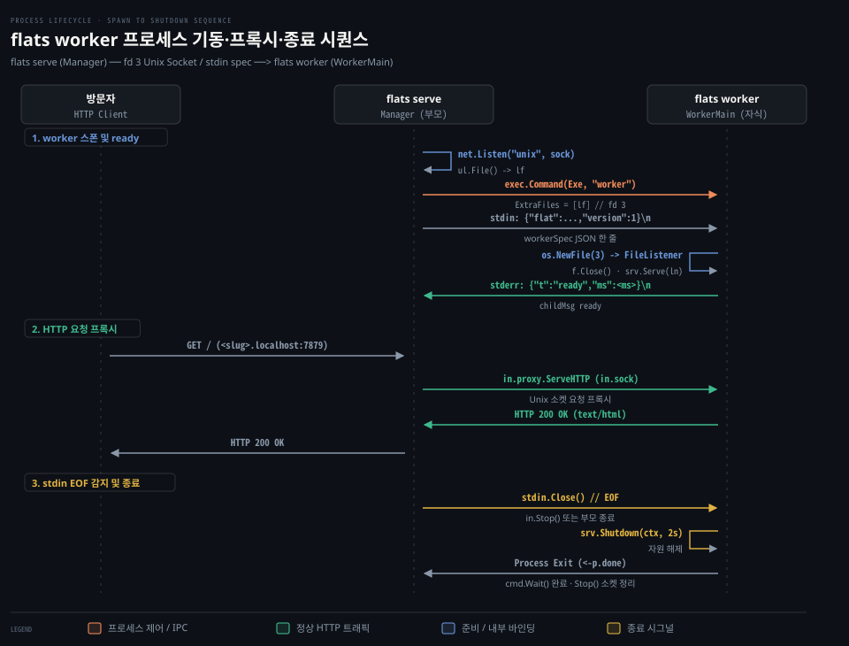
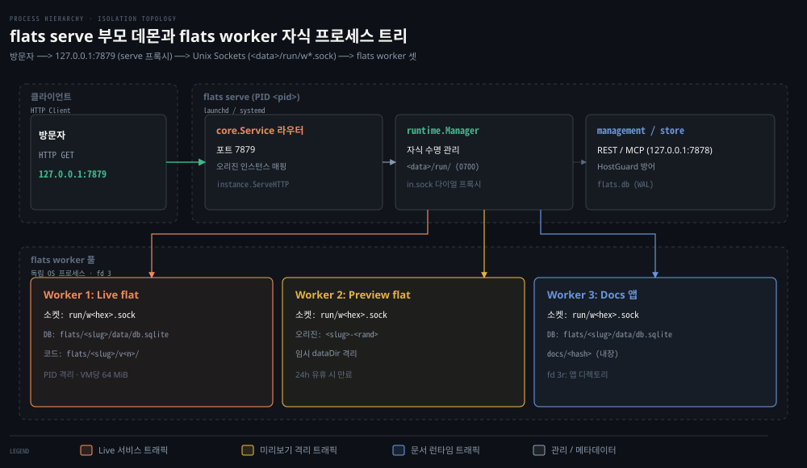

# worker process·manager

---

> 이 문서는 flats가 WebAssembly 샌드박스를 호스트 프로세스 안에 두지 않고 독립된 `flats worker` 서브프로세스로 분리하여 격리하는 이유와, 동일 바이너리 재실행(re-exec)을 통한 스폰 메커니즘, 파일 디스크립터 상속 및 Unix 도메인 소켓 기반 IPC, 비정상 종료 시의 지수 백오프 재시작과 요청 프록시 흐름을 소스 코드와 실측 데이터로 분석하는 본편 문서입니다.


## 학습 목표와 범위

> 단일 바이너리 데몬과 자식 워커 프로세스 간의 격리 원리를 파악하고, 프로세스 생성·감시·재기동의 전 과정을 설명할 수 있습니다.

1. 동일 Go 런타임 힙 공유 위험을 방어하기 위해 flats가 `flats worker` 자식 프로세스를 분리하는 이유와 다층 샌드박스 경계를 설명할 수 있습니다.
2. 부모 프로세스(`flats serve`)가 `os.Executable()`로 자기 자신을 재실행(`re-exec`)하고 fd 3의 Unix 소켓과 표준 입력(stdin)의 JSON 명세만을 넘기는 스폰 절차를 추적할 수 있습니다.
3. 자식 프로세스(`WorkerMain`)가 fd 3 리스너를 수납하고 표준 오류(stderr)로 준비 완료 신호(`ready`)를 보고하고 stdin EOF를 감지하여 2초 타임아웃 안에서 우아하게 종료되는 생명주기를 분석할 수 있습니다.
4. 예기치 않은 워커 프로세스 종료를 감지하여 지수 백오프(`backoff`) 수열로 재기동하고 대기 중인 동시 요청들을 경합 없이 안전하게 복구하는 관리자(`Manager.ensure`)의 감독 메커니즘을 설명할 수 있습니다.
5. 방문자의 HTTP 요청이 호스트 포트(`127.0.0.1:7879`)에서 도메인 라우터를 거쳐 격리된 워커의 Unix 도메인 소켓으로 프록시되는 데이터 흐름과 업로드 예산 제약을 추적할 수 있습니다.

이 문서는 워커 프로세스의 생성과 감시, 그리고 프로세스 간 통신(IPC)과 프록시 라우팅을 다룹니다. WebAssembly 및 QuickJS 내부 원리는 앞선 기초 편(`02-01.WebAssembly·WASI·QuickJS·sandbox.md`)을 참고하시기 바랍니다. SQLite/FILES 바인딩은 후속 편(`02-03.fetch handler·env.DB·env.FILES·WebSocket.md`)에서 다룹니다. 네트워크 제어(`02-04.WASI handler·egress·env·secrets.md`) 역시 이어지는 편에서 다룹니다.

기준 커밋 3abe537 (v0.11.0, 2026-10-17)


## 1. 단일 프로세스 샌드박스의 한계와 프로세스 경계

> WebAssembly 가상 머신으로 메모리를 격리하더라도 동일한 운영체제 프로세스 안에서 서드파티 코드를 실행하면 호스트 데몬 전체가 위험에 노출됩니다.

앞선 `02-01.WebAssembly·WASI·QuickJS·sandbox.md` 편에서 살펴보았듯이 WebAssembly(wasm)는 선형 메모리와 샌드박스 환경으로 외부 코드가 임의 메모리를 오염시키지 못하도록 막아줍니다. 하지만 임의의 사용자가 작성한 동적 서버 코드를 메인 관리 데몬(`flats serve`)의 단일 Go 프로세스 안에서 직접 구동하는 방식에는 설계적 위험(필자 정리)이 따릅니다:

1. **Go 런타임 힙과 스레드 공유**: 샌드박스가 호스트 프로세스 안에서 돌면 가상 머신 고루틴이 힙을 함께 씁니다. 단일 flat의 과도한 메모리 할당이 Go 가비지 컬렉터(GC)에 부하를 주어 관리 API와 타 서비스 전체를 지연시킬 수 있습니다.
2. **호스트 크래시 위험**: 런타임 엔진의 예상치 못한 결함이나 C/Go 런타임 레벨의 패닉, 스택 오버플로 등이 발생하면 단일 flat의 오류가 호스트 머신에서 동작 중인 `flats serve` 데몬 전체를 비정상 종료(SIGSEGV 등)시킬 수 있습니다.
3. **OS 자원 및 환경 변수 누출 위험**: 동일 프로세스 안에서는 호스트의 메타데이터 DB(`flats.db`), 마스터 비밀키(`secret.key`), 셸 환경 변수가 한 메모리 공간에 공존하므로 격리 경계가 취약해집니다.

공식 설계 문서 `docs/design.md`의 「Process layout」 절은 단일 데몬과 자식 워커를 분리한 다층 구조를 다음과 같이 규정합니다:

```markdown
flats serve                     (one long-running process; launchd on macOS, systemd on Linux)
├── core.Service                flats, Drafts, versions, deploys, previews, approvals and
│                               revisions (internal/core)
├── store                       SQLite metadata <data>/flats.db (modernc.org/sqlite, WAL)
├── provider manager            network providers (internal/expose/provider): local,
│                               tailscale, tailscale-funnel, portal, zrok, cloudflare-quick,
│                               netbird, netbird-expose
├── management server           HTTP API + MCP (/mcp) + web console on 127.0.0.1:7878, and on
│                               each configured console domain
├── design instances            in-process canvas handlers, one per live design (internal/design)
└── server-flat workers         `flats worker` child processes, one per running server flat
                                version or document (re-exec of the same binary; internal/runtime)
```

공식 문서 `README.md:260-263` 역시 샌드박스 실행 원칙을 명시합니다. "서버 코드는 wasm 메모리·시간 제한과 바운딩된 요청 본문을 갖춘 독립 워커 프로세스에서 실행된다"고 규정합니다.

정적 페이지만 서빙하는 `page`나 호스트가 관리하는 `design`과 달리, 동적 `server` flat과 문서(`docs`)는 별도 프로세스로 돕니다. 이들은 독립된 **`flats worker`** 서브프로세스로 분리되어 커널 가상 메모리와 파일 디스크립터 경계 안에서 동작합니다.


## 2. 바이너리 진입점과 모듈 분리

> flats는 추가 바이너리 없이 단일 실행 파일 스스로 `flats worker` 서브커맨드를 실행하는 재실행(re-exec) 구조를 취합니다.

flats는 외부 도커 데몬이나 헬퍼 바이너리를 요구하지 않는 순수 Go 단일 바이너리입니다. 이 실행 파일 하나가 관리 데몬과 격리 워커 프로세스의 두 가지 역할을 동시에 수행하는 방식을 살펴보겠습니다.

그 방식은 진입점 패키지인 `cmd/flats/main.go`의 초기화 로직에 있습니다:

```go
// cmd/flats/main.go:15-23
func init() {
	cli.Serve = app.Serve
	cli.Worker = runtime.WorkerMain
	cli.Config = app.ConfigCommand
	cli.ConfigUsage = app.ConfigUsage
	cli.Key = app.KeyCommand
	cli.KeyUsage = app.KeyUsage
	cli.EnsureConfig = app.EnsureConfig
}
```

`cmd/flats/main.go:17`은 `cli.Worker` 함수 포인터 변수에 `runtime.WorkerMain`을 직접 주입합니다(`internal/cli/cli.go:30-31`). 이는 `internal/cli` 패키지가 `runtime`이나 `app` 패키지를 직접 import하지 않도록 조립 패키지 차원에서 의존성을 분리하는 주입 훅입니다.

이어지는 `main()` 함수는 명령행 인자(`os.Args[1:]`)를 검사합니다:

```go
// cmd/flats/main.go:25-35
func main() {
	args := os.Args[1:]
	// serve and worker install their own signal handling.
	if len(args) > 0 && (args[0] == "serve" || args[0] == "worker") {
		os.Exit(cli.Run(context.Background(), args, cli.OSEnv()))
	}
	ctx, stop := signal.NotifyContext(context.Background(), os.Interrupt, syscall.SIGTERM)
	code := cli.Run(ctx, args, cli.OSEnv())
	stop()
	os.Exit(code)
}
```

`cmd/flats/main.go:28-30`을 보면 일반 CLI와 다른 점이 드러납니다. `serve`와 `worker` 명령은 자체 신호 처리를 수행하도록 루트 레벨 신호 컨텍스트 대신 `context.Background()`를 즉시 전달받습니다.

이후 제어권은 `internal/cli/cli.go:214`로 넘어갑니다:

```go
// internal/cli/cli.go:211-215
	switch name {
	case "serve":
		return a.runHook("serve", Serve, rest)
	case "worker":
		return a.runHook("worker", Worker, rest)
```

단일 Go 바이너리는 명령행의 첫 번째 토큰이 `"worker"`인 경우 곧바로 워커 모드로 전환되어 `runtime.WorkerMain`을 진입점으로 실행합니다.


## 3. 부모 프로세스의 스폰과 환경 통제

> 부모 프로세스는 자신의 환경 변수를 모두 비우고 전용 Unix 소켓을 생성하여 파일 디스크립터 3번으로 자식에게 주입합니다.

자식 프로세스를 띄울 때 호스트의 환경 변수나 파일 접근 권한이 그대로 상속되면 보안 격리가 무너집니다. flats 부모 프로세스는 어떻게 깨끗한 상태로 자식을 스폰할 수 있을까요? 이 역할을 맡는 핵심 오케스트레이터가 `internal/runtime/manager.go:30`의 **`Manager`** 구조체입니다:

```go
// internal/runtime/manager.go:30-41
type Manager struct {
	DataDir      string               // runtime state (sockets, compilation cache); "" = temp dir
	Exe          string               // binary to re-exec; "" = os.Executable()
	Logf         func(string, ...any) // operational log; nil = log.Printf
	Args         []string             // worker argv after Exe; nil = ["worker"]
	Env          []string             // the worker's entire environment; nil = empty (tests add a dispatch variable)
	Timeout      time.Duration        // per request; 0 = DefaultTimeout
	StartTimeout time.Duration        // worker start; 0 = 60s

	once    sync.Once
	sockDir string
	initErr error
}
```

`Manager`는 `core.Runtime` 인터페이스를 구현합니다. 필드 주석 `internal/runtime/manager.go:32-34`에 따르면 `Exe`가 비어 있을 때 `os.Executable()`로 현재 바이너리를 지정하고 `Args`가 비어 있으면 `["worker"]`를 기본 인자로 사용합니다.

### 소켓 디렉토리와 엄격한 권한 검증

`Manager.init()`은 소켓을 생성할 디렉토리를 결정하고 보안 검사를 수행합니다(`internal/runtime/manager.go:54-84`). Unix 도메인 소켓 경로는 운영체제 시스템 콜 한계로 인해 약 104바이트를 넘을 수 없습니다. 그래서 flats는 경로 길이가 안전 한도를 넘지 않도록 관리합니다:

```go
// internal/runtime/manager.go:89-107
func privateDir(dir string) error {
	if err := os.MkdirAll(dir, 0o700); err != nil {
		return err
	}
	fi, err := os.Lstat(dir)
	if err != nil {
		return err
	}
	if !fi.IsDir() {
		return fmt.Errorf("%s is not a directory", dir)
	}
	if st, ok := fi.Sys().(*syscall.Stat_t); ok && int(st.Uid) != os.Getuid() {
		return fmt.Errorf("%s is owned by another user", dir)
	}
	if fi.Mode().Perm()&0o077 != 0 {
		return os.Chmod(dir, 0o700)
	}
	return nil
}
```

`privateDir`(`internal/runtime/manager.go:89`)은 소켓 디렉토리를 `0700` 권한으로 생성합니다. 이미 존재한다면 심볼릭 링크 여부와 소유자 UID(`st.Uid != os.Getuid()`)를 검사합니다. 그룹이나 기타 권한이 열려 있으면 강제로 `0700`으로 고칩니다. 소켓에 다른 사용자가 접근하는 위험을 차단하기 위함입니다.

### 환경 변수 완전 격리와 커맨드 생성

워커를 실행하기 위한 `exec.Cmd` 객체를 만드는 로직은 `internal/runtime/manager.go:243`의 `command()`에 구현되어 있습니다:

```go
// internal/runtime/manager.go:243-253
func (m *Manager) command() *exec.Cmd {
	args := m.Args
	if args == nil {
		args = []string{"worker"}
	}
	cmd := exec.Command(m.Exe, args...)
	// A minimal environment: nothing of the parent's (HOME, tokens, PATH...).
	cmd.Env = append([]string{}, m.Env...)
	cmd.Dir = "/"
	return cmd
}
```

주목할 부분은 `cmd.Env` 처리입니다. 일반적인 서브프로세스 생성은 부모의 `os.Environ()`을 그대로 상속받지만 flats는 부모의 환경 변수를 단 하나도 물려주지 않습니다. `m.Env`는 기본값이 `nil`이므로 워커는 빈 환경 변수 슬라이스(`[]string{}`)로 기동됩니다. 호스트의 `HOME`, `PATH`, 셸 환경에 설정된 클라우드 액세스 키나 내부 토큰이 자식 워커 프로세스 내부로 흘러 들어가지 않습니다. 실행 디렉토리 역시 루트(`/`)로 고정됩니다.

### spawn: 소켓 바인딩과 ExtraFiles (fd 3) 주입

실제 프로세스 스폰은 `internal/runtime/manager.go:256`의 `spawn()` 메서드가 담당합니다:

```go
// internal/runtime/manager.go:256-287
func (in *instance) spawn(ctx context.Context) (err error) {
	os.Remove(in.sock)
	ln, err := net.Listen("unix", in.sock)
	if err != nil {
		return fmt.Errorf("worker socket: %w", err)
	}
	defer func() {
		if err != nil { // no worker serves it (e.g. a startup error)
			os.Remove(in.sock)
		}
	}()
	ul := ln.(*net.UnixListener)
	ul.SetUnlinkOnClose(false)
	lf, err := ul.File()
	ul.Close()
	if err != nil {
		os.Remove(in.sock)
		return fmt.Errorf("worker socket: %w", err)
	}
	defer lf.Close()

	cmd := in.m.command()
	cmd.ExtraFiles = []*os.File{lf} // fd 3
	stdin, err := cmd.StdinPipe()
	if err != nil {
		return err
	}
	stderr, err := cmd.StderrPipe()
	if err != nil {
		return err
	}
	cmd.Stdout = nil // /dev/null
```

부모 프로세스는 먼저 자신이 Unix 도메인 소켓(`in.sock`)에 `net.Listen("unix", in.sock)`을 호출하여 리스너를 개설합니다. 그리고 파일 핸들(`ul.File()`)을 추출한 뒤 부모의 리스너는 닫고 해당 파일 핸들을 `cmd.ExtraFiles`의 첫 번째 원소로 등록합니다(`internal/runtime/manager.go:278`).

유닉스 계열 운영체제에서 프로세스가 시작할 때 기본 파일 디스크립터 0, 1, 2번은 각각 stdin, stdout, stderr에 할당됩니다. Go의 `os/exec` 패키지는 `cmd.ExtraFiles`에 지정된 파일 포인터들을 3번부터 순서대로 자식 프로세스에 상속합니다. 첫 번째 원소인 `lf`는 자식 프로세스에서 정확히 **`fd 3`**으로 배정됩니다.

표준 출력(`cmd.Stdout`)은 `nil`로 설정되어 `/dev/null`로 버려집니다. 대신 표준 입력(`stdin`)과 표준 오류(`stderr`)는 부모와 자식 간의 정형화된 제어 채널로 파이프 연결됩니다.


## 4. 자식 프로세스의 수명주기와 프로토콜

> 자식 프로세스는 stdin 첫 줄에서 JSON 명세를 읽고 fd 3을 통해 HTTP 서비스를 시작하며 ready 신호를 부모에게 보고합니다.

부모로부터 파일 디스크립터와 프로세스를 넘겨받은 자식은 어떻게 초기화를 마치고 안전하게 요청을 처리할 수 있을까요? 스폰된 `flats worker` 프로세스는 `internal/runtime/worker.go:52`의 `WorkerMain`에서 실행을 시작합니다.

상속된 소켓 파일 디스크립터 번호는 상수로 선언되어 있습니다:

```go
// internal/runtime/worker.go:46-47
// listenerFD is the inherited listening Unix socket (cmd.ExtraFiles[0]).
const listenerFD = 3
```

### stdin의 workerSpec 파싱과 리스너 수납

워커는 기동하자마자 표준 입력(stdin)의 첫 번째 줄을 읽어들입니다:

```go
// internal/runtime/worker.go:52-71
func WorkerMain(args []string) error {
	_ = args
	log := stderrLog
	start := time.Now()
	stdin := bufio.NewReaderSize(os.Stdin, 64<<10)
	line, err := stdin.ReadBytes('\n')
	if err != nil {
		return fmt.Errorf("worker: read spec: %w", err)
	}
	var spec workerSpec
	if err := json.Unmarshal(line, &spec); err != nil {
		return fmt.Errorf("worker: bad spec: %w", err)
	}
	f := os.NewFile(listenerFD, "listener")
	ln, err := net.FileListener(f)
	f.Close()
	if err != nil {
		log.send(childMsg{T: "fatal", Msg: "worker: no listener: " + err.Error()})
		return err
	}
```

워커의 설정 명세는 `internal/runtime/protocol.go:52`의 **`workerSpec`** 구조체로 정의되어 있습니다:

```go
// internal/runtime/protocol.go:52-65
// workerSpec is sent to the child on stdin as one JSON line. Secrets travel
// only here: never in argv or in the child's environment.
type workerSpec struct {
	Flat           string            `json:"flat"`
	Version        int               `json:"version"`
	Generation     int64             `json:"generation"`
	Dir            string            `json:"dir"`
	Entry          string            `json:"entry"`
	DataDir        string            `json:"data_dir"`
	Env            map[string]string `json:"env"`
	CacheDir       string            `json:"cache_dir,omitempty"`
	TimeoutMS      int64             `json:"timeout_ms,omitempty"`
	MemoryPages    uint32            `json:"memory_pages,omitempty"`
	PoolSize       int               `json:"pool_size,omitempty"`
	NetworkOrigins []string          `json:"network_origins,omitempty"`
}
```

주석이 명시하듯 flat에 주입되는 환경 변수와 시크릿 값은 `ps` 명령으로 노출될 수 있는 명령행 인자(`argv`)나 프로세스 환경 변수를 통하지 않습니다. 오직 부모와 자식만 공유하는 stdin의 단일 JSON 라인으로만 안전하게 전달됩니다.

명세를 읽은 워커는 `os.NewFile(listenerFD, "listener")`로 3번 디스크립터를 감쌉니다. 이어 `net.FileListener(f)`로 네트워크 리스너(`ln`)를 획득한 뒤 원본 파일 핸들을 즉시 닫습니다(`f.Close()`).

### HTTP 서빙과 ready 통보

리스너를 확보한 워커는 샌드박스 엔진을 초기화하고 HTTP 서버를 가동합니다:

```go
// internal/runtime/worker.go:72-88
	w := &worker{spec: spec, log: log, data: newDataStore(spec.DataDir)}
	if err := w.init(); err != nil {
		log.send(childMsg{T: "fatal", Msg: err.Error()})
		return err
	}
	srv := &http.Server{Handler: w, ReadHeaderTimeout: 30 * time.Second, ErrorLog: nil}
	served := make(chan error, 1)
	go func() { served <- srv.Serve(ln) }()
	log.send(childMsg{T: "ready", MS: time.Since(start).Milliseconds()})

	// Stdin EOF means "stop" (or the parent is gone).
	stopped := make(chan struct{})
	go func() {
		io.Copy(io.Discard, stdin)
		close(stopped)
	}()
```

워커의 HTTP 리스너 타임아웃은 `ReadHeaderTimeout: 30 * time.Second`로 설정되어 있습니다. (참고: 워커 리스너는 부모 프로세스만 연결하는 사설 Unix 소켓이므로 외부 방문자의 느린 헤더 전송 지연 방어는 앞단의 호스트 콘텐츠 포트(7879) 서버가 1차로 담당합니다.)

서버가 성공적으로 `ln`에서 수신을 시작하면 워커는 표준 오류(stderr)로 부모 프로세스에게 준비 완료 메시지를 JSON 문자열로 전송합니다. 이 메시지 규격은 `internal/runtime/protocol.go:90`의 **`childMsg`** 구조체를 따릅니다:

```go
// internal/runtime/protocol.go:90-95
type childMsg struct {
	T     string `json:"t"` // "log", "ready", "fatal"
	Level string `json:"level,omitempty"`
	Msg   string `json:"msg,omitempty"`
	MS    int64  `json:"ms,omitempty"`
}
```

워커는 `childMsg{T: "ready", MS: ...}`를 전송합니다. 부모 프로세스는 `internal/runtime/manager.go:355`의 `readStderr`에서 이를 수신하여 `ready <- nil`을 발생시키고 스폰 완료를 확정합니다.

### stdin EOF를 통한 우아한 종료

워커는 별도의 종료 IPC 프로토콜이나 시그널 대신 표준 입력(stdin)의 EOF를 종료 트리거로 사용합니다. 백그라운드 고루틴이 `io.Copy(io.Discard, stdin)`을 수행하다가 부모가 파이프를 닫거나 부모 프로세스가 갑자기 사망하여 EOF가 감지되면 루프를 빠져나옵니다:

```go
// internal/runtime/worker.go:88-101
	select {
	case <-stopped:
	case err := <-served:
		log.send(childMsg{T: "log", Level: "error", Msg: "worker: serve: " + err.Error()})
	}
	ctx, cancel := context.WithTimeout(context.Background(), 2*time.Second)
	srv.Shutdown(ctx)
	cancel()
	if w.network != nil {
		w.network.Close()
	}
	w.eng.close()
	w.data.Close()
	return nil
```

종료 신호를 받으면 2초 타임아웃의 컨텍스트를 만들어 `srv.Shutdown(ctx)`를 호출합니다. 현재 처리 중인 HTTP 인플라이트 요청이 완료될 때까지 최대 2초간 대기한 뒤 네트워크 클라이언트, 가상 머신 엔진, SQLite 데이터스토어를 닫고 깨끗하게 프로세스를 종료합니다.



위 시퀀스 다이어그램은 부모 프로세스의 자식 스폰부터 종료까지의 전 과정을 보여줍니다. fd 3 소켓 주입과 stderr ready 통보, 요청 프록시와 stdin EOF 기반 2초 우아한 종료 흐름이 순서대로 이어집니다.


## 5. 프로세스 감시와 지수 백오프 재시작

> 워커가 예기치 않게 비정상 종료되면 즉시 재기동하지 않고 실패 횟수에 따른 지수 백오프를 적용하여 시스템 과부하를 방지합니다.

샌드박스 내부의 스크립트 오류나 메모리 폭주가 일어났을 때 호스트가 죽지 않고 워커의 비정상 종료를 감지하려면 어떻게 해야 할까요? 부모 프로세스의 `Manager`는 고루틴으로 자식의 생존을 면밀히 감시합니다.

### readStderr와 비정상 종료 감지

부모의 `readStderr`(`internal/runtime/manager.go:355`) 메서드는 워커의 stderr 스트림을 스캐너로 읽으며 출력 종류에 따라 네 갈래로 분기합니다:

1. `msg.T == "ready"`: 기동 대기 중인 채널에 완료(`ready <- nil`)를 알립니다.
2. `msg.T == "fatal"`: 초기화 실패(스크립트 문법 오류 등)를 알리고 에러를 보고합니다.
3. 그 밖의 `msg.T`(주로 `"log"`): `msg.Level`에 맞춰(없으면 `"info"`) 워커 내부의 애플리케이션 로그를 호스트 로거로 중계합니다.
4. JSON 형식이 아닌 출력: Go 런타임 크래시 덤프나 패닉 메시지로 간주하고 `tailBuf`에 보관한 뒤 에러 로그로 기록합니다.

워커 프로세스가 완전히 종료되면 `internal/runtime/manager.go:395`의 `exited()`가 호출됩니다:

```go
// internal/runtime/manager.go:395-416
func (in *instance) exited(p *proc) {
	in.mu.Lock()
	defer in.mu.Unlock()
	if in.p != p {
		return
	}
	in.p = nil
	in.tr.CloseIdleConnections()
	if p.stopped.Load() || in.stopped {
		return
	}
	if time.Since(p.started) > time.Minute {
		in.failures = 0
	}
	in.failures++
	in.retryAt = time.Now().Add(backoff(in.failures - 1))
	msg := fmt.Sprint(p.err)
	if t := strings.TrimSpace(p.tail.String()); t != "" {
		msg += ": " + lastLines(t, 5)
	}
	in.spec.Log("error", fmt.Sprintf("worker exited unexpectedly (%s); it restarts on the next request", msg))
}
```

정상적인 `Stop()` 호출에 의한 종료(`p.stopped.Load()`)가 아니라면 `failures` 카운터를 증가시키고 다음 재시도 시각(`retryAt`)을 계산합니다. 단, 워커가 시작된 지 1분 이상 안정적으로 동작했다면(`time.Since(p.started) > time.Minute`) 이전의 실패 누적을 0으로 리셋합니다.

### 지수 백오프 수열과 maxRestartWait

재시도 대기 시간을 계산하는 `backoff()` 함수는 `internal/runtime/manager.go:426`에 명확한 비트 시프트 수열로 구현되어 있습니다:

```go
// internal/runtime/manager.go:426-432
func backoff(n int) time.Duration {
	if n <= 0 {
		return 0
	}
	d := 250 * time.Millisecond << min(n-1, 8)
	return min(d, 30*time.Second)
}
```

호출 시 넘기는 인자 $n$에 따른 백오프 대기 시간 수열입니다:

| `backoff(n)` 인자 ($n$) | 계산식 | 대기 시간 |
|---|---|---|
| $n \le 0$ | $0$ | **0 ms** (즉시 재시도) |
| $n = 1$ | $250\text{ms} \ll 0$ | **250 ms** |
| $n = 2$ | $250\text{ms} \ll 1$ | **500 ms** |
| $n = 3$ | $250\text{ms} \ll 2$ | **1 초** ($1000\text{ms}$) |
| $n = 4$ | $250\text{ms} \ll 3$ | **2 초** |
| $n = 5$ | $250\text{ms} \ll 4$ | **4 초** |
| $n = 6$ | $250\text{ms} \ll 5$ | **8 초** |
| $n = 7$ | $250\text{ms} \ll 6$ | **16 초** |
| $n \ge 8$ | $\min(250\text{ms} \ll 7, 30\text{s})$ | **30 초** (최대 상한) |

여기서 호출 지점에 따른 인자 전달 방식의 차이에 주목해야 합니다. 프로세스가 비정상 종료된 직후 `exited()`는 `backoff(in.failures - 1)`(`internal/runtime/manager.go:410`)을 호출합니다.

그래서 첫 비정상 종료(`failures = 1`) 시에는 $n = 0$이 되어 대기 시간이 **0 ms**(다음 요청 진입 시 즉시 재기동)입니다. 연속 2회 비정상 종료(`failures = 2`)부터 250 ms 대기가 적용됩니다. 반면 `ensure()` 내에서 재기동 시도 자체가 실패한 경우에는 `backoff(in.failures)`(`:516`)를 직접 호출하여 곧바로 백오프 대기에 들어갑니다.

### ensure: 요청 진입 시점의 동기화와 재기동

워커 프로세스가 종료된 직후 flats는 즉시 백그라운드에서 프로세스를 띄우지 않습니다. 대신 실제 방문자 요청이 들어올 때까지 기다리는 지연 복구(Lazy recovery) 전략을 취합니다.

요청이 유입되면 `instance.ServeHTTP`는 `ensure(ctx)`를 호출합니다(`internal/runtime/manager.go:442`):

```go
// internal/runtime/manager.go:442-484
func (in *instance) ensure(ctx context.Context) error {
	in.mu.Lock()
	defer in.mu.Unlock()
	for {
		if in.stopped {
			return errStopped
		}
		if in.p != nil {
			return nil
		}
		if in.starting == nil {
			wait := time.Until(in.retryAt)
			if wait <= 0 {
				break
			}
			if wait > maxRestartWait {
				return fmt.Errorf("server flat is restarting (retry in %s)", wait.Round(100*time.Millisecond))
			}
			in.mu.Unlock()
			t := time.NewTimer(wait)
			select {
			case <-t.C:
			case <-ctx.Done():
				t.Stop()
				in.mu.Lock()
				return ctx.Err()
			}
			in.mu.Lock()
			continue
		}
		ch := in.starting
		in.mu.Unlock()
		select {
		case <-ch:
		case <-ctx.Done():
			in.mu.Lock()
			return ctx.Err()
		}
		in.mu.Lock()
		if in.p == nil && !in.stopped && in.lastErr != nil {
			return in.lastErr
		}
	}
```

여기서 `maxRestartWait`는 **`2초`**(`internal/runtime/manager.go:438`)로 고정되어 있습니다. 남은 백오프 시간(`wait`)이 2초를 초과하면 요청을 대기시키지 않고 즉시 503 Service Unavailable과 Retry-After: 1 헤더를 반환합니다. 대기 시간이 2초 이하라면 타이머로 잠시 수면한 뒤 재시작을 진행합니다.

동시에 여러 요청이 몰려올 경우 최초의 요청이 `in.starting = make(chan struct{})`를 생성하고 다른 동시 요청들은 `<-in.starting` 채널을 구독하여 단 하나의 프로세스만 스폰되도록 보장합니다.

### Stop과 terminate

인스턴스를 완전히 내릴 때는 `internal/runtime/manager.go:602`의 `Stop()`과 `:619`의 `terminate()`를 실행합니다:

```go
// internal/runtime/manager.go:619-628
func (in *instance) terminate(p *proc) {
	p.stopped.Store(true)
	p.stdin.Close() // the worker shuts down gracefully on stdin EOF
	select {
	case <-p.done:
	case <-time.After(3 * time.Second):
		p.cmd.Process.Kill()
		<-p.done
	}
}
```

부모는 `p.stdin.Close()`로 파이프를 닫아 자식에게 stdin EOF를 보냅니다. 자식이 2초 우아한 종료 처리를 마치고 스스로 종료되면 `<-p.done`이 풀립니다. 만약 자식이 데드락이나 무한 루프에 걸려 3초(`time.After(3 * time.Second)`) 내에 종료되지 않으면 `p.cmd.Process.Kill()`을 호출하여 SIGKILL로 강제 사살합니다.


## 6. 방문자 요청 전달과 버퍼링 방어

> 방문자의 HTTP 요청은 프록시 트랜스포트를 통해 워커의 Unix 소켓으로 흐르며 엄격한 업로드 속도 제한과 동시 본문 예산 제약을 받습니다.

호스트의 단일 콘텐츠 포트로는 수많은 요청이 인입됩니다. 이 요청을 각 워커의 독립된 소켓으로 안전하게 전달하면서 악의적인 대용량 업로드를 차단하는 방법은 무엇일까요? 방문자가 브라우저나 클라이언트로 `http://<flat>.localhost:7879/`에 접속했을 때의 요청 전달 흐름을 차례로 봅니다.

### instance.ServeHTTP와 visitorBody

부모 프로세스의 `instance.ServeHTTP`(`internal/runtime/manager.go:524`)는 먼저 `ensure()`로 워커의 생존을 확인한 뒤 요청을 프록시합니다:

```go
// internal/runtime/manager.go:524-539
func (in *instance) ServeHTTP(w http.ResponseWriter, r *http.Request) {
	if err := in.ensure(r.Context()); err != nil {
		w.Header().Set("Retry-After", "1")
		http.Error(w, "Service Unavailable: "+err.Error(), http.StatusServiceUnavailable)
		return
	}
	if r.ContentLength != 0 && r.Body != nil && r.Body != http.NoBody {
		b := &visitorBody{body: r.Body, rc: http.NewResponseController(w), start: time.Now()}
		r = r.WithContext(context.WithValue(r.Context(), visitorBodyKey{}, b))
		r.Body = b
	}
	in.proxy.ServeHTTP(w, r)
}
```

방문자가 본문을 함께 보낼 경우 `internal/runtime/manager.go:541-590`의 **`visitorBody`** 래퍼가 동작합니다. `http.NewResponseController(w)`로 30초 유예(`bodyGrace`) 후 최소 16 KiB/s(`minBodyRate`, `internal/runtime/worker.go:226-236`) 업로드 속도를 요구하는 읽기 데드라인을 갱신합니다. 이 기준에 미달하는 느린 업로드는 408 Request Timeout으로 연결을 끊습니다.

### 워커의 동시 본문 메모리 예산 (bodyBudget)

워커 프로세스 쪽에서는 `internal/runtime/worker.go:335`의 `worker.ServeHTTP`가 요청을 수신합니다.

가장 먼저 `readBody`(`internal/runtime/worker.go:267`)가 실행되어 요청 본문을 메모리로 읽어들입니다:

```go
// internal/runtime/protocol.go:27-31
const (
	DefaultTimeout     = 10 * time.Second
	DefaultMemoryPages = 1024 // 64 KiB wasm pages = 64 MiB
	DefaultPoolSize    = 4
	MaxRequestBody     = 10 << 20
	MaxResponseBody    = 32 << 20
	// ...
)
```

단일 요청 본문은 최대 10 MiB(`MaxRequestBody`)로 제한됩니다. `Content-Length`가 10 MiB를 초과하면 즉시 413 `http.StatusRequestEntityTooLarge`를 반환합니다(`internal/runtime/worker.go:270-271`). 선언 길이가 없거나 chunked 본문인 경우에는 `MaxBytesReader`로 10 MiB까지 읽은 시점에 413 오류를 발생시킵니다(`:287`, `:346-347`).

워커는 여러 요청이 동시에 들어올 때 본문 버퍼가 메모리를 과도하게 점유하는 것을 막기 위해 `internal/runtime/worker.go:247-257`의 **`bodyBudget`**을 운용합니다:

```go
// internal/runtime/worker.go:247-257
func (b *bodyBudget) take(n int64) bool {
	b.mu.Lock()
	defer b.mu.Unlock()
	if n > maxBufferedBodies-b.used {
		return false
	}
	b.used += n
	return true
}

func (b *bodyBudget) give(n int64) {
	b.mu.Lock()
	b.used -= n
	b.mu.Unlock()
}
```

워커의 동시 요청 본문 버퍼 총량이 80 MiB(본문 상한 10 MiB × 8, `maxBufferedBodies = 8 * MaxRequestBody`, `internal/runtime/worker.go:225`)를 초과하면 추가 버퍼를 할당하지 않습니다. 즉시 503 Service Unavailable과 함께 `"Service Unavailable: server flat is busy receiving other uploads."` 에러를 반환합니다.

### 핸들러 실행 실패와 상태 코드 변환

본문 읽기가 완료되면 워커는 JSON 형태의 요청 페이로드(`reqPayload`)를 조립하여 가상 머신 엔진(`w.eng.handle`)에 전달합니다.

엔진에서 오류가 반환되면 `internal/runtime/worker.go:394`의 `fail()` 메서드가 방문자에게 반환할 HTTP 상태 코드를 결정합니다:

```go
// internal/runtime/worker.go:394-406
func (w *worker) fail(rw http.ResponseWriter, r *http.Request, err error, took time.Duration) {
	status, visitor := http.StatusInternalServerError, "Internal Server Error: the server flat's handler failed."
	var fe *errVMFailed
	var je *jsError
	switch {
	case errors.As(err, &fe) && fe.timedOut:
		status, visitor = http.StatusGatewayTimeout, fmt.Sprintf("Gateway Timeout: the server flat's handler did not finish within %s.", w.spec.timeout())
	case strings.Contains(err.Error(), "out of memory"):
		visitor = "Internal Server Error: the server flat's handler ran out of memory."
	case errors.As(err, &je):
	}
	w.log.Log("error", fmt.Sprintf("%s %s -> %d after %dms: %v", r.Method, r.URL.RequestURI(), status, took.Milliseconds(), err))
	rw.Header().Set("Content-Type", "text/plain; charset=utf-8")
	rw.Header().Set("X-Content-Type-Options", "nosniff")
	rw.WriteHeader(status)
	io.WriteString(rw, visitor+"\n")
}
```

- 실행 시간이 10초(`DefaultTimeout`)를 초과한 경우: 504 Gateway Timeout을 냅니다. `"Gateway Timeout: the server flat's handler did not finish within 10s."` 문자열을 반환합니다(`internal/runtime/worker.go:400`).
- 메모리 한도(QuickJS 힙 한도 48 MiB 또는 wasm 캡 64 MiB)를 초과한 경우: 500 Internal Server Error를 냅니다. `"Internal Server Error: the server flat's handler ran out of memory."` 문자열을 반환합니다(`internal/runtime/worker.go:402`). 일반적인 JS 메모리 고갈은 QuickJS 힙 한도(48 MiB, `internal/runtime/js.go:87-89`)에서 먼저 걸려 깔끔한 `InternalError`로 처리되도록 설계되어 있습니다.

정상 응답인 경우 `internal/runtime/worker.go:417`의 `writeResponse`가 상태 코드와 헤더, 본문을 클라이언트에게 전송합니다.

### 인스턴스 격리 확인 (Live·미리보기·문서)

`internal/core/service.go:428`의 `buildWithEnvironment`(런타임 시작 호출은 `:471`)를 살펴보면 버전 종류에 따라 인스턴스가 어떻게 분리되는지 확인할 수 있습니다:

1. **배포된 Live flat**: 실서비스 중인 버전마다 독립된 `RuntimeSpec`으로 `s.cfg.Runtime.Start()`를 호출합니다.
2. **미리보기(Preview) flat**: 임시 데이터 디렉토리와 독립된 도메인(실측 포트 `http://rt-probe-ef4n465g.localhost:17879`, 일반형 `<slug>-<rand>.localhost:<port>`)을 부여받아 별도의 `RuntimeSpec`으로 워커를 띄웁니다.
3. **문서(Docs) flat**: 문서 flat은 `v.Kind`가 `"server"`로 지정됩니다. 내장된 마크다운 편집기 웹앱(`s.docsRuntime`)을 코드로 삼아 별개의 독립 워커 프로세스로 기동됩니다(`internal/core/service.go:450-465`)[^v0111-idle].

호스트에서 동작하는 Live 서버 flat, Preview 인스턴스, 실시간 문서는 서로 메모리를 공유하지 않으며 각자 고유한 워커 프로세스와 전용 Unix 도메인 소켓을 보유합니다.


## 7. 로컬 실측과 프로세스 트리 분석

> 실제 운영 중인 flats 호스트와 임시 검증 환경에서 프로세스 트리와 파일 디스크립터 상태를 관찰하여 설계 모델을 검증합니다.

코드에 기술된 프로세스 분리와 소켓 매핑이 실제 운영체제 커널 상에서도 그대로 구현되고 있는지 어떻게 확증할 수 있을까요? 실제 macOS 로컬 환경에서 flats v0.11.0 바이너리를 기동하여 프로세스와 파일 디스크립터 구조를 실측했습니다. 그 결과는 코드 분석 내용과 일치했습니다.

### 운영 호스트 실측 (2026-10-18)

운영 호스트에서 `flats list`를 조회하면 2개의 실시간 문서(`try-pod-doc`, `k8s-network-doc`)가 러닝 중이었습니다[^v0111-idle].

운영체제 프로세스 테이블을 확인한 결과:
- 부모 데몬: `flats serve --config <data>/config.json` (PID `<pid>`)
- 자식 워커 2개: `flats worker` (PID `<pid>` 등 2개 프로세스)

`docs/design.md`의 "러닝 중인 서버 flat 버전 또는 문서당 하나의 `flats worker` 서브프로세스" 명세와 일치합니다.

이 중 문서 워커 프로세스(PID `<pid>`)의 파일 디스크립터 열람 결과(로컬 실측, 2026-10-18)는 다음과 같았습니다:

- `3r`: DIR `<data>/runtime/docs/eb6569af1bcc-d4fc8a110d7a252a`
- `5u`, `6u`: unix `<data>/run/wcffaaebdeb314eac.sock`
- `7~9`: `<data>/flats/try-pod-doc/data/db.sqlite` (+wal, shm)

여기서 파일 디스크립터 할당 현황을 살펴보면 상속된 Unix 리스너 소켓은 부모로부터 fd 3으로 전달되었으나 실측 시점에는 문서 런타임 디렉토리(`DIR`)가 fd 3에 열려 있고 실제 Unix 소켓은 5u, 6u에 나타났습니다.

그 이유는 앞서 살펴본 `internal/runtime/worker.go:65-67`의 코드 동작과 직결됩니다:
```go
f := os.NewFile(listenerFD, "listener") // fd 3
ln, err := net.FileListener(f)          // dup 시스템 콜로 새 파일 디스크립터 복제
f.Close()                               // 원래 fd 3번 파일 디스크립터를 즉시 닫음
```
Go의 `net.FileListener`는 내부적으로 `dup` 시스템 콜을 사용하여 소켓을 위한 새 파일 디스크립터를 복제한 뒤 이어지는 `f.Close()`(`internal/runtime/worker.go:67`)로 원래의 fd 3을 닫습니다. fd 3은 닫힌 뒤 워커 초기화 과정에서 다른 파일 핸들이 재사용했습니다. 실측(2026-10-18)에서 그 자리는 문서 앱 디렉터리(`3r DIR`)였습니다. 5u·6u의 구체적인 정체(리스너와 부모 프록시 연결 등)는 확인하지 않았습니다.

### 임시 호스트 실측과 샌드박스 장애 복원력 (2026-10-18)

독립된 임시 호스트(`127.0.0.1:17878` 관리 / `17879` 콘텐츠)에서 `rt-probe` 서버 flat의 미리보기를 띄운 뒤 장애 주입 테스트를 수행했습니다:

- `flats preview rt-probe` 실행 시 임시 미리보기 워커 1개(PID `<pid>`)가 기동되었습니다.
- 무한 메모리 할당 엔드포인트(`/mem`)로 요청을 전송하자 0.82초 만에 `500 Internal Server Error`("ran out of memory")가 반환되었습니다.
- `/mem` 응답 뒤 잰 워커 프로세스의 메모리 점유(RSS)는 365,312 KB였습니다.
- 메모리 폭주 직후 곧바로 정상 엔드포인트(`/`)로 요청을 보냈습니다. 부모 데몬은 안전했으며 동일한 워커 프로세스(PID `<pid>`)가 0.027초 만에 `200 OK`를 반환하며 SQLite 데이터(`hits`)를 온전히 유지했습니다.

메모리 한도(QuickJS 힙 한도 48 MiB 또는 wasm 캡 64 MiB)에 걸려 에러가 발생했음에도 워커 프로세스 자체가 크래시되지 않고 격리 상태를 안전하게 유지했음을 관측했습니다. (참고: 메모리 한도는 풀 내 개별 VM마다 걸리며 기본 풀 크기는 4개(`DefaultPoolSize`, `internal/runtime/protocol.go:29`)이므로 실측 RSS가 64 MiB보다 큰 것은 모순이 아닙니다.)

[^v0111-idle]: 후속 버전인 v0.11.1(2026-10-17)부터는 유휴 상태인 문서 워커를 일정 시간 뒤 메모리에서 재우고 요청 진입 시 다시 깨우는 최적화(#132, `internal/core/docs_idle.go`)가 도입되어, 유휴 문서의 경우 워커 프로세스가 없을 수 있습니다. 본문은 v0.11.0 기준으로 서술합니다.

### 독자가 직접 확인해 볼 수 있는 명령

독자 여러분의 머신에서 flats가 실행 중이라면 터미널에서 다음 명령으로 프로세스 격리 구조를 직접 확인할 수 있습니다:

```bash
# 1. 실행 중인 flats worker 프로세스 목록과 메모리(RSS) 점유 확인
ps -axo pid,ppid,rss,command | grep '[f]lats worker'

# 2. 특정 워커 PID의 파일 디스크립터 및 소켓 연결 상태 확인 (macOS)
lsof -p <worker_pid>
```



위 아키텍처 다이어그램은 호스트 포트 관리와 프로세스 격리 구조를 보여줍니다. Live flat, 미리보기 flat, 문서는 각자 독립 워커로 분리되어 전용 소켓(`run/w*.sock`)과 SQLite DB 파일을 배타적으로 점유합니다.


## 8. 한계와 실패 조건

> flats의 워커 프로세스 아키텍처가 가진 태생적 제약과 코드 레벨에서 확인된 실패 조건을 정리합니다.

1. **소켓 경로 길이 제약 (~104 바이트)**:
   Unix 도메인 소켓 경로는 커널 구조체(`sockaddr_un`) 크기 제약으로 인해 경로 길이가 약 104바이트를 넘을 수 없습니다. 만약 flats의 데이터 디렉토리 경로가 과도하게 깊어지면 `internal/runtime/manager.go:67-68`에 따라 `os.TempDir()/flats-<uid>`로 소켓 경로가 자동 폴백됩니다.
2. **소켓 디렉토리 소유권 및 권한 제약**:
   소켓 디렉토리는 반드시 디렉터리여야 하며(`internal/runtime/manager.go:97-98`) 현재 사용자의 소유여야 합니다(`:100-101`). 소유자가 일치하지 않으면 `Manager.init()`에서 에러를 반환하여 기동(`Start`)이 실패합니다. 반면 그룹이나 타 사용자의 권한 비트가 열려 있는 경우(`&0o077 != 0`)에는 실패시키는 대신 `os.Chmod(dir, 0o700)`로 권한을 복구하고 계속 진행합니다(`:103-104`).
3. **환경 변수 상속 완전 배제로 인한 도구 제약**:
   워커 프로세스는 호스트 환경 변수를 전혀 상속받지 않으므로(`cmd.Env = []string{}`), 샌드박스 내부 스크립트는 호스트의 시스템 유틸리티나 로컬 환경 변수에 의존하는 로직을 수행할 수 없습니다. 필요한 환경 변수는 반드시 flats의 `env` 메타데이터 명세로만 주입되어야 합니다.
4. **첫 기동 실패 시 재시도 배제**:
   워커가 첫 기동(배포·미리보기 시작) 단계(`Manager.Start`, `internal/runtime/manager.go:186-187`)에서 문법 오류 등으로 `fatal` 종료되면 `spawn`은 즉시 에러를 반환합니다. 이 첫 기동에 한해서는 지수 백오프 루프를 돌지 않고 호출자에게 실패를 확정 통보합니다. 반면 이후 요청 처리 중 발생한 `ensure` 내부의 재기동 실패(`:514-518`)는 지수 백오프에 들어갑니다.
5. **지수 백오프 중 2초 초과 대기 시 즉각 실패 (503)**:
   워커 반복 장애로 백오프 시간이 2초(`maxRestartWait`)를 넘으면 방문자 요청을 대기시키지 않습니다. 즉시 `503 Service Unavailable`("server flat is restarting")을 반환합니다.
6. **동시 업로드 메모리 예산 고갈 (80 MiB)**:
   워커 전체의 동시 요청 본문 버퍼 총량은 80 MiB(`maxBufferedBodies`, `internal/runtime/worker.go:225`)로 제한됩니다(본문 상한 10 MiB × 8). 이 한도에 도달하면 추가적인 본문 수신이 차단되며 `errBodiesBusy` 에러와 함께 `503 Service Unavailable`이 반환됩니다.


## 리뷰 노트

> 소스 코드와 공식 문서를 대조하며 확인한 설계적 특이점과 주의 사항을 기록합니다.

- **`net.FileListener` 호출 후 `f.Close()`에 의한 fd 3 닫힘 (`internal/runtime/worker.go:65-67`)**:
  `cmd.ExtraFiles`로 전달된 파일 디스크립터 3번은 `net.FileListener(f)` 호출 직후 `f.Close()`에 의해 닫힙니다. 실측(2026-10-18)에서 3번 fd가 Unix 소켓이 아니라 문서 앱 디렉터리(`3r DIR`)로 나타난 것은 `f.Close()`로 빈 디스크립터 자리를 워커 초기화 과정에서 다른 핸들이 재사용한 결과입니다. 실측에서 관찰된 5u·6u 소켓의 구체적인 정체(리스너와 부모 프록시 연결 등)는 확인하지 않았습니다.
- **`cmd.Env` 완전 비우기를 통한 호스트 시크릿 격리 (`internal/runtime/manager.go:249-250`)**:
  일반적인 Go 서브프로세스 생성 관행과 달리 부모의 `os.Environ()`을 일체 상속하지 않고 빈 슬라이스로 격리합니다. 시크릿은 오직 stdin의 1회성 JSON 스트림으로만 전달되므로 `ps`나 `/proc/<pid>/environ` 같은 경로로는 노출되지 않습니다. 단, 워커는 운영자 계정으로 실행되므로 동일 사용자의 프로세스 메모리 열람 권한까지 차단하는 것은 아닙니다.
- **안정 기동 1분 경과 시 실패 카운터 리셋 (`internal/runtime/manager.go:406-408`)**:
  워커가 비정상 종료되더라도 기동 후 1분(`time.Minute`) 이상 정상 서빙을 유지했다면 누적 실패 횟수를 0으로 리셋하여 장기 운용 중 간헐적으로 발생하는 충돌이 영구적인 30초 백오프로 이어지지 않도록 합리적인 복원 정책을 갖추고 있습니다.


## 자가 점검 질문

> 본문의 핵심 내용을 바탕으로 스스로 질문에 답해 보며 이해도를 점검해 보시기 바랍니다.

1. flats는 WebAssembly 가상 머신을 호스트 데몬(`flats serve`) 프로세스 내부에서 직접 돌리지 않고 독립된 `flats worker` 서브프로세스로 분리하여 구동하는 주된 이유 두 가지는 무엇입니까?
2. 부모 프로세스가 `exec.Command`로 워커를 띄울 때 환경 변수 상속(`cmd.Env`)과 파일 디스크립터 전달(`cmd.ExtraFiles`)을 각각 어떻게 처리하고, 이러한 설계가 갖는 보안적 이점은 무엇입니까?
3. 자식 프로세스인 `WorkerMain`이 부모의 정상적인 종료 요구나 프로세스 중단을 감지하는 메커니즘과, 종료 신호를 받았을 때 수행하는 우아한 종료(Graceful shutdown) 절차는 무엇입니까?
4. 워커 프로세스가 런타임 중 비정상 종료되었을 때 flats가 적용하는 지수 백오프(`backoff`) 수열의 계산 규칙과, 요청 진입 시점(`ensure`)에서 대기 시간이 2초를 초과할 때 발생하는 동작은 무엇입니까?
5. `lsof` 실측 시 워커 프로세스로 상속된 파일 디스크립터 3번이 리스너로 유지되지 않고 닫히며, 대신 fd 3번에 다른 디렉터리 핸들이 관찰되는 이유는 무엇입니까?


## 정답 (자답 후 펼치기)

> 각 질문에 대해 생각한 뒤 아래 해설과 비교해 보시기 바랍니다.

### 1번 정답
첫째, Go 런타임 힙과 가비지 컬렉터(GC) 공유 위험을 방지하기 위함입니다. 단일 프로세스에서 실행할 경우 서드파티 스크립트의 과도한 메모리 할당이나 고루틴 폭주가 호스트 데몬의 관리 API 및 타 테넌트 서빙 전체를 마비시킬 수 있습니다. 둘째, 복구 불가능한 호스트 크래시를 차단하기 위함입니다. 런타임 버그나 세그멘테이션 오류가 발생하더라도 독립된 워커 프로세스만 사멸하고 메인 데몬(`flats serve`)은 생존하여 자동 재기동을 수행할 수 있습니다.

### 2번 정답
부모 프로세스는 `cmd.Env`를 빈 슬라이스(`append([]string{}, m.Env...)`, 기본값 nil)로 설정하여 호스트의 `PATH`, `HOME`, 클라우드 토큰 등 시스템 환경 변수를 자식에게 전혀 상속하지 않습니다. 대신 사전 개설된 유닉스 소켓 파일 핸들을 `cmd.ExtraFiles = []*os.File{lf}`로 등록하여 자식의 `fd 3`으로 넘깁니다. 또한 flat 실행에 필요한 환경 변수와 시크릿은 `argv`나 프로세스 환경 변수가 아니라 오직 자식의 표준 입력(stdin) 첫 줄의 JSON 명세(`workerSpec`)로만 주입합니다. 이 방식으로 로컬 프로세스 목록(`ps`)이나 커널 환경 변수 테이블 열람 경로로 시크릿이 노출되지 않도록 방어합니다(단, 워커는 운영자 계정으로 실행되므로 동일 사용자의 프로세스 메모리 열람 권한까지 차단하는 것은 아닙니다).

### 3번 정답
워커 프로세스는 백그라운드 고루틴에서 `io.Copy(io.Discard, stdin)`을 수행하며 표준 입력의 EOF를 감시합니다. 부모가 `stdin.Close()`를 호출하거나 부모가 갑작스럽게 사멸하여 stdin 파이프가 닫히면 즉시 EOF가 감지됩니다. EOF 감지 즉시 워커는 2초 타임아웃 컨텍스트로 `http.Server.Shutdown(ctx)`를 호출합니다. 진행 중인 요청을 최대 2초간 마친 뒤 네트워크, 엔진, SQLite를 닫고 프로세스를 자발적으로 종료합니다.

### 4번 정답
`backoff(n)` 함수는 $n \le 0$이면 0 ms, $n \ge 1$이면 $250\text{ms} \ll \min(n-1, 8)$로 계산되며 최대 상한은 30초입니다(250ms, 500ms, 1s, 2s, 4s, 8s, 16s, 30s). `exited()`는 `backoff(failures - 1)`을 전달하므로 첫 비정상 종료(failures=1) 시에는 0 ms 대기 후 다음 요청에서 바로 재기동을 시도합니다. 2회째(failures=2)부터 250 ms 백오프가 적용되며 `ensure()` 내 재기동 자체가 실패하면 `backoff(failures)`가 직접 호출됩니다. 남은 백오프 시간이 `maxRestartWait`(2초)를 넘으면 즉시 `503 Service Unavailable`과 `Retry-After: 1` 헤더를 반환합니다. 대기 시간이 2초 이하라면 해당 시간만큼 기다린 뒤 동기화 채널을 거쳐 단 한 번의 재시작을 수행합니다.

### 5번 정답
`WorkerMain`은 `os.NewFile(3, "listener")`로 3번 파일 디스크립터를 감싼 뒤 `net.FileListener(f)`를 호출합니다(`internal/runtime/worker.go:65-67`). Go 런타임의 `net.FileListener`는 내부적으로 `dup` 시스템 콜로 소켓 디스크립터를 새 번호로 복제한 다음 기존 3번 파일 객체를 `f.Close()`로 닫습니다. fd 3번이 닫힌 뒤 워커 초기화 과정에서 다른 파일 핸들(실측의 경우 문서 앱 디렉터리 `3r DIR`)이 비어 있는 가장 낮은 번호인 fd 3을 재사용했기 때문입니다(실측의 5u·6u 소켓 등의 구체적 정체는 미확인).
