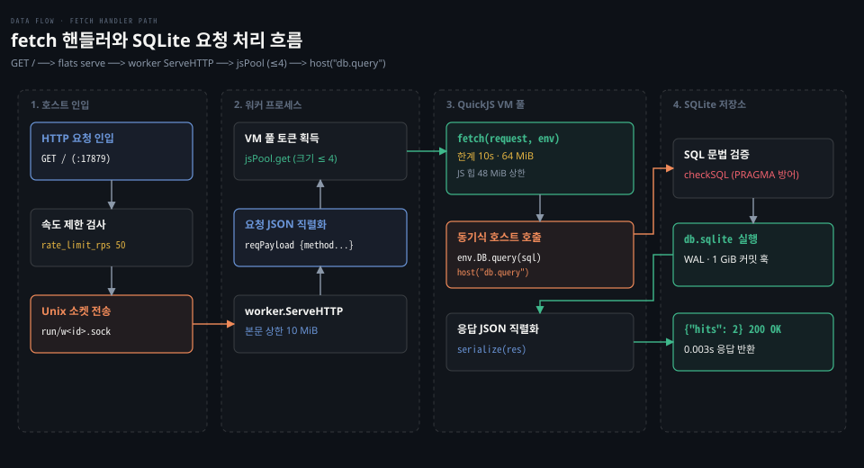
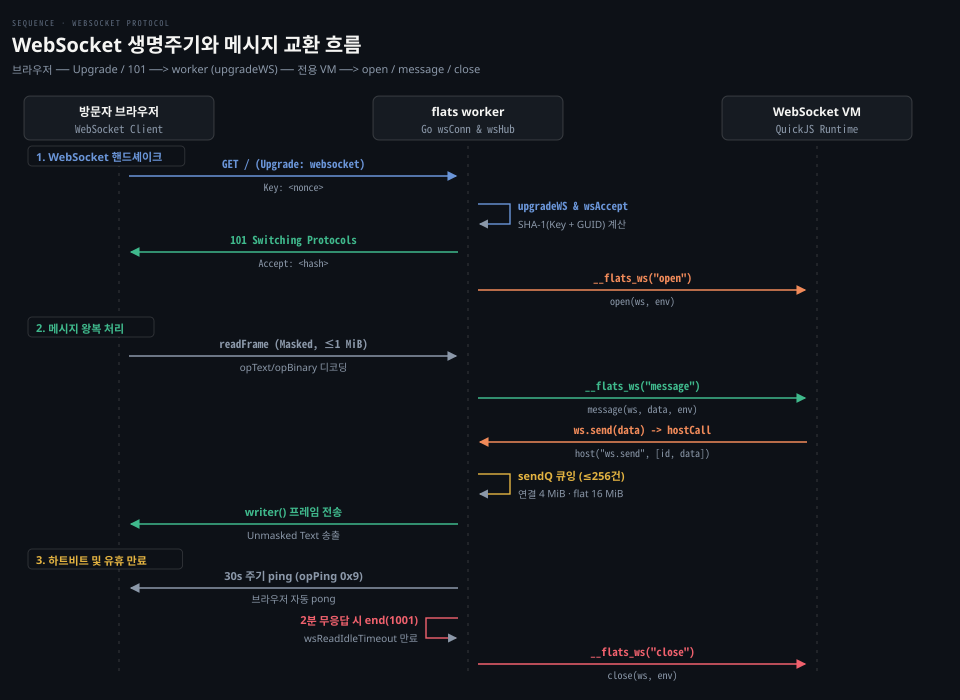

# fetch handler·env.DB·env.FILES·WebSocket

---

> 이 문서는 flats에서 JavaScript ES 모듈이 HTTP 서버 핸들러로 동작하는 원리와, WebAssembly 샌드박스 경계를 넘어 Go 호스트로 전달되는 동기식 DB/FILES 호출 브리지, 그리고 전용 런타임 기반의 WebSocket 프로토콜 생명주기를 소스 코드와 로컬 실측 데이터로 분석하는 본편 문서입니다.


## 학습 목표와 범위

> 단일 모듈 진입점의 HTTP 서버 변환 원리와 호스트 스토리지 브리지, 그리고 실시간 양방향 웹소켓 프로토콜 제어 구조를 파악할 수 있습니다.

1. `export default { fetch }` 선언적 모듈 인터페이스가 호스트 바이너리 내에서 HTTP 웹 서버로 승격되는 계약 구조를 설명할 수 있습니다.
2. 로컬 실측 데이터로 정상 인메모리/DB 상태 유지와 루프(504 타임아웃)·메모리 고갈(500 OOM) 이후의 격리 및 복구 특성을 분석할 수 있습니다.
3. 포트 인입 요청이 `worker.ServeHTTP`에서 JSON으로 직렬화되어 4개 한도의 VM 풀 중 하나로 디스패치되는 전체 데이터 파이프라인을 추적할 수 있습니다.
4. QuickJS 게스트 코드가 `env.DB`와 `env.FILES`를 동기적으로 호출할 때 wasm 경계를 넘어 Go 호스트의 `hostCall` 및 SQLite/os.Root 파일시스템 격리로 이어지는 브리지 메커니즘을 설명할 수 있습니다.
5. 10초 타임아웃, 64 MiB 메모리 예산, `MaxRequestBody`(10 MiB) 제약과 RFC 6455 101 핸드셰이크 및 전용 VM 기반의 WebSocket 생명주기 관리 규칙을 설명할 수 있습니다.

이 문서는 JavaScript 서버 런타임과 SQLite/FILES 호스트 브리지, 그리고 WebSocket 연결 처리를 다룹니다. WebAssembly/QuickJS 기초 원리와 멀티프로세스 관리 구조는 앞선 편(`02-01.WebAssembly·WASI·QuickJS·sandbox.md`, `02-02.worker process·manager.md`)을 참고하시기 바랍니다. WASI 핸들러 실행 및 외부 네트워크 송출(`fetch`) 제어는 이어지는 편(`02-04.WASI handler·egress·env·secrets.md`)에서 다룹니다[^v0111-idle].

기준 커밋 3abe537 (v0.11.0, 2026-10-17)

[^v0111-idle]: 후속 버전인 v0.11.1(2026-10-17)에서는 유휴 상태의 문서 워커 프로세스를 일정 시간 뒤 메모리에서 재우고 요청 진입 시 다시 깨우는 수명주기 최적화 기능(#132)이 추가되었습니다. 이 문서는 v0.11.0 기준 소스 구조를 바탕으로 서술합니다.


## 1. 런타임 API 계약과 Workers 형태의 인터페이스

> 사용자 코드가 직접 네트워크 포트를 열고 수명주기를 장악하면 포트 충돌과 프로세스 자원 누수가 발생하므로 선언적 모듈 계약으로 서버를 구성합니다.

독립적인 웹 서버를 개발할 때 Node.js 환경에서는 사용자가 직접 `http.createServer().listen(port)` 방식으로 운영체제 포트를 점유합니다. 하지만 단일 호스트에서 수십 개의 독립된 사이트를 동시에 호스팅할 때 각 앱이 포트를 바인딩하도록 허용하면 포트 충돌이 발생합니다. 프로세스 종료 신호를 무시한 채 소켓을 유지하는 자원 누수도 통제하기 어렵습니다.

flats는 이러한 운영 위험을 차단하기 위해 사용자가 포트를 열지 않고 표준화된 단일 ES 모듈 객체를 내보내도록 강제합니다. 이 모듈 계약 구조는 앞선 `00-01.What is Flats·비교 제품.md` 편에서 정리했듯이 Cloudflare Workers 모듈 형식과 모양이 비슷합니다. 단, 공식 호환 계층을 표방하지는 않으며 스트림 미지원, 동기식 DB 등 독자적인 제약과 차이가 있습니다.

사용자는 웹 프레임워크 코드 없이 진입점 파일(`server.js` 또는 `index.js`)에서 기본 객체를 내보냅니다(`README.md:186-193`):

```javascript
export default {
  async fetch(request, env) {
    env.DB.exec("CREATE TABLE IF NOT EXISTS hits (n INTEGER)");
    env.DB.exec("INSERT INTO hits VALUES (1)");
    const [{ n }] = env.DB.query("SELECT count(*) AS n FROM hits");
    return Response.json({ hits: n });
  }
};
```

공식 규격 문서 `docs/runtime-api-v1.md`와 타입 선언 `docs/agent/types/flats-runtime-v1.d.ts:27-37`에 명시된 계약 인터페이스의 진입점은 두 개입니다:

```typescript
declare namespace Flats {
  interface ServerModule<E extends Env = Env> {
    fetch(request: IncomingRequest, env: E): HandlerResult | Promise<HandlerResult>;
    websocket?: WebSocketHandlers<E>;
  }
}
```

첫 번째 매개변수인 `request`는 `Flats.IncomingRequest`를 따릅니다(`docs/agent/types/flats-runtime-v1.d.ts:72-90`). 클라이언트가 보낸 HTTP 메서드(`request.method`), 절대 URL(`request.url`), 소문자 키 헤더 맵(`request.headers`), 메모리 완충 본문(`request.body`)을 제공합니다.

브라우저 표준과 달리 스트리밍(`ReadableStream`)이나 `FormData` API는 지원하지 않습니다. 대신 `await request.text()`, `await request.json()`, `await request.arrayBuffer()`로 버퍼링된 텍스트에 접근합니다(`docs/runtime-api-v1.md:210-214`).

두 번째 매개변수인 `env`는 `Object.freeze`로 동결된 환경 객체입니다(`internal/runtime/prelude.js:482`). 이 객체는 데이터베이스 바인딩(`env.DB`)과 파일 바인딩(`env.FILES`)을 제공합니다. 관리자가 사전에 구성한 환경 변수 및 시크릿도 키-값 쌍으로 노출합니다(`docs/agent/types/flats-runtime-v1.d.ts:120-123`).

핸들러가 반환할 수 있는 결과(`HandlerResult`)는 규격상 3가지 형태 중 하나여야 합니다(`docs/agent/types/flats-runtime-v1.d.ts:43-57`, `internal/runtime/prelude.js:427-444`):
- 표준 `Response` 인스턴스: `new Response(body, {status, headers})` 또는 `Response.json(value, init)` 팩토리 반환 객체
- 일반 문자열(`string`): 200 상태 코드와 `text/plain;charset=UTF-8` 헤더가 자동 부여됨
- 일반 자바스크립트 객체(`PlainResponse`): `{ status?: number, headers?: HeadersInit, body?: any }` 형태입니다. 객체 본문은 JSON 직렬화되고 `application/json` 헤더가 설정됩니다.

`env.DB`와 `env.FILES`의 모든 메서드는 **동기식(synchronous)**으로 동작합니다(`docs/runtime-api-v1.md:276, 365`). `Promise`를 반환하지 않고 호출 즉시 일반 값으로 결과를 반환하거나 예외를 던집니다.

단, 공식 규격이 명시하듯 `env.FILES`의 다중 호출은 트랜잭션이 아니며 compare-and-swap을 지원하지 않습니다(`:347`). `env.FILES.list()` 역시 동시 변경에 대한 일관된 스냅샷을 보장하지 않습니다(`:333`). `env.DB`와 `env.FILES`는 트랜잭션을 공유하지 않습니다(`:407`). 핸들러 종료 시점에 커밋되지 않은 DB 트랜잭션은 Go 호스트가 무조건 롤백합니다(`:392-393`, `internal/runtime/js.go:263-270`).


## 2. 로컬 실측 — server.js 동작과 장애 복구 관측

> 스펙 문서만으로는 가상 머신 샌드박스가 무한 루프나 메모리 폭탄 같은 장애에서 호스트를 지키는지 검증하기 어렵습니다.

문서와 규격을 읽는 것만으로는 무한 루프나 메모리 누수 같은 런타임 장애에서 가상 머신 샌드박스가 호스트를 온전히 지키는지 판단하기 어렵습니다. 격리 복원력은 실제 환경에서 장애를 일으켜 확인해야 합니다. 로컬 환경에서 flats v0.11.0 호스트를 구동하고 `env.DB`, `env.FILES`, 무한 루프, 메모리 누수를 검증하는 프로브 앱(`rt-probe`)을 배포하여 동작을 실측하였습니다.

실측에 투입한 `server.js`의 전체 코드입니다:

```javascript
export default {
  async fetch(request, env) {
    const u = new URL(request.url);
    if (u.pathname === "/loop") { while (true) {} }
    if (u.pathname === "/mem") { const a = []; while (true) a.push(new Array(1e6).fill(1)); }
    if (u.pathname === "/fetch") {
      try { const r = await fetch("https://example.com/"); return new Response("fetched " + r.status); }
      catch (e) { return new Response("fetch error: " + e, {status: 502}); }
    }
    if (u.pathname === "/files") {
      env.FILES.put("note.txt", "hello " + Date.now());
      return Response.json({ got: env.FILES.get("note.txt"), list: env.FILES.list() });
    }
    if (u.pathname === "/env") { return Response.json({ keys: Object.keys(env) }); }
    env.DB.exec("CREATE TABLE IF NOT EXISTS hits (n INTEGER)");
    env.DB.exec("INSERT INTO hits VALUES (1)");
    const [{ n }] = env.DB.query("SELECT count(*) AS n FROM hits");
    return Response.json({ hits: n, url: request.url, host: request.headers.get("host") });
  }
};
```

로컬 실측(2026-10-18)에서 임시 호스트(`127.0.0.1:17879`)에 미리보기 세션을 열어 요청을 보낸 결과입니다:

1. **상태 지속과 응답 관측 (`/`)**:
   - 첫 번째 요청: `{"hits":1,...}` 응답, 소요 시간 0.008초
   - 두 번째 요청: `{"hits":2,...}` 응답, 소요 시간 0.003초
   - 첫 요청과 둘째 요청의 소요 시간 차이(0.008초 vs 0.003초)의 원인은 별도 계측하지 않았습니다. 다만 첫 VM은 요청 인입 전 `newJSEngine` 단계에서 이미 생성되어 풀에 적재됩니다(`internal/runtime/js.go:597-611`). 최초 요청 시에만 SQLite 연결 개설(`:462` `vm.w.data.conn`)과 테이블 생성(`CREATE TABLE`)이 수행되는 점이 후속 요청과 다릅니다. `request.url`에는 미리보기 오리진인 `http://rt-probe-ef4n465g.localhost:17879/`가 전달되었습니다.
2. **파일 저장소 I/O (`/files`)**:
   - `{"got":"hello 1792324871960","list":["note.txt"]}` 응답
   - `env.FILES.put`으로 디스크에 기록된 텍스트가 `env.FILES.get`과 `env.FILES.list()`로 즉시 조회되었습니다.
3. **환경 객체 격리 (`/env`)**:
   - `{"keys":["DB","FILES"]}` 응답
   - `env` 객체에는 `DB`와 `FILES`만 포함되어 조회되었습니다(설정된 환경 변수·시크릿 0개). 워커 프로세스 차원의 OS 환경 상속 차단은 `cmd.Env`를 부모 환경과 격리하는 Go 코드(`internal/runtime/manager.go:249-250`)의 몫입니다.
4. **무한 루프 차단 (`/loop`)**:
   - 자바스크립트 엔진이 `while(true){}`에 진입하자 10.02초 후 HTTP 504 응답이 반환되었습니다:
     `Gateway Timeout: the server flat's handler did not finish within 10s.`
   - 10초 타임아웃 컨텍스트가 만료되면서 WebAssembly 실행이 강제 중단되었습니다.
5. **메모리 고갈 차단 (`/mem`)**:
   - 배열을 무한 할당하자 0.82초 만에 HTTP 500 응답이 반환되었습니다:
     `Internal Server Error: the server flat's handler ran out of memory.`
   - 실측은 오류 문자열과 응답 시간만 나타내며 어느 상한선에 먼저 도달했는지는 관측하지 않았습니다.
   - 다만 코드 설계상 Wasm 선형 메모리 상한(64 MiB)에 앞서 QuickJS 내부 힙 한도(48 MiB)가 먼저 걸립니다(`internal/runtime/js.go:89`, `docs/runtime-api-v1.md:337`). 이에 따라 엔진이 `InternalError`를 내도록 구성되어 있습니다.
6. **장애 발생 후 자가 치유 (`/`)**:
   - `/loop`와 `/mem` 오류 발생 직후 다시 `/` 경로로 요청을 보내자 즉시 HTTP 200과 함께 `{"hits":3}`이 0.027초 만에 반환되었습니다.
   - 실측상 동일 워커 프로세스가 유지된 상태에서 기존 SQLite DB 데이터를 그대로 보존한 채 후속 요청에 정상 응답하였습니다. 코드상 고장 난 VM 인스턴스는 풀에서 폐기되고 새 VM이 투입되는 구조입니다(`internal/runtime/js.go:194, 254`).


## 3. 요청이 VM에 들어가는 길 — worker ServeHTTP에서 QuickJS invoke까지

> 네트워크 소켓으로 유입되는 원시 바이트를 신뢰할 수 없는 가상 머신에 전달할 때는 엄격한 버퍼 예산과 타임아웃 경계를 설정해야 합니다.

외부 네트워크 소켓으로 인입되는 원시 바이트 스트림을 그대로 가상 머신에 전달하면 메모리 오염과 버퍼 고갈 위험을 통제할 수 없습니다. 이 위험을 막으려면 호스트 계층에서 버퍼 예산과 타임아웃 경계를 먼저 세운 뒤 전달해야 합니다. 방문자의 HTTP 요청이 호스트 라우터를 거쳐 워커의 Unix 도메인 소켓으로 프록시되면 워커의 핵심 HTTP 핸들러인 `worker.ServeHTTP`가 실행됩니다(`internal/runtime/worker.go:335`).

이 진입점에서 Go 런타임과 QuickJS WebAssembly VM 사이의 데이터 전달은 5단계 파이프라인을 거칩니다:

```pseudocode
[HTTP Request]
       │
       ▼
1. worker.ServeHTTP (`internal/runtime/worker.go:335`)
   - requestURL (`:188`): 절대 경로 복원
   - requestHeaders (`:202`): 소문자 맵 변환 및 중복 결합
   - readBody (`:340`): 10 MiB 상한 및 bodyDeadline 검증
       │
       ▼
2. reqPayload 직렬화 (`:367`)
   - {method, url, headers, body} -> JSON 바이트 생성
   - context.WithTimeout(10s) 설정 (`:368`)
       │
       ▼
3. jsPool.get (`internal/runtime/js.go:547`)
   - 최대 4개 VM 풀에서 유휴 인스턴스 대여
       │
       ▼
4. vm.invoke (`internal/runtime/js.go:206`)
   - vm.guard (`:189`): panic 및 트랩 복구 보호막
   - Global().InvokeJS("__flats_dispatch", reqJSON)
       │
       ▼
5. prelude.js __flats_dispatch (`internal/runtime/prelude.js:491`)
   - new Request(JSON.parse(s)) 생성
   - await mod.fetch(req, env) 실행
   - serialize(res) 응답 JSON 반환
```

`worker.ServeHTTP`는 먼저 `requestURL(r)`을 호출합니다(`internal/runtime/worker.go:188`). `X-Forwarded-Proto` 헤더와 TLS 상태를 바탕으로 호스트명과 요청 URI를 결합한 절대 URL 문자열을 조립합니다. 헤더는 `requestHeaders(r)`(`internal/runtime/worker.go:202`)가 맡아 모든 키를 소문자로 정규화합니다. 중복 헤더 값은 쉼표(`, `)로, `Cookie` 헤더는 쌍점(`; `)으로 결합합니다.

두 번째 단계는 요청 본문 완충입니다. 워커는 핸들러가 실행되기 전에 본문 전체를 메모리로 읽어 들입니다(`internal/runtime/worker.go:340`).

단일 요청 본문 크기는 `MaxRequestBody = 10 << 20`(10 MiB)로 제한됩니다(`internal/runtime/protocol.go:30`). 선언 길이(`Content-Length`) 초과면 즉시 HTTP 413이 반환됩니다(`internal/runtime/worker.go:270-271`). chunked 본문은 `MaxBytesReader`(`:287`)로 10 MiB를 읽은 시점에 413(`StatusRequestEntityTooLarge`)으로 차단됩니다(`:346-347`).

워커가 동시에 메모리에 보관할 수 있는 전체 본문 총량은 `maxBufferedBodies = 8 * MaxRequestBody`(80 MiB)로 제한됩니다(`internal/runtime/worker.go:225`). 이 예산이 고갈되면 연결 대기를 방지하기 위해 `Retry-After: 1` 헤더와 함께 즉시 HTTP 503을 반환합니다(`internal/runtime/worker.go:352`).

느린 전송으로 메모리를 점유하는 슬로우로리스 공격을 막기 위해 `bodyDeadline` 검증을 수행합니다(`internal/runtime/worker.go:235-237`):

```go
func bodyDeadline(start time.Time, n int64) time.Time {
	return start.Add(bodyGrace + time.Duration(n)*time.Second/minBodyRate)
}
```

초기 유예 시간은 `bodyGrace = 30 * time.Second`입니다. 이 시간이 지나면 본문은 초당 최소 16 KiB(`minBodyRate = 16 << 10`) 이상의 속도로 수신되어야 합니다. 기준 속도에 미달하면 HTTP 408(`StatusRequestTimeout`)로 연결을 닫습니다(`internal/runtime/worker.go:355`).

본문 수납이 완료되면 `reqPayload{Method, URL, Headers, Body}` 구조체를 JSON 문자열(`reqJSON`)로 직렬화하고(`internal/runtime/worker.go:367`) 10초 타임아웃 컨텍스트를 생성합니다(`:368`).

세 번째 단계로 `jsEngine.handle`은 `jsPool.get(ctx)`를 호출합니다(`internal/runtime/js.go:619`). 풀은 최대 4개의 가상 머신 인스턴스를 유지합니다(`internal/runtime/protocol.go:29` `DefaultPoolSize = 4`). 유휴 VM이 있으면 즉시 반환하고 없으면 세마포어(`p.sem`)를 얻어 `newJSVM`으로 새 인스턴스를 만듭니다(`internal/runtime/js.go:547-565`). 모든 VM이 사용 중인 상태에서 10초 타임아웃이 만료되면 504 타임아웃 오류를 반환합니다(`:622`).

네 번째 단계에서 `vm.invoke`(`internal/runtime/js.go:206`)는 `vm.guard`(`:189`)의 보호 아래 QuickJS 전역 함수인 `__flats_dispatch`를 호출합니다.

`guard`는 wazero 런타임 컨텍스트를 교체하고 트랩이나 타임아웃 패닉을 `errVMFailed`로 변환하여 해당 VM을 `broken = true`로 표시합니다(`internal/runtime/js.go:194`).

미처리 메모리 고갈(OOM)이나 내부 엔진 실패가 발생하면 QuickJS는 `__error` 결과 객체를 반환합니다(`:253-255`). 호스트는 `InternalError` 또는 "out of memory" 문자열을 검사하여 동일하게 `broken = true`로 설정해 풀에서 폐기합니다. 다만 게스트 코드가 OOM 오류를 `try/catch`로 가로채면 실패 신호가 지워져 VM 폐기가 보장되지 않는 설계상 한계가 있습니다(`:277-280`).

다섯 번째 단계로 사전 스크립트인 `prelude.js`(`internal/runtime/js.go:26`, `internal/runtime/prelude.js`)의 `__flats_dispatch` 함수가 활성화됩니다. `prelude.js`는 Go 호스트가 주입한 `__flats_host` 원시 함수를 내부 스코프에 캡처합니다. 직후 `delete globalThis.__flats_host`를 호출하여 게스트 코드가 브리지를 직접 변조하지 못하도록 차단합니다(`internal/runtime/prelude.js:7-8`).

이어 전달받은 JSON을 파싱하여 `Request` 인스턴스를 조립합니다. `await mod.fetch(req, env)`를 실행하고 반환된 응답을 `serialize(res)`로 직렬화하여 Go 계층으로 넘깁니다(`internal/runtime/prelude.js:491-501`).


## 4. 호스트 호출과 데이터 저장소 — env.DB와 env.FILES 브리지

> 샌드박스 내부의 QuickJS는 OS 커널 시스템 콜이 차단되어 있으므로 엄격하게 검증된 호스트 호출 브리지를 통해서만 디스크와 데이터베이스에 접근합니다.

WebAssembly 격리 환경에서 구동되는 QuickJS 엔진은 호스트의 파일시스템이나 소켓에 직접 접근할 수 없습니다. 대신 Go 호스트 함수로 등록된 `__flats_host(op, argsJSON)` 브리지를 경유하여 외부 I/O를 수행합니다(`internal/runtime/js.go:368` `hostCall`).

호스트 브리지의 핵심 원칙은 게스트 ABI를 절대 신뢰하지 않는다(Treat the guest ABI as untrusted)는 점입니다(`internal/runtime/js.go:391`).

자바스크립트 엔진 내부에서 스크립트가 `JSON.stringify`를 변조하거나 임의의 매개변수를 조작할 수 있습니다. 하지만 Go 계층의 `vm.host` 함수는 `fetch` 인자 2 MiB 상한을 검사하고(`:392-394`) `json.Unmarshal`로 원시 인자 배열을 안전하게 파싱합니다(`:395-422`). 세부 검증(SQL PRAGMA 차단, 파일 키 경로 순회 검증 등)은 각 op의 처리 함수(`checkSQL`, `checkKey` 등)가 담당합니다.

`vm.host`가 처리하는 연산자(`op`) 목록은 다음과 같습니다(`internal/runtime/js.go:424-528`):
- `runtime.generation`: 플랫 버전 세대 번호 반환 (`:424`)
- `env`: 워커 기동 시 스냅샷된 환경 변수 맵 반환 (`:451`)
- `log`: 표준 로그 기록기 전달 (`:453`)
- `db.query`, `db.exec`: SQLite 데이터베이스 쿼리 및 명령 실행 (`:460`)
- `files.get`, `files.put`, `files.delete`, `files.list`: 로컬 디스크 파일 조작 (`:473-492`)
- `crypto.random`: 암호학적으로 안전한 난수 바이트 반환 (`:493`)
- `fetch`: 외부 HTTP(S) 송출 요청 (`:426`)
- `ws.send`, `ws.limits`, `ws.wake`, `ws.close`: 웹소켓 메시지 송출 및 제어 (`:503-526`)

### SQLite 데이터베이스 바인딩 (env.DB)

데이터베이스 파일은 디스크의 `<data>/flats/<slug>/data/db.sqlite` 경로에 생성됩니다(`docs/configuration.md:41`).

호스트는 데이터베이스를 초기화할 때 네 가지 핵심 설정을 적용합니다(`internal/runtime/host.go:79-100` `openDB`):
- **방어 모드 (`_defensive=1`)**: `SQLITE_DBCONFIG_DEFENSIVE` 플래그를 켜서 `sqlite_dbpage` 직접 쓰기나 스키마 직접 변조를 차단합니다.
- **WAL 모드와 동시성 (`journal_mode(WAL)`)**: 쓰기 트랜잭션 중에도 읽기 트랜잭션이 차단되지 않도록 WAL 모드를 강제합니다. 잠금 충돌 시 5초 동안 재시도하도록 `busy_timeout(5000)`을 설정합니다.
- **메모리 및 임시 저장소 제한**: `temp_store=2`로 임시 테이블과 정렬을 메모리에 유지합니다. 동시에 `hard_heap_limit(256 MiB)`를 적용하여 SQLite 전체 힙이 256 MiB를 넘지 않도록 통제합니다(`internal/runtime/host.go:77, 97`).
- **연결 분리 (`conn`)**: `d.conn(ctx)`는 풀에 속한 개별 JS VM마다 독립된 `sql.Conn`을 하나씩 전담 할당하므로(`internal/runtime/host.go:108`) 동시 요청 간에 트랜잭션이 뒤섞이지 않습니다.

악의적인 SQL 문장을 차단하기 위해 `checkSQL(query)`(`internal/runtime/host.go:227`) 함수가 매 쿼리마다 실행됩니다:
- **금지된 PRAGMA (`deniedPragmas`)**: 호스트 임의 디렉토리에 접근할 수 있는 `temp_store_directory`와 `data_store_directory` 실행을 차단합니다(`:216`).
- **읽기 전용 PRAGMA (`readOnlyPragmas`)**: `max_page_count`, `page_size`, `journal_mode`, `temp_store` 설정값 변경을 금지합니다. 스토리지 예산 무력화를 막기 위해 오직 조회만 허용합니다(`internal/runtime/host.go:217`).
- **외부 DB 첨부 차단**: `sqlite.Limit(c, sqliteLimitAttached, 0)`으로 `ATTACH DATABASE` 문을 원천 거절합니다(`internal/runtime/host.go:117`).

데이터베이스 파일 크기는 1 GiB(`MaxDBBytes = 1 << 30`, `internal/runtime/protocol.go:36`)로 제한됩니다. `limitDBSize`(`internal/runtime/host.go:146`)는 `PRAGMA main.max_page_count = limit / pageSize`로 DB 파일 본체의 최대 페이지 수를 제한합니다.

WAL 파일 비대화도 방어합니다. 오래된 스냅샷을 쥔 reader가 체크포인트를 방해해 WAL 로그가 계속 증가하는 경우를 대비하여 커밋 훅(`RegisterCommitHook`)을 등록합니다. WAL 파일이 1 GiB를 넘기면 커밋을 롤백(COMMIT -> ROLLBACK)시킵니다. 이후 `dbError`가 최대 1초 동안 reader 완료를 기다려 TRUNCATE 체크포인트를 시도하므로 재시도 시 커밋될 수 있습니다(`internal/runtime/host.go:139-145, 165-168, 189-205`). 단일 트랜잭션 자체도 `max_page_count`로 한도가 묶입니다.

`dbQuery`(`internal/runtime/host.go:381`)는 쿼리 결과를 JSON 배열로 조립하여 반환합니다. 결과 크기가 `MaxQueryResult = 16 << 20`(16 MiB)을 초과하면 에러를 던져 `LIMIT` 절 사용을 강제합니다(`:436`).

### 로컬 디스크 파일 바인딩 (env.FILES)

파일 저장소는 `<data>/flats/<slug>/data/files/` 경로에 위치합니다(`docs/configuration.md:41`). S3와 같은 원격 스토리지가 아니라 로컬 디스크 기반의 문자열 키-값 저장소입니다.

보안과 정합성을 유지하기 위해 다음 규칙을 집행합니다:
- **키 검증 (`checkKey`)**: 키 길이는 최대 512바이트의 유효한 UTF-8 문자열이어야 합니다(`internal/runtime/host.go:477`). 슬래시(`/`)로 시작할 수 없으며 제어 문자(U+0000~U+001F, U+007F), 백슬래시(`\`), 비어있는 세그먼트, `.` 및 `..` 디렉토리 순회 경로를 모두 거절합니다(`:484-492`). 원자적 임시 쓰기에 예약된 접두어(`.flats-tmp-`) 역시 차단됩니다(`:493`).
- **디렉토리 탈출 방어 (`filesRoot`)**: Go 1.24의 `os.OpenRoot(dir)`를 사용하여 `*os.Root` 핸들을 생성합니다(`internal/runtime/host.go:502-520`). 지정된 루트 디렉토리 밖을 가리키는 경로 순회와 심볼릭 링크를 Go 표준 라이브러리 수준에서 거절합니다. 다만 Go 공식 문서가 밝히듯 파일시스템 경계 순회, Linux 바인드 마운트, `/proc` 특수 파일, Unix 장치 파일 접근 자체를 시스템 레벨에서 원천 봉쇄하는 것은 아닙니다.
- **원자적 쓰기 (`filePut`)**: 개별 파일 값은 최대 10 MiB(`MaxFileValue = 10 << 20`, `internal/runtime/protocol.go:32`)입니다. 전체 저장소 용량은 1 GiB(`MaxFilesTotal = 1 << 30`), 전체 객체 수는 20,000개(`MaxFilesObjects = 20_000`)로 제한됩니다(`internal/runtime/host.go:607-658`). 쓰기는 난수 기반 임시 파일(`.flats-tmp-<hex>`)에 데이터를 먼저 쓴 뒤 원자적 `Rename`으로 교체합니다(`:670-676`).
- **목록 탐색 (`fileList`)**: 접두사(`prefix`) 기반으로 `os.Root`를 순회하되 최대 10,000개(`maxListKeys = 10000`)까지만 수집한 후 정렬하여 반환합니다(`internal/runtime/host.go:728-760`).




## 5. 실행 예산과 한계 — 시간·메모리·본문·속도 제한

> 개별 플랫의 자원 독점과 DoS 공격을 방지하기 위해 계층별 실행 예산과 한계선을 엄격히 집행해야 합니다.

flats는 단일 서버 플랫이 호스트 머신의 CPU, 메모리, 디스크, 대역폭을 독점하지 못하도록 다층적인 자원 제약선을 강제합니다.

주요 자원 제약 상수와 집행 메커니즘은 다음과 같습니다:

1. **핸들러 실행 시간 (10초)**:
   - `DefaultTimeout = 10 * time.Second` (`internal/runtime/protocol.go:27`)
   - `worker.ServeHTTP`에서 10초 타임아웃 컨텍스트를 생성하여 전달합니다(`internal/runtime/worker.go:368`). 핸들러가 10초 안에 완료되지 않으면 wazero 런타임에 인터럽트가 걸립니다. 방문자에게는 HTTP 504(`StatusGatewayTimeout`)가 반환됩니다(`:400`):
     `Gateway Timeout: the server flat's handler did not finish within 10s.`
2. **메모리 상한 (Wasm 64 MiB, JS 힙 48 MiB)**:
   - `DefaultMemoryPages = 1024` (64 KiB 페이지 1024개 = 64 MiB, `internal/runtime/protocol.go:28`, `internal/runtime/js.go:86`)
   - QuickJS 내부 힙 메모리 한도는 Wasm 상한의 75%인 48 MiB(`w.spec.pages() * 65536 * 3 / 4`)로 설정됩니다(`internal/runtime/js.go:89`). Wasm 엔진의 갑작스러운 패닉 대신 자바스크립트 레벨에서 `InternalError` 예외를 유도하기 위함입니다. 메모리가 고갈되면 방문자에게 HTTP 500이 반환됩니다(`internal/runtime/worker.go:402`):
     `Internal Server Error: the server flat's handler ran out of memory.`
3. **VM 동시성 풀 (4개)**:
   - `DefaultPoolSize = 4` (`internal/runtime/protocol.go:29`)
   - 동시 요청이 들어오면 최대 4개의 QuickJS 가상 머신이 병렬로 실행됩니다(`internal/runtime/js.go:540`). 4개 VM이 모두 작업 중일 때 추가 요청이 인입되면 빈 자리가 생길 때까지 대기합니다. 10초 컨텍스트가 만료되면 504로 거절됩니다(`:622`).
4. **요청 및 응답 크기 제약**:
   - 단일 요청 본문 상한: `MaxRequestBody = 10 << 20` (10 MiB, `internal/runtime/protocol.go:30`). 초과 시 HTTP 413(`internal/runtime/worker.go:347`).
   - 워커 전체 동시 수신 본문 완충 풀: `maxBufferedBodies = 80 MiB` (`internal/runtime/worker.go:225`). 초과 시 HTTP 503 및 `Retry-After: 1`(`:352`).
   - 느린 전송 차단 속도: 30초 유예 후 최소 초당 16 KiB(`internal/runtime/worker.go:226-237`). 미달 시 HTTP 408(`:355`).
   - 응답 본문 상한은 `MaxResponseBody = 32 << 20`(32 MiB)로 제한됩니다(`internal/runtime/protocol.go:31`). 초과 시 내부 로그에는 `"response body larger than 32 MiB"`를 남깁니다(`:405`). 방문자에게는 기본 오류 문구(`"Internal Server Error: the server flat's handler failed."`)와 함께 HTTP 500을 반환합니다(`internal/runtime/worker.go:395, 436`).
   - 외부 `fetch` 호출 페이로드 상한: 호스트 브리지 인자 크기가 2 MiB(`2 << 20`)를 넘으면 `egress.ErrLimit` 발생(`internal/runtime/js.go:392`).
5. **호스트 레벨 요청 속도 제한 (system.rate_limit_rps 50)**:
   - 로컬 실측(2026-10-18) `flats config show`의 `system.rate_limit_rps 50` 설정(`internal/config/config.go:110`)은 워커 내부가 아닙니다. **부모 데몬(`flats serve`)의 서비스 라우터 계층**에서 직접 집행됩니다(`internal/core/service.go:413, 525-528`).
   - 플랫마다 생성된 토큰 버킷 리미터(`lf.limiter = newLimiter(s.rateLimit())`)는 평균 초당 50회를 허용하되 초기/최대 버스트 용량은 2배인 100개 토큰으로 관리됩니다(`internal/core/settings.go:815-845`). 토큰이 고갈된 상태에서 유입되는 요청은 워커 소켓으로 넘기기 전에 즉시 HTTP 429(`StatusTooManyRequests`)와 `Retry-After: 1`을 반환합니다.
6. **외부 HTTP fetch 호출 횟수 (핸들러당 최대 16회)**:
   - 단일 핸들러 실행 중 허용되는 외부 네트워크 호출은 최대 16회입니다(`internal/runtime/js.go:430-432`, `docs/runtime-api-v1.md:433`). 16회를 초과하면 즉시 `egress.ErrLimit` 에러가 반환됩니다.


## 6. WebSocket 연결과 생명주기 관리

> 장시간 지속되는 웹소켓 연결이 일반 요청용 VM 풀을 점유하지 않도록 전용 런타임과 비동기 송출 큐를 분리해야 합니다.

VM 풀은 단기 요청-응답을 위해 4개 크기로 마련되어 있습니다. 여기에 지속 연결인 WebSocket을 그대로 투입하면 단 4개의 연결만으로도 풀 전체가 고갈되어 일반 HTTP 트래픽이 완전히 차단되는 **자원 고갈 문제**가 발생합니다.

flats는 WebSocket 연결을 HTTP 요청 풀과 분리합니다. **단일 전용 WebSocket VM**을 두고 모든 연결 이벤트를 직렬로 처리합니다(`internal/runtime/ws.go:455-469`, `docs/runtime-api-v1.md:246`). 이 전용 VM은 최초 WebSocket `open` 이벤트 시점에 지연 생성됩니다(`internal/runtime/ws.go:559-569`).

단일 VM이 모든 소켓 상태를 공유하는 이점이 있습니다. 반면 핸들러 오류로 WebSocket VM이 `broken` 상태가 되면 해당 워커의 모든 활성 웹소켓이 종료 코드 1011(`server error`)로 닫히는 장애 전파 특성이 있습니다(`:582-592`).

WebSocket의 전체 생명주기와 프로토콜 흐름은 3단계로 진행됩니다:

### 1. 핸드셰이크와 업그레이드 수납

클라이언트가 `Upgrade: websocket` 헤더를 포함한 GET 요청을 보내면 `isWebSocketUpgrade(r)`가 이를 감지합니다(`internal/runtime/ws.go:70`). `worker.ServeHTTP`는 요청을 전용 허브인 `wsHub.serve`로 넘깁니다(`internal/runtime/worker.go:336`).

`upgradeWS` 함수는 `http.Hijacker` 인터페이스로 기저 연결(`net.Conn`)을 가로채고 핸드셰이크를 수행합니다(`internal/runtime/ws.go:104-133`):

```go
func wsAccept(key string) string {
	h := sha1.Sum([]byte(key + wsGUID))
	return base64.StdEncoding.EncodeToString(h[:])
}
```

`wsAccept`(`internal/runtime/ws.go:54`)는 RFC 6455 §4.2.2 규격을 구현합니다. 클라이언트의 `Sec-WebSocket-Key`에 고정 GUID(`258EAFA5-E914-47DA-95CA-C5AB0DC85B11`)를 결합하여 SHA-1 해시를 구하고 Base64로 인코딩합니다.

`docs/internal/websocket-handshake.md`에 정리되었듯이 이 해시는 비밀번호 암호화가 아니라 표준 프로토콜 협상 확인용입니다. 그래서 SHA-1 사용이 필수적이며 보안 취약점에 해당하지 않습니다.

핸드셰이크가 성공하면 호스트는 `HTTP/1.1 101 Switching Protocols` 응답을 전송합니다(`internal/runtime/ws.go:123`). 응답을 보낸 뒤에는 전용 WebSocket VM에 `open` 이벤트를 전달합니다(`internal/runtime/prelude.js:537`):

```javascript
websocket: {
  open(ws, env) { /* 연결 수립 */ },
  message(ws, data, env) { /* 메시지 수신 */ },
  close(ws, env) { /* 연결 종료 */ }
}
```

### 2. 프레임 송수신 및 큐 버퍼링

연결이 맺어지면 Go 백그라운드 루틴인 `readFrame`(`internal/runtime/ws.go:186`)이 클라이언트 프레임을 지속적으로 수신합니다.

클라이언트 프레임을 언마스킹하여 복원합니다. 텍스트(`opText`)와 바이너리(`opBinary`) 프레임을 모두 수신하여 문자열로 변환합니다(`internal/runtime/ws.go:269`).

단일 메시지가 1 MiB(`MaxWSMessage = 1 << 20`) 이내이면 전용 VM의 `websocket.message(ws, data, env)`를 호출합니다(`:218-219`, `internal/runtime/prelude.js:539`). 메시지 크기가 1 MiB를 초과하면 즉시 종료 코드 1009(`message too big`)와 함께 연결이 닫힙니다(`internal/runtime/ws.go:219, 283`).

자바스크립트 코드에서 `ws.send(data)`를 호출하면 `call("ws.send", [id, data])` 호스트 브리지가 실행됩니다(`internal/runtime/prelude.js:516`). Go 계층의 `wsConn`은 소켓에 직접 동기식으로 쓰지 않고 `sendQ` 버퍼 채널(크기 256)에 메시지를 큐잉합니다(`internal/runtime/ws.go:98`). 이때 악의적인 클라이언트가 읽기를 멈춰 메모리가 무한정 증가하는 사태를 방지하기 위해 엄격한 송신 바이트 예산이 적용됩니다(`:39-40`):
- 연결당 대기 바이트 상한: `MaxWSQueuedBytesPerConn = 4 << 20` (4 MiB)
- 단일 플랫 전체 연결 대기 바이트 상한: `MaxWSQueuedBytesPerFlat = 16 << 20` (16 MiB)

이 예산을 초과하면 즉시 자바스크립트 예외가 발생하고 해당 연결은 종료 코드 1008(`Policy Violation`)로 강제 종료됩니다(`docs/runtime-api-v1.md:254`). 큐에 적재된 메시지는 백그라운드 `writer` 루틴(`internal/runtime/ws.go:330`)이 순차적으로 소켓에 기록합니다.

### 3. 하트비트와 유휴 연결 정리

네트워크 단절을 감지하기 위해 서버는 `wsPingInterval = 30 * time.Second` 간격으로 `opPing(0x9)` 프레임을 자동 발송합니다(`internal/runtime/ws.go:47, 360`). 브라우저는 RFC 규격에 따라 자동으로 `opPong(0xA)` 프레임을 응답합니다.

클라이언트가 2분 동안 퐁(pong)을 포함해 아무런 데이터도 보내지 않으면 `wsReadIdleTimeout = 2 * time.Minute` 타이머가 만료됩니다(`internal/runtime/ws.go:46`). 서버는 연결 단절로 판단하고 종료 코드 1001(`Going Away`, "idle timeout")로 소켓을 닫습니다(`internal/runtime/ws.go:652-654`).

소켓 종료 시에는 `wsCloseGrace = 2 * time.Second` 유예 시간을 두어 잔여 닫기 프레임을 송출한 뒤 소켓을 완전히 닫습니다(`internal/runtime/ws.go:414, 429`). 닫은 다음에는 전용 VM의 `websocket.close(ws, env)` 콜백을 실행합니다. `ws.closeCode`(상대방이 코드를 생략한 경우 1005, 비정상 단절 시 1006)와 `ws.closeReason`이 전달됩니다(`docs/agent/types/flats-runtime-v1.d.ts:228-232`).

단일 플랫 버전당 허용되는 최대 동시 웹소켓 연결 수는 256개(`MaxWSConnections = 256`, `internal/runtime/ws.go:38`)입니다. 초과 시 추가 업그레이드 요청은 HTTP 503으로 거부됩니다.




## 7. 한계와 실패 상황 요약

> 런타임의 안전장치가 작동할 때 방문자에게 반환되는 HTTP 상태 코드와 세부 원인을 파악해야 적절한 오류 복구 로직을 구성할 수 있습니다.

| 상황 | 방문자에게 반환되는 HTTP 응답 / 동작 | 발생 위치 및 세부 근거 |
|---|---|---|
| 핸들러 실행 시간 10초 초과 | 504 Gateway Timeout ("...did not finish within 10s.") | `internal/runtime/worker.go:400`, `internal/runtime/protocol.go:27` |
| QuickJS 힙(48 MiB) 또는 Wasm 메모리(64 MiB) 소진 | 500 Internal Server Error ("...ran out of memory.") | `internal/runtime/worker.go:402`, `internal/runtime/js.go:86-89` |
| 자바스크립트 미처리 예외 또는 비정상 반환 | 500 Internal Server Error ("...handler failed.") | `internal/runtime/worker.go:395`, `internal/runtime/prelude.js:500` |
| 요청 본문 10 MiB 초과 | 413 Payload Too Large ("request body larger than 10 MiB") | `internal/runtime/worker.go:347`, `internal/runtime/protocol.go:30` |
| 워커 전체 동시 수신 본문 완충 합계 80 MiB 초과 | 503 Service Unavailable ("Retry-After: 1") | `internal/runtime/worker.go:352`, `internal/runtime/worker.go:225` |
| 요청 본문 전송 속도 미달 (30초 후 16 KiB/s 미만) | 408 Request Timeout ("request body arrived too slowly") | `internal/runtime/worker.go:355`, `internal/runtime/worker.go:235` |
| 응답 본문 32 MiB 초과 | 500 Internal Server Error ("...handler failed.", 로그: "response body larger than 32 MiB") | `internal/runtime/worker.go:395, 436`, `internal/runtime/protocol.go:31` |
| 외부 fetch 호출 요청당 16회 초과 | JS Error (`egress.ErrLimit`) | `internal/runtime/js.go:430-432`, `docs/runtime-api-v1.md:433` |
| 호스트 설정 요청 속도(초당 50회) 초과 | 429 Too Many Requests ("Retry-After: 1") | `internal/core/service.go:525`, `internal/config/config.go:110` |
| SQLite 데이터베이스 파일 1 GiB 초과 | JS Error ("database is full: it is limited to 1024 MiB...") | `internal/runtime/host.go:207`, `internal/runtime/protocol.go:36` |
| SQLite WAL 로그 1 GiB 초과 시 commit | JS Error ("database write-ahead log is over its 1024 MiB limit...") | `internal/runtime/host.go:205`, `internal/runtime/host.go:165` |
| 허용되지 않은 SQLite PRAGMA 실행 | JS Error ("PRAGMA ... is not allowed / can be read but not changed") | `internal/runtime/host.go:245-248`, `internal/runtime/host.go:216-218` |
| FILES 키 512바이트 초과 또는 디렉토리 순회 | JS Error ("invalid key ...") | `internal/runtime/host.go:473-497` |
| FILES 개별 값 10 MiB 초과 | JS Error ("value for ... is ... bytes; the limit is 10 MiB") | `internal/runtime/host.go:621`, `internal/runtime/protocol.go:32` |
| FILES 전체 용량 1 GiB 초과 | JS Error ("FILES storage is full (limit 1024 MiB)") | `internal/runtime/host.go:642`, `internal/runtime/protocol.go:33` |
| FILES 전체 객체 수 20,000개 초과 | JS Error ("FILES object quota is full (limit 20000 files and directories)") | `internal/runtime/host.go:657`, `internal/runtime/protocol.go:34` |
| 단일 WebSocket 메시지 1 MiB 초과 | WebSocket 코드 1009 종료 ("message too big") | `internal/runtime/ws.go:218-219, 282-283` |
| 동시 WebSocket 연결 수 256개 초과 | 503 Service Unavailable | `internal/runtime/ws.go:38`, `docs/runtime-api-v1.md:255` |
| WebSocket 송신 큐 한도(연결 4 MiB, flat 16 MiB, 256건) 초과 | JS Error 던짐 및 WebSocket 코드 1008 강제 종료 | `internal/runtime/ws.go:39-40`, `docs/runtime-api-v1.md:254` |
| WebSocket 피어 2분 무응답 | WebSocket 코드 1001 종료 ("idle timeout") | `internal/runtime/ws.go:46`, `internal/runtime/ws.go:652-654` |


## 리뷰 노트

> 소스 코드와 공식 문서를 대조하며 확인한 설계적 특이점과 주의 사항을 기록합니다.

- `internal/runtime/prelude.js:417`과 `internal/egress/client.go:25, 107`: 게스트 JS의 `fetch`는 `req.url.length > 8192`로 문자열 길이를 조기 검사합니다. 한편 Go 호스트의 egress 클라이언트는 `target()` 함수에서 바이트 단위로 `len(raw) > MaxURL (8 << 10)`을 엄격하게 재검사합니다. 따라서 JS 앞단 검사를 통과하더라도 바이트 기준 8 KiB를 초과하는 URL 요청은 Go 계층에서 `ErrInvalid`로 차단됩니다.
- `internal/runtime/js.go:89`와 `internal/runtime/protocol.go:32`: `MaxFileValue`는 10 MiB이지만 QuickJS 엔진의 힙 상한은 48 MiB로 설정되어 있습니다. 자바스크립트 문자열 복사 오버헤드로 인해 10 MiB에 근접하는 대용량 텍스트를 `env.FILES.put`으로 쓸 때 파일 스토리지 상한 도달 전에 자바스크립트 힙 메모리가 먼저 고갈되어 500 오류가 발생할 수 있습니다. 공식 문서(`docs/runtime-api-v1.md:337`) 역시 이 경쟁 문제를 인정하고 있습니다.
- `internal/runtime/host.go:139-145, 189-205`: WAL 크기 상한(1 GiB) 커밋 훅은 오래된 스냅샷을 잡고 있는 읽기(reader) 트랜잭션으로 인해 체크포인트가 지연되어 WAL이 누적될 때 발동합니다. 단일 트랜잭션 쓰기량 자체는 `max_page_count`로 통제됩니다. 거절 발생 시 `dbError`가 `PRAGMA wal_checkpoint(TRUNCATE)`를 시도하므로 읽기 완료 후 재시도하면 커밋이 성공할 수 있습니다.
- `internal/core/service.go:413, 525-528`: `system.rate_limit_rps 50` 제한은 워커 내부가 아닌 부모 데몬(`flats serve`) 라우터의 `lf.limiter.allow()`로 차단됩니다. 덕분에 임계치를 초과하는 트래픽 폭주 시 불필요한 Unix 소켓 IPC나 워커 고루틴 리소스 소모 없이 429 응답이 신속하게 반환됩니다.


## 자가 점검 질문

> 본문의 핵심 내용을 바탕으로 스스로 질문에 답해 보며 이해도를 점검해 보시기 바랍니다.

1. `export default { fetch }` 핸들러에서 반환할 수 있는 3가지 유효한 응답 형태(`HandlerResult`)는 무엇입니까? 또한 일반 객체(`PlainResponse`)를 반환할 때의 상태 코드 보정과 본문 기본값은 어떻게 결정됩니까?
2. 핸들러 내부에서 무한 루프나 과도한 메모리 할당이 발생했을 때 워커 프로세스 전체가 비정상 종료되지 않고 독립적으로 방어되는 원리와 방문자에게 반환되는 HTTP 상태 코드는 각각 무엇입니까?
3. `env.DB`와 `env.FILES` 바인딩의 동기식 반환 규격을 설명할 수 있습니까? WebAssembly 선형 메모리 격리를 훼손하지 않고 Go 호스트의 SQLite 및 로컬 디스크 파일시스템에 접근하는 브리지 구조도 설명할 수 있습니까?
4. 지속 연결 기반의 WebSocket 트래픽은 일반 HTTP 요청을 처리하는 `jsPool`의 4개 VM을 점유하지 않도록 어떻게 분리되어 있습니까? 유휴 연결을 감지하여 안전하게 종료시키는 하트비트 및 타임아웃 메커니즘은 어떻게 동작합니까?


## 정답 (자답 후 펼치기)

> 각 질문에 대해 생각한 뒤 아래 해설과 비교해 보시기 바랍니다.

### 1번 정답
핸들러는 3가지 형태의 결과를 반환할 수 있습니다(`docs/agent/types/flats-runtime-v1.d.ts:43`). 표준 `Response` 인스턴스(`Response.json` 포함), 일반 문자열(`string`), 그리고 일반 객체(`PlainResponse`)입니다.

일반 객체를 반환할 때 JS 직렬화기(`serialize`)는 `status`가 누락되었을 때 200을 배정하고 `status | 0`으로 정수화합니다(`internal/runtime/prelude.js:435`). 0이 전달된 경우 Go 호스트의 `writeResponse`가 200으로 보정합니다(`internal/runtime/worker.go:419-421`). 본문(`body`)이 일반 객체나 배열인 경우 자동으로 `JSON.stringify`가 수행되고 `Content-Type: application/json`이 기본 설정됩니다.

### 2번 정답
무한 루프의 경우 Go 런타임이 핸들러 호출 시 부여한 10초 타임아웃 컨텍스트가 만료되면서 wazero WebAssembly 엔진이 실행을 강제 중단시키고 HTTP 504(`Gateway Timeout`)를 반환합니다. 과도한 메모리 할당의 경우 Wasm 64 MiB 선형 메모리에 앞서 QuickJS 엔진 자체에 설정된 48 MiB 힙 상한에 먼저 도달하여 메모리 고갈 예외를 던지며 HTTP 500(`Internal Server Error`)을 반환합니다.

시간 초과나 트랩은 `vm.guard`의 패닉 복구 로직(`internal/runtime/js.go:193-196`)에서 `broken`으로 표시됩니다. 미처리 메모리 고갈(OOM)은 `invoke`의 `__error` 결과 검사(`:253-255`)에서 `broken`으로 표시되어 풀에서 폐기됩니다. 워커 프로세스는 유지되므로 후속 요청은 새 VM에서 처리됩니다. 다만 게스트 코드가 OOM 예외를 `try/catch`로 가로채면 실패 신호가 지워져 VM 폐기가 보장되지 않는 설계상 한계가 있습니다(`:277-280`).

### 3번 정답
`env.DB`와 `env.FILES`의 모든 메서드는 `Promise`를 반환하지 않고 호출 즉시 일반 값으로 결과를 반환하거나 예외를 던지는 동기식으로 동작합니다(`docs/runtime-api-v1.md:276, 365`). QuickJS는 Go가 등록한 `__flats_host(op, argsJSON)` 함수를 호출합니다. Go 호스트의 `hostCall`과 `vm.host`가 인자를 파싱하여 `internal/runtime/host.go`의 함수를 실행합니다.

SQLite는 VM마다 전담 `sql.Conn`을 배정하여 동시성 충돌을 막습니다. 파일 저장은 Go 1.24의 `os.Root`를 써서 지정된 디렉토리 루트 밖을 가리키는 경로 및 심볼릭 링크 순회를 검증하여 거절합니다(파일시스템 경계·마운트·장치 파일 등의 제약은 제외).

### 4번 정답
WebSocket 연결은 최대 4개의 인스턴스로 제한된 `jsPool`을 점유하지 않고 워커 프로세스당 단 하나만 구동되는 **전용 WebSocket VM**에서 직렬로 처리됩니다. 모든 연결 이벤트(`open`, `message`, `close`)는 이 전용 런타임의 콜백으로 디스패치됩니다. 발신 메시지는 소켓 직접 쓰기 대신 연결당 4 MiB, 플랫당 16 MiB로 제한된 메모리 큐(`sendQ`)를 거쳐 백그라운드 루틴이 비동기 송출합니다.

서버는 30초마다 `opPing` 프레임을 전송합니다. 클라이언트가 2분(`wsReadIdleTimeout`) 동안 응답하지 않으면 유휴 연결로 판정되어 종료 코드 1001("idle timeout")로 정리됩니다(`internal/runtime/ws.go:652-654`). 단일 전용 VM이 고장(`broken`)나면 연결된 모든 소켓이 1011로 닫힙니다(`:582-592`).
