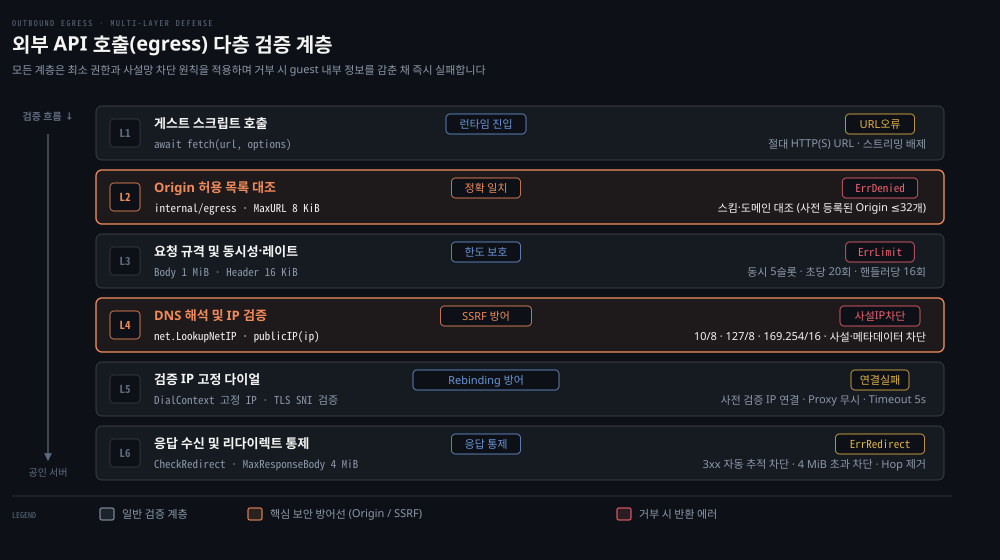
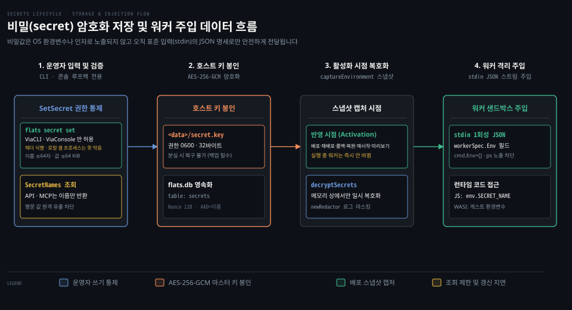

# WASI handler·egress·env·secrets

---

> 이 문서는 flats에서 WebAssembly(`.wasm`)로 컴파일된 바이너리를 WASI preview1 명령으로 실행할 때의 생명주기와 제약, 그리고 자바스크립트 서버 코드가 외부 API를 호출할 때 거치는 egress 통제 및 SSRF 방어 메커니즘, 환경 변수와 AES-256-GCM 기반 비밀(secret)의 암호화 저장 및 워커 주입 경로를 소스 코드와 실측으로 분석하는 본편 문서입니다.


## 학습 목표와 범위

> WASI 가상 머신의 제약 모델과 외부 통신 다층 방어선, 그리고 비밀의 라이프사이클을 추적하고 설명할 수 있습니다.

1. WASI preview1 기반 `.wasm` 서버 핸들러가 자바스크립트 런타임과 비교하여 어떤 자원(SQLite, 영속 파일, 외부 네트워크, WebSocket)을 쓸 수 없고 어떤 제약을 받는지 비교하여 설명할 수 있습니다.
2. 요청 진입 시마다 stdin/stdout JSON 스트림으로 독립된 wasm 모듈 인스턴스를 생성하고 폐기하는 wazero 기반 WASI 실행 수명주기를 추적할 수 있습니다.
3. 아웃바운드 HTTP 호출(egress) 시 운영자 허용 목록 대조, 정확한 Origin 단위 정규화, DNS 해석 및 사설망/메타데이터 IP 차단(`publicIP`), DNS rebinding 방어 및 리다이렉트 통제 과정을 설명할 수 있습니다.
4. 일반 환경 변수와 암호화된 비밀이 `flats.db`와 `<data>/secret.key`에 저장되는 방식을 분석합니다. 배포나 재시작 시 스냅샷으로 캡처되어 자식 프로세스의 stdin JSON 스트림으로만 주입되는 과정을 추적할 수 있습니다.
5. flat 런타임 코드가 자기 비밀을 열람할 수 있다는 신뢰 모델의 경계와 백업 시 주의 사항을 분석할 수 있습니다.

이 문서는 WASI 핸들러 ABI, 아웃바운드 네트워크 egress 검증, 환경 변수 및 비밀 관리 체계를 다룹니다. WebAssembly 및 QuickJS 내부 원리는 앞선 기초 편(`02-01.WebAssembly·WASI·QuickJS·sandbox.md`)을 참고하시기 바랍니다.

워커 프로세스 격리와 감시는 앞선 본편(`02-02.worker process·manager.md`)에서 다루었습니다. 자바스크립트 인바운드 핸들러와 `env.DB` 연동은 별도 편(`02-03.fetch handler·env.DB·env.FILES·WebSocket.md`)에서 다룹니다.

기준 커밋 3abe537 (v0.11.0, 2026-10-17)


## 1. 서버 코드의 외부 연결과 비밀 취급에 따르는 위험

> 자율 에이전트가 합성한 임의의 서버 코드에 제한 없는 외부 소켓 연결이나 호스트 환경 변수를 넘기면 내부망 침투와 비밀 유출로 이어집니다.

개발자가 로컬 머신이나 운영 호스트에서 에이전트가 실시간으로 생성한 서버 코드를 호스팅할 때 가장 경계해야 할 보안 위협은 크게 두 가지로 요약됩니다.

첫째는 제한 없는 외부 네트워크 통신에 의한 서버 사이드 요청 위조(SSRF)입니다. 서버 코드가 임의의 주소로 아웃바운드 소켓이나 HTTP 요청을 개설할 수 있다면 위험합니다. 호스트의 로컬 루프백(`127.0.0.1`), 사설망(`10.0.0.0/8`, `192.168.0.0/16`), 메타데이터(`169.254.169.254`)를 찔러 내부 자격증명을 탈취할 수 있습니다.

둘째는 민감한 인증 정보와 비밀(secret)의 무단 유출입니다. 서버가 외부 서드파티 API와 통신하려면 API 토큰이나 접근 키가 필요합니다. 하지만 운영자의 셸 환경 변수를 자식 프로세스에 그대로 상속하거나 실행 인자(`argv`)로 넘기면 로컬의 다른 프로세스가 프로세스 목록(`ps`)을 보거나 `/proc/<pid>/environ`을 열람해 비밀을 가로챌 수 있습니다. 원격 관리 API나 에이전트 도구가 비밀값을 아무 제약 없이 읽어갈 수 있다면 자격증명 노출 통로가 됩니다.

공식 문서 `README.md:206-226` 및 `docs/design.md`는 이러한 위험에 대응하기 위해 엄격한 보안 경계를 선언합니다. 관련 절은 「App environment variables」, 「Outbound HTTP permissions」, 「Secrets」입니다:

1. **기본 차단(Default Deny) 원칙**: 새로 생성된 flat은 외부 아웃바운드 네트워크 호출이 기본적으로 전면 차단됩니다.
2. **WASI 바이너리의 최소 권한**: WebAssembly로 빌드된 `.wasm` 핸들러는 네트워크 소켓, 파일시스템 마운트, 데이터베이스 바인딩이 일체 배제된 순수 입출력 명령으로만 구동됩니다.
3. **엄격한 다층 검증 egress**: 자바스크립트의 `fetch`는 운영자가 로컬에서 명시적으로 등록한 공인 Origin으로만 제한되며 VM 밖 Go 코드에서 사설 IP와 메타데이터 주소를 강제로 차단합니다.
4. **암호화 격리와 1회성 stdin 주입**: 비밀은 로컬 호스트 키로 암호화되어 저장되며 워커 프로세스에는 환경 변수 상속이 아니라 표준 입력(stdin)의 1회성 JSON 스트림으로만 전달됩니다.


## 2. WASI 핸들러 — .wasm 서버의 생명주기와 제약

> WASI 서버 핸들러는 요청마다 독립된 preview1 모듈 인스턴스를 띄워 stdin으로 입력을 받고 stdout으로 응답을 돌려주는 1회성 명령으로 동작합니다.

자바스크립트 대신 C, Rust, Go 등으로 컴파일된 임의의 바이너리를 웹 서버로 구동할 때 호스트 시스템 콜을 무제한 허용하면 메모리 손상과 시스템 장악 위험에 직면합니다. flats는 WebAssembly 바이너리(`.wasm`)를 서버 진입점으로 허용하되 장기 실행 프로세스가 아닌 엄격한 샌드박스 수명주기로 이를 통제합니다.

### 메모리 상한과 모듈 컴파일

워커가 `.wasm` 진입점을 로드할 때 `internal/runtime/wasi.go:30`의 `newWASIEngine` 함수가 wazero 런타임을 구성합니다. 이때 `internal/runtime/wasi.go:37`에 따라 `WithMemoryLimitPages(w.spec.pages())`로 메모리 상한을 강제합니다. 기본값은 1024 페이지로 64 MiB입니다(`internal/runtime/protocol.go:28`).

런타임 초기화 과정에서 flats는 `internal/runtime/wasi.go:45`에 명시된 대로 오직 표준 `wasi_snapshot_preview1` 모듈만을 인스턴스화합니다:

```go
if _, err := wasi_snapshot_preview1.Instantiate(ctx, rt); err != nil {
	rt.Close(ctx)
	return nil, err
}
```

`internal/runtime/wasi.go:54-59`에서는 컴파일된 WebAssembly 모듈의 임포트 함수 목록을 전수 검사합니다. 만약 모듈이 `wasi_snapshot_preview1` 이외의 다른 모듈로부터 함수를 가져오려 시도하면 즉시 컴파일을 중단하고 기동을 거부합니다:

```go
for _, f := range cm.ImportedFunctions() {
	if mod, _, _ := f.Import(); mod != wasi_snapshot_preview1.ModuleName {
		rt.Close(ctx)
		return nil, fmt.Errorf("%s imports from module %q; only %s is available", w.spec.Entry, mod, wasi_snapshot_preview1.ModuleName)
	}
}
```

이 검사로 flats는 사용자가 작성한 `.wasm` 코드가 `wasi_snapshot_preview1` 이외의 미인가 모듈 심볼을 호출하려는 시도를 사전에 차단합니다.

### 요청별 인스턴스화와 표준 입출력 스트림

자바스크립트 엔진이 단일 프로세스 메모리 안에서 요청 루프를 도는 것과 달리, WASI 핸들러는 HTTP 요청이 진입할 때마다 완전히 새로운 모듈 인스턴스를 생성하고 요청 처리가 끝나면 즉시 메모리에서 닫습니다.

`internal/runtime/wasi.go:89-136`의 `handle` 메서드는 요청을 이렇게 처리합니다:

1. `w.spec.poolSize()`로 크기가 제한된 세마포어(`sem`)를 획득하여 동시 인스턴스화 수를 통제합니다(`internal/runtime/wasi.go:91`).
2. `internal/runtime/wasi.go:99-110`에서 새 모듈 설정을 만듭니다:
   ```go
   cfg := wazero.NewModuleConfig().
   	WithName("").
   	WithArgs(filepath.Base(e.w.spec.Entry)).
   	WithStdin(bytes.NewReader(req)).
   	WithStdout(out).
   	WithStderr(errOut).
   	WithSysWalltime().
   	WithSysNanotime().
   	WithNanosleep(ctxSleep(ctx)).
   	WithRandSource(rand.Reader)
   ```
3. `internal/runtime/wasi.go:111-118`에 따라 flat에 할당된 환경 변수와 복호화된 비밀 키를 정렬하여 `cfg.WithEnv(k, v)`로 주입합니다.
4. `internal/runtime/wasi.go:119-122`에서 모듈을 인스턴스화(`InstantiateModule`)하여 실행한 직후 곧바로 `mod.Close(context.Background())`를 호출하여 인스턴스를 정리합니다.

이 구조에서 WASI 게스트 코드는 요청 간에 메모리 상태를 보존할 수 없습니다.

### 취소 가능한 수면(Nanosleep)과 타임아웃 방어

wazero가 제공하는 호스트 수면 옵션인 `WithSysNanosleep`은 `time.Sleep`을 사용하므로 Go 컨텍스트의 취소 신호를 감지하지 않습니다. 만약 게스트 코드가 1시간 동안 잠드는 `sleep`을 호출하면 요청 타임아웃(10초)이 지나도 인스턴스가 멈추지 않는 문제가 생깁니다.

이를 방어하기 위해 flats는 `internal/runtime/wasi.go:109`에서 커스텀 `WithNanosleep(ctxSleep(ctx))`를 등록합니다. `internal/runtime/wasi.go:140-152`에 정의된 `ctxSleep` 함수는 타이머 채널과 함께 `<-ctx.Done()`을 대기하므로 10초 핸들러 타임아웃이 초과되면 즉시 수면을 중단하고 모듈을 안전하게 종료합니다.

### JSON 입출력 규약과 자바스크립트 핸들러와의 차이

공식 설계 문서 `docs/design.md`의 「Server flats (handler ABI)」는 WASI 입출력 규약을 이렇게 정의합니다:

- **요청 JSON (stdin)**: `{"method": "GET", "url": "http://...", "headers": {"accept": "..."}, "body": "..."}` 형식의 JSON 문자열이 표준 입력으로 공급됩니다. 본문이 없으면 `body`는 null입니다.
- **응답 JSON (stdout)**: 게스트는 표준 출력으로 `{"status": 200, "headers": {"content-type": "..."}, "body": "..."}` 형식의 JSON을 출력해야 합니다. 바이너리 응답의 경우 본문을 base64로 인코딩하고 `{"body_base64": true}` 필드를 함께 설정합니다.
- **로그 전달 (stderr)**: 게스트가 표준 오류로 출력한 내용은 flats 워커의 로그 라인으로 전달됩니다.

자바스크립트 핸들러와 WASI preview1 핸들러의 기능적 차이는 명확합니다:

| 기능 영역 | JavaScript (`.js` / `.mjs`) | WASI preview1 (`.wasm`) |
|---|---|---|
| **실행 모델** | 단일 인스턴스 내 `fetch(request, env)` 비동기 호출 | 요청 진입 시마다 독립 모듈 인스턴스 생성 및 즉시 폐기 |
| **I/O 인터페이스** | Worker 스타일 Request/Response 객체 | 표준 입력(stdin) JSON / 표준 출력(stdout) JSON |
| **SQLite DB** | `env.DB.query` 및 `exec` API 제공 | 미제공 (호스트 바인딩 없음) |
| **영속 파일 (FILES)** | `env.FILES.get`, `put`, `delete`, `list` 제공 | 미제공 (호스트 바인딩 없음) |
| **WebSocket** | `websocket.open`, `message`, `close` 콜백 지원 | 미제공 (업그레이드 요청도 일반 HTTP 요청으로 취급) |
| **외부 통신 (Egress)** | 허가된 공인 Origin 대상의 `fetch()` 지원 | 미제공 (네트워크 소켓 및 HTTP 인터페이스 없음) |
| **파일시스템** | 번들된 파일 읽기 전용 로드 (임의 호스트 접근 불가) | 사전 오픈 디렉토리 및 마운트 없음 (데이터 폴더 미마운트) |
| **환경 변수·비밀** | `env.NAME` 프로퍼티 (문자열) | flat에 설정된 환경 변수 및 비밀만 wazero 게스트 환경 변수로 주입 |
| **시계 및 난수** | `Date`, 타이머, Web Crypto CSPRNG | WASI walltime/nanotime, 취소 가능한 sleep, CSPRNG |

`.wasm` 서버 flat은 데이터베이스나 외부 통신 없이 순수한 연산 로직이나 파일 변환, 비즈니스 규칙 판정 등에 특화된 무상태(stateless) 격리 환경으로 설계되어 있습니다.


## 3. 바깥 호출(egress) — 허용 목록과 다층 방어

> 자바스크립트 서버 코드의 외부 HTTP 호출은 운영자가 명시적으로 허락한 공인 Origin으로 제한되며, DNS 해석부터 리다이렉트까지 6단계에 걸쳐 강하게 통제됩니다.

서버 핸들러가 외부 API를 자유롭게 호출할 수 있다면 악의적인 스크립트가 내부 사설망을 탐색하거나 클라우드 메타데이터를 탈취하는 SSRF 공격에 무방비로 노출됩니다. flats는 자바스크립트 서버 flat에 한해 외부 통신을 허용하되 브라우저나 Node.js와 달리 6단계의 다층 방어 체계로 이를 엄격히 통제합니다.

### 운영자 권한 부여와 설정 정규화

신규 생성된 flat은 외부 호출 권한이 전혀 없습니다(`docs/external-api.md`). 외부 통신을 허용하려면 호스트 운영자가 직접 명령어나 웹 콘솔로 허용 목록을 등록해야 합니다:

```bash
flats network set <slug> https://api.example.com
flats network ls <slug>
flats network clear <slug>
```

`internal/core/network.go:22-25`의 `SetNetworkPolicy` 함수는 호출 경로를 엄격히 검증합니다:

```go
func (s *Service) SetNetworkPolicy(ctx context.Context, slugName string, origins []string, via Via) error {
	if via != ViaConsole && via != ViaCLI {
		return forbiddenf("network permissions are set by the operator in the web console or with `flats network set`")
	}
...
```

원격 API나 MCP 에이전트는 네트워크 정책을 등록하거나 변경할 수 없습니다. MCP의 `get_network`는 오직 읽기 전용입니다. 네트워크 정책은 오직 호스트 머신의 루프백 CLI와 웹 콘솔에서만 변경할 수 있습니다.

다만 공식 문서(`docs/external-api.md:25-28`)가 명시하듯 이 식별은 인증(authentication)이 아닙니다. 루프백 리스너에서 CLI 헤더를 전송하는 로컬 프로세스도 정책을 변경할 수 있으므로 호스트 머신에는 신뢰할 수 있는 에이전트만 실행해야 합니다(`SetNetworkPolicy`의 `via` 검사는 MCP·원격 API 호출을 차단하는 경계입니다).

등록된 네트워크 허용 목록은 `internal/runtime/protocol.go:64`의 `NetworkOrigins []string` 필드에 담겨 워커 프로세스의 스펙(`workerSpec`)으로 전달됩니다.

### egress 클라이언트의 엄격한 자원 한도

worker 프로세스의 Go 쪽(VM 밖, `internal/egress/client.go:23-31`)은 외부 요청의 폭주와 자원 고갈을 방지하기 위해 고정 한도를 강제합니다:

```go
const (
	MaxOrigins      = 32
	MaxURL          = 8 << 10
	MaxHeaders      = 16 << 10
	MaxHeaderFields = 128
	MaxRequestBody  = 1 << 20
	MaxResponseBody = 4 << 20
	Timeout         = 5 * time.Second
)
```

`internal/egress/client.go:94-96`에 따라 워커당 동시 실행 슬롯은 5개(`slots: make(chan struct{}, 5)`)로 제한됩니다. 레이트 리미터(`rate.NewLimiter(20, 20)`)는 초당 20회(버스트 20)를 통제합니다. 단일 핸들러 호출 안에서는 최대 16회의 외부 호출만 허용됩니다(`docs/external-api.md`).

### 다층 검증과 SSRF 방어 메커니즘

자바스크립트 코드에서 `await fetch(url, options)`를 호출하면 `internal/egress/client.go:211`의 `Fetch` 메서드가 실행되며 다음 방어 계층을 차례로 통과해야 합니다:

1. **Origin 사전 등록 규격 및 정확 일치 대조 (`NormalizeOrigins`:72-86, `target`:106-136, `Fetch`:216-222)**:
   운영자가 허용 목록을 등록할 때(`NormalizeOrigins`:72-86) 대상은 반드시 `http://`(포트 80) 또는 `https://`(포트 443) 표준 포트의 Origin이어야 합니다. 경로(끝부분 `/` 제외), 쿼리스트링, 프래그먼트, 사용자 정보가 포함되면 `invalid network origin`으로 거부됩니다. 서브도메인 와일드카드(`*.example.com`)나 비표준 포트도 일체 지원하지 않습니다.
   반면 자바스크립트가 실제 `fetch`를 호출할 때는 `target()`(:106-136)이 URL 길이(`MaxURL = 8 KiB`), 스킴, 표준 포트, 프래그먼트 부재를 검증합니다. 경로와 쿼리스트링은 실제 요청에 그대로 보존하여 전송합니다(`:346` `u.String()`). 요청 대상의 정규화된 Origin이 사전 등록된 목록(최대 32개)에 없으면 즉시 `internal/egress/client.go:35`의 `ErrDenied`("network target is not permitted") 에러를 반환합니다.
   실제로 허락 없이 `fetch("https://example.com/")`을 실행하면 `fetch`가 `Error: network target is not permitted` 예외(`internal/egress/client.go:35`의 `ErrDenied`)를 던집니다. 실측 핸들러가 이를 잡아 502 상태코드와 함께 `"fetch error: Error: network target is not permitted"` 오류를 반환합니다(로컬 실측(2026-10-18)).
2. **요청 규격 검증 및 민감 헤더 변조 차단 (`internal/egress/client.go:223-276`, `forbiddenHeader`:191-198)**:
   게스트 스크립트가 넘긴 요청 본문 크기(`MaxRequestBody = 1 MiB`)와 리다이렉트 옵션을 검사합니다. HTTP 메서드는 `GET`, `HEAD`, `POST`, `PUT`, `PATCH`, `DELETE`, `OPTIONS`만 허용합니다. 헤더는 최대 128개 필드(`MaxHeaderFields`), 최대 16 KiB(`MaxHeaders`)로 제한됩니다. 요청 변조 방지를 위해 `Host`, `Connection`, `Content-Length`, `Transfer-Encoding`, `Upgrade` 지정을 금지합니다. `Trailer`, `TE`, `Keep-Alive`, `Expect`, `Accept-Encoding` 및 `proxy-`, `sec-` 접두사 헤더도 차단합니다.
3. **동시성 슬롯 및 레이트 리밋 집행 (`internal/egress/client.go:94-96, 277-285`)**:
   외부 요청 폭주를 막기 위해 토큰 버킷 레이트 리미터(`rate.NewLimiter(20, 20)`)로 초당 20회(버스트 20)를 통제합니다. 워커당 동시 실행 슬롯 채널(`slots: make(chan struct{}, 5)`)에서 5개 슬롯 중 하나를 획득합니다. 슬롯이 고갈되거나 레이트를 초과하면 대기하지 않고 즉시 `ErrLimit`을 반환합니다. 단일 핸들러 호출 안에서는 최대 16회의 외부 호출만 허용됩니다(`docs/external-api.md`).
4. **DNS 해석과 공인 IP 전수 검증 (`internal/egress/client.go:307-322`, `blocked`:162-172, `publicIP`:174-189)**:
   도메인 이름을 IP로 해석한 뒤 반환된 주소가 32개를 넘으면 `ErrLimit`으로 차단합니다(`:315`). 반환된 IP 주소마다 `publicIP(ip)` 검사를 수행합니다(`:318-322`). 단 하나의 IP라도 사설망이거나 차단 목록에 포함되어 있다면 연결을 즉시 거부하고 `ErrDenied`를 반환합니다. 차단 대역인 `blocked` 슬라이스에는 루프백(`127/8`), 사설망(`10/8`, `172.16/12`, `192.168/16`), 클라우드 메타데이터(`169.254/16`)가 포함됩니다. CGNAT(`100.64/10`), 문서 예제 대역(`192.0.2/24`), 멀티캐스트(`224/4`), 예약 대역(`240/4`), Azure 가상 IP(`168.63.129.16/32`)도 막힙니다. IPv4 매핑 IPv6(`Is4In6`) 주소와 `2000::/3` 범위를 벗어난 IPv6 유니캐스트 주소도 모두 차단합니다.
5. **DNS Rebinding 방어와 IP 고정 다이얼 (`internal/egress/client.go:327-344`)**:
   커스텀 `http.Transport`의 `DialContext`는 사전 검증된 `addresses` IP 목록으로만 TCP 연결을 시도합니다. TLS 검증 시에만 원래 호스트명을 `ServerName: hostname`으로 넘깁니다. 이 고정 다이얼이 최초 해석 후 연결 시 사설 IP로 바꾸는 DNS Rebinding 공격을 차단합니다. `Proxy: nil`로 호스트 환경의 프록시 설정을 무시하며 `DisableKeepAlives: true`로 TCP 커넥션을 재사용하지 않고 요청 후 닫습니다.
6. **응답 수신, 홉별 헤더 삭제 및 리다이렉트 자동 추적 차단 (`internal/egress/client.go:351, 357-359, 366-388`)**:
   외부 서버가 301, 302, 303, 307, 308 등 리다이렉트 응답을 반환할 때 Go 클라이언트는 `CheckRedirect`에서 `http.ErrUseLastResponse`를 반환하여 후속 요청을 자동으로 따라가지 않습니다. 호출자가 `redirect: "manual"`을 지정하지 않았다면 `ErrRedirect`("outbound redirects are disabled") 오류를 내고 실패합니다. 외부 서버가 리다이렉트를 이용해 내부 사설망 엔드포인트로 클라이언트를 유도하는 2차 SSRF 공격은 이 단계에서 차단됩니다. 수신된 응답 헤더에서도 `forbiddenHeader`에 해당하는 홉별·민감 헤더는 모두 삭제(`res.Header.Del(name)`)하고 응답 본문은 `MaxResponseBody = 4 MiB`까지만 수용합니다.



위 다이어그램은 자바스크립트의 `fetch` 호출이 호스트 네트워크를 거쳐 공인 서버에 도달하기까지의 계층별 검증 절차를 보여줍니다. 게스트 스크립트 호출부터 `target()` URL 검증 및 Origin 대조, 요청 규격과 동시성·레이트 통제, DNS 해석과 공인 IP 검증, 고정 IP 다이얼, 그리고 응답 수신 및 자동 리다이렉트 통제까지 단계별 검증이 이루어집니다. 어느 한 단계라도 위반되면 `ErrDenied`, `ErrRedirect`, `ErrLimit` 등의 안전한 오류가 반환됩니다.


## 4. 환경 변수와 비밀 — 저장·암호화·주입 경로와 반영 시점

> 환경 변수는 flats.db에 평문으로 보관되고 비밀은 AES-256-GCM으로 봉인되며, 워커 프로세스에는 오직 표준 입력(stdin)의 JSON 명세를 통해서만 안전하게 주입됩니다.

서버 앱이 외부 서비스와 연동하거나 환경별 설정을 적용하려면 구성 변수와 비밀(API 키, 토큰)을 다룰 수 있어야 합니다. flats는 일반 환경 변수와 비밀을 엄격히 분리하여 관리합니다.

### 일반 환경 변수의 보관과 검증

일반 환경 변수는 `flats env set <slug> <name> <value>`, `flats env ls <slug>`, `flats env rm <slug> <name>` 명령으로 관리합니다(`docs/design.md`).

`internal/core/env.go:14-33`은 변수 이름과 값을 각각 검증합니다:

- **이름 검증**: `[A-Z_][A-Z0-9_]*` 정규식을 만족해야 하며 최대 길이는 64자입니다. 런타임 바인딩 및 프로토타입 오염 방지를 위해 `DB`, `FILES`, `__PROTO__`, `PROTOTYPE`, `CONSTRUCTOR` 예약어는 등록할 수 없습니다(`internal/core/env.go:19-21`).
- **값 검증**: UTF-8 문자열이어야 하며 길이는 최대 64 KiB입니다. NUL 바이트(`\0`)를 포함할 수 없습니다(`internal/core/env.go:26-31`).

일반 환경 변수는 `flats.db`에 평문으로 저장되고 관리 API, CLI, MCP 클라이언트가 자유롭게 조회할 수 있으므로(`internal/core/env.go:71`) 패스워드나 인증 토큰을 저장하는 데에는 적합하지 않습니다.

### 비밀(Secrets)의 AES-256-GCM 암호화와 키 관리

비밀은 인증 키나 토큰을 안전하게 보관하기 위해 특별히 설계된 공간입니다(`internal/core/secrets.go:18-20`).

1. **호스트 마스터 키 (`<data>/secret.key`)**:
   flats 호스트는 최초 기동 시 데이터 디렉토리 안에 32바이트의 무작위 키를 생성(`internal/core/secrets.go:57`, 검사는 `:103-105`)하여 `secret.key` 파일로 저장합니다. 파일 권한은 `os.CreateTemp`(`:63`)에 의해 소유자만 읽고 쓸 수 있는 `0600` 모드로 엄격히 제한됩니다(`:18-20`).
2. **AES-256-GCM 봉인**:
   비밀을 저장할 때 `internal/core/secrets.go:144-149`에 따라 12바이트의 암호학적 난수 Nonce를 생성하고 추가 인증 데이터(AAD)로 비밀의 이름(`[]byte(name)`)을 함께 바인딩하여 AES-256-GCM으로 암호화합니다:
   ```go
   nonce := make([]byte, g.NonceSize())
   if _, err := rand.Read(nonce); err != nil {
   	return err
   }
   ct := g.Seal(nil, nonce, []byte(value), []byte(name))
   ```
   암호문(`ct`)과 Nonce는 `flats.db`의 `secrets` 테이블(`internal/store/store.go:290`)에 안전하게 영속화됩니다.
3. **운영자 전용 쓰기 권한**:
   `internal/core/secrets.go:127-130`에 따라 `SetSecret`은 오직 호스트 머신의 루프백 CLI와 웹 콘솔(`via == ViaCLI || via == ViaConsole`)에서만 호출할 수 있습니다. 원격 API나 MCP 에이전트가 비밀을 쓰려 하면 `forbidden` 오류를 반환합니다. 다만 공식 문서(`docs/design.md` 「Secrets」)가 밝히듯 CLI 식별은 루프백 리스너의 `X-Flats-Client: cli` 헤더 기반입니다. 이는 MCP나 원격 API 클라이언트를 차단하는 경계일 뿐, 호스트 머신의 셸 권한을 가진 로컬 프로세스를 막는 인증은 아닙니다.
4. **정보 은닉 (API·MCP는 이름만 노출)**:
   `internal/core/secrets.go:172-185`의 `SecretNames` 메서드는 오직 비밀의 이름(`Name`)과 수정 시각(`UpdatedAt`)만을 반환합니다. 평문 비밀값은 관리 API나 MCP 도구로 절대 반환되지 않습니다.
5. **마스터 키 분실 방어 (`CheckSecretKey`)**:
   `internal/core/secrets.go:24-48`의 `CheckSecretKey`는 키 누락을 방어합니다. `flats.db`에 봉인된 비밀(`HasSecrets`)이나 봉인된 운영자 키(`HasSealedHostKeys`:42-47)가 있는데 `secret.key`가 없으면 `ErrSecretKeyMissing` 오류로 기동을 거부합니다. 임의의 새 키를 만들어 기존 비밀이 영구 소실되는 사고를 방지합니다.

### 워커 프로세스 주입 경로: 오직 stdin JSON 스트림

호스트 데몬이 복호화된 비밀과 환경 변수를 자식 워커 프로세스에 전달할 때 일반적인 OS 프로세스 관행을 따르지 않습니다.

`internal/runtime/protocol.go:50-51`의 주석은 이 원칙을 명확하게 규정합니다:

```go
// workerSpec is sent to the child on stdin as one JSON line. Secrets travel
// only here: never in argv or in the child's environment.
type workerSpec struct {
...
	Env            map[string]string `json:"env"`
...
}
```

앞선 `02-02.worker process·manager.md` 편에서 확인했듯이 부모 프로세스는 워커 서브프로세스를 스폰할 때 `cmd.Env`를 빈 슬라이스로 격리합니다. 그래서 호스트의 `PATH`, `HOME`, 클라우드 토큰은 물론 flat의 비밀값조차 OS 환경 변수 테이블에 등록되지 않습니다. 커맨드라인 인자(`argv`)에도 일체 포함되지 않습니다.

비밀과 환경 변수는 오직 부모 데몬이 자식의 표준 입력(stdin) 첫 줄로 전송하는 단 한 줄의 `workerSpec` JSON 스트림 안의 `Env` 맵 필드로만 전달됩니다. 이렇게 하면 `ps aux`로 프로세스 인자를 확인하거나 `/proc/<pid>/environ`을 열람하더라도 argv나 OS 환경 변수 경로로는 비밀이 새지 않습니다.

자바스크립트 런타임에서는 이 값들이 `env.NAME` 프로퍼티로 노출되며 WASI 핸들러에서는 모듈 인스턴스화 시 wazero의 `WithEnv(k, v)`를 거쳐 게스트 내부 환경 변수로 주입됩니다.

### 설정 변경의 반영 시점 (Activation Snapshot)

환경 변수나 비밀을 추가, 수정, 삭제하더라도 현재 실행 중인 워커 프로세스는 즉시 변경되지 않습니다(`README.md:217-224`, `docs/design.md` 「App environment variables」).

워커는 기동 시점에 부모로부터 전달받은 설정 스냅샷을 메모리에 유지합니다. 새로운 설정값이 실제로 서빙에 반영되는 시점은 오직 다음 **6가지 활성화(Activation)** 계기가 발생했을 때뿐입니다:

1. **승인된 새 버전 배포 (`flats deploy`)**
2. **기존 라이브 버전의 재배포 (`redeploy`)**
3. **이전 버전으로의 롤백 (`flats rollback`)**
4. **독립 데이터 스냅샷 복원 (`restore-data`)**
5. **flats 호스트 데몬 재시작 (`flats serve` 재기동)**
6. **새로운 미리보기 인스턴스 생성 (`flats preview`)**

프로세스 관리자가 비정상 종료된 워커를 자동 재기동(`ensure`)할 때는 새로운 설정을 읽지 않습니다. 이전에 캡처해 둔 스냅샷을 그대로 재사용합니다(`docs/design.md` 「App environment variables」). 그래서 변경사항을 적용하려면 운영자가 재배포를 승인해야 합니다.

### 신뢰 모델의 공식 한계와 주의 사항

공식 문서 `README.md:270-273`은 비밀 관리 체계의 명확한 보안 한계를 밝히고 있습니다:

1. **flat 코드 자체의 비밀 열람 권한**:
   flat 런타임 코드는 비즈니스 로직 수행을 위해 런타임에 자기 비밀의 평문을 읽을 수 있어야 합니다(`env.NAME`). 이 때문에 악의적인 코드는 읽어 들인 비밀을 HTTP 응답 본문에 실어 클라이언트에 반환하거나 외부 허용 엔드포인트로 전송할 수 있습니다. 비밀을 다루는 flat에는 반드시 신뢰할 수 있는 코드만 배포해야 합니다.
2. **데이터 디렉토리 읽기 권한자의 비밀 복구**:
   호스트 머신의 로컬 파일시스템에서 flats 데이터 디렉토리(`<data>`) 읽기 권한을 가진 사용자나 프로세스는 `secret.key`와 `flats.db`를 읽어 AES-256-GCM 복호화를 수행함으로써 모든 비밀을 복구할 수 있습니다.
3. **공식 백업 절차 내 평문 키 포함**:
   flats에는 별도 백업 명령이 없습니다. 공식 백업 문서(`docs/configuration.md:94-96`)는 `flats.db` 백업 시 같은 시점의 `<data>/secret.key`를 함께 백업하도록 요구합니다. 데이터베이스 안의 비밀과 운영자 키를 복구하려면 이 키가 필수이기 때문입니다. 공식 문서(`docs/release.md:338-341`, `docs/configuration.md:109`)가 권하는 가장 단순한 방법은 서비스를 멈추고 데이터 디렉터리를 통째로 복사하는 것입니다. 이때 디렉터리 사본에 `<data>/secret.key`가 0600 평문 파일로 포함되므로 백업본 자체가 비밀이 됩니다(로컬 실측(2026-10-15, v0.9.1)). 백업 디렉터리가 유출되면 암호화된 비밀도 함께 복구될 수 있으므로 백업 보관소의 접근 통제와 2차 암호화가 필수적입니다(상세한 백업 및 재해 복구 아키텍처는 `05-02.백업·복원·재해복구.md`(예정)에서 다룹니다).



위 데이터 흐름도는 운영자의 CLI 명령부터 워커 내부의 스크립트 실행까지 비밀이 이동하는 전 과정을 보여줍니다. CLI 입력은 루프백 검증을 거쳐 AES-256-GCM 마스터 키로 암호화된 뒤 `flats.db`의 `secrets` 테이블에 보관되며 배포 활성화 시점에 일시 복호화되어 표준 입력(stdin)의 1회성 JSON 스트림으로만 워커에 안전하게 주입됩니다.


## 5. 흔한 오해

> 비밀 암호화와 egress 허용 목록의 작동 원리에 관해 개발자가 자주 혼동하는 두 가지 사실을 짚어봅니다.

### 오해 1: "비밀(secret)로 등록했으니 flat 코드 내부에서도 값을 열어볼 수 없다"

일부 개발자는 flats의 비밀 암호화 메커니즘을 보고 flat의 서버 코드조차 비밀의 평문 값을 알지 못한 채 호스트가 자동으로 프록시해 주는 방식(예: 토큰 바인딩 프록시)이라고 오해하곤 합니다.

하지만 flats의 비밀 암호화는 외부 관리 API, MCP 클라이언트, 시스템 로그, 그리고 커맨드라인 인자 및 환경 블록(`ps`, `/proc/<pid>/environ`) 경로로부터 비밀을 숨기기 위한 보안 장치입니다. 이는 데이터 디렉터리를 읽을 수 있는 로컬 계정·프로세스로부터의 보호는 아닙니다(`README.md:272-273`이 밝히듯 디렉터리 읽기 권한자는 누구나 복구 가능). flat 서버 코드 자체는 서드파티 서비스와 통신하고 인증 헤더를 구성해야 하므로 런타임에 `env.SECRET_NAME`으로 비밀의 평문 문자열을 읽을 수 있습니다.

만약 에이전트가 악의적이거나 버그가 있는 코드를 생성하여 `return new Response(env.MY_TOKEN)`과 같이 응답을 작성한다면 해당 flat을 호출하는 방문자에게 비밀이 고스란히 노출될 수 있습니다. flats의 암호화는 코드 내부의 부주의나 악의적 유출까지 막아주는 마법이 아닙니다. 그래서 중요한 비밀을 주입하는 flat은 반드시 배포 승인(`approval`) 단계에서 코드를 검토해야 합니다.

### 오해 2: "egress 허용은 도메인 단위(`example.com`)나 와일드카드(`*.example.com`)로 설정한다"

일반적인 웹 방화벽이나 프록시 설정에 익숙한 사용자는 `flats network set <slug> example.com`이나 `*.example.com`과 같은 도메인 와일드카드 패턴을 사용할 수 있다고 생각하기 쉽습니다.

하지만 `internal/egress/client.go:72`의 `NormalizeOrigins`와 `internal/egress/client.go:106`의 `target`은 엄격합니다. flats는 오직 정확한 HTTP(S) Origin 단위(`scheme://host`, 표준 포트 `:80`/`:443` 표기는 허용)만을 요구합니다.

와일드카드 문자나 8080 같은 비표준 포트, `/api/v1` 같은 하위 경로, 스킴 없는 도메인은 모두 `invalid network origin` 에러로 거부됩니다. 예를 들어 서브도메인이 다른 auth, api, pay 서버와 통신하려면 와일드카드를 쓸 수 없습니다. 3개의 완전한 HTTPS Origin을 각각 개별 등록해야 합니다(최대 32개까지 허용).


## 6. 한계와 실패 조건

> flats의 WASI 런타임, egress 네트워크, 환경 변수 및 비밀 체계가 갖는 시스템적 한계와 오류 조건을 정리합니다.

| 분류 | 항목 | 제약 및 한계 수치 | 위반 시 동작 및 반환 오류 |
|---|---|---|---|
| **WASI 런타임** | DB 및 파일 접근 | SQLite(`env.DB`) 및 FILES(`env.FILES`) 미제공 | 호스트 바인딩 미제공으로 컴파일 또는 실행 불가 |
| **WASI 런타임** | 네트워크 및 웹소켓 | 아웃바운드 소켓 및 WebSocket 미제공 | 외부 통신 불가, 업그레이드 요청은 일반 HTTP 처리 |
| **WASI 런타임** | 미인가 모듈 임포트 | `wasi_snapshot_preview1` 외 임포트 금지 | 기동 거부 (`only wasi_snapshot_preview1 is available`) |
| **WASI 런타임** | 인스턴스화 오버헤드 | 요청마다 fresh 모듈 인스턴스 생성 및 폐기 | 메모리 상태 보존 불가, 세마포어 고갈 시 504 타임아웃 |
| **Egress 네트워크** | 최대 등록 Origin 수 | flat당 최대 32개 (`MaxOrigins = 32`) | `too many network origins` 에러와 함께 등록 거절 |
| **Egress 네트워크** | 요청 URL 길이 | 최대 8 KiB (`MaxURL = 8 << 10`) | `ErrInvalid` 에러 반환 |
| **Egress 네트워크** | 요청 헤더 상한 | 최대 16 KiB / 최대 128개 필드 (`MaxHeaders`, `MaxHeaderFields`) | `ErrLimit` 에러 반환 |
| **Egress 네트워크** | 본문 크기 상한 | 요청 최대 1 MiB / 응답 최대 4 MiB | `ErrLimit` 에러 반환 |
| **Egress 네트워크** | 호출 시간제한 | 호출당 5초 데드라인 (`Timeout = 5s`) | `ErrTimeout` 에러 반환 (핸들러 10s 내 제한) |
| **Egress 네트워크** | 동시성 및 레이트 | 워커당 동시 5개 슬롯, 초당 20회(버스트 20), 요청당 16회 | 슬롯 고갈·초과 즉시 `ErrLimit` 반환 (대기 없음) |
| **Egress 네트워크** | 사설망 및 메타데이터 | 루프백, 사설 IP, 169.254, 특수 IPv6 차단 | `ErrDenied` ("network target is not permitted") 반환 |
| **Egress 네트워크** | 리다이렉트 추적 | 3xx 상태코드 자동 추적 차단 | `redirect: manual` 외에는 `ErrRedirect` 반환 |
| **환경 변수·비밀** | 키 이름 및 예약어 | `[A-Z_][A-Z0-9_]*` ≤64자, DB/FILES 등 예약어 불가 | 패턴 불일치 시 `must match [A-Z_][A-Z0-9_]*...`, 예약어 시 `is reserved by the runtime` 에러 |
| **환경 변수·비밀** | 값 크기 및 포맷 | 최대 64 KiB, 유효한 UTF-8, NUL 바이트 금지 | 64 KiB 초과 또는 NUL 포함 시 등록 거절 |
| **환경 변수·비밀** | 실행 중 반영 지연 | 실행 중인 워커는 즉시 안 바뀜 (재배포 필요) | 배포·재배포·롤백·복원·재시작 전까지 이전 스냅샷 유지 |
| **환경 변수·비밀** | 마스터 키 분실 | `<data>/secret.key` 누락 시 기동 거부 | `ErrSecretKeyMissing` 오류로 호스트 시작 중단 |


## 리뷰 노트

> 소스 코드와 공식 문서를 분석하며 확인한 세부 구현 특징과 설계적 결정을 기록합니다.

- **아웃바운드 HTTP 트랜스포트의 연결 풀링 및 압축 해제 강제 비활성화 (`internal/egress/client.go:327-344`)**:
  flats의 egress `http.Transport`는 `DisableKeepAlives: true`와 `DisableCompression: true`를 강제합니다. 요청마다 TCP 커넥션을 새로 맺고 종료하여 유휴 연결을 남기지 않습니다. `Accept-Encoding` 요청 헤더는 거부되고 자동 압축 해제가 비활성화되어 업스트림의 압축 응답도 원시 바이트 그대로 게스트에 전달됩니다(`docs/external-api.md:84-85`).
- **마스터 키 누락 시 자동 재생성 차단과 고아화 방어 (`internal/core/secrets.go:28-48`)**:
  `CheckSecretKey` 함수는 데이터베이스에 봉인된 비밀이나 운영자 키가 존재할 때 `secret.key`가 누락되어 있으면 새 키를 자동으로 만들지 않고 기동을 중단합니다(`ErrSecretKeyMissing`). 새 키를 만들면 기존 데이터가 영구히 해독 불가능해지기 때문입니다. 봉인된 flat 비밀이 남아 있으면 반드시 백업에서 `secret.key`를 복구해야 합니다. 봉인된 운영자 키만 있는 경우에는 백업 복구 외에 `flats key rm`으로 기존 키를 지우고 새로 등록하는 대안 경로도 오류 문구에 담아 안내합니다(`:45-47`).
- **환경 변수 활성화 스냅샷과 로그 마스킹 연동 (`internal/core/env.go:88-117`)**:
  `captureEnvironment`는 배포 활성화 시점에 환경 변수와 비밀을 병합하면서 `newRedactor(env)`를 생성합니다. 그 결과 워커가 표준 출력이나 표준 오류로 로그를 출력할 때 비밀에 해당하는 문자열이 포함되어 있으면 호스트가 이를 자동으로 감지하여 마스킹(Redaction) 처리한 뒤 로그 저장소에 기록합니다.
- **컨텍스트 연동 커스텀 수면 함수 (`internal/runtime/wasi.go:107-109, 140-152`)**:
  wazero 런타임이 제공하는 `WithSysNanosleep` 옵션은 `time.Sleep`으로 호스트 스레드를 재우기 때문에 Go 컨텍스트 취소 신호를 무시합니다. flats는 `ctxSleep`을 직접 구현하여 `select { case <-t.C: case <-ctx.Done(): }` 채널로 대기합니다. 그래서 게스트가 긴 슬립을 호출해도 요청 타임아웃 발생 시 즉각 인스턴스를 닫을 수 있습니다.


## 자가 점검 질문

> 본문에서 다룬 핵심 원리를 바탕으로 질문에 답해 보며 이해도를 점검해 보시기 바랍니다.

1. WASI preview1 기반 `.wasm` 서버 flat이 자바스크립트 서버 flat과 비교하여 지원하지 않는 핵심 기능 네 가지는 무엇입니까?
2. 자바스크립트 flat이 `fetch()`로 외부 API를 호출할 때 flats 호스트가 사설망 접근(SSRF)과 DNS Rebinding 공격을 차단하기 위해 취하는 다층 방어 절차는 무엇입니까?
3. flats에서 환경 변수(env)와 비밀(secret)을 설정했을 때 실행 중인 워커 프로세스에 즉시 반영되지 않는 이유와, 변경된 값이 실제 서빙에 반영되는 계기 6가지는 무엇입니까?
4. flat의 비밀값이 호스트 프로세스의 환경 변수(`cmd.Env`)나 실행 인자(`argv`)로 전달되지 않고 워커 프로세스에 안전하게 주입되는 메커니즘과 그 보안적 이점은 무엇입니까?


## 정답 (자답 후 펼치기)

> 각 질문에 대해 충분히 고민해 본 뒤 아래 해설과 비교해 보시기 바랍니다.

### 1번 정답
첫째, SQLite 데이터베이스 바인딩(`env.DB`)이 제공되지 않아 릴레이셔널 쿼리를 수행할 수 없습니다. 둘째, 영속 파일 스토리지(`env.FILES`)가 제공되지 않으며 호스트 데이터 디렉토리도 마운트되지 않습니다. 셋째, 아웃바운드 네트워크 호출 인터페이스가 없어 외부 API를 부를 수 없습니다. 넷째, WebSocket 프로토콜 업그레이드가 지원되지 않아 실시간 양방향 통신을 구현할 수 없습니다. 추가로 메모리 상태를 유지하는 단일 런타임 루프가 아니라 요청마다 fresh 모듈 인스턴스를 생성하고 폐기하는 1회성 명령 모델로 실행됩니다.

### 2번 정답
첫째, 사전 등록된 최대 32개의 정확한 Origin(`scheme://host`, 표준 포트 `:80`/`:443` 표기 허용) 목록과 요청 대상을 대조하여 불일치 시 `ErrDenied`로 즉시 차단합니다. 둘째, DNS 해석 결과로 나온 IP마다 `publicIP` 검사를 수행합니다. 루프백, 사설망, 클라우드 메타데이터(`169.254/16`) 등이 하나라도 섞여 있으면 즉시 연결을 거부합니다. 셋째, 사전 검증된 IP로만 고정 다이얼(Pinning)하여 DNS Rebinding을 방어합니다. 자동 리다이렉트 추적도 차단하여 사설망 우회를 무력화합니다.

### 3번 정답
워커 프로세스는 기동 시점에 부모 데몬으로부터 주입받은 환경 변수 스냅샷을 메모리에 유지하며 서빙하기 때문입니다. 변경된 설정값은 6가지 활성화(Activation) 계기에서만 새 스냅샷으로 캡처되어 반영됩니다. (1) 승인된 새 배포, (2) 재배포, (3) 롤백, (4) 데이터 복원, (5) 호스트 재시작, (6) 새 미리보기 생성입니다. 워커 충돌로 인한 자동 재기동(`ensure`) 시에는 기존 스냅샷을 재사용하므로 반영되지 않습니다.

### 4번 정답
부모 프로세스가 워커 서브프로세스를 스폰할 때 `cmd.Env`를 빈 슬라이스로 설정하여 호스트의 모든 환경 변수 상속을 차단하고 실행 인자(`argv`)에도 비밀을 넣지 않습니다. 대신 복호화된 비밀은 부모 프로세스가 자식의 표준 입력(stdin) 첫 줄로 전송하는 `workerSpec` JSON 스트림의 `Env` 맵 필드로만 주입됩니다. 그 덕분에 로컬에서 `ps aux`로 프로세스 인자를 확인하거나 `/proc/<pid>/environ`을 열람하더라도 argv나 OS 환경 변수 경로로는 비밀값이 새지 않는 격리를 달성합니다(단, 데이터 디렉터리 읽기 권한을 가진 로컬 계정은 예외).
