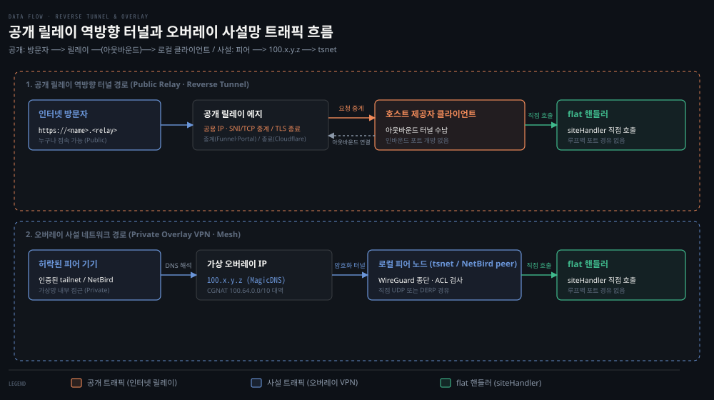
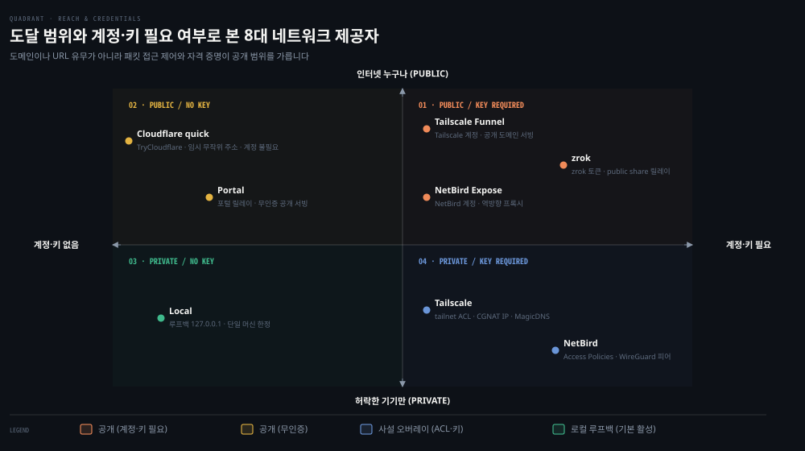

# Overlay VPN·reverse tunnel·public relay

---

> 로컬 루프백(`127.0.0.1`)에 묶인 서버를 NAT와 방화벽 너머의 외부 기기나 인터넷 사용자가 접근하도록 열어 주는 오버레이 VPN과 역방향 터널, 그리고 공개 릴레이의 네트워크 동작 원리와 보안 경계를 다루는 기초 개념 문서입니다.


## 학습 목표와 범위

> NAT 뒤 루프백 서버의 접근 제약 요인을 이해하고, 오버레이 가상 사설망과 공개 역방향 릴레이의 트래픽 라우팅 및 TLS 종료 지점의 차이를 설명할 수 있습니다.

1. 로컬 머신의 루프백 인터페이스(`127.0.0.1`)와 사설망 NAT 환경에서 외부 인바운드 연결이 기본 차단되는 원리를 패킷 라우팅과 conntrack 테이블 관점에서 설명할 수 있습니다.
2. WireGuard 기반 오버레이 VPN이 가상 인터페이스와 CGNAT 사설 IP 대역(`100.64.0.0/10`), MagicDNS, ACL을 써서 허락된 기기 간 암호화 통신을 구성하는 메커니즘을 분석할 수 있습니다.
3. 역방향 터널과 공개 릴레이(Tailscale Funnel, Cloudflare quick tunnel, zrok, Portal)가 인바운드 방화벽 개방 없이 아웃바운드 연결로 공용 인터넷 주소를 생성하는 원리와 제공자별 TLS 종료 위치를 비교할 수 있습니다.
4. "Private"(허락한 기기 한정)와 "Public"(인터넷 누구나)의 경계가 도메인 이름 유무가 아니라 패킷 접근 제어와 자격 증명 요구 여부로 갈린다는 사실을 설명할 수 있습니다.

이 문서는 오버레이 네트워크와 역방향 터널의 네트워크 계층 기초 원리를 다룹니다. flats 제공자 관리자와 grant 제어(`03-02.provider manager·grants·visibility.md`), Tailscale 연동(`03-03.local·Tailscale·Funnel.md`)은 후속 편에서 다룹니다. Portal 연동(`03-04.Portal.md`)과 zrok/Cloudflare/NetBird(`03-05.zrok·Cloudflare quick·NetBird.md`)도 이어지는 편으로 넘깁니다.

기준 커밋 3abe537 (v0.11.0, 2026-10-17)


## 1. 문제 — NAT·방화벽 뒤 루프백 서버

> 로컬 루프백 주소에 바인딩된 프로세스는 운영체제 커널 밖으로 나가지 않으며, 공유기 방화벽은 매핑 없는 외부 인바운드 패킷을 모두 폐기합니다.

개발자가 로컬 머신에서 웹 서버나 API 데몬을 띄울 때 가장 안전한 기본 바인딩 주소는 **루프백 인터페이스**(Loopback Interface, RFC 1122)인 `127.0.0.1` 또는 `localhost`입니다. 루프백으로 향하는 패킷은 컴퓨터 내부의 네트워크 스택 안에서만 순환하고 물리 네트워크 카드를 거치지 않습니다. 따라서 동일한 로컬 컴퓨터 내의 브라우저나 에이전트만 이 포트에 접속할 수 있으며 로컬 네트워크의 다른 컴퓨터나 외부 인터넷에서는 물리적으로 도달할 수 없습니다.

서버를 `0.0.0.0`으로 열어 두더라도 외부 인터넷에서 바로 접속하기는 어렵습니다. 오늘날 대부분의 가정과 사무실은 인터넷 공유기나 기업 방화벽 아래에 위치합니다. 이 장비들은 공인 IPv4 주소를 여러 단말이 공유할 수 있도록 **네트워크 주소 변환**(Network Address Translation, NAT)과 상태 기반 방화벽을 운영합니다.

NAT와 상태 기반 방화벽의 세부 원리는 portal 시리즈 기초 편 [01-01.NAT·conntrack·outbound connection.md](../../../02_os/project/portal-tunnel/01-01.NAT%C2%B7conntrack%C2%B7outbound%20connection.md)에 정리되어 있습니다. 방화벽은 내부 단말이 외부로 먼저 요청을 보낼 때만 연결 추적(conntrack) 테이블에 출발지와 목적지 포트 매핑을 임시로 기록합니다. 외부 인터넷에서 내부 사설 IP로 들어오는 인바운드 TCP SYN 패킷은 conntrack 테이블에 대응하는 항목이 없으므로 방화벽 장비에서 즉시 차단(DROP 또는 REJECT)됩니다.

공유기 관리자 페이지에서 포트 포워딩을 설정하거나 공인 IP를 직접 노출하는 방법도 있습니다. 하지만 카페나 모바일 핫스팟, 공용 클라우드 VPC처럼 방화벽 관리 권한이 없는 환경에서는 포트 포워딩이 불가능합니다. 가정용 공인 IP를 인터넷 전체에 노출하면 포트 스캐닝과 분산 서비스 거부 공격(DDoS)에 무방비로 노출되는 보안 위험도 따릅니다.

따라서 인바운드 방화벽 포트를 열지 않고 로컬 서버를 외부와 연결하려면 기술적으로 두 가지 길 중 하나를 선택해야 합니다:

1. **오버레이 가상 사설망(Overlay VPN)**: 통신하려는 양쪽 기기 모두에 전용 클라이언트를 설치하고 암호학적 키를 교환하여 물리 네트워크 위에 가상의 사설 L3 네트워크(Private Mesh)를 덧씌우는 방식입니다.
2. **역방향 터널과 공개 릴레이(Reverse Tunnel & Public Relay)**: 로컬 기기가 방화벽 밖의 고정 공용 IP를 가진 릴레이 서버로 먼저 아웃바운드 연결을 열어 두고 릴레이로 들어오는 인터넷 방문자 요청을 터널로 되받아오는 방식입니다.


## 2. 오버레이 VPN (Overlay VPN)

> 물리 네트워크 토폴로지 위에 소프트웨어 기반 가상 인터페이스를 올리고, 암호화 키 교환과 사설 IP 라우팅으로 인가된 노드 사이의 가상망을 만듭니다.

오버레이 가상 사설망(Overlay VPN)은 기존의 물리 네트워크를 밑바탕 삼고 그 위에 가상 네트워크 인터페이스를 생성하여 논리적인 사설망을 구축하는 기술입니다.

### WireGuard 백서와 핵심 원리

현대적인 오버레이 VPN은 대부분 Jason A. Donenfeld의 **WireGuard** 프로토콜(백서 "WireGuard: Next Generation Kernel Network Tunnel")을 기반으로 동작합니다. WireGuard는 복잡한 IKEv2나 IPsec 대신 현대적 암호 프리미티브와 단순한 설계를 채택했습니다:

- **노이즈 프로토콜 프레임워크**(Noise Protocol Framework): WireGuard는 `Noise_IKpsk2` 핸드셰이크를 사용하여 단일 왕복(1RTT) 안에 상호 인증과 세션 대칭키 교환을 마칩니다.
- **암호키 라우팅**(Cryptokey Routing): WireGuard의 핵심 설계입니다. 가상 네트워크 인터페이스에 등록된 각 피어(Peer)의 공개키를 해당 피어가 사용할 수 있는 사설 IP 주소 목록(`AllowedIPs`)과 1:1로 직접 바인딩합니다. 터널 인터페이스로 IP 패킷을 보낼 때 운영체제는 패킷의 목적지 IP와 일치하는 `AllowedIPs`를 가진 피어의 공개키로 패킷을 암호화하여 UDP로 전송합니다. 반대로 패킷을 수신할 때도 패킷을 복호화한 공개키의 `AllowedIPs` 범위 안에 출발지 IP가 들어 있지 않으면 패킷을 즉시 폐기합니다.
- **상태 비저장 침묵**(Stealth): WireGuard는 핸드셰이크 요청이 올바른 암호학적 인증을 통과하지 못하면 어떠한 응답 패킷도 보내지 않고 침묵합니다. 외부 포트 스캐너에게는 포트가 닫힌 것처럼 보입니다.

### Tailscale과 tailnet

WireGuard는 점대점 터널링 규격이므로 노드가 수십 대로 늘어나면 모든 피어의 공개키와 IP, 엔드포인트 주소를 수동으로 동기화해야 하는 관리 부담이 생깁니다. **Tailscale**은 이 키 교환과 노드 관리를 중앙 제어 평면(Control Plane)으로 자동화한 오버레이 네트워크 솔루션입니다:

- **tailnet과 사설 IP 대역**: 사용자의 Tailscale 계정에 등록된 노드들의 가상 사설망을 **tailnet**이라고 부릅니다. Tailscale은 IANA가 통신사급 NAT(Carrier-Grade NAT) 전용으로 예약한 RFC 6598 대역인 `100.64.0.0/10` 중에서 각 머신에 겹치지 않는 고유 사설 IP(`100.x.y.z`)를 할당합니다.
- **NAT 순회와 DERP 릴레이**: 각 노드는 STUN과 ICE 기법을 사용해 피어 간 직접 UDP P2P 통신을 시도합니다. 양쪽 방화벽이 엄격하여 직접 연결이 불가능하면 전 세계에 분산된 Tailscale의 암호화 중계 서버인 **DERP**(Designated Encrypted Relay for Packets)를 거쳐 패킷을 중계합니다. DERP 서버는 피어 간의 세션 키를 알지 못하므로 패킷 내용을 복호화할 수 없습니다.
- **MagicDNS**: IP 주소를 외우지 않아도 tailnet 내부의 내장 DNS 리졸버가 노드 이름(`hostname.tailnet-name.ts.net`)을 자동으로 `100.x.y.z` IP로 변환해 줍니다.
- **접근 제어(ACLs와 Grants)**: 중앙 관리 콘솔에서 HuJSON 형식의 정책을 작성하여 tailnet 내의 어떤 사용자나 태그(`tag:*`), 기기가 다른 기기의 특정 포트로 접근할 수 있는지 패킷 레벨에서 통제합니다.
- **tsnet**: Tailscale이 제공하는 순수 Go 라이브러리입니다. 운영체제의 루트 권한이나 커널 네트워크 인터페이스를 생성하지 않고 애플리케이션 프로세스 메모리 안에 독립된 Tailscale 노드 네트워크 스택을 임베딩하여 동작할 수 있게 합니다.

### NetBird

**NetBird**는 WireGuard를 기반으로 구축된 오픈소스 제로 트러스트(Zero Trust) 오버레이 네트워크입니다:

- Tailscale과 유사하게 중앙 Management 서버, Signal 서버, STUN/TURN 및 자체 릴레이 서비스로 피어 간 P2P 터널 수립 및 폴백 중계를 처리합니다.
- Tailscale과 동일한 RFC 6598 CGNAT 대역(`100.64.0.0/10`)에서 사설 IP를 피어에 할당합니다.
- **접근 정책**(Access Policies): 피어들을 그룹 단위로 묶고 그룹 간의 트래픽을 양방향 또는 단방향으로 허용하는 정밀한 방화벽 규칙을 적용할 수 있습니다.


## 3. 공개 터널과 역방향 릴레이 (Reverse Tunnel & Public Relay)

> 로컬 기기가 외부 릴레이로 아웃바운드 연결을 먼저 맺어 방화벽 통과 상태를 유지하고, 릴레이의 공용 URL로 들어오는 방문자 트래픽을 거꾸로 전달받습니다.

오버레이 VPN은 통신하려는 모든 기기에 전용 클라이언트(Tailscale, NetBird 앱)가 설치되어 있고 동일한 가상망 계정에 인증되어 있어야만 동작합니다. 불특정 다수의 고객이나 웹 브라우저를 사용하는 일반 인터넷 방문자에게 로컬 서버를 보여주어야 한다면 오버레이 VPN만으로는 접근을 제공할 수 없습니다.

이 문제를 해결하는 기술이 **역방향 터널**(Reverse Tunnel)과 **공개 릴레이**(Public Relay)입니다.

공개 릴레이는 아래 순서로 동작합니다.

1. 공용 인터넷에 고정 도메인과 공인 IP를 가진 릴레이 서버가 상시 대기합니다.
2. 로컬 머신의 터널 클라이언트가 릴레이 서버를 향해 **아웃바운드 연결**(TCP, HTTP/2 멀티플렉싱, WebSocket, QUIC 등)을 먼저 개설합니다. 이 연결은 로컬 방화벽의 conntrack 테이블에 정상 아웃바운드 세션으로 등록되므로 방화벽 포트를 개방할 필요가 없습니다.
3. 일반 인터넷 방문자가 브라우저에서 `https://<subdomain>.<relay-domain>` 주소로 접속하면 요청이 릴레이 서버에 도달합니다.
4. 릴레이 서버는 들어온 HTTP 요청 바이트를 미리 맺어져 있던 아웃바운드 백홀 연결을 거쳐 로컬 기기로 전달합니다.
5. 로컬 터널 클라이언트는 이 요청을 받아 `127.0.0.1`의 로컬 웹 서버로 전달하고 서버가 반환한 응답을 다시 백홀과 릴레이를 거쳐 방문자 브라우저로 전송합니다.



위 도식은 외부 사용자가 로컬 서버에 도달하는 두 가지 경로를 보여줍니다. 상단의 공개 릴레이 경로는 로컬 클라이언트가 릴레이로 먼저 맺은 아웃바운드 터널로 불특정 인터넷 방문자의 요청을 중계받습니다. 하단의 오버레이 사설망 경로는 tailnet이나 NetBird에 인증된 피어가 `100.64.0.0/10` 사설 IP 대역과 WireGuard 암호화 터널을 통해 로컬 머신의 tsnet 노드로 직접 또는 DERP 경유로 접근합니다.

대표적인 공개 터널 솔루션들의 사양과 TLS 처리 특성을 비교해 보겠습니다.

### Tailscale Funnel

Tailscale Funnel은 tailnet 내부 노드에 열려 있는 웹 서비스를 공용 인터넷 전체에 노출해 주는 역방향 프록시 기능입니다:

- **포트 제한**: 보안과 운영 효율을 위해 임의 포트를 열 수 없으며 표준 웹 포트인 443, 8443, 10000 포트만 지원합니다.
- **TLS 종료 위치**: Tailscale의 Funnel 릴레이 서버는 트래픽을 복호화하지 않고 TCP 수준에서 중계합니다. TLS 연결은 로컬 기기에서 실행되는 Tailscale 노드(flats 프로세스 내 tsnet 노드)가 Let's Encrypt 인증서로 직접 종료합니다(Tailscale KB 1223).

### Cloudflare Tunnel과 TryCloudflare quick tunnel

Cloudflare Tunnel은 로컬 데몬인 `cloudflared`가 Cloudflare의 글로벌 에지 데이터센터로 아웃바운드 연결(기본 프로토콜 QUIC 또는 HTTP/2)을 수립하는 서비스입니다:

- **TryCloudflare quick tunnel**: Cloudflare 계정을 생성하거나 도메인을 등록하지 않고도 명령 한 줄(`cloudflared tunnel --url ...`)로 즉시 테스트용 공개 터널을 열 수 있는 임시 서비스입니다.
- **무작위 도메인**: `https://<random-words>.trycloudflare.com` 형태의 임의 도메인이 발급됩니다.
- **제한 사항**: 개발 및 테스트 목적으로 제공되므로 무중단 가동 보장(SLA)이 없습니다. 터널 프로세스가 종료되면 주소가 소멸합니다. 터널당 최대 동시 요청 수도 200개로 제한(초과 시 HTTP 429 반환)되며 서버 전송 이벤트(SSE)를 지원하지 않습니다.
- **TLS 종료 위치**: Cloudflare 에지 서버에서 Cloudflare의 범용 SSL 인증서로 TLS를 종료합니다. 따라서 Cloudflare 에지는 복호화된 평문 HTTP 트래픽을 관찰할 수 있습니다.

### zrok (OpenZiti)

NetFoundry가 개발한 오픈소스 제로 트러스트 공유 플랫폼으로, OpenZiti 오버레이 패브릭을 기반으로 동작합니다:

- **공개 공유**(Public share): `zrok share public` 명령으로 zrok 공용 릴레이 프런트엔드(`*.share.zrok.io`)에 공개 URL을 생성합니다. 무료 티어에서는 방문자 브라우저가 처음 접속할 때 안내 화면이 표시되며 `skip_zrok_interstitial` 헤더로 건너뛸 수 있습니다.
- **이름 예약**: 매번 무작위 URL이 발급되는 문제를 방지하기 위해 네임스페이스(`zrok.namespace`, 기본값 `public`)에 slug를 이름으로 미리 예약합니다. 예약한 이름이 있으면 호스트 재기동이나 공개 상태 전환 뒤에도 고정된 공개 주소를 유지할 수 있습니다(zrok v2 이름 모델, `docs/networking.md:144-150`).
- **TLS 종료 위치**: zrok 공용 프런트엔드 릴레이 서버에서 TLS를 종료합니다.

### Portal

gosuda가 개발한 경량 터널 솔루션으로, 상세한 아키텍처와 제품 비교는 portal 시리즈 [00-01.What is Portal·비교 제품.md](../../../02_os/project/portal-tunnel/00-01.What%20is%20Portal%C2%B7%EB%B9%84%EA%B5%90%20%EC%A0%9C%ED%92%88.md)에서 다룹니다.

Portal의 가장 두드러진 아키텍처적 차이는 릴레이가 TLS를 풀지 않는다는 E2E Keyless TLS 설계입니다(portal 시리즈 `02-02.SNI routing·ClientHello.md`, `02-03.keyless TLS.md`). Cloudflare quick tunnel, zrok, NetBird Expose 등 에지 릴레이에서 TLS를 복호화하는 공개 릴레이와 달리, Portal 릴레이는 클라이언트 핸드셰이크의 SNI 헤더만 읽어 올바른 테넌트 백홀 스트림으로 전달합니다.

실제 TLS 복호화와 세션 수립은 로컬 머신의 테넌트 인스턴스에 링크된 Portal SDK의 `keyless.Client`에서 일어납니다. 따라서 설계상 릴레이는 복호화하지 않고 키를 쥔 릴레이의 가로채기는 표본 self-probe로 탐지합니다.


## 4. Private vs Public의 차이

> "Private"와 "Public"의 본질적인 기술적 차이는 도달 범위와 신원 인증, 그리고 TLS 종료 주체에 있습니다.

로컬 서버를 외부에 공유하려 할 때 직면하는 문제는 허락된 기기만 접근하는 사설망과 인터넷 누구나 열 수 있는 공개망의 경계를 명확히 분리하기 어렵다는 점입니다. 제공되는 네트워크는 사설 오버레이(Private)와 공개 릴레이(Public)로 나뉩니다. 두 모드는 서비스의 도달 범위, 필요한 계정 자격 증명, URL의 영속성, 그리고 트래픽 암호화 종료 지점에서 뚜렷한 차이를 보입니다.

flats의 8대 네트워크 제공자 사양(`README.md:234-237`, `docs/networking.md:9-19`)을 바탕으로 각 제공자의 특성을 아래 표로 비교합니다.

| 제공자 ID | 접근 그룹 | 도달 범위 (Reachability) | 필요 계정·키 | URL 수명 및 형태 | 접근 제어 주체 | TLS 종료 위치 |
|---|---|---|---|---|---|---|
| **Local** | Private | 로컬 머신의 `*.localhost` 오리진 | 불필요 | 영구 (`http://<slug>.localhost:7879`) | 로컬 사용자 프로세스 격리 | 로컬 루프백 (평문 HTTP) |
| **Tailscale** | Private | tailnet 인가 기기 | Tailscale 계정 + auth key 또는 로그인 링크 | 고정 (`*.ts.net`) | tailnet ACLs / Grants | tailnet 로컬 노드 (tsnet HTTPS) |
| **NetBird** | Private | NetBird 인가 피어 | NetBird 계정 및 setup key | 고정 (`*.netbird.cloud`) | NetBird Access Policies | 피어 로컬 노드 (HTTP/WireGuard) |
| **Portal** | Public | 전 세계 인터넷 누구나 | 불필요 (공개 릴레이 기본) | `<slug>.<relay>`, 릴레이 pin으로 유지 | 없음 (Public 전체 공개) | 로컬 테넌트 (릴레이 복호화 없음) |
| **Tailscale Funnel** | Public | 전 세계 인터넷 누구나 | Tailscale 계정 및 노드 권한 | 고정 (`*.ts.net`) | 없음 (Public 전체 공개) | flats의 tsnet 노드 (릴레이 비복호화) |
| **zrok** | Public | 전 세계 인터넷 누구나 | zrok 계정 및 환경 토큰 | 임시 또는 예약 share | 없음 (Public 전체 공개) | zrok 프런트엔드 릴레이 |
| **Cloudflare quick** | Public | 전 세계 인터넷 누구나 | 불필요 (TryCloudflare 익명) | 일회성 무작위 주소 (종료 시 소멸) | 없음 (Public 전체 공개) | Cloudflare 글로벌 에지 |
| **NetBird Expose** | Public | 전 세계 인터넷 누구나 | NetBird 계정 및 호스트 설정 | 동적 도메인 (재연결 시 접미사 변경) | 없음 (Public 전체 공개) | NetBird 역방향 프록시 릴레이 |



위 사분면 다이어그램은 8개 제공자를 세로축(도달 범위: Private ↔ Public)과 가로축(자격 증명 요구: 없음 ↔ 필요)을 기준으로 배치한 결과를 보여줍니다. 로컬 루프백과 사설 오버레이는 하단의 Private 영역에 머무르며 공용 인터넷에 노출되는 제공자들은 상단의 Public 영역에 배치됩니다. Cloudflare quick tunnel과 Portal은 별도의 복잡한 계정 등록이나 API 키 설정 없이도 인터넷 공개 경로를 열어 줍니다.


## 5. 흔한 오해

> 도메인이나 URL의 존재가 공개 여부를 결정하지 않으며, VPN 연결이 애플리케이션 계층의 인증을 대신해 주지 않습니다.

### 오해 1: "도메인 이름(URL)이 있으면 공개이고, 없으면 비공개다"

많은 개발자가 `https://my-service.example.com`처럼 공인 도메인 이름과 HTTPS 주소가 발급되면 인터넷 누구나 접속할 수 있는 "Public" 상태가 되었다고 생각합니다. 반대로 IP 주소 형태(`100.x.y.z`)이면 "Private"라고 여깁니다.

이것은 잘못된 생각입니다. flats CLI는 `flats list` 출력에서 아래 안내 문구를 명시합니다:

`"A domain or URL is not what makes it public."`

실제로 로컬 실측(2026-10-16, v0.9.1)에서 확인한 `flats list` 출력 결과는 이 원리를 선명하게 보여줍니다:

```bash
SLUG             TYPE  VISIBILITY  LIVE     VERSIONS  URL
k8s-network      page  public      v1       1         https://k8s-network.portal.<relay-domain> (*)
try-pod-network  page  private     v1       1         http://try-pod-network.localhost:7879
...
(*) public URL:
  k8s-network: This flat is public: anyone on the internet can open it. A domain or URL is not what makes it public.
```

Tailscale이 제공하는 `https://my-flat.tailnet-name.ts.net` 주소는 공인 Let's Encrypt TLS 인증서가 발급되어 Certificate Transparency(CT) 공개 원장에 이름이 실리는 정규 도메인입니다(Tailscale KB 1153). 하지만 tailnet에 등록되어 있고 적절한 ACL 권한을 획득한 기기가 아니면 전 세계 그 누구도 해당 IP로 TCP 핸드셰이크를 맺을 수 없습니다. 도메인이 존재하더라도 패킷 도달성 측면에서는 엄격한 **Private** 서비스입니다.

반대로 도메인 이름이 전혀 없는 순수 IP 주소 형태라도 공용 인터넷 라우팅 테이블에 광고되고 인바운드 방화벽이 열려 있다면 전 세계 누구나 접근할 수 있는 **Public** 서비스입니다. Public과 Private를 결정짓는 핵심 기준은 주소의 문자열 형식이 아니라 네트워크 패킷 진입점에서 요구하는 신원 인증과 방화벽 접근 제어입니다.

### 오해 2: "VPN 안에 서버가 있으니 애플리케이션 인증은 필요 없다"

오버레이 VPN을 도입한 조직에서 흔히 저지르는 또 다른 실수는 "VPN 망 안에 들어왔으니 사내 인트라넷처럼 모든 API 인증을 생략해도 안전하다"는 믿음입니다.

오버레이 VPN이 보장하는 것은 네트워크 계층(L3/L4)의 안전성입니다. 전송 중인 패킷이 도청되지 않고 등록되지 않은 외부 공격자가 가상망에 들어오지 못한다는 점만 보장합니다.

하지만 tailnet 내부에는 수많은 기기가 연결되어 있습니다. 동료 개발자의 노트북, CI/CD 빌드 러너, 테스트용 가상 머신, 심지어 에이전트가 제어하는 자동화 프로세스가 같은 오버레이 망을 공유합니다. 사설망 내의 어떤 기기 하나가 악성코드에 감염되거나 잘못된 스크립트를 실행한다면 애플리케이션 계층(L7)의 인증이 없는 내부 서버는 손쉽게 침해당합니다. 관리 콘솔 작업, 데이터베이스 변경, 비밀값 접근과 같은 민감한 처리는 VPN 내부라 하더라도 세션 쿠키, 토큰, 접근 권한 검사 등의 애플리케이션 계층 인증을 반드시 독립적으로 유지해야 합니다.


## 6. 「flats 에서는」

> flats는 8개의 네트워크 제공자를 Private와 Public으로 엄격히 분리하며, 공개 릴레이를 열더라도 호스트 관리 포트는 로컬에 격리합니다.

단일 호스트 안에서 여러 서비스가 동시에 동작할 때 각 flat의 접근 권한과 공개 범위를 격리하지 않으면 내부 관리 API가 외부에 노출되는 보안 위험이 발생합니다. flats는 개발자의 로컬 머신에서 동작하는 단일 바이너리 시스템이므로 외부 네트워크 노출을 세밀하게 통제하기 위해 코드 수준에서 명확한 분류 체계를 갖추고 있습니다.

### 8대 제공자와 PublicProvider 판별

flats는 총 8개의 네트워크 제공자를 지원합니다(`README.md:228-253`, `docs/networking.md`). 지원 목록은 Local, Tailscale, NetBird, Portal, Tailscale Funnel, zrok, Cloudflare quick tunnel, NetBird Expose입니다.

`internal/core/expose.go:76`과 `internal/core/expose.go:82`는 제공자의 성격을 판별하는 핵심 함수를 정의합니다:

```go
// PublicProvider reports whether id serves visitors on the internet
// (Tailscale Funnel, Portal, zrok, a Cloudflare quick tunnel or NetBird Expose).
func PublicProvider(id ProviderID) bool {
	return id == ProviderFunnel || id == ProviderPortal || id == ProviderZrok || id == ProviderCloudflareQuick || id == ProviderNetbirdExpose
}

// PrivateMeshProvider reports whether id is a private overlay network that
// serves a flat's Private route besides loopback (Tailscale or NetBird).
func PrivateMeshProvider(id ProviderID) bool {
	return id == ProviderTailscale || id == ProviderNetbird
}
```

이와 일치하게 제공자 관리자 패키지인 `internal/expose/provider/manager.go:1004`는 공개 제공자 슬라이스를 이렇게 선언합니다:

```go
// publicIDs are the public providers, in the order requests open them.
var publicIDs = []ID{Funnel, Portal, Zrok, CFQuick, NetbirdExpose}
```

flats에서 flat을 Public으로 전환하려면 `PublicProvider` 조건을 충족하는 제공자가 호스트와 해당 flat에 허용되어 있어야 합니다. 구성된 공개 라우트도 준비되어야 하고 콘솔에서 명시적 승인을 거쳐야 합니다(`README.md:248-250`, `docs/networking.md`).

웹사이트와 페이지는 사전에 배포된 버전이 있어야 Public 전환이 가능합니다. 반면 문서와 디자인 flat은 별도 버전 배포 없이 실행됩니다.

### 호스트 관리 경로의 루프백 격리 실측

flats는 일반 인터넷 방문자에게 특정 웹사이트나 페이지를 Public으로 공개하더라도 호스트 관리 데몬과 내부 데이터는 안전하게 보호합니다.

로컬 실측(2026-10-16, v0.9.1) 데이터는 이 설계를 입증합니다. 사용자가 콘솔에서 Portal 제공자를 활성화하고 `k8s-network` 페이지를 Public으로 전환하여 공개 도메인(`https://k8s-network.portal.<relay-domain>`)을 발급받은 상태에서 포트 바인딩과 HTTP 엔드포인트를 점검했습니다:

1. **포트 바인딩 격리**:
   ```bash
   lsof -nP -iTCP -sTCP:LISTEN | grep -i flats
   flats      3647 <user>       10u  IPv4 …  TCP 127.0.0.1:7879 (LISTEN)
   flats      3647 <user>       21u  IPv4 …  TCP 127.0.0.1:7878 (LISTEN)
   ```
   공개 주소가 활성화된 상태에서도 flats 데몬의 관리 포트(`7878`)와 서빙 포트(`7879`)는 오직 로컬 루프백 인터페이스인 `127.0.0.1`에만 LISTEN 상태를 유지했습니다. 외부 인바운드 인터페이스로 포트가 열리지 않았습니다.
2. **엔드포인트 접근 제어**:
   발급된 공개 릴레이 주소로 HTTP 요청을 전송한 결과 일반 웹 페이지 경로(`/`)는 `200 OK`를 정상 반환했습니다. 반면 로컬 콘솔에서 관리용으로 사용되는 경로들은 모두 공개 주소에서 차단되었습니다:
   - `GET /` → `200 text/html` (승인된 콘텐츠 정상 서빙)
   - `GET /mcp` → `404 text/plain`
   - `POST /mcp` (`tools/list`) → `method not allowed` (본문 반환, 상태 코드 미기록)
   - `GET /api/flats` → `404 text/plain`
   - `GET /api/approvals` → `404 text/plain`
   - `GET /console` → `404 text/plain`
   - `GET /api/system` → `404 text/plain`
   동일한 시점에 로컬 콘솔(`http://127.0.0.1:7878`)에서 `POST /mcp`로 JSON-RPC `tools/list` 요청을 보내면 `result.tools` 배열이 정상 반환되었습니다.

flats는 공개 노출 시 `s.siteHandler(f.Slug, f.Visibility.Public())`로 사이트 서빙 핸들러만 라우팅에 등록합니다(`internal/core/lifecycle.go:1182-1185`). 따라서 공개 릴레이로 들어오는 트래픽은 승인된 콘텐츠와 서빙 핸들러에만 도달하며 호스트 관리 API와 MCP 엔드포인트는 외부 노출 경로에 연결되지 않습니다. 다만 로컬 실측(2026-10-16, v0.9.1)은 동일 머신에서 발급된 공개 주소로 요청한 결과이며 외부 이종 네트워크(LTE 등)에서의 실측은 수행하지 않았습니다.

### 이어지는 본편

이 편에서 정리한 오버레이 VPN과 역방향 릴레이의 기초 원리를 바탕으로, 이어지는 03장의 본편들에서는 flats의 네트워크 구현 세부를 순서대로 분석합니다:

- `03-02.provider manager·grants·visibility.md`: 제공자 관리자의 상태 머신과 호스트·flat 2단계 grant 권한 모델, 그리고 가시성(Visibility) 전이 규칙을 다룹니다.
- `03-03.local·Tailscale·Funnel.md`: tsnet 임베딩을 통한 사용자 공간 tailnet 노드 운용과 Funnel 공개 포워딩 방식을 분석합니다.
- `03-04.Portal.md`: 릴레이가 TLS를 풀지 않는 Portal 터널 클라이언트의 세션 수립과 백홀 스트리밍 구현을 살펴봅니다.
- `03-05.zrok·Cloudflare quick·NetBird.md`: zrok의 환경 토큰 등록, TryCloudflare 익명 터널 생성, NetBird 별도 모듈 빌드와 Expose 세션을 분석합니다.


## 리뷰 노트

> 소스 코드와 공식 문서를 대조하며 확인한 네트워크 계층의 세부 구현 특징과 설계 의문점입니다.

- **공개 제공자 슬라이스 순서와 단일 선택 구조 (`internal/expose/provider/manager.go:1004`)**:
  `manager.go:1004`의 `publicIDs = []ID{Funnel, Portal, Zrok, CFQuick, NetbirdExpose}`는 공개 요청을 열 때의 탐색 순서입니다. 다만 flat 설정에서 여러 공개 제공자를 동시에 허용하더라도 실제 공개 라우트는 각 제공자별로 독립 엔드포인트를 획득합니다(`docs/networking.md`). 이 슬라이스가 단순 순회용 목록인지 아니면 우선순위 폴백으로 확장될 여지가 있는지 코드상 명확한 주석이 없습니다.
- **NetBird 모듈 분리와 빌드 제약 (`docs/networking.md#serving-through-netbird`)**:
  NetBird 클라이언트 라이브러리는 Go 모듈의 `replace` 지시어를 요구합니다. 이 때문에 루트 디렉터리의 기본 `go install`이나 `go build ./cmd/flats`로는 NetBird 드라이버가 포함되지 않습니다(`docs/networking.md:209-212`).
  
  NetBird가 제외된 빌드에서 해당 기능을 호출하면 `ErrNetbirdNotBuilt` 에러를 반환합니다(`internal/expose/provider/netbird_driver.go:13`). 이때 콘솔에는 빌드 미포함 안내 메시지가 표시됩니다.
  
  한편 NetBird가 포함된 바이너리라도 백엔드가 미구성된 상태에서는 `internal/expose/provider/manager.go:697-700`에 따라 일반 안내 문구가 출력됩니다. 로컬 실측(2026-10-18)에서도 미구성된 6개 제공자에 동일한 "backend is not configured for this process" 메시지를 확인했습니다. 단일 Go 바이너리의 단순성을 지키는 대가로 NetBird 사용 시 별도 하위 모듈(`netbird/`) 빌드를 요구하는 트레이드오프입니다.
- **코어 패키지와 프로바이더 패키지 간 상수 중복 정의 (`internal/core/expose.go:76-78`, `internal/expose/provider/manager.go:1004`)**:
  공개 제공자를 판별하는 `PublicProvider()` 로직이 `internal/core` 패키지에 존재하고 실제 제공자 인스턴스를 관리하는 `manager.go`에도 `publicIDs` 슬라이스가 별도로 선언되어 있습니다. 두 정의가 항상 동일한 5개 제공자(Funnel, Portal, zrok, Cloudflare quick, NetBird Expose)를 가리켜야 하므로 새로운 공개 제공자가 추가될 때 두 패키지를 동시에 수정해야 하는 결합도가 발생합니다.


## 자가 점검 질문

1. **질문 1**: 로컬 개발 서버를 `127.0.0.1`에 바인딩했을 때 동일한 LAN 환경의 다른 기기에서도 접속할 수 없는 이유와, 공유기 뒤 사설 IP로 바인딩해도 외부 인터넷에서 인바운드 접근이 차단되는 이유를 conntrack 관점에서 설명하십시오.
2. **질문 2**: WireGuard의 암호키 라우팅(Cryptokey Routing) 원리와 Tailscale이 이를 기반으로 사설 IP(`100.64.0.0/10`) 및 MagicDNS를 제공하는 메커니즘을 서술하십시오.
3. **질문 3**: 역방향 터널(Reverse Tunnel)이 인바운드 방화벽 포트 개방 없이 인터넷 방문자에게 서비스를 공개할 수 있는 네트워크 흐름을 아웃바운드 세션 관점에서 설명하십시오.
4. **질문 4**: "정규 도메인과 HTTPS 인증서가 발급되었으므로 이 서비스는 Public이다"라는 주장이 기술적으로 타당하지 않은 이유를 패킷 라우팅과 접근 제어 관점에서 설명하십시오.


## 정답 (자답 후 펼치기)

1. **정답 1**: 루프백 주소(`127.0.0.0/8`)는 운영체제 커널의 가상 루프백 인터페이스에 묶여 있어 물리 네트워크 인터페이스로 나가지도 들어오지도 않기 때문에 LAN의 다른 기기에서 도달할 수 없습니다. 사설 IP로 바인딩하더라도 외부에서 들어오는 미지의 인바운드 패킷은 conntrack(연결 추적) 테이블에 사전 등록된 매핑이 없으므로 일반적인 가정이나 사무실의 공유기 및 방화벽이 보안 정책상 즉각 패킷을 폐기(DROP)합니다.
2. **정답 2**: WireGuard는 각 피어의 공개키를 해당 피어가 사용할 수 있는 IP 대역(`AllowedIPs`)과 1:1로 결합하여 패킷 송수신 시 목적지·출발지 IP가 공개키와 일치하는지 암호학적으로 검증하고 라우팅합니다. Tailscale은 중앙 제어 평면으로 피어 간 키 교환을 자동화하고 IANA가 통신사급 NAT 대역으로 지정한 RFC 6598 대역(`100.64.0.0/10`)에서 각 머신에 고유 사설 IP를 부여합니다. 내장 DNS 리졸버인 MagicDNS로 노드 이름(`hostname.tailnet-name.ts.net`)을 해당 사설 IP로 매핑하여 tailnet 내부 기기 간의 직관적인 이름 풀이를 지원합니다.
3. **정답 3**: 로컬 머신의 터널 클라이언트가 공용 IP를 가진 외부 릴레이 서버를 향해 아웃바운드 연결(HTTP/2, QUIC, WebSocket 등)을 먼저 개설합니다. 이 연결은 방화벽 conntrack 테이블에 정상적인 외부 통신으로 등록되므로 인바운드 포트를 열 필요가 없습니다. 인터넷 방문자가 릴레이 서버의 공용 URL로 요청을 보내면 릴레이 서버는 이미 열려 있는 아웃바운드 백홀 터널을 거쳐 요청을 로컬 기기로 전달하고 응답을 되받아 방문자에게 전달합니다.
4. **정답 4**: 서비스의 Public/Private 여부는 URL이나 도메인 문자열의 존재가 아니라 패킷이 통과하는 네트워크 진입점에 걸려 있는 신원 인증과 방화벽 접근 제어에 따라 결정되기 때문입니다. 예를 들어 Tailscale 노드는 Certificate Transparency(CT) 공개 원장에 이름이 실리는 도메인(`*.ts.net`)과 공인 Let's Encrypt TLS 인증서를 갖추고 있습니다. 하지만 tailnet에 가입되어 인증된 기기가 아니면 네트워크 패킷 자체가 차단되는 완전한 Private 서비스입니다. 반대로 도메인이 없는 순수 IP 주소라도 인터넷 누구나 패킷을 보낼 수 있다면 Public 서비스입니다.


## 출처와 관련 문서

- [WireGuard: Next Generation Kernel Network Tunnel](https://www.wireguard.com/papers/wireguard.pdf): Jason A. Donenfeld의 WireGuard 공식 백서, Noise 프로토콜 및 Cryptokey Routing 명세
- [Tailscale Documentation: How Tailscale Works](https://tailscale.com/kb/1151/what-is-tailscale): tailnet 가상 오버레이, CGNAT 100.64.0.0/10 대역, DERP 릴레이 및 tsnet 아키텍처
- [Tailscale Documentation: Tailscale Funnel](https://tailscale.com/kb/1223/funnel): Funnel 포트 제한과 릴레이 비복호화
- [NetBird Documentation](https://docs.netbird.io/): NetBird 아키텍처, Management/Signal 서버 및 Access Policies 명세
- [Cloudflare Zero Trust: Cloudflare Tunnel](https://developers.cloudflare.com/cloudflare-one/connections/connect-networks/): 아웃바운드 터널 및 TryCloudflare quick tunnel 사양
- [zrok Documentation](https://docs.zrok.io/): zrok 공개 공유, 이름 예약 모델 및 아키텍처
- [01-01.NAT·conntrack·outbound connection.md](../../../02_os/project/portal-tunnel/01-01.NAT%C2%B7conntrack%C2%B7outbound%20connection.md): NAT 변환, conntrack 상태 테이블 및 아웃바운드 세션 기초
- [00-01.What is Portal·비교 제품.md](../../../02_os/project/portal-tunnel/00-01.What%20is%20Portal%C2%B7%EB%B9%84%EA%B5%90%20%EC%A0%9C%ED%92%88.md): Portal 터널 아키텍처 및 릴레이 비복호화(E2E Keyless TLS) 설계
- `03-02.provider manager·grants·visibility.md`: flats 제공자 수명주기 및 호스트·flat 2단계 grant 권한 모델
- `03-03.local·Tailscale·Funnel.md`: tsnet 임베딩 및 Tailscale Funnel 라우트 운영
- `03-04.Portal.md`: Portal 클라이언트 세션 및 SNI 백홀 라우팅 구현
- `03-05.zrok·Cloudflare quick·NetBird.md`: zrok 환경 토큰, Cloudflare 익명 터널, NetBird Expose 세션
