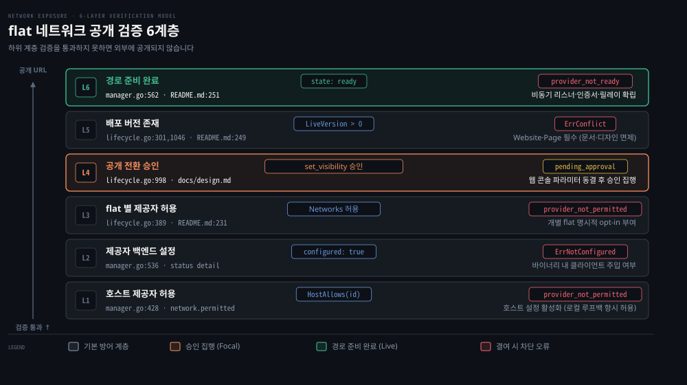
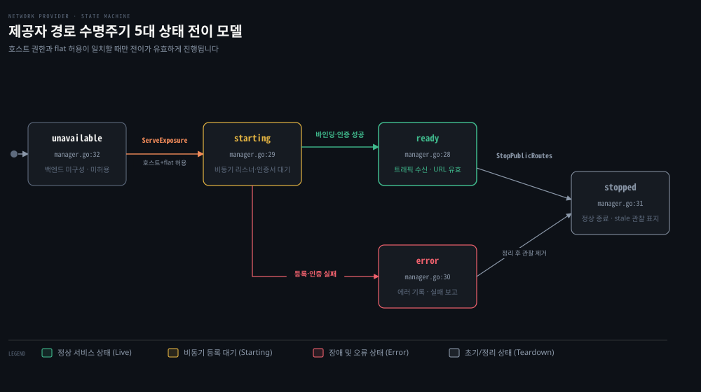

# provider manager·grants·visibility

---

> flat이 인터넷에 노출되기까지 거쳐야 하는 호스트 허용·flat별 권한·공개 승인·경로 준비의 다층 방어 구조와, 8개 네트워크 제공자를 다루는 통합 관리자(Manager)의 수명주기 계약 및 상태 전이 원리를 다룹니다.

## 학습 목표와 범위

> flats 의 네트워크 제공자 관리자(Manager), 권한 부여(Grants), 공개 가시성(Visibility) 전이 규칙과 다층 방어 모델을 이해하고 코드로 추적할 수 있습니다.

1. flat이 외부에 노출되려면 호스트 허용, 제공자 구성, flat별 권한, 공개 승인, 라이브 배포(Website·Page 한정, 문서·디자인 면제), 경로 준비의 다층 검증을 통과해야 합니다. 단일 설정 변경이나 API 호출만으로 공개되지 않는 방어 메커니즘을 분석할 수 있습니다.
2. core와 provider 사이의 계약인 `LifecycleNet`을 파악합니다. `ExposureRequest`와 `ExposureResult`로 8개 제공자를 일관되게 제어하고 `PrivateMeshProvider`와 `PublicProvider`를 분리 격리하는 아키텍처를 제시할 수 있습니다.
3. 호스트 차원의 제공자 허용(`network.permitted`, `SetGrant`)과 개별 flat 차원의 권한 부여(`SetProviderPermission`)가 분리된 이유를 제시합니다. 호스트 기본값 변경이 기존 flat에 소급 적용되지 않는 불변 원칙을 설명할 수 있습니다.
4. 공개 범위를 되돌리거나 허용을 철회할 때 종료되는 경로와 리소스를 파악합니다. Funnel 노드 정리 실패 시 디스크에 남는 `retirementMarker`의 역할을 추적할 수 있습니다.
5. 제공자 경로의 5대 상태(`unavailable`, `starting`, `ready`, `error`, `stopped`)의 전이 조건을 설명합니다. 호스트 전역 상태(`HostStatus`)와 flat별 엔드포인트 상태(`ExposureStatus`)의 보고 차이를 대조할 수 있습니다.

이 문서는 flats의 네트워크 제공자 관리자, 권한 부여, 공개 가시성 전이 규칙을 다룹니다. 개별 제공자의 구체적인 네트워크 프로토콜 구현은 이어지는 03-03~03-05편에서 다룹니다. 코어 승인 엔진의 일반 콘솔 동작은 04-04편에서 다룹니다.

기준 커밋 3abe537 (v0.11.0, 2026-10-17)


## 1. 문제: 설정 하나로 실수로 공개되는 것을 막는 다층 방어

> 단일 설정 플래그나 에이전트의 API 호출 하나로 로컬 서비스가 외부에 노출되는 사고를 방지하기 위해 여러 단계의 독립된 방어 계층이 필요합니다.

개발 머신이나 프라이빗 서버에서 에이전트와 협업할 때 발생하는 위험 중 하나는 내부 데이터가 실수로 인터넷 전체에 노출되는 일입니다. 호스트 관리자가 터널 릴레이나 VPN 기능을 켜는 순간 기존의 모든 로컬 작업물이 외부 URL을 할당받는다면 민감 정보가 유출될 수 있습니다. 특정 flat의 옵션 변경이나 환경 변수 주입만으로 배포 승인 없이 즉시 공개 상태가 변경되는 구조 역시 안전하지 않습니다.

flats는 이런 위험을 막으려고 엄격한 불변 원칙을 채택합니다(`README.md:243-253`, `docs/networking.md` 「Providers」). 첫째, 호스트가 특정 네트워크 제공자를 허용했다는 사실만으로는 개별 flat에 어떠한 권한도 부여하지 않습니다. 둘째, 호스트 설정에서 기본 제공자를 변경하더라도 기존 flat에 소급 적용되지 않습니다. 셋째, 단순한 설정 저장이나 구성 변경만으로는 어떠한 버전도 배포되지 않으며 공개 범위도 바뀌지 않습니다.

로컬 루프백을 제외한 모든 외부 네트워크 제공자는 초기 기동 시 기본적으로 꺼져 있습니다(`docs/networking.md:21-22`). flat 하나가 공개 상태가 되려면 호스트 전역 설정, flat별 권한, 운영자 승인, 라이브 배포 상태, 실제 터널 경로 준비가 모두 맞물려야 합니다. 이 다층 방어 구조 때문에 에이전트 혼자서는 서비스를 외부에 공개하지 못합니다.

사람이 직접 확인한 변경사항만 인터넷에 노출됩니다. 단, 공식 문서가 명시하듯 Public은 접근 제어가 아니며 URL을 아는 누구나 flat을 열 수 있습니다(`docs/networking.md:257`). 승인은 노출 시점을 통제하는 운영 게이트일 뿐이며 릴레이 가용성과 네트워크 연결성은 외부 의존성입니다(`README.md:251-253`).


## 2. 공통 계약: core와 provider Manager 간의 인터페이스 분리

> 코어 비즈니스 로직과 복잡한 8개 네트워크 구현체가 강하게 결합되면 유지보수와 모의 테스트가 불가능해지므로 추상화된 단방향 계약이 필요합니다.

flats는 로컬 루프백 외에도 Tailscale, Tailscale Funnel, Portal, zrok, Cloudflare quick tunnel, NetBird, NetBird Expose 등 다양한 네트워크 백엔드를 지원합니다. 이 백엔드들의 구체적인 클라이언트 라이브러리가 코어 패키지(`internal/core`)에 직접 임포트되면 네트워크 종속성 문제로 코어 테스트가 무거워지고 CGO 의존성이나 서드파티 라이브러리 충돌이 코어 엔진 전체로 전파됩니다.

flats는 이 문제를 해결하기 위해 `internal/core/expose.go`에 코어 관점의 공통 계약을 정의하고 구체적인 네트워크 구현체는 `internal/expose/provider`의 제공자 관리자(`Manager`)가 총괄하도록 역할을 분리합니다. 코어는 expose 패키지를 절대 임포트하지 않습니다(`docs/network-provider-lifecycle.md:146`). 의존성 주입 시점에 `Config.Lifecycle`로 인터페이스를 넘겨받습니다.

코어 계층은 아래 주요 통신 계약과 식별자를 정의합니다.

- **PrivateNet** 및 **PublicNet**: 전통적인 단일 사설/공개 네트워크 어댑터 인터페이스입니다(`internal/core/expose.go:13` `PrivateNet`, `:27` `PublicNet`). `PrivateNet`은 로컬 루프백이나 단일 tsnet 노드에서 특정 호스트를 서빙하고 종료하는 메서드(`Serve`, `Stop`, `URL`, `Status`, `Close`)를 선언합니다. `PublicNet`은 Portal 릴레이처럼 외부 인터넷에 특정 슬러그를 서빙하고 릴레이 노출 여부를 조정하는 메서드(`Serve`, `SetHidden`, `Stop`, `URL`, `Status`, `Close`)를 선언합니다.
- **ProviderID**: 네트워크 제공자를 고유하게 식별하는 문자열 타입입니다(`internal/core/expose.go:57`). 총 8개 제공자가 정의되어 있습니다:
  - `local`: 로컬 루프백(`127.0.0.1:7879`, 항시 켜짐)
  - `tailscale`: Tailscale 사설 tailnet (ACL 기반 접근 제어)
  - `tailscale-funnel`: Tailscale 공개 Funnel (인터넷 누구나 접근)
  - `portal`: Portal 릴레이 기반 공개 서비스
  - `zrok`: zrok 공개 share 서비스
  - `cloudflare-quick`: Cloudflare 익명 퀵 터널
  - `netbird`: NetBird 사설 오버레이 메시
  - `netbird-expose`: NetBird 역방향 프록시 기반 공개 서비스
- **PublicProvider** 및 **PrivateMeshProvider**: 제공자의 성격을 판별하는 핵심 함수입니다. `PublicProvider`는 대상 제공자가 인터넷 방문자에게 열리는 5개 공개 경로 중 하나인지 판정합니다(`internal/core/expose.go:76`). 대상은 `tailscale-funnel`, `portal`, `zrok`, `cloudflare-quick`, `netbird-expose`입니다. `PrivateMeshProvider`는 인가된 기기에게만 열리는 2개 사설 경로(`tailscale`, `netbird`)인지 판정합니다(`internal/core/expose.go:82`).
- **ExposureRequest**: 코어가 네트워크 계층에 엔드포인트 생성을 요청할 때 전달하는 DTO입니다(`internal/core/expose.go:97`). 대상 슬러그와 가상 호스트명, 공개 범위(`private` 또는 `public`), 서빙 대상(`draft` 또는 `current`)을 담습니다. 사설 핸들러, 메인 핸들러, 임시 여부, flat에 명시적으로 허용된 제공자 목록 `Permitted`도 함께 포함합니다.
- **ExposureEndpoint** 및 **ExposureResult**: 네트워크 계층이 실제로 개설하거나 거부한 엔드포인트 정보를 담는 응답 객체입니다(`internal/core/expose.go:112`, `:125`). 개별 엔드포인트는 `Provider`, 접속 주소 `URL`, 상태 `State`, 세부 사유 `Detail`, 설정 여부 `Configured`, 허용 여부 `Permitted`, 준비 완료 여부 `Ready`를 코어에 보고합니다.
- **LifecycleNet**: 코어 서비스가 다중 제공자 라이프사이클을 제어하기 위해 사용하는 통합 인터페이스입니다(`internal/core/expose.go:138`). 엔드포인트 개설을 요청하는 `ServeExposure`와 공개 경로를 원자적으로 차단하는 `StopPublicRoutes`를 제공합니다.

제공자 관리자 내부(`internal/expose/provider/manager.go`)에서는 각 백엔드 구현체를 추상 인터페이스로 감싸서 유지합니다:

- `Tailnet` (`:60`): 사설 tailnet 서빙과 Funnel 공개 서빙(`ServeFunnel`, `StopFunnel`, `FunnelState`)을 동일 tsnet 노드 상에서 제어하는 인터페이스입니다.
- `PortalNet` (`:72`): Portal 릴레이 연결을 맺고 서빙 및 목록 숨김을 제어하는 인터페이스입니다.
- `ZrokNet` (`:83`): zrok 공개 share를 개설하고 슬러그 이름을 예약·은퇴(`Retire`)시키는 인터페이스입니다.
- `QuickNet` (`:100`): Cloudflare quick tunnel 세션을 열고 터널 자격증명을 관리하는 인터페이스입니다.
- `NetbirdNet` (`:117`): NetBird 피어를 제어하여 사설 메시(`ServePrivate`)와 공개 역방향 프록시(`ServePublic`)를 분리 구동하는 인터페이스입니다.

이러한 분리 구조 덕분에 관리자는 특정 백엔드가 nil로 주입되었더라도 코어의 전체 수명주기 계약을 깨뜨리지 않습니다. 일관되게 `ErrNotConfigured` 오류(카테고리 `provider_unavailable`, `lifecycle.go:1619`)를 보고할 수 있습니다.


## 3. 호스트 허용: config.json과 Manager의 허용 제어

> 호스트 머신 차원에서 허용되지 않은 백엔드가 flat에 의해 무단으로 기동되거나 백그라운드 프로세스를 점유하지 않도록 상위 통제가 필요합니다.

호스트 전체에서 쓸 수 있는 네트워크 제공자는 `config.json`에 선언됩니다(`docs/network-provider-lifecycle.md` 「Host grants」). 설정 키는 `network.permitted` 배열과 `network.private_backend` 문자열입니다. 프로세스 부팅 시 `Options.Grants` 형태로 `Manager`에 주입됩니다. 로컬 루프백(`local`)은 항상 허용되며 끌 수 없습니다(`internal/expose/provider/manager.go:434`).

실제 운영 환경의 기본 설정을 살펴보면 외부 네트워크가 엄격하게 통제되는 모습을 확인할 수 있습니다. 로컬 실측(2026-10-18) 운영 호스트에서 `flats config show`를 실행한 결과 schema_version은 4였습니다. `network.permitted` 키에는 `["portal"]`만이 명시적으로 허용되어 있고 나머지 외부 터널 제공자는 모두 제외되어 있었습니다.

호스트 차원의 권한 관리에는 두 가지 설계 원칙이 적용됩니다.

첫째, 호스트가 실행 중인 상태에서는 임의의 CLI 명령이나 외부 프로세스가 `config.json` 파일을 직접 덮어쓸 수 없습니다. `docs/design.md` 「Approvals」의 Enforced 첫 항목에 명시되어 있듯이 `flats config` 명령은 호스트가 정지되어 데이터 락을 얻을 수 있을 때만 설정을 수정합니다. 호스트가 기동 중일 때 제공자를 켜거나 끄려면 웹 콘솔의 전용 엔드포인트(`PUT /console/api/providers/{id}`)에서 ETag 검증을 거쳐야 합니다.

둘째, 호스트에서 제공자를 활성화하거나 비활성화할 때 상위 앱 계층과 `Manager`의 내부 메서드가 협력합니다:
- `Host.SetNetworkProvider` (`internal/app/providers.go:195`, `docs/network-provider-lifecycle.md:85-86`): 호스트 제공자 토글의 상위 진입점입니다. 제공자를 끌 때(`enabled = false`), 등록된 flat 중 해당 제공자를 허용하고 있는 flat이 남아있다면(`flatsAllowing`) `ErrProviderInUse`("provider_in_use") 오류를 반환하며 설정을 거절합니다. 검증을 통과하면 `config.json`을 저장하고 `Manager.SetGrant`를 호출합니다.
- `SetGrant(id, permitted)` (`internal/expose/provider/manager.go:428`): 관리자 메모리 상의 호스트 허용 목록(`m.file.Permitted`)을 갱신합니다. `Options.Grants`가 주입된 운영 경로(`m.fixed = true`)에서는 메모리 구조체만 원자적으로 갱신하고 반환합니다.
- `HostAllows(id)` (`:471`) 및 `allows(id)` (`:483`): 내부 뮤텍스(`m.mu`) 보호 아래 현재 적재된 `File` 구조체를 조회하여 해당 제공자가 호스트 수준에서 인가되었는지 확인합니다.
- `Reload()` (`:493`): `m.fixed`가 참인 운영 경로에서는 디스크를 다시 읽지 않고 즉시 `nil`을 반환합니다("config.json changes apply on restart"). `Load(m.dir)` 재적재는 레거시 경로에만 해당합니다. 호스트에서 특정 제공자 허용이 빠지더라도 기존에 개설된 런타임 경로를 `Reload`나 `SetGrant`가 스스로 파괴적으로 강제 종료하지는 않습니다.


## 4. flat 별 허용과 공개 전환: 다층 검증과 승인 동결

> flat이 인터넷에 공개되려면 호스트 허용뿐 아니라 개별 flat의 명시적 권한과 사람의 배포 및 가시성 승인이 모두 충족되어야 합니다.

호스트에서 특정 제공자가 허용되었다고 해서 개별 flat이 자동으로 해당 네트워크를 사용할 수 있는 것은 아닙니다. flat이 외부로 노출되려면 아래에서 위로 다층의 검증 계층을 순차적으로 통과해야 합니다(Website와 Page는 최대 6계층, 문서와 디자인은 L5가 면제되어 5계층). 어느 한 계층이라도 조건이 결여되면 전체 공개 과정이 중단되고 오류가 반환됩니다.

- **호스트 제공자 허용 (L1)**: 호스트의 `network.permitted`에 대상 제공자가 등록되어 있어야 합니다(`manager.go:428`). 결여 시 `provider_not_permitted` (`ErrProviderNotPermitted`, `lifecycle.go:1618`) 오류가 발생합니다.
- **제공자 백엔드 설정 (L2)**: flats 바이너리 안에 해당 백엔드가 컴파일되어 있고 유효한 백엔드 클라이언트가 주입되어 있어야 합니다(`manager.go:536`). 결여 시 `ErrNotConfigured` (오류 카테고리 `provider_unavailable`, `lifecycle.go:1619`) 오류가 발생합니다.
- **flat 별 제공자 허용 (L3)**: flat의 설정 탭(Settings → Networks)에서 해당 제공자가 명시적으로 허용되어 있어야 합니다. 이 작업은 `internal/core/lifecycle.go:389`의 `SetProviderPermission` 함수가 수행하며 오직 웹 콘솔의 운영자만 호출할 수 있습니다(`via == ViaConsole`). 결여 시 `provider_not_permitted` (`ErrProviderNotPermitted`, `lifecycle.go:1618`) 오류가 발생합니다.
- **공개 전환 승인 (L4)**: 공개 전환은 사람의 승인이 필요합니다(`internal/core/lifecycle.go:280` `requestVisibility`, `docs/design.md` 「Approvals」). 승인 전에는 `pending_approval` 상태로 대기하며 외부에 노출되지 않습니다.
- **배포 버전 존재 (L5)**: Website와 단일 페이지는 배포된 라이브 버전(`f.LiveVersion > 0`)이 필수입니다(`internal/core/lifecycle.go:301-303`, `:1046-1048`, `README.md:248-250`). 배포 이력이 없는 초안 flat을 공개하려 하면 충돌 오류 `ErrConflict`("publish and deploy a version before making this flat public")가 발생합니다. 단, 문서(`documents`)와 디자인(`designs`)은 배포 없이 실행되므로 이 검증이 면제됩니다(`README.md:249-250`).
- **경로 준비 완료 (L6)**: 승인이 집행된 후 터널 백엔드가 비동기로 외부 릴레이나 리스너에 바인딩되고 인증서 발급을 마쳐 엔드포인트 상태가 `state: ready`로 확정되어야 합니다(`manager.go:562`). 준비 중이거나 장애가 발생한 경우 `provider_not_ready` (`ErrProviderNotReady`)가 보고됩니다.

공개 가시성 승인 집행(`internal/core/lifecycle.go:998` `applyVisibilityApproval`)은 요청 시점의 파라미터를 동결하여 현재 flat 상태와 대조합니다. 대기 중 다른 배포가 발생하여 라이브 버전이 바뀌었거나 제공자 권한 목록이 달라지면 승인 집행을 거부하고 `stale_approval` (`ErrStaleApproval`) 에러를 반환합니다.

승인 집행 도중 네트워크 경로 개설(`ensureExposure`)이 실패하면 코어는 `rollbackPublicExposure`(`:1092`)를 호출합니다. 방금 열려고 시도했던 공개 경로를 강제 회수하고 flat의 상태를 이전의 비공개 정책으로 되돌립니다.

반대로 공개된 flat을 비공개로 되돌릴 때는 `stopPublicRoutes`(`:1124`)가 모든 외부 공개 경로를 닫습니다. 네트워크 백엔드가 리스너 종료를 확인하지 못해 단 하나의 제공자라도 `res.Unconfirmed` 목록에 남게 되면 코어는 `ErrPublicStopUnconfirmed` 에러를 반환합니다. 외부에서 접속 가능한 경로가 남아있는데 비공개로 간주해버리는 보안 착시를 이 오류로 차단합니다. flat에서 특정 제공자 권한을 철회할 때도 `revokeProviderRoutes`(`:1869`)가 활성 경로를 먼저 확인하고 내립니다.



위 도식은 flat이 외부 인터넷에 공개 URL로 도달하기까지 거쳐야 하는 방어 계층을 보여줍니다. 1단계 호스트 허용부터 2단계 백엔드 주입, 3단계 flat별 허용, 4단계 운영자 승인, 5단계 배포 버전(Website·Page 한정, 문서·디자인 면제), 6단계 경로 준비 완료까지 각 층의 검증 조건을 모두 만족해야 트래픽이 연결됩니다. 어느 한 층이라도 조건을 만족하지 못하면 우측의 차단 오류와 함께 외부 노출이 차단됩니다.


## 5. 관리자(Manager) 내부 메커니즘과 상태 머신

> 다양한 네트워크 백엔드를 단일 제어 루프로 통솔하면서 각 경로의 수명주기 상태를 정확하고 일관되게 추적·보고해야 합니다.

`internal/expose/provider/manager.go`의 `Manager` 구조체(`:207`)는 flats 데몬 내부에서 모든 네트워크 경로의 수립, 상태 감시, 그리고 종료 정리를 총괄하는 중앙 관리자입니다. `New` 생성자(`:253`)로 초기화되며 기동 시점에는 어떠한 flat의 라우트도 자동으로 열지 않습니다.

### 5.1 요청 분기와 엔드포인트 서빙

코어가 `LifecycleNet.ServeExposure`(`:512`)를 호출하면 관리자는 요청에 담긴 `Visibility`와 `Audience`를 검사하여 두 개의 내부 메서드로 분기합니다.

- `servePrivate` (`:708`): 요청 대상이 초안(`AudienceDraft`)이거나 비공개(`Visibility == "private"`)일 때 호출됩니다. 로컬 루프백(`openLocal`)을 항상 개방하며 flat이 허용한 경우에 한해 사설 메시 네트워크인 Tailscale(`openTailscale`)과 NetBird(`openNetbird`, 단 임시 미리보기는 제외)를 개설합니다. 비공개 요청의 허용 목록에 공개 제공자(`publicIDs`)가 포함되어 있으면 즉시 거부 엔드포인트(`refused`)를 추가하고 `ErrProviderNotPermitted` 오류를 반환합니다.
- `servePublic` (`:740`): 요청 대상이 라이브 배포본(`AudienceCurrent`)이고 공개(`Visibility == "public"`)일 때 호출됩니다. 임시 미리보기(`req.Ephemeral`)가 공개 제공자를 요청하면 즉시 거부합니다. 공개 제공자 목록인 `publicIDs`(`:1004`, `Funnel`, `Portal`, `Zrok`, `CFQuick`, `NetbirdExpose`)를 순회하며 flat이 허용한 백엔드를 `openPublic`(`:887`)으로 개설합니다. 공개 경로가 열리더라도 독립적인 로컬 루프백 리스너(`privateReq.Handler`)는 계속 유지되어 로컬 콘솔 및 에이전트의 내부 접속성을 보장합니다. flat이 허용한 경우 사설 메시 경로(Tailscale, NetBird)도 유지(`retainPrivate`, `:766-779`)됩니다.

### 5.2 제공자 경로의 5대 상태 전이

관리자는 각 경로의 상태를 5가지 상수로 관리합니다(`internal/expose/provider/manager.go:27-33`):
- `unavailable`: 백엔드가 프로세스에 구성되지 않았거나 호스트/flat 권한이 없는 초기 상태입니다.
- `starting`: `ServeExposure` 호출 후 백엔드가 비동기로 리스너를 열거나 도메인을 등록하는 중인 상태입니다.
- `ready`: 리스너 바인딩, 인증서 발급, 엣지 터널 연결이 모두 완료되어 실제 트래픽을 수신할 수 있는 정상 상태입니다(`:562`).
- `error`: 네트워크 바인딩 실패, 토큰 거절, 백엔드 오류 등으로 인해 개설이 실패한 상태입니다.
- `stopped`: 정상적인 종료 절차를 거쳐 리스너가 닫히고 경로가 정리된 상태입니다.

이 5대 상태 외에도 백엔드에 따라 로그인 요구를 뜻하는 `needs-login`이나, 준비 상태를 유지하는 `key-expiring` 같은 부가 상태가 존재합니다(`internal/core/expose.go:50`, `manager.go:562`).



위 도식은 관리자가 다루는 제공자 경로의 5대 상태 전이 흐름을 보여줍니다. 초기 `unavailable` 상태에서 `ServeExposure` 호출로 권한이 확인되면 즉시 `starting`으로 진입하여 비동기 연결을 시도합니다. 바인딩과 인증이 완료되면 `ready` 상태로 전환되어 트래픽을 서빙합니다. 등록이나 인증이 실패하면 `error`로 이동합니다. 운영자의 비공개 전환 승인에 따라 코어가 `StopPublicRoutes`(`lifecycle.go:1124`)를 호출하면 정상 종료되어 `stopped` 상태로 정리됩니다.

### 5.3 호스트 상태와 엔드포인트 상태의 이원화 보고

관리자는 상태 보고를 두 단계로 분리해 불필요한 네트워크 접속이나 혼란을 막습니다.

첫째, 호스트 전역 상태를 보고하는 `HostStatus`입니다(`manager.go:693`). 백엔드 구성 여부(`Configured`)와 호스트 허용 여부(`Permitted`)만을 보고합니다. 실제 flat 경로를 열어보지 않으므로 상태는 항상 `state: unavailable`로 고정됩니다.

로컬 실측(2026-10-18)에서 `flats --json status`를 실행했을 때 local과 portal만 configured 및 permitted가 참이었습니다. 나머지 6개 제공자는 `"backend is not configured for this process"`로 출력되었습니다. 로컬 실측(2026-10-15) 로그와 `HostStatus` 코드(`manager.go:697-701`)에 따르면 구성된 백엔드의 상태는 항상 `unavailable`입니다. 세부 메시지는 `"backend configured; route readiness is reported per flat"`으로 고정됩니다.

둘째, flat별 실제 경로 상태를 보고하는 `ExposureStatus`입니다(`manager.go:606`). flat의 활성 엔드포인트를 실시간 조회하여 실제 통신 준비 상태를 반영합니다. 로컬 실측(2026-10-15, v0.9.1, `flats --json info`)의 초안 엔드포인트 응답에서도 개별 flat의 실제 서빙 준비 상태가 아래처럼 보고되는 것을 확인했습니다.

```json
    {
      "provider": "local",
      "url": "http://k8s-network-6fgw0tb3.localhost:7879",
      "state": "ready",
      "configured": true,
      "permitted": true,
      "ready": true,
      "audience": "draft",
      "host": "k8s-network-6fgw0tb3"
    }
```

### 5.4 은퇴 표지 (retirementMarker)와 노드 정리

Tailscale Funnel을 사용할 때 독특한 정리 문제가 발생합니다(`docs/network-provider-lifecycle.md` 「Manager」). flat이 사설망 없이 오직 공개 Funnel 목적으로만 tsnet 노드를 띄웠다면 비공개로 바뀔 때 Funnel 리스너를 닫고 제어 서버에서 노드 자격증명을 로그아웃해 은퇴시켜야 합니다.

그러나 리스너를 닫는 작업과 외부 Tailscale 제어 서버에 접속해 로그아웃을 수행하는 작업은 별개의 문제입니다. 관리자는 Funnel 전용 노드를 정리할 때 리스너를 바꾸기 전에 은퇴 표지 파일(`network-retirements/<slug>/<host>`)을 먼저 기록합니다(`manager.go:1235-1239`). 비공개 정리 의무인 `retirementMarker`(`:1006-1024`, `:1048-1120`)를 디스크에 영속화하는 단계입니다.

리스너를 닫은 후 제어 서버 로그아웃과 노드 종료(`Stop`)가 성공하면 이 마커를 지웁니다(`:1259-1261`). 통신 장애로 로그아웃이 실패하더라도 방문자 트래픽은 이미 차단되었으므로 공개 경로 잔존으로 보지 않습니다. 대신 먼저 기록해 둔 은퇴 표지를 디스크에 유지합니다.

이 영속 마커는 비공개 정리 의무(cleanup obligation)로 보관되며 프로세스가 재시작되더라도 지워지지 않습니다. 이후 flat이 삭제되거나(`StopSlug`) 해당 flat에서 Funnel을 다시 켤 때(`openPublic`, `:897-907`), 관리자는 먼저 디스크의 잔존 은퇴 표지를 확인합니다. 이전 노드의 로그아웃을 재시도하여 완전히 은퇴시킨 뒤에만 새로운 작업을 진행합니다. 이 절차 덕분에 외부 제어 평면에 일시적 장애가 발생하더라도 고아 노드가 쌓이지 않습니다.


## 6. 업그레이드와 구버전 호스트 허용 이관

> 구버전 호스트에서 신규 버전으로 업그레이드될 때 이전 명령줄 플래그와 권한 설정이 명시적인 승인 없이 무단으로 자동 활성화되는 현상을 방지해야 합니다.

과거 flats는 실행 플래그로 네트워크 제공자를 설정했습니다(`docs/networking.md` 「Upgrading provider grants from an older host」). 최신 버전 업그레이드 시 최초 1회 플래그와 `network-provider.json`을 `config.json`(schema 4)으로 변환합니다. 기존 파일은 백업 폴더로 이동합니다.

이 마이그레이션 과정에서도 "과거의 네트워크 구성 이력이 flat의 권한을 자동으로 만들어내지 않는다"("Historical network configuration does not create provider permissions")는 원칙이 철저히 고수됩니다:

- 명령줄 플래그가 없었다면 어떠한 권한도 묵시적으로 생성되지 않습니다. `--network`의 기본값은 `local`이며 `--portal`을 명시하지 않으면 `portal`은 `network.permitted`에 포함되지 않습니다.
- 과거 데이터베이스 스키마 5(`flats.db` `user_version` 5)에 기록된 수명주기 도입 이전의 flat(Pre-lifecycle flats)에는 1회성 Private Tailscale 선택권이 주어집니다. 과거 tsnet 상태가 남아있는 호스트는 최초 업그레이드 기동 시 `--network tailscale`을 명시하여 해당 flat들의 사설 Tailscale 선택을 보존하거나 `--network local`을 명시하여 Local 전용으로 확정해야 합니다. 모호한 상태로 기동하면 프로세스는 네트워크를 시작하기 전에 중단됩니다.
- 가장 중요한 점은 이러한 구버전 이관 과정에서도 Tailscale Funnel, Portal, zrok, Cloudflare quick tunnel, NetBird Expose 등 어떠한 공개 제공자도 자동 승격되지 않는다는 사실입니다. 운영자가 각 flat의 설정 화면에서 명시적으로 허용하고 승인을 거치지 않는 한, 업그레이드 전후로 비공개 원칙은 유지됩니다.


## 7. 한계와 실패 경로

> 네트워크 제공자 관리자와 권한 검증 엔진이 명시적으로 거절하거나 복구하는 주요 실패 경로를 정리합니다.

| 상황 | 원인 및 조건 | 결과 및 시스템 상태 | 코드 위치 |
| :--- | :--- | :--- | :--- |
| **호스트 미허용 제공자 요청** | flat이 호스트 `network.permitted`에 없는 제공자를 요청 | `ErrProviderNotPermitted` 반환, 엔드포인트 `refused` 기록, 경로 미개설 | `internal/expose/provider/manager.go:889` |
| **백엔드 미구성 상태 서빙** | 호스트가 허용했으나 프로세스 내 해당 백엔드 구현체가 nil | `ErrNotConfigured` 반환, `State: unavailable` 기록(`refused`), 다른 제공자로 대체 안 함 | `internal/expose/provider/manager.go:42, 894, 925` |
| **비공개 flat에 공개 제공자 요청** | `Visibility == "private"` 또는 `AudienceDraft`에 공개 제공자 포함 | `ErrProviderNotPermitted` 반환, 엔드포인트 `refused`, 허용된 사설 경로만 서빙 | `internal/expose/provider/manager.go:731-736` |
| **공개 제공자 부재 상태 공개 요청** | 공개 전환 요청 시 flat에 허용된 공개 제공자가 전무함 | `ErrConflict` + `ErrProviderNotPermitted` 반환, 공개 승인 요청 거절 | `internal/core/lifecycle.go:376` |
| **미배포 flat의 공개 전환 시도** | Website/Page flat의 `LiveVersion == 0`인 상태에서 공개 요청 | `ErrConflict` 반환, "publish and deploy a version before making this flat public" | `internal/core/lifecycle.go:301-303, 1046-1048` |
| **가시성 승인 집행 불일치** | 대기 중 라이브 버전 또는 flat 제공자 권한 목록이 변경됨 | `ErrConflict` + `ErrStaleApproval` 반환, 승인 집행 거부 | `internal/core/lifecycle.go:1020-1040` |
| **공개 경로 개설 실패 시 롤백** | `ensureExposure` 중 백엔드 실패 발생 | `rollbackPublicExposure` 호출, 이전 비공개 상태로 강제 복귀 | `internal/core/lifecycle.go:1055, 1092` |
| **비공개 전환 시 경로 미종료** | `stopPublicRoutes` 호출 시 리스너 종료 확인 불가 (`Unconfirmed`) | `ErrPublicStopUnconfirmed` 반환, flat의 비공개 전환 완료 거부 | `internal/core/lifecycle.go:1130-1136` |
| **사용 중인 호스트 제공자 제거** | flat이 여전히 사용 중인 제공자를 호스트에서 끄려 함 (`PUT /console/api/providers/{id}`) | `ErrProviderInUse` 반환, 호스트 설정 변경 거절 | `internal/app/providers.go:195`, `docs/network-provider-lifecycle.md:85-86` |
| **사용 중인 flat 제공자 철회** | 활성 경로가 남아있는 상태에서 flat 권한 철회 시도 | `revokeProviderRoutes`가 경로 종료 실패 시 `ErrProviderInUse` 반환 | `internal/core/lifecycle.go:1871, 1911` |
| **Funnel 노드 은퇴 지연** | 리스너 종료 전 은퇴 표지 기록 후 제어 평면 로그아웃 실패 | `retirementMarker` 유지, 차후 `StopSlug`/재기동 시 은퇴 재시도 | `internal/expose/provider/manager.go:1048-1120, 1235-1261` |
| **호스트 가동 중 CLI 설정 수정** | 호스트가 실행 중일 때 `flats config` 실행 | 데이터 락 획득 실패로 명령 거부 (`docs/design.md` Enforced) | `docs/design.md:488-490` |


## 리뷰 노트

> 코드베이스와 문서를 대조 분석하는 과정에서 확인한 구현 특이점과 설계 관찰점입니다.

- `internal/expose/provider/manager.go:1233-1250`: Funnel 경로를 종료할 때 사설 Tailscale과의 노드 공유 여부(`sharedPrivate`)에 따라 리소스 은퇴 처리가 정교하게 분기됩니다. 동일 tsnet 노드 상에서 사설 Tailscale 경로(`Tailscale`)가 함께 돌고 있다면 노드 자체는 계속 살아있어야 하므로 Funnel 리스너만 닫고 은퇴 표지를 남기지 않습니다. 반면 오직 Funnel 전용으로 뜬 노드일 경우에만 리스너를 닫기 전에 `markPendingTailnet`으로 영속 마커를 먼저 기록한 뒤 노드 은퇴를 시도합니다. 이 분기는 비공개 서비스를 불필요하게 건드리지 않으면서 고아 자원을 추적합니다.
- `internal/core/lifecycle.go:1003-1005`: 구버전 레거시 가시성 승인이 동결된 제공자 목록(`p.Providers`)이나 이전 가시성(`p.From`)을 누락했다면 시스템은 승인을 거절합니다. 이때 `ErrStaleApproval` 충돌 에러를 반환합니다. 보안 정책의 일관성을 위해 구버전 데이터를 관대하게 처리하지 않습니다.
- `internal/expose/provider/manager.go:493-504`: `Reload()`는 운영 경로(`Options.Grants`, `m.fixed = true`)에서 즉시 `nil`을 반환합니다. 디스크를 다시 읽지 않습니다("config.json changes apply on restart"). 파일 재적재는 레거시 경로에 한정됩니다. 런타임에 호스트 제공자를 끌 때는 앱 계층(`Host.SetNetworkProvider`, `internal/app/providers.go:195`)이 `flatsAllowing`을 먼저 검사합니다. 사용 중인 flat이 있으면 `ErrProviderInUse`로 차단합니다. 따라서 `Reload`나 `SetGrant`가 실행 중인 경로를 임의로 끊지 않아도 구조가 보호됩니다.
- `internal/expose/provider/manager.go:693-705`: 호스트의 전역 상태를 보고하는 `HostStatus()`는 백엔드가 구성되어 있고 권한이 있더라도 개별 상태를 항상 `stateUnavailable`로 반환합니다. 세부 메시지로 `"backend configured; route readiness is reported per flat"`을 남깁니다. 개별 flat 단위로 실제 경로가 개설되어 헬스체크를 통과하기 전까지는 호스트 차원에서 섣불리 `ready` 상태를 표방하지 않는다는 원칙을 코드가 엄격하게 따릅니다.


## 자가 점검 질문

1. **질문 1**: flat 하나가 외부 인터넷에 공개(`Public`)되기 위해 아래에서 위로 통과해야 하는 6단계 방어 계층의 순서는 무엇이며, 호스트 차원에서 제공자를 켰다고 해서 기존 flat에 권한이 자동 부여되지 않는 이유는 무엇입니까?
2. **질문 2**: 제공자 관리자(`Manager`)가 서빙 요청(`ExposureRequest`)을 처리할 때 사설 메시 제공자(`PrivateMeshProvider`)와 공개 제공자(`PublicProvider`)를 취급하는 분기 규칙은 무엇입니까?
3. **질문 3**: flat을 비공개(`Private`)로 되돌릴 때 `stopPublicRoutes`의 핵심 검증은 무엇입니까? 일부 경로가 `Unconfirmed`로 남을 때 코어 서비스의 처리 방식은 무엇입니까?
4. **질문 4**: Tailscale Funnel 경로가 종료될 때 사설 Tailscale 경로를 공유하지 않는 단독 노드에 대해 관리자가 생성하는 "은퇴 표지(`retirementMarker`)"의 목적과 수명주기는 무엇입니까?


## 정답 (자답 후 펼치기)

1. **정답 1**: 6단계 방어 계층은 호스트 허용, 백엔드 구성, flat별 권한, 운영자 승인, 라이브 배포(Website·Page 한정, 문서·디자인 면제), 경로 준비 완료 순입니다. 호스트에서 제공자를 켜도 미완성 작업물이 실수로 노출되지 않도록 flat 권한 자동 상속을 배제합니다. 기본값 변경 역시 기존 flat에 소급 적용되지 않습니다.
2. **정답 2**: 요청이 초안(`AudienceDraft`)이거나 비공개(`Visibility == "private"`)인 경우 `servePrivate`가 호출됩니다. 로컬 루프백과 사설 메시 제공자(`tailscale`, `netbird`)만 개방하며 공개 제공자가 포함되어 있으면 즉시 거부(`refused`)합니다. 반면 요청이 라이브 버전(`AudienceCurrent`)이고 공개(`Visibility == "public"`)인 경우 `servePublic`이 호출됩니다. 공개 제공자 목록(`Funnel`, `Portal`, `Zrok`, `CFQuick`, `NetbirdExpose`)을 순차 개설하며 동시에 내부 관리를 위한 독립적인 로컬 사설 리스너를 유지합니다.
3. **정답 3**: `stopPublicRoutes`는 해당 flat에 개설된 모든 공개 터널과 릴레이 경로를 종료하도록 백엔드에 명령합니다. 네트워크 단절이나 백엔드 응답 지연으로 인해 단 하나의 제공자라도 닫힘이 확인되지 않고 `Unconfirmed` 목록에 남게 되면 코어 서비스는 `ErrPublicStopUnconfirmed` 에러를 반환합니다. flat의 가시성을 `Private`로 변경하지 않고 작업을 중단합니다. 외부에서 접속 가능한 경로가 여전히 살아있는데 내부 상태만 비공개로 바뀌어 보안 착시가 발생하는 위험을 이렇게 막습니다.
4. **정답 4**: 사설 Tailscale 없이 오직 Funnel 전용으로 생성된 tsnet 노드는 리스너를 닫기 전에 은퇴 표지를 먼저 기록합니다(`manager.go:1235-1239`). 디스크에 `retirementMarker`(`<data>/network-retirements/<slug>/<host>`)를 남겨 비공개 정리 의무를 확정합니다. 리스너가 닫히고 제어 평면 로그아웃(`Stop`)까지 성공하면 이 마커를 지웁니다(`:1259-1261`). 통신 장애로 로그아웃이 실패하면 마커를 디스크에 유지합니다. 이후 프로세스가 재시작되거나 flat이 삭제될 때 해당 마커를 확인해 미완료된 노드 은퇴를 재시도하므로 고아 노드가 쌓이지 않습니다.


## 출처와 관련 문서

- [flats GitHub Repository (v0.11.0, 3abe537)](https://github.com/gosuda/flats/tree/3abe537): flats 공식 소스코드 저장소
- [flats README: Network providers](https://github.com/gosuda/flats/blob/3abe537/README.md): 네트워크 제공자 목록 및 공개 규칙
- [flats Documentation: Private and public access](https://github.com/gosuda/flats/blob/3abe537/docs/networking.md): 운영자를 위한 제공자 설정 및 구버전 이관 가이드
- [flats Documentation: Network provider lifecycle](https://github.com/gosuda/flats/blob/3abe537/docs/network-provider-lifecycle.md): 제공자 관리자 계약 및 수명주기 상태 머신 상세
- [flats Design Specification: Approvals](https://github.com/gosuda/flats/blob/3abe537/docs/design.md): 승인 제어 및 설정 격리 규칙
- `00-02.Concepts.md`: flat, slug, provider, grant, visibility 핵심 용어 정의
- `03-01.Overlay VPN·reverse tunnel·public relay.md`: 오버레이 VPN과 공개 릴레이의 기술적 기초
- `03-03.local·Tailscale·Funnel.md`: Local 루프백, tsnet 임베딩 및 Funnel 리스너 상세 메커니즘
- `03-04.Portal.md`: Portal 릴레이 프로토콜 및 다중 릴레이 바인딩
- `03-05.zrok·Cloudflare quick·NetBird.md`: zrok share, Cloudflare quick tunnel, NetBird 통합
- `04-04.Approval engine·console.md`: 승인 엔진 상태 머신 및 콘솔 제어 상세 메커니즘
