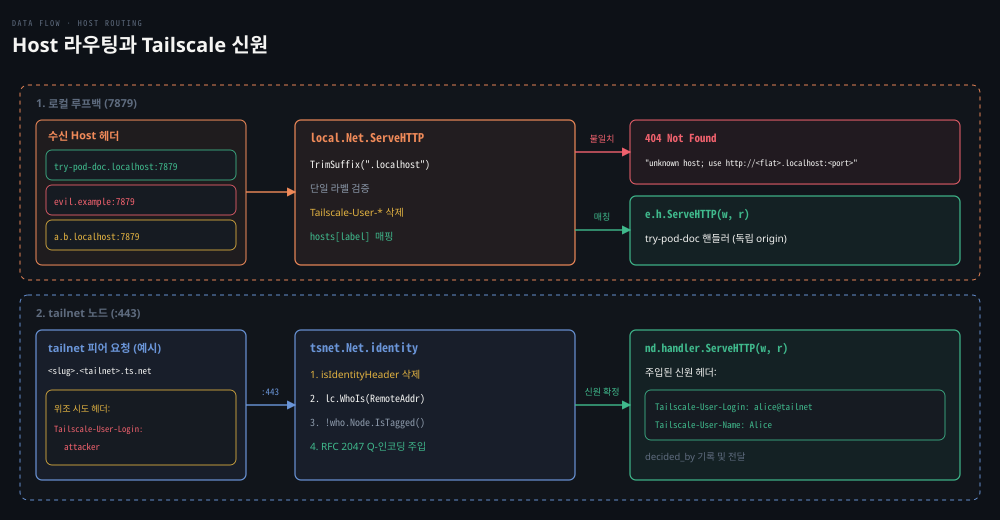
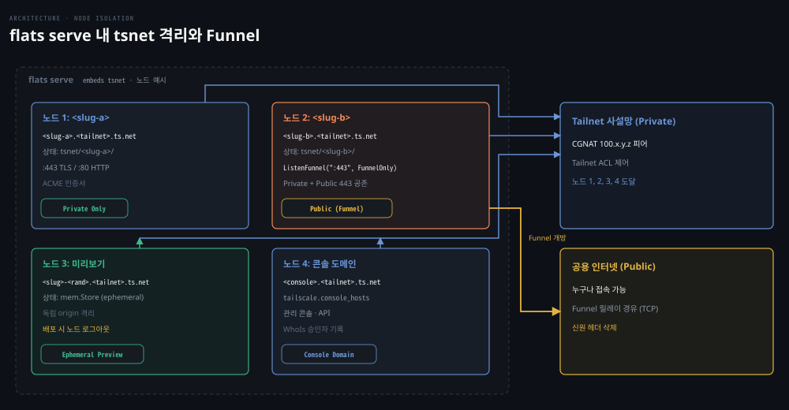

# local·Tailscale·Funnel

---

> 단일 루프백 포트에서 Host 헤더로 flat을 분기하는 로컬 서빙 방식과, tsnet 임베딩을 통해 flat·미리보기·콘솔마다 독립된 tailnet 노드를 생성하고 Funnel로 공용 인터넷에 노출하는 네트워크 구조 및 수명주기를 다룹니다.


## 학습 목표와 범위

> 단일 포트 로컬 라우팅의 origin 격리 원리를 이해하고, tsnet 임베딩 멀티 노드 아키텍처와 WhoIs 신원 검증, 그리고 fail-closed 퇴역 메커니즘을 코드로 추적할 수 있습니다.

1. 로컬 루프백(`127.0.0.1:7879`)에서 Host 헤더의 첫 번째 DNS 라벨을 추출해 flat 핸들러를 분기하는 메커니즘을 분석할 수 있습니다. RFC 6761 §6.3과 브라우저의 `*.localhost` 루프백 해석으로 얻는 독립 **출처**(Origin) 격리 원리를 설명할 수 있습니다.
2. Go 라이브러리인 `tsnet`을 프로세스 내부에 임베딩하여 사용자 공간 WireGuard 노드를 운용하는 개념을 파악할 수 있습니다. flat·미리보기·콘솔마다 별도 노드를 띄워 웹 보안 출처와 tailnet 접근 제어 목록(ACL) 단위를 분리하는 설계를 제시할 수 있습니다.
3. Tailscale에 내장된 Let's Encrypt DNS-01 챌린지로 HTTPS 인증서를 얻는 과정을 분석할 수 있습니다. 모든 노드가 단일 ACME 계정 키를 공유(`shareACMEKey`)해 3시간당 10개 신규 계정 생성 한도를 방어하고, 핸드셰이크 타임아웃을 막는 인증서 예열(`warm`) 동작을 설명할 수 있습니다.
4. 동일한 tailnet 노드에서 사설망 리스너와 `ListenFunnel("tcp", ":443", tsnet.FunnelOnly())` 공용 리스너가 충돌 없이 공존하는 구조를 파악할 수 있습니다. Tailscale 허용과 Funnel 허용이 분리된 2단계 권한 원칙을 설명할 수 있습니다.
5. 데몬 재기동을 위한 프로세스 종료(`Close`)와 자원 반납을 위한 퇴역(`Stop`/`StopPrivate`/logout)의 차이를 구분할 수 있습니다. 제어 평면 로그아웃 실패 시 영속 상태를 보존한 채 새 백엔드로 재시도하는 fail-closed 수명주기를 코드로 추적할 수 있습니다.
6. 클라이언트가 전송한 `Tailscale-User-*` 헤더를 선제 삭제하고 로컬 API의 `WhoIs` 조회로 얻은 실제 WireGuard 피어 신원만 주입하는 위조 방어 원리를 서술할 수 있습니다.

이 문서는 flats의 로컬 루프백 제공자와 Tailscale 및 Funnel 연동 세부를 다룹니다.
오버레이 사설망 기초는 `03-01.Overlay VPN·reverse tunnel·public relay.md`에 정리되어 있습니다.
8개 제공자 관리자 계약은 `03-02.provider manager·grants·visibility.md`를 참조하십시오.
Portal은 `03-04.Portal.md`, zrok·Cloudflare·NetBird는 `03-05.zrok·Cloudflare quick·NetBird.md`에서 이어집니다.

기준 커밋 3abe537 (v0.11.0, 2026-10-17)


## 1. local — 루프백 단일 포트와 Host 라우팅

> 여러 flat마다 매번 운영체제 포트를 새로 할당하면 방화벽 관리와 포트 충돌 문제가 발생하므로 단일 루프백 포트에서 Host 헤더 라벨로 라우팅하는 구조가 필요합니다.

개발 환경에서 수십 개의 웹사이트나 서버 애플리케이션을 호스팅할 때 각 서비스마다 서로 다른 TCP 포트를 할당하면 포트 충돌과 관리 혼란이 발생합니다. 사용자는 매번 포트 번호를 기억해야 하며 프로세스 비정상 종료 시 포트 점유 충돌이 일어납니다. 포트가 다르면 브라우저 관점의 출처는 갈리지만 호스트 이름이 같으면 쿠키의 `Domain` 속성이나 로컬 스토리지 공유 범위가 모호해질 위험이 있습니다.

flats의 로컬 네트워크 제공자인 `internal/expose/local`은 단 하나의 루프백 포트(`7879`)만 열어 둡니다. 들어오는 HTTP 요청의 `Host` 헤더를 파싱하여 적절한 flat으로 트래픽을 분기합니다(`internal/expose/local/local.go:38` `Listen`, `:53` `ServeHTTP`).



위 도식은 단일 포트(`7879`)로 인입된 요청이 Host 헤더 검증을 거쳐 개별 flat 핸들러로 분기되는 로컬 경로를 보여줍니다. 하단에는 tailnet 노드에서 신원 헤더를 검증 주입하는 사설망 경로의 데이터 흐름을 대조합니다.

서버는 `Listen` 호출 시 지정된 주소(예: `127.0.0.1:7879`)에 단일 TCP 리스너를 바인딩합니다(`local.go:38-47`). 클라이언트 요청이 들어오면 `ServeHTTP`가 이 순서로 라우팅합니다(`local.go:53-82`):

1. **포트 분리 및 접미사 제거**: `net.SplitHostPort`를 호출해 포트 번호를 떼어냅니다. 이후 `strings.TrimSuffix(host, ".localhost")`로 앞쪽 라벨을 추출합니다(`local.go:54-58`).
2. **단일 라벨 유효성 검증**: 추출한 `label`이 원래 `host`와 동일하거나 내부에 점(`.`)을 포함하고 있다면 허용되지 않는 도메인으로 판정합니다. 이 경우 HTTP 404 상태 코드와 안내 문구를 반환하고 즉시 종료합니다(`local.go:59-62`):
   ```markdown
   unknown host; use http://<flat>.localhost:<port>
   ```
3. **핸들러 맵 조회**: 읽기 잠금(`mu.RLock`) 상태에서 내부의 `hosts` 맵을 조회합니다. 등록되지 않은 라벨이면 `"no flat is served at " + label`과 함께 404를 반환합니다(`local.go:63-69`).
4. **신원 헤더 초기화**: 외부 요청 헤더 중 `Tailscale-User-`로 시작하는 키를 모두 삭제합니다(`local.go:70-74`). 테스트 모의 환경(`Identity` 함수)이 설정되어 있다면 신원 헤더를 다시 주입합니다(`local.go:75-80`).
5. **서빙 위임**: 매핑된 엔트리의 핸들러 `e.h.ServeHTTP(w, r)`를 호출합니다(`local.go:81`).

웹 브라우저가 `*.localhost` 주소를 외부 DNS 서버에 묻지 않고 로컬 루프백으로 해석하는 배경에는 **IETF RFC 6761 §6.3**이 있습니다. RFC 6761 §6.3은 애플리케이션 소프트웨어가 `.localhost` 이름을 특별 취급할 수 있는 권한을 두고, 이름 풀이 API·라이브러리와 캐시 DNS에는 항상 루프백 IP 주소를 반환할 것을 권고합니다. 오늘날 주요 웹 브라우저는 네트워크 질의를 보내기 전에 `*.localhost`를 루프백 `127.0.0.1` 또는 `::1`로 직접 해석하도록 구현되어 있습니다.

브라우저의 동일 출처 정책에 따라 스키마(`http`), 호스트 이름, 포트 번호가 일치해야 동일 출처로 인정됩니다. 로컬 실측(2026-10-18)에서 임시 호스트에 서버 flat의 미리보기를 띄웠을 때 발급된 주소는 `http://rt-probe-ef4n465g.localhost:17879`였습니다. 같은 호스트에서 실행된 문서 flat인 `doc-probe.localhost:17879`와 미리보기 flat은 서로 다른 서브도메인 라벨을 가지므로 브라우저 레벨에서 독립된 출처로 격리됩니다.

동일 머신이 아닌 다른 기기에서 flats 호스트의 로컬 링크를 열 수는 없습니다. 로컬 링크(`*.localhost`)는 링크를 클릭한 기기 자신의 루프백 인터페이스를 가리키기 때문입니다. 다른 기기에서 tailnet을 통해 flats 콘솔에 접속하면 콘솔 UI는 로컬 링크를 하이퍼링크 대신 "server only" 텍스트로 표시합니다(`docs/networking.md` 「Local links from another device」).


## 2. Tailscale 노드 — 프로세스 안 tsnet과 flat별 독립 노드

> 외부 오버레이 사설망에 서비스를 올릴 때 단일 머신 노드 아래 URL 경로로 여러 flat을 묶으면 보안 출처와 접근 권한이 섞이므로 flat마다 독립된 가상 노드가 필요합니다.

호스트 서버 전체를 단 하나의 Tailscale 노드로 등록하고 하위 URL 경로로 서비스를 분기하면 보안 결함이 발생합니다. 모든 flat이 동일한 도메인과 포트를 공유하므로 브라우저 보안 출처(Origin)가 하나로 합쳐집니다. 한 flat의 스크립트가 다른 flat의 세션 쿠키를 읽거나 로컬 스토리지를 변조할 수 있습니다. Tailscale 관리 콘솔의 ACL 정책으로 특정 팀원에게 특정 flat만 열어 주는 세분화된 접근 제어도 불가능해집니다.

flats는 이 문제를 해결하기 위해 Tailscale의 Go 임베디드 라이브러리인 `tailscale.com/tsnet`을 프로세스 내부에 내장합니다(`internal/expose/tsnet/tsnet.go:36`).

`tsnet`은 Go 언어로 작성된 사용자 공간 Tailscale 클라이언트 라이브러리입니다. 루트 권한을 요구하는 커널 가상 네트워크 카드(TUN/TAP 디바이스)나 시스템 데몬(`tailscaled`)이 필요하지 않습니다. 단일 Go 바이너리가 프로세스 메모리 공간 안에서 완전한 가상 네트워크 스택과 WireGuard 암호화 통신을 직접 구동합니다.

flats는 Tailscale을 켜면 허용된 flat마다 독립된 tsnet 노드를 띄웁니다(`docs/design.md` Process layout).
미리보기와 콘솔 도메인 역시 별도의 가상 노드로 등록됩니다(`docs/networking.md` 「Running the console on Tailscale」).



위 도식은 단일 `flats serve` 프로세스 안에서 4개의 tsnet 노드가 독립 기동되는 모습을 보여줍니다. 각 노드의 역할(Private, Public Funnel, Ephemeral Preview, Console)에 따라 사설망과 공용 인터넷으로 연결선이 갈립니다.

노드 생성을 총괄하는 `tsnet.Net` 구조체와 개별 `node`의 핵심 제어 흐름은 다음과 같습니다(`tsnet.go:42` `Config`, `:103` `Net`, `:149` `node`, `:200` `New`):

- **노드 인스턴스 생성 (`newNode`)**: `Serve` 메서드가 호출되면 검증된 호스트 이름으로 `newNode`를 만듭니다(`tsnet.go:248`, `:301`). 영속 flat은 디스크 경로(`Config.Dir/<host>/`)에 상태를 기록합니다. 반면 일회성 미리보기(`ephemeral=true`)는 메모리 스토어(`mem.Store`)를 써서 디스크에 흔적을 남기지 않습니다(`tsnet.go:317-319`).
- **서버 기동 및 리스너 개설 (`run`, `listen`)**: 백그라운드 고루틴 `run`이 `ts.Server`를 시작합니다(`tsnet.go:337`, `:350`). tailnet 연결이 맺어지고 MagicDNS와 인증서 발급이 활성화되면 사설 리스너(`:443` HTTPS 및 `:80` 리다이렉트)를 열고 핸들러를 바인딩합니다(`tsnet.go:439-503`). tailnet에서 HTTPS 인증서가 활성화되지 않았다면 80번 포트로 일반 HTTP를 서빙합니다(`tsnet.go:60-61`, `:505-515`).
- **출처 격리와 ACL 경계**: 각 flat은 `<slug>.<tailnet>.ts.net`, 미리보기는 `<slug>-<8자리>.<tailnet>.ts.net` 도메인을 부여받습니다. 콘솔은 `tailscale.console_hosts`에 설정된 도메인(기본 예시 `flats.<tailnet>.ts.net`)을 씁니다(`docs/networking.md:54`). 브라우저 보안 출처가 물리적으로 분리됩니다. tailnet 관리자는 ACL 정책으로 노드 단위 접근 권한을 독립 제어할 수 있습니다.

### ACME 계정 키 공유 (shareACMEKey)

개별 노드가 독립된 도메인(`*.ts.net`)을 가지려면 공인 TLS 인증서가 필요합니다. Tailscale은 Let's Encrypt의 DNS-01 챌린지 방식으로 노드마다 인증서를 자동 발급받습니다.

그러나 Let's Encrypt 정책상 동일 IP에서 3시간 동안 생성할 수 있는 신규 ACME 계정 수는 최대 10개로 제한됩니다. 노드가 뜰 때마다 매번 새 ACME 계정을 등록하면 11번째 flat은 한도 초과 에러로 수 시간 동안 인증서를 발급받지 못합니다.

flats는 `shareACMEKey` 메커니즘으로 이 문제를 방지합니다(`tsnet.go:530` `shareACMEKey`). 호스트 상태 디렉토리(`Config.Dir`)의 `acme-account.key.pem` 파일을 확인하고 새 노드가 생성될 때 해당 노드의 `certs/` 폴더에 계정 키를 원자적으로 복사합니다(`tsnet.go:531-544`). 모든 tsnet 노드가 단 하나의 Let's Encrypt 계정을 공유하므로 쿼터 고갈이 일어나지 않습니다.

운영상 주의할 점도 있습니다. Tailscale 노드 도메인은 공용 Certificate Transparency 로그에 호스트명이 공개 기록됩니다. Let's Encrypt의 도메인당 주간 인증서 발급 한도도 1장씩 소모합니다(`docs/design.md:359-361`).

### 인증서 예열 (warm)

새 노드가 Let's Encrypt로부터 DNS-01 챌린지를 거쳐 인증서를 발급받기까지는 1~2분이 걸립니다(`tsnet.go:68-71`). 첫 방문자가 접속하는 순간 인증서 발급을 시작하면 브라우저의 TLS 핸드셰이크 타임아웃이 먼저 만료되어 접속 실패가 발생합니다.

flats는 사설 리스너가 열리자마자 백그라운드 고루틴으로 `warm` 메서드를 실행합니다(`tsnet.go:496`, `:682` `warm`). 로컬 클라이언트의 `CertPair`를 호출하여 도메인 인증서를 미리 받아 캐시에 채웁니다.

인증서 발급에 실패하면 30초에서 최대 10분까지 지수 백오프인 `certRetryMin`과 `certRetryMax`를 적용해 재시도합니다(`tsnet.go:77-78`, `:690-708`). 인증서가 메모리에 확보될 때까지 호스트 상태는 `starting`으로 보고됩니다(`tsnet.go:680-681`). 상태 세부 정보에는 `CertPending` 문구가 명시됩니다(`tsnet.go:71`). 준비되지 않은 URL에 요청을 보내 오류를 겪는 일을 막습니다.


## 3. 신원 — WhoIs 기반 tailnet 신원 주입과 위조 방어

> 외부 클라이언트가 HTTP 요청 헤더에 관리자 로그인 이름을 임의로 위조해 보낼 수 있다면, 콘솔 승인 엔진이나 flat 애플리케이션의 접근 통제가 무력화됩니다.

외부 클라이언트가 임의의 신원 헤더를 주조해 보낼 수 있다면 콘솔 승인 엔진이나 flat 애플리케이션의 보안 경계가 무너집니다. tailnet 환경에서 콘솔 승인 엔진은 배포 승인을 내린 주체를 추적해야 합니다(`docs/design.md` 「Approvals」 Console decisions). flat 내부에서 실행되는 서버 코드 역시 요청을 보낸 동료의 로그인 계정이나 이름을 필요로 할 수 있습니다.

애플리케이션이 클라이언트의 `Tailscale-User-Login: admin@company.com` 헤더를 그대로 믿으면 권한 상승 사고가 발생합니다. tailnet 접근이 가능한 누구라도 curl이나 프록시 도구를 이용해 임의의 신원 헤더를 조작할 수 있기 때문입니다.

flats는 이런 신원 위조 공격을 막으려고 모든 수신 요청에 `identity` 미들웨어를 적용합니다(`tsnet.go:750` `identity`):

1. **클라이언트 전송 헤더 전량 폐기**: 수신된 모든 헤더 키를 순회하며 `isIdentityHeader`를 호출합니다. 대소문자를 무시하고 `_`를 `-`로 정규화한 뒤 `tailscale-user-` 접두사로 시작하는 헤더를 즉시 삭제합니다(`tsnet.go:743` `isIdentityHeader`, `:752-756`).
2. **tsnet WhoIs 피어 조회**: `whoIs(r.Context(), r.RemoteAddr)`를 호출합니다(`tsnet.go:757`). tsnet 사용자 공간 스택은 WireGuard로 인증된 연결의 출발지 주소(`r.RemoteAddr`)로 피어 정보(`apitype.WhoIsResponse`)를 조회합니다.
3. **태그 피어 제외**: 조회된 피어가 태그된 노드(`who.Node.IsTagged()`)인 경우 신원 헤더를 주입하지 않습니다(`tsnet.go:757`). 태그된 노드는 서버나 자동화 봇이므로 개인 사용자 프로필이 없기 때문입니다.
4. **RFC 2047 Q-인코딩 신원 주입**: 사람 사용자가 확인되면 `who.UserProfile.LoginName`과 `DisplayName`을 인코딩(`headerValue`)하여 헤더에 주입합니다(`tsnet.go:758-760`):
   - `Tailscale-User-Login`: `alice@tailnet`
   - `Tailscale-User-Name`: `Alice`
   비 ASCII 유니코드 문자는 RFC 2047에 따라 Q-인코딩되며 유효하지 않은 UTF-8 바이트는 제거됩니다(`tsnet.go:771-776`).

이 과정을 거치므로 콘솔 도메인에서 승인을 결정하면 실제 tailnet 로그인 신원이 `decided_by` 필드와 승인 이벤트에 남습니다(`docs/design.md:508-510`). 반면 로컬 루프백(`127.0.0.1:7878`)에서 내린 결정은 신원 주입 없이 빈 신원으로 기록됩니다(`docs/design.md:511-512`).

다만 콘솔의 헤더 검사는 웹 브라우저 요청을 겨냥한 CSRF 방어선일 뿐입니다. 호스트에서 임의 HTTP를 직접 전송할 수 있는 로컬 프로세스나 셸 권한을 가진 에이전트에게는 인증을 강제하지 못합니다(Not enforced, `docs/design.md:514-517`, `README.md:264-269`).


## 4. Funnel — 동일 노드의 공용 인터넷 개방

> 사설망 전용으로 동작하던 Tailscale 노드를 인터넷 전체에 공개할 때 별도 프로세스나 새 포트를 열지 않고 안전하게 공용 트래픽을 분기 수납해야 합니다.

Tailscale Funnel은 tailnet 내부 노드를 Tailscale의 Funnel 릴레이 서버를 거쳐 일반 공용 인터넷 사용자에게 열어 주는 기능입니다. Tailscale KB 1223에 명시된 대로 Funnel 릴레이 서버는 트래픽을 복호화하지 않으며(암호화된 TCP 프록시), flats 프로세스 내부에서 구동되는 tsnet 가상 노드가 TLS 연결을 직접 종료합니다.

flats에서 Tailscale과 Tailscale Funnel은 독립된 2단계 권한 모델을 따릅니다(`README.md:245-246`). 호스트 설정에서 Tailscale을 허용했다고 해서 Funnel 권한이 함께 열리지 않습니다. flat 공개 범위를 Public으로 바꾸고 Funnel을 지정하더라도 콘솔에서 사람이 승인하기 전까지는 공개 경로가 열리지 않습니다(`03-02.provider manager·grants·visibility.md`).

Funnel이 켜질 때 핵심 과제는 동일한 노드에서 사설 트래픽과 공개 트래픽이 충돌 없이 공존하는가입니다.

### ListenFunnel과 FunnelOnly의 메커니즘

과거 CLI의 `tailscale serve` 방식과 달리 flats는 Go API를 직접 호출합니다(`internal/expose/tsnet/funnel.go:38` `ServeFunnel`).
이때 `tsnet.Server.ListenFunnel("tcp", ":443", tsnet.FunnelOnly())`를 호출합니다. 옵션 지정은 `funnel.go:106`, 리스너 개설은 `:401`에 구현되어 있습니다(`docs/network-provider-lifecycle.md:189-198`).

tsnet 내부의 `registerListener`는 프로토콜, 주소, 포트, Funnel 여부 4개 조합으로 리스너를 구분합니다(`docs/network-provider-lifecycle.md:192-199`).
사설 HTTPS 리스너는 일반 `Listen("tcp", ":443")`으로 등록되어 내부적으로 `funnel=false` 플래그를 갖습니다.

`FunnelOnly()` 옵션 없이 `ListenFunnel`을 호출하면 사설과 공개를 동시에 바인딩하려 하므로 충돌 에러가 발생합니다. `SetServeConfig`가 `listen`보다 먼저 실행되므로 `ListenFunnel`이 거부되더라도 `AllowFunnel` 설정이 제어 평면에 먼저 기록될 수 있습니다(`funnel.go:101-105`). flats는 `openFunnel` 실패 시 `undoNewAllowFunnel`(`funnel.go:113`, `:337`)로 롤백합니다.

flats는 항상 `tsnet.FunnelOnly()` 옵션을 명시합니다. 이 옵션은 리스너를 `funnel=true` 전용으로 등록하므로 사설 리스너와 동일한 TCP 443 포트를 공유하면서도 독립된 두 리스너로 공존합니다.

공용 인터넷에서 들어온 요청은 Tailscale Funnel 릴레이를 거쳐 flats 호스트로 전달될 때 `funnel=true`로 디스패치됩니다.
사설 핸들러가 아니라 공개 전용 핸들러인 `publicHandler`로 진입합니다(`funnel.go:404` `publicHandler`).

### 공개 핸들러의 신원 헤더 박탈

`publicHandler`는 인터넷 익명 방문자의 요청을 처리하므로 사설망 핸들러와 다른 보안 규칙을 적용합니다(`funnel.go:404-418`):

```go
func (n *Net) publicHandler(nd *node) http.Handler {
	return http.HandlerFunc(func(w http.ResponseWriter, r *http.Request) {
		for k := range r.Header {
			if isIdentityHeader(k) {
				delete(r.Header, k)
			}
		}
		h := nd.funnelH.Load()
		if h == nil || *h == nil {
			http.Error(w, "not published", http.StatusNotFound)
			return
		}
		(*h).ServeHTTP(w, r)
	})
}
```

공개 핸들러는 인입된 요청 헤더 중 `isIdentityHeader`에 부합하는 모든 `Tailscale-User-*` 헤더를 삭제합니다. 인터넷 방문자는 tailnet 피어가 아니므로 `WhoIs` 조회를 호출하지 않으며 어떤 신원 헤더도 주입하지 않습니다. 그래서 flat 내부 로직은 익명 사용자를 tailnet 구성원으로 오인하지 않습니다.

Tailscale 공식 명세(KB 1223)상 Funnel은 MagicDNS와 HTTPS 인증서가 tailnet에서 활성화되어 있어야 합니다. Tailscale ACL 정책에 `funnel` nodeAttr도 부여되어 있어야 동작합니다. 대역폭 제한 설정은 지원되지 않으며 포트는 443, 8443, 10000만 지원합니다. flats는 표준 HTTPS인 443 포트만 쓰도록 고정되어 있습니다(`funnel.go:365`).

tailnet에서 HTTPS가 비활성화되어 사설 노드가 80번 평문 HTTP로 폴백된 상태(`tsnet.go:60-61`)에서는 HTTPS 전용인 Funnel을 개설할 수 없습니다. 임시 검증용 일회성 미리보기 노드(`ephemeral=true`)는 Funnel로 인터넷에 공개하는 요청을 거부합니다(`funnel.go:295-297`).


## 5. 수명주기 — 프로세스 종료와 노드 퇴역(Logout)의 분리

> 데몬 재기동 시 노드 식별자를 유지해야 하지만 권한 철회나 삭제 시에는 tailnet에서 노드를 깨끗이 지워야 하므로 수명주기 종료 단계가 명확히 분리되어야 합니다.

Tailscale 노드는 생성되어 등록되면 Tailscale 관리 콘솔의 머신 목록에 고유 기기로 등록됩니다. flats 데몬이 재시작될 때마다 기존 노드를 로그아웃시키면 다음 기동 시 인증키로 노드를 다시 등록하고 도메인 이름 풀이와 TLS 인증서 발급을 위해 또다시 수 분을 기다려야 합니다.

반대로 flat이 영구 삭제되거나 권한이 철회되었는데 노드를 방치하면 tailnet에 유령 머신이 누적됩니다.

flats는 프로세스 종료 `Close`와 명시적 노드 퇴역 메서드들을 분리합니다(`docs/network-provider-lifecycle.md` 「Shutdown」). 권한 철회 수명주기 역시 `StopPrivate`으로 별도 관리합니다(`docs/network-provider-lifecycle.md` 「Private Tailscale revocation」).

| 동작 구분 | 호출 지점 | 디스크 상태 보존 | 제어 평면 Logout | 비고 |
|---|---|---|---|---|
| **프로세스 종료** | `Host.Close`, `tsnet.Close` | 보존 (`tsnet/<host>/` 유지) | 호출하지 않음 | 재시작 시 기존 노드 식별자 및 TLS 인증서 즉시 복구 |
| **사설 권한 철회** | `tsnet.Net.StopPrivate` | Funnel 없으면 삭제 | Funnel 없으면 호출 | Funnel 활성 중이면 사설 HTTP만 닫고 노드 유지 |
| **flat 삭제·퇴역** | `tsnet.Net.Stop` | 삭제 | 반드시 호출 | tailnet 관리 콘솔에서 노드 완전 말소 |

### 로그아웃 실패 시의 새 백엔드 재시도 (retryLogout)

Tailscale 클라이언트 라이브러리(`tsnet`)는 특이한 내부 동작을 보입니다. 로컬 클라이언트에서 `Logout`을 호출하면 백엔드는 제어 평면으로 요청을 보내기 전에 메모리의 노드 키를 먼저 지웁니다(`tsnet.go:1077-1080`).

네트워크 순단으로 제어 평면 로그아웃 요청이 실패하면 기존 백엔드 인스턴스는 메모리 키가 사라져 동일 인스턴스로는 로그아웃을 다시 시도할 수 없습니다.

flats는 `retryLogout` 함수에서 영속 상태 기반의 백엔드 재기동 방식을 취합니다(`tsnet.go:1081-1149` `retryLogout`):

1. **상태 스냅샷 보존**: 노드 퇴역을 시작할 때 디스크의 `tailscaled.state` 파일을 스냅샷으로 보존합니다(`tsnet.go:1096-1099`).
2. **독립된 새 백엔드 기동**: 실패한 기존 백엔드를 닫고 보존된 디스크 상태를 기반으로 새로운 `ts.Server` 인스턴스를 즉석 생성해 기동합니다(`tsnet.go:1106-1125`).
3. **영속 키 재적재 및 로그아웃 재전송**: 새로 뜬 백엔드가 디스크에 저장되어 있던 원래 노드 키를 다시 메모리로 로드하면 `lc.Logout(ctx)`를 다시 전송합니다(`tsnet.go:1130-1137`).
4. **상태 정리 및 롤백**: 제어 평면에서 로그아웃이 성공적으로 확인된 경우에만 디스크 상태를 최종 삭제합니다(`tsnet.go:1143-1144`). 재시도가 실패하면 스냅샷을 복원합니다(`tsnet.go:1145-1147`).

확인되지 않은 퇴역 시도는 `n.retiring` 맵에 등록되어 **fail-closed** 상태로 유지됩니다(`tsnet.go:935-966`, `docs/network-provider-lifecycle.md:410`). 퇴역이 완전히 끝나기 전까지는 동일한 호스트 이름으로 새 서비스를 서빙하려는 시도가 차단됩니다(`tsnet.go:267-277`). 데몬 종료 시 Tailscale 정리 작업은 30초의 제한 시간(`stopWait = 30 * time.Second`) 내에 완료되도록 통제됩니다(`tsnet.go:79`, `docs/design.md:68`).


## 6. 검증 — 실측과 게이트 기준

> 외부 Tailscale 인증 서버 및 Let's Encrypt CA 연동은 유효한 계정 키와 인터넷 접속이 필요하므로 일반 로컬 환경에서는 전체 라우트를 즉각 재현하기 어렵습니다.

외부 Tailscale 제어 서버 및 CA와의 통신은 유효한 계정 키가 필요합니다.
본 문서 작성 환경에서는 키가 구성되지 않아 로컬 실측을 수행하지 않았습니다.
제공자 상태 조회(`flats --json status`)에서도 Tailscale 및 Funnel은 "backend is not configured for this process" 상태로 잠겨 있습니다(로컬 실측 2026-10-18).

운영 환경에서 Tailscale 연동을 활성화하고 검증하려는 사용자는 공식 가이드(`docs/networking.md` 「Running the console on Tailscale」)에 명시된 CLI 명령으로 재현할 수 있습니다:

```bash
# 1. 호스트 레벨 Tailscale 제공자 허용
flats config set network.permitted tailscale

# 2. Tailscale 콘솔 도메인 이름 지정
flats config set tailscale.console_hosts flats

# 3. 재사용 가능한 인증키 등록 (또는 대화형 로그인 링크 활용)
flats key set tailscale < tailscale-authkey

# 4. 신규 flat의 기본 사설 백엔드를 Tailscale로 지정
flats config set network.private_backend tailscale
```

flats 저장소의 CI 파이프라인은 `scripts/tailnet-gate.sh` 구문 린트(`shellcheck`, `bash -n`)만 수행합니다. 실제 외부 인프라 연동 정합성 검증은 운영자가 실제 tailnet 환경에서 수동 게이트로 실행합니다(`docs/gates.md` 「Real tailnet」).

이 게이트 스크립트는 운영자 tailnet 환경(macOS, Tailscale 1.102 클라이언트, untagged auth key)에서 실행되었습니다. main에 도달하지 않는 squash 전 커밋 6771a6c 기준으로 아래 항목을 통과(PASS)했습니다(`docs/gates.md:112-126`):

- **개별 노드 및 Let's Encrypt 인증서 발급**: 3개의 flat과 1개의 콘솔 노드가 각각 자신만의 tailnet 노드를 생성하고 약 40~41초 만에 Let's Encrypt 공인 인증서를 정상 발급받아 `ready` 상태로 진입함을 확인했습니다. 4개 노드가 동시에 뜬 상태의 프로세스 RSS 메모리는 약 69 MB였습니다.
- **인증서 발급 중 상태 보호**: 새 호스트가 인증서를 발급받기 전까지 `starting` 상태를 보고함을 확인했습니다(`docs/gates.md:120`).
- **임시 미리보기 노드 자동 수거**: 임시 미리보기 flat(`<slug>-<8자리>`)이 생성되어 candidate 버전을 서빙한 뒤 배포 명령이 내려지자 1초 이내에 리스너가 닫히고 tailnet에서 노드가 정상 로그아웃됨을 확인했습니다.
- **삭제 시 tailnet 말소**: flat이 삭제되었을 때 해당 노드가 tailnet 피어 목록에서 완전히 로그아웃되어 제거됨을 확인했습니다.
- **관리 API 격리**: 일반 flat 호스트 주소로 관리 API 접근 시 HTTP 404가 반환됨을 확인했습니다(`docs/gates.md:124`).
- **신원 위조 방어**: 실제 피어가 보낸 `Tailscale-User-Login`과 `Name`은 전달되지만 위조된 헤더(`Tailscale-User-Profile-Pic` 등)는 미들웨어에서 삭제됨을 확인했습니다.


## 7. 한계와 실패 조건

> 오버레이 사설망과 공개 역방향 릴레이는 외부 CA 및 제어 평면 네트워크 상태에 강하게 결합되므로 시스템의 잠재적 실패 조건을 사전에 인지해야 합니다.

아래 표는 Tailscale 및 Funnel 연동 운영 시 발생할 수 있는 주요 실패 조건과 flats의 방어 동작을 정리합니다:

| 실패 시나리오 | 발생 원인 | 관찰되는 증상 | flats의 대응 및 완화 메커니즘 |
|---|---|---|---|
| **ACME 계정 생성 차단** | 짧은 시간에 10개 이상의 신규 노드가 개별 ACME 계정 등록을 시도 | 11번째 flat부터 인증서 발급이 중단되고 `starting`에 장시간 머무름 | `shareACMEKey`(`tsnet.go:530`)로 호스트 내 모든 노드가 단일 ACME 계정 키를 공유하여 쿼터 소진 방지 |
| **초기 TLS 핸드셰이크 타임아웃** | Let's Encrypt DNS-01 챌린지 및 인증서 전파 지연 (통상 1~2분 소요) | 첫 방문자의 TLS 핸드셰이크가 타임아웃되어 브라우저 연결 실패 | `warm`(`tsnet.go:682`) 고루틴이 백그라운드 사전 발급을 수행하며, 완료 전까지 노드 상태를 `starting`으로 동결 |
| **제어 평면 통신 두절로 인한 로그아웃 실패** | 노드 삭제 시 인터넷 단절로 Tailscale 제어 서버(`controlURL`) 응답 없음 | tailnet 관리 콘솔에 노드가 오프라인 상태로 남아 유령 머신 누적 | `retryLogout`(`tsnet.go:1081`)이 디스크 스냅샷을 보존하고, 차후 새 백엔드를 기동해 `Logout`을 재시도하는 fail-closed 큐 운용 |
| **Funnel 포트 및 프로토콜 충돌** | 동일 노드에서 사설 443과 공용 443이 단일 리스너 경합 | `listener already open for tcp, :443` 에러 발생 및 공개 실패 | `tsnet.FunnelOnly()` 옵션(`funnel.go:106`, `:401`)으로 리스너 테이블에 `funnel=true`를 별도 등록하여 동일 포트 공존 실현 |
| **로컬 악의적 프로세스의 콘솔 사칭** | 동일 머신 내에서 셸 권한을 가진 에이전트가 로컬 콘솔에 헤더 전송 | 콘솔 헤더를 조작해 승인을 직접 통과시키려는 시도 | 콘솔 헤더 검사는 CSRF 방어일 뿐 인증이 아니며 로컬 프로세스는 방어 불가(Not enforced, `docs/design.md:514-517`); tailnet ACL로 콘솔 기기를 제한하고 에이전트를 별도 OS 사용자나 머신으로 격리 권고 |


## 리뷰 노트

> 소스 코드와 공식 문서를 대조하며 확인한 세부 구현 특징과 설계 의문점입니다.

- **`isIdentityHeader`의 CGI 스타일 언더스코어 방어 (`internal/expose/tsnet/tsnet.go:743-746`)**:
  `tsnet.go:745`는 `tailscale-user-`뿐 아니라 `tailscale_user_` 형태까지 탐지해 삭제합니다. 과거 레거시 CGI 스크립트나 일부 프록시가 헤더의 하이픈을 밑줄로 바꾸면서 생기는 신원 위조 취약점까지 방어한 설계입니다.
- **`retryLogout`의 백엔드 신규 기동 비용과 타임아웃 트레이드오프 (`internal/expose/tsnet/tsnet.go:1077-1149`)**:
  Tailscale 라이브러리가 `Logout` 호출 시 메모리 노드 키를 즉시 파기하는 문제를 해결하기 위해 디스크에 보존된 `tailscaled.state`로부터 새 `ts.Server` 인스턴스를 즉석에서 띄워 로그아웃을 재시도합니다. fail-closed 퇴역을 시도하는 기법이지만 네트워크 단절 상황에서 매번 새 백엔드 기동과 타임아웃(`logoutTimeout = 10 * time.Second`)이 발생합니다. 데몬 종료 시 30초 바운드(`stopWait`)를 소모할 수 있습니다.
- **다중 호스트 인스턴스 시의 ACME 계정 키 격리 한계 (`internal/expose/tsnet/tsnet.go:547-568`)**:
  `sharedACMEKey`는 `n.cfg.Dir`(호스트 데이터 디렉토리의 `tsnet/`) 아래에 `acme-account.key.pem`을 보관합니다. 동일 호스트 내부의 멀티 노드는 단일 계정을 공유합니다. 하지만 서로 다른 데이터 디렉토리로 여러 개의 `flats serve` 인스턴스를 동일 IP에서 띄우는 환경에서는 인스턴스마다 별도의 ACME 계정을 생성하게 되므로 여전히 Let's Encrypt의 3시간당 10개 계정 제한에 직면할 수 있습니다.


## 자가 점검 질문

1. **질문 1**: 단일 루프백 포트(`127.0.0.1:7879`)에서 동작하는 flats 로컬 서버가 요청을 서로 다른 서비스로 분기하고 브라우저에서 쿠키와 스토리지가 섞이지 않도록 격리하는 메커니즘을 Host 헤더와 RFC 6761 §6.3 관점에서 설명하십시오.
2. **질문 2**: Tailscale 환경에서 모든 flat을 단일 노드 아래의 하위 경로로 서빙하지 않고 flat·미리보기·콘솔마다 독립된 tsnet 가상 노드를 별도로 생성하는 이유를 웹 보안 출처와 Tailscale ACL 관점에서 서술하십시오.
3. **질문 3**: Let's Encrypt의 3시간당 10개 ACME 계정 생성 한도와 도메인 인증서 발급 지연(1~2분) 문제를 해결하기 위해 flats가 구현한 `shareACMEKey`와 `warm` 메커니즘을 설명하십시오.
4. **질문 4**: Tailscale Funnel이 사설 리스너와 동일한 TCP 443 포트에서 공존하는 원리를 `registerListener` 키 구조와 `FunnelOnly` 옵션 관점에서 분석하십시오.
5. **질문 5**: flats 프로세스가 종료될 때(`Close`)와 flat이 삭제되어 퇴역할 때(`Stop`)의 Tailscale 상태 디렉토리 및 제어 평면 로그아웃 처리 차이점을 비교하고, 로그아웃 실패 시 새 백엔드를 띄워 재시도하는 이유를 설명하십시오.


## 정답 (자답 후 펼치기)

1. **정답 1**: flats 로컬 서버(`local.Net.ServeHTTP`)는 인입된 요청의 Host 헤더에서 포트를 분리하고 `.localhost` 접미사를 제거한 첫 번째 라벨을 추출하여 내부 `hosts` 맵에서 매핑된 핸들러를 조회해 라우팅합니다. 점(`.`)이 더 포함되어 있거나 외래 도메인이면 404를 반환합니다. RFC 6761 §6.3의 권고와 주요 웹 브라우저의 구현에 따라 `*.localhost` 도메인은 외부 DNS 질의 없이 로컬 루프백(`127.0.0.1`)으로 직접 해석됩니다. 동일 출처 정책에 따라 서로 다른 호스트 라벨(운영 호스트의 `try-pod-doc` 또는 임시 호스트의 `doc-probe`와 `rt-probe-ef4n465g`)은 서로 다른 출처로 인식하므로 쿠키나 `localStorage` 데이터가 상호 격리됩니다.
2. **정답 2**: 단일 노드의 URL 하위 경로로 여러 flat을 묶으면 모든 flat이 동일한 도메인과 포트를 공유하게 되어 동일 출처(Origin)로 묶이게 됩니다. XSS 등의 공격 발생 시 쿠키 탈취나 스토리지 오염을 방어할 수 없습니다. Tailscale 관리 콘솔에서 노드 단위로 부여하는 ACL 접근 제어 정책도 개별 flat마다 세분화하여 적용할 수 없게 됩니다. flat·미리보기·콘솔마다 독립된 tsnet 노드를 부여함으로써 출처를 격리하고 관리자가 tailnet 정책을 작성해 노드 단위로 ACL 보안 통제를 분리할 수 있습니다(`README.md:236,269`).
3. **정답 3**: Let's Encrypt는 동일 IP당 3시간에 최대 10개의 신규 ACME 계정 생성만 허용합니다. `shareACMEKey`는 호스트 상태 디렉토리에 생성된 단일 `acme-account.key.pem` 계정 키를 새로 생성되는 모든 노드 디렉토리에 복사하여 모든 노드가 동일한 계정을 재사용하도록 만듭니다. 또한 새 노드의 인증서 발급에 1~2분이 걸려 첫 방문자의 TLS 연결이 끊기는 현상을 막기 위해 `warm` 고루틴을 씁니다. 리스너 개설 즉시 백그라운드에서 인증서를 사전 예열합니다. 완료 전까지 노드 상태를 `starting`으로 유지하여 준비되지 않은 URL 노출을 차단합니다.
4. **정답 4**: tsnet 내부의 `registerListener`는 네트워크, 주소, 포트, 그리고 `funnel` 불리언 값의 4개 조합으로 리스너를 식별합니다. 사설 HTTPS 리스너는 `Listen("tcp", ":443")`으로 등록되어 `funnel=false`를 가집니다. 이때 flats가 `ListenFunnel`을 호출하면서 `tsnet.FunnelOnly()` 옵션을 전달하면 해당 리스너는 `funnel=true` 전용으로 등록됩니다. 따라서 두 리스너는 동일한 TCP 443 포트를 사용하지만 서로 다른 키로 등록되어 충돌하지 않으며 인바운드 트래픽은 `funnel=true` 플래그에 따라 공개 핸들러(`publicHandler`)로 독립 분기됩니다.
5. **정답 5**: 프로세스 정상 종료(`Close`)는 데몬 재시작 후에도 기존 노드 식별자와 발급받은 TLS 인증서를 즉시 재사용할 수 있도록 디스크의 `tsnet/<host>/` 상태를 그대로 보존하며 제어 평면 로그아웃을 호출하지 않습니다. 반면 flat 삭제나 권한 철회(`Stop`)는 tailnet 머신 목록에서 고스트 노드를 제거하기 위해 제어 평면 로그아웃을 수행하고 디스크 상태를 완전히 삭제합니다. 로그아웃 과정에서 실행 중인 백엔드는 메모리의 노드 키를 먼저 파기해 버리므로 로그아웃이 네트워크 오류로 실패했을 때 동일 백엔드로는 재시도할 수 없습니다. flats는 디스크에 보존된 스냅샷 상태를 기반으로 새로운 `ts.Server` 인스턴스를 즉석에서 띄워 저장된 키를 다시 적재한 뒤 `Logout`을 재시도합니다.


## 출처와 관련 문서

- [IETF RFC 6761: Special-Use Domain Names](https://datatracker.ietf.org/doc/html/rfc6761): §6.3 Domain Name Reservation Considerations for "localhost." 명세
- [Tailscale Documentation: Tailscale Funnel](https://tailscale.com/kb/1223/funnel): Funnel 릴레이 서버, 지원 포트(443, 8443, 10000) 및 공개 라우팅 규격
- [Tailscale Blog: tsnet - Virtual Private Services](https://tailscale.com/blog/tsnet-virtual-private-services): Go 애플리케이션 내 임베디드 사용자 공간 WireGuard 네트워크 스택 아키텍처
- [Tailscale Documentation: Machine Certificates](https://tailscale.com/kb/1153/certificates): MagicDNS 연동 Let's Encrypt DNS-01 챌린지 및 인증서 수명주기
- [WHATWG URL Standard](https://url.spec.whatwg.org/): 호스트 구문 분석 규격
- `03-01.Overlay VPN·reverse tunnel·public relay.md`: WireGuard 암호키 라우팅, CGNAT 사설 IP 대역, 역방향 터널 아키텍처 기초
- `03-02.provider manager·grants·visibility.md`: 8대 네트워크 제공자 관리자, 2단계 권한(Grants) 모델, 가시성(Visibility) 전이 규칙
- `03-04.Portal.md`: 릴레이 비복호화 E2E TLS 터널 및 Portal 클라이언트 백홀 스트리밍 구현
- `03-05.zrok·Cloudflare quick·NetBird.md`: zrok 환경 토큰, TryCloudflare 익명 터널, NetBird Expose 모듈 빌드 분석
