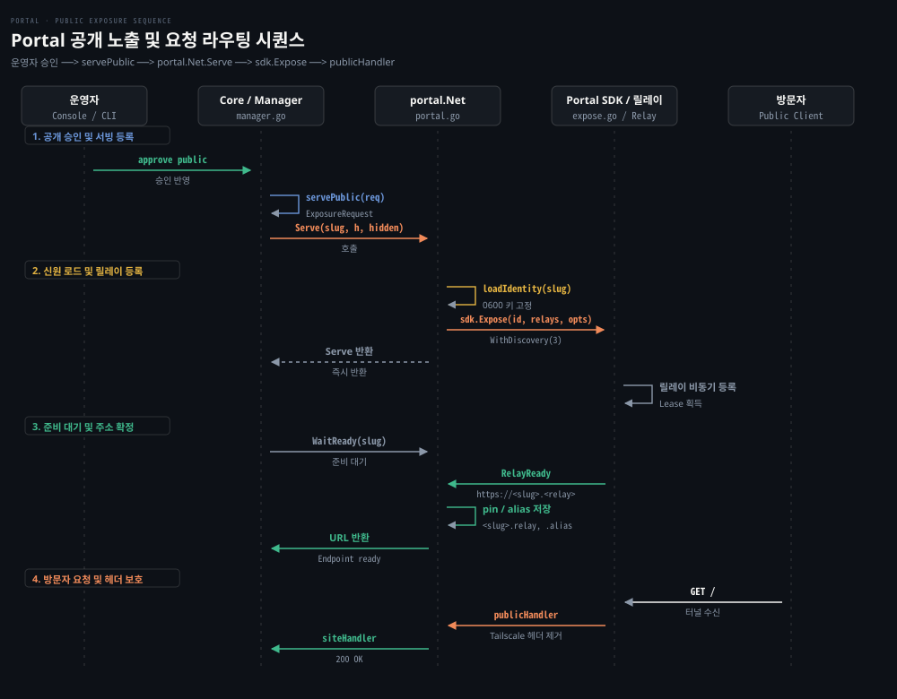
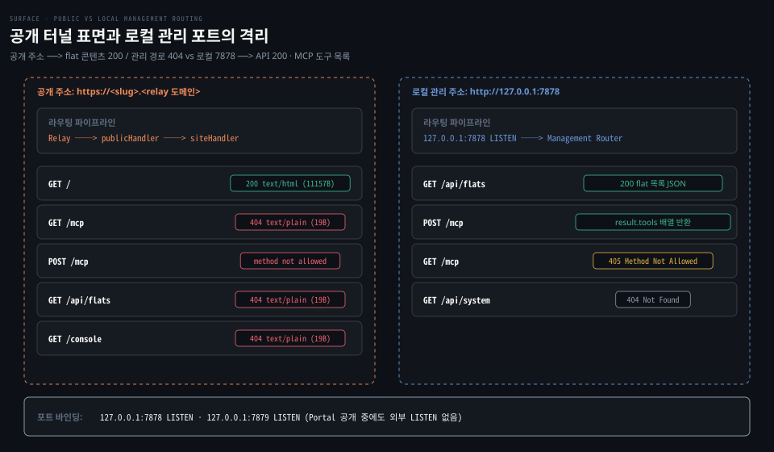

# Portal

---

> 계정 생성과 사전 토큰 발급 없이 오픈소스 분산 릴레이 네트워크를 통해 flat에 고유한 HTTPS 공개 주소를 부여하는 Portal 어댑터의 SDK 임베딩, flat별 암호학적 신원 격리, 상태 전이 및 자원 회수 수명주기를 다룹니다.


## 학습 목표와 범위

> flats가 portal-tunnel SDK를 활용해 계정 없는 공개 역방향 터널을 구성하고 flat별 신원과 라우팅 표면을 격리하는 원리를 분석할 수 있습니다.

1. Tailscale Funnel이나 zrok과 달리 별도 가입이나 API 키 발급 없이도 공용 인터넷에 서비스를 노출할 수 있는 Portal 제공자의 동작 원리와 의존성 구조를 설명할 수 있습니다.
2. flats가 flat마다 독립된 secp256k1 신원 키 파일(`<slug>.json`)을 분리 생성·관리하여 공개 호스트명의 소유권을 고정하고 데이터 백업 시 이 파일이 필수적인 이유를 파악할 수 있습니다.
3. 릴레이 디스커버리(`WithDiscovery`), 최대 활성 릴레이 수(`max_active_relays 3`), 핀(`pin`) 저장 및 별칭(`alias`) 추적이 동적 릴레이 환경에서 URL 안정성을 유지하는 메커니즘을 추적할 수 있습니다.
4. `portal.hide`와 flat별 `SetHidden` 옵션이 릴레이 탐색 목록 노출만 제어할 뿐 인터넷 전체 접근을 제한하는 보안 제어가 아니라는 사실을 규명할 수 있습니다.
5. flat 노출 중단(`Stop`)과 호스트 종료(`Close`) 시 30초 타임아웃 안에서 HTTP 드레인, SDK 닫기, 리스너 펌프 정리가 순차 수행되는 과정과 2분의 lease 만료 유예 시간을 설명할 수 있습니다.
6. 공개 주소로 들어온 트래픽에서 flats 콘솔이나 MCP 도구 같은 관리 API가 완전히 차단되는 라우팅 구조의 근거를 소스 코드와 로컬 실측 데이터로 증명할 수 있습니다.

이 문서는 flats 저장소 안의 Portal 어댑터 패키지(`internal/expose/portal`)와 코어 수명주기 연동을 다룹니다. Portal 자체의 역방향 터널링 및 keyless TLS 내부 프로토콜 원리는 [portal 시리즈 기초 편](../../../02_os/project/portal-tunnel/00-01.What%20is%20Portal%C2%B7%EB%B9%84%EA%B5%90%20%EC%A0%9C%ED%92%88.md)과 [keyless TLS 편](../../../02_os/project/portal-tunnel/02-03.keyless%20TLS.md)에 상세히 정리되어 있으므로 다시 길게 풀지 않고 해당 문서로 연결합니다.

기준 커밋 3abe537 (v0.11.0, 2026-10-17)


## 1. 문제와 자리 — 계정과 키 없이 여는 Public 제공자

> 외부 인터넷에 로컬 서비스를 즉시 공개하려 할 때 서비스 제공자 회원 가입과 비밀 키 설정이 자동화의 장애물이 되며, flats는 무계정 분산 릴레이인 Portal을 Public 제공자로 채택해 이를 해결합니다.

개발자가 로컬 머신에서 실행 중인 웹 페이지나 앱을 인터넷의 불특정 다수에게 공개하려면 공인 IP를 가진 중계 인프라가 필요합니다(`README.md:237`, `docs/networking.md` 「Providers」). 하지만 상용 터널 서비스나 오버레이 VPN 기반 도구들은 호스트 등록 과정에서 계정 가입과 사전 발급된 API 토큰을 필수로 요구합니다.

예를 들어 Tailscale Funnel은 tailnet 관리자 승인이 선행되어야 하며 zrok은 환경 토큰이 필요합니다. 외부 서비스 계정을 발급받기 어려운 환경에서 임시 퍼블릭 링크를 신속하게 얻으려는 개발자라면 이러한 사전 인증 절차가 마찰이 됩니다.

flats는 8개 지원 네트워크 제공자 중 인터넷 전체에 공개되는 **Public** 제공자의 하나로 **Portal**을 내장합니다(`internal/core/expose.go:63`, `internal/expose/provider/manager.go:923`). Portal은 이더리움 주소 체계 기반의 secp256k1 키쌍을 로컬에서 자체 생성해 분산 릴레이에 세션을 등록합니다. 따라서 중앙화된 계정 등록이나 유료 결제 없이도 유효한 공용 HTTPS URL을 즉시 획득할 수 있습니다.

| 제공자 | 분류 | 도달 범위 및 특징 |
| :--- | :--- | :--- |
| Local | Private | `127.0.0.1` 및 `*.localhost` 루프백 (기본 활성) |
| Tailscale | Private | tailnet ACL이 허용한 사설 기기 |
| NetBird | Private | NetBird 접근 정책이 허용한 피어 |
| Tailscale Funnel | Public | 인터넷 누구나 (Tailscale 계정 및 노드 필요) |
| Portal | Public | 인터넷 누구나 (계정·키 불필요, 분산 릴레이 경유) |
| zrok | Public | 인터넷 누구나 (zrok 계정 및 환경 토큰 필요) |
| Cloudflare quick | Public | 인터넷 누구나 (`trycloudflare` 임시 터널) |
| NetBird Expose | Public | 인터넷 누구나 (NetBird 프록시 경유) |

flats가 의존하는 Portal 버전은 `go.mod:8`의 `github.com/gosuda/portal-tunnel/v2 v2.6.3`입니다. portal 시리즈 기준 버전인 `v2.6.4`와는 패치 하나 차이입니다.

두 버전 사이의 세부 커밋 변경 내역(`v2.6.3..v2.6.4`)은 로컬 모듈 캐시 환경에서 직접 확인하지 못해 미확인으로 남깁니다.

flats는 Portal의 CLI 바이너리를 외부 프로세스로 실행하지 않고 Go 모듈 라이브러리인 Portal SDK를 프로세스 내부에 직접 링크해 함수 호출로 제어합니다. SDK의 핵심 인터페이스와 동작은 [portal 시리즈 04-01.sdk.Expose·Listener.md](../../../02_os/project/portal-tunnel/04-01.sdk.Expose%C2%B7Listener.md)에 기술되어 있으며 flats는 이를 감싸는 `internal/expose/portal` 어댑터를 제공합니다.


## 2. SDK 어댑터 — WithDiscovery와 WithMetadata 호출 계약

> 서드파티 라이브러리인 Portal SDK와 flats 코어 엔진의 수명주기 계약이 직접 맞물리지 않도록 중간에서 설정을 정규화하고 SDK 인터페이스를 추상화하는 어댑터가 필요합니다.

flats 코어는 네트워크 세부 구현체를 직접 알지 못하며 `core.PublicNet` 인터페이스만 바라봅니다(`internal/core/expose.go:27`). `internal/expose/portal/portal.go`는 이 인터페이스를 구현하는 `Net` 구조체(`:92`)를 정의하고 포털 전용 구성 옵션들을 `Config` 구조체(`:47-63`)에 담습니다.

```go
// internal/expose/portal/portal.go:47-63
type Config struct {
	ShutdownTimeout time.Duration
	Dir             string
	Relays          []string
	Discovery       bool
	MaxActiveRelays int
	Logf            func(string, ...any)
}
```

호스트 설정의 포털 구성값을 로컬 실측(2026-10-18, `flats config show`)으로 확인했습니다.

- `portal.discovery`: `true` (부트스트랩 릴레이 자동 발견 활성화)
- `portal.max_active_relays`: `3` (발견으로 추가할 최대 활성 릴레이 수 상한)

여기에 더해 명시적 릴레이 목록인 `portal.relays`는 빈 배열(`[]`, `internal/config/config.go:115`, `docs/configuration.md:165`)이 기본값입니다. 디렉터리 숨김 플래그인 `portal.hide`는 `false`(`internal/config/config.go:122`, `docs/configuration.md:168`)가 기본 적용됩니다.

`New` 생성자(`internal/expose/portal/portal.go:179-216`)는 전달된 구성을 검증하고 신원 파일이 저장될 디렉터리를 `os.MkdirAll(cfg.Dir, 0o700)`으로 생성합니다. `cfg.ShutdownTimeout`이 0 이하이면 기본 30초(`30 * time.Second`, `:181`)로 보정합니다. 명시적 릴레이 목록이 주어지면 `NormalizeRelays`(`:220-235`) 함수를 거쳐 공백을 제거하고 중복을 걸러냅니다. `Discovery`가 꺼져 있으면서 명시적 릴레이가 하나도 없으면 릴레이 연결이 불가하므로 에러를 반환합니다(`:197`).

실제 Portal 네트워크 노출은 `sdkExpose` 함수(`:79-90`)에서 시작합니다.

```go
// internal/expose/portal/portal.go:79-90
func sdkExpose(ctx context.Context, id types.Identity, relays []string, maxActive int, meta types.LeaseMetadata) (exposure, error) {
	opts := []sdk.Option{sdk.WithMetadata(meta)}
	if maxActive > 0 {
		opts = append(opts, sdk.WithDiscovery(maxActive))
	}
	e, err := sdk.Expose(ctx, id, relays, opts...)
	if err != nil {
		return nil, err
	}
	return e, nil
}
```

이 함수는 SDK 원문(`portal-tunnel v2.6.3 sdk/expose.go:202`)의 `sdk.Expose(ctx, identity, relays, opts...)`를 호출합니다. 전달되는 옵션의 의미는 다음과 같습니다:

1. `sdk.WithMetadata(meta)` (`portal-tunnel v2.6.3 sdk/expose.go:171`): 임대 등록 시 릴레이에 전달할 메타데이터를 지정합니다. `Hide` 여부와 slug 설명을 설정합니다.
2. `sdk.WithDiscovery(maxActive)` (`portal-tunnel v2.6.3 sdk/expose.go:183`): 릴레이 멤버십 관리를 SDK 내부의 발견 컨트롤러(`discovery.Controller`)에 위임합니다. 명시적으로 지정된 릴레이를 우선 보존하면서 부트스트랩 릴레이 후보군을 동적으로 탐색하여 최대 `maxActive`(기본 3개)까지 연결을 확장합니다.

이로써 flats는 사용자가 별도의 공개 릴레이 주소를 입력하지 않더라도 공용 부트스트랩 릴레이 후보군을 자동으로 탐색하여 터널을 엽니다(`portal-tunnel v2.6.3 sdk/expose.go:193-196`).


## 3. flat별 신원 격리 — secp256k1 키 파일과 호스트명 고정

> 호스트 전체가 단일 키를 공유하면 개별 flat의 호스트명이 섞이거나 특정 서비스 이전 시 신원 분리가 불가능해지므로, flat마다 고유한 암호학적 신원을 유지해야 합니다.

Portal의 모든 공개 호스트명은 임의로 지정되는 것이 아니라, 클라이언트가 제시하는 암호학적 신원(secp256k1 개인키에서 도출된 이더리움 주소)과 결합하여 결정됩니다. 이더리움 신원과 서명, 임대 토큰 발급 메커니즘은 [portal 시리즈 03-02.identity·SIWE·lease token.md](../../../02_os/project/portal-tunnel/03-02.identity%C2%B7SIWE%C2%B7lease%20token.md)에서 다룹니다.

flats 호스트가 단일 Portal 신원 키 하나로 모든 flat을 노출한다면 모든 flat이 동일한 공개 주소 아래의 서브패스를 쓰거나, 특정 flat을 삭제하거나 다른 호스트로 이전할 때 주소 소유권을 독립적으로 분리할 수 없습니다. 따라서 flats는 flat마다 별도의 신원 키 파일을 생성하고 격리합니다(`internal/expose/portal/portal.go:248-271`).

신원 파일 경로는 `identityPath(slug)`(`:248-253`)로 도출됩니다. 슬러그 빈 값, `filepath.Base` 불일치, 구분자(`/`, `\`), 마침표(`.`) 접두사 등 경로 탐색 패턴을 검증해 차단합니다. 이후 `filepath.Join(cfg.Dir, slug+".json")` 경로를 반환합니다.

```go
// internal/expose/portal/portal.go:257-271
func (n *Net) loadIdentity(slug string) (types.Identity, error) {
	path, err := n.identityPath(slug)
	if err != nil {
		return types.Identity{}, err
	}
	id, err := identity.LoadOrCreate(slug, path, "")
	if err != nil {
		return types.Identity{}, fmt.Errorf("portal: identity for %s: %w", slug, err)
	}
	// LoadOrCreate writes new files 0600 but leaves an existing file as is.
	if err := os.Chmod(path, 0o600); err != nil {
		return types.Identity{}, fmt.Errorf("portal: identity for %s: %w", slug, err)
	}
	return id, nil
}
```

`loadIdentity`는 SDK의 `identity.LoadOrCreate(slug, path, "")`(`portal-tunnel v2.6.3 portal/identity/client_identity.go:38`)를 호출합니다. 이 함수는 디스크에 기존 키 파일이 있으면 이를 읽고 없으면 신규 secp256k1 개인키를 생성해 저장합니다.

소스 코드 주석이 밝히듯 기존 파일이 항상 우선권을 가지며 공개 호스트명을 안정적으로 유지합니다("An existing file wins, which keeps the public hostname stable", `:255-256`). 생성된 파일은 소유자만 읽고 쓰도록 `0600` 권한으로 강제 조정됩니다(`:267`).

이 구조는 flats의 데이터 백업과 복원 정책에서도 핵심적인 의미를 가집니다(`docs/configuration.md` 「Data map」 및 「Backups」). 데이터 디렉터리 내의 `portal/` 폴더(`docs/configuration.md:53-54`)가 보관하는 파일은 세 가지입니다.

1. `<slug>.json`: flat별 Portal secp256k1 신원 키 파일 (권한 `0600`)
2. `<slug>.relay`: 최초 연결 성공 시 고정된 핀 릴레이 URL
3. `<slug>.alias`: 릴레이로부터 부여받아 사용자에게 노출했던 호스트 별칭 기록

문서 `docs/configuration.md:100-101`이 명시하듯 백업 시 `tsnet/`과 `portal/` 디렉터리가 누락되면 복원 후 새 노드 이름과 인증서 및 키가 재발급됩니다. Portal 신원 파일이 유실되면 암호학적 주소가 완전히 달라지므로 기존에 안내되었던 공개 URL로 접속하는 외부 방문자가 영구적으로 접속 불능에 빠지게 됩니다. 따라서 `portal/` 디렉터리는 호스트 메타데이터 백업의 필수 구성요소입니다.


## 4. 비동기 서빙과 상태 추적 — pin·별칭 보존과 TLS 종단

> 릴레이 등록은 네트워크 왕복으로 수백 밀리초 이상 걸리므로 코어 요청을 블로킹하지 않고 즉시 반환해야 하며, 동적 릴레이 변경 속에서도 방문자 URL이 바뀌지 않도록 보호해야 합니다.

코어 서비스가 flat의 공개 노출을 명령할 때 호출되는 `Serve` 메서드(`internal/expose/portal/portal.go:281`)는 릴레이 연결이 완료될 때까지 기다리지 않고 즉시 반환합니다. 릴레이 등록 작업은 백그라운드 고루틴에서 비동기로 수행됩니다.

```go
// internal/expose/portal/portal.go:276-281
// Serve exposes h for slug and returns at once; relays register in the
// background. The returned URL is empty until a relay is ready (see
// WaitReady). Serving an already-served slug swaps the handler and applies
// hidden without re-registering.
func (n *Net) Serve(ctx context.Context, slug string, h http.Handler, hidden bool) (string, error)
```

이미 서빙 중인 슬러그로 `Serve`를 다시 호출하면 기존 터널과 릴레이 등록을 끊지 않고 내부의 `handlerBox`(`:156-175`)에 보관된 핸들러를 뮤텍스 잠금 아래 교체합니다(`:316`). 따라서 새 버전 배포 시 릴레이 재등록에 따른 서비스 단절이 발생하지 않습니다.

클라이언트의 실제 요청을 받는 관문은 `publicHandler`(`:395-406`)입니다. 이 핸들러는 활성 요청 카운터(`b.active.Add(1)`, `:397`)를 관리하여 우아한 종료 시 드레인 완료 여부를 추적합니다. 외부 인터넷 방문자가 내부 네트워크의 신원을 위조할 수 없도록 요청 헤더에서 `Tailscale-User-`로 시작하는 모든 식별 헤더를 검사하여 강제 삭제(`r.Header.Del(k)`, `:401`)합니다.

릴레이 등록이 완료되어 실제 공개 URL을 사용할 수 있는 시점은 `WaitReady(ctx, slug)`(`:725-747`)로 동기화합니다. `WaitReady`는 SDK의 `WaitReady` 메서드를 호출해 최소 하나 이상의 릴레이가 정상 등록 상태(`isReady`, `:930`)가 될 때까지 대기한 뒤 URL 목록을 반환합니다.



위 시퀀스 도식은 운영자의 공개 승인부터 릴레이 비동기 등록, WaitReady 완료, 외부 방문자 요청 수신까지의 제어 흐름과 데이터 흐름을 보여줍니다. 

### 릴레이 핀(Pin)과 별칭(Alias) 보존

릴레이 디스커버리를 켜 두면 릴레이 네트워크 상태에 따라 SDK가 활성 릴레이를 수시로 교체합니다. 소스 주석에 따르면 개발자 실행에서도 2분 만에 두 릴레이가 교체되어 이전에 배포된 URL이 작동을 멈추는 현상이 관측되었습니다(`:934-937`).

flats는 이 문제를 방지하기 위해 **릴레이 핀**(Relay Pinning, `:934-1025`) 메커니즘을 적용합니다.

1. 명시적 릴레이 설정이 없는 경우 최초로 준비 완료(`ready`)된 발견 릴레이를 명시적 릴레이(`pinned`)로 고정합니다(`:937`).
2. 고정된 핀 주소는 디스크의 `<Dir>/<slug>.relay` 파일(`:946`)에 영구 저장되어 호스트가 재부팅되더라도 동일한 릴레이에 우선 접속합니다.
3. 핀된 릴레이가 영구 실패(`permanent`, `:988`)하거나 24시간(`repinAfter = 24 * time.Hour`, `:943`) 동안 복구되지 않으면서 다른 가용 릴레이가 존재하는 경우에만 제한적으로 핀을 교체(`repin`, `:1001`)합니다.

각 릴레이는 flat에 고유 주소인 정규 호스트명 `<slug>-<address>.<relay>`와 짧은 별칭 `<slug>.<relay>`를 제공합니다. flats는 부여받은 별칭을 `<Dir>/<slug>.alias` 파일(`:876-923`)에 기록합니다. 다른 사용자가 동일한 별칭을 선점해 별칭이 유실되면 이전 링크가 타인 서비스로 연결될 위험을 경고 메시지(`aliasLostHint`, `:872`)로 안내합니다.

### TLS 종단 위치와 flats의 역할

flats 어댑터 코드(`internal/expose/portal`)에는 직접적인 `crypto/tls` 설정이나 인증서 조작 코드가 없습니다(`grep -rn "tls" internal/expose/portal/`). 설계상 원격 릴레이는 TLS를 복호화하지 않고 암호화된 터널을 중계할 뿐입니다.

실제 테넌트 TLS 종단은 flats 프로세스 안의 Portal SDK 리스너가 전담합니다(`keyless.Client`, `portal-tunnel v2.6.3 sdk/listener.go:391, 1082`). SDK 내부의 TLS 종료는 `portal-tunnel v2.6.3 sdk/http.go:47` 주석("The tunnel ended TLS")과 [portal 시리즈 keyless TLS 편](../../../02_os/project/portal-tunnel/02-03.keyless%20TLS.md)에 기술되어 있습니다.

flats 어댑터는 `sdk.RunHTTP(ctx, ln, h, "")`(`internal/expose/portal/portal.go:209`)에 리스너와 핸들러를 넘깁니다. SDK 리스너가 프로세스 안에서 TLS를 종료한 뒤 건네는 순수 HTTP 스트림(`net.Conn`)을 받아 처리합니다.


## 5. hide와 접근 제어 — 디렉터리 숨김과 공개 표면의 한계

> 공개 릴레이의 검색 목록에서 flat을 감추는 기능이 인터넷 방문자의 직접 접속을 차단하는 보안 수단으로 오해되기 쉬우므로, 가시성과 접근 제어의 경계를 명확히 구분해야 합니다.

Portal 어댑터는 flat 노출 시 릴레이 목록에 서비스 이름을 표시할지 여부를 결정하는 `SetHidden` 메서드(`internal/expose/portal/portal.go:410-431`)를 제공합니다.

```go
// internal/expose/portal/portal.go:410-412
// SetHidden toggles relay listing. Relays pick it up at the next lease
// renewal, up to about 90 s later.
func (n *Net) SetHidden(slug string, hidden bool) error
```

이 메서드는 내부적으로 `e.exp.UpdateMetadata(metadata(e.slug, hidden))`(`:444`)을 호출하여 릴레이에 등록된 임대 메타데이터의 `Hide` 플래그를 갱신합니다. 릴레이는 다음 임대 갱신 시점(최대 약 90초 이내)에 이 변경을 감지하여 공개 디렉터리에서 해당 flat의 등재를 숨깁니다.

공식 문서가 거듭 강조하듯 hide 설정은 결코 접근 제어가 아닙니다(`docs/networking.md` 「Visibility」). "Hiding is not access control" 원칙을 따릅니다(`docs/design.md:379`).

Portal로 노출된 Public flat은 도메인 이름을 알고 있거나 URL을 유추한 인터넷의 모든 사용자가 암호나 인증 없이 접근할 수 있습니다. flats CLI 역시 `flats list` 출력에서 공개 주소를 표시할 때 아래 주의 문구를 출력합니다.

> "This flat is public: anyone on the internet can open it. A domain or URL is not what makes it public." (로컬 실측(2026-10-16, v0.9.1) `flats list`)

`portal.hide`는 릴레이 탐색 페이지의 공개 목록(relay listings)에서 flat을 제외하는 옵션일 뿐이며(`docs/design.md:375-379`) 권한이 없는 외부인의 요청을 네트워크 수준에서 차단하는 방화벽이나 ACL이 아닙니다.


## 6. 안전한 자원 해제 — 30초 한도와 단계적 teardown

> 터널과 릴레이 연결을 제대로 닫지 않고 프로세스를 종료하면 원격 릴레이에 유령 세션이 잔류하거나 진행 중이던 HTTP 요청이 중단되므로, 엄격한 타임아웃 안에서 정해진 순서대로 자원을 회수해야 합니다.

터널 연결이 활성화된 상태에서 프로세스가 강제 종료되면 원격 릴레이에 유령 세션이 잔류하고 클라이언트 요청이 중단되는 문제가 발생합니다. 특정 flat의 공개를 중단하거나(`Stop`) 호스트 전체를 종료할 때(`Close`) 자원 누수가 없어야 합니다. Portal 어댑터는 정해진 순서대로 자원을 회수합니다(`internal/expose/portal/portal.go:456-646`, `docs/design.md` 「Shutdown」).

### 단일 flat 중단 (`Stop`)

`Stop(slug)`(`:456`)은 `stopEntry(e)`(`:525-590`)를 호출해 해당 flat의 자원을 순서대로 정리합니다.

1. **컨텍스트 취소**: `e.cancel()`을 호출하여 진행 중인 백그라운드 워처 고루틴에 종료를 알립니다.
2. **HTTP 요청 드레인 (`waitIdle`)**: `n.cfg.ShutdownTimeout`(30초) 한도 안에서 `e.done` 채널을 기다립니다. `sdk.RunHTTP` 종료 중 타임아웃(`context.DeadlineExceeded`)이 발생해 먼저 리턴하더라도 `waitIdle(ctx, e.handler)`(`:541-548, 599-610`)를 가동합니다. 활성 요청 수(`b.active.Load()`)가 0이 될 때까지 10ms 주기로 폴링해 잔여 요청 처리를 기다립니다.
3. **리스너 폐쇄**: `e.ln.Close()`(`:557`)를 호출해 신규 인바운드 스트림 수락을 즉시 차단합니다.
4. **SDK 임대 해제 (`exp.Close`)**: 고루틴을 띄워 SDK의 노출 객체를 닫습니다(`:561-565`). 이 과정에서 원격 릴레이에 `Unregister` 요청이 전송되어 등록된 임대 토큰이 반환됩니다.
5. **리스너 펌프 대기**: 내부 펌프 고루틴이 완전히 종료될 때까지 대기합니다(`:585`).

릴레이와의 통신 장애로 4단계의 `Unregister` 호출이 실패하더라도 Portal 어댑터는 해당 flat을 내부 상태 목록에서 섣불리 지우지 않고 `e.stopErr`에 실패를 기록해 둡니다(`:520`). SDK의 `Close`는 `sync.Once`로 보호되어 재호출 시 이전 오류가 유실되므로 flats는 실패한 작업을 그대로 보존하여 이후 재시도 시 남은 단계부터 이어갈 수 있도록 설계되었습니다(`:524`).

### 2분의 Lease 만료 유예와 프로세스 전체 종료 (`Close`)

릴레이 등록 해제에 최종 실패한 임대는 원격 릴레이의 임대 만료 타이머에 의존하게 됩니다. 소스 코드 주석(`:112-116`)과 `docs/design.md` 「Shutdown」 문단에 명시된 대로 릴레이가 갱신되지 않은 임대를 파기하기까지는 **약 2분**의 시간(`n.leaseExpiry()`, `:581-583`)이 소요됩니다. flats는 이 기간이 지나기 전까지는 동일한 슬러그로 서빙을 재개하지 못하도록 차단하여 상태 충돌을 방지합니다.

프로세스 종료를 처리하는 `Net.Close()`(`:613-646`)는 `sync.Once`로 단 한 번만 실행되며 멱등성을 가집니다. `Close`는 서빙 중인 flat마다 병렬로 `stop(s)`을 호출하고 전체 완료를 최대 30초(`n.cfg.ShutdownTimeout`) 동안 대기합니다.

모든 작업이 끝나거나 타임아웃에 도달한 뒤에야 최상위 SDK 부모 컨텍스트(`n.cancel()`, `:633`)를 취소합니다. 조기 취소로 임대 해제 HTTP 요청이 가로채이고 오류가 버려지는 문제를 줄입니다(`:626-632`). 다만 타임아웃 시 마감 시간 초과 오류를 반환하며 백그라운드 정리가 `Close`보다 오래 지속될 수 있습니다.


## 7. 실측 대조 — 공개 주소 표면과 로컬 관리 포트의 분리

> 공개 인터넷 주소로 접근했을 때 flats 호스트의 관리 API와 MCP 도구가 외부에 노출되지 않고 오직 승인된 flat 콘텐츠만 격리 서빙되는지 실제 HTTP 응답 대조로 검증합니다.

공개 터널을 열었을 때 외부 방문자에게 내부 관리 API가 노출되는 보안 문제가 발생하지 않도록 표면을 엄격히 분리해야 합니다. flats 콘솔 관리 API(`http://127.0.0.1:7878`)와 MCP 서버는 설정 제어와 파일 접근 등 고권한 기능을 처리하므로 철저히 격리해야 합니다.

로컬 실측(2026-10-16, v0.9.1, `k8s-network` Page 승인 배포 환경)에서 공개 주소와 로컬 관리 포트가 어떻게 동작하는지 관측했습니다.



위 데이터 흐름 도식은 공개 주소와 로컬 루프백 간의 엔드포인트 응답 및 접근 격리를 실측 데이터 기반으로 대조합니다.

### 공개 주소 접근 실측 (`https://<slug>.<relay 도메인>`)

사용자가 웹 콘솔에서 Portal 제공자를 허용하고 특정 flat(`k8s-network`, Page 타입 v1)을 Public으로 승인한 뒤 발급된 공개 주소로 curl 요청을 보낸 결과입니다:

- `GET /`: `200 OK`, `Content-Type: text/html; charset=utf-8`, 다운로드 크기 `11157B` (승인된 Page의 HTML 정상 반환)
- `GET /mcp`: `404 Not Found`, `Content-Type: text/plain; charset=utf-8`, 응답 크기 `19B`
- `POST /mcp` (`{"method":"tools/list"}`): 본문 `method not allowed` 반환 (MCP 도구 목록 호출 차단)
- `GET /api/flats`: `404 Not Found`, 응답 크기 `19B`
- `GET /api/approvals`: `404 Not Found`, 응답 크기 `19B`
- `GET /console`: `404 Not Found`, 응답 크기 `19B`
- `GET /api/system`: `404 Not Found`, 응답 크기 `19B`

### 로컬 콘솔 주소 대조 (`http://127.0.0.1:7878`)

동일한 시점에 호스트 내부 루프백 포트로 요청을 보냈습니다.

- `GET /api/flats`: `200 OK` (호스트의 flat 메타데이터 JSON 정상 반환)
- `POST /mcp` (`{"method":"tools/list"}`): `result.tools` 배열 반환
- `GET /mcp`: `405 Method Not Allowed` (GET 요청 거부, POST JSON-RPC만 허용)

### 소스 코드 상의 격리 근거

이러한 표면 격리는 flats 코어와 네트워크 어댑터 간의 단방향 핸들러 전달 구조 덕분에 유지됩니다.

1. **핸들러 분리**: 코어 라이프사이클(`internal/core/lifecycle.go:1182-1185`)이 전달하는 핸들러는 관리 서버가 아닙니다. `Handler: s.siteHandler(f.Slug, f.Visibility.Public())`와 `PrivateHandler: s.siteHandler(f.Slug, false)`(`internal/core/service.go:503`)만 넘깁니다.
2. **관리 라우트의 부재**: `siteHandler`는 오직 해당 flat의 정적 에셋 또는 WASI/JS 워커 프로세스로만 요청을 전달합니다. `/mcp`, `/api/flats`, `/console` 등의 라우트는 이 핸들러의 멀티플렉서에 아예 등록되어 있지 않으므로 flat 내부 정적 파일 라우터에서 404를 반환합니다.
3. **루프백 바인딩 불변식**: Portal 터널 가동 중에도 포트 리슨 상태(`lsof -nP -iTCP -sTCP:LISTEN`)는 `127.0.0.1:7878`과 `127.0.0.1:7879`에 국한됩니다. 외부 인바운드 포트를 열지 않고 릴레이로 나가는 아웃바운드 연결만 맺습니다.

> [!NOTE]
> **실측 미확인 항목**  
> 위 실측은 로컬 개발 머신에서 수행된 결과입니다. 릴레이 내부의 종단 간 테넌트 TLS 유지 여부, 디렉터리 숨김(`hide`) 적용 시 릴레이 디렉터리 웹 UI에서의 실제 제외 여부, 그리고 셀룰러 LTE 등 외부 이종 네트워크에서의 접속 가용성은 실측 대상에서 제외되어 "미확인" 상태로 남깁니다.


## 리뷰 노트

> 소스 코드 정독 및 로컬 실측 과정에서 관측된 설계 의문과 잠재적 결함 후보를 기록합니다.

- **릴레이 예산 소진 시 외부 트래픽 차단 가능성**: [portal 시리즈 TR-4](../../../02_os/project/portal-tunnel/05-01.%EC%BD%94%EB%93%9C%20%EB%A6%AC%EB%B7%B0.md)에서 설계 질문으로 남겼듯 릴레이 전역 예산(1024)은 신원별 공정성을 보장하지 않습니다. 트래픽 집중 시 정상 요청이 선점당할 구조적 가능성이 제기되나 실제 영향은 미확인 상태입니다.
- **비정상 터널 연결의 릴레이 잔류 지연 추측**: `internal/expose/portal/portal.go:112-116` 주석상 2분 대기(`:581`)는 언레지스터 누락 릴레이의 SDK 임대 수명(`sdkLeaseTTL`)에 맞춘 것입니다. [portal 시리즈 TR-2](../../../02_os/project/portal-tunnel/05-01.%EC%BD%94%EB%93%9C%20%EB%A6%AC%EB%B7%B0.md)의 소켓 잔류 가설을 보완하려는 의도로 볼 수도 있으나 추측입니다.
- **터미널 오류 및 MITM 감지 시 영구 격리**: `internal/expose/portal/portal.go:826-829`는 `RelayFailureMITM`을 받으면 릴레이를 `sticky` 맵에 영구 격리합니다. [portal 시리즈 02-04.MITM self-probe.md](../../../02_os/project/portal-tunnel/02-04.MITM%20self-probe.md)의 probe 실패를 터미널 오류로 처리하는 로직입니다.
- **종료 시 부모 컨텍스트 취소 지연 설계**: `internal/expose/portal/portal.go:633`의 `defer n.cancel()` 주석처럼, SDK는 컨텍스트가 취소되면 세부 오류를 버립니다. flats는 드레인과 언레지스터가 끝날 때까지 부모 컨텍스트 취소를 지연시켜 오류를 보존합니다.


## 자가 점검 질문

1. flats가 Tailscale Funnel이나 zrok 대신 Portal을 Public 제공자로 사용할 때 얻는 운영상의 차별점은 무엇입니까?
2. flat마다 `<Dir>/<slug>.json` 신원 파일을 분리하여 저장하는 이유와, 백업 복원 시 이 파일이 누락되었을 때 발생하는 문제는 무엇입니까?
3. `portal.hide` 설정을 켜서 릴레이 목록에서 flat을 숨기면 인터넷 외부 사용자의 무단 접속을 차단할 수 있습니까? 그 이유는 무엇입니까?
4. flat의 공개 노출을 중단(`Stop`)할 때 30초 한도 안에서 수행되는 작업 순서와, 언레지스터 실패 시 2분의 대기 유예가 존재하는 이유는 무엇입니까?
5. 외부 인터넷 사용자가 공개 URL(`https://<slug>.<relay>`)로 접근할 때 `/mcp`나 `/api/flats` 같은 관리 엔드포인트에 접속할 수 없는 소스 코드 수준의 근거는 무엇입니까?


## 정답 (자답 후 펼치기)

1. **정답**: 별도의 사용자 계정 가입, 웹 로그인, 사전 발급된 API 토큰이나 라이선스 키 설정 없이 로컬에서 자동 생성된 secp256k1 신원 키만으로 즉시 유효한 공용 HTTPS URL을 얻을 수 있다는 점입니다.
2. **정답**: Portal 공개 주소는 클라이언트의 secp256k1 키쌍에서 도출된 이더리움 주소에 고정됩니다. flat마다 키를 분리해야 호스트명이 유지되고 소유권을 독립 격리할 수 있습니다. 백업 시 누락되면 복원 후 새 키가 생성되어 공개 URL이 영구 변경됩니다.
3. **정답**: 차단할 수 없습니다. `hide` 설정은 릴레이 탐색 웹 UI나 공개 디렉터리 목록에서 flat 이름을 제외하는 표시 제어일 뿐이며 공개 URL을 알고 있거나 유추한 인터넷의 모든 사용자가 인증 없이 접속할 수 있으므로 접근 제어(Access Control) 역할을 하지 못합니다.
4. **정답**: 30초 한도 안에서 (1) 컨텍스트 취소 및 HTTP 요청 드레인(`waitIdle`로 활성 요청 0 확인), (2) 리스너 닫기, (3) SDK `Close`로 릴레이 `Unregister` 호출, (4) 리스너 펌프 대기가 순차 진행됩니다. 언레지스터가 네트워크 장애로 실패하더라도 원격 릴레이가 갱신되지 않은 임대를 파기하기까지 약 2분이 걸리므로 동일 슬러그의 조기 재노출로 인한 주소 충돌을 막기 위해 2분의 만료 유예를 둡니다.
5. **정답**: Portal 어댑터의 `Serve`에 전달되는 HTTP 핸들러는 관리 서버(`127.0.0.1:7878`)가 아니라 배포된 flat 콘텐츠만 감싸고 있는 `siteHandler`이기 때문입니다. `siteHandler`에는 `/mcp`나 `/api/flats` 라우트가 등록되어 있지 않아 404를 반환하며 관리 포트는 외부 개방 없이 오직 로컬 루프백(`127.0.0.1:7878`)에만 LISTEN 상태를 유지합니다.
