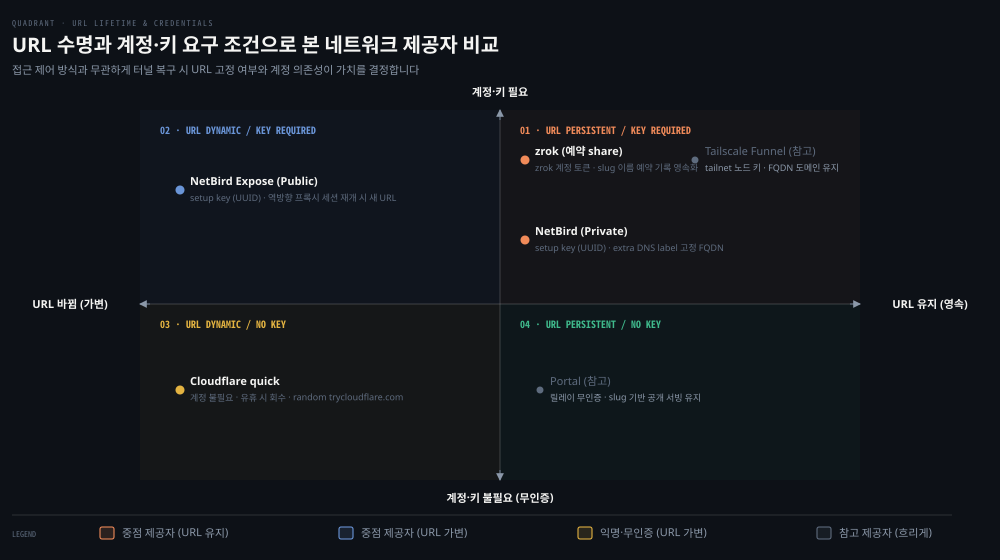
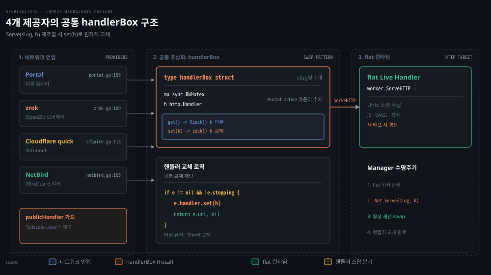

# zrok·Cloudflare quick·NetBird

---

> 외부 계정 필요 여부와 URL 수명이 각기 다른 세 네트워크 제공자 묶음(zrok, Cloudflare quick tunnel, NetBird·NetBird Expose)의 동작 원리와, flats가 이를 독립 모듈 및 라이브러리로 품어 공통 핸들러 상자(handlerBox) 패턴으로 일관되게 다루는 메커니즘을 살펴봅니다.

## 학습 목표와 범위

> zrok, Cloudflare quick tunnel, NetBird가 제공하는 네트워크 특성과 제약을 파악하고, flats 내부의 어댑터 구현 및 핸들러 교체 메커니즘을 코드로 추적할 수 있습니다.

1. zrok, Cloudflare quick tunnel, NetBird, NetBird Expose의 계정·키 요구 조건, URL 영속성, 네트워크 제약, 접근 제어 방식을 대조 분석할 수 있습니다.
2. flats가 zrok의 이름 예약(name reservation)을 로컬 디스크에 영속 기록하여 재기동 후에도 동일한 공개 URL을 유지하는 원리를 설명할 수 있습니다.
3. Cloudflare quick tunnel이 `github.com/oesni/libtunnel` 라이브러리를 통해 프로세스 환경을 격리하고 연결 단절 시 지수 백오프로 재시도하거나 새 호스트네임을 수퍼바이저(supervise)로 갱신하는 구조를 추적할 수 있습니다.
4. NetBird가 Go 모듈의 `replace` 제약으로 인해 별도 중첩 모듈(`./netbird`)로 분리된 사유와, slug마다 독립된 유저스페이스 피어를 기동하는 방식을 이해할 수 있습니다.
5. Portal을 포함한 4개 네트워크 구현체가 `handlerBox`를 통해 터널이나 릴레이를 재연결하지 않고 런타임 핸들러를 원자적으로 교체(swap)하는 공통 설계 패턴을 제시할 수 있습니다.

이 문서는 zrok, Cloudflare quick tunnel, NetBird·NetBird Expose 제공자의 내부 구현을 다룹니다. Local 루프백과 Tailscale·Funnel은 [03-03.local·Tailscale·Funnel.md](03-03.local·Tailscale·Funnel.md)에서, Portal 릴레이 프로토콜은 [03-04.Portal.md](03-04.Portal.md)에서 다룹니다. NetBird 콘솔 도메인의 세부 보안 가드 및 승인 절차는 [04-01.MCP·JSON-RPC·Same-origin·CSRF·DNS rebinding.md](04-01.MCP%C2%B7JSON-RPC%C2%B7Same-origin%C2%B7CSRF%C2%B7DNS%20rebinding.md)에서 다룹니다.

기준 커밋 3abe537 (v0.11.0, 2026-10-17)

## 1. 세 제공자 한눈에 보기: 계정, URL 수명, 제약, 접근 제어

> 서비스 목적과 네트워크 토폴로지에 따라 필요한 자격 증명과 URL 수명이 다르므로 각 제공자의 고유한 성격을 먼저 비교해야 합니다.

로컬 머신에서 구동 중인 flat을 외부에 공개하거나 사설망에 연결할 때 모든 환경에서 단 하나의 터널 방식만 사용할 수는 없습니다. 방화벽 뒤에서 임시 테스트용 공개 URL이 즉시 필요한 상황이 있고 고정된 도메인으로 지속적인 서비스를 제공해야 하는 상황이 있습니다. 팀원들만의 사설 VPN 오버레이에 안전하게 물려야 하는 요구도 존재합니다. flats는 이 다양한 배포 시나리오를 충족하려고 기술적 기반이 서로 다른 네트워크 제공자들을 제공합니다(`README.md:234-237`, `docs/networking.md:10-19`).

세 제공자 묶음(zrok, Cloudflare quick tunnel, NetBird·NetBird Expose)의 핵심 특성을 표로 비교합니다.

| 제공자 | 유형 | 계정·키 요구 조건 | URL 수명 (영속성) | 네트워크 제약 및 특성 | 접근 제어 | 사실 근거 |
| :--- | :--- | :--- | :--- | :--- | :--- | :--- |
| **zrok** | Public | zrok 계정 토큰 (`myzrok.io` API 콘솔) | **유지 (영속)**: slug 이름 예약 기록 영속화로 호스트 재기동 및 Private↔Public 전환 뒤에도 URL 유지 | 무료 플랜 첫 방문 시 인터스티셜(interstitial) 경고 페이지 노출 (`skip_zrok_interstitial` 헤더로 우회 가능), 계정당 환경·이름 수량 상한 | **없음 (Public)**: URL을 아는 누구나 접근 가능 | `docs/networking.md:113-169`, `docs/network-provider-lifecycle.md:279-370` |
| **Cloudflare quick tunnel** | Public | **불필요 (익명)**: 계정, 도메인, 토큰 없음 | **바뀜 (가변)**: 유휴 시 에지에서 회수, 자격 증명 만료 시 새 터널 민트(mint)로 주소 변경 | 테스트 및 개발용, 가동 시간 보장 없음, 터널당 동시 요청 최대 200개 제한(초과 시 `429`), SSE(Server-Sent Events) 미지원, Cloudflare 에지에서 TLS 종단(평문 복호화) | **없음 (Public)**: URL을 아는 누구나 접근 가능 | `docs/networking.md:170-195`, `docs/network-provider-lifecycle.md:239-278` |
| **NetBird** | Private | NetBird 설정 키(setup key UUID, Allow extra DNS labels 활성화 필수) | **유지 (영속)**: slug 기반 extra DNS label 요청으로 `http://SLUG.<domain>/` 유지 | 평문 HTTP만 지원 (TLS 인증서 미발급), WebCrypto·클립보드·`Secure` 쿠키 사용 불가, 오프라인 약 10분 후 NetBird 대시보드에서 피어 삭제 | **허가된 기기만 (Private)**: NetBird 접근 정책(Access Policies)으로 제어 | `docs/networking.md:196-250`, `docs/network-provider-lifecycle.md:412-440` |
| **NetBird Expose** | Public | NetBird 설정 키(Private NetBird와 동일한 setup key) | **바뀜 (가변)**: NetBird 역방향 프록시가 매 노출 세션마다 무작위 접미사를 붙여 재개 시 새 URL 발급 | NetBird 서버 및 계정에서 역방향 프록시 활성화 필요, 세션 종료 시 URL 변경 | **없음 (Public)**: flats는 PIN이나 비밀번호를 설정하지 않음, URL을 아는 누구나 접근 가능 (NetBird Peer Expose는 베타 기능) | `docs/networking.md:250-259`, `docs/network-provider-lifecycle.md:432-438` |

위 사분면 도식은 각 제공자가 요구하는 외부 자격 증명 유무와 터널 재개 시 URL 고정 여부를 보여줍니다. Cloudflare quick tunnel은 계정이나 인증 절차가 전혀 필요 없는 대신 URL이 언제든 바뀔 수 있습니다. 반면 zrok과 NetBird(Private)는 계정 토큰이나 설정 키가 필요한 대신 호스트가 식별자를 예약하여 URL 영속성을 확보합니다.

공개 터널인 NetBird Expose는 계정 키를 사용함에도 불구하고 NetBird 프록시 세션의 설계 특성상 재연결 시 URL에 무작위 접미사가 붙어 가변성을 띱니다. 우측 상단의 Tailscale Funnel과 우측 하단의 Portal은 앞선 편과의 비교를 위해 함께 배치했습니다.

## 2. zrok: 계정 환경 임베딩과 예약 share 기반 영속 URL

> zrok을 통해 서빙되는 flat의 공개 URL이 호스트 재기동과 Private↔Public 전환 뒤에도 유지되도록 호스트 차원의 이름 예약과 로컬 레코드 영속화가 필요합니다.

zrok은 OpenZiti 기반의 오픈소스 공유 서비스입니다. flats는 Go SDK인 `github.com/openziti/zrok/v2 v2.0.8`을 사용하여 zrok 클라이언트를 내부 프로세스에 직접 임베딩합니다(`go.mod:12`). 외부 `zrok` CLI 바이너리를 설치하거나 셸 명령을 실행할 필요가 없습니다.

zrok 패키지의 핵심 설정과 네트워크 구조는 아래처럼 선언되어 있습니다.

- **Config**: zrok 네트워크 백엔드를 구성하는 구조체입니다(`internal/expose/zrok/zrok.go:39`). 예약된 이름 파일들이 저장되는 `Dir`과 zrok 환경 디렉터리 경로인 `Environment`를 받습니다. 기본값은 flats 데이터 디렉터리 아래의 `zrok/` 및 `zrok-environment/`입니다(`docs/configuration.md:536-537`).
- **Net**: 제공자 관리자 인터페이스를 충족하는 구조체로 zrok 공개 share들을 관리합니다(`internal/expose/zrok/zrok.go:67`). 내부적으로 백엔드 클라이언트(`backend`)와 slug별 활성 share 항목(`entries`)을 유지합니다. 바인딩 재시도 백오프(`retryMin`, `retryMax`), 고아 share 맵(`orphans`), 정착되지 않은 share 맵(`unsettled`)도 함께 관리합니다.
- **New**: zrok 환경을 디스크에서 읽어 `Net` 인스턴스를 초기화합니다(`internal/expose/zrok/zrok.go:119`). 디스크의 환경 설정 파일만 검사하며 zrok 컨트롤러나 오버레이 네트워크에는 첫 번째 `Serve` 호출 전까지 통신을 시도하지 않습니다.

### 이름 예약과 디스크 영속 기록

zrok에서 서빙을 시작할 때 flat의 URL이 유지되는 핵심 메커니즘은 이름 예약(name reservation)입니다(`internal/expose/zrok/zrok.go:179` `Serve`).

flats가 zrok으로 flat을 서빙하는 절차는 아래 순서로 진행됩니다.

1. **로컬 슬러그 락 획득**: 동일한 slug에 동시에 진입하지 못하도록 `slugLock(slug)`을 획득합니다(`internal/expose/zrok/zrok.go:190`).
2. **사전 레코드 기록 (의도 저장)**: zrok 컨트롤러에 요청을 보내기 전, 로컬 디렉터리 `<data>/zrok/<slug>`에 예약 의도를 담은 JSON 파일(`record`)을 먼저 기록합니다(`internal/expose/zrok/zrok.go:702`). 네트워크 장애로 응답을 수신하지 못하더라도 나중에 정리할 수 있도록 기록합니다.
3. **컨트롤러 이름 예약**: 컨트롤러의 지정된 네임스페이스(`zrok.namespace`, 기본값 `public`)에서 slug를 이름으로 예약합니다. 이미 다른 zrok 계정이 해당 이름을 점유하고 있다면 `TakenHint` 안내와 함께 거절됩니다(`internal/expose/zrok/zrok.go:36`).
4. **공개 share 생성**: 예약된 이름을 기반으로 고유 대상 태그(`flats:<instance-id>:<slug>`)를 지정하여 공개 share를 생성하고 프론트엔드 URL을 수령합니다(`internal/expose/zrok/zrok.go:320-330`).
5. **비동기 오버레이 바인딩**: `bindAndServe`를 고루틴으로 실행하여 zrok 오버레이 리스너를 바인딩하고 HTTP 트래픽을 서빙합니다(`internal/expose/zrok/zrok.go:383`). 오버레이 리스너가 연결되기 전까지 라우트 상태는 `starting`으로 보고되며 바인딩이 완료되면 `ready`로 전이됩니다.

`record` 구조체(`internal/expose/zrok/zrok.go:702`)는 계정 해시, 네임스페이스, 직접 생성 여부, 생성 시각, 할당된 share 토큰을 담고 있습니다. flats는 자신이 생성하고 기록한 이름과 share만을 제어합니다. 이미 로컬에 유효한 레코드가 존재하면 호스트가 재기동되거나 flat이 비공개에서 다시 공개로 전환되어도 동일한 이름을 재사용하므로 프론트엔드 URL이 일정하게 유지됩니다.

### 계정 연동 및 승계 메커니즘

운영자는 flats 콘솔에서 zrok 계정 토큰을 등록하여 기기를 활성화합니다(`internal/expose/zrok/account.go:38-72`). 계정 토큰은 디스크의 `zrok-environment/` 디렉터리에 파일 권한 `0600`으로 안전하게 저장됩니다.

만약 토큰을 새로 갱신하여 교체하는 경우 `internal/expose/zrok/account.go`의 `Replace`가 임시 디렉터리(`<dir>.next`)에 새 환경을 먼저 구성한 뒤 기존 환경과 원자적으로 교체합니다. 교체가 완료되면 `Adopt` 메서드(`internal/expose/zrok/zrok.go:877`)가 기존 `zrok/` 디렉터리의 레코드들을 검사하여 새 계정의 지문으로 소유권을 승계합니다. 단, zrok에서 공개(Public) 상태인 flat이 하나라도 있는 동안에는 계정 토큰 교체(Replace)가 거부됩니다(`docs/networking.md:131-133`).

### 보안 및 자원 정리

zrok으로 유입되는 공개 요청은 보안 필터인 `publicHandler`(`internal/expose/zrok/zrok.go:427`)를 거칩니다. 이 필터는 외부 방문자가 임의로 위조할 수 있는 `Tailscale-User-*` 형태의 식별 헤더를 `isIdentityHeader`(`internal/expose/zrok/zrok.go:441`)로 검사하여 제거합니다. 공개 경로는 외부에서 위조될 수 있는 Tailscale 신원 헤더를 신뢰하지 않고 전달하지 않습니다.

flat이 삭제되거나 이름 변경 리다이렉트가 만료되면 `Retire`(`internal/expose/zrok/zrok.go:577`)가 호출됩니다. `Retire`는 동작 중인 오버레이 리스너를 중단하고 `release`(`internal/expose/zrok/zrok.go:601`)를 호출하여 zrok 컨트롤러에서 예약된 이름을 해제한 뒤 로컬 레코드 파일을 삭제합니다. 만약 zrok 백엔드가 꺼져 있는 상태에서 flat 삭제를 시도하면 이름 누수를 방지하기 위해 작업이 거부됩니다(`docs/network-provider-lifecycle.md:313-314`).

## 3. Cloudflare quick tunnel: libtunnel 격리와 자동 수퍼바이저

> 외부 바이너리 없이 익명 터널을 프로세스 안에서 직접 제어할 때 호스트 환경 변수 오염을 막고 에지 세션 종료에 자동으로 대응해야 합니다.

외부 `cloudflared` 바이너리를 설치하여 관리하면 호스트 환경 변수 오염과 프로세스 관리 부담이 발생합니다. Cloudflare quick tunnel(일명 TryCloudflare)은 무료 서비스입니다. 계정 등록, 도메인 구매, 인증 토큰 설정 없이 누구나 즉시 인터넷 공개 터널을 생성할 수 있습니다. flats는 `github.com/oesni/libtunnel`(`go.mod:10`) 라이브러리를 사용하여 외부 바이너리 없이 프로세스 내부에서 순수 Go 코드로 quick tunnel을 구동합니다.

패키지 구조와 환경 격리를 선언 단위로 살펴봅니다.

- **Config**: 터널 자격 증명 레코드 파일이 보관될 `Dir` 경로와 에지 민트 타임아웃을 정의합니다(`internal/expose/cfquick/cfquick.go:56`). 터널 레코드는 `<data>/cloudflare-quick/<slug>.json`에 저장됩니다.
- **session**: libtunnel의 세션을 추상화한 인터페이스입니다(`internal/expose/cfquick/cfquick.go:69`). 호스트네임 확인(`Hostname`), 자격 증명 직렬화(`Serialize`), 터널 시작 및 이벤트 스트림 수신(`Start`)을 제공합니다.
- **Net**: quick tunnel들을 총괄하는 네트워크 구조체입니다(`internal/expose/cfquick/cfquick.go:88`).
- **New**: `libtunnel` 환경을 초기화합니다(`internal/expose/cfquick/cfquick.go:139`). 이때 `v1.SetEnvironment(v1.Isolated)`를 호출하여(`internal/expose/cfquick/cfquick.go:164`) 호스트 프로세스가 상속받은 `LIBTUNNEL_*` 환경 변수를 무시하도록 격리합니다. 이 격리로 부모 프로세스의 환경 변수가 터널을 다른 곳으로 돌리거나 자식 프로세스에 터널 시크릿을 유출하는 사고를 방지합니다. 터널 오프너(`internal/expose/cfquick/cfquick.go:750-752` `libtunnelOpener`)는 `WithReports(false)`를 설정하여 민트 클라이언트의 네트워크 에러 리포트가 외부로 전송되지 않도록 로컬에 유지합니다.

### Serve와 주소 결정

공개 flat을 서빙하라는 요청이 오면 `Serve`(`internal/expose/cfquick/cfquick.go:202`)가 호출됩니다:

1. **기존 자격 증명 재사용 시도**: `<data>/cloudflare-quick/<slug>.json`에 저장된 이전 터널 스펙이 있는지 확인합니다. 스펙이 존재하면 `resolve`(`internal/expose/cfquick/cfquick.go:297`)가 기존 자격 증명으로 에지에 재연결을 시도합니다.
2. **신규 터널 민트(Mint)**: 기존 기록이 없거나 에지에서 거부되면 스펙을 비운 채 호출합니다. `api.trycloudflare.com`으로부터 새 무작위 호스트네임(`https://<words>.trycloudflare.com`)과 자격 증명을 받습니다.
3. **호스트네임 동기 확정**: `Serve`는 호스트네임이 확정될 때까지 블록된 후 URL을 반환하므로 코어 승인 엔진이 실제 도메인이 배정된 상태에서 트랜잭션을 커밋할 수 있습니다. 반환 직후 에지와의 데이터 연결은 백그라운드에서 비동기로 수립됩니다(`starting` → `ready`).
4. **자격 증명 영속화**: 발급된 터널 스펙을 `<slug>.json`에 권한 `0600`으로 원자적으로 저장합니다.

### 수퍼바이저(supervise)에 의한 자동 복구

Cloudflare quick tunnel은 무상 개발용 서비스이므로 유휴 상태가 지속되면 Cloudflare 에지 서버가 터널을 회수(reap)합니다. 연결이 단절되거나 터널이 파기되었을 때 flats가 이를 감지하고 복구하는 역할은 `supervise` 고루틴이 담당합니다(`internal/expose/cfquick/cfquick.go:388`).

`supervise`는 아래 규칙대로 동작합니다.

- **에지 종료 감지**: `sess.Done()` 채널을 감시하다가 터널 세션이 종료되면 원인을 분석합니다.
- **영구 파기 처리**: 터널 세션이 파기되었거나(`gone`), 에지에서 자격 증명이 거절된 경우(`ErrCredentialRejected`) 로컬 레코드를 삭제합니다. 백오프 시간을 초기화한 뒤 빈 스펙으로 새로운 터널을 민트합니다. 이때 flat은 새로운 무작위 호스트네임을 부여받으며 상위 라우트의 `public_url` 필드에 즉시 반영됩니다. 별도의 운영자 재승인은 요구되지 않습니다.
- **일시적 네트워크 장애 처리**: 단순 네트워크 순단이나 일시적 오류인 경우 저장된 기존 자격 증명 스펙을 유지합니다. 지수 백오프(최소 2초에서 최대 60초)를 적용하여 동일한 주소로 재연결을 시도합니다.

이 수퍼바이저 루프 덕분에 flats는 외부 터널이 일방적으로 끊기더라도 호스트 프로세스의 개입 없이 자율적으로 연결을 복구합니다.

## 4. NetBird와 NetBird Expose: 별도 모듈 격리와 독립 피어 수명주기

> 외부 라이브러리의 의존성 교체 제약으로 인해 빌드 시스템이 오염되는 문제를 막고, flat마다 분리된 WireGuard 피어를 관리할 수 있어야 합니다.

NetBird는 WireGuard 기반의 오픈소스 제로 트러스트 사설 오버레이 VPN 네트워크입니다. flats가 지원하는 NetBird 제공자는 두 가지입니다. **NetBird**(Private)는 NetBird 네트워크로 사설 메시 통신을 지원합니다. **NetBird Expose**(Public)는 역방향 프록시로 인터넷에 서비스를 노출합니다.

### 왜 NetBird는 `go install` 빌드에 없는가

일반 사용자가 `go install github.com/gosuda/flats/cmd/flats@version` 명령으로 flats를 설치하면 컴파일된 바이너리에 NetBird 기능이 포함되어 있지 않습니다(`README.md:150-152, 239-241`). 콘솔의 네트워크 제공자 설정 화면에서도 해당 빌드에는 NetBird가 포함되어 있지 않다는 안내가 출력됩니다(`internal/expose/provider/netbird_driver.go:13`).

그 이유는 Go 언어 툴체인의 엄격한 의존성 정책 때문입니다:

1. **의존 모듈의 replace 제약**: NetBird 클라이언트는 `golang.zx2c4.com/wireguard` 등 여러 패키지를 포크 버전으로 replace 지정합니다(`netbird/go.mod:275-293`). 의존 모듈의 replace는 require하는 상위 모듈에 자동 적용되지 않으므로 NetBird를 빌드하는 모듈의 `go.mod`에 replace를 반복 선언해야 합니다.
2. **go install의 replace 거절**: Go는 `go install` 시 `go.mod`에 `replace`가 있으면 빌드를 거부합니다(`docs/networking.md:198-200`, `netbird/go.mod:275-278`). 루트 모듈에 replace를 두면 `go install` 설치가 불가능해집니다.
3. **독립 모듈 분리 해결책**: flats는 루트 모듈의 `go install` 호환성을 유지하기 위해 NetBird 코드를 루트 모듈에서 분리하여 `./netbird`라는 별도의 중첩 Go 모듈로 격리했습니다(`netbird/go.mod:1`). 루트 바이너리(`cmd/flats`)는 NetBird 드라이버를 `nil`로 둔 채 컴파일됩니다. 릴리스 아카이브와 컨테이너 이미지를 만드는 `scripts/build-release.sh`는 `./netbird` 디렉터리에서 `netbird/cmd/flats`를 컴파일합니다(`scripts/build-release.sh:11-15, 58-59`). 소스 트리에서 NetBird가 포함된 바이너리를 빌드하려면 `cd flats/netbird && go build ./cmd/flats`를 실행해야 합니다.

### flat별 독립 피어 아키텍처

flats의 NetBird 구현은 단일 공유 데몬을 띄우는 일반 VPN 클라이언트와 다릅니다. tsnet처럼 flat의 slug마다 독립된 유저스페이스 피어를 기동합니다(`netbird/netbird.go:1-25`). 콘솔 도메인 역시 독자적인 피어로 뜹니다(`docs/network-provider-lifecycle.md:412-421`).

- **설정 키(Setup key)**: 운영자는 NetBird 대시보드에서 설정 키(UUID)를 생성하여 flats에 등록합니다(`docs/networking.md:221-237`). 키는 AES-256-GCM으로 암호화되어 `flats.db`에 저장됩니다. 설정 키는 **Allow extra DNS labels**가 켜져 있어야 하며 여러 피어가 등록할 수 있도록 재사용 가능(reusable)해야 합니다. 피어가 오프라인된 지 약 10분 뒤 NetBird가 대시보드에서 피어를 자동 제거하도록 임시(ephemeral) 피어 옵션도 켭니다. 제거된 피어를 flats가 재등록할 수 있도록 만료 시한이나 사용 횟수 제한도 없어야(without an expiry or usage limit) 합니다.
- **피어 식별자**: 각 피어는 flat의 slug 이름을 추가 DNS 레이블(extra DNS label)로 요청합니다. 피어의 암호화 신원과 WireGuard 상태는 `<data>/netbird/peers/<name>/` 디렉터리 아래 `netbird.json`(권한 `0600`) 및 `dns.json`에 저장되어 재기동 후에도 신원을 유지합니다.
- **Private 경로 포트**: 사설 NetBird 경로는 해당 피어 오버레이 IP의 **80 포트**에서 평문 HTTP로 서빙됩니다. 접속 주소는 `http://SLUG.<domain>/` 형태가 됩니다.
- **Public 경로 포트**: NetBird Expose 경로는 피어 오버레이의 **8080 포트**에서 대기하며 NetBird 제어 서버에 역방향 프록시 개설을 요청합니다(`docs/network-provider-lifecycle.md:432-438`). flats는 PIN이나 비밀번호를 설정하지 않습니다. NetBird 서버 및 계정에서는 역방향 프록시(Peer Expose, 베타 기능) 활성화가 필요합니다.

### 평문 HTTP 제약과 콘솔 보안

NetBird가 제공하는 도메인 이름은 공인 CA의 TLS 인증서가 발급되지 않는 평문 HTTP입니다(`docs/networking.md:260-269`). 패킷 자체는 WireGuard 터널을 통해 종단 간 암호화되지만 웹 브라우저는 이를 보안되지 않은 사이트로 간주합니다. 그래서 클립보드 접근, `crypto.subtle` 암호화 API, 서비스 워커, `Secure` 플래그 쿠키가 동작하지 않습니다.

평문 HTTP 환경에서는 브라우저가 Fetch Metadata 헤더(`Sec-Fetch-Site` 등)를 서버로 전송하지 않습니다. flats는 NetBird 콘솔 도메인에서 CSRF 공격을 방어하기 위해 특수한 규칙을 둡니다. 요청의 `http` `Origin`이 동일 출처인지 검사하고 콘솔 전용 커스텀 헤더(`X-Flats-Console: 1`)를 요구하여 브라우저의 사전 요청(Preflight)을 강제합니다(`docs/design.md:502-506`). 이 세부 방어 메커니즘은 [04-01.MCP·JSON-RPC·Same-origin·CSRF·DNS rebinding.md](04-01.MCP%C2%B7JSON-RPC%C2%B7Same-origin%C2%B7CSRF%C2%B7DNS%20rebinding.md)에서 다룹니다.

NetBird 임베디드 클라이언트 라이브러리는 기동 시 `NB_DNS_STATE_FILE` 환경 변수를 참조합니다. 두 개 이상의 피어가 동시에 기동되면 상태 파일 경로가 뒤섞이는 경쟁 상태가 발생할 수 있습니다. flats는 패키지 전역 세마포어를 두어 피어 초기화 구간을 한 번에 하나씩만 실행되도록 엄격히 직렬화합니다(`docs/network-provider-lifecycle.md:451-460`).

## 5. 공통 추상화: 네 제공자가 공유하는 handlerBox와 수명주기 패턴

> 네트워크 프로토콜마다 제각기 다른 라이브러리를 다루더라도 상위 코어 엔진에서는 단일한 수명주기 계약과 터널 세션을 유지한 채 핸들러를 교체하는 방식으로 통합 관리해야 합니다.

네트워크 제공자마다 프로토콜과 백엔드가 다르면 코어 엔진이 제각기 다른 연결 코드를 관리해야 하는 문제가 생깁니다. Portal은 릴레이 역방향 연결입니다. zrok은 OpenZiti 오버레이이며 Cloudflare quick은 libtunnel quick tunnel입니다. NetBird는 WireGuard 피어입니다.

이 네 구현체는 서로 다른 네트워크 기술을 사용하지만 소스코드를 대조해보면 동일한 공통 설계 패턴을 일관되게 채택하고 있습니다.

네 제공자의 내부 설계 패턴을 구성 요소별로 대조합니다.

| 구성 요소 및 동작 | Portal (`portal.go`) | zrok (`zrok.go`) | Cloudflare quick (`cfquick.go`) | NetBird (`netbird.go`) | 패턴의 일치점과 차이점 |
| :--- | :--- | :--- | :--- | :--- | :--- |
| **핸들러 상자 (`handlerBox`)** | `internal/expose/portal/portal.go:156` | `internal/expose/zrok/zrok.go:100` | `internal/expose/cfquick/cfquick.go:118` | `netbird/netbird.go:165` | **일치**: 4개 패키지 모두 `get()`과 `set(h)` 메서드를 가진 `handlerBox` 구조체를 정의하여 서빙 핸들러를 감쌉니다. 4개 모두 `sync.RWMutex`와 `h http.Handler`를 기반으로 하며, Portal은 여기에 요청 수 추적을 위한 `active atomic.Int64` 카운터를 더합니다. |
| **슬러그 락 (`slugLock`)** | `internal/expose/portal/portal.go:237` | `internal/expose/zrok/zrok.go:154` | `internal/expose/cfquick/cfquick.go:177` | `netbird/netbird.go:497` (`lockFor`) | **일치**: 동일한 slug나 name에 대한 중복 설정 및 전이 충돌을 막기 위해 맵 기반 뮤텍스 잠금을 사용합니다. |
| **동작 게이트 (`beginOp`)** | `internal/expose/portal/portal.go:474` | `internal/expose/zrok/zrok.go:165` | `internal/expose/cfquick/cfquick.go:188` | `netbird/netbird.go:215` | **일치**: 백엔드가 닫히는 도중(`closed`) 새로운 작업이 시작되지 않도록 차단하고 `ops sync.WaitGroup`으로 진행 중인 작업을 추적합니다. |
| **이미 서빙 중일 때의 `Serve`** | `internal/expose/portal/portal.go:316` | `internal/expose/zrok/zrok.go:198-202` | `internal/expose/cfquick/cfquick.go:225-228` | `netbird/netbird.go:504-507` | **일치**: 이미 활성화된 터널이나 릴레이가 존재하면 세션을 끊거나 재등록하지 않고 `e.handler.set(h)`만 호출하여 런타임 핸들러를 교체(swap)하고 기존 URL을 반환합니다. |
| **보안 진입 필터** | `internal/expose/portal/portal.go:395` (`publicHandler`) | `internal/expose/zrok/zrok.go:427` (`publicHandler`) | `internal/expose/cfquick/cfquick.go:635` (`publicHandler`) | `netbird/netbird.go:706` (`guardHandler`) | **일치**: 공개 요청에서 위조된 `Tailscale-User-*` 신원 헤더를 식별하여 제거(`isIdentityHeader`)합니다. NetBird의 `guardHandler` 역시 신원 헤더를 제거하며, 평문 HTTP 콘솔의 Origin 검사는 콘솔 전용 핸들러(`docs/design.md:502-506`)가 담당합니다. |
| **종료 메서드 (`Stop`/`Close`)** | `internal/expose/portal/portal.go:411` | `internal/expose/zrok/zrok.go:454` | `internal/expose/cfquick/cfquick.go:482` | `netbird/netbird.go:754` | **일치**: 개별 라우트를 닫는 `Stop`과 전체 프로세스 백엔드를 정리하는 `Close` 계약을 동일하게 이행합니다. |

위 아키텍처 도식이 보여주듯, 외부에서 유입되는 트래픽은 서로 다른 네트워크 프로토콜을 통과하지만 최종적으로는 모두 해당 slug 전용 `handlerBox`의 `ServeHTTP`로 진입합니다.

이 패턴의 핵심 특징은 터널 세션을 유지한 채 핸들러를 교체(swap)하는 구조입니다. flat의 새로운 버전이 빌드되어 배포되더라도 제공자 관리자는 기존의 외부 터널이나 릴레이 연결을 파괴하지 않습니다.

새 flat 워커의 핸들러를 준비한 뒤 `Serve(slug, newHandler)`를 호출하면 기존 활성 엔트리를 확인합니다(`internal/expose/zrok/zrok.go:198-202`). Cloudflare quick과 NetBird 역시 동일하게 동작합니다(`internal/expose/cfquick/cfquick.go:225-228`, `netbird/netbird.go:504-507`). 터널을 그대로 둔 채 `e.handler.set(newHandler)`로 핸들러 참조만 교체합니다. 터널 세션의 재연결 없이 새 버전의 핸들러로 요청 처리를 이어갑니다.

## 6. 실측과 운영 확인: 비활성 상태 점검과 켜기 절차

> 개발 머신에서 작업 중인 내부 서비스가 의도치 않은 네트워크 개방으로 외부에 누출되는 사고를 방지해야 합니다.

개발 머신에서 로컬 서비스가 부주의하게 외부에 노출되는 사고는 심각한 정보 유출로 이어집니다. flats는 이 위험을 방지하기 위해 호스트를 처음 기동할 때 로컬 루프백을 제외한 모든 외부 네트워크 제공자를 비활성화합니다(`docs/networking.md:21-22`).

호스트를 처음 기동한 뒤 네트워크 제공자 상태를 확인했습니다:

로컬 실측(2026-10-18)에서 `flats --json status` 명령 결과를 확인했습니다. 제공자 8개 중 local과 portal은 configured와 permitted가 true였습니다. 나머지 6개 외부 제공자는 모두 detail이 `"backend is not configured for this process"`였습니다. 대상은 `tailscale`, `tailscale-funnel`, `zrok`, `cloudflare-quick`, `netbird`, `netbird-expose`입니다.

### 제공자 활성화 절차 (운영자 가이드)

이 세 가지 제공자 중 하나를 켜서 직접 검증해보려는 독자는 제공자별 절차를 따라야 합니다(`docs/networking.md`):

1. **Cloudflare quick tunnel 켜기**:
   - 호스트 전역 허용: 콘솔의 Settings → Network providers → Cloudflare Quick Tunnel에서 **Turn on**을 선택합니다. 호스트 중단 상태라면 `flats config set network.permitted cloudflare-quick`을 실행합니다.
   - flat별 허용: 노출하려는 flat의 설정 페이지에서 **Networks** 탭을 열고 Cloudflare Quick Tunnel을 허용(Allow)합니다.
   - 공개 승인: flat의 가시성을 Public으로 전환하고 콘솔에서 승인을 수락합니다.

2. **zrok 켜기**:
   - 계정 토큰 획득: `myzrok.io` API 콘솔에서 계정 토큰을 복사합니다.
   - 계정 연결: 콘솔의 Settings → Network providers → zrok에서 토큰을 입력하고 **Connect**를 누르거나, 호스트 중단 상태에서 `flats key set zrok < token.txt`를 실행합니다.
   - 호스트 활성화: **Turn on**을 눌러 `network.permitted`에 `zrok`을 추가합니다.
   - flat별 허용 및 공개 승인을 완료하면 slug 이름으로 예약된 영속 URL이 발급됩니다.

3. **NetBird 켜기 (NetBird 빌드 바이너리 필수)**:
   - 빌드 확인: 공식 릴리스 바이너리나 `netbird/cmd/flats`에서 빌드한 바이너리를 실행해야 합니다.
   - 설정 키 등록: NetBird 대시보드에서 `Allow extra DNS labels`가 활성화된 setup key를 발급받아 콘솔의 **Settings → Keys** 또는 `flats key set netbird`로 등록합니다.
   - 제공자 활성화: 콘솔에서 NetBird(사설) 또는 NetBird Expose(공개)를 켭니다.

> [!WARNING]
> 공개(Public)는 접근 제어가 아닙니다.
> flats에서 flat을 Public으로 전환하여 zrok, Cloudflare quick tunnel, NetBird Expose로 노출하면 어떠한 비밀번호나 PIN 번호도 걸리지 않습니다(`docs/networking.md:257-258, 292`). URL을 획득한 인터넷 상의 누구나 해당 flat의 화면을 열고 API를 호출할 수 있으므로, 민감한 내부 데이터나 관리자 전용 기능이 포함된 flat을 승인 없이 공개해서는 안 됩니다.

## 7. 한계와 실패 처리

> 네트워크 장애, 계정 충돌, 외부 세션 만료 등의 예외 상황에서 각 제공자 어댑터가 취하는 방어적 실패 처리 방식을 이해해야 합니다.

분산 네트워크 환경에서는 토큰 만료, 도메인 점유, 터널 강제 종료 등 다양한 실패 시나리오가 발생합니다. flats의 세 제공자 구현체는 장애가 발생했을 때 데이터가 오염되거나 고아 자원이 남지 않도록 엄격한 실패 처리 규칙을 이행합니다.

| 장애 시나리오 | 발생 원인 | 시스템 대응 및 복구 동작 | 코드 및 문서 근거 |
| :--- | :--- | :--- | :--- |
| **zrok 이름 충돌** | 동일한 zrok 계정의 다른 기기나 외부 zrok CLI가 이미 같은 slug 이름을 선점함 | `TakenHint` 에러를 반환하며 경로 개설을 거부합니다. 운영자에게 flat의 slug 이름을 변경하도록 안내합니다. | `internal/expose/zrok/zrok.go:36`, `docs/networking.md:156-159` |
| **zrok share 생성 중 응답 유실** | 컨트롤러는 share를 생성했으나 네트워크 단절로 flats가 응답을 받지 못함 | `setUnsettled`에 기록하여 호스트 종료 시나 추후 `Stop` 호출 시 컨트롤러의 소유권 대상 태그(`flats:<instance>:<slug>`)를 조회하여 호스트가 소유한 잔존 share의 정리를 시도합니다(정리 실패 시 unsettled로 유지). | `internal/expose/zrok/zrok.go:328`, `docs/network-provider-lifecycle.md:323-327, 356-360` |
| **zrok 비공개 전환 시 unshare 실패** | zrok 컨트롤러와의 일시적 통신 장애로 share 삭제 명령이 실패함 | 경로를 닫히지 않은 상태로 판단하여 `StopPublicRoutes`의 `Unconfirmed` 목록에 zrok을 남기고 flat의 비공개 전환 완료를 거부합니다. 보안 착시를 방지합니다. | `internal/expose/zrok/zrok.go:454-463`, `docs/network-provider-lifecycle.md:306-307` |
| **Cloudflare 에지 터널 회수** | 유휴 상태 지속으로 Cloudflare 에지 서버가 quick tunnel을 회수함 | `supervise` 루프가 세션 종료를 감지하고, 기존 자격 증명 파일(`<slug>.json`)을 삭제한 뒤 새 터널을 민트하여 새 호스트네임으로 자동 갱신합니다. | `internal/expose/cfquick/cfquick.go:414-428`, `docs/network-provider-lifecycle.md:258-262` |
| **Cloudflare 자격 증명 거절** | 재사용하려던 이전 터널의 자격 증명을 에지에서 거부함 | `ErrCredentialRejected` 에러를 확인하고 로컬 레코드를 즉시 파기한 후 새로운 무작위 터널을 즉시 발급받습니다. | `internal/expose/cfquick/cfquick.go:414`, `docs/network-provider-lifecycle.md:258-260` |
| **NetBird 피어 동시 기동 충돌** | 여러 flat이 동시에 기동되며 `NB_DNS_STATE_FILE` 환경 변수를 경합함 | 패키지 전역 세마포어를 통해 `embed.New` 호출 구간을 상호 배제 잠금하여 한 번에 하나의 피어만 순차적으로 시작되도록 강제합니다. | `docs/network-provider-lifecycle.md:451-460` |
| **NetBird 미지원 바이너리 기동** | `go install`로 빌드된 기본 바이너리에서 NetBird 활성화를 시도함 | `ErrNetbirdNotBuilt` 에러를 반환하며 기동을 거부하고 릴리스 바이너리 사용법을 안내합니다. | `internal/expose/provider/netbird_driver.go:13` |
| **NetBird 관리 서버 장애** | NetBird 관리 서버와의 연결이 두절되거나 응답이 지연됨 | 60초 시작 타임아웃이 초과되면 에러를 반환하고, 백그라운드에서 지연 완료된 피어는 다음 재시도를 위해 즉시 중단 처리합니다. | `docs/network-provider-lifecycle.md:455-460` |

## 리뷰 노트

> 소스코드와 공식 문서를 정밀 대조하는 과정에서 발견한 구현 특이점과 설계 관찰점입니다.

- `internal/expose/cfquick/cfquick.go:164, 750-752`: `New`는 `v1.SetEnvironment(v1.Isolated)`를 호출하여 호스트의 `LIBTUNNEL_*` 환경 변수를 격리합니다. `libtunnelOpener`(`:751`)는 `WithReports(false)`를 지정하여 에러 리포트의 외부 전송을 비활성화하고 로컬에 유지합니다.
- `internal/expose/zrok/zrok.go:198-202, 347`: zrok 어댑터는 `Serve` 호출 시 기존 엔트리가 살아있으면 `e.handler.set(h)`로 핸들러만 교체합니다. 엔트리가 종료 중(`stopping`)이거나 없으면 새 `entry`를 할당하고 share를 다시 생성합니다. 이때 이름 레코드(`<data>/zrok/<slug>`)가 디스크에 남아있다면 이전과 동일한 예약 이름을 사용하므로 외부 URL이 변경되지 않습니다.
- `internal/expose/zrok/zrok.go:427-446`: `publicHandler`는 들어오는 HTTP 요청 헤더 중 `isIdentityHeader` 검사를 통과한 헤더를 삭제합니다. 이때 `strings.ReplaceAll`로 대소문자뿐만 아니라 언더스코어(`_`)가 포함된 CGI 스타일의 `TAILSCALE_USER_*` 변형 헤더까지 필터링하여 스푸핑을 방어합니다.
- `netbird/go.mod:275-293`: NetBird 클라이언트 라이브러리는 WireGuard, 암호화 툴킷, ICE 라이브러리 등 여러 패키지에 `replace` 지시자를 선언하고 있습니다. 의존 모듈의 `replace`는 require하는 상위 모듈에 자동 전파되지 않습니다. `go install pkg@version`은 대상 모듈의 `go.mod`에 `replace`가 있으면 거부됩니다. 여기서 flats가 별도의 중첩 모듈 구조(`netbird/`)를 설계한 배경을 확인할 수 있습니다.

## 자가 점검 질문

1. **질문 1**: Cloudflare quick tunnel은 외부 계정이나 설정 키가 전혀 필요 없다는 장점이 있습니다. 반면 프로덕션 서비스로 사용하기에 부적합한 기술적 제약 사항 3가지는 무엇입니까?
2. **질문 2**: zrok으로 공개된 flat은 호스트를 재기동하거나 비공개로 전환했다가 다시 공개해도 왜 동일한 프론트엔드 URL을 유지할 수 있습니까? flats 내부의 어떤 영속 메커니즘 덕분입니까?
3. **질문 3**: `go install` 명령으로 빌드한 바이너리에는 왜 NetBird와 NetBird Expose 제공자가 포함되지 않습니까? 이를 포함한 바이너리를 직접 빌드하려면 어떻게 해야 합니까?
4. **질문 4**: Portal, zrok, Cloudflare quick tunnel, NetBird 4개 네트워크 구현체가 공통으로 채택하고 있는 `handlerBox` 패턴의 역할은 무엇이며, 실행 중인 flat에 새 버전을 배포할 때 어떤 동작을 수행합니까?

## 정답 (자답 후 펼치기)

1. **정답 1**: Cloudflare quick tunnel은 유휴 시 에지 서버가 터널을 회수하여 주소가 바뀔 수 있습니다. 가동 시간(SLA)이 보장되지 않고 터널당 동시 요청이 200개로 제한(초과 시 429)됩니다. 또한 SSE(Server-Sent Events)를 지원하지 않으며 에지에서 TLS를 종단하여 트래픽 평문을 복호화합니다.
2. **정답 2**: flats는 zrok 컨트롤러에 요청하기 전 로컬 디렉터리(`<data>/zrok/<slug>`)에 slug를 이름으로 예약한 레코드 JSON 파일을 먼저 기록합니다. 이후 share를 재생성할 때도 이 기록을 참조하여 동일한 예약 이름을 컨트롤러에 바인딩하므로 호스트가 재기동되어도 고정된 프론트엔드 URL을 유지할 수 있습니다.
3. **정답 3**: NetBird 클라이언트가 `go.mod`에 여러 `replace` 지시자를 요구합니다. Go 툴체인은 `go install pkg@version` 실행 시 `replace` 지시자가 있으면 빌드를 거부합니다. NetBird 포함 바이너리는 소스 트리에서 중첩 모듈을 빌드합니다. `cd flats/netbird && CGO_ENABLED=0 go build -trimpath -ldflags="-s -w" -o flats ./cmd/flats`를 실행합니다.
4. **정답 4**: `handlerBox`는 스레드 안전하게 내부의 `http.Handler`를 교체하는 추상화 상자입니다. 새 버전을 배포할 때 외부 네트워크 터널이나 릴레이를 끊고 다시 맺지 않습니다. 이미 열린 세션의 `handlerBox.set(newHandler)`만 호출하여 실행 타깃을 원자적으로 교체하므로 재연결 지연 없이 새 버전으로 처리를 이어갑니다.

## 출처와 관련 문서

- [flats GitHub Repository (v0.11.0, 3abe537)](https://github.com/gosuda/flats/tree/3abe537): flats 공식 소스코드 저장소
- [flats README: Network providers](https://github.com/gosuda/flats/blob/3abe537/README.md): 네트워크 제공자 분류 및 NetBird 빌드 제외 안내
- [flats Documentation: Private and public access](https://github.com/gosuda/flats/blob/3abe537/docs/networking.md): zrok, Cloudflare quick tunnel, NetBird 설정 및 운영 가이드
- [flats Documentation: Network provider lifecycle](https://github.com/gosuda/flats/blob/3abe537/docs/network-provider-lifecycle.md): 제공자별 수명주기 전이 및 실패 처리 상세
- [flats Documentation: Configuration and storage](https://github.com/gosuda/flats/blob/3abe537/docs/configuration.md): 디스크 데이터 지도 및 조작자 키 저장 규칙
- [flats Design Specification: Approvals](https://github.com/gosuda/flats/blob/3abe537/docs/design.md): NetBird 콘솔 도메인의 평문 HTTP 보안 방어 규칙
- `03-01.Overlay VPN·reverse tunnel·public relay.md`: 네트워크 오버레이와 릴레이 기초 이론
- `03-02.provider manager·grants·visibility.md`: 제공자 관리자의 6단계 방어 및 수명주기 계약
- `03-03.local·Tailscale·Funnel.md`: Local 루프백과 tsnet 노드 임베딩 메커니즘
- `03-04.Portal.md`: Portal 릴레이 프로토콜 및 다중 릴레이 바인딩
- `04-01.MCP·JSON-RPC·Same-origin·CSRF·DNS rebinding.md`: 호스트 가드 및 평문 HTTP 콘솔 접근 제어 메커니즘
