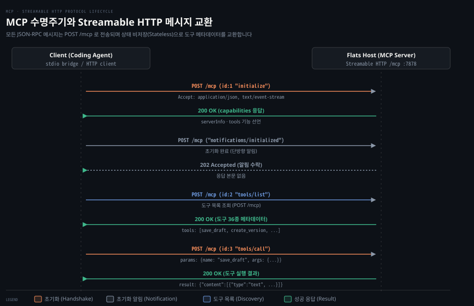
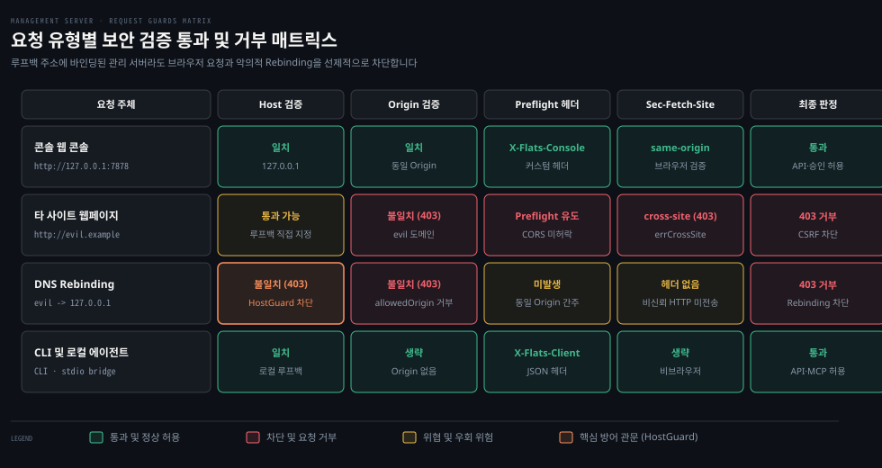

# MCP·JSON-RPC·Same-origin·CSRF·DNS rebinding

---

> 에이전트와 로컬 관리 서버 사이의 통신 표준인 MCP 및 JSON-RPC 2.0 프로토콜 규격과, 루프백 주소에 바인딩된 관리 데몬을 브라우저 기반 공격으로부터 격리하기 위한 동일 출처 정책(SOP), CSRF, Fetch Metadata, DNS Rebinding 방어 원리를 다룹니다.


## 학습 목표와 범위

> 인공지능 에이전트 도구 연동 규격과 로컬 루프백 관리 서버의 브라우저 공격 격리 원리를 이해하고 설명할 수 있습니다.

1. 에이전트가 로컬 관리 서버 기능을 호출할 때 사용하는 JSON-RPC 2.0 프로토콜의 요청·응답·알림·오류 객체 규격과 표준 에러 코드를 분석할 수 있습니다.
2. Model Context Protocol(MCP)의 수명주기(initialize 핸드셰이크)와 도구 목록 조회(`tools/list`), 도구 호출(`tools/call`), 그리고 Streamable HTTP 전송 규격을 설명할 수 있습니다.
3. 동일 출처 정책(SOP)이 교차 출처 간 요청 전송 자체를 막지 않고 응답 읽기만을 차단하는 원리를 이해하고 CORS Preflight 강제 조건과 CSRF 공격 메커니즘을 분석할 수 있습니다.
4. 브라우저가 자동 주입하는 Fetch Metadata(`Sec-Fetch-Site`)의 4가지 값과 비브라우저 클라이언트의 차이를 비교하고 보안 컨텍스트에서의 전송 제약을 설명할 수 있습니다.
5. 악성 웹사이트가 도메인 IP 해석을 조작해 로컬 루프백(`127.0.0.1`)으로 침투하는 DNS Rebinding의 원리와, 서버 차원의 `Host` 헤더 검증 차단 메커니즘을 추적할 수 있습니다.

이 문서는 MCP와 JSON-RPC 2.0, 그리고 브라우저 교차 출처 위협(CSRF, DNS Rebinding)의 기반 원리를 다룹니다. 관리 서버 세부 구현(`04-02.management server·HostGuard·console.md`)과 도구 플러그인(`04-03.MCP tools·guide·plugin.md`)은 후속 편에서 다룹니다. 승인 및 신뢰 모델(`04-04.approval·trust model.md`) 역시 다음 편으로 넘깁니다.

기준 커밋 3abe537 (v0.11.0, 2026-10-17)


## 1. 문제 — 로컬 관리 서버에 접근하는 주체와 위협

> 로컬 루프백 인터페이스에 띄운 관리 서버는 신뢰하는 로컬 프로세스뿐 아니라 사용자가 방문한 임의의 웹 브라우저 탭에서도 네트워크 요청을 수신할 수 있습니다.

개발자의 기계에서 구동되는 로컬 관리 서버는 성격이 다른 두 가지 클라이언트와 통신합니다. 첫 번째는 터미널에서 사용자가 실행하는 CLI 도구나 백그라운드에서 동작하는 AI 코딩 에이전트(Claude Code, Codex, Cursor 등)입니다. 이들에게는 프로젝트 파일을 읽고 쓰거나 새 버전을 패키징하고 배포 상태를 조회하는 원격 프로시저 호출(RPC) 규격이 필요합니다. 기계와 기계, 에이전트와 도구 사이의 상호작용을 파편화 없이 표준화하려면 구조화된 메시지 규약이 있어야 합니다.

두 번째 통신 주체는 운영자 본인이 사용하는 웹 브라우저입니다. 개발자는 웹 콘솔 대시보드에서 배포 앱 목록을 확인하고 리비전을 검토하며 배포 변경 요청을 수락하거나 거절합니다. 이때 관리 서버는 운영자 편의를 위해 `127.0.0.1` 루프백 인터페이스의 특정 TCP 포트(기본 7878, `internal/config/config.go:82`)에서 HTTP 데몬을 호스팅합니다.

문제는 운영체제 네트워크 스택 관점에서 `127.0.0.1:7878`로 유입되는 패킷의 발생지를 구별할 수 없다는 점입니다. "운영자가 직접 연 콘솔 탭"의 정상 요청인지, "외부 악성 웹페이지 탭"의 백그라운드 스크립트가 쏜 위조 요청인지 소켓 계층만으로는 판별되지 않습니다.

브라우저는 샌드박스 내부의 탭이 사설망이나 루프백 주소로 아웃바운드 HTTP 요청을 보내는 것을 완전히 금지하지 않습니다. 로컬 관리 서버는 에이전트에게 강력한 도구 실행 권한을 줍니다. 이 서버가 웹 브라우저의 보안 경계를 올바르게 이해하지 못하면 악성 웹사이트가 사용자의 브라우저를 발판 삼아 로컬 데몬에 무단 명령을 주입하거나 데이터를 탈취하는 사태가 일어납니다.

이러한 위협을 체계적으로 방어하려면 두 축의 원리를 함께 파악해야 합니다. 한 축은 에이전트가 도구를 호출하는 통신 규약인 JSON-RPC 2.0과 MCP 프로토콜 계층입니다. 다른 한 축은 브라우저 탭의 무단 접근을 차단하는 동일 출처 정책(SOP), CORS Preflight, Fetch Metadata, 그리고 DNS Rebinding 방어 계층입니다.


## 2. JSON-RPC 2.0 프로토콜

> JSON-RPC 2.0은 상태 비저장 직렬화 규격으로 요청, 응답, 오류, 알림 객체를 정의하여 클라이언트와 서버 간의 일관된 원격 프로시저 호출을 보장합니다.

서로 다른 언어와 환경에서 동작하는 에이전트와 서버 사이에 표준 원격 호출 규약이 없으면 메시지 형식 불일치와 오류 처리 파편화 문제가 발생합니다. 이 문제를 해결하는 간결한 직렬화 표준이 **JSON-RPC 2.0**(https://www.jsonrpc.org/specification)입니다. 전송 계층(소켓, 파이프, HTTP 등)에 구애받지 않고 사람이 읽을 수 있는 JSON 객체 직렬화만으로 양방향 통신을 구성합니다.

JSON-RPC 2.0 명세는 네 가지 기본 객체 구조를 규정합니다:

1. **요청 객체 (Request Object)**: 클라이언트가 서버에 원격 메서드 실행을 요구하며 응답을 기대하는 메시지입니다.
   - `jsonrpc`: 반드시 정확히 `"2.0"` 문자열이어야 합니다.
   - `method`: 호출할 원격 메서드 이름입니다.
   - `params`: 메서드에 전달할 인자 값으로, 구조화된 객체(Named params) 또는 배열(Positional params) 형태를 취합니다.
   - `id`: 클라이언트가 부여한 고유 식별자(문자열, 숫자, 또는 null)입니다. 서버는 응답을 돌려줄 때 이 값을 그대로 반환해 요청과 응답을 대응시킵니다.

```json
{"jsonrpc": "2.0", "id": 1, "method": "tools/call", "params": {"name": "save_draft", "arguments": {"slug": "rt-probe"}}}
```

2. **응답 객체 (Response Object)**: 호출 성공 시 서버가 결과를 반환하는 메시지입니다.
   - `jsonrpc`: `"2.0"` 문자열입니다.
   - `result`: 메서드 실행 결과 데이터입니다.
   - `id`: 요청에서 전달받은 `id`와 동일한 값입니다.

```json
{"jsonrpc": "2.0", "id": 1, "result": {"content": [{"type": "text", "text": "Saved Private Draft revision 1"}]}}
```

3. **오류 객체 (Error Object)**: 요청 처리 중 결함이 발생했을 때 반환하는 메시지입니다. `result` 멤버는 생략되고 `error` 멤버가 포함됩니다.
   - `code`: 정수형 에러 코드입니다.
   - `message`: 오류의 요약 문장입니다.
   - `data`: 디버깅을 위한 부가 정보(선택적)입니다.

JSON-RPC 2.0 명세는 표준 에러 코드를 미리 정의해 두었습니다:
- `-32700` (Parse error): 서버가 유효한 JSON을 수신하지 못함.
- `-32600` (Invalid Request): JSON 구조는 유효하나 JSON-RPC 2.0 요청 객체 규격을 만족하지 못함.
- `-32601` (Method not found): 요청한 메서드가 존재하지 않거나 사용할 수 없음.
- `-32602` (Invalid params): 메서드 인자 형식이 일치하지 않음.
- `-32603` (Internal error): 서버 내부 실행 중 예외 발생.
- `-32000 ~ -32099` (Server error): 서버 구현체가 자체 정의하는 예약 영역.

```json
{"jsonrpc": "2.0", "id": 1, "error": {"code": -32601, "message": "Method not found", "data": {"method": "unknown_action"}}}
```

4. **알림 객체 (Notification Object)**: 클라이언트가 서버로 단방향 이벤트를 전달할 때 사용합니다. 요청 객체와 구조가 같지만 `id` 멤버가 아예 존재하지 않습니다. 서버는 알림 객체에는 어떤 응답도 반환해서는 안 됩니다.

```json
{"jsonrpc": "2.0", "method": "notifications/initialized"}
```

이 네 가지 기본 객체 규약 덕분에 클라이언트와 서버는 비동기 환경에서도 다수의 요청과 응답을 단일 연결 위에서 안전하게 다중화할 수 있습니다.


## 3. Model Context Protocol (MCP)

> MCP는 인공지능 모델과 도구 및 자원을 표준 인터페이스로 연결하며, 초기화 핸드셰이크와 도구 검색 및 호출 규격을 제공합니다.

외부 시스템과의 M×N 결합 문제를 해결하는 MCP의 기본 아키텍처와 호스트-클라이언트 구조는 [02-04.MCP 설계 — 외부 도구·데이터를 표준으로 연결하기.md](../../02-04.MCP%20%EC%84%A4%EA%B3%84%20%E2%80%94%20%EC%99%B8%EB%B6%80%20%EB%8F%84%EA%B5%AC%C2%B7%EB%8D%B0%EC%9D%B4%ED%84%B0%EB%A5%BC%20%ED%91%9C%EC%A4%80%EC%9C%BC%EB%A1%9C%20%EC%97%B0%EA%B2%B0%ED%95%98%EA%B8%B0.md)에서 다루었습니다. 여기서는 프로토콜의 실제 수명주기, 메시지 포맷, 그리고 전송 계층의 보안 규격을 깊이 살펴봅니다.

공식 명세는 2024-11-05 첫 안정판 이후 개정을 거쳐 단일 엔드포인트 기반 Streamable HTTP와 `initialize` 핸드셰이크 수명주기를 정립했습니다. 최신 안정판(2026-07-28)은 이 `initialize` 핸드셰이크를 하위 호환용 레거시 규격으로 분류합니다. 대신 모든 프로토콜 메타데이터를 요청 본문의 `_meta` 필드나 HTTP 헤더에 실어 전달하는 요청 단위 구조를 채택했습니다.

flats v0.11.0은 공식 Go SDK(`github.com/modelcontextprotocol/go-sdk v1.8.0`)를 사용합니다. 에이전트 생태계의 2025-11-25 이전 수명주기와 호환되도록 동작하면서도 서버 자체는 상태 비저장(`internal/mcpx/mcpx.go:33` `Stateless: true`)으로 구동됩니다.

### 수명주기 (Lifecycle, 2025-11-25 이전 규격 기반)

에이전트와의 연결은 3단계 초기화 절차를 거칩니다:

1. **`initialize` 요청**: 클라이언트가 서버에 접속한 직후 첫 번째로 보내는 요청입니다. 자신이 지원하는 프로토콜 버전(`protocolVersion`), 클라이언트 정보(`clientInfo`), 지원 기능(`capabilities`)을 선언합니다.
2. **`initialize` 응답**: 서버는 프로토콜 버전을 합의하고 자신이 제공하는 기능 목록(`tools`, `resources`, `prompts` 등)과 서버 정보(`serverInfo`) 및 지침(`instructions`)을 응답합니다.
3. **`notifications/initialized` 알림**: 클라이언트가 초기화 완료를 서버에 알리는 단방향 알림 메시지입니다. 명세는 클라이언트가 이 알림을 전송하기 전에는 `ping` 등 일부 예외를 제외하고 도구 호출이나 자원 조회를 보내지 않아야(SHOULD NOT) 한다고 규정합니다.

최신 2026-07-28 명세에서는 별도 핸드셰이크 없이 요청 본문의 `_meta` 필드나 헤더에 버전을 명시해 즉시 도구를 호출할 수 있습니다. 이전 버전 클라이언트와 통신할 때만 위 `initialize` 핸드셰이크로 대체(fallback)합니다.

### 도구 (Tools)와 힌트 어노테이션

에이전트는 서버가 제공하는 도구를 동적으로 탐색하고 실행합니다:
- `tools/list`: 사용 가능한 도구 목록을 조회합니다. 각 도구는 이름(`name`), 설명(`description`), JSON Schema 형식의 입력 매개변수 규격(`inputSchema`)을 반환합니다.
- **도구 힌트 어노테이션 (Tool Annotations)**: LLM과 실행 환경이 도구의 성격을 사전에 파악할 수 있도록 서버가 제공하는 메타데이터입니다. 공식 명세는 "클라이언트는 신뢰할 수 있는 서버로부터 온 것이 아닌 한 도구 어노테이션을 신뢰할 수 없는(untrusted) 것으로 간주해야 한다(MUST)"는 보안 경고를 둡니다:
  - `readOnlyHint` (boolean): `true`이면 환경을 수정하지 않는 읽기 전용 도구임을 나타내는 힌트입니다. 클라이언트 정책에 따라 자동 승인 여부를 결정할 수 있습니다.
  - `destructiveHint` (boolean): `true`이면 데이터 삭제나 덮어쓰기처럼 비가역적 파괴를 일으킬 수 있는 도구임을 나타냅니다. 런타임은 사용자에게 명시적 확인 대화상자를 띄우도록 유도합니다.
  - `idempotentHint` (boolean): `true`이면 동일한 인자로 여러 번 실행해도 최초 1회 실행과 동일한 효과를 냄을 나타내는 힌트입니다. 네트워크 지연 시 재시도 안전성을 판단하는 참고 자료로 쓰입니다.
- `tools/call`: 도구를 실행하는 요청입니다. 도구 이름과 인자 맵을 전달받아 텍스트, 이미지, 오디오, 자원 참조(resource link), 임베디드 자원(embedded resource), 구조화된 콘텐츠(structuredContent) 등의 콘텐츠 블록을 반환합니다.

### 자원 (Resources)

파일이나 데이터베이스 내용 같은 정적·동적 데이터를 읽기 전용으로 노출하는 원시요소입니다. 고유한 URI(`flats://docs/runtime-api/v1` 등)로 주소를 지정하며 `resources/list`와 `resources/read`로 접근합니다.

### 전송 계층 (Transports)

MCP가 공식 지원하는 표준 전송 방식은 둘입니다:

1. **`stdio` 전송**: 에이전트 프로세스가 서버를 자식 서브프로세스로 직접 기동하고 표준 입력(stdin)과 표준 출력(stdout)으로 줄바꿈 구분 JSON-RPC 문자열을 교환합니다. 프로세스 격리에 의존하므로 로컬 환경에서 가장 단순하고 안전합니다.
2. **`Streamable HTTP` 전송**: 네트워크 너머의 원격 서버나 데몬 프로세스와 통신하기 위한 전송 규격입니다. 레거시 SSE 전송이 `/sse`와 `/messages`로 엔드포인트를 분리했던 것과 달리, 단일 엔드포인트(예: `/mcp`)에 HTTP `POST` 메서드로 메시지를 보냅니다.
   - 요청 헤더: `Content-Type: application/json`과 `Accept: application/json, text/event-stream`을 전달합니다.
   - 세션 관리와 Stateless 동작: 2025-11-25 개정판에서는 서버가 `Mcp-Session-Id` 헤더로 연결 세션을 발급할 수 있었으나 최신 2026-07-28 개정판에서는 이 세션 메커니즘이 제외되었습니다. flats의 MCP 서버 역시 `internal/mcpx/mcpx.go:33`에서 `Stateless: true`로 구동됩니다. Go SDK(`streamable.go:131`) 규격에 따라 상태 비저장 서버는 `Mcp-Session-Id` 헤더를 읽지도 발행하지도 않으며 모든 요청은 독립된 컨텍스트에서 상태 비저장으로 처리됩니다.

Streamable HTTP 전송의 공식 명세 보안 고려사항(Security Considerations)은 다음 세 가지를 규정합니다:
1. 들어오는 모든 연결의 `Origin` 헤더를 반드시 검증해야 하며(MUST), 유효하지 않은 출처는 403 Forbidden으로 차단하여 DNS Rebinding 공격을 막아야 합니다.
2. 로컬 환경에서 실행할 때는 전체 인터페이스(`0.0.0.0`) 대신 루프백(`127.0.0.1`)에만 바인딩해야 합니다(SHOULD).
3. 모든 연결에 적절한 인증(Authentication)을 구현해야 합니다(SHOULD).

flats는 계정 비밀번호나 사용자 로그인 체계가 없는 단일 사용자 로컬 데몬입니다. 그래서 이 세 번째 권고(인증) 대신 호스트 레벨의 요청 검증(`HostGuard`, `agentRequest`, `consoleRequest`)이 보안 경계를 맡습니다.



위 시퀀스 다이어그램은 클라이언트와 flats MCP 서버 간의 초기화, 도구 탐색, 도구 호출 왕복 흐름을 보여줍니다. 모든 메시지는 단일 끝점 `POST /mcp`로 전달되며 flats MCP 서버는 상태 비저장(`internal/mcpx/mcpx.go:33` `Stateless: true`)으로 요청마다 도구를 실행하고 결과를 즉시 반환합니다.


## 4. 동일 출처 정책(SOP)과 CSRF

> 웹 브라우저의 동일 출처 정책은 응답 데이터의 열람을 제한할 뿐 요청 전송 자체를 차단하지 않으므로 교차 사이트 요청 위조(CSRF) 위협이 발생합니다.

웹 브라우저 보안의 초석은 RFC 6454에 정의된 **동일 출처 정책**(SOP)입니다. 동일 출처는 URL의 스킴, 호스트, 포트 세 가지 튜플이 모두 일치하는 경우를 뜻합니다. 예를 들어 `http://127.0.0.1:7878`과 `http://127.0.0.1:7879`는 포트가 다르므로 교차 출처에 해당합니다.

여기서 핵심은 SOP가 차단하는 대상입니다. SOP는 다른 출처에서 읽어온 응답 데이터를 스크립트가 "읽는 것"을 차단할 뿐, 다른 출처로 네트워크 요청을 "보내는 것" 자체를 막지 않습니다.

악의적인 웹사이트 `http://evil.example`에 접속한 피해자의 브라우저를 가정해 보겠습니다. 이 페이지의 자바스크립트는 아래 동작을 자유롭게 수행할 수 있습니다. 아래 경로는 웹 API 취약성을 설명하기 위한 가상 예시입니다(flats의 실제 배포 엔드포인트는 `POST /api/flats/{slug}/deploy`, `internal/api/api.go:127`입니다):
- ``: 이미지 태그 로딩으로 GET 요청 전송 (가상 예시).
- `<form method="POST" action="http://127.0.0.1:7878/api/deploy">`: HTML 폼 제출로 POST 요청 전송 (가상 예시).
- `fetch("http://127.0.0.1:7878/api/flats", {method: "POST", body: "..."})`: 비동기 요청 전송.

브라우저는 이 요청들을 로컬 서버로 그대로 전달합니다. 다만 `evil.example` 스크립트가 그에 대한 서버 응답 본문을 읽으려 할 때 브라우저가 SOP 규칙에 따라 접근을 차단할 뿐입니다. 하지만 관리 서버 입장에서 상태 변경 작업(데이터 삭제, 배포 트리거 등)은 이미 실행된 뒤입니다.

이것이 OWASP CSRF Prevention Cheat Sheet가 정의하는 **교차 사이트 요청 위조**(CSRF) 공격입니다. 공격자는 피해자가 가진 네트워크 위치 권한(로컬 루프백 접근 가능성)이나 브라우저의 자동 자격 증명 전송 메커니즘을 악용하여 피해자가 의도하지 않은 상태 변경 요청을 대상 서버로 전송하도록 강제합니다.

### CORS 단순 요청과 Preflight

WHATWG Fetch 표준의 「CORS protocol」 규격은 이러한 교차 출처 요청을 안전하게 제어하기 위해 **사전 요청**(Preflight) 메커니즘을 정의합니다.

브라우저가 교차 출처로 요청을 보낼 때, 기존 웹 호환성을 위해 사전 검사 없이 즉시 전송을 허용하는 요청을 **단순 요청**(Simple Request)이라고 부릅니다. 단순 요청의 조건은 엄격합니다:
1. 메서드가 `GET`, `HEAD`, `POST` 중 하나일 것.
2. 수동 설정 헤더가 CORS 안전목록(`Accept`, `Accept-Language`, `Content-Language`, `Content-Type`)으로만 제한될 것.
3. `Content-Type` 헤더가 다음 세 가지 중 하나일 것:
   - `application/x-www-form-urlencoded`
   - `multipart/form-data`
   - `text/plain`

만약 요청이 사용자 지정 헤더(예: `X-Flats-Console`, `X-Flats-Client`)를 포함하거나 `Content-Type: application/json` 또는 바이너리 아카이브 형식을 사용하면, 브라우저는 즉시 본 요청을 보내지 않습니다. 대신 HTTP `OPTIONS` 메서드로 **CORS Preflight** 요청을 대상 서버에 먼저 전송합니다.

브라우저는 Preflight 요청에서 `Origin`, `Access-Control-Request-Method`, `Access-Control-Request-Headers`를 서버에 제시하며 "이 출처와 헤더를 허용하는가"를 묻습니다. 이때 서버가 `Access-Control-Allow-Origin` 응답 헤더로 명시적 허가 의사를 밝히지 않거나 403 오류를 반환하면, 브라우저는 본 요청 전송을 취소합니다.

따라서 상태를 변경하는 관리 API가 `Content-Type: application/json`을 강제하거나 커스텀 HTTP 헤더를 요구하면, 다른 출처의 악성 웹페이지는 사전 요청 단계에서 가로막혀 본 요청 자체를 서버에 도달시킬 수 없습니다.


## 5. Fetch Metadata (Sec-Fetch-Site)

> W3C Fetch Metadata는 브라우저가 직접 주입하는 읽기 전용 헤더를 통해 요청의 출처 관계를 서버가 격리 수준별로 식별하도록 지원합니다.

CORS Preflight만으로는 브라우저 내부의 요청과 교차 사이트의 위조 요청을 서버 측에서 확실히 구별하기 어렵다는 한계가 있습니다. 이러한 출처 구분의 불투명성을 해결하기 위해 도입된 규격이 W3C **Fetch Metadata Request Headers**(https://www.w3.org/TR/fetch-metadata/)입니다.

Fetch Metadata의 핵심인 `Sec-Fetch-Site` 헤더는 요청이 발생한 컨텍스트와 대상 서버 간의 관계를 4가지 값 중 하나로 전달합니다:

1. `same-origin`: 요청을 보낸 페이지와 대상 서버의 스킴, 호스트, 포트가 모두 같은 경우입니다. (예: `http://127.0.0.1:7878`의 콘솔 페이지가 `http://127.0.0.1:7878/api`를 호출)
2. `same-site`: 서로 다른 서브도메인이지만 동일한 최상위 도메인(eTLD+1)을 공유하는 경우입니다. (예: `http://app.example.com`에서 `http://api.example.com`을 호출)
3. `cross-site`: 완전히 무관한 외부 사이트에서 발생한 교차 출처 요청입니다. (예: `http://evil.example`에서 `http://127.0.0.1:7878`을 호출)
4. `none`: 웹페이지의 스크립트가 유발한 것이 아니라 사용자가 브라우저 주소창에 URL을 직접 입력하거나 북마크를 눌러 진입한 탐색인 경우입니다.

Fetch Metadata에는 방어에 쓸모 있는 특성이 둘 있습니다:
- **브라우저 전용 및 변조 불가**: `Sec-` 접두사 헤더는 브라우저 엔진이 강제로 설정합니다. 페이지 스크립트는 `fetch()` 등으로 이 값을 조작할 수 없습니다(WHATWG Fetch §2.2 금지된 헤더). 반면 일반 HTTP 클라이언트는 이 헤더를 기본 전송하지 않습니다.
- **보안 컨텍스트 제약**: W3C 명세 및 MDN 문서에 명시된 바와 같이, 브라우저는 오직 **보안 컨텍스트**(HTTPS 또는 `localhost`/`127.0.0.1`)에서만 Fetch Metadata 헤더를 생성하여 전송합니다. 평문 HTTP 사설망 환경에서는 브라우저가 `Sec-Fetch-Site` 헤더를 누락합니다.

그래서 로컬 관리 서버는 엔드포인트에 따라 `Sec-Fetch-Site`를 차등 검증합니다.

에이전트와 CLI가 접근하는 `/api` 엔드포인트(`internal/api/guard.go:123-126` `agentRequest`)는 `cross-site`와 `same-site`를 403 `errCrossSite`로 거부합니다. 직접 탐색인 `none`이나 비브라우저 클라이언트의 헤더 부재는 통과시킵니다.

반면 콘솔 변경 요청(`internal/api/guard.go:167` `consoleRequest`)은 `Sec-Fetch-Site: same-origin`과 `Origin` 헤더를 필수 조건으로 요구합니다.


## 6. DNS Rebinding

> 공격자가 제어하는 도메인의 IP 해석을 루프백 주소로 변경하여 브라우저의 동일 출처 판정을 무력화하는 DNS Rebinding의 원리와 방어 기법을 분석합니다.

CORS Preflight와 `Sec-Fetch-Site`를 갖추더라도 브라우저가 대상 서버의 출처 자체를 오인하면 방어선이 무너지는 한계가 있습니다. 이 허점을 파고드는 공격 기법이 **DNS Rebinding**(DNS 리바인딩)입니다.

### 공격 원리

스탠퍼드 대학교 콜린 잭슨 등의 논문 「Protecting Browsers from DNS Rebinding Attacks」(ACM CCS 2007)이 정리한 DNS Rebinding의 원리는 다음과 같습니다:

1. 공격자는 자신이 통제하는 권위 DNS 서버와 도메인(예: `evil.example`)을 준비하고 해당 도메인의 DNS 응답 TTL을 1초 내외의 짧은 값으로 설정합니다.
2. 피해자가 브라우저로 `http://evil.example:7878`에 접속합니다. 초기 DNS 조회 결과는 공격자의 공인 웹 서버 IP를 가리키며 브라우저는 공격자가 작성한 악성 웹페이지를 정상 로드합니다.
3. 로드된 악성 스크립트는 잠시 대기하여 브라우저의 DNS 캐시가 만료되도록 유도한 뒤 자바스크립트로 동일 도메인의 경로(`http://evil.example:7878/api/flats`)에 비동기 HTTP 요청을 보냅니다.
4. 브라우저는 캐시가 만료되었으므로 공격자의 권위 DNS 서버에 IP 주소를 재질의합니다. 이때 공격자의 DNS 서버는 공인 IP 대신 로컬 루프백 주소인 `127.0.0.1`을 반환합니다.
5. 브라우저는 패킷을 피해자 로컬 머신의 `127.0.0.1:7878` 관리 서버로 발송합니다.

여기서 모순이 생깁니다. 브라우저의 보안 관점에서 이 요청의 스킴은 `http`, 호스트는 `evil.example`, 포트는 `7878`입니다. 브라우저는 자신이 원래 로드했던 페이지의 출처와 동일하다고 판단합니다.

그 결과 브라우저는 이 요청을 이렇게 다룹니다:
- 동일 출처 요청으로 간주하므로 CORS Preflight를 발생시키지 않습니다.
- 커스텀 헤더와 `application/json` 본문을 자유롭게 실어 보냅니다.
- 평문 HTTP 사이트(비신뢰 URL)이므로 W3C Fetch Metadata 규격에 따라 `Sec-Fetch-Site` 헤더를 아예 생성하지 않습니다(헤더 누락).
- 로컬 관리 서버가 반환한 응답 데이터를 동일 출처 자원으로 판단하여 악성 스크립트가 그대로 읽도록 허락합니다.

동일 출처 정책을 무력화당한 브라우저는 악성 스크립트에게 로컬 관리 서버의 모든 제어권을 넘겨줍니다.

### 방어: Host 헤더 검증

DNS Rebinding을 차단하는 방어선은 브라우저가 아니라 **서버**에 있습니다.

DNS 질의 결과가 `127.0.0.1`로 변조되었더라도 HTTP 표준(RFC 7230 §5.4를 대체한 RFC 9110 §7.2)에 따라 브라우저는 자신이 주소창에서 접근한 도메인 이름을 요청의 `Host` 헤더에 담아 전송해야 합니다:

```http
POST /api/flats HTTP/1.1
Host: evil.example:7878
Content-Type: application/json
```

로컬 관리 서버는 들어오는 요청의 `Host` 헤더를 검사합니다. 끝 점(`.`)을 떼고 대소문자를 무시한 뒤(`strings.EqualFold`, `internal/api/guard.go:63`) 리스너의 인가 호스트와 포트 목록(`guard.go:51, 59`)에 일치하는지 대조합니다.

`Host` 헤더가 목록에 없는 이름(`evil.example:7878` 등)이면 403 Forbidden 오류로 연결을 거부합니다. 외부 도메인 이름을 업고 들어오는 DNS Rebinding 시도는 이렇게 차단됩니다. 다만 이는 헤더 검사이므로 로컬 프로세스가 임의 HTTP로 `Host: 127.0.0.1`을 주입하는 위협까지 막지는 못합니다(`docs/design.md` Approvals Not enforced).


## 7. 흔한 오해

> 로컬 루프백 바인딩과 사용자 인증에 대한 대표적인 보안 오해와 그 위험성을 짚어봅니다.

### 오해 1: "루프백(127.0.0.1)에만 열어 두면 네트워크 공격으로부터 안전하다"

많은 개발자가 관리 데몬을 `0.0.0.0`이 아닌 `127.0.0.1`에 바인딩했으므로 외부 해커가 접속할 수 없다고 안심합니다. 물리 네트워크 어댑터 너머의 외부 컴퓨터가 로컬 루프백 소켓에 직접 패킷을 보낼 수 없는 것은 사실입니다.

하지만 앞서 보았듯이 사용자가 웹 브라우저를 켜는 순간, 브라우저는 신뢰할 수 없는 외부 인터넷과 신뢰하는 로컬 루프백 네트워크를 넘나드는 프록시 역할을 수행합니다. 방문한 웹사이트의 악성 스크립트는 브라우저 내부에서 `127.0.0.1`을 향해 HTTP 패킷을 쏘아댈 수 있고 DNS Rebinding으로 루프백 소켓의 응답까지 가로챌 수 있습니다. 루프백 바인딩은 물리적 인바운드를 막는 최소 조건일 뿐, 브라우저 경계를 넘나드는 공격 앞에서는 방패가 되지 못합니다.

### 오해 2: "CSRF 방어는 곧 사용자 인증(Authentication)이다"

"우리 관리 API는 세션 토큰이나 쿠키를 확인하므로 CSRF로부터 안전하다"는 믿음 역시 대표적인 오판입니다. CSRF 공격의 본질은 공격자가 자격 증명을 훔치는 것이 아니라, 브라우저가 이미 보유한 자격 증명(쿠키, HTTP Basic 인증 등)을 요청에 자동으로 실어 보내도록 속이는 데 있습니다.

인증은 "요청을 보낸 사용자가 누구인가"를 증명하지만 CSRF 방어는 "이 요청이 신뢰할 수 있는 출처와 경로를 거쳐 발송되었는가"를 검증합니다. 세션 인증이 통과되더라도 요청 출처가 `evil.example`이라면 그 명령은 거부되어야 합니다. 인증 여부와 무관하게 `HostGuard`, CORS Preflight 강제, `Sec-Fetch-Site` 검증이라는 3중 방어막이 있어야 합니다.


## 8. 「flats 에서는」

> flats는 HostGuard, agentRequest, consoleRequest를 조합하여 루프백 관리 서버와 MCP 끝점을 브라우저 공격으로부터 보호합니다.

로컬 루프백 관리 포트는 외부 웹페이지의 위조 요청을 막지 못하면 침해 위험에 직면합니다.

flats는 단일 관리 포트(기본 7878, `internal/config/config.go:82`)에서 여러 서비스를 함께 호스팅합니다:
- REST API: `/api` (`internal/app/serve.go:548`)
- MCP 끝점: `/mcp` (`serve.go:550`)
- 웹 콘솔과 콘솔 API: `/console/api` (`serve.go:549`) 및 `/` (`serve.go:555`)

모든 요청이 단일 리스너로 유입되므로 각 계층마다 가드 미들웨어를 배치합니다.

### 1. HostGuard (`internal/api/guard.go:15-41`)

관리 서버의 최외곽은 `HostGuard` 구조체가 감쌉니다. 들어오는 모든 HTTP 요청의 `Host`와 `Origin`을 검사합니다:

```go
// HostGuard wraps the whole management server (API, MCP and console) on one
// listener. It refuses requests whose Host is not a name of that listener,
// which defeats DNS rebinding: a page that points its own name at
// 127.0.0.1 or at the console node still sends its own name as Host. It
// also refuses requests whose Origin, when present, is not one of those
// names.
type HostGuard struct {
	Hosts func() []string
	Ports []string
	Next  http.Handler
}
```

`internal/api/guard.go:31-40`의 `ServeHTTP` 메서드는 아래 순서로 검사합니다:
1. `!g.allowed(r.Host)`: `Host` 헤더를 소문자로 정규화하고 포트를 분리한 뒤 리스너가 인가한 호스트 목록과 대조합니다. 불일치 시 403 Forbidden 오류와 함께 DNS rebinding protection 메시지를 반환합니다.
2. `o := r.Header.Get("Origin"); o != "" && !g.allowedOrigin(o)`: `Origin` 헤더가 존재할 경우 해당 출처의 호스트가 리스너 허용 목록에 속하는지 검사합니다. 불일치 시 403 Forbidden과 함께 `"cross-origin request from %q refused: only the Flats console itself may call this server from a browser"` 오류를 반환합니다.

로컬 실측(2026-10-18)에서도 임시 호스트(`127.0.0.1:17878`)를 띄우고 `Host: evil.example:17878`을 주입했을 때 403 Forbidden 오류가 발생함을 확인했습니다. 반면 정상 `Host: 127.0.0.1:17878` 헤더를 전달하면 200 OK 응답을 반환했습니다.

### 2. agentRequest (`internal/api/guard.go:122-137`)

에이전트와 CLI가 접근하는 `/api` 엔드포인트는 `agentRequest` 함수로 브라우저 교차 출처 요청을 차단합니다. `internal/api/guard.go:118-121`의 주석은 그 설계 원리를 이렇게 진술합니다:

```go
// agentRequest guards /api against cross-site browser requests (CSRF). Real
// clients never send Sec-Fetch-Site; a browser sends it on every request.
// Mutations must carry a header no cross-origin page can send without a
// preflight, which this server never grants.
func agentRequest(r *http.Request) (int, error) {
	switch r.Header.Get("Sec-Fetch-Site") {
	case "cross-site", "same-site":
		return http.StatusForbidden, errCrossSite
	}
	if !sameOrigin(r) {
		return http.StatusForbidden, errCrossSite
	}
	if safeMethod(r.Method) || r.Header.Get("X-Flats-Client") != "" {
		return 0, nil
	}
	if mt, _, err := mime.ParseMediaType(r.Header.Get("Content-Type")); err == nil && slices.Contains(bodyTypes, mt) {
		return 0, nil
	}
	return http.StatusUnsupportedMediaType, errNoClient
}
```

- 브라우저 감지: `Sec-Fetch-Site` 헤더가 `cross-site` 또는 `same-site`이면 즉시 403 `errCrossSite`를 반환합니다.
- 동일 출처 강제: `!sameOrigin(r)`이면 즉시 403으로 거부합니다.
- Preflight 강제: 상태를 변경하는 요청은 `X-Flats-Client` 헤더나 `Content-Type: application/json`(또는 tar/zip 등의 아카이브 타입)을 반드시 포함해야 합니다(`guard.go:107-111`, `:133`). 웹페이지 스크립트가 이 헤더를 실어 보내면 브라우저가 Preflight를 발생시키지만 flats 서버는 교차 출처 Preflight를 일절 허가하지 않으므로 본 요청이 차단됩니다.

### 3. consoleRequest (`internal/api/guard.go:144-171`)

운영자가 승인 결정을 내리는 `/console/api` 엔드포인트는 `consoleRequest` 함수가 지킵니다(`internal/api/guard.go:139-143`):

```go
// consoleRequest provides browser CSRF protection, not operator identity.
// Requests carry
// X-Flats-Console: 1 (a custom header, so cross-origin pages need a
// preflight), never X-Flats-Client, and mutations come same-origin with the
// browser's Origin header.
func consoleRequest(r *http.Request) error {
	if r.Header.Get("X-Flats-Console") != "1" {
		return errors.New("console endpoints only accept requests from the Flats web console")
	}
	if r.Header.Get("X-Flats-Client") != "" {
		return errors.New("console endpoints do not accept the CLI or other API clients; the operator decides in the web console")
	}
	if !sameOrigin(r) {
		return errCrossSite
	}
	if safeMethod(r.Method) {
		return nil
	}
	site := r.Header.Get("Sec-Fetch-Site")
	if site == "" && plainHTTPConsole(r) {
		if u, err := url.Parse(r.Header.Get("Origin")); err == nil && u.Scheme == "http" && sameOrigin(r) {
			return nil
		}
	}
	if site != "same-origin" || r.Header.Get("Origin") == "" {
		return errors.New("console changes must come from the Flats console page in a browser (same-origin request with an Origin header)")
	}
	return nil
}
```

- 오직 웹 콘솔만 허용: `X-Flats-Console: 1` 헤더가 필수입니다.
- CLI·에이전트 배제: `X-Flats-Client` 헤더를 가진 요청은 즉시 거절합니다. 에이전트나 스크립트가 콘솔 결정을 흉내 낼 수 없도록 합니다.
- 변경 요청 통제: 상태 변경(POST 등)은 반드시 `Sec-Fetch-Site: same-origin`과 `Origin` 헤더를 동봉해야 합니다. 평문 HTTP 환경(NetBird 등)에서는 브라우저가 Fetch Metadata를 누락하므로 `plainHTTPConsole(r)` 컨텍스트 확인과 동일 출처 HTTP `Origin`을 검증합니다(`guard.go:158-165`).

### 4. MCP 끝점과 stdio 브리지 (`mcpx.go:25`, `mcpbridge.go:32`)

flats의 MCP 서버는 `internal/mcpx/mcpx.go:25`의 `Handler` 함수로 `/mcp` 경로에 마운트됩니다. Go SDK의 `mcp.NewStreamableHTTPHandler`를 사용하며 `Stateless: true, JSONResponse: true` 옵션으로 동작합니다.

`internal/mcpx/mcpx.go:95-110`의 `fromLoopback(r)` 함수는 요청을 거절하는 관문이 아닙니다. 해당 MCP 요청이 로컬 머신의 프로세스에서 온 것인지 판별해 `context`에 `loopbackKey` 플래그로 심는 표지 역할을 합니다(`mcpx.go:41`, 보조 함수 `loopbackAddr` `:112-120`).

이 표지는 이후 개별 도구가 `isLoopback(ctx)` (`mcpx.go:89-93`)로 참조합니다. 예컨대 `save_draft_from_dir` 도구는 호스트 머신의 로컬 빌드 산출물 경로를 읽어야 합니다. 이 도구는 `!isLoopback(ctx)`일 때 403 Forbidden 오류로 실행을 거절합니다(`internal/mcpx/tools.go:558`).
루프백 판정 조건:
- `loopbackAddr(r.RemoteAddr)`가 참이어야 합니다.
- 로컬 주소(`LocalAddrContextKey`) 역시 루프백이어야 합니다.
- 리버스 프록시 우회 방지를 위해 `Forwarded`, `X-Forwarded-For`, `X-Real-Ip`, `Tailscale-User-Login` 헤더가 하나라도 존재하면 루프백 판정에서 배제합니다.

한편 터미널 에이전트가 flats를 stdio MCP 서버로 기동하도록 `flats mcp` 명령(`internal/cli/mcpbridge.go:32` `mcpBridge`)을 제공합니다. stdin의 JSON-RPC 한 줄을 읽어 내부 `POST /mcp` 요청을 조립합니다. 프로토콜 버전 헤더(`MCP-Protocol-Version`)와 `Content-Type: application/json`을 실어 로컬 데몬과 통신한 뒤 결과를 stdout으로 중계합니다(`mcpbridge.go:208-223`).

브리지의 `setSessionHeaders`(`mcpbridge.go:294-303`)는 `Mcp-Session-Id` 동봉 로직을 갖췄습니다. 그러나 flats MCP 서버는 상태 비저장(`Stateless: true`)으로 세션 ID를 발급하지 않으므로 프로토콜 버전 헤더만 효력이 있습니다.

로컬 실측(2026-10-18)에서 `POST /mcp` 끝점에 `tools/list` 요청을 보냈을 때 도구 36종 목록이 정상 반환됨을 확인했습니다. 반환된 도구에는 `save_draft`, `create_version`, `deploy`, `guide` 등이 포함됩니다.

### 5. 신뢰 모델의 한계: 막는 것과 못 막는 것

공식 문서 `docs/design.md`의 「Approvals」 절은 flats 가드 시스템의 한계를 밝힙니다:

- **Enforced (막는 것)**:
  - MCP, CLI, 일반 `/api`에는 승인 결정 도구나 엔드포인트가 아예 존재하지 않습니다.
  - 모든 요청은 `HostGuard`를 통과해야 하므로 DNS Rebinding과 교차 사이트 브라우저 요청이 차단됩니다.
  - `/console/api`는 `X-Flats-Console: 1`과 `Sec-Fetch-Site: same-origin`을 요구하므로 외부 웹페이지가 콘솔 권한을 사칭할 수 없습니다.
- **Not enforced (못 막는 것)**:
  - 모든 검사는 HTTP **요청 헤더** 기반입니다. 운영자 기계에서 임의 HTTP를 실행할 수 있는 프로세스는 헤더를 직접 조작해 콘솔 페이지를 사칭할 수 있습니다. tailnet이나 NetBird 접근 정책이 콘솔 도메인에 닿게 허용한 기기(`docs/design.md:514-517`)도 마찬가지입니다.
  - 또한 flats 데이터 디렉터리를 읽을 수 있는 로컬 프로세스는 데이터베이스와 비밀키 파일(`secret.key`)을 직접 열람할 수 있습니다.
  - 별도의 운영자 패스워드나 생체 인증 자격 증명이 없으므로 승인 이벤트가 실제 사람의 결정을 뜻하지는 않습니다. Approvals 방어는 오직 MCP, CLI, API만 쓰는 에이전트와 외부 웹페이지에만 유효합니다.
  - 공식 문서 완화책(`docs/design.md:522-525`): Tailscale ACL이나 NetBird 정책을 작성해 운영자 브라우저 기기만 콘솔 도메인에 닿도록 제한해야 합니다. 비신뢰 에이전트는 별도 OS 사용자나 머신에서 실행해 flats에 오직 MCP나 API로만 접근하도록 격리해야 합니다.



위 매트릭스는 각 주체가 flats의 가드를 거칠 때의 판정 결과를 요약합니다. DNS Rebinding 공격은 최외곽 `HostGuard`의 1차 관문에서 차단됩니다. `Origin` 헤더가 있어도 `allowedOrigin`에서 거부되며 비신뢰 HTTP 컨텍스트에서는 `Sec-Fetch-Site` 헤더 자체가 생성되지 않습니다.

이 보안 기반 위에서 flats의 관리 서버와 콘솔의 상세 통신은 `04-02.management server·HostGuard·console.md`로 이어집니다. MCP 도구 명세는 `04-03.MCP tools·guide·plugin.md`에서 다룹니다. 신뢰 모델과 승인 워크플로우는 `04-04.approval·trust model.md`에서 다룹니다.


## 리뷰 노트

> flats 코드베이스와 공식 문서를 분석하는 과정에서 확인한 세부 구현 특징과 설계 의문점입니다.

- `internal/api/guard.go:54-68`의 `HostGuard.allowed`는 포트 일치와 `strings.EqualFold`를 검사합니다. `allowedOrigin`(`guard.go:70-76`)도 허용 호스트 목록을 대조합니다. 반면 `internal/api/guard.go:80-98`의 `sameOrigin`은 요청 `Origin`과 요청 `Host`의 일치(`on == rn && op == rp`)만 봅니다. DNS Rebinding 상황에서는 둘 다 `evil.example`로 같아 `sameOrigin`을 통과하므로 `HostGuard`를 대신하지 못합니다. `sameOrigin`의 보완 역할은 일반 교차 출처 요청에서 `Origin`과 `Host`가 어긋나는 경우를 거르는 범위로 한정됩니다.
- `internal/api/guard.go:130`에서 `agentRequest`는 safeMethod 또는 `X-Flats-Client != ""` 조건에서 본문 타입 검사를 생략합니다. 브라우저 스크립트는 Preflight 없이 이 헤더를 보낼 수 없으므로 안전합니다.
- `internal/mcpx/mcpx.go:37`의 `MaxRequestBodyBytes: -1` 설정: 핸들러 자체의 정적 바디 제한을 끕니다. 대신 `mcpx.go:40`에서 `http.MaxBytesReader`로 런타임 업로드 한도를 동적으로 반영합니다.


## 자가 점검 질문

1. **질문 1**: 브라우저의 동일 출처 정책(SOP)이 요청 전송을 막지 않음에도, `Content-Type: application/json` 요구만으로 CSRF 공격이 방어되는 메커니즘을 설명하십시오.
2. **질문 2**: DNS Rebinding 공격에서 동일 출처 정책(SOP)이 무력화되는 원리를 설명하고 서버 측 `HostGuard`가 이를 차단할 수 있는 이유를 기술하십시오.
3. **질문 3**: JSON-RPC 2.0 프로토콜에서 요청(Request) 객체와 알림(Notification) 객체의 구조적 차이를 서술하고 서버가 각 객체를 처리할 때의 응답 규칙을 비교하십시오.
4. **질문 4**: 공식 문서 `docs/design.md`가 명시하는 승인(Approvals) 모델의 한계(Not enforced)를 기술하고 로컬 셸 권한 에이전트에 대해 무력한 이유를 설명하십시오.


## 정답 (자답 후 펼치기)

1. **정답 1**: 단순 요청은 사전 검사 없이 전송되지만 폼 전송 타입으로 제한됩니다. `Content-Type`이 `application/json`이면 브라우저는 본 요청 전 HTTP `OPTIONS` 사전 요청(CORS Preflight)을 발송합니다. 서버가 사전 요청에 허용 헤더를 주지 않으면 본 요청 전송이 중단되므로 CSRF 요청이 차단됩니다.
2. **정답 2**: DNS TTL 만료 후 루프백 IP(`127.0.0.1`)가 반환되어도 브라우저는 도메인 명이 같으므로 동일 출처 요청으로 판단합니다. 그 결과 Preflight가 생략되고 본문 읽기까지 허용됩니다. 하지만 브라우저는 `Host: evil.example:7878`을 전송하므로 서버의 `HostGuard`가 목록 대조 후 403 오류로 즉각 차단합니다.
3. **정답 3**: JSON-RPC 2.0 요청 객체는 클라이언트가 부여한 식별자인 `id` 필드를 반드시 포함하며 서버는 메서드 실행 후 성공(`result`) 또는 실패(`error`) 내용과 함께 동일한 `id`를 담은 응답 객체를 반환해야 합니다. 반면 알림 객체는 `id` 필드가 아예 존재하지 않는 단방향 메시지이며 서버는 알림을 수신해 처리하더라도 클라이언트에게 어떠한 응답 객체도 반환해서는 안 됩니다.
4. **정답 4**: flats의 콘솔 가드와 방어는 모두 HTTP 요청 헤더 검사에 기반합니다. 브라우저 샌드박스는 이 헤더를 위조하지 못하지만 로컬 셸 권한 프로세스나 tailnet/NetBird로 허용된 기기는 헤더를 조작해 콘솔 요청을 사칭할 수 있습니다. 또한 별도 로그인 비밀번호가 없어 승인 레코드가 인간의 결정을 증명하지는 못합니다. 공식 완화책은 Tailscale ACL/NetBird 정책으로 콘솔 접근 기기를 제한하고 비신뢰 에이전트를 별도 OS 사용자나 머신으로 격리하는 것입니다.


## 출처와 관련 문서

- [JSON-RPC 2.0 Specification](https://www.jsonrpc.org/specification): 요청·응답·알림 규격 및 표준 오류 코드
- [Model Context Protocol Specification](https://modelcontextprotocol.io/specification): MCP 프로토콜 수명주기, 도구·자원 명세 및 Streamable HTTP 보안 요건
- [RFC 6454: The Web Origin Concept](https://datatracker.ietf.org/doc/html/rfc6454): 웹 출처(Scheme, Host, Port) 튜플 및 동일 출처 정책 표준
- [OWASP CSRF Prevention Cheat Sheet](https://cheatsheetseries.owasp.org/cheatsheets/Cross-Site_Request_Forgery_Prevention_Cheat_Sheet.html): 교차 사이트 요청 위조 정의 및 방어 기법
- [WHATWG Fetch: CORS protocol](https://fetch.spec.whatwg.org/#cors-protocol): 단순 요청 및 CORS Preflight 규격
- [W3C Fetch Metadata Request Headers](https://www.w3.org/TR/fetch-metadata/): `Sec-Fetch-Site` 헤더 정의 및 브라우저 보안 컨텍스트
- [Protecting Browsers from DNS Rebinding Attacks (ACM CCS 2007)](https://crypto.stanford.edu/dns/): DNS Rebinding 원리 및 Host 헤더 기반 방어 논문
- [02-04.MCP 설계 — 외부 도구·데이터를 표준으로 연결하기.md](../../02-04.MCP%20%EC%84%A4%EA%B3%84%20%E2%80%94%20%EC%99%B8%EB%B6%80%20%EB%8F%84%EA%B5%AC%C2%B7%EB%8D%B0%EC%9D%B4%ED%84%B0%EB%A5%BC%20%ED%91%9C%EC%A4%80%EC%9C%BC%EB%A1%9C%20%EC%97%B0%EA%B2%B0%ED%95%98%EA%B8%B0.md): MCP 아키텍처 및 통합 문제 해결 배경
- `04-02.management server·HostGuard·console.md`: flats 관리 서버 아키텍처 및 콘솔 통신 구현
- `04-03.MCP tools·guide·plugin.md`: flats MCP 36종 도구 명세 및 에이전트 플러그인
- `04-04.approval·trust model.md`: flats 비가역적 변경 승인 및 신뢰 모델
