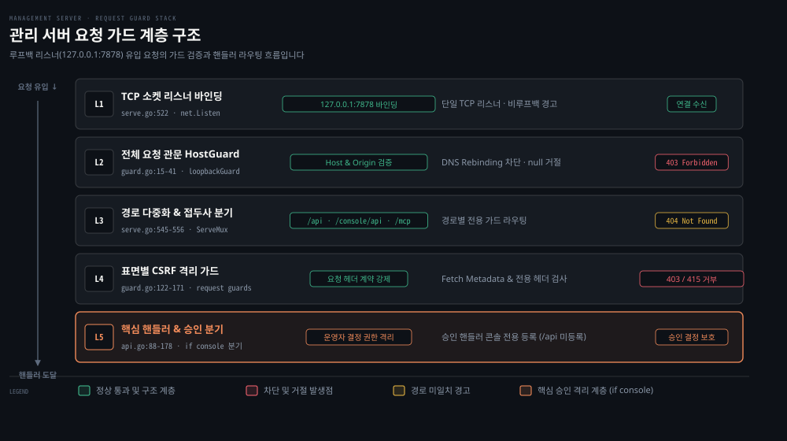
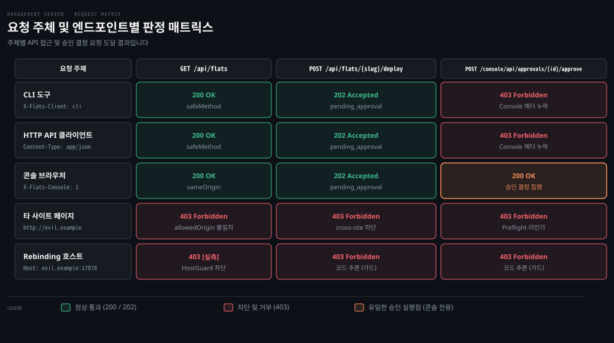

# management server·HostGuard·console

---

> 단일 TCP 리스너 상에서 CLI·에이전트·웹 브라우저를 동시에 수용하는 flats 관리 서버의 조립 구조와, `HostGuard`·`agentRequest`·`consoleRequest` 다층 가드를 통한 브라우저 공격 격리 및 승인 결정 보호 메커니즘을 다룹니다.


## 학습 목표와 범위

> 단일 루프백 리스너에서 구동되는 관리 데몬의 엔드포인트 격리 원리와 브라우저 보안 가드의 동작 순서를 이해하고 설명할 수 있습니다.

1. `127.0.0.1:7878` 단일 리스너 상에 `/api`, `/console/api`, `/mcp`, 그리고 콘솔 SPA 정적 파일이 어떤 순서로 조립되고 요청이 어느 가드를 거치는지 설명할 수 있습니다.
2. 동일한 코어 핸들러가 `/api`와 `/console/api` 두 접두사에 중복 등록되면서도 승인 결정(`approve`/`reject`) 엔드포인트가 왜 콘솔 접두사에만 존재하는지 코드 수준에서 분석할 수 있습니다.
3. 콘솔 프론트엔드가 변경 요청을 전송할 때 요구되는 커스텀 헤더와 Fetch Metadata 검증 조건을 식별하고 NetBird 평문 HTTP 환경에서 완화되는 보안 분기를 추적할 수 있습니다.
4. 관리 서버의 표준 JSON 오류 응답 구조(`ErrorBody`)와 상태 코드 매핑 규칙, 그리고 CLI 표준 종료 코드(0·1·2·3 및 ExitConfig 78)의 의미를 설명할 수 있습니다.
5. 요청 헤더 기반 가드가 방어하지 못하는 로컬 프로세스 신뢰 한계와 tailnet ACL 격리 완화책을 도출할 수 있습니다.

이 문서는 flats 관리 서버의 엔드포인트 라우팅과 요청 가드 체계를 다룹니다. 선행하는 기반 보안 개념은 [04-01.MCP·JSON-RPC·Same-origin·CSRF·DNS rebinding](04-01.MCP·JSON-RPC·Same-origin·CSRF·DNS%20rebinding.md)을 참고합니다. 구체적인 MCP 도구 등록과 가이드 시스템은 04-03 편에서, 운영자 신뢰 모델과 파라미터 동결 원리는 04-04 편에서 다룹니다.

기준 커밋 3abe537 (v0.11.0, 2026-10-17)


## 1. 문제와 표면 — 단일 리스너에 공존하는 서로 다른 신뢰 주체

> 단일 포트에 바인딩된 관리 서버는 로컬 CLI, 백그라운드 AI 에이전트, 그리고 운영자의 웹 브라우저를 동시에 상대해야 합니다.

로컬 관리 데몬은 개발자의 기계에서 동작합니다. 이 데몬은 물리적으로 분리된 여러 데몬을 띄우지 않고 단일 TCP 소켓(기본 `127.0.0.1:7878`)을 열어 그 위에서 모든 관리 트래픽을 처리합니다(`internal/app/serve.go:522`). 이 단일 포트에는 성격이 서로 다른 엔드포인트 네 가지가 함께 올라갑니다.

1. **에이전트 및 CLI API (`/api/`)**: AI 에이전트와 터미널 CLI 도구가 flats의 상태를 조회하고 새 리비전을 저장하거나 배포를 요구하는 HTTP REST 엔드포인트입니다.
2. **운영자 웹 콘솔 API (`/console/api/`)**: 브라우저 기반 대시보드 화면이 호출하는 관리 엔드포인트입니다.
3. **MCP 프로토콜 엔드포인트 (`/mcp`)**: AI 코딩 어시스턴트가 도구를 검색하고 실행하는 HTTP 엔드포인트입니다. JSON-RPC 2.0 기반이며 Stateless 및 `JSONResponse: true`로 동작합니다(`internal/mcpx/mcpx.go:33-34`).
4. **콘솔 정적 SPA (`/`)**: 바이너리에 내장된 HTML, CSS, JavaScript 단일 페이지 애플리케이션(SPA) 에셋입니다.

문제는 운영체제 커널의 소켓 관점에서는 이 포트로 들어오는 패킷의 발생 주체를 신뢰할 수 없다는 점입니다. 터미널의 개발자가 직접 입력한 CLI 명령의 패킷인지, 로컬에서 실행 중인 AI 에이전트의 호출인지, 브라우저 콘솔 탭의 정상적인 승인 클릭인지, 사용자가 방문한 외부 악성 웹페이지의 자바스크립트가 백그라운드에서 전송한 비인가 요청인지 구별되지 않습니다.

관리 서버가 단순히 엔드포인트를 열어두고 아무 검증 없이 요청을 받으면 악성 웹사이트가 사용자의 브라우저를 거쳐 로컬 API를 호출하는 크로스 사이트 요청 위조(CSRF)나 도메인 IP를 루프백으로 속이는 DNS Rebinding 공격에 노출됩니다. 반대로 브라우저 보안을 이유로 인증 토큰만 요구하면 로컬 터미널에서 곧바로 도구를 호출해야 하는 에이전트나 CLI의 사용성이 떨어집니다.

이 문제를 해결하기 위해 flats는 `docs/surfaces.md` 「Request guards」에 명시된 다층 가드 아키텍처를 설계했습니다. 모든 요청을 단일 관문인 `HostGuard`로 감싸 악의적인 호스트 위조를 가장 먼저 막습니다. 그 아래에서는 `/api`와 `/console/api` 접두사마다 다른 요청 헤더 계약을 강제해 브라우저 교차 출처 호출을 분리합니다.


## 2. 관리 서버의 조립 순서와 정적 콘솔 내장

> 단일 프로세스 내에서 여러 인터페이스를 충돌 없이 띄우려면 리스너와 핸들러의 초기화 순서가 엄격히 보장되어야 합니다.

포트 바인딩과 핸들러 등록 순서가 꼬이면 코어 서비스가 미처 확정되지 않은 주소를 참조하거나 보안 가드가 누락된 채 트래픽이 유입될 위험이 있습니다. flats는 이런 초기화 결함을 막으려고 정해진 조립 순서를 따릅니다(`internal/app/serve.go:520-566`).

1. **소켓 바인딩 (`net.Listen`)**: 가장 먼저 관리 리스너를 바인딩합니다(`internal/app/serve.go:522`). 코어 서비스가 시작 중에 콘솔 주소를 참조해야 하므로 실제 바인딩된 TCP 주소를 조기에 확정합니다(`internal/app/serve.go:526`).
2. **다중화기 구성 (`http.NewServeMux`)**: 공통 API 핸들러(`apiH`)를 생성해 `/api/`와 `/console/api/` 두 접두사에 각각 등록합니다. 이어서 `/mcp`와 LLM 경로(`mcpx.LLMsPaths`), 그리고 루트 경로(`/`)에 콘솔 핸들러를 연결합니다(`internal/app/serve.go:546-556`).
3. **루프백 검증 경고**: 바인딩된 리스너의 IP 주소가 루프백(`tcp.IP.IsLoopback()`)이 아닐 경우 보안 경고 로그를 남깁니다(`internal/app/serve.go:558-560`).
4. **루프백 가드 래핑 (`loopbackGuard`)**: 완성된 Mux 전체를 `loopbackGuard`로 감싸 `http.Server`의 최종 핸들러로 등록합니다(`internal/app/serve.go:561`).
5. **백그라운드 서빙 (`Serve`)**: 백그라운드 고루틴에서 HTTP 서빙 루프를 시작합니다(`internal/app/serve.go:562-566`).

```go
// internal/app/serve.go:545-556
apiSrv := &api.Server{Svc: svc, System: h}
mux := http.NewServeMux()
apiH := apiSrv.Handler()
mux.Handle("/api/", apiH)
mux.Handle("/console/api/", apiH)
mux.Handle("/mcp", mcpx.Handler(svc, mcpx.Options{Version: buildinfo.Get().Version}))
llms := mcpx.LLMsHandler(svc, mcpx.Options{Version: buildinfo.Get().Version})
for _, p := range mcpx.LLMsPaths {
	mux.Handle(p, llms)
}
mux.Handle("/", console.Handler())
h.Mux = mux
```

웹 콘솔은 별도의 프론트엔드 빌드 도구 없이 단일 바이너리에 완전히 내장됩니다(`internal/console/console.go:1-4`). Go 컴파일러의 `//go:embed static` 지시자로 정적 파일 트리를 바이너리 데이터 영역에 적재합니다(`internal/console/console.go:18-19`). 프로세스 시작 시 `load()` 함수가 모든 에셋의 SHA-256 해시를 계산해 ETag를 준비합니다(`internal/console/console.go:45-74`).

브라우저가 콘솔 화면을 열 때 외부 웹사이트의 프레임 삽입 공격(Clickjacking)을 막으려고 콘텐츠 보안 정책(CSP)을 강제합니다(`internal/console/console.go:24-25`). 모든 콘솔 응답에는 `frame-ancestors 'none'`과 `base-uri 'none'`을 포함하는 보안 헤더가 자동으로 붙습니다(`internal/console/console.go:106-112`).

```go
// internal/console/console.go:24-25
const CSP = "default-src 'self'; img-src 'self' data:; style-src 'self'; script-src 'self'; " +
	"frame-ancestors 'none'; base-uri 'none'; form-action 'self'"
```

콘솔 프론트엔드 자바스크립트는 동일 출처의 `/console/api` 경로로만 백엔드와 통신합니다(`internal/console/static/assets/js/api.js:4`). `api.js`의 `request` 함수는 모든 요청 헤더에 `X-Flats-Console: 1`을 명시적으로 추가합니다. `credentials: 'same-origin'` 옵션도 지정해 다른 출처로는 자격 증명이 새지 않도록 고정합니다(`internal/console/static/assets/js/api.js:18-19`).


## 3. HostGuard — DNS Rebinding과 교차 출처 원천 차단

> `HostGuard`는 모든 엔드포인트의 최전방에서 `Host` 헤더와 `Origin` 헤더를 검사하여 비인가 도메인 접근을 차단합니다.

`HostGuard`(`internal/api/guard.go:21-29`)는 관리 서버의 최상위 계층에 놓입니다. 요청이 Mux나 세부 API 핸들러로 넘어가기 전에 가장 먼저 실행되는 미들웨어입니다. `HostGuard`의 핵심 방어 대상은 **DNS Rebinding**입니다.

악성 웹사이트가 자신의 도메인 A 레코드 TTL을 극단적으로 짧게 설정한 뒤 첫 해석은 외부 서버로, 다음 해석은 `127.0.0.1`로 변경하더라도 브라우저는 원래 접속 도메인(예: `evil.example`)을 `Host` 헤더에 실어 보냅니다. `HostGuard`는 이 헤더 값을 검사해 403 Forbidden JSON 오류 응답을 반환합니다(`internal/api/guard.go:31-34`).

```go
// internal/api/guard.go:21-29
type HostGuard struct {
	Hosts func() []string
	Ports []string
	Next  http.Handler
}
```

`HostGuard` 구조체의 `Hosts` 필드는 정적 슬라이스가 아니라 함수(`func() []string`)로 선언되어 있습니다(`internal/api/guard.go:25`). tailnet 환경에서는 노드가 시작된 이후에 MagicDNS FQDN이 동적으로 할당되거나 변경될 수 있습니다. `HostGuard`는 매 요청마다 `Hosts()` 함수를 호출하므로(`internal/api/guard.go:62`) 데몬을 재시작하지 않고도 새로 학습된 도메인 이름을 곧바로 허용 목록에 반영합니다.

루프백 리스너에서 `loopbackGuard`가 생성하는 기본 허용 목록은 `docs/design.md` 「Approvals」 Enforced 둘째 항목에 명시된 규칙을 따릅니다.
1. `127.0.0.1`
2. `localhost`
3. `::1` (IPv6 루프백)
4. 명시적으로 지정된 특정 리슨 IP 주소(`internal/app/serve.go:675-677`)

`HostGuard.ServeHTTP`는 두 단계로 판정합니다.

```go
// internal/api/guard.go:31-41
func (g *HostGuard) ServeHTTP(w http.ResponseWriter, r *http.Request) {
	if !g.allowed(r.Host) {
		writeErr(w, http.StatusForbidden, fmt.Errorf("Host %q is not an address of this Flats server (DNS rebinding protection); use the console URL or the loopback address", r.Host))
		return
	}
	if o := r.Header.Get("Origin"); o != "" && !g.allowedOrigin(o) {
		writeErr(w, http.StatusForbidden, fmt.Errorf("cross-origin request from %q refused: only the Flats console itself may call this server from a browser", o))
		return
	}
	g.Next.ServeHTTP(w, r)
}
```

첫째 검사는 `g.allowed(r.Host)`입니다(`internal/api/guard.go:54-68`). `splitHost` 함수가 `Host` 문자열에서 포트를 분리하고 호스트명을 소문자로 정규화합니다(`internal/api/guard.go:44-52`).

요청의 포트(비어 있는 기본 포트 포함)는 허용된 포트 목록(`g.Ports`)에 속해야 합니다(`internal/api/guard.go:59`). 예를 들어 80번 포트 리스너는 빈 문자열 `""`도 포트 목록에 등록합니다(`internal/app/serve.go:679-682`). 호스트명은 대소문자를 무시하고(`strings.EqualFold`) 허용 목록과 일치해야 합니다. 일치하지 않으면 403 Forbidden 오류와 함께 DNS Rebinding 보호 문구를 반환합니다.

로컬 실측(2026-10-18)에서도 이 동작을 확인했습니다. 임시 호스트(`127.0.0.1:17878`)에 비인가 `Host: evil.example:17878`을 실어 `GET /api/flats`를 호출했습니다. 이때 `HostGuard`는 403 Forbidden 오류(`Host "evil.example:17878" is not an address of this Flats server (DNS rebinding protection); …`)를 반환했습니다. 올바른 루프백 Host로 요청했을 때는 200 OK 응답이 돌아왔습니다.

둘째 검사는 브라우저가 보내는 `Origin` 헤더를 확인하는 `g.allowedOrigin(o)`입니다(`internal/api/guard.go:70-76`). URL 파싱을 거쳐 스킴이 `http` 또는 `https`가 아니거나 경로가 있거나 사용자 정보가 들어 있으면 즉시 거절합니다.

로컬 HTML 파일이나 샌드박스 iframe이 보내는 불투명한 출처 `"null"`(`Origin: null`)은 이 파싱 단계에서 유효하지 않은 스킴으로 분류되어 차단됩니다(`internal/api/guard.go:73`). 파싱된 오리진의 호스트 역시 `g.allowed`를 통과해야 합니다. `Origin` 헤더가 실린 외부 도메인의 교차 출처 호출은 이렇게 1차 관문인 `HostGuard`에서 걸러집니다. `Origin` 헤더가 없는 단순 탐색 등은 하위 `agentRequest` 가드의 `Sec-Fetch-Site` 검사가 막아 2단 방어를 이룹니다.


## 4. 두 접두사 — `/api`와 `/console/api`의 가드 분기와 승인 격리

> 에이전트용 API와 브라우저용 콘솔이 같은 리스너에 열려 있으면 웹페이지가 관리 기능을 무단 호출하는 위협이 발생합니다.

에이전트용 API와 브라우저용 콘솔이 한 리스너를 함께 쓰면 웹페이지가 관리 기능을 무단으로 호출하는 보안 위협에 노출됩니다. flats는 두 표면의 권한을 안전하게 격리하려고 공통 라우팅 계층에서 접두사별 전용 가드를 적용합니다. 승인 실행 엔드포인트는 콘솔 접두사에만 등록합니다.

### 접두사별 라우팅과 요청 가드 분기

서버가 구동될 때 `api.Server.Handler()`는 `/api`와 `/console/api` 두 접두사를 순회하며 라우팅 테이블을 구성합니다(`internal/api/api.go:88-89`). 공통 라우팅 래퍼는 요청이 어느 접두사로 들어왔는지에 따라 다른 가드 함수를 실행합니다(`internal/api/api.go:92-110`).

```go
// internal/api/api.go:92-110
mux.HandleFunc(method+" "+prefix+path, func(w http.ResponseWriter, r *http.Request) {
	via := core.ViaAPI
	if console {
		if err := consoleRequest(r); err != nil {
			writeErr(w, http.StatusForbidden, err)
			return
		}
		via = core.ViaConsole
	} else {
		if code, err := agentRequest(r); err != nil {
			writeErr(w, code, err)
			return
		}
		if r.Header.Get("X-Flats-Client") == "cli" {
			via = core.ViaCLI
		}
	}
	fn(w, r, via)
})
```

`/api` 접두사로 들어온 요청은 **`agentRequest`** 가드를 통과해야 합니다(`internal/api/guard.go:122-137`).
1. **Fetch Metadata 차단**: 브라우저가 보낸 `Sec-Fetch-Site` 헤더가 `cross-site` 또는 `same-site`이면 403 Forbidden을 반환합니다(`internal/api/guard.go:123-126`). 일반 CLI 도구나 에이전트는 이 헤더를 보내지 않으므로 통과합니다.
2. **동일 출처 검사**: `Origin` 헤더가 있으면 요청된 호스트와 같은지 `sameOrigin(r)`으로 검증합니다(`internal/api/guard.go:127-129`).
3. **세이프 메서드 및 클라이언트 식별**: `GET`, `HEAD`, `OPTIONS` 같은 안전한 조회 메서드이면 즉시 통과합니다(`internal/api/guard.go:100-102`). `X-Flats-Client` 헤더(예: `cli`)가 명시되어 있어도 즉시 허용합니다(`internal/api/guard.go:130-132`).
4. **CORS-safelisted 방어**: 상태 변경 요청(POST, PUT, DELETE)에 클라이언트 헤더가 없으면 `Content-Type`이 `bodyTypes`에 속해야 합니다(`internal/api/guard.go:107-111,133-135`). 브라우저는 이 타입 전송 시 Preflight를 보냅니다. flats는 Preflight를 허용하지 않으므로 웹페이지 호출이 차단됩니다(위반 시 415 반환, `guard.go:136`).

`/console/api` 접두사로 들어온 요청은 **`consoleRequest`** 가드를 거칩니다(`internal/api/guard.go:144-171`).
1. **전용 헤더 요구**: `X-Flats-Console: 1` 커스텀 헤더를 포함해야 합니다(`internal/api/guard.go:145-147`).
2. **외부 클라이언트 배제**: `X-Flats-Client` 헤더가 존재하면 403 Forbidden으로 거절합니다(`internal/api/guard.go:148-150`). CLI나 MCP 클라이언트가 콘솔 전용 엔드포인트를 호출하는 것을 차단합니다.
3. **엄격한 동일 출처**: `sameOrigin(r)`이 거짓이면 즉시 403을 반환합니다(`internal/api/guard.go:151-153`).
4. **브라우저 변경 컨텍스트 강제**: 조회 메서드가 아닌 변경 요청은 브라우저가 보낸 `Sec-Fetch-Site: same-origin` 헤더와 유효한 `Origin` 헤더를 동시에 지녀야 합니다(`internal/api/guard.go:167-170`).



### 엔드포인트 격리와 승인 결정 매트릭스

두 접두사는 엔드포인트 등록 여부에서 갈립니다. `internal/api/api.go:112-148`의 공통 경로(상태 조회, flat 목록, 초안 저장, 버전 생성, 배포 요청 등)는 두 접두사 모두에 등록됩니다. `if console` 조건문(`internal/api/api.go:149-175`) 아래에 있는 엔드포인트는 `/console/api` 아래에만 존재합니다.

```go
// internal/api/api.go:149-152
if console {
	h("POST /approvals/{id}/approve", s.decide(true))
	h("POST /approvals/{id}/reject", s.decide(false))
	h("POST /flats/{slug}/name", s.setName)
...
} else {
	h("POST /flats", s.createFlat)
}
```

이 구조는 `docs/design.md` 「Approvals」 Enforced 첫 항목에 적힌 공식 설계 원칙과 일치합니다.
> "MCP, the CLI and `/api` have no approve, reject or settings operation, and their approval-gated calls only create approvals."

에이전트나 CLI가 접근하는 `/api` 표면에는 승인을 수락(`approve`)하거나 거절(`reject`)하는 라우트 자체가 바인딩되지 않습니다. CLI나 에이전트가 배포를 요구해도 배포는 즉시 수행되지 않습니다. 그 대신 승인 대기 객체(`pending_approval`)가 생성되고 HTTP 202 Accepted 응답이 돌아옵니다(`internal/api/api.go:270-275`). 동일 출처 브라우저 검증을 통과한 콘솔만 `POST /console/api/approvals/{id}/approve`를 호출해 승인을 집행할 수 있습니다.

아래 매트릭스는 목록 조회(`GET /api/flats`), 배포 요청(`POST /api/flats/{slug}/deploy`), 그리고 승인 집행(`POST /console/api/approvals/{id}/approve`)의 주체별 접근 결과를 대조합니다.

| 요청 주체 | 식별 헤더 | `GET /api/flats` | `POST /api/flats/{slug}/deploy` | `POST /console/api/approvals/{id}/approve` | 판정 근거 및 차단 지점 |
| :--- | :--- | :--- | :--- | :--- | :--- |
| **CLI 도구** | `X-Flats-Client: cli` | 200 OK | 202 Accepted | 403 Forbidden | `agentRequest` 통과, 승인은 `consoleRequest`에서 `X-Flats-Console` 누락(및 CLI 헤더 배제)으로 거부 |
| **HTTP API 클라이언트** | `Content-Type: application/json` | 200 OK | 202 Accepted | 403 Forbidden | `bodyTypes` 충족으로 대기 생성, 콘솔 승인은 `X-Flats-Console` 누락으로 차단 |
| **콘솔 브라우저** | `X-Flats-Console: 1` | 200 OK | 202 Accepted | 200 OK | `Sec-Fetch-Site: same-origin` 및 `Origin` 일치로 유일하게 승인 집행 가능 |
| **타 사이트 웹페이지** | `Origin: http://evil.example` | 403 Forbidden | 403 Forbidden | 403 Forbidden | `allowedOrigin` 불일치, `cross-site` 차단, Preflight 미인가 |
| **Rebinding 호스트** | `Host: evil.example:17878` | 403 Forbidden | 403 Forbidden | 403 Forbidden | `HostGuard` 최전방에서 차단 (GET은 로컬 실측 2026-10-18, POST는 코드 추론) |




## 5. 콘솔 도메인 — Tailscale HTTPS, NetBird 평문 HTTP, 그리고 Approver 기록

> 콘솔은 로컬 루프백뿐 아니라 사설 오버레이 네트워크(Tailscale, NetBird) 노드로 확장될 수 있으며, 네트워크 특성에 맞춰 보안 검증 분기와 감사 신원이 결정됩니다.

관리 서버 콘솔은 원격 기기에서도 안전하게 대시보드에 접근할 수 있도록 가상 사설망(VPN) 오버레이 상에 노드를 노출할 수 있습니다(`docs/networking.md` 「Running the console on Tailscale」). 이 기능은 `internal/app/consoledomains.go`에 구현되어 있으며 지원하는 네트워크 제공자에 따라 서로 다른 전송 계층 특성을 다룹니다.

Tailscale 콘솔 도메인(`tsConsole`)은 flats에 임베디드된 `tsnet` 엔진을 사용해 도메인별 독립 노드를 기동합니다(`internal/app/consoledomains.go:80-97`). Tailscale 환경은 인증서 기반의 종단간 HTTPS를 제공하므로 포트 80과 443을 모두 수용합니다(`internal/app/consoledomains.go:114`).

NetBird 콘솔 도메인(`nbConsole`)은 이와 달리 평문 HTTP(포트 80)로 구동됩니다(`internal/app/consoledomains.go:116-162`). 여기서 웹 보안 문제가 생깁니다. 최신 웹 브라우저는 잠재적으로 신뢰할 수 없는 일반 도메인의 평문 HTTP 통신(루프백이 아닌 NetBird 도메인 HTTP)에서는 Fetch Metadata(`Sec-Fetch-Site`)를 전송하지 않습니다. `/console/api`가 `Sec-Fetch-Site: same-origin`만 고집하면 NetBird 환경의 콘솔에서는 변경 작업이 전부 거부됩니다.

flats는 이 문제를 풀려고 `PlainHTTPConsole` 미들웨어를 도입했습니다(`internal/api/guard.go:179-188`). 이 미들웨어는 NetBird 콘솔 리스너에만 장착되어 요청 컨텍스트에 플래그를 심어 둡니다.

```go
// internal/api/guard.go:157-166
site := r.Header.Get("Sec-Fetch-Site")
if site == "" && plainHTTPConsole(r) {
	// Browsers send Fetch Metadata only to secure origins; a NetBird
	// console domain is plain HTTP. The custom header above already needs
	// a CORS preflight from any other origin, which is never granted;
	// require the page's own http Origin as well.
	if u, err := url.Parse(r.Header.Get("Origin")); err == nil && u.Scheme == "http" && sameOrigin(r) {
		return nil
	}
}
```

브라우저가 `Sec-Fetch-Site`를 누락해도 예외 처리가 동작합니다. 해당 요청이 `PlainHTTPConsole` 리스너를 통과하고 `Origin` 스킴이 `http`이며 대상 호스트와 일치하면 변경을 허용합니다. 이때 `X-Flats-Console: 1` 헤더가 타 출처의 무단 호출 시 Preflight를 강제하므로 보안 강도는 유지됩니다.

콘솔에서 승인을 결정할 때 감사 추적용으로 결정 주체(`decided_by`)를 기록하는 방식도 네트워크마다 다릅니다(`internal/api/api.go:872-891`).

1. **Tailscale 콘솔 (`TailnetIdentity`)**: `tsnet` 노드가 WhoIs 조회를 수행합니다. tsnet identity 미들웨어가 클라이언트 전송 `Tailscale-User-*` 헤더를 제거한 뒤, WhoIs로 확인된 Tailscale 로그인 계정(예: `alice@example.com`)을 `Tailscale-User-Login` 헤더에 설정합니다. `TailnetIdentity`(`internal/api/guard.go:208-218`)는 이 헤더를 읽어 요청 컨텍스트에 기록합니다.
2. **NetBird 콘솔 (`WithApprover`)**: NetBird 연결 피어의 IP 주소를 역조회합니다. 해당 피어의 FQDN을 식별한 뒤 `netbird:<fqdn>` 문자열을 기록합니다(`internal/app/consoledomains.go:151-160`).
3. **로컬 루프백 콘솔**: 루프백 리스너에서는 별도의 Tailnet 신원 정보가 없으므로 `who == ""`로 비워집니다. 이벤트 로그에는 `the console on the loopback listener (no tailnet identity)`로 기록됩니다(`internal/api/api.go:884-887`).

이 감사 정보는 승인 결과 DTO의 `decided_by` 필드에 담겨 반환되며 이벤트 저장소에 보관됩니다. 단, 승인된 삭제(`delete`) 액션은 flat과 함께 이벤트도 즉시 삭제되므로 응답 바디에만 기록됩니다(`internal/api/api.go:881-883`, `docs/design.md:506-508`).

공식 문서 `README.md:127-128`은 관리 콘솔 포트를 노출하지 말라고 경고합니다.
> "Never publish the console port to your network: anything that reaches it can approve deploys."

관리 서버의 루프백 포트는 오버레이 네트워크가 통제하는 격리된 인터페이스가 아닌 공용 LAN 등에 직접 포트포워딩되어서는 안 됩니다. 소켓에 도달할 수 있는 모든 주체는 잠재적으로 콘솔 헤더를 모방할 수 있기 때문입니다.


## 6. 오류 응답의 모양과 CLI 종료 코드 규칙

> flats는 구조화된 JSON 에러 바디를 통해 거절 사유를 기계 판독 가능한 형태로 제공하며, CLI는 표준 종료 코드(0·1·2·3 및 ExitConfig 78)로 실행 상태를 요약합니다.

관리 서버에서 오류가 나면 클라이언트로 돌아가는 응답 바디는 일관된 JSON 객체 구조를 갖습니다(`internal/api/api.go:185-190`).

```json
{
  "error": "conflict: stale approval: draft hash changed",
  "category": "stale_approval"
}
```

`ErrorBody` 구조체는 사람이 읽을 수 있는 요약 문장인 `error`와 함께 머신 분류용 `category` 코드를 반환합니다. `problems`와 `health` 필드는 `omitempty` 태그가 붙어 있습니다(`internal/api/api.go:187-189`). 번들 검증 실패(`problems`)나 런타임 헬스체크 실패(`health`)가 발생했을 때만 응답에 포함되고 평소에는 생략됩니다(`internal/api/api.go:207-227`).

`writeErr`와 `statusOf` 함수(`internal/api/api.go:229-268`)는 Go 내부 에러 객체를 HTTP 상태 코드로 매핑합니다(`docs/surfaces.md` 「Errors and status codes」).

| HTTP 상태 코드 | flats 에러 센티널 및 상황 | 의미와 동작 |
| :--- | :--- | :--- |
| **202 Accepted** | `core.PendingApproval` | 승인 대기 객체가 생성됨. 응답에 `status: "pending_approval"`과 `approval_url` 반환 |
| **400 Bad Request** | `core.ErrInvalid`, `slug.ErrInvalid` | 잘못된 slug 형식, 유효하지 않은 요청 파라미터 |
| **403 Forbidden** | `core.ErrForbidden`, 가드 거절 | `HostGuard` 도메인 불일치, `agentRequest` 교차 출처, 콘솔 헤더 위반 |
| **404 Not Found** | `store.ErrNotFound` | 대상 flat 또는 버전, 승인 ID가 데이터베이스에 존재하지 않음 |
| **409 Conflict** | `core.ErrConflict`, `core.ErrStaleApproval` | 변경 전 파라미터 충돌, 동결된 해시 불일치, 허용되지 않은 제공자 |
| **412 Precondition Failed** | `core.ErrConfigChanged` | 호스트가 읽은 뒤 `config.json`이 디스크에서 변경되었거나 콘솔 화면이 낡음 |
| **415 Unsupported Media Type** | `errNoClient` | 상태 변경 `/api` 요청에 JSON/아카이브 타입 또는 `X-Flats-Client` 헤더가 없음 |
| **422 Unprocessable Entity** | `core.DeployError`, 번들 검증 | 런타임 기동 실패(`runtime_start_failed`) 또는 헬스체크 실패(`health_check_failed`) |
| **500 Internal Server Error** | 미처리 내부 에러 | 호스트 데몬 내부 예외 발생 |

터미널에서 사용자가 실행하는 CLI 도구는 명령어 실행 결과와 API 오류를 프로세스 종료 코드(Exit Code)로 매핑해 반환합니다. 종료 코드는 `internal/cli/cli.go:55-62`에 정의되어 있으며 종료 처리기 `a.finish`(`internal/cli/cli.go:257-298`)와 승인 대기 반환부(`internal/cli/commands.go:577`)에서 설정됩니다. `flats help` 명령어의 마지막 줄(`internal/cli/cli.go:337`)에도 이 규칙이 명시되어 있습니다.

```markdown
Run `flats help <command>` for details. Exit codes: 0 ok, 1 error, 2 usage, 3 pending approval.
```

- **0 (ExitOK)**: 요청이 완전히 성공하여 상태 변경이 즉시 반영됨.
- **1 (ExitError)**: 충돌, 권한 부족, 서버 거절 등 일반적인 에러 발생.
- **2 (ExitUsage)**: 잘못된 플래그 입력 등 커맨드라인 사용법 오류.
- **3 (ExitPending)**: 요청이 승인 게이트에 도달하여 보류 승인(`pending_approval`)이 생성됨.
- **78 (ExitConfig)**: 호스트 설정 파일 오류 등 운영자의 설정 수정이 필요한 경우(sysexits `EX_CONFIG`; `internal/cli/cli.go:61`, 도움말 요약행에는 미포함).

로컬 실측(2026-10-18)에서 새 버전 생성 명령을 실행했을 때의 출력에 종료 코드 3의 동작이 드러납니다.
```bash
flats --url http://127.0.0.1:17878 create-version rt-probe --revision 1 --hash 158b8a0d…
This action needs the operator's approval. Share the approval link with them; nothing changes until they approve it in the web console.
Status: pending_approval
Approval needed: http://127.0.0.1:17878/approvals/apr-<id>
Approval apr-<id> is waiting for the operator; check with `flats approvals`.
```
이때 프로세스는 즉시 종료 코드 3을 반환합니다. 요청된 해시 파라미터는 승인 레코드에 동결되며 운영자가 콘솔에서 승인할 때까지 아무것도 바뀌지 않습니다.


## 7. 이 가드가 막지 못하는 것과 신뢰 경계

> 요청 가드는 브라우저 교차 출처 공격을 차단하는 CSRF 방어선일 뿐이며, 운영자 기기에서 임의의 HTTP 요청을 전송할 수 있는 로컬 프로세스는 콘솔을 모방할 수 있습니다.

`HostGuard`, `agentRequest`, `consoleRequest` 다층 방어는 브라우저 격리를 이룹니다. 그러나 공식 문서 `docs/design.md` 「Approvals」 Not enforced 문단이 밝히듯 보안 한계가 있습니다.

> "Not enforced: all of the console checks are request headers. A process that can send arbitrary HTTP from one of the operator's devices (for example an agent with a shell on the Flats host, or on a device the tailnet or NetBird access policy lets reach a console domain) can imitate the console page and approve or act directly, and a process that can read the Flats data directory can read the database and secret key. There is no separate operator credential, so an approval does not prove that a human decided."

모든 검증은 HTTP 요청 헤더(`X-Flats-Console: 1`, `Origin`, `Sec-Fetch-Site`)에 기반합니다. 브라우저 샌드박스 내부의 웹페이지는 브라우저 엔진의 제약 때문에 이 헤더들을 위조할 수 없습니다.

반면 브라우저 밖에서 운영자 계정으로 실행되는 프로세스에는 이런 제약이 없습니다. 공식 문서가 적은 그대로 운영자 기기에서 임의의 HTTP 를 보낼 수 있는 프로세스는 콘솔 페이지를 흉내 낼 수 있습니다. 서버는 그 요청을 콘솔과 구별할 수단을 갖고 있지 않습니다.

이 가드들은 MCP·CLI·API 만 쓰는 에이전트와 다른 사이트의 웹 페이지를 막도록 설계됐습니다. 운영자 계정에서 도는 임의의 코드까지 막도록 설계되지는 않았습니다.

또한 flats 데이터 디렉토리에 읽기 권한이 있는 로컬 프로세스는 SQLite 데이터베이스(`flats.db`)와 암호화 시크릿 키를 직접 열람할 수 있습니다. flats에는 별도의 비밀번호나 다중 인증(MFA) 같은 운영자 전용 크리덴셜 체계가 없으므로 승인이 완료되었다는 사실 자체가 "물리적인 인간 운영자가 직접 검토하고 승인했다"는 암호학적 증명이 되지는 못합니다.

공식 문서는 이 한계를 완화하는 인프라 레벨 격리 대책 두 가지를 권고합니다.
1. **사설망 접근 제어**: Tailscale ACL 또는 NetBird 접근 정책을 구성해 콘솔 도메인 포트에는 운영자가 소유한 신뢰된 브라우저 디바이스만 도달할 수 있도록 통제합니다.
2. **에이전트 권한 분리**: 공식 문서는 신뢰할 수 없는 에이전트를 다른 OS 사용자 계정이나 다른 기계("another OS user or on another machine", `docs/design.md:524-525`)에서 실행할 것을 권고합니다. 컨테이너나 VM 격리 역시 이 원칙의 연장선입니다. 이렇게 분리하면 에이전트가 루프백 소켓에 임의의 헤더를 날리거나 flats 데이터 폴더를 직접 읽지 못하게 막고 제한된 MCP 도구나 `/api` 인터페이스로만 대화하도록 격리합니다.


## 8. 한계와 실패 표

> 각 가드 계층의 검증 대상과 차단 메커니즘, 그리고 위반 시 반환되는 상태 코드와 실패 양상을 요약합니다.

| 가드 계층 | 소스 위치 | 검증 대상 헤더 | 방어하는 위협 | 위반 시 상태 코드 | 실패 메시지 및 양상 | 잔여 한계 |
| :--- | :--- | :--- | :--- | :--- | :--- | :--- |
| **`HostGuard`** | `guard.go:15-41` | `Host`, `Origin` | DNS Rebinding, 허가되지 않은 도메인 유입 | **403 Forbidden** | `Host "..." is not an address of this Flats server` | 로컬 프로세스는 막지 못함 |
| **`agentRequest`** | `guard.go:122-137` | `Sec-Fetch-Site`, `Origin`, `Content-Type` | 웹페이지의 `/api` CSRF 호출, 단순 Form 제출 | **403 / 415** | `cross-site browser requests to the Flats API are refused` / `requests that change something must send Content-Type: application/json` | 비브라우저 도구(curl, CLI)는 헤더 위조 가능 |
| **`consoleRequest`** | `guard.go:144-171` | `X-Flats-Console`, `X-Flats-Client`, `Sec-Fetch-Site`, `Origin` | 타 웹사이트의 콘솔 승인 조작, CLI의 승인 직교 호출 | **403 Forbidden** | `console endpoints only accept requests from the Flats web console` / `console endpoints do not accept the CLI` | 쉘 권한 프로세스의 콘솔 헤더 전송 방어 불가 |
| **`PlainHTTPConsole`** | `guard.go:179-188` | 컨텍스트 플래그, `Origin` (`http`) | NetBird 평문 환경에서 Fetch Metadata 누락 오작동 | **정상 완화** | 평문 HTTP에서 동일 출처 `http` 스킴 Origin만 조건부 수용 | 피어 간 WireGuard 암호화되나 브라우저 비보안 컨텍스트(non-secure context) 제약 잔존 |
| **`TailnetIdentity`** | `guard.go:208-218` | `Tailscale-User-Login` (WhoIs 검증) | 원격 콘솔 승인자의 신원 위조 및 책임 부인 | **신원 기록** | 클라이언트 전송 헤더 파기 후 WhoIs 신원만 컨텍스트에 주입 | 로컬 루프백 접속 시 신원 없음(`who == ""`) |


## 리뷰 노트

> 코드베이스 분석 중 확인한 구현 세부 사항과 설계 의문, 문서 대조 결과를 기록합니다.

- `internal/app/serve.go:388-390`: 과거 설정의 운영자 크리덴셜 파일(`credentials.operator_file`, `--operator-credential-*`)은 코드에서 무시되며 경고만 남깁니다. 콘솔 결정이 same-origin 검사에만 의존함을 확인했습니다.
- `internal/api/guard.go:70-76`: `allowedOrigin`은 불투명 출처(`Origin: null`)를 거절할 때 `url.Parse` 후 스킴이 `http`/`https`인지 검사합니다. 유효 스킴이 아니면 즉시 `false`를 반환해 차단합니다.
- `internal/api/api.go:176`: 엔드포인트 목록 중 유일하게 `POST /flats`(새 빈 플랫 생성)만 `else` 블록에 속해 있어 `/api` 접두사에서만 호출 가능하고 `/console/api`에는 마운트되지 않습니다. 소스 주석에는 이유가 명시되어 있지 않으나, 콘솔 화면이 플랫을 직접 생성하기보다 초안 저장과 배포 승인 흐름 위주로 구성되어 있기 때문인 것으로 추론됩니다.
- 이 편 범위에서 공식 문서와 코드 간 불일치는 발견되지 않았습니다.


## 자가 점검 질문

1. `HostGuard` 구조체의 `Hosts` 필드가 슬라이스(`[]string`)가 아닌 함수(`func() []string`)로 선언된 기술적 이유는 무엇입니까?
2. `/api`와 `/console/api`는 동일한 `api.Server` 인스턴스를 공유하는데, 왜 CLI 도구나 HTTP API 클라이언트는 `POST /approvals/{id}/approve`를 호출하여 승인을 완료할 수 없습니까?
3. NetBird 콘솔 도메인에서 브라우저가 `Sec-Fetch-Site` 헤더를 보내지 않는 원인은 무엇이며 flats는 보안을 유지하면서 이를 어떻게 처리합니까?
4. 로컬 터미널에서 `flats create-version` 명령을 실행했을 때 프로세스가 종료 코드 3(ExitPending)을 반환하는 조건과 의미는 무엇입니까?
5. 공식 문서는 콘솔 가드가 운영자 계정에서 도는 임의의 프로세스를 막지 못한다고 적습니다. 가드가 기대는 전제가 무엇이기에 그런가요?


## 정답 (자답 후 펼치기)

1. Tailscale과 같은 오버레이 네트워크 환경에서는 노드가 부팅된 이후에 컨트롤 플레인으로부터 MagicDNS FQDN이나 호스트 별칭이 동적으로 할당됩니다. 함수형 클로저로 매 HTTP 요청마다 호스트 목록을 동적으로 평가해 프로세스 재기동 없이도 새로 학습된 도메인 이름을 곧바로 허용 목록에 반영하려는 것입니다.
2. 두 가지 장벽 때문입니다. 첫째, 라우팅 등록 단계(`internal/api/api.go:149-152`)에서 승인 핸들러(`POST /approvals/{id}/approve` 및 `reject`)는 `if console` 블록에서 `/console/api`에만 등록됩니다. 둘째, `/console/api`로 직접 호출하더라도 `consoleRequest` 가드가 `X-Flats-Client` 존재, `X-Flats-Console` 누락을 감지해 403 Forbidden으로 거부합니다.
3. 브라우저 보안 명세상 Fetch Metadata(`Sec-Fetch-Site` 등)는 잠재적으로 신뢰할 수 있는 URL(HTTPS 및 `http://127.0.0.1`·`localhost` 등)로 향하는 요청에만 주입됩니다. 일반 도메인 이름을 사용하는 NetBird 콘솔 도메인은 평문 HTTP로 구동되어 비신뢰 출처로 분류되기 때문입니다. flats는 `PlainHTTPConsole` 미들웨어로 해당 리스너에 들어온 요청에 컨텍스트 플래그를 달아둡니다. `Sec-Fetch-Site`가 비어있더라도 `Origin`이 `http` 스킴이며 요청 Host와 정확히 일치하는 `sameOrigin` 상태라면 조건부 허용합니다. 다른 출처에서 온 요청은 여전히 `X-Flats-Console: 1` 커스텀 헤더 때문에 브라우저의 Preflight 검증에 걸려 차단됩니다.
4. 해당 작업이 승인 게이트 대상(버전 생성, 배포, 롤백, 공개 범위 변경 등)이어서 즉시 집행되지 않고 보류 승인 객체(`pending_approval`)가 생성되었음을 의미합니다. 서버는 HTTP 202 Accepted와 함께 승인 URL을 반환합니다. CLI는 파라미터가 동결된 채 운영자의 웹 콘솔 승인을 기다리는 상태를 운영체제에 알리려고 예약된 종료 코드 `ExitPending = 3`으로 종료합니다.
5. 콘솔 가드는 "브라우저 안의 다른 사이트 페이지는 특정 헤더를 마음대로 붙이거나 Fetch Metadata 를 바꿀 수 없다"는 브라우저의 제약을 전제로 합니다. 브라우저 밖에서 운영자 계정으로 도는 프로세스에는 이 제약이 없습니다. flats 에는 운영자만 가진 별도 자격 증명도 없어서 그런 요청을 콘솔과 구별하지 못합니다(`docs/design.md` 「Approvals」 Not enforced). 그래서 공식 문서는 신뢰하지 않는 에이전트를 다른 OS 사용자나 다른 기계에서 MCP·API 로만 붙이라고 권합니다.
