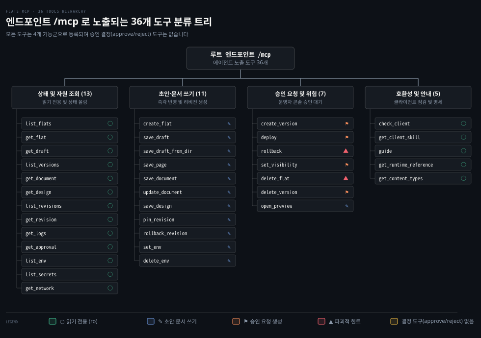
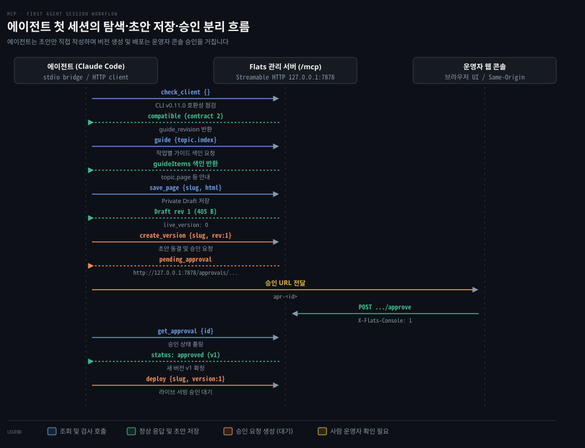

# MCP tools·guide·plugin

---

> Claude Code, Codex, Cursor 등 인공지능 코딩 에이전트가 flats 관리 서버와 상호작용하는 MCP 도구 36개의 분류 체계와 어노테이션, 온디맨드 안내 시스템(guide·llms.txt), stdio 릴레이 다리(mcpBridge), 그리고 승인 결정 분리 기반의 권한 경계를 다룹니다.


## 학습 목표와 범위

> 에이전트와 flats 호스트 간의 MCP 연동 구조와 권한 통제 메커니즘을 이해하고 설명할 수 있습니다.

1. 플러그인(`flats mcp` stdio 릴레이) 방식과 직접 HTTP 엔드포인트(`http://127.0.0.1:7878/mcp`) 등록 방식의 차이를 분석하고 원격 호스트 연결(`flats connect`)의 저장 원리를 설명할 수 있습니다.
2. flats가 에이전트에게 노출하는 36개 MCP 도구의 4대 기능 분류(상태 조회, 초안·문서 쓰기, 승인 요청 생성, 호환성 안내)와 어노테이션(`ReadOnlyHint`, `DestructiveHint`) 체계를 식별할 수 있습니다.
3. 도구 목록에 승인 결정(`approve`, `reject`) 도구가 원천적으로 존재하지 않는 설계 이유를 파악하고 에이전트가 승인 URL을 수신했을 때의 프로토콜 동작을 설명할 수 있습니다.
4. 에이전트 세션이 시작될 때 실행되는 3단계 탐색 흐름(`check_client` → `guide` → `get_runtime_reference`)과 `llms.txt`의 주소 해석 메커니즘을 추적할 수 있습니다.
5. stdio 다리(`mcpBridge`)가 `initialize` 핸드셰이크에서 CLI 버전과 계약 번호를 주입하는 원리와, 동일 OS 셸 권한을 가진 에이전트에 대한 로컬 신뢰 한계를 도출할 수 있습니다.

이 문서는 flats의 MCP 도구 구현체와 클라이언트 연동 규격을 다룹니다. 기반 통신 프로토콜 및 브라우저 격리 원리는 [04-01.MCP·JSON-RPC·Same-origin·CSRF·DNS rebinding](04-01.MCP·JSON-RPC·Same-origin·CSRF·DNS%20rebinding.md)을, 관리 서버의 다층 가드 아키텍처는 [04-02.management server·HostGuard·console.md](04-02.management%20server%C2%B7HostGuard%C2%B7console.md)를 참고합니다. 운영자 승인 상태 머신과 파라미터 동결의 세부 수학적 증명은 04-04 편에서 다룹니다.

기준 커밋 3abe537 (v0.11.0, 2026-10-17)


## 1. 문제 — 에이전트 연동의 세 가지 장벽과 flats의 접근법

> 인공지능 코딩 에이전트에게 로컬 개발 머신의 호스팅 권한을 부여할 때 호스트 주소 파편화, 자율 권한 오남용, 그리고 가이드 버전 불일치라는 세 가지 장벽이 발생합니다.

개발 환경에서 동작하는 AI 어시스턴트(Claude Code, Codex, Cursor 등)가 생성한 웹사이트나 서버 애플리케이션을 개발자 본인의 컴퓨터에 즉시 띄우고 테스트하려면 에이전트가 호스트 데몬과 대화할 수 있는 인터페이스가 필요합니다. 하지만 실제 환경에서는 다음 기술적 문제가 생깁니다:

첫째, **호스트 연결 설정의 파편화**입니다. 각 에이전트 클라이언트는 MCP 서버를 등록하는 설정 파일 형식(`.mcp.json`, `config.toml`, 커맨드라인 플래그)이 제각각입니다. 더구나 에이전트가 구동되는 머신과 실제 flats 데몬이 실행되는 머신이 다를 경우(예: 로컬 노트북에서 코딩하고 Tailscale 사설망 너머의 워크스테이션에 호스팅하는 경우), 에이전트 설정 파일마다 원격 주소를 일일이 수정해야 하는 번거로움이 생깁니다.

둘째, **통제되지 않는 자율 권한의 위험성**입니다. 에이전트에게 무제한의 쓰기 및 배포 권한을 주면 코드를 편집하다가 아직 완성되지 않은 초안을 인터넷에 불시에 공개하거나(Public 노출) 기존 라이브 버전을 무단으로 덮어쓰거나 데이터베이스가 담긴 플랫을 영구 삭제하는 사고가 일어날 수 있습니다. 에이전트의 작업 범위는 안전한 초안 작성으로 제한되어야 하며 실제 대외적인 상태 변경은 반드시 인간 운영자의 명시적 승인을 거쳐야 합니다.

셋째, **가이드 및 런타임 제약의 시차**입니다. 호스트 바이너리가 업그레이드되면서 새로운 런타임 API가 추가되거나 업로드 용량 제한이 변경될 수 있습니다. 이때 에이전트의 프롬프트나 정적 지침 파일이 과거 버전에 머물러 있다면 존재하지 않는 이전 명령어를 호출하거나 변경된 제약 조건에 걸려 런타임 오류를 반복하게 됩니다.

flats는 이 문제를 풀려고 다음 축을 세웠습니다(`README.md:156-173`, `docs/agents.md`):
1. **이중 연동 계층**: 호스트 주소를 하드코딩하지 않고 클라이언트 전역 설정을 따르는 표준 플러그인(`flats mcp` stdio 릴레이)과, 단일 URL만으로 즉시 붙는 Streamable HTTP 엔드포인트(`http://127.0.0.1:7878/mcp`)를 동시에 제공합니다.
2. **도구 분할과 승인 분리**: 36개 도구 중 초안·문서 저장은 즉각 허용하되, 버전 박제·배포·삭제·공개 범위 변경은 에이전트가 직접 집행할 수 없도록 차단하고 오직 '승인 대기 레코드'만 생성합니다. 도구 목록 자체에 승인 결정(`approve`, `reject`) 도구를 아예 넣지 않았습니다.
3. **온디맨드 가이드 시스템**: 부트스트랩 스킬은 최소화합니다. 에이전트가 작업에 착수할 때마다 `check_client`로 버전 호환성을 점검한 뒤 `guide` 도구와 `get_runtime_reference`로 서버의 실시간 최신 지침을 읽어 가도록 유도합니다.


## 2. 클라이언트 붙이기 — 플러그인과 직접 HTTP 등록

> flats는 공식 플러그인을 통한 stdio 릴레이 방식과 클라이언트 내장 명령어를 통한 직접 Streamable HTTP 등록 방식을 모두 지원합니다.

에이전트 클라이언트에 flats를 연결하는 경로는 두 가지입니다(`docs/agents.md` 「Plugin」「MCP without the plugin」).

### 플러그인 연동 방식

공식 플러그인은 Claude Code, Codex, Cursor 마켓플레이스 규격에 맞춰 패키징되어 있습니다(`.claude-plugin/marketplace.json`, `plugins/flats/skills/flats-deploy/SKILL.md`). 플러그인은 특정 서버 주소를 하드코딩하지 않으며 에이전트 머신의 `PATH`에 존재하는 `flats` CLI 바이너리를 실행하여 `flats mcp` 명령을 stdio 프로세스로 구동합니다(`plugins/flats/.mcp.json`).

설치 명령어는 다음과 같습니다:

```bash
# Claude Code 마켓플레이스 설치
claude plugin marketplace add gosuda/flats && claude plugin install flats@flats

# Codex 마켓플레이스 설치
codex plugin marketplace add gosuda/flats && codex plugin add flats@flats

# Cursor 마켓플레이스 설치
cursor-agent plugin marketplace add https://github.com/gosuda/flats
```

플러그인이 실행하는 `flats mcp`는 기본적으로 로컬 루프백(`http://127.0.0.1:7878/mcp`)을 대상으로 삼습니다. 에이전트가 원격 호스트(예: Tailscale 머신)에 배포해야 한다면 터미널에서 다음 명령을 1회 실행합니다(`internal/cli/connect.go:114` `connect`). 이 명령은 `:151`에서 `GET /api/status` 응답으로 호스트를 검증합니다:

```bash
flats connect https://flats.example.ts.net
```

`flats connect`는 대상 호스트가 실제 flats 관리 데몬인지 HTTP 핑으로 검증한 뒤 사용자 설정 디렉토리 내 `<user config dir>/flats-client/connection.json` 파일에 해당 주소를 기록합니다. 이후 CLI 명령어와 에이전트의 플러그인 프로세스는 모두 이 저장된 원격 주소를 향해 통신을 중계합니다. 로컬 루프백으로 복귀할 때는 `flats connect --clear`를 입력합니다.

### 플러그인 없는 직접 HTTP MCP 등록

플러그인을 설치하지 않고 클라이언트 고유의 MCP 등록 명령어로 Streamable HTTP 엔드포인트를 직접 연결할 수도 있습니다. 호스트에서 `flats mcp-config` 명령을 실행하면 현재 관리 서버 주소에 기반한 설정 안내문이 출력됩니다.

로컬 실측(2026-10-15, v0.9.1)에서 확인한 출력입니다:

```bash
flats mcp-config
Flats MCP endpoint: http://127.0.0.1:7878/mcp  (Streamable HTTP)

Claude Code:
  claude mcp add --transport http flats http://127.0.0.1:7878/mcp
  (add --scope user to make it available in every project)

Codex (~/.codex/config.toml):
  [mcp_servers.flats]
  url = "http://127.0.0.1:7878/mcp"
  # needed for `codex exec`; interactive sessions can prompt instead
  default_tools_approval_mode = "approve"
  or: codex mcp add flats --url http://127.0.0.1:7878/mcp
  Flats requires operator approval for every publish, activation, rollback,
  deletion and visibility change in both directions. Client auto-approval
  permits Draft edits and pending requests; it does not make a version live
  or grant operator authority. Use only with trusted agents.
  Discover runtime APIs: read flats://docs/runtime-api/v1 or call
  get_runtime_reference with {} (no installed skill required).

Cursor (.cursor/mcp.json in a project, or ~/.cursor/mcp.json for all projects):
  {
    "mcpServers": {
      "flats": {
        "url": "http://127.0.0.1:7878/mcp"
      }
    }
  }

The Flats plugin for these clients runs `flats mcp` instead; choose its host with `flats connect <url>`.
```

이 안내에 따라 프로젝트 디렉토리에서 Claude Code에 프로젝트 범위(`--scope project`)로 HTTP 서버를 등록하면 다음 동작이 기록됩니다:

로컬 실측(2026-10-15, v0.9.1):
```bash
claude mcp add --transport http --scope project flats http://127.0.0.1:7878/mcp
Added HTTP MCP server flats with URL: http://127.0.0.1:7878/mcp to project config
File modified: <project dir>/.mcp.json
```

생성된 `.mcp.json` 파일의 내용입니다:

```json
{
  "mcpServers": {
    "flats": {
      "type": "http",
      "url": "http://127.0.0.1:7878/mcp"
    }
  }
}
```

이 설정을 등록한 상태로 비대화형 Claude Code 세션(`claude -p`)을 띄워 flats 도구를 조회하고 페이지를 저장하게 했습니다. 그때 관측된 에이전트의 실제 응답입니다:

로컬 실측(2026-10-15, v0.9.1):
```markdown
`save_page`를 `deploy: false`로 호출해 slug `mcp-hello`, 제목 "MCP Hello"로 한 문단짜리 페이지를 저장했습니다. publish, deploy, 승인 요청은 하지 않았습니다.

**3) 상태**
- **status:** Draft revision 1로 저장됐습니다. `get_flat` 기준 `publication: unpublished`, `visibility: private`, `live_version: 0`, 저장된 버전은 0개입니다.
- **정식 URL 접근:** 불가능합니다. `private_url`이 비어 있고 `endpoints`도 없어서 지금 열 수 있는 주소가 없습니다.
- **미리보기 URL:** 없습니다. 열린 미리보기가 없고, 범위 밖이라 `open_preview`도 호출하지 않았습니다.
- **경고 2건(차단 아님):** 콘솔 썸네일용 screenshot이 없고, favicon이 없어 브라우저가 `/favicon.ico`를 요청하면 404가 납니다.
```

호스트 측에서 `flats info mcp-hello`로 교차 확인했습니다. 디스크에 `Draft: revision 1 (base v0), dirty=true, type=page`가 생성되었으나 `live: not deployed`, `versions: 0`으로 남아있어 인터넷이나 로컬 포트로 노출되지 않았습니다. 에이전트가 임의로 배포할 수 없다는 사실이 실측으로 확인됩니다.


## 3. 에이전트가 보는 36개 도구와 어노테이션 체계

> flats 관리 서버는 에이전트에게 36개의 정교한 MCP 도구를 노출하며, 모든 도구는 읽기 전용, 쓰기, 파괴적 힌트 어노테이션으로 엄격히 통제됩니다.

에이전트가 관리 서버의 엔드포인트(`POST /mcp`)로 `tools/list` 요청을 전송하면 정확히 36개의 도구 사양이 반환됩니다(`observations.md:38`).

로컬 실측(2026-10-18):
```markdown
- `POST /mcp tools/list` (Accept: application/json, text/event-stream) → 도구 36개: check_client create_flat create_version delete_env delete_flat delete_version deploy get_approval get_client_skill get_content_types get_design get_document get_draft get_flat get_logs get_network get_revision get_runtime_reference guide list_env list_flats list_revisions list_secrets list_versions open_preview pin_revision rollback rollback_revision save_design save_document save_draft save_draft_from_dir save_page set_env set_visibility update_document. (승인 결정 도구 없음.)
```

이 36개 도구는 단일 파일에 뭉쳐있지 않고 기능 책임에 따라 모듈화되어 등록됩니다. 핵심 도구는 `internal/mcpx/tools.go:27` `register`에서 등록하고 디자인 도구는 `design.go:17`에서 등록합니다. 클라이언트 점검은 `client.go:22`, 가이드는 `guide.go:37`, 런타임 참조는 `reference.go:19,44`에서 각각 마운트합니다.

도구 등록 시 주입되는 어노테이션(`mcp.ToolAnnotations`)은 다음 표준 힌트를 씁니다:
1. `ro`: `&mcp.ToolAnnotations{ReadOnlyHint: true, IdempotentHint: true}`. 부수 효과가 없으며 반복 호출해도 안전한 조회 도구입니다(`internal/mcpx/tools.go:28`).
2. `write`: `&mcp.ToolAnnotations{DestructiveHint: &no}` (`no = false`). 초안이나 문서를 기록하지만 기존 데이터를 비가역적으로 파괴하지 않는 일반 쓰기 도구입니다(`internal/mcpx/tools.go:30`).
3. `Destructive`: `&mcp.ToolAnnotations{DestructiveHint: &yes}` 로 표시합니다(`yes = true`). 데이터베이스 스냅샷을 덮어쓰거나 플랫을 영구 삭제하는 등 데이터 유실 위험이 있는 도구입니다(`internal/mcpx/tools.go:66,74`). 클라이언트가 실행 전 경고를 띄워야 합니다.

### 36개 도구의 4대 기능군 분류

36개 도구는 성격과 권한 요구 수준에 따라 4개 기능군으로 갈립니다:

| 기능군 | 도구 이름 | 어노테이션 | 등록 소스 위치 | 주요 역할 및 계약 |
| :--- | :--- | :--- | :--- | :--- |
| **상태 및 자원 조회** (13개) | `list_flats` | `ReadOnlyHint` | `tools.go:31` | 전체 플랫 목록, 가시성, 라이브 버전 및 서빙 URL 조회 |
| | `get_flat` | `ReadOnlyHint` | `tools.go:33` | 단일 플랫 상세 정보, 엔드포인트 주소, 미리보기 상태 조회 |
| | `get_draft` | `ReadOnlyHint` | `tools.go:46` | 웹사이트의 현재 비공개 초안 리비전 번호 및 콘텐츠 해시 조회 |
| | `list_versions` | `ReadOnlyHint` | `tools.go:42` | 웹사이트에 보관된 버전 목록과 현재 라이브 버전 조회 |
| | `get_document` | `IdempotentHint` | `tools.go:58` | 협업 문서의 실시간 마크다운 원문 및 블록 해시 가드 조회 |
| | `get_design` | `ReadOnlyHint` | `design.go:24` | 캔버스 아트보드 메타데이터, 파일 목록 및 개별 파일 원문 조회 |
| | `list_revisions` | `ReadOnlyHint` | `design.go:26` | 문서나 디자인의 과거 수정 리비전 이력 목록 조회 |
| | `get_revision` | `ReadOnlyHint` | `design.go:28` | 특정 리비전 시점의 스냅샷 파일 내용 조회 |
| | `get_logs` | `ReadOnlyHint` | `tools.go:76` | 플랫의 이벤트 로그(저장, 배포, 헬스체크, 승인 상태) 조회 |
| | `get_approval` | `ReadOnlyHint` | `tools.go:78` | 승인 요청의 현재 진행 상태(`pending`, `approved` 등) 폴링 |
| | `list_env` | `ReadOnlyHint` | `tools.go:80` | 일반 앱 환경변수 이름 및 설정값 목록 열람 |
| | `list_secrets` | `ReadOnlyHint` | `tools.go:88` | 등록된 시크릿 키 이름 목록 열람 (보안상 값은 반환하지 않음) |
| | `get_network` | `ReadOnlyHint` | `tools.go:86` | 운영자가 허용한 외부 아웃바운드 HTTP(S) 도메인 목록 조회 |
| **초안·문서 쓰기** (11개) | `create_flat` | `Destructive: no` | `tools.go:35` | 빈 플랫(website, page, docs) 신규 등록 |
| | `save_draft` | `Destructive: no` | `tools.go:37` | 인라인 파일 목록으로 비공개 웹사이트 초안 전체 덮어쓰기 저장 |
| | `save_draft_from_dir` | `Destructive: no` | `tools.go:39` | 호스트 로컬 디렉토리 경로로부터 초안 저장 (루프백 전용) |
| | `save_page` | `Destructive: no` | `tools.go:52` | 단일 HTML 페이지 및 정적 에셋을 초안으로 저장 |
| | `save_document` | `Destructive: no` | `tools.go:56` | 마크다운 문서 즉시 저장 (버전·승인 없이 즉시 실시간 반영) |
| | `update_document` | `Destructive: no` | `tools.go:60` | 블록 해시 가드를 사용한 정밀 부분 편집 (즉시 실시간 반영) |
| | `save_design` | `Destructive: no` | `design.go:20` | HTML 캔버스 아트보드 파일 저장 및 새 리비전 생성 |
| | `pin_revision` | `Destructive: no` | `design.go:30` | 자동 정리 정책에 의해 삭제되지 않도록 특정 리비전 고정 |
| | `rollback_revision` | `Destructive: no` | `design.go:32` | 문서나 디자인을 이전 리비전 상태로 되돌리는 새 리비전 생성 |
| | `set_env` | `Destructive: no` | `tools.go:82` | 일반 앱 환경변수 등록 (다음 배포 승인 시 적용) |
| | `delete_env` | `Destructive: no` | `tools.go:84` | 일반 앱 환경변수 삭제 (다음 배포 승인 시 적용) |
| **승인 요청 및 위험** (7개) | `create_version` | `Destructive: no` | `tools.go:48` | 초안 해시를 동결하고 새 번호 버전(v1, v2...) 생성 승인 요청 |
| | `deploy` | `IdempotentHint` | `tools.go:44` | 저장된 특정 버전 번호를 라이브 서빙으로 활성화하는 승인 요청 |
| | `rollback` | `Destructive: yes` | `tools.go:66` | 이전 라이브 버전 활성화 또는 DB 스냅샷 복원 승인 요청 |
| | `set_visibility` | `Destructive: no` | `tools.go:72` | 공개 범위를 private ↔ public으로 전환하는 승인 요청 |
| | `delete_flat` | `Destructive: yes` | `tools.go:74` | 플랫과 모든 버전 및 저장 데이터를 영구 삭제하는 승인 요청 |
| | `delete_version` | `Destructive: no` | `tools.go:50` | 라이브가 아닌 특정 보관 버전을 삭제하는 승인 요청 |
| | `open_preview` | `Destructive: no` | `tools.go:70` | 저장 버전이나 초안(version 0)의 격리된 미리보기 워커 기동 |
| **호환성 및 안내** (5개) | `check_client` | `ReadOnlyHint` | `client.go:24` | CLI 버전, 계약 번호, 부트스트랩 스킬 호환성 점검 |
| | `get_client_skill` | `ReadOnlyHint` | `client.go:39` | 서버 내장 부트스트랩 SKILL.md 및 SHA-256 다이제스트 조회 |
| | `guide` | `ReadOnlyHint` | `guide.go:39` | 온디맨드 안내 토픽 및 오류 거부 사유(`refusal.*`) 조회 |
| | `get_runtime_reference` | `ReadOnlyHint` | `reference.go:29` | 런타임 API v1 전체 명세 일괄 조회 |
| | `get_content_types` | `ReadOnlyHint` | `reference.go:50` | 콘텐츠 유형 계약(웹사이트, 페이지, 문서) 명세 일괄 조회 |



승인 결정 도구(`approve`, `reject`)는 MCP 인터페이스에서 원천적으로 배제되어 있습니다. 에이전트는 라이브 배포나 삭제를 원할 때 오직 승인 '요청'만을 생성할 수 있고 실제 변경 집행은 반드시 브라우저 웹 콘솔의 운영자가 수행해야 합니다.


## 4. 에이전트가 처음에 읽는 것 — check_client·guide·llms.txt

> flats는 프롬프트 주입 비용을 줄이기 위해 부트스트랩 스킬을 최소화하고, 에이전트가 작업에 착수할 때마다 스스로 서버의 최신 계약을 온디맨드로 읽어가도록 설계되었습니다.

에이전트가 flats와 처음 상호작용할 때 무엇을 읽어야 하는지는 `docs/agents.md` 「What the agent reads」「A first MCP deploy」에 절차로 규정되어 있습니다.

### 1단계: check_client를 통한 호환성 점검

에이전트는 모든 작업에 앞서 부수 효과가 없는 `check_client` 도구를 호출합니다(`internal/mcpx/client.go:22-37`). 에이전트는 stdio 다리의 초기화 안내문에서 전달받은 CLI 버전(`cli_version`)과 클라이언트 계약 번호(`client_contract`)를 확인합니다. 여기에 자신이 적재한 스킬의 부트스트랩 리비전 번호(`bootstrap_revision: 3`)를 함께 인자로 넘깁니다:

```json
check_client {
  "cli_version": "v0.11.0",
  "client_contract": 2,
  "bootstrap_revision": 3
}
```

호스트는 `internal/clientstate/clientstate.go:49` `NewManifest`에 정의된 서버 규격과 대조합니다. 현재 v0.11.0 기준 규격은 `ContractRevision = 2`, `BootstrapRevision = 3`입니다. 서버는 다음 결과를 반환합니다:

```json
{
  "cli_status": "compatible",
  "guide_status": "current",
  "bootstrap_status": "current",
  "guide_revision": "5543c79a..."
}
```

CLI가 구버전이어서 `cli_status`가 `incompatible`로 나오면 에이전트는 즉시 작업을 멈추고 `flats client check` 및 `flats update` 안내 지침을 사용자에게 제시합니다.

### 2단계: guide 도구를 통한 온디맨드 지침 탐색

호환성이 확인되면 에이전트는 `guide` 도구에 `{"items":["topic.index"]}`를 전달하여 작업별 가이드 색인을 읽습니다(`internal/mcpx/guide.go:37-90`).

flats의 가이드 원본은 `docs/agent/topics/` 디렉토리에 20개의 모듈화된 마크다운 파일로 관리됩니다(`docs/runtime_reference.go:41` `TopicOrder`). 같은 파일의 `init`(70-77행)이 토픽 파일 수와 이 목록을 1:1로 강제합니다:
* `topic.index`: 전체 작업 라우팅 색인
* `topic.static`: 정적 웹사이트 배포 규칙 및 `index.html` 필수 조건
* `topic.design`: 페이지 디자인(아트보드·레이아웃) 규칙
* `topic.server`: JavaScript 백엔드 서버 앱 규칙
* `topic.server.types`: TypeScript 런타임 타입 선언(`flats-runtime-v1.d.ts`)
* `topic.server.files`: `env.FILES` 가상 파일시스템 API 규격
* `topic.server.db`: `env.DB` SQLite 데이터베이스 API 규격
* `topic.server.fetch`: 아웃바운드 `fetch` 네트워크 통신 규격
* `topic.server.limits`: 실행 시간(10초 wall-clock deadline), 메모리(VM당 64 MiB, JS heap 48 MiB), 업로드 용량 제한
* `topic.docs`: 실시간 협업 마크다운 문서 규칙
* `topic.page`: 단일 HTML 페이지 규칙
* `topic.page.visuals`: 페이지 내 차트·다이어그램 작성 규칙
* `topic.canvas`: 디자인 아트보드 캔버스 규칙
* `topic.manifest`: `flats.json` 매니페스트 규격
* `topic.env-secrets`: 환경변수와 AES-256-GCM 시크릿 키 분리 원칙
* `topic.approvals`: 운영자 승인 상태 머신 및 URL 처리 규칙
* `topic.rollback-data`: 데이터 복원 동반 롤백 주의사항
* `topic.preview-check`: 브라우저를 통한 미리보기 사전 검증 스크립트
* `topic.preview-verify`: 미리보기 엔드포인트 헬스체크 수칙
* `topic.client-update`: 클라이언트 및 스킬 갱신 수칙

에이전트가 잘못 호출해 거부(Refusal)당하면 오류 객체에 카테고리가 적힙니다. 에이전트는 `refusal.<category>`(예: `refusal.conflict`, `refusal.upload_limit`) 토픽을 호출해 자가 교정 지침을 바로 얻습니다.

### 3단계: 전체 계약 일괄 참조와 llms.txt

작업 도중 단일 문서로 정리된 완전한 규격서가 필요할 때가 있습니다. 에이전트는 MCP 리소스 `flats://docs/runtime-api/v1`을 읽습니다. 또는 인자 없이 **`get_runtime_reference {}`** 도구를 호출합니다(`README.md:168-173`, `internal/mcpx/reference.go:19-41`). 콘텐츠 유형별 계약은 `get_content_types {}` 도구(`reference.go:44-55`)로 즉시 열람할 수 있습니다.

웹 검색 기반의 AI 도구나 스크레이퍼를 위해 flats 관리 서버는 표준 `llms.txt` 엔드포인트를 함께 호스팅합니다(`internal/mcpx/llms.go:37` `LLMsHandler`):
* `GET /llms.txt`: 연결 주소와 MCP 엔드포인트, 핵심 CLI 명령어 요약(`llmsIndex:115`)
* `GET /llms-full.txt`: 발견 페이지와 에이전트 가이드 전체를 이어 붙인 단일 텍스트 문서

이 문서들에 기재되는 MCP 엔드포인트 URL은 요청이 들어온 `Host` 헤더를 반영하므로(`llms.go:73`) 루프백 접속 시에는 `http://127.0.0.1:7878/mcp`가, Tailscale 콘솔 도메인 접속 시에는 해당 FQDN 주소가 자동으로 표기됩니다.



위 시퀀스 도식은 전형적인 첫 세션 흐름을 보여줍니다. 에이전트는 최초 접속 시 `check_client`로 호환성을 검증하고 `guide`로 규칙을 익힌 뒤 `save_page`로 초안을 안전하게 작성해 버전 생성 승인을 요청합니다.


## 5. stdio 다리 — flats mcp와 호환성 계약

> 공식 플러그인이 실행하는 `flats mcp`는 클라이언트의 표준 입출력(stdio)과 관리 서버의 Streamable HTTP 엔드포인트 사이를 매끄럽게 잇는 중계 프록시입니다.

Claude Code나 Codex 같은 에이전트는 로컬 서브프로세스를 띄우고 표준 입출력(stdin/stdout)으로 JSON-RPC 메시지를 한 줄씩 주고받는 stdio 방식을 선호합니다. 반면 flats 관리 데몬은 네트워크 상에서 다수의 클라이언트를 수용하기 위해 HTTP 엔드포인트(`/mcp`)를 열어둡니다.

두 세계를 잇는 컴포넌트는 `internal/cli/mcpbridge.go`에 구현된 `mcpBridge` 구조체입니다(`mcpbridge.go:32` `mcpBridge`, `:65`).

### stdio 한 줄 JSON-RPC ↔ HTTP /mcp 변환 파이프라인

`flats mcp` 명령이 실행되면 브리지는 이렇게 동작합니다:

1. **실행 환경 확인**: 현재 프로세스의 실행 파일 절대 경로를 확인합니다(`mcpbridge.go:39-46`). 이어 `internal/clientstate/clientstate.go`의 `ContractRevision`(현재 2) 및 CLI 버전을 묶어 `bridgeIdentity` 객체를 생성합니다(`mcpbridge.go:51-53,58-63`).
2. **입력 수신 루프 (`run:83`)**: 백그라운드 고루틴이 `bufio.NewReaderSize(stdin, 64<<10)`로 에이전트가 stdin으로 전송한 한 줄 JSON-RPC 메시지를 읽어 채널로 전달합니다. 인라인 파일 업로드(base64)를 수용하기 위해 한 줄의 최대 크기는 256 MiB로 설정되어 있습니다(`const maxBridgeLine = 256 << 20`, `:81`).
3. **HTTP 메시지 포워딩 (`forward:190`)**: 수신한 JSON-RPC 메시지를 바디에 담아 서버 엔드포인트(`http://127.0.0.1:7878/mcp`)로 HTTP `POST` 요청을 전송합니다. 헤더에는 `Content-Type: application/json`과 `Accept: application/json, text/event-stream`을 설정합니다(`:208-209`).
4. **세션 및 프로토콜 추적 (`setSessionHeaders:294`)**: 호스트가 `Mcp-Session-Id`를 돌려줄 때만 그 값을 보관합니다(`:219`의 `if id != ""`). 보관한 세션 ID와 협상된 `MCP-Protocol-Version`을 이어지는 요청마다 자동 주입합니다(`:219-224,294-303`). flats는 `Stateless: true`(`internal/mcpx/mcpx.go:33`)라 세션 ID를 발급하지 않으므로 실제로 추적되는 것은 프로토콜 버전뿐입니다.
5. **응답 수신 및 스트리밍 변환 (`readSSE:414`)**: 서버가 단일 JSON 대신 서버 전송 이벤트(SSE, `text/event-stream`)로 응답할 수 있습니다. 이때 `readSSE` 함수가 `data:` 라인을 파싱하여 온전한 JSON-RPC 메시지로 조립한 뒤 stdout으로 한 줄씩 방출합니다(`:314-340`).
6. **세션 종료 (`endSession:394`)**: 에이전트 프로세스가 종료되어 stdin에 EOF가 발생하면 관리 서버로 HTTP `DELETE /mcp`를 보내 상태를 정리합니다. 단 세션 ID가 없으면 `:398-400`의 `if session == ""`로 조기 반환하며 주석도 이 동작을 "stateful host"로 한정합니다. flats는 세션 ID를 발급하지 않으므로 이 DELETE는 실제로 전송되지 않습니다.

### withIdentity를 통한 호환성 메타데이터 주입

브리지의 기능 가운데 하나는 `initialize` 핸드셰이크 가로채기입니다(`mcpbridge.go:181` `isInitialize`, `:344` `withIdentity`).

에이전트가 최초로 보낸 `initialize` 요청에 서버가 성공 응답을 반환하면 `withIdentity` 함수는 응답 JSON의 `result.instructions` 문자열 끝에 브리지 자신의 신원 정보를 자동으로 덧붙입니다(`:369-372`):

```markdown
Running local Flats MCP bridge (JSON): {"cli_version":"v0.11.0","client_contract":2,"executable":"<user bin>/flats","server_url":"http://127.0.0.1:7878"}. Pass cli_version and client_contract to check_client. This process keeps this identity until reconnect; a different shell executable is not this bridge. Reconcile server_url with the intended host.
```

이 주입 메커니즘 덕분에 에이전트는 셸 환경변수나 로컬 파일시스템을 뒤지지 않아도 됩니다. 자신이 대화 중인 stdio 브리지의 바이너리 경로와 계약 번호를 즉시 파악합니다. 이를 `check_client` 호출에 그대로 반영하여 버전 일치 검증을 완결합니다.

로컬 실측(2026-10-17, v0.11.0)에서 터미널 CLI와 서버의 계약 호환성을 검증한 결과입니다:

```bash
flats client check
Server: http://127.0.0.1:7878 (v0.11.0)
CLI: v0.11.0, contract 2 — compatible
```


## 6. 응답 모양과 승인 URL을 받았을 때의 에이전트 행동 강령

> flats 도구의 응답은 사람이 읽을 요약 텍스트와 구조화된 JSON을 결합하며, 승인 대기 응답을 수신한 에이전트는 정해진 5대 행동 강령을 엄격히 준수해야 합니다.

### 도구 응답과 오류 규격

flats 관리 서버의 MCP 도구 핸들러는 일관된 결과 생성 헬퍼를 사용합니다:

* **성공 응답 (`internal/mcpx/tools.go:228` `result`)**:
  ```go
  func result(text string, out any) *mcp.CallToolResult {
      content := []mcp.Content{&mcp.TextContent{Text: text}}
      if raw, err := json.Marshal(out); err == nil {
          content = append(content, &mcp.TextContent{Text: string(raw)})
      }
      return &mcp.CallToolResult{Content: content}
  }
  ```
  클라이언트가 구조화된 필드(`structuredContent`)를 파싱하지 못하더라도 사람이 즉시 결과를 이해할 수 있도록 첫 번째 요소에 요약 텍스트를 두고 두 번째 요소에 전체 JSON 문자열을 함께 실어 보냅니다.
* **오류 응답 (`internal/mcpx/tools.go:238` `toolErr`)**:
  단순한 에러 문자열만 반환하지 않습니다. 번들 유효성 검사 실패 목록(`problems`), 실패한 헬스체크의 HTTP 상태 코드와 응답 바디 앞부분(`health.body_head`)을 구조화된 맵에 담습니다. 여기에 자가 해결을 위한 안내 가이드 페이지(`refusal.<category>`)를 함께 전달합니다.

### 승인 대기(pending_approval) 응답 모양

에이전트가 `create_version`, `deploy`, `rollback`, `set_visibility`, `delete_flat`, `delete_version` 중 하나를 호출하면 서버는 작업을 즉시 집행하지 않습니다. 대신 `ActionOut` 또는 `DeployInfo` 객체를 반환합니다(`internal/mcpx/tools.go:190` `deployText`, `tools.go:852` `actionText`):

```markdown
Status: pending_approval (id apr-<id>). Give the operator this link: http://127.0.0.1:7878/approvals/apr-<id>
Poll with get_approval.
```

동시에 사설 URL이 즉각 응답하지 않는 상태일 수 있습니다. 이때 `writePending`(`tools.go:206`) 헬퍼가 동작합니다. 응답에는 "The private URL does not answer yet (starting: waiting for certificate). Check again with get_flat before fetching it." 라는 안내가 덧붙습니다.

### 승인 URL 수신 시 에이전트 5대 행동 강령

공식 지침 `docs/agent/topics/approvals.md`는 에이전트가 승인 URL을 받았을 때 취해야 할 행동 규칙을 다음과 같이 못 박고 있습니다:

1. **승인 URL 원본 전달**: 반환된 `approval_url`을 임의로 가공하거나 생략하지 말고 사용자에게 글자 그대로 전달해야 합니다.
2. **비동기 폴링 대기**: `get_approval {id}` 도구를 주기적으로 호출하여 상태가 최종 결과(`approved`, `rejected`, `failed`)로 바뀔 때까지 대기합니다. `pending` 또는 `applying` 상태인 동안에는 운영자 승인을 기다리고 있다고 사용자에게 보고합니다.
3. **자체 승인 시도 절대 금지**: 에이전트는 어떠한 경우에도 자신의 승인 요청을 스스로 승인하려 시도해서는 안 됩니다. 콘솔 엔드포인트로 직접 HTTP 요청을 쏘거나 콘솔 헤더를 위조하는 행위는 금지됩니다.
4. **위험 작업 사전 동의**: `set_visibility`(공개 범위 전환), `delete_flat`(플랫 영구 삭제)은 호출 전 확인이 필요합니다. `restore_data=true`가 포함된 `rollback`(데이터베이스 스냅샷 덮어쓰기) 역시 호출 전 대화창에서 사용자에게 먼저 동의를 구해야 합니다.
5. **파라미터 동결 인식**: 승인 레코드는 생성 시점의 초안 리비전과 해시를 영구 동결합니다. 운영자가 승인 버튼을 누르기 전에 에이전트가 초안을 다시 수정해 해시가 바뀌면 기존 승인은 즉시 `stale_approval`로 거부되므로 다시 승인을 요청해야 합니다.


## 7. 에이전트 권한의 경계와 로컬 셸 신뢰 한계

> flats의 승인 분리 아키텍처는 브라우저 격리를 보장하지만, 운영자와 동일한 OS 사용자 계정에서 임의의 셸 명령을 실행할 수 있는 에이전트는 콘솔을 모방할 수 있다는 근본적인 신뢰 한계를 내포합니다.

공식 설계 문서 `docs/design.md` 「Approvals」의 첫 두 문단과 Not enforced 문단은 flats의 보안 경계를 이렇게 규정합니다:

```markdown
Agents (MCP, CLI, HTTP API) cannot create or delete a version, deploy,
roll back, restore data, change visibility in either direction (private ->
public or public -> private) or delete a flat on their own. Each such request
freezes its parameters in a pending approval and returns approval_url. Nothing
changes until the operator approves it in the console.

Not enforced: all of the console checks are request headers. A process that
can send arbitrary HTTP from one of the operator's devices (for example an
agent with a shell on the Flats host, or on a device the tailnet or NetBird
access policy lets reach a console domain) can imitate the console page and
approve or act directly, and a process that can read the Flats data directory
can read the database and secret key. There is no separate operator
credential, so an approval does not prove that a human decided.
```

### 헤더 기반 검증의 한계

04-02 편에서 다루었듯이 관리 서버의 콘솔 보호선(`consoleRequest`)은 `X-Flats-Console` 커스텀 헤더, `Origin`, 그리고 브라우저가 자동으로 넣는 `Sec-Fetch-Site`에 의존합니다. 이 방어선은 웹 브라우저 샌드박스 안에서 열린 웹페이지를 겨냥한 것입니다. 브라우저 엔진이 페이지가 이 헤더들을 임의로 바꾸지 못하게 막으므로 샌드박스 안의 악성 웹페이지는 콘솔 요청을 흉내 낼 수 없습니다.

그러나 이 가드는 요청이 브라우저에서 왔다고 전제할 뿐, 요청을 보낸 주체가 사람인지는 확인하지 못합니다. 공식 설계 문서가 위의 Not enforced 문단에서 인정하는 지점이 여기입니다.

운영자의 기기에서 임의의 HTTP 요청을 보낼 수 있는 프로세스는 콘솔 페이지와 같은 지위에서 서버에 접근하게 됩니다. flats 호스트에 셸을 가진 에이전트나, ACL이 콘솔 도메인에 닿도록 허용한 기기의 프로세스가 그런 예입니다. flats 관리 서버에는 별도의 운영자 전용 로그인 암호나 서명 체계가 없어 서버는 콘솔 형식을 갖춘 요청을 사람이 누른 승인과 구별하지 못합니다. 같은 이유로 데이터 디렉토리를 읽을 수 있는 프로세스는 데이터베이스와 비밀 키에 닿습니다.

즉, “flats의 승인 레코드가 승인되었다는 사실 자체는 물리적인 인간이 검토하고 결정했다는 증명이 될 수 없습니다.” 이것은 flats만의 결함이라기보다, 승인 분리가 막아 주는 경계(브라우저 안의 웹페이지)와 막지 못하는 경계(호스트의 셸·데이터 디렉토리)를 분명히 구분해 두는 문제입니다.

### 권장되는 인프라 완화책

이 신뢰 한계에 대비해 공식 문서는 다음 인프라 격리 전략을 권고합니다:

1. **에이전트 OS 계정 격리**: 외부의 AI 코딩 에이전트는 개발자 본인의 계정이 아닌, 권한이 제한된 별도의 OS 사용자 계정, 도커 컨테이너, 혹은 경량 가상 머신(VM) 내부에서 실행합니다. 이 격리 환경에서는 로컬 루프백 소켓(`127.0.0.1:7878`)에 임의의 헤더를 보낼 수 없도록 네트워크 네임스페이스를 차단하거나 오직 원격 MCP 포트만을 허용하여 콘솔 사칭을 방지합니다.
2. **사설망 기반 ACL 통제**: Tailscale이나 NetBird 사설망을 경유할 때 ACL 정책을 구성합니다. 관리 콘솔 포트는 오직 운영자의 신뢰된 브라우저 디바이스에만 개방합니다. 에이전트 디바이스에는 MCP 포트 접근만 허용하도록 네트워크 레벨에서 방화벽을 분리합니다.


## 8. 한계와 실패 표

> flats MCP 도구 및 클라이언트 연동 계층별 주요 계약, 실패 조건, 반환 오류, 그리고 구조적 한계를 요약합니다.

| 계층 및 모듈 | 소스 위치 | 정상 동작 계약 | 거부 및 실패 조건 | 반환 코드 / 오류 메시지 | 잔여 한계 및 대응책 |
| :--- | :--- | :--- | :--- | :--- | :--- |
| **클라이언트 호환성** (`check_client`) | `client.go:24`<br>`clientstate.go:49` | CLI 버전 및 계약 번호(`ContractRevision=2`) 일치 | CLI 바이너리가 구버전이거나 가이드 스킬 해시 불일치 | `cli_status: "incompatible"`<br>`guide refusal.client_update` | 자동 업그레이드 불가; `flats update` 사용자 승인 실행 필요 |
| **초안 저장** (`save_draft` / `save_page`) | `tools.go:37,52`<br>`bundle.go` | 파일 전체 인라인 교체, 단일 HTML 및 에셋 저장 | 업로드 용량(기본 20 MiB) 초과, 파일 개수 한도 초과 | `toolErr: upload limit exceeded`<br>`problems: [...]` (비차단 경고) | 에셋 누락 경고는 저장을 막지 않음; `preview-check`로 확인 |
| **실시간 문서 편집** (`update_document`) | `tools.go:60`<br>`document.go` | 블록 해시 가드 기반 정밀 부분 치환 (즉시 라이브) | 대상 블록 해시 불일치, 검색 대상 문자열 부재/중복 | `refusal.conflict`<br>`guard mismatch: block changed` | 동시 편집 충돌 시 `get_document {blocks: true}` 재조회 후 재시도 |
| **버전 승인 요청** (`create_version`) | `tools.go:48`<br>`actionText:852` | 초안 해시 동결 및 승인 대기 레코드 생성 | 초안이 없거나 이미 동일 해시의 버전이 존재하는 경우 | `Status: pending_approval`<br>`refusal.already_exists` | 승인 전 초안 변경 시 `stale_approval` 실패; 재요청 필수 |
| **배포 승인 요청** (`deploy` / `rollback`) | `tools.go:44,66`<br>`deployText:190` | 저장된 버전 번호 활성화 및 데이터 복원 대기 | 존재하지 않는 버전 지정, 문서 플랫에 버전 배포 시도 | `ErrDocsUnversioned`<br>`refusal.not_found` | 문서는 배포 개념 없음; `save_document` 즉시 라이브 안내 |
| **stdio 브리지** (`mcpBridge`) | `mcpbridge.go:32`<br>`run:83, forward:190` | stdin JSON-RPC ↔ HTTP `/mcp` 실시간 스트리밍 중계 | 관리 데몬 미기동, 잘못된 호스트 주소 지정 | JSON-RPC `-32603`<br>`cannot reach Flats at ...` | `flats connect` 저장 주소 점검 및 데몬 기동 확인 |
| **승인 권한 경계** (`Approvals`) | `design.md:470-520`<br>`guard.go:144-171` | 웹 콘솔의 `X-Flats-Console: 1` 동일 출처 승인 | 타 출처 브라우저 스크립트의 위조 호출 시도 | `403 Forbidden`<br>`console endpoints only accept...` | 셸 권한을 가진 로컬 에이전트의 헤더 위조 방어 불가 |


## 리뷰 노트

> 코드베이스 분석 중 확인한 구현 세부 사항과 설계 의문, 문서 대조 결과를 기록합니다.

- `internal/mcpx/tools.go:50`: `delete_version` 도구는 설명에 "Request explicit operator approval to delete a retained version"이라고 명시되어 있습니다. 그러나 어노테이션에는 `DestructiveHint: &yes`가 아닌 일반 `write`(`DestructiveHint: &no`)가 부여되어 있습니다. 반면 `delete_flat`(`tools.go:74`)과 `rollback`(`tools.go:66`)은 `DestructiveHint: &yes`로 선언되어 있습니다. 개별 버전 삭제는 라이브 버전을 지울 수 없습니다(`The live version cannot be deleted`). 플랫 전체나 DB를 날리는 파괴적 작업보다는 덜 위험하다고 분류한 설계 판단입니다.
- `internal/mcpx/tools.go:56-63`: 문서 플랫(`type docs`)을 다루는 `save_document`와 `update_document`는 웹사이트와 달리 초안(`Draft`), 번호 버전, 그리고 승인 절차가 전혀 존재하지 않습니다. 저장 즉시 라이브 워커에 반영되며 공개 플랫인 경우 인터넷 방문자에게 실시간으로 노출됩니다. 에이전트가 이를 혼동하여 `create_version`이나 `deploy`를 호출하면 `ErrDocsUnversioned`(`tools.go:255`) 오류와 함께 문서 전용 도구를 사용하라는 힌트가 반환됩니다.
- `internal/mcpx/client.go:17`: `clientManifest` 함수는 컨텍스트에서 `clientOriginKey{}`를 추출하여 `ServerURL`을 채웁니다. 이 값은 `check_client` 도구 설명에 명시되어 있듯이("server_url is a routing hint, not authenticated identity") 라우팅 힌트일 뿐 인증된 신원으로 취급되지 않습니다.
- `internal/cli/mcpbridge.go:38`: `mcpBridge`는 HTTP 클라이언트의 타임아웃을 `hc.Timeout = 0`으로 해제합니다. 에이전트의 대용량 초안 저장이나 스트리밍 도구 호출이 정상적으로 장시간 실행될 수 있기 때문입니다. 연결 종료는 오직 stdin EOF나 운영체제 인터럽트 시그널로만 제어합니다.
- 이 편 범위에서 공식 문서와 코드 간의 유의미한 불일치는 발견되지 않았습니다.


## 자가 점검 질문

1. 에이전트 환경에서 플러그인(`flats mcp`)을 사용하는 방식과 직접 HTTP 엔드포인트(`http://127.0.0.1:7878/mcp`)를 등록하는 방식의 결정적 차이는 무엇입니까?
2. flats가 에이전트에게 노출하는 36개 MCP 도구 중 `deploy`나 `delete_flat` 같은 위험 작업을 실행했을 때, 왜 도구가 즉시 결과를 적용하지 않고 `pending_approval` 상태를 반환합니까?
3. 에이전트가 flats와 대화를 시작할 때 `check_client` 도구를 가장 먼저 호출해야 하는 기술적 이유는 무엇이며, 어떤 정보들이 상호 검증됩니까?
4. `internal/cli/mcpbridge.go`의 `withIdentity` 함수가 `initialize` 응답의 `instructions` 문자열에 브리지의 실행 파일 경로와 계약 번호를 덧붙이는 이유는 무엇입니까?
5. flats 공식 설계 문서가 "승인(approval)이 완료되었다는 사실 자체가 물리적인 인간 운영자가 결정했음을 증명하지 못한다"고 인정한 기술적 근거는 무엇입니까?


## 정답 (자답 후 펼치기)

1. 직접 HTTP 등록 방식은 설정 파일에 특정 호스트 IP와 포트(`http://127.0.0.1:7878/mcp`)가 고정되어 호스트가 변경될 때마다 설정을 다시 편집해야 합니다. 반면 플러그인 방식은 stdio 프로세스로 `flats mcp`를 실행합니다. `flats connect <url>` 명령으로 기기에 1회 저장된 연결 정보(`<user config dir>/flats-client/connection.json`)를 참조합니다. 그 덕분에 에이전트 설정을 건드리지 않고도 로컬 및 원격 Tailscale 호스트를 유연하게 오갈 수 있습니다.
2. flats의 보안 모델은 초안 작성과 실제 라이브 상태 변경의 권한을 분리하기 때문입니다. 에이전트는 초안 파일 작성(`save_draft`)까지만 자율적으로 수행할 수 있습니다. 번호 버전 확정, 인터넷 노출, 이전 데이터 복원, 영구 삭제 등 비가역적 위험이 있는 작업은 오직 운영자 웹 콘솔에서 사람이 직접 검토하고 승인해야만 집행되도록 설계되었습니다. 그래서 MCP 인터페이스에는 승인 결정 도구(`approve`, `reject`) 자체가 없습니다.
3. 호스트 관리 데몬과 클라이언트 도구 간의 버전 및 지침 불일치를 방지하기 위함입니다. 에이전트는 실행 중인 브리지의 CLI 버전(`cli_version`), 클라이언트 계약 번호(`client_contract`), 부트스트랩 스킬 리비전(`bootstrap_revision`)을 전달합니다. 호스트의 현재 바이너리 및 가이드 리비전(`guide_revision`)과 호환되는지 대조합니다. 불일치 시 작업을 즉각 중단하고 업데이트 지침을 받음으로써 구버전 규격 호출로 인한 런타임 오류를 방지합니다.
4. stdio 브리지는 에이전트 클라이언트의 자식 프로세스로 실행되므로 에이전트 세션은 자신이 대화하는 브리지의 정확한 바이너리 경로와 계약 버전을 알기 어렵습니다. `withIdentity`는 초기화 응답 메시지에 실행 파일의 절대 경로와 `ContractRevision` 번호를 주입합니다. 에이전트는 이 정보를 파싱해 후속 `check_client` 호출에 그대로 전달하고 신원 검증을 완결할 수 있습니다.
5. 관리 서버의 모든 승인 검증이 HTTP 요청 헤더(`X-Flats-Console`, 동일 `Origin`, `Sec-Fetch-Site`) 검사에만 기반하기 때문입니다. 이 헤더 검사는 웹 브라우저 샌드박스 안의 웹페이지를 겨냥한 방어선이고 브라우저 엔진이 페이지의 헤더 조작을 막아 주므로 악성 웹페이지는 콘솔을 흉내 낼 수 없습니다. 그러나 헤더 검사는 요청이 브라우저에서 왔다고 전제할 뿐, 요청 주체가 사람인지는 확인하지 못합니다. 운영자의 기기에서 임의의 HTTP 요청을 보낼 수 있는 프로세스는 콘솔 페이지와 같은 지위를 얻습니다. flats에는 별도의 운영자 패스워드나 서명 체계가 없어 콘솔 형식을 갖춘 요청과 사람이 실제로 누른 승인을 구별하지 못합니다.
