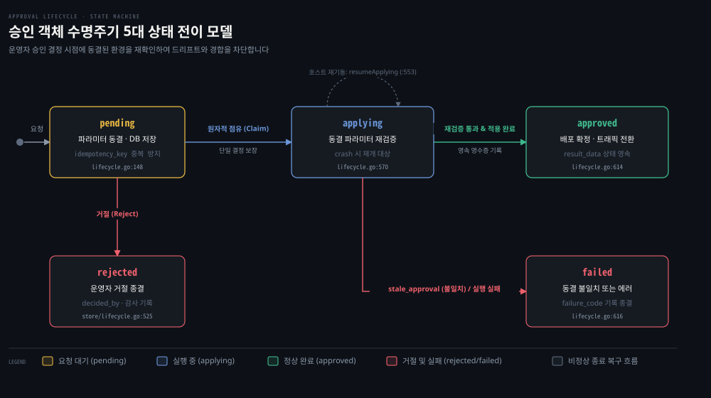
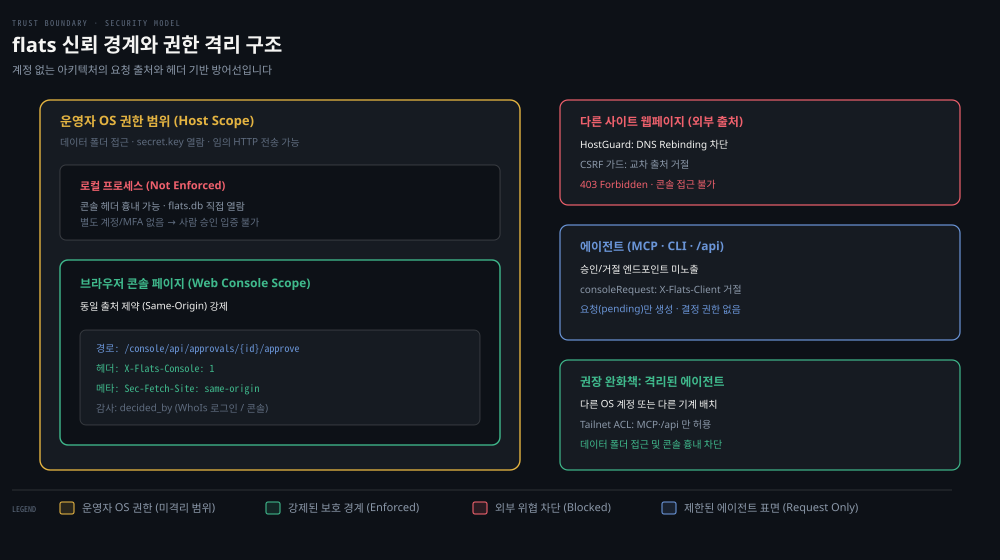

# approval·trust model

---

> 에이전트의 변경 요청을 동결하고(frozen params) 운영자 결정 순간에 환경 드리프트를 재검사하여 거절하는(stale_approval) 승인 상태 머신과, 계정 없는 단일 바이너리 환경에서 운영자 권한을 보장하기 위한 출처·헤더 기반 신뢰 모델을 다룹니다.


## 학습 목표와 범위

> 에이전트의 제안과 인간 운영자의 최종 결정을 분리하는 승인 파라미터 동결 기법과, 계정 없는 아키텍처의 신뢰 경계를 이해하고 설명할 수 있습니다.

1. 승인 요청 시점에 동결되는 파라미터(`frozen params`)의 구성과, 결정 시점에 이를 재검증하여 `stale_approval`로 거절하는 불일치(`mismatch`) 조건을 설명할 수 있습니다.
2. 승인 대상이 되는 일곱 가지 핵심 액션과, 승인 절차 없이 즉시 집행되는 작업의 경계를 식별할 수 있습니다.
3. 승인 점유(`applying`)와 실제 적용 사이에 호스트 프로세스가 비정상 종료되었을 때, `resumeApplying`과 `restore-journal.json`을 통해 안전하게 복구되는 과정을 추적할 수 있습니다.
4. 사용자 계정과 비밀번호가 존재하지 않는 flats 환경에서 운영자 권한이 기대는 세 가지 기둥(리스너 바인딩, 요청 헤더 계약, 라우트 분리)을 분석할 수 있습니다.
5. 공식 문서(`docs/design.md`)가 명시한 신뢰 한계(동일 OS 사용자의 헤더 위조 및 데이터 열람)를 파악하고 실제 운영 환경에서 에이전트를 격리하기 위한 인프라 완화책을 도출할 수 있습니다.

이 문서는 flats의 승인 수명주기와 보안 신뢰 모델을 다룹니다. 불변 버전 보관 원리는 [01-03.Version model](01-03.Version%20model.md)을, 관리 서버의 가드 구조와 엔드포인트 격리는 [04-02.management server·HostGuard·console](04-02.management%20server%C2%B7HostGuard%C2%B7console.md)을 참고합니다.

기준 커밋 3abe537 (v0.11.0, 2026-10-17)


## 1. 문제와 원칙 — 계정 없는 시스템에서 운영자 권한의 근거

> 자율적인 AI 에이전트가 코드를 작성하더라도, 외부 네트워크 공개나 데이터 파괴 같은 중대한 영향은 인간 운영자의 최종 통제 아래에 두어야 합니다.

AI 코딩 어시스턴트는 저장소를 읽고 코드를 고치며 초안을 저장하는 작업에 뛰어납니다. 하지만 완성된 웹 애플리케이션을 인터넷에 공개하거나, 기존 프로덕션 트래픽을 다른 버전으로 전환하거나, 데이터베이스 스냅샷을 덮어쓰는 행위는 외부 사용자 및 영속 데이터에 직접적인 영향을 미칩니다. 자율 에이전트가 독단으로 이러한 변경을 집행하도록 허용하면 예기치 못한 서비스 장애나 데이터 유실이 발생할 수 있습니다. 그래서 시스템은 "에이전트는 제안하고, 운영자는 결정한다"는 분리 원칙을 강제해야 합니다(`docs/design.md` 「Approvals」).

하지만 flats는 별도의 데이터베이스 서버나 외부 인증 서비스에 의존하지 않는 단일 Go 바이너리입니다. 전통적인 웹 애플리케이션처럼 사용자 계정 테이블, 회원가입 절차, 비밀번호 해시, 세션 쿠키, 다중 인증(MFA) 시스템을 탑재하지 않았습니다. 개발자의 로컬 머신에서 가볍게 구동되는 데몬에 복잡한 계정 체계를 도입하는 것은 설치와 운영의 단순성을 해치기 때문입니다.

계정과 자격 증명이 없는 환경에서는 요청자가 권한을 가진 인간 운영자인지, 아니면 백그라운드에서 동작하는 AI 에이전트인지 구별하는 문제가 발생합니다.

flats는 `docs/design.md` 「Approvals」에 명시된 원칙을 따릅니다. 시스템은 별도의 자격 증명 대신 **요청의 물리적 유입 경로**와 **프로토콜 헤더 계약**에 기대어 권한을 판별합니다(`docs/lifecycle-core-contract.md` 「Operator authority and frozen approvals」):

1. **엔드포인트 표면의 분리**: 승인 결정(`approve`/`reject`) API는 오직 웹 콘솔 전용 접두사(`/console/api/`)에만 마운트되며 일반 에이전트 API(`/api/`)나 MCP 도구 목록에는 노출되지 않습니다.
2. **엄격한 요청 출처 검증**: 모든 관리 요청은 `HostGuard`에서 허가된 호스트 검사를 통과해야 합니다. 콘솔 API는 브라우저 샌드박스만 보낼 수 있는 커스텀 헤더(`X-Flats-Console: 1`)와 Fetch Metadata(`Sec-Fetch-Site: same-origin`)도 요구합니다.
3. **요청 시점 파라미터 동결**: 에이전트가 제출한 요청은 즉시 집행되지 않고 요청 시점의 환경 상태와 함께 불변 레코드(`approvals` 테이블)로 동결됩니다. 운영자가 콘솔 화면에서 확인하고 승인 버튼을 누르는 순간 서버는 동결된 값이 현재 시스템 상태와 일치하는지 재검사하여 변경 사항의 의도치 않은 왜곡을 차단합니다.


## 2. 승인 객체와 동결 데이터 — approvals 스키마와 저장소 모델

> 승인 요청은 단순히 동작 이름만 보관하지 않고, 결정 순간의 안전성을 입증할 수 있는 환경 상태를 직렬화하여 영속화합니다.

flats 관리 데몬의 메타데이터 데이터베이스(`flats.db`)는 모든 승인 요청을 `approvals` 테이블에 기록합니다(`internal/store/store.go:200-215`). 

고유 식별자 `id`는 난수 기반 슬러그(`apr-...`)로 생성됩니다. 대상 플랫 식별자 `flat`과 실행할 작업 명칭 `action`, 동결된 매개변수 JSON인 `params`가 저장됩니다. 수명주기 상태 문자열 `status`와 요청 유입 경로 `via`(`cli`, `mcp`, `api`, `console`), 요청 사유 `reason`, 처리 결과 `result`가 뒤따릅니다.

시간 정보로는 요청 접수 시각인 `requested_at`과 결정 완료 시각 `decided_at`이 기록됩니다. 중복 요청을 방지하기 위한 멱등성 키는 `idempotency_key`에 보관됩니다. 실행 영수증 JSON은 `result_data`에 저장됩니다. 결정을 내린 운영자 신원은 `decided_by`에, 승인 권한 검증 시각은 `authorized_at`에 각각 영속화됩니다.

| 컬럼명 | 데이터 타입 | 제약 조건 | 설명 |
| :--- | :--- | :--- | :--- |
| `id` | `TEXT` | `PRIMARY KEY` | 승인 식별자 (`apr-` 접두사 + 난수 12자리) |
| `flat` | `TEXT` | `NOT NULL` | 대상 플랫의 슬러그 이름 |
| `action` | `TEXT` | `NOT NULL` | 승인 대상 행동 (예: `create_version`, `activate`, `set_visibility`) |
| `params` | `TEXT` | `NOT NULL` | 요청 시점에 동결된 파라미터 JSON |
| `status` | `TEXT` | `NOT NULL` | 승인 상태 (`pending`, `applying`, `approved`, `rejected`, `failed`) |
| `via` | `TEXT` | `NOT NULL` | 요청 유입 표면 (`cli`, `mcp`, `api`, `console`) |
| `reason` | `TEXT` | 생략 가능 | 요청자가 제출한 승인 요청 사유 |
| `result` | `TEXT` | 생략 가능 | 사람이 읽을 수 있는 최종 처리 결과 또는 오류 메시지 |
| `requested_at` | `INTEGER` | `NOT NULL` | 요청이 접수되어 동결된 유닉스 타임스탬프 |
| `decided_at` | `INTEGER` | 생략 가능 | 운영자가 승인 또는 거절을 확정한 유닉스 타임스탬프 |
| `idempotency_key`| `TEXT` | 생략 가능 | 동일 요청 중복 생성을 막는 정규 해시 키 |
| `result_data` | `TEXT` | 생략 가능 | 실행 결과 구조체(`ApprovalExecution`)의 JSON 직렬화 |
| `decided_by` | `TEXT` | 생략 가능 | 승인자의 신원 (Tailnet WhoIs 로그인, NetBird 피어명, 또는 `console`) |
| `authorized_at` | `INTEGER` | 생략 가능 | 원자적 점유 및 승인 권한이 입증된 시각 |

실제 환경에서 승인 요청이 생성될 때의 반응은 로컬 실측(2026-10-18)으로 확인했습니다. CLI 도구에서 초안을 새 버전으로 승인 요청했을 때의 화면 출력입니다:

```bash
flats --url http://127.0.0.1:17878 create-version rt-probe --revision 1 --hash 158b8a0d…
This action needs the operator's approval. Share the approval link with them; nothing changes until they approve it in the web console.
Status: pending_approval
Approval needed: http://127.0.0.1:17878/approvals/apr-<id>
Approval apr-<id> is waiting for the operator; check with `flats approvals`.
```

로컬 실측(2026-10-18)에서 `flats --json approvals`를 조회하면 위 요청의 단일 승인 객체가 확인됩니다:

- 식별자(`id`): `apr-<id>` (난수 접미사 12자리)
- 동작 명칭(`action`): `create_version`
- 수명주기 상태(`status`): `pending`
- 유입 표면(`via`): `cli`
- 멱등성 해시(`idempotency_key`): `9f49…`
- 동결 파라미터(`params`): `revision 1`, 콘텐츠 해시 `158b8a0d…`, `base_version 0`, `expected_live 0`, `visibility private`, 제공자 키 `providers "local\naf8b9a…"`

여기서 해시는 앞 8자리만 표시하고 생략 부호(`…`)를 붙였으며 승인 식별자는 `apr-<id>`로 익명화했습니다. `params` 내부의 동결 필드는 각각 다음을 뜻합니다:

- `revision`과 `hash`: 승인 대상이 되는 Draft 초안의 정확한 리비전 번호와 콘텐츠 해시입니다.
- `base_version`: 요청 시점에 가장 최신으로 저장되어 있던 버전 번호입니다(초기 상태이므로 0).
- `expected_live`: 요청 시점에 현재 실행 중이던 실시간(Live) 버전 번호입니다(배포 전이므로 0).
- `visibility`: 요청 시점 플랫의 공개 범위(`private`)입니다.
- `providers`: 플랫에 허용된 제공자 목록과 호스트 노출 정책 토큰의 조합입니다.

`providers` 필드의 문자열에는 줄바꿈(`\n`)이 들어 있습니다. `internal/core/lifecycle.go:108-122`의 `providerKey` 함수는 정렬된 허용 제공자 목록(`local`) 뒤에 옵저버의 안정적인 정책 해시 토큰(`ExposurePolicy`)을 덧붙입니다. 두 값은 줄바꿈 문자(`\n`)로 결합됩니다. 그 결과 제공자 이름뿐만 아니라 호스트의 포트나 바인딩 정책 변경까지 승인 파라미터로 함께 동결합니다.


## 3. 요청과 동결 — requestFrozen과 멱등성 보장

> 동일한 승인 요청이 여러 번 도착하더라도 중복 승인 객체를 만들지 않으며, 도메인 유형에 맞추어 동결 대상 식별자를 정교하게 분기합니다.

에이전트나 CLI가 보호된 동작을 호출하면 코어 서비스는 내부 함수 `requestFrozen`을 호출하여 매개변수를 동결합니다(`internal/core/lifecycle.go:148-176`).

```go
// internal/core/lifecycle.go:139-156
func frozenKey(slugName, action string, params any) (string, []byte, error) {
	raw, err := json.Marshal(params)
	if err != nil {
		return "", nil, err
	}
	sum := sha256.Sum256([]byte(slugName + "\n" + action + "\n" + string(raw)))
	return hex.EncodeToString(sum[:]), raw, nil
}

func (s *Service) requestFrozen(ctx context.Context, slugName, action string, params any, via Via, reason string) (ActionResult, error) {
	key, raw, err := frozenKey(slugName, action, params)
	if err != nil {
		return ActionResult{}, err
	}
	if existing, err := s.st.FindOpenApprovalByKey(ctx, key); err == nil {
		url := s.ApprovalURL(ctx, existing.ID)
		return ActionResult{Status: "pending_approval", Approval: &existing, ApprovalURL: url,
			Message: "This action is already waiting for the operator. Nothing changes until they approve it in the web console."}, nil
	}
    // ...
```

`requestFrozen`은 아래 순서로 동작합니다:

1. **멱등성 키 계산 (`frozenKey`)**: 대상 플랫 이름, 액션 문자열, 직렬화된 파라미터 JSON 바이트를 줄바꿈으로 이어 붙이고 SHA-256 해시를 계산합니다(`internal/core/lifecycle.go:139-146`).
2. **기존 보류 요청 검색 (`FindOpenApprovalByKey`)**: 동일한 멱등성 키를 가지며 아직 결정되지 않은(`pending` 또는 `applying`) 승인이 존재하는지 확인합니다. 이미 열려 있는 승인이 있다면 새 객체를 생성하지 않고 기존 승인의 콘솔 URL을 즉시 반환합니다(`internal/core/lifecycle.go:153-156`).
3. **새 승인 삽입 및 경합 방어**: 동일 요청이 없다면 새 ID(`apr-...`)를 부여하고 `status="pending"`으로 DB에 삽입합니다(`internal/core/lifecycle.go:160-164`). 삽입 중 동시성 경합으로 유니크 제약 위반이 발생하면 다시 검색을 시도하여 기존 승인으로 합류합니다(`internal/core/lifecycle.go:165-170`).

flats에서 승인을 거쳐야 하는 동작은 총 일곱 가지입니다(`docs/design.md:475-476`). 각 액션은 전용 요청 함수에서 각기 다른 환경 값을 동결합니다:

1. `create_version`: `RequestCreateVersion`(`internal/core/lifecycle.go:1939`, `CreateVersion` `:1686`)을 호출합니다. 초안 리비전, 콘텐츠 해시, 최신 저장 버전(`BaseVersion`), 현재 활성 버전(`ExpectedLive`), 공개 범위, 제공자 키를 동결합니다.
2. `delete_version`: `RequestDeleteVersion`(`internal/core/version.go:122`, `DeleteVersion` `:93-120`). 삭제할 버전 번호, 해당 버전 해시, 활성 버전, 공개 범위, 제공자 키를 동결합니다. 활성 버전 삭제는 즉시 `ErrConflict`로 거부됩니다.
3. `activate` (배포): `requestDeploy`(`internal/core/lifecycle.go:193-225`). 배포할 버전 번호, 버전 해시, 현재 활성 버전, 공개 범위, 제공자 키를 동결합니다.
4. `rollback`: `requestRollback`(`internal/core/lifecycle.go:227-278`). 되돌릴 버전 번호, 현재 활성 버전, 데이터 복구 여부(`RestoreData`), 대상 버전 해시를 동결합니다. 스냅샷 파일명과 해시(`SnapshotHash`), 제공자 키도 함께 담깁니다.
5. `restore_data`: 독립적인 데이터 스냅샷 복원(`internal/core/service.go:1509`). 스냅샷 파일명과 무결성 해시를 동결합니다.
6. `set_visibility`: `requestVisibility`(`internal/core/lifecycle.go:280-330`). 변경할 목표 공개 범위(`Visibility`), 현재 공개 범위(`From`), 제공자 키를 동결합니다.
7. `delete`: 플랫 자체의 삭제(`internal/core/service.go:1740-1743`). 콘솔 외부(CLI, MCP, API)에서 호출될 경우 대상 플랫 슬러그를 파라미터로 동결합니다.

웹사이트/페이지와 문서/디자인(Revision 모델)은 동결 정책이 다릅니다(`docs/lifecycle-core-contract.md:157-172`). 

웹사이트나 단일 페이지의 경우 공개 범위를 바꿀 때 `ExpectedLive`를 동결하여 실시간 배포 버전이 변경되면 승인이 무효화되도록 만듭니다. 반면 문서나 디자인 캔버스는 `ExpectedLive` 대신 플랫의 고유 UUID인 `f.ID`(`FlatID`)를 동결합니다(`internal/core/lifecycle.go:318`). 문서는 편집 시마다 내부적인 실시간 버전이 계속 증가하므로 초안 수정이나 롤백이 발생하더라도 승인을 무효화하지 않고 승인 적용 시점에 현재 구동 중인 버전을 그대로 공개하기 위함입니다. 

플랫이 삭제된 뒤 동일 슬러그로 새 플랫이 생성되면 `f.ID`가 어긋나므로 과거 미결 승인이 새 플랫에 오적용되지 않습니다(`internal/core/lifecycle.go:1019-1021`).


## 4. 결정과 적용 — Decide, 동결 값 재검증, 그리고 stale_approval

> 승인 버튼을 누르는 순간 시스템은 동결된 과거와 현재의 물리적 현실을 비교하며, 단 하나의 필드라도 어긋나면 실행을 거부합니다.

웹 콘솔에서 운영자가 승인 또는 거절을 클릭합니다. 요청은 `/console/api/approvals/{id}/approve` 또는 `/reject` 엔드포인트를 거쳐 코어 서비스의 `Decide` 함수에 도달합니다(`internal/core/service.go:1875-1927`).

`Decide` 함수는 승인 식별자별 뮤텍스 락(`approval:<id>`)을 획득하여 동시 결정을 직렬화합니다(`internal/core/service.go:1876-1877`). 컨텍스트에서 감사 신원(`decided_by`)을 추출한 뒤 결정 로직을 분기합니다:

- **거절 (`approve == false`)**: `RejectApprovalAuthorized`를 호출하여 상태를 즉시 `rejected`로 전이하고 사유를 기록합니다(`internal/store/lifecycle.go:525`).
- **승인 (`approve == true`)**: 이미 완료된 승인이면 멱등하게 기존 결과를 반환합니다. 대기 상태(`pending`)라면 `ClaimApprovalAuthorized`를 원자적으로 실행하여 상태를 `applying`으로 바꿉니다(`internal/store/lifecycle.go:511`). 두 운영자가 동시에 승인을 누르더라도 한 명만 1개의 행을 갱신하며 패배한 요청은 충돌 오류(`ErrConflict`)를 받습니다.

점유에 성공한 요청은 즉시 `finishApplying`(`internal/core/lifecycle.go:570`)과 `applyApproval`(`:646`)을 호출하여 실제 변경을 집행합니다. 이때 가장 먼저 수행되는 작업이 **동결 값 재검증**입니다.

서버는 `mismatch` 함수로 동결 당시의 값과 현재 시스템의 실제 상태를 대조합니다(`internal/core/lifecycle.go:665-667`):

```go
// internal/core/lifecycle.go:665-667
func mismatch(frozen, current, what string) error {
	return fmt.Errorf("%w: %w: %s changed after the request (approval has %s, current is %s)", ErrConflict, ErrStaleApproval, what, frozen, current)
}
```

재검증 규칙은 액션별 적용 함수마다 다릅니다:

1. **버전 생성 적용 (`applyPublishApproval`, `:669-720`)**:
   - `f.LiveVersion != p.ExpectedLive`: 승인 대기 중 배포 버전이 바뀌었으면 거절합니다.
   - `latest.Number != p.BaseVersion`: 대기 중 다른 새 버전이 먼저 확정되었으면 거절합니다.
   - `draft.Revision != p.Revision || draft.Hash != p.Hash`: 대기 중 초안이 수정되었으면 거절합니다.
   - 구버전 flats에서 생성되어 `expected_live`가 기록되지 않은 레코드는 안전을 위해 즉시 거절합니다(`:680`).
2. **배포 활성화 적용 (`applyActivateApproval`, `:880-929`)**:
   - `v.Hash != p.Hash`: 디스크 상의 버전 디렉터리 파일 해시가 동결 시점의 스냅샷과 다르면 거절합니다.
   - 활성 버전, 공개 범위, 제공자 설정이 변경되었는지 확인합니다.
3. **롤백 적용 (`applyRollbackApproval`, `:931-996`)**:
   - 대상 버전의 무결성을 검증하고 데이터 복원(`RestoreData`)이 활성화된 경우 대상 데이터베이스 백업의 실제 SHA-256 해시를 디스크에서 계산하여 `p.SnapshotHash`와 일치하는지 대조합니다.
4. **공개 범위 변경 적용 (`applyVisibilityApproval`, `:998-1045`)**:
   - `f.Visibility.Canonical() != p.From`: 대기 중 공개 상태가 이미 변경되었으면 거절합니다.
   - 문서가 아닌 경우 `f.LiveVersion` 일치 여부를, 문서인 경우 `f.ID == p.FlatID` 일치 여부를 검사합니다.

재검증에서 불일치가 발견되면 `finishApplying`은 승인 상태를 `failed`로 영속화합니다(`internal/core/lifecycle.go:616`). 이때 `result_data` 내부에 `failure_code: "stale_approval"`을 기록합니다(`:623`).

해시 불일치가 발생했을 때의 로컬 실측(2026-10-18) 결과입니다:

```bash
flats --url http://127.0.0.1:17878 create-version rt-probe --revision 1 --hash wronghash
error: conflict: stale approval: draft hash changed
```

초안의 해시가 일치하지 않는 상태로 생성을 시도하면 승인 객체가 만들어지기도 전에 요청 단계(`internal/core/lifecycle.go:1710`)에서 `ErrStaleApproval` 오류와 함께 프로세스가 종료 코드 1로 중단됩니다. 

초안 리비전 1의 정상 승인 요청을 생성한 뒤 `server.js`에 주석을 달아 리비전 2를 새로 저장하더라도 리비전 1의 승인은 여전히 `pending` 상태로 보존됩니다. 공식 문서(`README.md:93-95`)가 명시하듯 승인 요청은 요청 순간에 저장된 초안 파일 바이트를 완전히 동결하므로 이후에 초안이 편집되더라도 동결된 과거 버전을 분리 유지합니다. 

이 로컬 실측에서는 요청 생성과 파라미터 동결까지만 확인하였으며, 콘솔 화면에서의 승인 결정 클릭 자체는 실측하지 않았습니다.

다음 도식은 승인 요청 접수부터 원자적 점유, 동결 값 재검증, 그리고 최종 적용 또는 stale 실패까지의 상태 머신 전이 흐름을 보여줍니다.




## 5. 중단과 재개 — resumeApplying과 restore-journal 장애 복구

> 승인과 실제 변경 집행 사이에 전원이 꺼지더라도, 시스템은 멱등한 배포 영수증과 복원 저널을 통해 안전한 상태로 수렴합니다.

승인 시스템에서 가장 까다로운 장애 구간은 운영자가 승인하여 상태가 `applying`으로 바뀐 직후, 파일 복사나 프로세스 교체가 완료되기 전에 호스트가 비정상 종료(Crash)되는 상황입니다. 

flats 호스트가 재기동되면 `Service.Init` 초기화 루틴의 마지막 단계에서 `resumeApplying`을 호출합니다(`internal/core/service.go:403`, `internal/core/lifecycle.go:553-568`):

```go
// internal/core/lifecycle.go:553-568
func (s *Service) resumeApplying(ctx context.Context) {
	as, err := s.st.ListApprovals(ctx, "applying")
	if err != nil {
		s.logf("resume approvals: %v", err)
		return
	}
	for _, a := range as {
		if a.AuthorizedAt == nil || a.DecidedBy == "" {
			_ = s.st.FinishApproval(ctx, a.ID, "failed", "legacy applying approval lacks validated operator decision; request fresh approval", s.now())
			continue
		}
		if _, err := s.finishApplying(ctx, a); err != nil {
			s.logf("resume approval %s: %v", a.ID, err)
		}
	}
}
```

재개 절차는 아래 안전장치를 거칩니다:

1. **인가 검증 (`fail-closed`)**: 승인 객체의 `AuthorizedAt` 타임스탬프가 없거나 `DecidedBy`가 비어있는 행은 `failed`로 종결합니다(`internal/core/lifecycle.go:560-562`). 과거 구버전이나 인가되지 않은 행이 재기동 시점에 슬그머니 승인되는 보안 취약점을 차단합니다.
2. **배포 영수증 대조 (`DeploymentByApproval`)**: `finishApplying`은 `deployments` 테이블에서 해당 승인 ID로 이미 기록된 배포 행을 확인합니다(`internal/core/lifecycle.go:591-608`). 이미 커밋된 상태라면 프로세스를 재시작하지 않고 승인 상태만 `approved`로 전이시킵니다.
3. **미완료 작업 재집행**: 배포가 커밋되지 않은 상태라면 동결 값 재검증을 처음부터 다시 수행한 뒤 적용합니다.

데이터베이스 스냅샷 복원 도중의 크래시 방어는 `restore-journal.json` 저널링 메커니즘이 전담합니다(`docs/lifecycle-core-contract.md` 「Restore-journal recovery」). 관련 코드는 `internal/core/data.go:370-413`에 구현되어 있습니다.

코어 서비스는 데이터 디렉토리 파일을 실제로 교체하기 직전에 `restore-journal.json` 파일을 원자적으로 생성합니다(`internal/core/service.go:1565-1570`). 이 파일에는 승인 ID와 이전 백업 스냅샷 명칭이 담깁니다. 프로세스가 재기동될 때 `recoverRestoreJournals` 함수가 이 파일을 탐지합니다:

- 배포가 아직 커밋되지 않은 상태라면 교체 중이던 불완전한 라이브 데이터를 폐기하고 저널에 기록된 이전 백업 스냅샷을 원복 복원(`installSnapshot`)합니다(`internal/core/data.go:394-406`).
- 배포가 이미 커밋되었다면 복원된 새 데이터를 보존하고 저널 파일만 삭제합니다(`internal/core/data.go:408-410`).
- 만약 저널 파일이 손상되었거나 파싱할 수 없는 상태라면 flats는 **호스트 기동을 의도적으로 중단(block startup)**합니다(`docs/lifecycle-core-contract.md:346-356`). 데이터 오염 상태에서 트래픽을 서빙하는 일을 막기 위해, 자동 복구 대신 운영자가 오프라인에서 백업을 확인하고 수동 조치하도록 강제하는 안전 원칙입니다.

이러한 복구 로직의 완전성을 보증하기 위해, flats 코드베이스는 결정론적 크래시 테스트 체계를 갖추고 있습니다(`docs/lifecycle-core-contract.md` 「Deterministic crash tests」). 

상용 빌드에서는 빈 깡통 함수(`internal/core/lifecycle_hooks.go:7`)로 컴파일됩니다. 반면 `-tags lifecycle_testhooks` 빌드 태그를 부여한 테스트 빌드에서는 네 단계 장애 지점을 검증합니다. 점검 순서는 `before_health`, `after_health`, `after_allocation_before_live`, `after_live_before_finalize`입니다. 프로세스가 마커 파일(`FLATS_TEST_PHASE_MARKER`)을 남기고 스스로 종료된 뒤 재기동되는 시나리오를 자동으로 평가합니다.


## 6. 승인 없이 되는 것 — 자율성과 통제의 경계

> 모든 사소한 동작마다 승인을 요구하면 개발 효율이 마비되므로, 시스템은 안전한 개발 작업과 위험한 공개 작업을 엄격히 구분합니다.

완전한 통제를 이유로 코드 한 줄 저장할 때마다 인간 운영자의 승인을 거치게 만든다면 AI 에이전트의 개발 생산성은 크게 저하됩니다. flats는 에이전트의 로컬 작업 자율성과 운영자의 공개 및 영속 데이터 통제권 사이에 경계선을 그었습니다(`docs/design.md` 「Approvals」).

다음 작업들은 승인 객체를 생성하지 않고 즉시 집행됩니다:

1. **문서 및 디자인 캔버스 저장**: `flats save-document`나 `save-design`은 별도의 배포 단계 없이 로컬 루프백 주소에서 즉시 구동됩니다.
2. **모든 리비전 조작**: 초안 저장(`save-draft`), 리비전 고정(`pin-revision`), 리비전 롤백(`rollback-revision`), 리비전 목록 조회는 운영자 승인 없이 자유롭게 수행됩니다.
3. **새 플랫 생성**: `create_flat` API는 빈 플랫 공간을 할당할 뿐 트래픽을 유발하지 않으므로 에이전트가 자유롭게 호출합니다. 실제로 콘솔 화면에는 새 플랫 생성 버튼이 아예 존재하지 않으며 오직 에이전트 표면(MCP, CLI, API)에서만 생성할 수 있습니다.
4. **환경 변수 및 시크릿 설정**: `set_env`나 `flats secret set`은 컨테이너 구성을 준비하는 동작이므로 즉시 반영됩니다. 단, 시크릿 설정은 로컬 CLI 루프백 또는 콘솔에서만 가능합니다.
5. **초안 미리보기 (Preview)**: 에이전트는 미승인 상태의 Draft 초안을 임시 주소에서 직접 띄워볼 수 있습니다.

승인 없이 동작하는 작업의 로컬 실측(2026-10-18) 결과입니다:

```bash
flats --url http://127.0.0.1:17878 preview rt-probe
Preview of rt-probe Private Draft revision 1: http://rt-probe-ef4n465g.localhost:17879
  Private via loopback or existing tailnet ACL; closes on the next deploy or after 24h without visits (now: 2026-10-19 21:01)
```

서버 플랫의 초안을 미리보기로 띄우면 승인 절차 없이도 백그라운드에 독립된 `flats worker` 프로세스가 즉시 기동되어 실제 JavaScript 서버 핸들러를 실행합니다. 미리보기 환경은 10초 핸들러 타임아웃과 64 MiB 메모리 상한, 격리된 임시 데이터로 호스트를 보호하면서 에이전트에게 온전한 테스트 환경을 제공합니다. 

문서 저장 역시 마찬가지입니다:

```bash
flats --url http://127.0.0.1:17878 save-document doc-probe <obs>/doc
Saved document doc-probe; it is running now (private) at http://doc-probe.localhost:17879. Documents have no publish step.
```

출력 메시지가 직접 명시하듯 문서는 배포 단계(`publish step`)가 아예 존재하지 않으며 승인 없이 즉시 구동됩니다.

한편, 웹 콘솔 화면에서는 파괴적인 두 가지 동작이 승인 객체를 거치지 않고 직접 집행됩니다(`docs/design.md:480-482`):
- 플랫 전체 삭제 (`applyDelete`, `internal/core/service.go:1740-1743`)
- 활성 상태가 아닌 구버전 삭제 (`deleteVersionLocked`, `internal/core/version.go:110-111`)

에이전트(MCP, CLI, API)가 플랫 삭제나 버전 삭제를 요청하면 반드시 파라미터가 동결된 승인 객체가 생성됩니다. 반면 웹 콘솔에서는 운영자가 브라우저 경고 대화상자(Confirm Dialog)에서 명시적으로 확인을 누르므로, `via == ViaConsole` 조건을 감지하여 승인 큐를 거치지 않고 즉시 집행합니다. 이미 화면에서 직접 삭제를 확인한 운영자에게 또다시 승인 결정을 요구하는 것은 불필요한 중복이기 때문입니다.


## 7. 신뢰 모델 — Enforced와 Not enforced의 경계

> flats의 보안 가드는 브라우저 교차 사이트 공격과 제한된 에이전트를 철저히 격리하지만, 호스트 쉘을 장악한 악성 프로세스까지 막아주지는 못합니다.

계정 없는 flats 아키텍처의 신뢰 경계를 이해하려면 구분이 필요합니다. 시스템이 **강제하는 것(Enforced)**과 **강제하지 못하는 것(Not enforced)**을 나누어야 합니다(`docs/design.md:485-526`).

### 시스템이 강제하는 규칙 (Enforced)

공식 문서가 밝힌 핵심 강제 규칙은 네 가지입니다:

1. **승인 엔드포인트 격리**: MCP, CLI, 일반 API(`/api`)는 승인(`approve`), 거절(`reject`), 호스트 설정 변경 기능을 일체 제공하지 않습니다. 에이전트가 호출할 수 있는 게이트 API는 승인 대기 객체를 생성하는 데 그칩니다. 호스트 설정 파일(`config.json`)을 직접 수정하는 `flats config` 명령 역시 호스트 데몬이 정지되어 데이터 락을 획득할 수 있을 때만 실행됩니다(`docs/design.md:488-490`).
2. **엄격한 Host 및 Origin 검증 (`HostGuard`)**: 허용 리스너 목록은 요청 시점에 동적으로 평가됩니다. 모든 유입 요청은 이 목록과 `Host` 헤더를 대조합니다. 루프백 리스너(`127.0.0.1`, `localhost`, `[::1]`), Tailscale 도메인, NetBird 도메인의 지정된 포트만 허용되며 요청에 포함된 `Origin` 역시 이 목록에 포함되어야 합니다. 이 검사로 외부 웹사이트를 경유한 DNS Rebinding 및 단순 교차 사이트 요청을 차단합니다(`docs/design.md:491-498`).
3. **콘솔 요청 헤더 계약 강제 (`consoleRequest`)**: `/console/api` 엔드포인트는 `X-Flats-Console: 1` 헤더를 요구하며 `X-Flats-Client` 헤더가 존재하면 403으로 거부합니다. 상태를 변경하는 모든 요청은 `Sec-Fetch-Site: same-origin`과 요청 Host와 동일한 `Origin`을 요구합니다. 평문 HTTP인 NetBird 환경에서도 커스텀 헤더 검사로 인해 CORS Preflight가 강제되어 외부 웹사이트 호출이 차단됩니다(`docs/design.md:499-505`).
4. **결정자 신원 감사 추적**: 승인 결과에는 결정을 내린 주체(`decided_by`)가 명시됩니다. Tailscale 콘솔 환경에서는 클라이언트 헤더를 파기하고 tsnet(Tailscale) `WhoIs` 신원 조회로 얻은 실제 로그인 계정을 기록하며 NetBird 콘솔 환경에서는 인증된 피어 이름을 기록합니다. 루프백 리스너에서의 결정은 특정 신원 없이 기록됩니다(`docs/design.md:506-512`).

### 시스템이 강제하지 못하는 한계 (Not enforced)

반면 공식 문서는 구현 메커니즘의 근본적인 한계를 솔직하게 인정합니다(`docs/design.md:514-526`):

모든 콘솔 가드는 HTTP 요청 헤더에 기반합니다. 브라우저 샌드박스 내부의 웹페이지는 브라우저 엔진의 통제를 받으므로 이러한 헤더를 임의로 조작할 수 없습니다. 그러나 운영자의 OS 사용자 권한으로 쉘을 획득하여 실행 중인 로컬 프로세스에는 브라우저 엔진과 같은 제약이 전혀 없습니다.

운영자 기기에서 임의의 HTTP 패킷을 전송할 수 있는 프로세스는 콘솔 웹페이지가 보내는 헤더를 얼마든지 흉내 낼 수 있습니다. 콘솔 헤더(`X-Flats-Console: 1`)를 붙여 승인 API를 직접 호출하는 행위를 서버는 구별하지 못합니다. flats 데이터 디렉토리에 파일 읽기 권한이 있는 로컬 프로세스는 SQLite 데이터베이스(`flats.db`)와 암호화 키(`secret.key`)를 직접 열람할 수 있습니다.

flats에는 별도의 운영자 비밀번호나 하드웨어 토큰 인증이 없습니다. 따라서 "승인이 완료되었다"는 사실 자체가 "물리적인 인간이 눈으로 보고 결정했다"는 암호학적 증명이 되지는 못합니다(`docs/design.md:519-520`).

다음 표는 flats가 방어하는 대상과 구조적으로 방어하지 못하는 대상, 그리고 각 영역별 잔여 한계의 대비를 설명합니다.

표는 다섯 열로 되어 있습니다. 왼쪽부터 시스템에 접근을 시도하는 `위협 주체`, 그 주체가 시도하는 `공격 및 접근 경로`, flats 관리 서버가 적용하는 `핵심 방어 기제`, 해당 공격의 `최종 차단 여부`, 이 방어 체계가 기대는 `전제 조건 및 잔여 한계`입니다.

| 위협 주체 | 공격 및 접근 경로 | 핵심 방어 기제 | 최종 차단 여부 | 전제 조건 및 잔여 한계 |
| :--- | :--- | :--- | :--- | :--- |
| **외부 악성 웹사이트** | 브라우저 백그라운드 CSRF, DNS Rebinding | `HostGuard`, `consoleRequest` (`Sec-Fetch-Site`, `Origin`) | **완전 차단** (403 거절) | 브라우저 샌드박스의 헤더 위조 불가 원칙에 의존 |
| **제한된 로컬 에이전트** | MCP 프로토콜, `/api` 엔드포인트 호출 | 승인 엔드포인트 미노출, `X-Flats-Client` 거절 | **완전 차단** (요청만 가능) | 에이전트가 로컬 소켓에 임의 헤더를 주입하지 못한다는 전제 |
| **호스트 쉘 권한 프로세스** | 루프백 직접 소켓 통신, 콘솔 헤더 흉내 | 없음 (방어 불가) | **차단 불가** (콘솔 흉내 승인) | 운영자 OS 계정으로 동작하는 프로세스는 콘솔과 구별 불가 |
| **데이터 디렉토리 접근자** | 로컬 파일 시스템 직접 읽기 | 없음 (OS 파일 권한에 위임) | **차단 불가** (DB 및 시크릿 누출) | 운영자 프로세스는 `flats.db` 및 `secret.key` 직접 열람 가능 |

### 독자를 위한 실무 신뢰 경계 완화책

이러한 신뢰 모델의 한계를 극복하고 실제 운영 환경에서 안전성을 확보하기 위해, 운영자는 다음 두 가지 인프라 레벨의 완화책을 구축해야 합니다(`docs/design.md:522-525`):

1. **사설망 접근 제어 (Tailnet ACL / NetBird 정책)**: Tailscale ACL 또는 NetBird 정책을 엄격히 작성합니다. 관리 콘솔 도메인 포트에는 오직 운영자가 소유한 신뢰된 브라우저 디바이스만 도달할 수 있도록 통제해야 합니다.
2. **에이전트 권한 분리 (OS 계정 및 가상 머신 분리)**: 신뢰할 수 없는 AI 에이전트를 flats 데몬과 동일한 OS 계정에서 실행하지 않아야 합니다. 에이전트는 별도의 OS 사용자 계정이나 독립 컨테이너, 또는 다른 머신에서 구동해야 합니다(`docs/design.md:524-525`). 이 분리로 에이전트가 로컬 소켓에 임의의 콘솔 헤더를 전송하지 못하도록 막습니다. flats 데이터 디렉토리도 직접 읽지 못하도록 OS 커널 수준에서 격리합니다. 오직 인가된 MCP 도구나 제한된 `/api` 인터페이스로만 통신하도록 통제해야 합니다.

다음 도식은 flats 관리 데몬을 둘러싼 운영자 OS 권한 범위와 외부 신뢰 주체들 간의 계층적 포함 관계 및 방어 경계를 보여줍니다.




## 8. 리뷰 노트

> 코드베이스 분석 중 확인한 구현 세부 사항과 설계 질문, 문서 대조 결과를 기록합니다.

- `internal/core/lifecycle.go:108-122`: `providerKey` 함수는 정렬된 제공자 목록(`strings.Join(ps, ",")`) 뒤에 줄바꿈 문자(`\n`)를 두고 옵저버의 노출 정책 토큰을 결합합니다. 이로 인해 승인 파라미터 JSON 내부의 `providers` 필드가 복수의 줄로 구성된 문자열 형태(`local\naf8b9a…`)로 직렬화됩니다. 단순 문자열 비교 시 줄바꿈 문자의 존재를 유의해야 합니다.
- `internal/core/service.go:1893`: 루프백 리스너에서 콘솔 승인을 내릴 때 `actor`는 단순히 `"console"` 문자열로 하드코딩되어 기록됩니다. Tailscale(`WhoIs`)이나 NetBird(피어명) 환경에서는 실제 접속자의 고유 신원이 감사 로그에 영속화되지만 로컬 루프백 접속에서는 특정 OS 사용자나 브라우저 탭을 식별할 수 없는 익명 승인으로 남게 됩니다.
- `internal/core/lifecycle.go:1706-1711`: `CreateVersion` 함수는 승인 객체를 생성(`requestFrozen`)하기 전에 현재 초안의 리비전 번호와 콘텐츠 해시를 먼저 대조합니다. 클라이언트가 제출한 해시가 현재 초안과 다를 경우, 대기 상태의 승인을 만들지 않고 요청 단계에서 즉시 `ErrStaleApproval`을 반환하며 종료합니다. 반면 실시간 배포 버전이나 최신 버전 번호의 변경 여부는 승인 결정 시점(`applyPublishApproval`)에 대조됩니다.
- `internal/core/data.go:387-389`: 데이터 복원 저널 파일(`restore-journal.json`)이 손상되었거나 승인 ID가 누락된 경우, 서버는 경고 로그를 남기고 무시하는 대신 즉시 오류를 반환하며 부팅을 전면 차단합니다. 복구 자동화보다 데이터 정합성을 우선시하는 fail-closed 설계가 반영되어 있습니다.
- 이 편 범위에서 공식 문서와 코드 간의 불일치는 발견되지 않았습니다.


## 자가 점검 질문

1. 승인 요청 시점에 파라미터를 동결(`requestFrozen`)하는 기술적 이유는 무엇이며, 동일한 파라미터로 다시 요청이 접수될 때 중복 객체 생성을 막는 메커니즘은 무엇입니까?
2. `applyPublishApproval`에서 수행되는 동결 값 재검증 조건 중 하나가 위반되었을 때, 서버는 어떤 오류(`error`)를 반환하며 승인 레코드의 상태(`status`)와 세부 데이터(`result_data`)는 어떻게 갱신됩니까?
3. 승인 객체 상태가 `applying`으로 전이된 직후 호스트 데몬이 강제 종료되었을 때, 재기동 시 `resumeApplying`이 배포 작업을 중복 수행하지 않도록 방지하는 근거 데이터는 무엇입니까?
4. 웹 콘솔(`via == ViaConsole`)에서 플랫 전체 삭제나 비활성 버전 삭제를 실행할 때 승인 객체(`approvals`)가 생성되지 않는 설계상 이유는 무엇입니까?
5. 공식 문서(`docs/design.md`)가 "승인이 완료되었다는 사실이 사람이 결정했음을 증명하지 않는다"고 밝힌 기술적 근거는 무엇이며, 이를 완화하기 위한 권장 운영 아키텍처는 무엇입니까?


## 정답 (자답 후 펼치기)

1. 에이전트가 승인을 요청한 시점과 운영자가 콘솔에서 승인 버튼을 누르는 시점 사이에는 시간차가 존재합니다. 그사이에 초안 내용, 배포 버전, 공개 범위 등이 변경되면 운영자가 검토했던 대상과 전혀 다른 결과물이 배포될 위험이 있습니다. 이를 막기 위해 요청 시점의 환경 값을 JSON으로 고정합니다. 동일 요청의 중복을 막기 위해 플랫 이름, 액션, 직렬화된 파라미터의 SHA-256 해시를 `idempotency_key`로 생성합니다. DB에 동일 키를 가진 열린(`pending`/`applying`) 승인이 이미 존재하면 새 객체를 만들지 않고 기존 승인의 URL을 반환합니다.
2. 서버는 `mismatch` 함수가 `ErrConflict`와 `ErrStaleApproval`로 래핑한 오류("... changed after the request (approval has ..., current is ...)")를 반환합니다. 승인 레코드의 상태(`status`)는 `failed`로 영속화되며 결과 메시지(`result`)에 해당 오류 문자열이 기록됩니다. `result_data` JSON 내부의 `failure_code` 필드에는 표준 오류 범주인 `"stale_approval"`이 영구 기록되어 에이전트가 거절 사유를 기계적으로 식별할 수 있게 합니다.
3. `deployments` 테이블에 기록된 배포 영수증(`DeploymentByApproval`)입니다. 호스트가 비정상 종료되기 전 트랜잭션이 이미 커밋되어 배포 행이 DB에 기록되었다면 `finishApplying`은 새로운 버전 번호 할당이나 프로세스 시작을 일체 수행하지 않고 기존 배포 결과를 바탕으로 승인 상태만 즉시 `approved`로 종결 처리합니다.
4. 웹 콘솔 화면에서는 인간 운영자가 대시보드 UI를 직접 조작하고 있습니다. 파괴적인 동작을 수행하기 전에 브라우저의 기본 확인 대화상자(Confirm Dialog)에서 이미 명시적인 삭제 의사를 확정했습니다. 이미 브라우저에서 직접 의사를 표현한 운영자에게 또다시 별도의 승인 대기 링크를 생성하는 것은 불필요한 절차입니다. 그래서 `via == ViaConsole` 조건에서는 승인 큐를 건너뛰고 내부 실행 함수(`applyDelete`, `deleteVersionLocked`)를 직접 호출합니다. 반면 에이전트(CLI, MCP, API)가 요청할 때는 운영자 확인이 선행되지 않았으므로 반드시 승인 객체를 생성합니다.
5. flats의 콘솔 가드(`consoleRequest`)는 모두 HTTP 요청 헤더(`X-Flats-Console: 1`, `Origin`, `Sec-Fetch-Site`) 검증에 의존하기 때문입니다. 브라우저 내부의 타 웹사이트는 이 헤더를 위조할 수 없지만 로컬 머신에서 운영자 OS 권한으로 구동되는 임의의 쉘 프로세스나 에이전트는 소켓 통신으로 이 헤더들을 흉내 낼 수 있습니다. 또한 flats에는 별도의 패스워드나 MFA 자격 증명이 없습니다. 이를 완화하기 위해 공식 문서는 신뢰할 수 없는 에이전트를 다른 OS 사용자 계정이나 다른 머신에서 격리 실행하여 오직 제한된 MCP나 API로만 flats에 접근하도록 통제할 것을 권고합니다.
