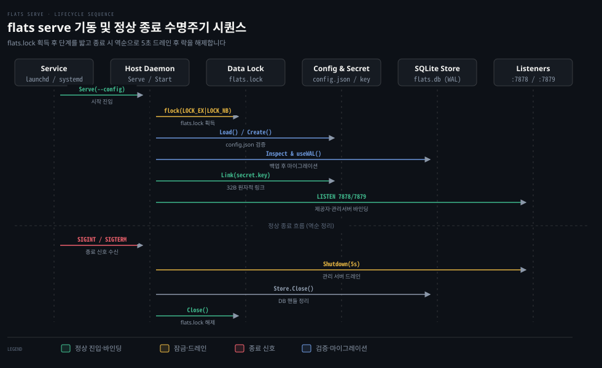
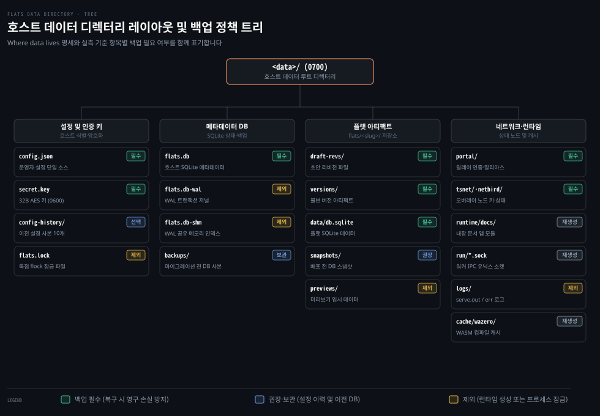

# serve 조립·config·data directory

---

> `flats serve` 데몬의 기동부터 정상 종료까지 이어지는 수명주기, `flats.lock` 단일 파일 잠금을 통한 다중 인스턴스 충돌 방지, `config.json`의 스키마 및 원자적 갱신 규칙, 데이터 디렉터리 내 영구 아티팩트와 임시 캐시의 배치 지도를 다룹니다.


## 학습 목표와 범위

> 단일 호스트 프로세스가 OS 서비스 관리자 하에서 데이터 디렉터리를 초기화하고 잠금을 획득하며 정상 종료하는 전 과정을 이해하고 설명할 수 있습니다.

1. macOS `launchd`와 Linux `systemd` user 단위 관리자가 백그라운드 데몬을 자동 기동하고 재시작하는 원리를 설명할 수 있습니다.
2. 커널 권고 잠금(advisory lock) `flock(2)`의 동작 원리와 파일 식별자(inode) 보존이 다중 호스트 실행 방지에 필수적인 이유를 분석할 수 있습니다.
3. `flats serve` 기동 시 데이터 디렉터리 잠금, `config.json` 유효성 검증, SQLite 마이그레이션 백업, 호스트 바인딩 및 `secret.key` 검증이 수행되는 순서를 추적할 수 있습니다.
4. `config.json`의 핵심 설정 키 구조와 호스트 구동 중 `flats config set` 명령이 거부되는 잠금 보호 메커니즘을 파악할 수 있습니다.
5. 데이터 디렉터리(`flats.db`, `secret.key`, `flats/<slug>/`, 네트워크 상태)의 구성 요소를 식별하고 백업 필수 대상과 재생성 대상을 구별할 수 있습니다.
6. SIGINT/SIGTERM 수신 시 관리 서버 5초 드레인부터 데이터 잠금 해제까지 이어지는 정상 종료 역순 정리 절차를 도출할 수 있습니다.

이 문서는 flats 호스트 데몬의 부트스트랩 조립과 스토리지 디렉터리 수명주기를 다룹니다. SQLite WAL 저널의 기초 원리는 [01-01.Immutable artifact·content hash·SQLite WAL](01-01.Immutable%20artifact%C2%B7content%20hash%C2%B7SQLite%20WAL.md)을, 단일 포트 상의 관리 서버 라우팅과 요청 가드는 [04-02.management server·HostGuard·console](04-02.management%20server%C2%B7HostGuard%C2%B7console.md)을 참고합니다.

기준 커밋 3abe537 (v0.11.0, 2026-10-17)


## 1. 서비스 관리자와 파일 잠금·원자적 교체

> 운영체제의 백그라운드 서비스 관리 원리와 파일 시스템 수준의 동시성 제어 프리미티브는 로컬 데몬의 안전한 기동과 무결성을 떠받치는 토대입니다.

로컬 개발 기계에서 상시 구동되는 서버 프로세스를 운영하려면 두 가지 물리적 한계와 마주합니다. 첫째는 사용자가 터미널 창을 닫거나 컴퓨터를 재부팅했을 때 프로세스를 자동으로 다시 띄우고 장애 발생 시 즉각 재기동하는 수명주기 관리 문제입니다. 둘째는 실수로 동일한 저장소 경로를 바라보는 두 개 이상의 데몬이 동시에 기동되어 데이터를 덮어쓰거나 파괴하는 데이터 오염 문제입니다. flats는 운영체제 표준 서비스 관리자와 POSIX 파일 잠금 인터페이스를 조합하여 이 문제를 해결합니다.

macOS 환경에서는 **launchd**(시스템 초기화 및 서비스 관리 데몬)가 백그라운드 에이전트의 등록과 감시를 전담합니다. 사용자의 그래픽 로그인 세션에서 구동되는 데몬은 `LaunchAgent`로 등록됩니다. 설정 파일은 `~/Library/LaunchAgents/` 아래 XML 속성 목록(`plist`) 파일로 배치됩니다(`launchd.plist(5)` man page).

이 속성 목록에서 가장 중요한 불리언 키는 두 개입니다.

1. `RunAtLoad`: `launchd`가 해당 에이전트 설정을 적재하는 즉시 프로세스를 기동할지 결정합니다. `launchctl bootstrap` 실행 시점이나 사용자 최초 로그인 시점이 이에 해당합니다.
2. `KeepAlive`: 데몬 프로세스가 비정상 종료되거나 예기치 않게 죽었을 때 `launchd`가 프로세스를 자동으로 다시 살려낼지 결정합니다.

운영자는 `launchctl(1)` 명령어로 서비스를 제어합니다. 최신 macOS 명세에서 서비스를 등록할 때는 `launchctl bootstrap gui/<uid> <plist-path>`를 사용합니다. 서비스를 해제할 때는 `launchctl bootout gui/<uid>/<service-name>`을 호출합니다. 실행 중인 데몬을 즉시 강제 종료하고 다시 띄울 때는 `launchctl kickstart -k gui/<uid>/<service-name>` 플래그를 사용합니다.

```bash
# 로컬 실측(2026-10-15, v0.9.1) plist 등록 및 kickstart 재시작 검증
launchctl kickstart -k gui/$(id -u)/dev.flats.serve
launchd: loaded, running, pid 12818, last exit 0
```

로컬 실측(2026-10-15, v0.9.1)에서 생성된 `dev.flats.serve` plist 파일은 `RunAtLoad`와 `KeepAlive`가 모두 `true`로 설정되었습니다. `launchctl kickstart -k` 호출 시 pid가 갱신되면서 정상적으로 재기동됨을 확인했습니다.

리눅스 환경에서는 **systemd**(시스템 및 서비스 관리자)의 사용자 인스턴스인 `systemd --user` 단위가 동일한 역할을 수행합니다(`systemd.service(5)` 명세). 루트 권한을 요구하는 시스템 전역 서비스와 달리 사용자 서비스는 `~/.config/systemd/user/` 아래 단위 파일(`flats.service`)로 배치됩니다.

사용자 서비스는 `systemctl --user daemon-reload`와 `systemctl --user start flats`로 구동됩니다. 서비스 섹션의 `Restart=always` 또는 `Restart=on-failure` 설정으로 프로세스 비정상 종료 시 자동 복구를 보장합니다.

서비스 관리자가 프로세스를 다시 띄울 수 있다는 것은 중복 실행으로 인해 동일한 데이터 디렉터리에 두 프로세스가 동시에 접근할 위험이 상존함을 의미합니다. flats는 이를 차단하기 위해 **flock(2)**(권고 파일 잠금, advisory file lock) 시스템 호출을 활용합니다.

`flock(2)`는 열린 파일 디스크립터에 배타적 잠금(`LOCK_EX`) 또는 공유 잠금(`LOCK_SH`)을 설정합니다. 논블로킹 플래그 `LOCK_NB`를 조합하면 이미 잠금이 걸려 있을 때 대기하지 않고 즉시 커널 에러 `EWOULDBLOCK`(`EAGAIN`)을 반환합니다.

이 잠금의 본질적인 특징은 특정 프로세스나 스레드가 아니라 커널 내부의 열린 파일 테이블 항목(inode)에 바인딩된다는 점입니다. 따라서 프로세스가 정상 종료되거나 충돌(SIGKILL)로 강제 종료되더라도 커널이 열린 파일 디스크립터를 정리하면서 잠금을 자동으로 회수합니다.

단, 권고 잠금이므로 파일 시스템 접근 자체를 물리적으로 차단하지는 않습니다. flats 데몬과 CLI 도구처럼 명시적으로 `flock`을 확인하는 협력 프로세스 사이에서만 상호 배제가 달성됩니다.

마지막 선행 원리는 파일 갱신의 원자성을 보장하는 **rename(2)** 시스템 호출입니다. 설정 파일이나 보안 키를 디스크에 직접 덮어쓰는 과정에서 전원이 차단되거나 프로세스가 강제 종료되면 파일이 잘리거나 손상된 상태(corrupted state)로 남게 됩니다. 이를 방지하는 표준 기법은 4단계 원자적 교체 파이프라인입니다.

1. 대상 파일과 동일한 파일 시스템(동일 디렉터리) 내에 임시 파일(`.tmp`)을 생성합니다.
2. 새 데이터를 임시 파일에 전부 기록합니다.
3. `fsync(2)`(Go 언어의 `file.Sync()`)를 호출하여 메모리 버퍼의 데이터와 메타데이터가 물리 저장 장치에 온전히 기록되도록 강제합니다.
4. `rename(2)`(Go 언어의 `os.Rename()`)를 호출하여 임시 파일을 대상 파일 경로로 덮어씁니다. 동일 파일 시스템 내에서 디렉터리 엔트리를 교체하는 작업은 POSIX 표준상 원자적(atomic)으로 완료되므로 외부 관찰자는 완전히 기록된 이전 파일이나 완전히 기록된 새 파일 중 하나만을 목격하게 됩니다. 교체 직후 부모 디렉터리에도 `fsync`를 수행하여 디렉터리 엔트리 반영을 확정합니다.


## 2. 진입과 부트스트랩 가드

> 데몬이 구동될 때 CLI 플래그를 정규화하고 기존 데이터의 오염 여부를 확인하여 의도치 않은 덮어쓰기를 사전에 거부합니다.

`flats serve` 명령은 `internal/app/serve.go:179`의 `Serve` 함수로 진입합니다. `Serve`는 시그널 통지 컨텍스트(`signal.NotifyContext`)를 구성하여 `SIGINT`와 `SIGTERM`을 청취할 준비를 마칩니다. 이어서 `ParseServeFlags`(`internal/app/serve.go:100`)를 호출하여 입력 인자를 파싱합니다.

호스트의 데이터 디렉터리가 명시적으로 주어지지 않은 경우 `DefaultDataDir`(`internal/app/serve.go:85`)이 환경 변수 `FLATS_DATA`를 먼저 조회합니다. 환경 변수가 비어 있다면 OS 표준 경로인 macOS의 `~/Library/Application Support/Flats`, 리눅스의 `$XDG_CONFIG_HOME/Flats`(`~/.config/Flats`)를 절대 경로로 반환합니다.

```go
// internal/app/serve.go:85-98
func DefaultDataDir() string {
	d := os.Getenv("FLATS_DATA")
	if d == "" {
		d = ".flats"
		if c, err := os.UserConfigDir(); err == nil {
			d = filepath.Join(c, "Flats")
		}
	}
	if abs, err := filepath.Abs(d); err == nil {
		return abs
	}
	return d
}
```

파싱된 옵션은 `Options.setup`(`internal/app/serve.go:295`) 메서드를 거치며 검증됩니다. `--config` 플래그로 명시적인 설정 파일 경로를 넘겨받은 모드에서는 설정 파일 자체가 호스트 구성의 단일 진실 원천(SSOT)이 됩니다. 따라서 `--listen`, `--local-addr`, `--runtime`처럼 런타임 1회성 오버라이드가 허용된 플래그를 제외한 레거시 플래그들이 전달되면 실행을 즉시 거부하고 `flats config set`을 안내합니다.

옵션 검증이 끝나면 `Start`(`internal/app/serve.go:330`)가 `prepare`(`internal/app/setup.go:99`)를 호출하여 호스트 초기화를 시작합니다. 지정된 데이터 디렉터리에 아무런 파일도 없고 `config.json`도 존재하지 않는 신규 환경이라면 `bootstrap`(`internal/app/setup.go:290`) 단계로 진입합니다.

```bash
# 로컬 실측(2026-10-18) 신규 임시 호스트 기동 로그
flats serve --config <obs>/tmphost/config.json --listen 127.0.0.1:17878 --local-addr 127.0.0.1:17879
initialized a new host in <dir> (instance <id>): <dir>/config.json did not exist, so Flats created it with the defaults and an empty database. If you expected existing data, stop the host and check the path or volume
flats v0.11.0 serving; console http://127.0.0.1:17878
```

로컬 실측(2026-10-18)에서 빈 디렉터리에 임시 호스트를 띄웠을 때 기본 설정 파일과 빈 데이터베이스를 생성했다는 초기화 메시지가 출력되고 관리 콘솔이 루프백에 바인딩되었습니다.

여기서 핵심 안전장치는 기존 데이터가 있을 때의 **부트스트랩 거부** 규칙입니다(`README.md:137-140`). `config.json`은 없는데 지정된 폴더에 flats 관련 잔여 데이터가 이미 존재한다면 flats는 절대 새 설정으로 기존 데이터를 덮어쓰지 않습니다.

`setup.go:331`의 `flatsLeftovers` 함수는 디렉터리 내에 아티팩트 잔재가 존재하는지 검사합니다. 검사 대상에는 `flats`, `secret.key`, `tsnet`, `portal`, `backups` 등이 포함됩니다. 잔여 항목이 하나라도 발견되면 `leftoverErr`(`internal/app/setup.go:341`)를 발생시키고 실행을 중단합니다:

```go
// internal/app/setup.go:341-344
func leftoverErr(configPath, dataDir string, found []string) error {
	return actionf("%s has no host database, but %s already holds Flats data (%s): restore flats.db and %s from the same backup, or start a new host in an empty directory",
		dataDir, dataDir, strings.Join(found, ", "), configPath)
}
```

이 가드는 백업 복원 과정에서 실수로 설정 파일만 누락되었을 때 호스트가 제멋대로 새 빈 데이터베이스를 생성하여 기존 플랫 데이터를 덮어쓰거나 고아 파일로 만드는 사고를 방지합니다.


## 3. flats.lock — 단일 호스트 독점 잠금

> 데이터베이스를 열거나 네트워크를 올리기 전에 파일 디스크립터 잠금을 획득하여 다중 데몬 실행을 물리적으로 차단합니다.

호스트가 데이터 폴더를 확정한 직후 가장 먼저 수행하는 작업은 권고 잠금 파일인 `flats.lock`을 선점하는 것입니다(`internal/app/setup.go:141`). 이 잠금은 SQLite 데이터베이스를 열거나 시크릿 키를 읽기 전에 획득되어야 합니다(`docs/design.md` Process layout).

Unix 환경에서는 `internal/app/lock_unix.go:16-28`의 `lockDataDir` 함수가 이 잠금을 구현합니다:

```go
// internal/app/lock_unix.go:16-28
func lockDataDir(dir string) (*os.File, error) {
	f, err := os.OpenFile(filepath.Join(dir, "flats.lock"), os.O_CREATE|os.O_RDWR, 0o600)
	if err != nil {
		return nil, fmt.Errorf("data directory lock: %w", err)
	}
	if err := unix.Flock(int(f.Fd()), unix.LOCK_EX|unix.LOCK_NB); err != nil {
		f.Close()
		if errors.Is(err, unix.EWOULDBLOCK) {
			return nil, fmt.Errorf("data directory %q is already in use: %w", dir, errDataDirInUse)
		}
		return nil, fmt.Errorf("data directory %q cannot be locked: %w", dir, err)
	}
	return f, nil
}
```

소스 주석이 명시하듯 `flats.lock` 파일은 생성된 후 절대 삭제(`unlink`)하거나 교체해서는 안 됩니다. 파일 시스템에서 `flats.lock`을 삭제하면 커널 상에서 새 inode를 가진 동명의 파일이 생성되므로 두 개의 서로 다른 프로세스가 각각 구 inode와 신 inode에 잠금을 획득하여 한 데이터 디렉터리를 동시에 조작하는 사고가 발생할 수 있습니다.

이미 다른 flats 인스턴스가 동작 중인 상태에서 새 호스트가 기동을 시도하면 `unix.Flock`은 논블로킹 조건에 의해 즉시 `unix.EWOULDBLOCK`을 반환합니다. `lockDataDir`은 이를 감지하여 `data directory "..." is already in use` 에러를 반환하며 기동을 안전하게 거부합니다.

또 하나의 방어선은 **지연된 잠금 유지**(`retainDataLock`, `internal/app/serve.go:814`) 메커니즘입니다. 데몬 종료 과정에서 네트워크 드레인이나 백그라운드 태스크가 제한 시간을 초과(`context.DeadlineExceeded`)하여 실패할 수 있습니다. 이때 flats는 `h.dataLock.Close()`를 호출하여 잠금을 풀지 않고 파일 디스크립터를 전역 리스트(`retainedLocks`)에 보관합니다.

프로세스가 완전히 종료되어 운영체제 커널이 프로세스를 거둘 때까지 디스크립터를 열린 상태로 유지합니다. 이 방식은 백그라운드 작업이 디스크를 정리하는 동안 새 호스트가 성급히 디렉터리에 접근하는 레이스 컨디션을 물리적으로 차단합니다(`docs/design.md:72`).


## 4. 기동 준비와 스토리지 바인딩 순서

> 설정 파일 검증, SQLite 마이그레이션 백업, 호스트 바인딩 및 시크릿 키 검증이 단계별 롤백 보장 하에 순차 집행됩니다.

데이터 디렉터리 잠금을 확보한 호스트는 `internal/app/setup.go:99`의 `prepare` 파이프라인을 따라 구동에 필요한 내부 상태를 순서대로 조립합니다. 모든 단계는 실패 시 이전 상태를 온전히 보존하도록 설계되었습니다:

```pseudocode
[prepare 진입]
       │
       ▼
1. sameConfig 검증 ── (잠금 전 읽은 config.json 해시와 잠금 후 파일 일치 확인)
       │
       ▼
2. inspectDB ──────── (flats.db 존재 여부, schema version, 기존 호스트 바인딩 검사)
       │
       ▼
3. decide 분기 ────── (신규 부트스트랩 vs 기존 호스트 기동 vs 마이그레이션 판별)
       │
       ▼
4. SQLite 마이그레이션 ─ (마이그레이션 전 백업 생성 → useWAL 전환 → 단계별 DDL 실행)
       │
       ▼
5. bindHost 확정 ──── (flats.db의 host_binding 테이블에 configPath와 instance_id 각인)
       │
       ▼
[Start 후속 단계]
       │
       ▼
6. CheckSecretKey ─── (암호화 시크릿 존재 시 secret.key 누락 검증 및 거부)
```

첫째, `sameConfig`(`internal/app/setup.go:437`)는 잠금 획득 전후의 설정 파일 일치 여부를 검증합니다. `flats.lock`을 잡기 직전에 메모리로 읽어 들였던 `config.json`의 내용과 잠금을 획득한 직후 디스크에 존재하는 파일의 SHA-256 해시(`p.hash`)를 대조합니다. 잠금을 획득하는 찰나의 순간에 외부 편집기나 CLI에 의해 설정이 변경되었다면 오염된 설정을 반영하지 않고 즉시 재시도를 요구합니다.

둘째, `inspectDB`는 읽기 전용 모드로 SQLite 데이터베이스를 열어 `PRAGMA user_version`과 테이블 메타데이터를 확인합니다. `decide`(`internal/app/setup.go:185`)는 읽어낸 정보와 `config.json`을 대조합니다. 데이터베이스에 기록된 호스트 인스턴스 ID(`info.Binding.InstanceID`)와 `config.json`에 기록된 인스턴스 ID가 일치하지 않는다면 다른 호스트의 데이터 폴더가 연결되었거나 복사본이 잘못 지정된 것으로 판단하고 실행을 거부합니다.

셋째, SQLite 데이터베이스 스키마가 현재 바이너리보다 낮은 버전이라면 `internal/store/migrate.go:222-227`의 `migrate` 함수가 구동됩니다. flats의 마이그레이션에는 원칙이 있습니다: 마이그레이션 전 백업이 성공하지 않으면 단 하나의 DDL도 실행하지 않습니다.

```go
// internal/store/migrate.go:222-227
func migrate(ctx context.Context, path string, info Info) error {
	if !info.New {
		if err := backup(ctx, path, info.Version, time.Now()); err != nil {
			return fmt.Errorf("backup before migration: %w", err)
		}
	}
```

기존 데이터베이스가 존재하면 `<data>/backups/` 디렉터리 아래 `flats.v<버전>.<타임스탬프>.db` 형식으로 스냅샷을 남깁니다. 불필요한 디스크 잠식을 막기 위해 최신 3개의 마이그레이션 백업만을 보존합니다(`const backupsKept = 3`, `internal/store/migrate.go:61`).

```bash
# 로컬 실측(2026-10-17, v0.11.0 업그레이드) 스토어 백업 디렉터리 확인
ls "<data>/backups/"
flats.v11.20261016T052227.476768000Z.db
flats.v15.20261017T130002.538674000Z.db
```

로컬 실측(2026-10-17, v0.11.0 업그레이드)에서 업그레이드 직전 DB 사본이 보존됨을 확인했습니다. 스키마 11인 v0.9.1에서 v0.10.0으로 올라갈 때는 `flats.v11`이, 스키마 15인 v0.10.0에서 v0.11.0으로 올라갈 때는 `flats.v15`가 남았습니다.

백업이 완료되면 `useWAL`(`internal/store/migrate.go:258`)이 데이터베이스를 WAL 모드로 전환합니다. 첫 DDL 실행 전에 WAL 모드로 전환해 두어야 프로세스가 도중에 강제 종료되더라도 롤백 저널 모드의 핫 저널 잔재가 생기지 않고 이후 읽기 전용 검사가 안전하게 통과할 수 있기 때문입니다. 각 마이그레이션 단계는 `runMigration`(`internal/store/migrate.go:282`) 내에서 `user_version` 갱신과 함께 단일 트랜잭션으로 원자적으로 커밋됩니다.

마이그레이션이 완료되면 `bind`(`internal/app/setup.go:395`)가 스토리지 결합을 확정합니다. `flats.db`의 `host_binding` 테이블에 인스턴스 ID와 설정 파일 경로를 기록합니다(`p.st.BindHost`, `internal/app/setup.go:402`).

`prepare` 반환 후 `Start`(`internal/app/serve.go:369`, 주석 `:361`)에서 네트워크 가동 전 `CheckSecretKey`(`internal/core/secrets.go:30-48`)로 키 무결성을 검증합니다.

데이터베이스에 암호화된 시크릿(`st.HasSecrets`)이나 호스트 키가 있는데 `secret.key`가 누락되면 기동을 거부합니다(`ErrSecretKeyMissing`). 새 키로는 기존 시크릿을 열 수 없으므로 동일 백업에서 복원해야 합니다.

실제 `secret.key` 파일은 호스트 키나 시크릿을 처음 봉인할 때 생성됩니다. `loadOrCreateKey`(`internal/core/secrets.go:51-90`)가 지연 호출(`SealHostKey`, `internal/core/hostkeys.go:90`)되는 구조입니다. 32바이트 난수를 임시 파일에 쓰고 `Sync()`와 `0600` 권한 부여를 거쳐 `os.Link`로 원자적 배치합니다. 경쟁 승자가 이미 존재하면 기존 키를 읽어옵니다.




## 5. config.json의 스키마와 오프라인 수정 제약

> 실행 중인 서비스의 설정 파일이 외부 프로세스에 의해 임의로 수정되면 메모리에 상주하는 런타임 상태와 디스크의 설정 사이에 상태 불일치가 발생합니다.

특히 바인딩 주소나 데이터 경로가 바뀌면 진행 중인 요청이 엉뚱한 곳으로 향하거나 데이터 손실로 이어집니다. 이를 방지하기 위해 flats는 `config.json`의 수정을 오프라인 상태로 제한합니다. `config.json`은 운영자가 직접 지정한 설정값만을 담는 간결한 JSON 문서입니다(`docs/configuration.md` 「config.json」). 파일 내에 명시되지 않은 키는 코드에 내장된 고정 기본값을 사용합니다. 파일의 유효성은 1 MiB 용량 제한, UTF-8 인코딩, 중복 키 금지, 미정의 키 금지, `null` 값 금지 등의 규칙으로 검증됩니다.

`internal/config/config.go:82`의 스펙 정의와 로컬 실측(2026-10-18, v0.11.0)의 `flats config show` 출력으로 주요 설정 키와 기본값을 확인했습니다.

| 설정 키 | 기본값 | 적용 시점 | 설명 |
| :--- | :--- | :--- | :--- |
| `host.instance_id` | 초기화 시 생성 | 불변 | 호스트 식별용 UUID (수정 불가, rebind로만 재생성) |
| `host.data_dir` | 초기화 시 결정 | 오프라인 | 호스트의 절대 데이터 디렉터리 경로 |
| `host.management_addr` | `127.0.0.1:7878` | 재기동 | 관리 콘솔, CLI, MCP 엔드포인트 루프백 주소 |
| `host.local_addr` | `127.0.0.1:7879` | 재기동 | 콘텐츠 서빙용 로컬 네트워크 바인딩 주소 |
| `host.server_runtime` | `true` | 재기동 | 서버 플랫(wazero WebAssembly 런타임) 활성화 여부 |
| `network.permitted` | `[]` | 콘솔 즉시 / 재기동 | 허용할 네트워크 제공자 목록 (`portal`, `tailscale` 등) |
| `network.private_backend`| `local` | 재기동 | 기본 비공개 백엔드 (`local` 또는 `tailscale`) |
| `network.default_private`| `""` | 신규 플랫 즉시 | 신규 플랫에 기본 부여할 비공개 제공자 |
| `network.default_public` | `""` | 신규 플랫 즉시 | 신규 플랫에 기본 부여할 공개 제공자 |
| `tailscale.console_hosts`| `[]` | 콘솔 즉시 / 재기동 | Tailscale 상에서 콘솔을 서빙할 도메인 노드 목록 |
| `system.upload_max_bytes`| `20971520` (20 MiB) | 즉시 | 단일 아티팩트 업로드 최대 허용 바이트 수 |
| `system.version_quota` | `20` | 즉시 | 플랫당 보존할 최대 버전 개수 (0은 무제한) |
| `system.disk_quota_bytes`| `32212254720` (30 GiB)| 즉시 | 플랫당 최대 디스크 사용량 상한 |
| `system.preview_ttl_seconds`| `86400` (24시간) | 다음 청소 | Draft 미리보기 컨테이너의 유효 수명 |
| `system.rate_limit_rps` | `50` | 즉시 | 플랫당 초당 최대 요청 처리 상한선 |
| `system.revision_quota` | `100` | 즉시 | 문서/디자인당 보존할 고정되지 않은 리비전 수 |
| `system.pin_quota` | `20` | 즉시 | 문서/디자인당 고정(pin) 가능한 최대 리비전 수 |
| `portal.max_active_relays`| `3` | 재기동 | 동시 연결을 유지할 최대 Portal 릴레이 개수 |
| `portal.discovery` | `true` | 재기동 | Portal 기본 디스커버리 릴레이 자동 탐색 여부 |

이 설정 파일은 `internal/config/write.go`의 `Writer.Save`가 안전하게 갱신합니다. 새 설정을 쓰기 전에 파일의 해시 충돌(`ConflictError`)을 검사하고 기존 파일은 `config-history/` 디렉터리에 `config.v<스키마>.<타임스탬프>.json` 형식으로 최신 10개까지 보관합니다. 그 후 임시 파일 작성, `fsync`, `os.Rename` 및 디렉터리 동기화의 4단계를 거쳐 교체됩니다.

가장 중요한 운영 규칙은 호스트가 실행 중일 때 `flats config set`이 거부된다는 점입니다(`docs/design.md` 「Approvals」 Enforced 첫 항목).

```go
// internal/app/configcmd.go:154-160
func lockOffline(dir string) (*os.File, error) {
	f, err := lockDataDir(dir)
	if errors.Is(err, errDataDirInUse) {
		return nil, actionf("%v: stop the running Flats host first", err)
	}
	return f, err
}
```

오프라인 설정을 변경하는 CLI 명령(`set`, `unset`, `init`, `rebind`)은 파일 수정 전에 반드시 `lockOffline`으로 해당 데이터 디렉터리의 `flats.lock`을 잡으려고 시도합니다. 호스트 데몬이 구동 중이라면 잠금 획득이 실패하고 프로세스는 즉시 중단됩니다. 이 설계는 데몬이 메모리에 캐시하고 있는 설정과 디스크의 설정이 괴리되는 것을 막고 실행 중인 서비스의 핵심 주소나 포트가 임의로 뒤바뀌는 것을 차단합니다.

```bash
# 로컬 실측(2026-10-15, v0.9.1) 백업 복원 중 발생한 경로 불일치
flats config set host.data_dir '<data>/restore-test' --config '<data>/restore-test/config.json'
```

로컬 실측(2026-10-15, v0.9.1)에서 백업 디렉터리를 복사하여 복원 테스트를 진행할 때 복사된 `config.json`의 `host.data_dir`이 여전히 기존 운영 경로를 가리키고 있었습니다. 그 상태에서 `flats config set`을 호출하자 CLI가 기존 운영 디렉터리의 `flats.lock`을 잡으려 시도하다가 이미 실행 중인 운영 호스트에 의해 거부되었습니다. 이는 안전장치로서 의도된 동작이며 운영 중인 데이터 폴더를 실수로 변경하지 못하도록 보호합니다.


## 6. 데이터 디렉터리 구조와 백업 전략

> 데이터 디렉터리는 호스트의 영구 데이터와 임시 런타임 캐시가 정밀하게 분리 배치된 계층 구조를 가집니다.

flats는 "누가 이 값을 결정하는가?"라는 기준에 따라 데이터의 저장 위치를 분리합니다(`docs/configuration.md` 「Where data lives」). 운영자가 결정한 것은 `config.json`에, 호스트 런타임이 결정한 것은 `flats.db`에, 플랫 사용자가 결정한 것은 `flats/<slug>/`에 저장됩니다.

공식 문서 명세와 로컬 실측을 종합해 데이터 디렉터리 지도와 백업 정책을 정리했습니다.

| 저장 경로 | 내용 및 역할 | 백업 필요 여부 |
| :--- | :--- | :--- |
| `config.json` | 운영자 설정 단일 진실 원천 | **필수** |
| `config-history/` | 직전 설정 파일 사본 (최신 10개) | 선택 (이력 추적용) |
| `flats.db` | 호스트 메타데이터 SQLite DB (플랫, 버전, 배포, 승인, 이벤트) | **필수** (`VACUUM INTO` 또는 호스트 정지 시 복사) |
| `flats.db-wal`, `-shm` | SQLite 트랜잭션 저널 및 공유 메모리 인덱스 | 제외 (정상 종료 시 자동 병합) |
| `secret.key` | 플랫 시크릿 및 운영자 키 암호화용 32바이트 AES 키 (0600) | **필수** (`flats.db`와 동일 시점 백업 필수) |
| `backups/` | 스키마 마이그레이션 전 DB 스냅샷 (최신 3개) | 보관 (롤백 필요 시) |
| `flats/<slug>/draft-revs/` | 저장된 초안(Draft) 리비전 파일 아티팩트 | **필수** |
| `flats/<slug>/versions/` | 배포 및 승인 완료된 불변 버전 아티팩트 | **필수** |
| `flats/<slug>/data/db.sqlite` | 플랫 전용 SQLite 데이터베이스 | **필수** |
| `flats/<slug>/data/files/` | 플랫 전용 파일 저장소 (`env.FILES`) | **필수** |
| `flats/<slug>/snapshots/` | 배포 전 또는 데이터 복원 전 DB+FILES 스냅샷 | **필수** (문서 제외) |
| `flats/<slug>/previews/` | Draft 임시 미리보기 런타임 데이터 | 제외 (24시간 TTL 후 삭제) |
| `flats/.lifecycle/` | 미완료 이름변경/삭제 저널 및 고아 폴더(`orphans/`) | **필수** (존재 시) |
| `tsnet/` | Tailscale 노드 상태 및 인증서 | **필수** (누락 시 새 머신 발급) |
| `portal/` | Portal 릴레이 인증 ID(`<slug>.json`) 및 고정 릴레이 매핑 | **필수** (누락 시 도메인 주소 변경) |
| `netbird/peers/<name>/` | NetBird 피어별 신원 키(0600) 및 연결 상태 | **필수** (누락 시 신규 피어 재등록) |
| `zrok/`, `zrok-environment/` | zrok 예약 이름 목록 및 연결된 계정 신원 키(0600) | **필수** (누락 시 계정 재연결 필요) |
| `cloudflare-quick/<slug>.json` | Cloudflare 빠른 터널 자격 증명 (0600) | 선택 (누락 시 새 무작위 주소 발급) |
| `network-retirements/` | 미완료 tailnet 노드 정리 작업 저널 | **필수** (존재 시) |
| `runtime/docs/` | 내장 문서 앱 정적 JS 모듈 에셋 | 제외 (기동 시 자동 재생성) |
| `run/*.sock` | 워커 프로세스 통신용 Unix 도메인 소켓 | 제외 (프로세스 종료 시 파기) |
| `logs/` | 서비스 표준 출력/에러 로그 (`serve.out.log`, `serve.err.log`) | 제외 (재기동 시 새로 생성) |
| `cache/wazero/` | 컴파일된 WASM 기계어 바이너리 캐시 | 제외 (자동 재생성) |
| `flats.lock` | 호스트 독점 실행 권고 잠금 파일 | 제외 (기동 시 자동 잠금) |

```bash
# 로컬 실측(2026-10-16, v0.9.1) 백업 디렉터리 항목 확인
cp -Rp "$HOME/Library/Application Support/Flats" backups/flats-data-20261016-pre-v0.10.0
백업에 든 것: cache, config-history, config.json, flats/, flats.db, flats.lock, logs, portal/, run, runtime, secret.key. 정상 종료 뒤라 -wal·-shm 파일은 없었다.
```

로컬 실측(2026-10-16, v0.9.1)에서 v0.10.0 업그레이드 직전 호스트를 중지(`launchctl bootout`)하고 전체 디렉터리 백업을 수행했습니다. 정상 종료된 상태였으므로 SQLite `-wal`과 `-shm` 파일은 깔끔하게 체크포인트되어 디스크에 남지 않았습니다. `config.json`, `flats.db`, `secret.key`, `flats/`, `portal/` 등이 무결하게 복제되었습니다.

백업을 수행할 때는 반드시 호스트를 정지한 상태에서 디렉터리를 통째로 복사하거나 호스트가 구동 중이라면 SQLite의 `VACUUM INTO` 명령을 사용하여 원자적 스냅샷을 뜬 뒤 `secret.key`를 동일한 시점에 함께 백업해야 합니다. `secret.key` 없는 `flats.db`는 암호화된 시크릿을 복호화할 수 없어 복원이 불가능합니다.




## 7. 종료 수명주기와 안전한 락 해제

> 데몬을 즉각 강제 종료하면 처리 중이던 HTTP 연결이 잘려 나가고 데이터베이스 저널이 불완전하게 남거나 자식 워커 프로세스가 고아로 남게 됩니다.

백그라운드 작업이 디스크를 정리하는 동안 새 호스트가 기동되면 동일 데이터를 두고 경쟁 상태가 발생합니다. flats에서는 `internal/app/serve.go:732`의 `Host.Close` 메서드가 각 컴포넌트를 역순으로 안전하게 드레인합니다. `Close`는 `sync.Once`로 보호되어 다중 호출이나 동시 호출에도 멱등성(idempotency)을 보장합니다.

공식 설계 문서(`docs/design.md` Process layout 뒤 Shutdown 문단)에 명시된 종료 절차와 실제 `serve.go:732-812` 구현 코드를 비교하면 아래 순서로 동작합니다:

```pseudocode
[종료 신호 수신]
       │
       ▼
1. 백그라운드 컨텍스트 취소 (`bgCancel()`)
       │
       ▼
2. 관리 서버 5초 드레인 (`srv.Shutdown(5s)`) ── 실패 시 즉시 강제 종료(`srv.Close()`)
       │
       ▼
3. 코어 서비스 정지 (`Svc.Close()`) ────────── 실행 중인 워커 프로세스들 정리
       │
       ▼
4. 제공자 라우트 종료 (`Providers.Close()`)
       │
       ▼
5. 공개 네트워크 종료 (`Public.Close()` / `portalNet` / `zrokNet` / `quickNet` / `netbirdNet`)
       │
       ▼
6. 비공개 네트워크 종료 (`Private.Close()` / `tsNet` / `localNet`)
       │
       ▼
7. 백그라운드 고루틴 대기 (`bg.Wait()`) ────── 요청 처리 잔여 작업 완료 보증
       │
       ▼
8. SQLite 스토어 종료 (`Store.Close()`) ────── 데이터베이스 커넥션 풀 정리
       │
       ▼
9. 데이터 잠금 해제 (`dataLock.Close()`) ────── 기한 초과 에러 시 retainDataLock 유지
```

첫째, 새 인입 요청을 차단하기 위해 관리 서버 HTTP 리스너에 5초 타임아웃 컨텍스트를 부여하고 `Shutdown`을 호출합니다. 5초 내에 기존 연결이 정리되지 않으면 즉시 `Close()`로 연결을 강제 절단합니다.

둘째, 코어 서비스(`Svc.Close()`)가 구동 중인 플랫의 워커 프로세스(`wazero` 런타임 및 내장 문서 앱)를 종료시킵니다.

셋째, 네트워크 리버스 터널과 오버레이 네트워크를 닫습니다. 외부 인터넷에 노출된 공개 네트워크(`portal`, `zrok`, `cloudflare-quick`)를 먼저 닫아 외부 유입을 차단한 뒤 운영자 사설망인 비공개 네트워크(`tailscale`, `local`)를 닫습니다.

넷째, 네트워크로 들어와 아직 진행 중인 백그라운드 태스크가 스토어에 접근할 수 있으므로 `h.bg.Wait()`로 고루틴들이 작업을 마칠 때까지 기다린 뒤 SQLite 데이터베이스(`Store.Close()`)를 닫습니다.

마지막으로 모든 컴포넌트의 종료 결과 에러를 합산(`errors.Join(errs...)`)합니다. 컴포넌트 중 어느 하나라도 기한 초과(`context.DeadlineExceeded`)를 일으켰다면 `retainDataLock`을 호출하여 `flats.lock` 잠금을 프로세스가 죽을 때까지 유지합니다. 정상적으로 모든 자원이 회수되었을 때에만 `dataLock.Close()`를 호출하여 잠금을 해제합니다. 실패가 발생한 경우 구성 요소 이름과 원인 에러를 결합하여 CLI 종료 에러로 보고합니다.


## 8. 한계와 실패 표

> 호스트 조립 및 기동 과정에서 발생하는 전형적인 실패 원인과 감지 위치, 시스템의 방어 양상을 정리합니다.

| 장애 상황 | 감지 위치 | 주요 원인 | 발생 에러 및 증상 | 복구 및 조치 절차 |
| :--- | :--- | :--- | :--- | :--- |
| **다중 호스트 기동 충돌** | `lock_unix.go:23` | 동일한 데이터 디렉터리로 다른 flats 데몬이 이미 실행 중임 | `data directory "..." is already in use` (기동 즉시 실패) | 실행 중인 기존 데몬을 중지하거나 다른 데이터 디렉터리 지정 |
| **기존 데이터 디렉터리 덮어쓰기** | `setup.go:341` | `config.json`이 없는데 디렉터리에 기존 flats 아티팩트 잔재가 있음 | `... has no host database, but ... already holds Flats data` | 동일 백업에서 `config.json`과 `flats.db`를 함께 복원하거나 빈 디렉터리에서 새로 시작 |
| **호스트 인스턴스 바인딩 불일치** | `setup.go:190` | `config.json`의 `instance_id`와 `flats.db`의 `host_binding` 기록이 다름 | `... is bound to host instance ..., but ... is instance ...` | `host.data_dir` 경로를 바로잡거나 `flats config rebind --yes`로 독립 식별자 재부여 |
| **기동 중 설정 변경 충돌** | `setup.go:445` | 잠금 획득 전후에 `config.json` 파일 내용이 외부에서 변경됨 | `... changed while Flats was starting; retry` | 외부 편집기 수정을 멈추고 `flats serve` 재실행 |
| **호스트 실행 중 설정 편집 시도** | `configcmd.go:157` | 호스트가 떠 있는 상태에서 터미널 CLI로 `flats config set` 실행 | `...: stop the running Flats host first` | 호스트 데몬을 중지한 후 오프라인 상태에서 설정을 변경하거나 웹 콘솔 UI에서 변경 |
| **암호화 시크릿 키 분실** | `secrets.go:39` | DB에 암호화된 시크릿이 존재하는데 디렉터리에 `secret.key`가 없음 | `secret.key is missing but the database holds encrypted secrets` | 새 키 생성을 거부하므로 DB와 동일 시점에 백업된 `secret.key`를 반드시 복원해야 함 |
| **종료 기한 초과로 인한 락 잠김** | `serve.go:802` | 네트워크 드레인이나 고루틴 종료가 5초 기한을 넘김 | `data directory unlock` 스킵 및 프로세스 종료 시까지 잠금 유지 | 프로세스가 커널에 의해 완전히 소멸할 때까지 대기한 후 새 호스트 기동 |


## 리뷰 노트

> 코드베이스와 공식 문서를 대조하며 확인한 세부 사항과 설계 판단을 기록합니다.

- `internal/app/serve.go:747-797` 대조: `docs/design.md` Shutdown 문단은 종료 절차를 5단계로 요약합니다. "관리 서버 5s drain → core worker 정지 → 공개 다음 비공개 네트워크 닫기 → SQLite 닫기 → 잠금 해제" 순입니다. 실제 코드에서는 코어 워커 정지와 네트워크 종료 사이에 `Providers.Close()`가 호출됩니다. 비공개 네트워크 종료와 SQLite 닫기 사이에는 `h.bg.Wait()`도 명시적으로 배치되어 있습니다. 비동기 백그라운드 요청이 SQLite 핸들을 참조하다 패닉에 빠지는 것을 방지하기 위한 필수 안전 seam입니다.
- `internal/app/lock_unix.go:17`: `flats.lock`을 열 때 `os.O_CREATE|os.O_RDWR` 모드를 사용하며 파일 퍼미션은 `0600`으로 제한됩니다. 소스 주석에서 강조하듯 잠금 파일 자체를 삭제(`os.Remove`)하는 코드는 리포지토리 어디에도 존재하지 않으며 오직 `Close()`로 디스크립터를 닫아 커널이 잠금을 회수하도록 유도합니다.
- `internal/core/secrets.go:51-90` (`loadOrCreateKey`): `secret.key`를 발행할 때 `os.CreateTemp`(:63)로 임시 파일을 만들고 `Sync()` 후 `os.Link`(:84)를 호출합니다. `os.Link`는 대상이 이미 있으면 실패(`os.IsExist`)하여 경쟁 승자의 32바이트 키를 보존합니다. 패자는 기존 키를 읽어옵니다. 반면 기동 경로의 `CheckSecretKey`(:30-48)는 키를 생성하지 않고, DB에 시크릿이 있는데 키가 없으면 거부(`ErrSecretKeyMissing`)만 수행합니다.
- `internal/app/setup.go:327`: `leftoverNames` 리스트에 `provider.FileName`(`network-provider.json`)이 포함되어 있습니다. 과거 버전의 네트워크 설정 파일이 남아있는 레거시 디렉터리도 안전하게 감지하여 부트스트랩 덮어쓰기를 차단합니다.


## 자가 점검 질문

1. `flats serve`가 단일 데이터 디렉터리에서 다중 인스턴스 실행을 방지할 때 `flock(2)` 잠금 파일을 절대 삭제(`unlink`)하지 않고 유지하는 이유는 무엇입니까?
2. `config.json`이 존재하지 않는 빈 폴더에서 `flats serve`를 처음 실행하면 정상 기동되지만, 과거 데이터 잔재가 남아 있는 폴더에서 실행하면 부트스트랩이 거부되는 이유는 무엇입니까?
3. 데몬이 기동 준비(`prepare`) 단계에서 SQLite 마이그레이션을 수행하기 전에 반드시 `<data>/backups/`에 스냅샷을 생성하고 WAL 모드로 먼저 전환하는 이유는 무엇입니까?
4. 호스트 데몬이 구동 중일 때 CLI에서 `flats config set` 명령을 실행하면 어떤 기제로 차단되며 왜 이러한 제약을 두었습니까?
5. 데몬이 정상 종료될 때 네트워크 드레인 과정에서 `context.DeadlineExceeded` 에러가 발생하면 `flats.lock`은 어떻게 처리됩니까?


## 정답 (자답 후 펼치기)

1. `flock(2)` 권고 잠금은 파일 경로 문자열이 아니라 커널 내부의 고유 파일 식별자(inode)에 바인딩됩니다. 잠금 파일을 삭제하면 파일 시스템에 새로운 inode를 가진 새 파일이 생성되므로 기존 데몬이 이전 inode를 잡고 있는 상태에서 새 데몬이 새 inode에 잠금을 획득하여 두 호스트가 한 디렉터리를 동시에 조작하는 동시성 파괴가 발생하기 때문입니다.
2. 실수로 설정 파일만 유실되었거나 백업 복원 과정에서 `config.json`이 누락되었을 때 호스트가 이를 새 설치 환경으로 오판하여 기본값과 빈 데이터베이스로 초기화해 버리면 기존 플랫 데이터가 덮어써지거나 고아 상태로 남게 됩니다. flats는 데이터 안전을 위해 잔여 아티팩트(`flatsLeftovers`)가 하나라도 발견되면 즉시 거부하고 동일 백업에서 복원할 것을 강제합니다.
3. 마이그레이션 도중 실패가 발생했을 때 데이터베이스를 마이그레이션 직전의 완전한 상태로 복구할 수 있는 마지막 수단을 확보하기 위함입니다(백업 생성이 실패하면 마이그레이션 자체가 중단됨). 또한 WAL 모드로 먼저 전환해야 DDL 도중 강제 종료되더라도 롤백 저널 모드 특유의 핫 저널 잔재가 남지 않아 이후 읽기 전용 검사(`Inspect`)가 방해받지 않습니다.
4. `flats config set` 명령은 실행 직후 `lockOffline`을 호출하여 대상 데이터 디렉터리의 `flats.lock`에 논블로킹 배타적 잠금(`LOCK_EX|LOCK_NB`)을 걸려고 시도합니다. 실행 중인 호스트 데몬이 이미 해당 락을 선점하고 있으므로 커널이 `EWOULDBLOCK`을 반환하여 명령이 거부됩니다. 이는 실행 중인 데몬의 인메모리 설정과 디스크 설정이 불일치하는 것을 막고 포트나 바인딩 주소가 임의로 바뀌는 사고를 방지하기 위함입니다.
5. 종료 에러 목록에 기한 초과(`DeadlineExceeded`)가 포함되어 있으면 `Host.Close`는 `h.dataLock.Close()`를 호출하지 않고 `retainDataLock`을 호출하여 파일 디스크립터를 전역 슬라이스에 유지합니다. 백그라운드 태스크가 완전히 정리되지 않은 상태에서 성급히 잠금이 풀려 새 호스트가 디렉터리에 접근하는 것을 막기 위해 프로세스가 OS에 의해 완전히 거두어질 때까지 잠금을 강제로 유지합니다.
