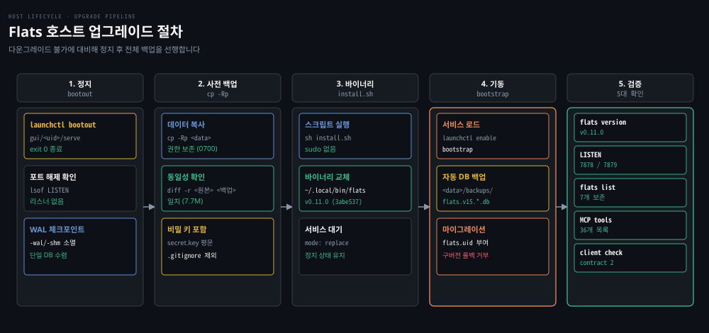
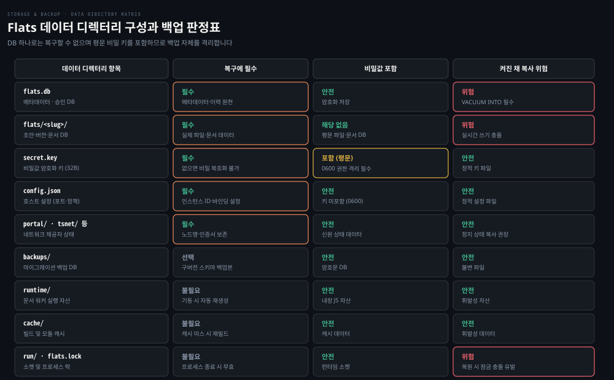

# install·upgrade·backup

---

> 권한 없는 단일 바이너리 설치와 백그라운드 서비스 등록, 다운그레이드가 불가능한 스키마 전진에 대비한 선행 백업 및 업그레이드 순서, 전체 데이터 디렉터리 복구 및 핫 카피 기법, 그리고 CLI 독립 갱신 메커니즘을 다룹니다.


## 학습 목표와 범위

> 무권한 호스트 설치와 안전한 업그레이드 수명주기, 데이터 디렉터리 복구 요건 및 클라이언트 독립 갱신 원리를 이해하고 설명할 수 있습니다.

1. `install.sh` 가 플랫폼 판별, 체크섬 대조, 원자적 바이너리 교체, launchd 및 systemd 서비스 등록을 수행하는 전 과정을 설명할 수 있습니다.
2. 스키마 버전(`user_version`) 전진으로 인한 비가역적 데이터 변경에 대비해 왜 서비스 정지와 전체 디렉터리 백업을 선행해야 하는지 인과관계를 분석할 수 있습니다.
3. 데이터베이스 파일 단독 복사의 한계를 규명하고, `secret.key` 와 슬러그 디렉터리를 포함한 전체 백업 세트의 필요성과 무중단 `VACUUM INTO` 메커니즘을 비교할 수 있습니다.
4. `flats update` 가 서비스 실행 바이너리를 보호하고 비차단 파일 락을 통해 안전하게 클라이언트만 갱신하는 내부 제어를 추적할 수 있습니다.
5. 컨테이너 환경에서 단일 볼륨 마운트와 루프백 포트 격리를 통해 호스트 보안을 유지하는 운영 방식을 도출할 수 있습니다.

이 문서는 호스트 설치와 서비스 등록, 업그레이드 절차, 백업과 복구, 클라이언트 셀프 업데이트를 다룹니다. 데이터 디렉터리의 `config.json` 구조와 serve 조립 내부는 05-01 편을 참고합니다. SQLite WAL 모드의 동시성과 내구성 기반은 01-01 편을 참고합니다.

기준 커밋 3abe537 (v0.11.0, 2026-10-17)


## 1. 설치 — 권한 없는 단일 바이너리와 백그라운드 서비스 등록

> `install.sh` 는 루트 권한을 요구하지 않고 단일 Go 바이너리를 배치하며 사용자 세션 관리자에 백그라운드 서비스를 등록합니다.

서버 소프트웨어를 설치할 때 루트(`sudo`) 권한을 요구하거나 셸 환경 설정 파일(`.zshrc`, `.bashrc`)을 임의로 수정하는 스크립트는 운영체제의 보안 경계를 무너뜨립니다. 전역 시스템 디렉터리에 파일을 쓰면 패키지 관리자와 충돌이 일어나고 프로세스가 높은 권한으로 실행되면 런타임 취약점이 시스템 전체로 번집니다.

flats 는 이런 침해를 막으려고 사용자의 일반 권한만으로 동작하게 설계되었습니다. 공식 설치 스크립트 머리 주석에는 인스톨러가 sudo 를 사용하지 않고 셸 프로필을 편집하지 않는다는 원칙이 명시되어 있습니다(`install.sh:27`).

스크립트는 일곱 단계로 실행됩니다.

1. **플랫폼 판별 (`detect_platform`)**: 운영체제(`uname -s`)와 CPU 아키텍처(`uname -m`)를 검사합니다(`install.sh:142-158`). Darwin 과 Linux, 그리고 amd64 와 arm64 조합만 허용합니다. macOS 환경에서 x86_64 셸이 Rosetta 2 아래에서 돌고 있으면 `sysctl -n sysctl.proc_translated` 를 조회해 자동으로 arm64 로 보정합니다(`install.sh:154-158`).
2. **릴리스 버전 해석 (`latest_tag`)**: 버전을 따로 지정하지 않으면 GitHub 릴리스의 최종 리다이렉트 URL 헤더(`url_effective`)를 먼저 조회해 최신 태그를 해석합니다(`install.sh:362-376`). 버전을 미리 고정해 두면 아카이브와 `checksums.txt` 가 서로 다른 릴리스에서 내려받아지는 레이스 컨디션을 막습니다.
3. **아카이브 및 체크섬 수신 (`fetch`)**: GitHub 릴리스 저장소에서 OS 및 아키텍처별 아카이브(`flats_<os>_<arch>.tar.gz`)와 `checksums.txt` 를 임시 디렉터리로 내려받습니다(`install.sh:517-521`).
4. **암호학적 체크섬 대조**: `checksums.txt` 에서 해당 아카이브의 해시를 추출한 뒤 시스템의 `sha256sum` 또는 `shasum -a 256` 계산 결과와 비교합니다(`install.sh:522-524`). 해시가 다르면 스크립트는 즉시 종료합니다. 공식 문서가 밝히듯 이 과정은 독립 서명 검증이 아니라 GitHub 발행 출처 내 일관성 확인입니다(`docs/release.md:15-16`, `docs/release.md:411-413`).
5. **임시 스테이징 및 실행성 검증**: 아카이브에서 `flats` 바이너리를 풀어 대상 폴더(`~/.local/bin`)에 `.flats.install.$$` 이라는 임시 이름으로 복사합니다(`install.sh:528-534`). 교체하기 전에 `"$staged" version` 을 실행해 현재 커널에서 바이너리가 정상 구동되는지 먼저 확인합니다(`install.sh:536-538`).
6. **원자적 교체 (`mv -f`)**: 검증을 통과하면 `mv -f "$staged" "$binary"` 명령으로 대상 위치에 원자적으로 교체합니다(`install.sh:539`). 원자적 파일 교체 덕분에 기존 프로세스가 디스크에서 읽고 있던 실행 파일이 손상되지 않습니다.
7. **서비스 등록 및 헬스체크**: `--no-service` 플래그가 없는 한 `flats install` 명령을 호출해 사용자 서비스 관리자에 데몬을 등록합니다(`install.sh:553-557`). 서비스 관리자 등록 후 `wait_healthy` 함수가 최대 30초 동안 서비스 러닝 상태와 `GET /api/status` 응답을 확인합니다(`install.sh:387-396`).

백그라운드 서비스는 운영체제의 사용자 도메인에 등록됩니다.

- **macOS launchd**: 사용자 에이전트 경로(`~/Library/LaunchAgents/dev.flats.serve.plist`)에 plist 파일을 기록합니다. `internal/launchd/launchd.go:143` 의 `BuildJob` 함수가 인자를 조립하고 `:90` 의 `Plist` 가 XML 을 생성하며 `:192` 의 `Install` 이 서비스를 로드합니다. 이때 사용자의 현재 셸 `PATH` 환경변수 전체가 plist 의 `EnvironmentVariables` 블록으로 복사됩니다. 서비스 중단은 `:244` 의 `Stop`(`launchctl bootout`), 서비스 기동은 `:262` 의 `Start`(`launchctl bootstrap`)가 담당합니다.
- **Linux systemd**: 사용자 유닛 파일(`${XDG_CONFIG_HOME:-~/.config}/systemd/user/flats.service`)을 생성합니다. `internal/systemd/systemd.go:69` 의 `Render` 함수가 유닛 텍스트를 구성하고 `:108` 의 `Install` 함수가 `systemctl --user daemon-reload` 와 `enable`, `restart` 를 호출합니다. 로그아웃 후에도 프로세스가 지속되도록 `enable_linger` 가 `loginctl enable-linger` 를 시도합니다(`install.sh:309-318`).

로컬 실측(2026-10-15, v0.9.1)으로 설치 전 과정을 확인했습니다.

```bash
sh logs/raw/install.sh
flats-install: downloading flats_darwin_arm64.tar.gz (v0.9.1)
flats-install: installed <home>/.local/bin/flats: flats v0.9.1 (e681bb5) go1.27.1 darwin/arm64
flats-install: installing the Flats service
Installed launchd agent dev.flats.serve (<home>/Library/LaunchAgents/dev.flats.serve.plist)
  runs:   <home>/.local/bin/flats serve --config <home>/Library/Application Support/Flats/config.json
  logs:   <home>/Library/Application Support/Flats/logs/serve.out.log
          <home>/Library/Application Support/Flats/logs/serve.err.log
Flats is running at http://127.0.0.1:7878
flats-install: Flats is running at http://127.0.0.1:7878

Console:  http://127.0.0.1:7878
Status:   flats status
Remove:   flats uninstall   (keeps your flats and data)
```

설치된 아카이브 SHA-256(`2cf9d0245fd22fbd71782801d1688227642d37b6291d7f5886b6eba55a440687`)은 릴리스의 `checksums.txt` 와 일치했습니다. 설치 바이너리의 코드시그니처는 ad-hoc(`Signature=adhoc`, linker-signed)으로 확인되었습니다.

`flats --version` 은 플래그 미정의(`flag provided but not defined: -version`, 종료 코드 2)로 실패합니다(`internal/cli/cli.go:197`). 올바른 명령은 하위 명령 `flats version` 입니다. `gh attestation verify` 는 출력 없이 종료 코드 0 만 반환했습니다.

`install.sh` 의 파일 해시는 v0.9.1 부터 v0.11.0 까지 `0bb87c02029374154f201d2339db0982814ebe2b4141f15462a82a69d63ab6a9` 로 동일했습니다.


## 2. 업그레이드 — 비가역적 스키마 마이그레이션과 전체 백업 선행

> flats 호스트 업그레이드는 데이터베이스 스키마와 설정 버전을 전진시키며 하위 버전으로의 다운그레이드를 거부하므로 서비스 정지와 전체 백업이 필수입니다.

실행 중인 서버 바이너리를 단순히 덮어쓰는 무중단 업그레이드는 데이터베이스 구조가 바뀌는 소프트웨어에서 큰 장애로 이어집니다. 구버전 코드가 메모리에 상주한 채 신버전 프로세스가 새 테이블이나 컬럼을 생성하면 두 버전이 SQLite 잠금과 트랜잭션을 놓고 충돌합니다. flats 의 메인 메타데이터베이스(`flats.db`)는 마이그레이션 과정에서 `user_version` PRAGMA 값까지 전진시키고, 구버전 릴리스는 상위 스키마 버전을 발견하는 즉시 기동을 거부합니다.

공식 릴리스 노트는 이 비가역적 특성을 강조합니다. v0.10.0 릴리스 노트는 설정 스키마(`schema → 4`)와 메인 DB(`user_version → 15`)를 동시에 마이그레이션하며 이후 v0.9.x 로는 다운그레이드를 지원하지 않는다고 명시했습니다.

v0.11.0 릴리스 노트 역시 첫 기동 시 모든 플랫에 무작위 고유 식별자(`flats.uid`)를 추가하며 스키마가 더 최신이므로 v0.10.x 로 다운그레이드하면 거부된다고 경고합니다.

따라서 `docs/release.md` 「Upgrading a host」 가 규정하는 업그레이드 표준 절차는 서비스 중지와 전체 디렉터리 백업을 반드시 먼저 거칩니다.

1. **서비스 정지**: macOS 에서는 `launchctl bootout gui/<uid>/dev.flats.serve`, Linux 에서는 `systemctl --user stop flats.service` 로 서비스를 내립니다.
2. **리스너 종료 확인**: `lsof -nP -iTCP -sTCP:LISTEN` 으로 7878 및 7879 포트를 쥐고 있는 flats 프로세스가 완전히 소멸했는지 확인합니다. 정상 종료되어야 SQLite WAL 로그(`flats.db-wal`)가 메인 파일에 완전 체크포인트되고 락이 해제됩니다.
3. **전체 데이터 디렉터리 통복사**: `cp -Rp <data> <backup>` 으로 데이터 디렉터리 전체를 복사합니다. 디렉터리 0700 및 키 파일 0600 권한을 유지합니다.
4. **인스톨러 재실행**: `sh install.sh` 를 실행합니다. 스크립트는 새 바이너리를 설치하고 서비스가 정지되어 있음을 감지해 `mode: replace` 로 동작합니다. 멈춘 서비스를 임의로 기동하지 않고 정지 상태로 유지합니다.
5. **서비스 재기동**: `launchctl enable gui/<uid>/dev.flats.serve && launchctl bootstrap gui/<uid> …/dev.flats.serve.plist` 명령으로 서비스를 올립니다. 기동 직후 새 바이너리가 마이그레이션을 실행하며 직전 DB 사본을 `<data>/backups/flats.v<이전버전>.<타임스탬프>.db` 에 자동으로 보관합니다. 마이그레이션 백업 코드는 05-01 편을 참고합니다.
6. **5대 검증**: 버전(`flats version`)과 로컬 리스너 바인딩(`127.0.0.1:7878` 및 `7879`)을 확인합니다. 플랫 목록(`flats list`), MCP 도구 개수(36개), 클라이언트 호환성(`flats client check`)도 차례로 검증합니다.



위 도식은 서비스 정지부터 무결성 검증까지 이어지는 업그레이드 파이프라인의 5단계 흐름을 나타냅니다. 정상 종료하면 WAL 파일이 해소되어 단일 DB 로 수렴하고 마이그레이션 전 자동 백업과 5대 검증이 차례로 실행됩니다.

로컬 실측(2026-10-16, 2026-10-17)에서도 이 흐름이 검증되었습니다. v0.10.0 및 v0.11.0 업그레이드 과정에서 `launchctl bootout` 후 `lsof` 로 프로세스 종료를 확인했습니다. 원본과 백업 디렉터리를 `diff -r` 로 대조해 7.7M 용량이 바이트 단위로 일치함을 검증했습니다.

새 바이너리 시작 직후 `<data>/backups/` 아래에 `flats.v15.20261017T130002.538674000Z.db` 가 생성되었습니다. 플랫 7개(공개 Portal 주소 포함)와 MCP 도구 36개, 그리고 `flats client check` 의 `CLI: v0.11.0, contract 2 — compatible` 상태도 그대로 유지되었습니다.


## 3. CLI 업데이트 — 실행 중인 서버와 격리된 독립 바이너리 갱신

> `flats update` 는 호스트 서비스를 중단하거나 간섭하지 않고 독립 클라이언트 바이너리만 안전하게 자체 갱신합니다.

CLI 업데이트 도구가 백그라운드 데몬의 실행 바이너리를 직접 덮어쓰면 런타임 불일치 결함이 발생합니다. 실행 중인 flats 서버가 새 워커 프로세스를 포크(`exec`)하는 순간 디스크에서 바뀐 바이너리가 로드되어 프로토콜 불일치나 메모리 오류가 생깁니다.

flats CLI 도움말(`flats help`, `internal/cli/cli.go:138`)은 업데이트 명령에 서버와 분리한다는 원칙을 명시합니다. 실행 중인 포그라운드 및 커스텀 서버와 바이너리를 결코 공유하지 말라고 규정합니다(`never share with a running foreground/custom server`, 로컬 실측(2026-10-15, v0.9.1)).

`internal/selfupdate` 패키지가 클라이언트 셀프 업데이트의 내부 로직을 모두 맡습니다.

- `internal/selfupdate/update.go`: 메인 업데이트 제어 파이프라인(`Update`)을 구현합니다. 요청된 릴리스 태그의 정합성을 검증하고 릴리스 아카이브(최대 128 MiB 상한, `archiveLimit`)와 `checksums.txt`(최대 1 MiB 상한)를 내려받아 SHA-256 다이제스트를 대조합니다. 압축 아카이브에서는 정규 파일 `flats`(최대 256 MiB 상한, `executableLimit`)만 추출합니다(`internal/selfupdate/update.go:101-143`).
- `internal/selfupdate/files.go`: 원자적 파일 교체와 동시성 제어를 담당합니다. 경로 해시로 `<config>/flats-client/locks/<hash>.lock` 에 비차단 락(`unix.Flock`)을 획득합니다(`internal/selfupdate/files.go:54-76`). 다른 프로세스가 업데이트 중이면 `locked` 오류로 즉시 거절합니다. 바이너리는 `.flats-update-<hash>.stage` 파일에 먼저 기록한 뒤 `rename` 과 디렉터리 동기화(`Sync`)로 교체합니다.
- `internal/selfupdate/service.go`: 실행 파일이 호스트 서비스의 바이너리인지 감시합니다(`checkService`). macOS 의 launchd plist 나 Linux 의 systemd unit 파일을 파싱해 서비스가 구동 중인 바이너리 경로를 추출합니다(`internal/selfupdate/service.go:16-55`). 업데이트하려는 대상 경로가 서비스 실행 파일과 동일하면 `service_binary` 오류를 반환하고 업데이트를 거절합니다.
- `internal/selfupdate/version.go`: 릴리스 태그와 버전 간의 의미적 관계(업그레이드, 다운그레이드, 동일)를 평가합니다.

`flats update` 는 임시 스테이징한 바이너리에 `probe` 함수를 호출해 `flats --json version` 을 미리 실행합니다(`internal/selfupdate/update.go:153-166`). 바이너리가 현재 플랫폼에서 정상 실행되는지, 릴리스 플래그와 버전이 일치하는지, 그리고 클라이언트 계약(`client_contract`)이 유효한지 확인한 뒤에야 최종 교체합니다.


## 4. 백업과 복구 — 단일 DB의 한계와 전체 데이터 디렉터리 복원

> flats 호스트는 분산 파일과 마스터 암호화 키에 의존하므로 데이터베이스 단일 파일 복사로는 복구가 불가능하며 전체 디렉터리를 백업해야 합니다.

많은 엔지니어가 SQLite 기반 시스템을 백업할 때 `flats.db` 파일 하나만 복사하면 충분하다고 오판합니다. 그러나 flats 의 저장 구조에서 `flats.db` 는 메타데이터와 승인 이력, 버전 포인터만 담고 있습니다. 실제 정적 파일 묶음과 배포 번들, 그리고 문서 편집기의 라이브 데이터는 `flats/<slug>/` 디렉터리 아래의 일반 파일과 개별 SQLite 파일로 격리되어 분산 저장됩니다.

복구에서 핵심이 되는 자산은 **마스터 암호화 키**(`secret.key`)입니다. 서버 플랫의 환경변수 비밀값(`secrets`)과 Tailscale 인증 키 등 민감 데이터는 데이터 디렉터리 루트의 `secret.key`(32바이트 대칭키)로 암호화되어 DB 에 보관됩니다. `flats.db` 만 복구하고 `secret.key` 를 잃어버리면 기존의 모든 비밀값과 인증 토큰을 복호화할 수 없게 됩니다. `README.md:274-276` 역시 "불변 코드 버전은 데이터 백업이 아니다. `secret.key` 를 포함하여 데이터 디렉터리를 백업하라"고 경고합니다.

`docs/configuration.md` 「What to back up」 은 백업 대상을 정의합니다.

- **필수 백업 항목**:
  1. `config.json`: 호스트 고유의 인스턴스 ID, 포트 바인딩, 네트워크 정책 설정.
  2. `flats.db`: 메인 메타데이터베이스 (`secret.key` 와 동일 시점의 것).
  3. `secret.key`: 32바이트 암호화 마스터 키.
  4. `flats/<slug>/`: 개별 플랫의 초안 리비전(`draft-revs/`), 확정 버전(`versions/`), 데이터 스냅샷(`snapshots/`), 문서 라이브 DB(`data/db.sqlite`).
  5. 네트워크 제공자 상태 디렉터리: `tsnet/`, `portal/`, `zrok/`, `zrok-environment/`, `netbird/`. 이 디렉터리가 없으면 노드 이름과 인증서가 재발급되거나 피어 등록이 꼬입니다.
- **선택 및 자동 재생성 항목**:
  - `cloudflare-quick/`: 임시 터널 주소이므로 복원하지 않아도 새 주소가 부여됩니다.
  - `backups/`, `runtime/`, `cache/`, `logs/`, `run/`, `flats.lock`: 서비스 기동 시 자동으로 재구성되므로 복구 대상에서 제외해도 됩니다.



위 판정표는 데이터 디렉터리 내 주요 항목별 복구 필수 여부와 보안 및 런타임 위험도를 보여줍니다. 필수 자산 중 `secret.key` 는 평문 키이므로 백업 저장소 자체를 따로 격리해야 합니다. 실행 중인 DB 파일에는 잠금 충돌 위험이 따릅니다.

서비스가 가동 중인 상태에서 메타데이터베이스만 안전하게 캡처하려면 일반 `cp` 명령을 쓰면 안 됩니다. WAL 모드에서는 메모리와 `-wal` 파일에 기록이 분산되어 있어 파일 복사 시점에 찢어진 읽기(Torn page)나 손상이 발생합니다. 이때는 SQLite 엔진이 트랜잭션 일관성을 보장하는 무중단 핫 카피 명령을 씁니다.

```bash
sqlite3 -readonly '<data>/flats.db' "VACUUM INTO '<backup>/hot-flats.db'"
```

로컬 실측(2026-10-15, v0.9.1)에서 `VACUUM INTO` 로 생성된 `hot-flats.db` 는 `PRAGMA integrity_check` 결과 `ok` 를 반환했고 플랫 목록도 그대로 보존했습니다. 다만 이것은 DB 단일 파일의 핫 카피일 뿐이라 전체 정적 파일과 `secret.key` 는 담지 못합니다. 빠짐없이 복구하려면 서비스를 일시 정지(실측 기준 약 5초 소요)하고 데이터 디렉터리 전체를 `cp -Rp` 로 복사하는 방법이 가장 확실합니다.

복구 실측 과정에서 기술적 교훈도 얻었습니다. 운영 호스트를 유지한 채 백업본을 임시 폴더(`restore-test`)에 풀고 다른 포트(17878/17879)의 포그라운드 서버로 복구 검증을 시도하자 `flats config set` 명령이 실패(종료 코드 78)했습니다. 복사된 `config.json` 의 `host.data_dir` 이 여전히 원래 운영 경로를 가리키고 있어 기존 실행 중인 호스트의 파일 락과 충돌했기 때문입니다. 이 경우 `config.json` 을 직접 열어 `data_dir` 과 리슨 포트를 임시 경로로 수정한 뒤 기동해야 합니다.


## 5. 컨테이너 — 호스트 모드, 포트 격리와 hardening

> flats 컨테이너는 단일 데이터 볼륨 마운트와 루프백 포트 격리를 통해 운영되며 관리 포트를 외부 네트워크에 노출해서는 안 됩니다.

컨테이너 환경에서 flats 를 운영할 때 가장 주의해야 할 지점은 제어 평면의 네트워크 노출입니다. flats 의 관리 엔드포인트(`127.0.0.1:7878`)는 별도의 패스워드나 Bearer 토큰 없이 동일 출처(Same-Origin) 및 루프백 헤더 계약만으로 승인 결정을 수용합니다(`docs/design.md` 「Approvals」). 따라서 컨테이너 포트를 외부 네트워크 인터페이스(`0.0.0.0:7878`)로 바인딩하는 순간 동일 서브넷의 모든 호스트가 브라우저로 배포를 승인할 수 있는 비인가 승인 위험이 생깁니다(`README.md:127-128`).

공식 문서(`docs/container.md`)는 네트워크 구성 방식 세 가지를 제시합니다.

1. **Linux 호스트 네트워킹 (`--network host`)**: Linux 환경에서 가장 권장되는 방식입니다. 컨테이너가 호스트의 루프백 네트워크를 그대로 공유하므로 네이티브 바이너리 설치와 동일한 보안 경계와 성능을 유지합니다.
2. **루프백 지정 포트 포워딩 (`-p 127.0.0.1:7878:7878`)**: 데스크톱 가상화 환경에서는 전용 도커 네트워크를 만들고 호스트의 127.0.0.1 에만 포트를 바인딩합니다.
3. **오버레이 사설망 (Tailscale / NetBird)**: 포트를 일절 외부에 열지 않고 내부에서 Tailscale 또는 NetBird 를 활성화해 인증된 tailnet 장비에서만 콘솔로 접근하도록 구성합니다.

모든 설정과 상태는 단일 볼륨 `/data` 에 집약됩니다(`docs/container.md:20-22`). 컨테이너를 기동할 때는 반드시 이름 있는 볼륨이나 호스트 디렉터리를 `/data` 에 마운트해야 합니다. 익명 볼륨으로 띄우면 컨테이너 재생성 시 데이터가 유실됩니다.

공식 문서(`docs/container.md:167-176` 「Hardening」)는 리눅스 호스트 환경에서 권한을 최소화하는 하드닝 옵션을 권장합니다(로컬 실측 환경인 macOS 에서는 직접 컨테이너를 구동하지 않아 미검증).

```bash
docker run -d --name flats --restart unless-stopped --network host \
  --read-only --tmpfs /tmp --cap-drop ALL --security-opt no-new-privileges \
  -v flats-data:/data ghcr.io/gosuda/flats:latest
```

공식 배포 이미지는 Distroless 기반(`gcr.io/distroless/static-debian12:nonroot`)으로 셸이나 패키지 관리자가 없으며 비특권 사용자 `65532` 로 실행됩니다(`docs/container.md:18-20`). 루트 파일시스템을 읽기 전용(`--read-only`)으로 잠그고 모든 기능(`--cap-drop ALL`)을 박탈해도 워커는 WebAssembly 제한 아래 격리 구동됩니다(`docs/container.md:177-179`).

저장소의 `scripts/container-smoke.sh` 스크립트가 리눅스 도커 호스트에서 이 최소 권한 구성을 점검합니다. 컨테이너 환경의 백업과 업그레이드 역시 컨테이너를 멈춘 뒤 볼륨 데이터를 통복사하는 단일 원칙을 따릅니다.


## 6. 체크리스트 — 설치·업그레이드·백업·복구

> 운영 현장에서 즉각 참조할 수 있도록 검증된 명령어를 작업 단계별로 분류하여 정리합니다.

### 설치 및 초기 상태 점검

```bash
# [실측] 설치 스크립트 수신 및 검토
curl -fsSL https://raw.githubusercontent.com/gosuda/flats/main/install.sh -o install.sh
shasum -a 256 install.sh

# [실측] 무권한 백그라운드 서비스 설치
sh install.sh

# [실측] 바이너리 버전 및 릴리스 정보 확인
flats version

# [실측] 호스트 구동 상태 확인
flats status

# [문서] 공식 릴리스 서명 attestation 검증
gh attestation verify flats_<os>_<arch>.tar.gz --repo gosuda/flats
```

### 호스트 안전 업그레이드

```bash
# [실측] 1단계: 백그라운드 서비스 정지 (macOS)
launchctl bootout gui/$(id -u)/dev.flats.serve

# [문서] 1단계 대안: 백그라운드 서비스 정지 (Linux)
systemctl --user stop flats.service

# [실측] 2단계: 리스너 소멸 및 프로세스 종료 확인
lsof -nP -iTCP -sTCP:LISTEN | grep -i flats

# [실측] 3단계: 전체 데이터 디렉터리 사전 백업
cp -Rp "$HOME/Library/Application Support/Flats" backups/flats-data-pre-upgrade
diff -r "$HOME/Library/Application Support/Flats" backups/flats-data-pre-upgrade

# [실측] 4단계: 인스톨러 재실행 (바이너리 교체)
sh install.sh

# [실측] 5단계: 서비스 재등록 및 기동
launchctl enable gui/$(id -u)/dev.flats.serve && launchctl bootstrap gui/$(id -u) ~/Library/LaunchAgents/dev.flats.serve.plist

# [실측] 6단계: 5대 무결성 검증
flats version
lsof -nP -iTCP:7878 -iTCP:7879 -sTCP:LISTEN
flats list
flats client check
```

### 데이터 백업 및 격리 복구 시험

```bash
# [실측] 가동 중 메인 DB 무중단 핫 카피
sqlite3 -readonly "$HOME/Library/Application Support/Flats/flats.db" "VACUUM INTO 'backups/hot-flats.db'"
sqlite3 -readonly backups/hot-flats.db "PRAGMA integrity_check;"

# [실측] 백업 폴더 권한 격리 및 .gitignore 확인
git check-ignore -v backups/x

# [실측] 격리 복구 시험용 포그라운드 서버 기동 (config.json 수동 편집 후)
flats serve --config ./backups/restore-test/config.json --listen 127.0.0.1:17878 --local-addr 127.0.0.1:17879

# [실측] 복구 호스트 데이터 확인
flats --url http://127.0.0.1:17878 list
flats --url http://127.0.0.1:17878 status
```


## 7. 한계와 실패 표

> 코드 분석 및 실제 운영 관측을 통해 확인된 예외 상황과 실패 양상을 정리합니다.

| 상황 및 명령어 | 소스 및 문서 위치 | 관측된 현상 및 반환 코드 | 원인 분석 | 조치 및 운영 권고 |
| :--- | :--- | :--- | :--- | :--- |
| `flats --version` 실행 | `internal/cli/cli.go:197` | `flag provided but not defined: -version` (종료 코드 2) | Go 표준 flag 패키지 사용 및 글로벌 플래그 미정의(하위 명령 구조) | `flats version` 하위 명령 사용 (실측 확인) |
| `flats help serve` 실행 | `internal/cli/cli.go:333` | 전체 최상위 도움말 목록 출력 (종료 코드 0) | 서브커맨드 플래그 도움말 라우팅 누락 | `flats serve -h` 로 상세 플래그 확인 (v0.9.1 기준) |
| `flats config set` 복구 시도 | `internal/app/lock_unix.go:24` | `data directory is already in use` (종료 코드 78) | 기존 운영 데이터 디렉터리의 `flats.lock` 충돌 | `config.json` 파일의 `data_dir` 을 텍스트 에디터로 직접 수정 |
| `gh attestation verify` | `docs/release.md:82` | 출력 내용 없이 종료 코드 0 만 반환 | GitHub CLI 검증 성공 시 표준 출력 미생성 | 스크립트 자동화 시 종료 코드로만 성공 판정 |
| 서비스 바이너리 업데이트 | `internal/selfupdate/service.go:52` | `executable is used by installed Flats service` | `selfupdate` 가 실행 중인 호스트 바이너리 덮어쓰기 거부 | 호스트는 `install.sh` 로, CLI 는 별도 경로에서 `update` |
| 워커 기동 시 로그 출력 | `flats logs` 관측 | `flats: ignoring the saved connection: $HOME is not defined` 반복 기록 | 원인 미확인 (샌드박스 워커 환경, 소스 미확인) | 기능 동작 영향 없음 확인 (헬스체크 200 정상, v0.9.1 기준) |


## 리뷰 노트

> 코드베이스와 실측 로그를 대조하며 확인한 엔지니어링 세부 사항입니다.

- `install.sh:477-480`: 인스톨러는 서비스 plist 가 이미 존재할 때 서비스가 실행 중이면 `mode=restart` 로, 정지 상태이면 `mode=replace` 로 분기합니다. 사용자가 의도적으로 `bootout` 시켜 둔 서비스를 인스톨러가 마음대로 되살리지 않도록 배려한 설계입니다.
- `internal/launchd/launchd.go:213-217`: `Install` 함수는 구버전 서비스를 내리려고 `bootout` 을 호출한 직후 `waitGone` 함수로 launchd 도메인에서 작업이 완전히 사라질 때까지 최대 5초간 기다립니다. `bootout` 직후 즉시 `bootstrap` 을 호출하면 macOS 커널이 `Bootstrap failed: 5: Input/output error` 를 내는 레이스 컨디션을 막기 위한 필수 안전장치입니다.
- `internal/systemd/systemd.go:101-103`: systemd 유닛 템플릿에 `RestartPreventExitStatus=78` 이 정의되어 있습니다. 종료 코드 78(EX_CONFIG)은 설정 오류나 락 충돌을 의미하므로 무한 재기동 루프에 빠지지 않도록 systemd 차원에서 재시작을 중단시킵니다.
- `internal/selfupdate/update.go:118-121`: tar 압축 해제 루프에서 엔트리 파일명이 절대 경로이거나 상위 디렉터리(`../`), 백슬래시(`\`)를 가질 경우 에러를 반환합니다. Zip Slip 류의 디렉터리 순회 공격을 막는 방어 코드입니다.
- 이 편 범위에서 공식 문서와 코드 간의 기능적 불일치는 발견되지 않았습니다.


## 자가 점검 질문

1. `install.sh` 가 릴리스 다운로드 전에 `latest_tag` 함수를 호출해 최신 태그를 먼저 해석하는 이유는 무엇입니까?
2. 호스트 업그레이드 시 서비스를 내리지 않고 제자리에서 새 바이너리를 실행하거나 덮어쓰면 어떤 장애가 발생할 수 있습니까?
3. 메인 데이터베이스 `flats.db` 파일만 온전히 백업했을 때 실제 서비스 복구가 불가능한 구체적인 원인 두 가지는 무엇입니까?
4. `flats update` 명령이 launchd 나 systemd 에 등록된 실행 파일의 업데이트를 거부하는 기술적 근거는 무엇입니까?
5. 가동 중인 flats 호스트에서 데이터베이스를 캡처할 때 단순 파일 복사(`cp`) 대신 `VACUUM INTO` 를 사용해야 하는 SQLite WAL 모드의 구조적 이유는 무엇입니까?


## 정답 (자답 후 펼치기)

1. 최신 릴리스 리다이렉트 URL 을 개별 파일마다 따로 요청하면 레이스 컨디션이 생깁니다. 아카이브는 구버전에서 받고 `checksums.txt` 는 신버전에서 받는 불일치가 가능합니다. 태그 이름을 먼저 단일 문자열로 확정해 두면 같은 릴리스의 자산 조합을 받게 됩니다.
2. 스키마 버전이 전진하기 때문입니다. flats 는 기동 시 `user_version` 스키마 마이그레이션을 실행합니다. 메모리에 구버전 프로세스가 떠 있는 상태에서 스키마가 전진하면 구버전 워커가 예기치 않은 데이터 구조를 만나 크래시를 냅니다. 롤백을 시도해도 구버전 바이너리는 상위 버전 스키마를 감지하고 기동을 거부하므로 서비스가 영구 불능 상태에 빠집니다.
3. 첫째, flats 의 정적 자산과 번들 파일, 문서 데이터는 `flats.db` 내부가 아니라 `flats/<slug>/` 디렉터리 아래의 일반 파일 및 개별 SQLite 파일로 분산 저장되므로 실제 웹사이트 콘텐츠가 유실됩니다. 둘째, 환경변수 비밀값과 노드 인증 토큰을 복호화하는 32바이트 마스터 키 `secret.key` 가 없으면 `flats.db` 안의 암호화된 비밀 레코드를 영원히 풀 수 없습니다.
4. 실행 중인 호스트 서비스가 새 워커 프로세스를 포크(`exec`)할 때 디스크 상에서 교체된 바이너리가 불완전하게 로드되거나 메인 데몬과 워커 간에 예기치 못한 프로토콜 불일치가 발생하는 런타임 결함을 방지하기 위함입니다. 서비스 바이너리 업데이트는 반드시 서비스를 안전하게 정지한 상태에서 전용 인스톨러로 진행해야 합니다.
5. SQLite WAL 모드에서는 최신 트랜잭션의 커밋 데이터가 디스크의 메인 `.db` 파일이 아니라 `-wal` 임시 로그 파일과 `-shm` 공유 메모리에 머물러 있습니다. 이 상태에서 OS 수준의 `cp` 로 메인 파일만 긁어가면 체크포인트되지 않은 최신 변경분이 누락되거나 트랜잭션 경계가 찢어진(Torn read) 비정상 DB 가 복사됩니다. `VACUUM INTO` 는 데이터베이스 엔진이 내부 읽기 트랜잭션을 걸고 WAL 프레임까지 모두 반영된 독립 클린 DB 를 안전하게 생성해 줍니다.
