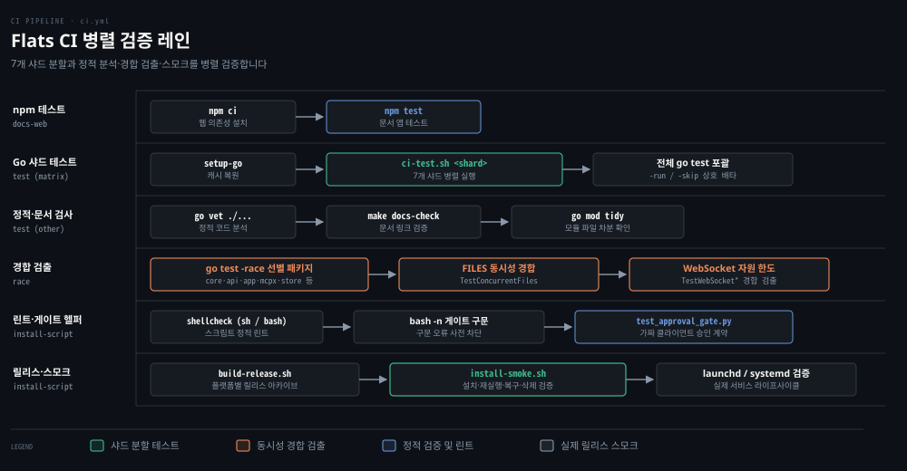
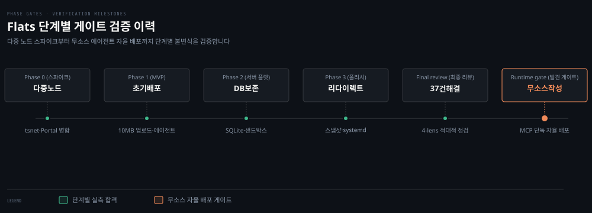

# tests·gates·CI

---

> 단위·통합 테스트 스위트의 규모와 로컬 실측 결과, 7개 샤드 분할과 정적 분석·경합 검출·스모크를 포괄하는 CI 파이프라인, 단계별 실측 게이트 및 수명주기 블랙박스 회귀 검증, 생성 문서와 플러그인 스킬의 코드화된 무결성 검증, 그리고 저장소의 에이전트 지침 체계를 분석합니다.


## 학습 목표와 범위

> flats 가 자체 동작과 계약을 방어하는 다층적 검증 하네스와 CI 파이프라인, 단계별 게이트 및 문서 검증 체계를 이해하고 설명할 수 있습니다.

1. 단위 테스트와 비테스트 코드의 규모 비율을 파악하고 로컬 환경에서 전체 테스트를 실행한 결과와 패키지별 소요 시간 편차의 원인을 설명할 수 있습니다.
2. `.github/workflows/ci.yml` 이 테스트를 7개 병렬 샤드로 분할하고 린트, 경합 검출, 릴리스 스모크를 조합하여 실행하는 전 과정을 설명할 수 있습니다.
3. 단계별 실측 게이트(Phase 0~3, Tailnet, 수명주기 회귀, 무소스 에이전트 게이트)가 증명하려는 핵심 불변식과 회귀 방어 원리를 비교할 수 있습니다.
4. `docs/runtime_reference_test.go` 와 `plugins/skill_test.go` 가 공식 문서의 수치 및 플러그인 스킬의 지침을 Go 테스트로 검증하는 이유를 분석할 수 있습니다.
5. 저장소 루트의 기여 규칙 파일 부재 속에서 `.agents/skills` 와 플러그인 스킬이 에이전트의 작업 경계를 어떻게 통제하는지 규명할 수 있습니다.

이 문서는 flats 저장소의 테스트 스위트, CI 워크플로, 검증 게이트, 생성 문서 테스트, 그리고 에이전트 지침 체계를 다룹니다. 호스트 기동과 설정 파일 구조는 05-01 편, 설치 스크립트와 백업 수명주기는 05-02 편을 참고합니다. 구체적인 오픈소스 기여 워크플로는 06-02 편에서 이어집니다.

기준 커밋 3abe537 (v0.11.0, 2026-10-17)


## 1. 규모 — 테스트 파일과 패키지 구성

> flats 코드베이스는 제품 코드 자체보다 더 많은 테스트 파일을 유지하며 각 패키지의 경계와 불변식을 단위 수준에서 방어합니다.

하위 모듈이 밀집된 단일 바이너리에서는 한 곳의 변경이 다른 컴포넌트를 소리 없이 깨뜨리기 쉽습니다. 기능을 확장할 때마다 시스템 전반의 계약이 어긋나지 않는지 감시할 보호막이 필요합니다. flats 는 제품 로직을 작성하기에 앞서 엄격한 테스트 코드를 동반합니다.

로컬 소스 트리를 직접 실측해 파일과 패키지 규모를 집계했습니다.

- **테스트 Go 파일 수 (`*_test.go`)**: 189개
- **비테스트 Go 파일 수 (`*.go`)**: 163개
- **전체 Go 패키지 수**: 38개

비테스트 제품 코드 파일(163개)보다 테스트 파일(189개)이 더 많습니다. 코드베이스 전체가 단순 구현에 그치지 않고 각 모듈의 공개 인터페이스를 테스트로 감싸고 있다는 뜻입니다. 핵심 런타임(`internal/runtime`)과 문서 협업 엔진(`internal/apps/docs`), 코어 수명주기(`internal/core`)가 테스트 대상입니다. 외부 노출 어댑터(`internal/expose`)와 MCP 프로토콜(`internal/mcpx`) 등 38개 패키지 전반에 걸쳐 촘촘한 테스트망을 형성합니다.


## 2. 로컬 실행 결과 — 전체 스위트 실측과 패키지별 소요 시간

> 로컬 전체 테스트는 단일 루프백 주소와 에페머럴 포트를 활용하여 플랫폼 마찰 없이 2분 35초 만에 전량 통과합니다.

개발자가 로컬 머신에서 전체 테스트를 돌릴 때 플랫폼 종속적인 네트워크 설정이나 권한 문제가 발생하면 생산성이 급격히 저하됩니다. flats 의 테스트 스위트는 외부 의존성을 배제하고 격리된 임시 디렉터리와 로컬 리스너를 조립하도록 구성되어 있습니다.

로컬 실측(2026-10-18, macOS arm64, go1.27.1, v0.11.0)으로 전체 테스트를 단일 스레드 캐시 없이 실행했습니다.

```bash
# [실측] go test ./... -count=1 (go1.27.1 darwin/arm64, v0.11.0)
# 32 ok, 6 no test files, FAIL 0 (2분 35초, user 558s)
go test ./... -count=1  558.05s user 111.04s system 431% cpu 2:35.11 total
```

38개 패키지 중 테스트 파일이 없는 패키지는 6개입니다. 진입점 바이너리(`cmd/flats`)와 문서 링크 검사기(`internal/doccheck/cmd/doccheck`), 정적 로컬 노출 어댑터(`internal/expose/local`)가 이에 해당합니다. 수명주기 검증 어댑터 2종(`internal/lifecyclecheck/adapter`, `internal/lifecyclecheck/legacyadapter`)과 테스트용 로그아웃 헬퍼(`scripts/tsnet-logout`)도 마찬가지입니다. 나머지 32개 패키지는 단 하나의 실패도 없이 통과했습니다.

실행 시간이 오래 걸린 순서로 상위 패키지를 꼽았습니다.

1. `internal/apps/docs`: 83초 (83.318s), 협업 문서 편집 엔진의 동시 편집 및 저장소 버짓 테스트
2. `internal/runtime`: 80초 (80.335s), QuickJS WASM 런타임 인스턴스 기동 및 메모리·타임아웃 검증
3. `internal/expose/tsnet`: 69초 (69.440s), 임베디드 Tailscale 노드 다중 기동 및 로컬 제어 평면 연동
4. `internal/core`: 50초 (50.340s), 플랫 생성, 버전 승인, 배포 및 롤백 수명주기 전이
5. `internal/expose/provider`: 28초 (28.328s), 다중 네트워크 프로바이더 관리자의 상태 머신
6. `internal/app`: 21초 (21.044s), CLI 서브커맨드와 설정 파일 로딩 및 호스트 락 검증

이 결과는 유사한 네트워크 터널 프로젝트와 뚜렷한 대조를 이룹니다. portal-tunnel 저장소는 macOS 에서 루프백 보조 IP 바인딩 부재로 `e2e` 테스트가 실패했습니다([05-01.코드 리뷰.md](../../../02_os/project/portal-tunnel/05-01.코드%20리뷰.md)). 반면 flats 는 단일 루프백(`127.0.0.1`)과 에페머럴 포트, `*.localhost` 호스트명만 사용해서 macOS 환경에서도 별칭 설정 없이 모든 테스트가 통과합니다.


## 3. CI 파이프라인 — 병렬 샤드와 정적·경합·스모크 레인

> CI 는 실행 시간이 긴 런타임과 문서 테스트를 7개 샤드로 분할하고 정적 분석과 경합 검출 및 실제 릴리스 스모크를 병렬 작업으로 검증합니다.

전체 테스트를 단일 CI 러너에서 순차 실행하면 피드백 루프가 10분 이상 지연됩니다. `.github/workflows/ci.yml` 은 테스트 스위트의 병목 지점을 분할해 병렬로 처리하도록 설계되었습니다(`.github/workflows/ci.yml:16-212`).

워크플로는 8개의 최상위 작업(job)으로 구성되며 PR 과 푸시 시점에 주요 검증 레인을 병렬로 가동합니다.

1. **웹 프론트엔드 검증 (`docs-web`)**: Node 22 환경에서 `internal/apps/docs/_web` 디렉터리로 이동하여 `npm ci` 와 `npm test` 를 실행합니다(`.github/workflows/ci.yml:30-31`).
2. **Go 샤드 분할 테스트 (`test`)**: 매트릭스 전략을 써서 전체 테스트를 7개 샤드로 나누어 병렬 실행합니다(`.github/workflows/ci.yml:35-39`). 각 러너는 `scripts/ci-test.sh "${{ matrix.shard }}"` 명령을 수행합니다(`.github/workflows/ci.yml:68`). `other` 샤드는 `go mod tidy` 차분 검증(`.github/workflows/ci.yml:51-53`)과 `go vet ./...` 정적 분석(`.github/workflows/ci.yml:54-56`)을 전담합니다. CI 헬퍼 회귀 테스트(`.github/workflows/ci.yml:57-61`)와 문서 링크 검증(`make docs-check`, `.github/workflows/ci.yml:64-66`)도 함께 수행합니다.
3. **격리 모듈 및 미링크 검증 (`netbird`)**: NetBird 모듈은 별도 디렉터리(`netbird`)에서 `go test -race ./...` 와 CGO 없는 빌드를 수행합니다(`.github/workflows/ci.yml:87-92`). 루트 바이너리(`cmd/flats`)가 NetBird 라이브러리를 링크하지 않음을 검사합니다(`.github/workflows/ci.yml:93-98`). 루트 `go.mod` 에 `replace` 지시자가 없음을 단언합니다(`.github/workflows/ci.yml:99-102`).
4. **동시성 경합 검출 (`race`)**: Go 런타임 경합 검출기(`-race`)를 선별된 핵심 패키지와 테스트에만 적용합니다(`.github/workflows/ci.yml:104-117`).
5. **호스트 설치 스크립트 및 릴리스 스모크 (`install-script`)**: Ubuntu 와 macOS 환경에서 릴리스 아카이브를 빌드합니다(`.github/workflows/ci.yml:146-152`). `scripts/install-smoke.sh` 로 실제 launchd 및 systemd 서비스의 설치, 업그레이드, 크래시 복구, 삭제를 검증합니다(`.github/workflows/ci.yml:161-162`). Linux 러너는 `shellcheck` 린트를 수행합니다(`.github/workflows/ci.yml:133-137`). 승인 게이트 헬퍼 회귀 검증(`scripts/test_approval_gate.py`)도 선행합니다(`.github/workflows/ci.yml:138-145`).
6. **컨테이너 빌드 및 라이프사이클 스모크 (`container`)**: Ubuntu 환경에서 `docker buildx` 로 멀티플랫폼 이미지를 빌드합니다(`.github/workflows/ci.yml:190-194`). 빌드된 이미지를 러너에 로드한 뒤 `scripts/container-smoke.sh` 로 부트스트랩, 배포, 재시작, 중지 전 과정을 스모크 검증합니다(`.github/workflows/ci.yml:195-198`).

이 외에도 Linux 상에서 Intel macOS 릴리스 아카이브를 크로스 빌드하는 `darwin-cross-build`(`.github/workflows/ci.yml:167-177`)가 러너 부하를 줄입니다. main 브랜치 푸시 시점에는 SHA 태그 이미지를 게시하는 `commit-images`(`.github/workflows/ci.yml:204-212`) 작업이 연계됩니다.

샤드 분할의 핵심 로직은 `scripts/ci-test.sh` 에 담겨 있습니다. 스크립트 머리 주석은 샤드 분할의 기본 원칙을 이렇게 설명합니다:

```pseudocode
The QuickJS runtime and docs app packages hold most of the suite's time.
Their tests run in parallel (t.Parallel) except those whose result depends
on elapsed time, which Go runs one at a time before the parallel ones. Each
package is split by test name: the named soak, codec and budget tests run in
their own shards with -run, and the remaining shard runs everything else
with -skip on the same patterns. A new or renamed test therefore always runs
somewhere; at worst the shards become unbalanced. Running every shard covers
exactly `go test ./...`.
```

샤드는 구체적으로 7개로 갈라집니다(`scripts/ci-test.sh:24-32, 43-73`):
- `runtime-soak`: 순차 실행되는 런타임 가비지 컬렉션 및 소크 테스트 (`TestOutboundFetchLoopOwnershipCycleCollection` 등)
- `runtime-codec`: 대규모 호스트 및 코덱 소유권 소크 테스트 (`TestLargeHostAndCodecOwnership`)
- `runtime`: 위 두 패턴을 제외한(`-skip`) 나머지 런타임 테스트
- `docs-soak`: 문서 앱 스토리지 버짓 및 공개 문서 읽기 소크 테스트
- `docs-budget`: 문서 엔진의 타이밍 및 편집 버짓 테스트 (Linux 러너의 경우 SQLite WAL 디스크 병목을 피하기 위해 `/dev/shm` tmpfs 환경에서 실행, `scripts/ci-test.sh:50-62`)
- `docs`: 위 두 패턴을 제외한 나머지 문서 협업 테스트
- `other`: `internal/runtime` 과 `internal/apps/docs` 를 제외한 나머지 36개 패키지 전체

이 분할 구조는 정규식 `-run` 과 `-skip` 이 상호 배타적으로 맞물려 있으므로 개발자가 새 테스트를 추가하거나 이름을 바꾸더라도 누락 없이 항상 7개 샤드 중 한곳에서 반드시 실행되도록 보장합니다.

저장소 루트의 `Makefile` 은 CI 와 로컬에서 공통으로 쓰이는 문서 유지보수 타깃을 정의합니다(`Makefile:1-32`):
- `docs-check`: 깨진 마크다운 상대 링크 및 앵커를 검사 (`internal/doccheck`, `Makefile:17-18`)
- `docs-audit`: 미참조 문서, 콜로케이션 노트, 16진수 해시 리터럴 검토 (`Makefile:20-21`)
- `docs-generate`: `docs/agent/` 토픽으로부터 참조 문서 자동 재생성 (`Makefile:23-24`)
- `docs-test`: 문서 내용을 단언하는 Go 테스트 스위트 실행 (`Makefile:26-28`)
- `docs-verify`: 링크 검사, 전체 패키지 컴파일 확인, 문서 테스트를 순차 수행 (`Makefile:30-32`)



위 도식은 PR 핵심 파이프라인의 대표적인 6개 검증 단계(웹, Go 샤드, 정적 검사, 경합 검출, 스크립트 린트, 호스트 설치 스모크)와 단계별 실행 명령을 보여 줍니다. 컨테이너 스모크(`container`)와 macOS 크로스 빌드(`darwin-cross-build`)는 독립된 병렬 작업으로 함께 가동되어 플랫폼별 무결성을 입증합니다.


## 4. 단계별 게이트 — 실제 환경 증명과 수명주기 블랙박스 회귀

> flats 는 단위 테스트를 넘어 실제 Tailnet, 멀티 에이전트 자동 배포, 수명주기 전이 및 크래시 복구, 그리고 무소스 자율 개발 게이트를 통해 제품 계약을 검증합니다.

단위 테스트가 통과하더라도 실제 운영체제 서비스 관리자나 원격 Tailnet, 외부 LLM 에이전트와 연동할 때 예기치 못한 결함이 발생할 수 있습니다. 공식 문서 `docs/gates.md` 와 전용 게이트 스크립트들은 각 개발 마일스톤마다 통과해야 하는 실측 검증 기준을 규정합니다.

### 마일스톤별 게이트와 실측 결과

1. **Pull-request baseline (`docs/gates.md:15-47`)**: CI 환경에서 읽기 전용 권한으로 실행되는 정적 분석, 7개 샤드 테스트, 그리고 선별된 `-race` 동시성 검출입니다.
2. **Phase 0 — spike (`docs/gates.md:96-105`)**: 단일 프로세스 내 다수 tsnet 노드(3개 및 10개)를 기동했습니다. 노드당 메모리는 첫 노드 약 14MB RSS, 추가 노드당 4.2~6MB RSS 로 측정되었습니다. 프로세스 내 Portal 노출과 Hide 토글, wazero 기반 QuickJS 핸들러 실행성을 모두 통과했습니다.
3. **Real tailnet (`docs/gates.md:112-149`, `scripts/tailnet-gate.sh`)**: 실제 Tailscale 네트워크에서 3개 플랫과 콘솔 노드가 각각 독립 노드로 참가합니다. 실제 Let's Encrypt 인증서 발급을 검증했습니다. 이 과정에서 Let's Encrypt 발급 한도, HTTPS 준비 전 ready 표시, darwin 의 `fork` 교착, 무제한 Stop 대기 등 4대 버그를 발견해 수정했습니다.
4. **Phase 1 — MVP (`docs/gates.md:151-163`)**: 10MB 크기의 비압축 정적 사이트 업로드부터 라이브 반영까지 33ms 만에 완료(상한 30초)하고 롤백을 1.4ms 에 수행했습니다. Claude Code(19초), Codex(49초), Cursor(32초) 3개 에이전트가 단 1회의 MCP 설정만으로 정적 사이트를 배포하는 데 성공했습니다.
5. **Phase 2 — server flats (`docs/gates.md:165-181`, `scripts/server-flat-gate.sh`)**: JavaScript 서버 플랫이 배포 후에도 SQLite 데이터를 보존함을 확인했습니다. `--restore-data` 플래그로 배포 전 스냅샷 롤백을 증명했습니다. 샌드박스가 호스트 파일과 환경변수, 관리 API 접근을 차단하고 10초 타임아웃(504)과 메모리 한도(500) 후 워커가 즉각 복구됨을 검증했습니다.
6. **Phase 3 — polish (`docs/gates.md:183-191`)**: 슬러그 변경 시 경로와 쿼리를 보존하는 7일 리다이렉트를 검증했습니다. 배포 전 DB 스냅샷 생성과 페이지뷰 카운트, 파비콘 썸네일 폴백을 통과했습니다. Linux 6.6 환경에서 systemd 사용자 서비스 복구도 함께 입증했습니다.
7. **Final review (`docs/gates.md:193-215`)**: 보안, 정확성, 스펙 준수, 인터페이스라는 네 가지 렌즈를 적용한 적대적 코드 리뷰에서 37건의 발견 사항을 도출하고 32건을 코드 수정으로 해결했습니다. 동일 머신에서 임의의 HTTP 를 보낼 수 있는 프로세스가 콘솔 헤더를 모방할 수 있다는 근본적 한계는 설계 문서에 정직하게 명시했습니다.

### 낯선 에이전트 무소스 자율 배포 게이트

`docs/gates/runtime-discovery.md` 에 기록된 런타임 발견 게이트는 에이전트의 실제 사용성을 입증하는 가장 가혹한 검증입니다(`docs/gates.md:217-272`).

사전 애플리케이션 코드나 소스 트리를 일절 주지 않는 격리 디렉터리를 준비하고 오직 Flats MCP 엔드포인트(`http://127.0.0.1:<port>/mcp`)만 연결했습니다. Claude Code 2.1.288 클라이언트(`claude-opus-5-5`)에게 노트를 저장하는 서버 앱을 제작하도록 요청했습니다(`docs/gates/runtime-discovery.md:11-57`):

- **도구 격리**: 네이티브 셸, 로컬 파일 편집, 브라우저, 디렉터리 업로드 도구(당시 명칭 `save_version_from_dir`, 현재의 `save_draft_from_dir`)를 모두 비활성화했습니다.
- **자율 발견**: 에이전트는 `get_runtime_reference` 를 호출하여 JS 핸들러 형식, SQLite `env.DB` 문법, `env.FILES` 규격을 스스로 학습했습니다. 동일 문서의 별도 런에서는 `guide` 도구의 동작성도 함께 검증되었습니다.
- **3단계 검증 통과**: 1단계 작성에서 v1 배포와 데이터 시딩에 성공했습니다. 2단계 수정에서 v2 배포와 기존 데이터 보존을 확인했습니다. 3단계 고의 실패 배포에서는 503 에러를 감지하고 이전 v2 라이브 상태와 데이터를 그대로 유지했습니다. 전 과정을 사람의 소스 힌트 없이 완수했습니다(`docs/gates/runtime-discovery.md:81-85`).

### 수명주기 블랙박스 회귀 게이트 (`scripts/lifecycle-gate.sh`)

수명주기 게이트는 실제 바이너리와 HTTP API, CLI, MCP 를 가동하여 28개 시나리오를 검증하는 종단간 블랙박스 하네스입니다(`docs/lifecycle-verification.md:3-92`):

- **레거시 마이그레이션 호환성**: 고정된 과거 커밋(`29edc2a6e13e27867603a23ff5b1b5a8d1b84df0`)에서 생성된 레거시 데이터베이스와 승인 참조를 현재 후보 바이너리로 마이그레이션하여 데이터가 손상되지 않는지 검사합니다.
- **어댑터 분리**: `internal/lifecyclecheck/adapter` 는 코어와 루프백 백엔드를 결합해 프로바이더 장애를 주입합니다. 반면 `internal/lifecyclecheck/legacyadapter` 는 과거 소스 아카이브를 바탕으로 구버전 상태를 시딩합니다.
- **크래시 주입 (`restart-claimed-approval`)**: 어댑터에 전용 빌드 태그(`lifecycle_testhooks`)를 부여합니다. 배포 핵심 4단계(`before_health`, `after_health`, `after_live_before_finalize`, `after_allocation_before_live`)에서 프로세스에 `SIGKILL` 을 주입합니다. 재기동 후 승인 상태가 정확히 1회만 재개되는지 확인합니다(`docs/lifecycle-verification.md:116-122`).
- **종료 코드와 의도된 불일치**: 게이트 종료 코드는 0(통과), 1(미합격), 2(설정 오류)로 정의됩니다(`docs/lifecycle-verification.md:51-55`). 주목할 점은 28개 케이스가 모두 통과해도 전체 실행은 항상 종료 코드 1을 반환한다는 사실입니다. 콘솔의 승인 결정은 CSRF 헤더에만 의존합니다. 로컬 머신의 다른 프로세스가 승인을 흉내 낼 수 있습니다. 따라서 기계적 테스트만으로는 사람 승인(`human_approval`)을 `proven` 으로 확정할 수 없습니다(`docs/lifecycle-verification.md:57-69`). 이는 결함이 아니라 보안 신뢰 한계를 숨기지 않는 정직한 설계입니다.

### 전용 게이트 스크립트 요약

저장소의 각 게이트 스크립트는 공식 문서에 정의된 고유한 증명 목표를 수행합니다:

- `scripts/approval-gate.sh` / `scripts/test_approval_gate.py`: 게이트들이 공유하는 승인 요청 대기 및 수신 루프의 계약을 검증하며 실제 서버 기동 없이 가짜 클라이언트로 동작을 확인합니다.
- `scripts/server-flat-gate.sh`: 실제 컴파일된 바이너리로 SQLite DB 보존, 롤백, 시크릿 격리, 샌드박스 시스템 자원 차단을 증명합니다.
- `scripts/agent-gate.sh`: Claude Code, Codex, Cursor 3개 에이전트가 단일 MCP 설정만으로 정적 사이트를 배포할 수 있는지 증명합니다.
- `scripts/tailnet-gate.sh`: 실제 Tailnet 상에서 독립 노드 분리, Let's Encrypt 인증서 발급, 피어 신원 헤더 전송, 임시 미리보기 노드 자동 정리를 증명합니다.
- `scripts/lifecycle-gate.sh`: 드래프트, 승인 동결, 버전 배포, 롤백, 프로바이더 권한 해제, 레거시 마이그레이션, SIGKILL 크래시 복구 등 전체 수명주기 불변식을 블랙박스로 증명합니다.



위 타임라인 도식은 프로토타입 단계인 Phase 0 스파이크부터 최종 낯선 에이전트 런타임 발견 게이트까지, 각 마일스톤이 증명해 낸 핵심 불변식을 보여 줍니다.


## 5. 생성 문서와 스킬 테스트 — 코드처럼 검증받는 문서 체계

> 공식 문서의 수치 제한과 에이전트 가이드, 그리고 플러그인 스킬의 규약은 Go 테스트 스위트에 의해 코드처럼 엄격하게 검증됩니다.

코드를 수정한 뒤 문서를 함께 갱신하지 않으면 시스템은 동작하는데 문서는 과거 규칙을 설명하는 불일치가 발생합니다. 에이전트가 문서를 읽고 코드를 작성하는 환경에서는 부정확한 문서 설명이 곧바로 런타임 장애로 번집니다.

flats 는 이를 막으려고 문서를 코드와 동일한 단위 테스트 대상으로 취급합니다.

### 런타임 제한 수치의 일대일 단언 (`docs/runtime_reference_test.go`)

`docs/runtime_reference_test.go:18-56` 의 `TestDocumentedRuntimeLimits` 함수는 마크다운 문서에 적힌 모든 수치 주장이 Go 소스 코드의 실제 상수와 정확히 일치하는지 검사합니다:

- `runtime.MaxFileValue` (10 MiB, 10,485,760 bytes)
- `runtime.MaxFilesTotal` (1 GiB, 1,073,741,824 bytes)
- `runtime.MaxDBBytes` (1 GiB, 1,073,741,824 bytes)
- `runtime.MaxQueryResult` (10 MiB)
- `runtime.MaxRequestBody` (10 MiB)
- `egress.MaxOrigins` (32개 원격 오리진)
- `egress.Timeout` (5초 아웃바운드 타임아웃)

코드의 상수가 바뀌었는데 마크다운 문서의 텍스트가 갱신되지 않으면 테스트는 즉시 실패합니다(`docs/runtime_reference_test.go:47` 및 `docs/runtime_reference_test.go:54`).

### 단일 진실 공급원과 문서 생성 (`docs/README.md`)

`docs/README.md:26-27` 은 두 개의 공식 참조 문서(`runtime-api-v1.md`, `content-types.md`)가 수동 편집 대상이 아니라 `docs/agent/` 의 마크다운 토픽들로부터 자동 생성되는 산출물임을 명시합니다.

`TestGeneratedReferences` 테스트는 마크다운 파일이 최신 토픽 소스와 일치하는지 대조합니다. 불일치 시 수동 수정을 거부하고 `go test ./docs -run TestGeneratedReferences -update` 명령으로 재생성할 것을 요구합니다(`docs/runtime_reference_test.go:104-123`).

### 가이드 리비전 안정성 (`docs/client_revision_test.go`)

`TestGuideRevisionTracksRuntimeInstructions` 는 가이드 리비전이 안정적인 64자리 SHA-256 해시를 유지하는지 봅니다(`docs/client_revision_test.go:5-16`). 파일 업로드 한도 등 런타임 지침이 바뀌면 가이드 해시가 반드시 갱신되는지 함께 검증합니다.

### 플러그인 스킬과 마켓플레이스 계약 (`plugins/skill_test.go`)

플러그인이 제공하는 에이전트용 스킬 파일 역시 테스트를 거칩니다.

- `TestBootstrapReleaseContract`: 플러그인 버전이 호스트의 부트스트랩 리비전과 일치하는지 검증합니다(`plugins/skill_test.go:13-42`).
- `TestMarketplaceReleaseContract`: Claude, Cursor, Codex 의 마켓플레이스 카탈로그 메타데이터가 실제 플러그인 버전과 동일한지 확인합니다(`plugins/skill_test.go:44-115`).
- `TestPluginSkillBoundary`: 개발용 스킬(`.agents/skills`)과 배포용 플러그인 스킬(`plugins/flats/skills`)의 경계를 격리합니다. 심볼릭 링크의 무결성도 함께 검증합니다(`plugins/skill_test.go:117-163`).

문서와 스킬을 코드처럼 검증하는 이유는 명확합니다. 에이전트는 사람이 아닌 기계이므로 모호하거나 부정확한 문서 표현을 스스로 교정할 수 없습니다. 문서의 단 하나의 오탈자나 수치 차이도 시스템 수준의 결함으로 이어지기 때문에 테스트 하네스로 묶어 둡니다.


## 6. 에이전트용 지침과 스킬 체계 — 규칙 파일의 부재와 도구화된 스킬

> 저장소 루트에는 전통적인 규칙 파일이 존재하지 않는 대신, 표준화된 에이전트 스킬과 도구를 통해 기여와 운영을 안내합니다.

많은 오픈소스 저장소는 루트 디렉터리에 `CONTRIBUTING.md`, `AGENTS.md`, `SECURITY.md` 같은 마크다운 파일을 두고 기여 규칙을 설명하지만 flats 저장소 루트를 실측(`ls`)해 보면 이러한 파일이 전혀 존재하지 않습니다.

flats 는 정적인 지침 텍스트를 나열하는 대신 에이전트가 실행 가능한 **스킬(Skill)** 로 지침을 도구화하여 제공합니다:

1. **문서 무결성 정리 스킬 (`.agents/skills/flats-doc-sanitize/SKILL.md`)**:
   - 저장소 내 문서의 모순 제거, 최신 구현과의 동기화, 단일 진실 공급원(SSOT) 유지, 불필요한 일회성 아티팩트 정리를 안내합니다(`.agents/skills/flats-doc-sanitize/SKILL.md:10-21`).
   - 스펙과 코드의 괴리가 발견되면 임의로 스펙을 낮추지 않습니다. 사용자와 소통해 분류하는 6단계 프로토콜을 정의합니다(`.agents/skills/flats-doc-sanitize/SKILL.md:23-44`, `.agents/skills/flats-doc-sanitize/SKILL.md:68-76`).
   - `.claude/skills/flats-doc-sanitize` 와 `.cursor/skills/flats-doc-sanitize` 가 이 원본 스킬 디렉터리를 심볼릭 링크로 참조합니다.
2. **배포 및 호스트 연동 스킬 (`plugins/flats/skills/flats-deploy/SKILL.md`)**:
   - 에이전트가 작업을 시작할 때 읽기 전용 `check_client` 를 호출하고 MCP `guide` (`topic.index`)를 먼저 읽도록 지시합니다(`plugins/flats/skills/flats-deploy/SKILL.md:10-25`). 연결할 호스트 선택과 점검은 `flats connect` 절(`:36-46`)에서 다룹니다.
   - 웹사이트와 정적 페이지는 Draft 저장 후 승인을 거쳐 버전 생성 및 배포로 이어지는 반면 문서와 디자인은 승인 없이 즉시 반영된다는 수명주기 차이를 명확히 구분합니다(`plugins/flats/skills/flats-deploy/SKILL.md:27-33`).
   - 에이전트가 자신의 배포 요청을 스스로 승인하는 행위를 금지하고 사용자 콘솔 링크를 제공하여 대기하도록 규정합니다.
3. **에디터 환경 통합 (`.cursor`)**:
   - Cursor 에이전트가 프로젝트를 열었을 때 자동으로 flats 스킬을 인식할 수 있도록 `.cursor/skills/` 아래에 심볼릭 링크를 배치합니다.

저장소 기여를 위한 구체적인 브랜치 관리, 빌드 절차, PR 승인 요건 등 개발자 기여 경로는 06-02 편에서 상세히 다룹니다[^fn-triage].

[^fn-triage]: v0.11.1 (2026-10-17, #131) 릴리스에서 GitHub 이슈 라벨링과 트리아지를 보조하는 `issue triage` 스킬이 추가되었습니다.


## 7. 로컬 기여 전 검증 명령 — CI 정합성 재현 절차

> 기여자는 PR 을 올리기 전 로컬 머신에서 CI 와 동일한 정적 분석, 문서 링크 검사, 셸 린트, 그리고 테스트 스위트를 순차 실행해야 합니다.

CI 러너에서 실패를 발견하고 수정 커밋을 반복하는 것은 시간과 자원을 낭비합니다. 기여자는 로컬에서 다음 명령을 순서대로 실행하여 CI 통과 가능성을 사전에 검증할 수 있습니다.

### 1단계: 모듈 및 정적 분석

```bash
# Go 모듈 파일 차분 확인 (CI test other 샤드와 동일)
go mod tidy
git diff --exit-code -- go.mod go.sum

# 정적 분석 실행
go vet ./...
```

### 2단계: 문서 무결성 및 링크 검사

```bash
# 깨진 상대 링크 및 앵커 검증 (Makefile 대상)
make docs-check

# 문서 수정이 포함된 경우 전체 패키지 컴파일 및 문서 테스트 수행
make docs-verify
```

### 3단계: 스크립트 정적 린트 및 승인 게이트 구문 검사

```bash
# POSIX 및 Bash 스크립트 shellcheck (ci.yml 과 동일)
shellcheck -s sh install.sh scripts/ci-test.sh scripts/build-release.sh scripts/install-smoke.sh scripts/container-smoke.sh scripts/build-commit-image.sh scripts/build-commit-images.sh
shellcheck -s bash scripts/approval-gate.sh scripts/server-flat-gate.sh scripts/tailnet-gate.sh scripts/agent-gate.sh scripts/lifecycle-gate.sh

# 게이트 스크립트 구문 오류 검사
sh -n scripts/container-smoke.sh
for gate_script in scripts/approval-gate.sh scripts/server-flat-gate.sh scripts/tailnet-gate.sh scripts/agent-gate.sh scripts/lifecycle-gate.sh; do
  bash -n "$gate_script" || exit 1
done

# 승인 게이트 헬퍼 회귀 테스트 (가짜 클라이언트 계약)
python3 -B scripts/test_approval_gate.py
```

### 4단계: 단위 및 통합 테스트 스위트 실행

```bash
# 전체 테스트 순차 실행 (로컬 실측 확인 완료)
go test ./...

# 또는 CI 샤드별 분할 실행 (필요한 샤드만 선별 실행 가능)
scripts/ci-test.sh runtime
scripts/ci-test.sh docs
scripts/ci-test.sh other
```

### 5단계: 핵심 동시성 경합 검출

```bash
# CI race 작업과 동일한 핵심 패키지 경합 검출
go test -race ./internal/core ./internal/api ./internal/app ./internal/mcpx ./internal/store ./internal/expose/portal
go test -race ./internal/runtime -run 'TestConcurrentFiles|TestWASIRejectsJSHostABI'
go test -race ./internal/runtime -run 'TestWebSocket(AdmissionCeiling|RejectedUpgrade|PostFailureReleasesSlot|IdleReadDeadline|ControlFramesKeepReadAlive|ServerPingsKeepIdleClientAlive|DefaultByteLimits)$'
```


## 리뷰 노트

> 코드베이스와 실측 로그를 대조하며 확인한 엔지니어링 세부 사항입니다.

- `scripts/ci-test.sh:50-58`: `internal/apps/docs` 패키지가 로컬 전체 테스트에서 83초(83.318s)를 소모하는 주원인은 협업 문서 편집 엔진의 SQLite WAL 트랜잭션 때문입니다. CI 스크립트는 이를 방지하고자 Linux 환경에서 `docs-budget` 샤드에 `/dev/shm` tmpfs 를 마운트합니다. GitHub 러너 디스크에서는 5회 중 1회꼴로 20~300ms 지연이 발생했으나 tmpfs 에서는 6.2ms 이내로 단축되었습니다. 반면 macOS 에는 `/dev/shm` 이 없어 환경이 변경되지 않은 채 실행됩니다.
- `internal/expose/tsnet`: 로컬 실행에 69초가 소요됩니다. 테스트 프로세스 내에서 가상 Tailscale 제어 서버와 로컬 DERP 서버를 띄우기 때문입니다. 다수 임베디드 노드가 키 생성과 TLS 핸드셰이크를 수행합니다.
- `.github/workflows/ci.yml:112-117`: CI 에서 `-race` 플래그는 특정 패키지(`core`, `api`, `app`, `mcpx`, `store`, `portal`)와 특정 런타임 테스트에만 적용됩니다. QuickJS WASM 인터프리터와 문서 소크 전체에 `-race` 를 걸면 CI 제한 시간(20분)을 초과할 위험이 높기 때문으로 추정됩니다.
- `docs/lifecycle-verification.md:57-69`: 수명주기 게이트(`scripts/lifecycle-gate.sh`)가 28개 테스트를 모두 통과해도 종료 코드 1로 끝나는 동작은 버그가 아닙니다. 현재 콘솔의 승인 처리가 브라우저 CSRF 헤더에만 의존합니다. 로컬 프로세스의 위조 가능성을 완전히 배제할 수 없습니다. 따라서 기계적 테스트만으로는 사람 승인을 입증할 수 없다는 보안 한계를 드러내기 위한 의도적 설계입니다.
- 이 편 범위에서 공식 문서와 코드 간의 기능적 불일치는 발견되지 않았습니다.


## 자가 점검 질문

1. flats 코드베이스의 테스트 Go 파일(`*_test.go`) 개수가 비테스트 Go 파일 개수보다 많은 구조적 이유는 무엇입니까?
2. `scripts/ci-test.sh` 가 테스트를 7개 샤드로 분할할 때 새 테스트가 누락 없이 항상 어딘가에서 실행되도록 보장하는 정규식 메커니즘은 무엇입니까?
3. `docs/runtime_reference_test.go` 가 공식 마크다운 문서의 텍스트 수치를 Go 런타임 상수의 실제 값과 글자 단위로 대조하는 이유는 무엇입니까?
4. `scripts/lifecycle-gate.sh` 의 수명주기 회귀 게이트에서 28개 시나리오가 모두 통과하더라도 전체 실행이 종료 코드 1로 끝나는 구조적 원인은 무엇입니까?
5. 저장소 루트에 `CONTRIBUTING.md` 나 `AGENTS.md` 가 없음에도 불구하고 외부 AI 에이전트가 올바른 규칙으로 기여하거나 사이트를 배포할 수 있는 기제는 무엇입니까?


## 정답 (자답 후 펼치기)

1. 단일 바이너리 안에 웹 서버, WASM 샌드박스 런타임, 오버레이 네트워크, SQLite 메타데이터, MCP 프로토콜 등 상호 의존적인 하위 시스템들이 밀집되어 있어 작은 변경으로도 공개 계약이 깨지기 쉽기 때문입니다. 내부 변경에 따른 회귀를 방지하기 위해 제품 코드 이상의 방대한 단위·통합 테스트를 구축했습니다.
2. 실행 시간이 긴 런타임과 문서 패키지의 특정 소크 및 버짓 테스트를 정규식 패턴 이름으로 `-run` 하여 독립 샤드로 격리하고 일반 샤드에서는 정확히 동일한 정규식 패턴을 `-skip` 으로 지정하여 실행하기 때문입니다. 새 테스트가 추가되거나 이름이 바뀌더라도 두 패턴 중 하나에 반드시 걸리므로 항상 어느 한 샤드에서 실행됩니다.
3. flats 는 에이전트가 MCP 도구로 공식 문서와 가이드를 읽고 스스로 앱을 작성하여 배포하는 자율 시스템이기 때문입니다. 사람이 아닌 기계 에이전트는 문서의 오탈자나 수치 오차를 스스로 판단할 수 없으므로 문서에 적힌 바이트 한도나 타임아웃 규약이 실제 코드와 다르면 곧바로 런타임 장애로 이어집니다.
4. 콘솔의 승인 결정이 별도의 관리자 자격증명 없이 브라우저 CSRF 헤더(`X-Flats-Console`, `Sec-Fetch-Site`)에만 의존하므로 동일 기기에서 임의의 HTTP 를 보낼 수 있는 로컬 프로세스가 승인을 위조할 수 있기 때문입니다. 게이트는 사람 승인(`human_approval`)을 기계적으로 입증할 수 없다고 판단하여 fail-closed 원칙에 따라 종료 코드 1을 반환합니다.
5. 정적인 텍스트 지침 대신 실행 가능한 스킬(`.agents/skills/flats-doc-sanitize`, `plugins/flats/skills/flats-deploy`)을 도구화하여 제공하기 때문입니다. 에이전트는 스킬과 MCP `guide` 도구를 통해 호스트 연결 절차, Draft 와 Version 모델의 차이, 승인 요청 준수 규칙, 문서 무결성 검증 절차를 실시간으로 주입받아 활동합니다.
