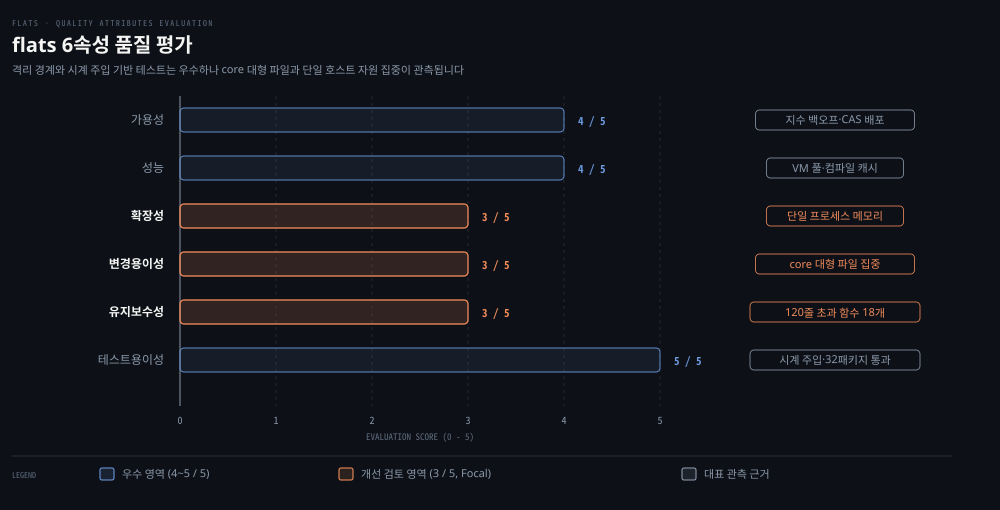

# 코드 리뷰

---

> 기준 커밋 3abe537을 바탕으로 flats의 6대 품질 속성과 핵심 불변식을 종합 평가하고, 확인된 실측 마찰과 설계 가설을 바탕으로 학습자를 위한 단계별 기여 로드맵을 정리합니다.

## 리뷰 범위와 방법

> 소스 코드 정독, 로컬 실측, 자동화 테스트 스위트 검증을 통합하여 시스템의 단단한 지점과 취약한 지점을 판정한 기준과 평가 절차를 설명합니다.

에이전트가 생성한 웹 애플리케이션과 문서를 로컬 머신에서 호스팅할 때 격리 경계가 취약하면 호스트 전체가 위험해집니다. 외부 제어 평면이 없는 단일 바이너리 구조에서는 격리가 실패할 경우 호스트 머신의 메모리 고갈이나 권한 탈취로 이어질 수 있습니다. 이 리뷰는 기준 커밋 `3abe537`의 flats가 어떤 설계로 불변식을 지키고 어디에서 구조적 병목과 표면 마찰을 드러내는지 평가합니다.

본 코드 리뷰는 00장부터 05장까지 분석한 핵심 패키지 전체를 대상으로 삼습니다. 대상 범위는 호스트 조립을 담당하는 `internal/app`과 비즈니스 로직의 중심인 `internal/core`, 샌드박스 실행을 제어하는 `internal/runtime` 및 `internal/qjs` 패키지입니다.

네트워크 터널을 관리하는 `internal/expose`, 관리 API의 `internal/api`, 번들 검증의 `internal/bundle`을 검토했습니다. 에이전트 도구 접점인 `internal/mcpx`와 CLI 진입점인 `internal/cli` 패키지도 함께 확인했습니다. 전체 패키지 의존 관계와 구조 지도는 [00-02.Concepts](00-02.Concepts.md) 편을 참고합니다.

분석과 검증에는 세 가지 방법을 교차해 썼습니다.

1. **코드 정독**: 공식 설계 문서(`docs/design.md`, `docs/lifecycle-core-contract.md`)를 기준으로 상태 전이 조건, 프로세스 격리 경계, 잠금 순서, 예외 처리 경로를 추적했습니다.
2. **로컬 실측**: 로컬 실측(2026-10-15~18)으로 단일 머신에서 임시 호스트와 운영 호스트를 구동하며 Draft 저장, 미리보기 실행, 장애 발생 시 복구, DNS rebinding 차단 등 실제 동작을 관측했습니다.
3. **전체 테스트 스위트 실행**: macOS arm64 환경에서 `go test ./... -count=1` 명령을 실행해 32개 패키지가 모두 통과하는 것을 확인했습니다.

리뷰에서 나온 발견 사항은 모두 네 단계 판정 기준으로 나눴습니다.

1. **확인**: 소스 코드 정독과 로컬 실측, 또는 테스트 실행으로 결함이나 동작 제약이 확정된 항목입니다.
2. **의문(가설)**: 특정 경계 조건에서 문제가 발생할 가능성이 있으나 메인테이너의 설계 의도 확인이나 추가 검증이 필요한 항목입니다.
3. **해당 없음(좋은 설계)**: 초기 검토에서 취약점이나 병목을 의심했으나 소스 코드 분석 결과 방어 로직과 회수 경로가 갖춰져 좋은 설계로 확인된 항목입니다.
4. **관찰**: 시스템의 구조적 수치나 규모를 측정한 중립적 사실 항목입니다.

이 리뷰에서는 외부 네트워크 제공자의 원격 라이브 연동을 켜거나 승인 결정을 집행하는 시험은 수행하지 않았습니다. 수천 개 단위의 대규모 부하 스트레스 시험도 수행 범위에서 제외했습니다.

기준 커밋 3abe537 (v0.11.0, 2026-10-17)

## 핵심 불변식과 잘 된 설계

> 프로세스 격리, 네트워크 가드, 승인 무결성, 결정론적 시간을 지탱하는 네 가지 핵심 아키텍처 불변식과 그 구현 메커니즘을 분석합니다.

에이전트가 만든 임의 코드를 실행하다 보면 핸들러가 무한 루프에 빠지거나 메모리를 소진하는 결함이 발생하기 쉽습니다. 중심 불변식이 부실하면 특정 flat의 오류가 호스트 전체 다운이나 권한 탈취로 이어집니다. flats는 네 지점에서 무엇을 막는지 분명히 정의해 시스템을 방어합니다.

### 런타임 프로세스 격리와 오류 회복 (OB-2)

- **코드 위치**: `internal/runtime/worker.go:400-402`, `internal/runtime/protocol.go:27-28`
- **무엇을 막는가**: flat 핸들러 내부의 무한 루프나 메모리 누수가 flats 호스트 프로세스 전체를 멈추게 하거나 워커 프로세스를 영구 중단시키는 장애를 차단합니다.

QuickJS 런타임은 호스트 메인 프로세스와 분리된 독립 워커 프로세스 안에서 실행됩니다. 워커는 핸들러 실행 시 10초 제한(`DefaultTimeout`, `internal/runtime/protocol.go:27`)을 둡니다. 64 MiB 메모리 상한(`DefaultMemoryPages = 1024`, `internal/runtime/protocol.go:28`)도 함께 적용합니다.

핸들러가 무한 루프에 빠지면 10초 타임아웃 인터럽트가 발생하여 504 Gateway Timeout으로 즉시 응답합니다(`internal/runtime/worker.go:400`). 핸들러가 메모리를 과도하게 늘리면 QuickJS 할당기가 실패를 감지해 500 Internal Server Error를 반환합니다(`internal/runtime/worker.go:402`).

중요한 점은 오류 발생 이후의 회복력입니다. 로컬 실측(2026-10-18)에서 `/loop`와 `/mem` 호출로 오류가 발생한 직후 동일한 미리보기 워커에 정상 요청(`/`)을 보냈을 때, 워커 프로세스가 종료되지 않고 0.027초 만에 200 OK로 정상 응답했습니다. 워커 내부의 SQLite 데이터베이스(`env.DB`) 상태 역시 손실 없이 그대로 보존되었습니다. 프로세스 격리와 런타임 인터럽트 경계가 정상 작동해 호스트와 상태를 보호함을 확인했습니다.

### HostGuard의 DNS rebinding 원천 차단 (OB-3)

- **코드 위치**: `internal/api/guard.go:15-41`
- **무엇을 막는가**: 사용자의 브라우저에서 실행 중인 악의적인 외부 웹페이지가 DNS rebinding 공격으로 로컬 머신의 127.0.0.1 또는 관리 콘솔 끝점에 무단 접근하는 권한 탈취를 차단합니다.

개발자 머신에서 구동되는 로컬 서버는 브라우저 기반 공격의 주요 표적이 됩니다. 공격 도메인의 DNS 레코드를 127.0.0.1로 짧은 TTL과 함께 변경하면 브라우저는 동일 출처 정책을 우회하여 로컬 포트로 HTTP 요청을 보낼 수 있습니다.

flats는 관리 서버 앞단에 `HostGuard`를 배치해 들어오는 모든 요청의 `Host` 헤더를 검사합니다(`internal/api/guard.go:15-41`). 리스너가 실제로 응답하도록 허용된 로컬 호스트명이나 IP 주소가 아닐 경우 `403 Forbidden`을 반환하며 연결을 거부합니다. 브라우저가 전송한 `Origin` 헤더가 존재할 때도 콘솔 자체 오리진이 아니면 즉시 차단합니다. 로컬 실측(2026-10-18)에서 임의의 `Host: evil.example:17878` 헤더를 붙여 요청했을 때 즉각 403 오류와 함께 DNS rebinding 방어 문구가 반환되는 것을 확인했습니다.

### 승인 요청 시점의 내용 동결과 변경 감지 (OB-4)

- **코드 위치**: `internal/core/lifecycle.go:1576,1710`
- **무엇을 막는가**: 승인 요청이 제출된 이후 작업 폴더의 코드가 수정되었는데도 이전 승인 토큰을 악용해 변조된 코드가 라이브 환경으로 배포되는 무단 갱신 취약점을 차단합니다.

에이전트가 Draft를 저장한 뒤 버전 생성 승인을 요청하면 코어는 요청 시점의 번들 content hash를 승인 파라미터에 원자적으로 결합합니다. 승인 레코드가 대기 상태(`pending`)에 머무는 동안 작업자가 새로운 코드를 작업 폴더에 덮어써도 승인 대상은 최초 요청 시점의 리비전 해시로 엄격히 고정됩니다.

로컬 실측(2026-10-18)에서 리비전 1의 승인을 요청한 뒤 새로운 코드를 반영해 리비전 2를 저장하더라도 리비전 1의 승인 건은 `pending` 상태를 유지하며 원본 리비전 파일을 안전하게 동결했습니다. 만약 해시가 일치하지 않는 상태에서 승인 요청을 시도하면 시스템은 `error: conflict: stale approval: draft hash changed` 오류를 반환하며 작업을 거부합니다. 이 동결 메커니즘으로 승인자가 검토한 코드와 실제 배포되는 코드 사이의 정합성을 보장합니다.

### 코어 서비스의 결정론적 시계 주입 (ST-2)

- **코드 위치**: `internal/core/service.go:109,117`
- **무엇을 막는가**: `time.Now()` 직접 호출로 인해 발생하는 시간 의존적 경쟁 상태와, TTL 만료 및 승인 타임아웃 테스트의 비결정성을 차단합니다.

분산 시스템과 수명주기 관리 로직에서 시스템 시계를 직접 조회하면 시계 왜곡이나 테스트 지연에 따라 동작이 달라지는 결함이 발생하기 쉽습니다. flats 코어를 관장하는 `internal/core/service.go`는 시계를 직접 조회하지 않고 `Config.Now func() time.Time`을 주입받습니다(`internal/core/service.go:109,117`).

core 패키지 내부에서는 45회에 걸쳐 일관되게 `s.now()` 헬퍼를 호출하여 시간을 판정합니다. 반면 `time.Now()` 직접 호출은 네트워크 핸들러(`internal/design/handler.go`)나 워커 프로세스 스폰 계층(`internal/runtime/manager.go`) 같은 외부 가장자리로 엄격히 제한되어 있습니다. 이 설계 덕분에 테스트 하네스는 임의의 가상 시간을 주입해 미리보기 만료, 승인 대기 만료, 임시 데이터 정리 수명주기를 결정론적으로 검증할 수 있습니다.

## 6속성 평가

> 가용성, 성능, 확장성, 변경용이성, 유지보수성, 테스트용이성이라는 6대 아키텍처 품질 속성의 실측 결과와 개선 조치를 제시합니다.

단일 머신에서 여러 flat을 호스팅할 때는 자원 고갈과 코드 비대화라는 병목을 사전에 걸러내야 합니다. 병목 지점을 미리 찾지 못하면 장기 운영 시 전체 서비스가 멈출 위험이 있습니다. 이 절은 flats의 소스 코드와 로컬 실측 데이터를 토대로 6대 품질 속성을 평가하고 개선 조치를 정리합니다.

| 속성 | 점수 | 근거 (파일:줄 + 신호) | 조치 |
|---|---|---|---|
| 가용성 | 4/5 | worker 비정상 종료 시 지수 백오프(`internal/runtime/manager.go:426-438`, 250ms~30s) 재시작, 2s 초과 대기 시 503 즉각 응답; 핸들러 10s·메모리 64 MiB 상한 뒤에도 worker 응답 유지(`internal/runtime/worker.go:400-402`, OB-2); 배포 시 15s 헬스체크(`internal/core/service.go:1250`) 후 CAS live 전환 및 이전 핸들러 5s 드레인(`internal/core/service.go:1376-1405`); 프로세스 종료 단계별 30s 상한(`docs/design.md` Process layout). 단일 호스트 다운 시 전체 정지는 설계 범위. | - |
| 성능 | 4/5 | JS VM 풀(기본 4개, `internal/runtime/protocol.go:29`)과 wazero 컴파일 캐시(`internal/qjs/runtime.go:21-42`)로 요청당 컴파일 배제, 로컬 실측(2026-10-18) 미리보기 응답 지연 3~8ms(OB-2). flat당 rate limit 50 rps(`internal/config/config.go:110`, `internal/core/settings.go:30`). WASI는 요청마다 신규 인스턴스 생성(`internal/runtime/wasi.go:92-103`). | WASI 요청당 인스턴스 비용 측정 |
| 확장성 | 3/5 | 의도적 단일 기계·단일 프로세스 호스트(`README.md:38-39`), flat마다 독립 worker 프로세스 분리, WebSocket 연결 256/worker(`internal/runtime/ws.go:38`), SQLite WAL 기반 단일 메타데이터. 10배 flat 증가 시 워커 프로세스 수와 메모리(로컬 실측 워커 RSS `/mem` 뒤 365,312 KB, 초기치 미확인)가 병목 후보. v0.11.1의 유휴 문서 worker sleep(#132)이 완화 첫 조치. | 유휴 server flat worker 정리 정책 검토 |
| 변경용이성 | 3/5 | 네트워크 제공자는 `core.PrivateNet`/`PublicNet` 인터페이스 뒤 격리(`internal/core/expose.go:13,27`), core 방향 단방향 의존. 반면 `internal/core/service.go`(2,341줄)·`lifecycle.go`(1,946줄)에 수명주기·승인·미리보기가 집중(ST-1), `handlerBox` 4중 복제(`internal/expose/portal/portal.go:156`·`internal/expose/zrok/zrok.go:100`·`internal/expose/cfquick/cfquick.go:118`·`netbird/netbird.go:165`, ST-4). | core를 수명주기·승인·미리보기 단위 파일로 분리, 공용 handlerBox |
| 유지보수성 | 3/5 | 설계 이유를 밝히는 주석 풍부(`internal/qjs/runtime.go:21-26` FORK 주석, `internal/runtime/worker.go:46-51`), 핵심 계약 문서가 코드와 짝을 이룸(`docs/lifecycle-core-contract.md`). 반면 120줄 초과 함수 18개(최장 `internal/app/serve.go:330 Start` 247줄, ST-1), CLI 미리보기 만료 라벨 오류 및 24h 상수 표기(SF-1, `internal/cli/commands.go:473`). | 긴 함수 분해, SF-1 수정 |
| 테스트용이성 | 5/5 | core가 시계를 주입받아(`internal/core/service.go:109,117`, ST-2) 결정론적 검증 보장, `lifecyclecheck` 인터페이스 어댑터 하네스, 테스트:코드 줄 비 0.86(`_test.go` 50,220줄 / 비테스트 58,312줄), `go test ./...` 32개 패키지 전원 통과(OB-1, 2분 35초), CI 샤드·선택 race·install smoke 자동화(06-01). | - |

위 차트는 6대 품질 속성의 평가 점수와 대표 관측 근거를 가로 막대로 요약합니다. 테스트용이성은 5점 만점으로 모범 수준이며, 가용성과 성능은 4점으로 우수합니다. 반면 단일 머신 자원 집중과 코어 모듈의 거대화로 인해 확장성, 변경용이성, 유지보수성은 3점으로 평가되어 구조적 개선 검토가 요구됩니다.

### 가용성: 4/5

- **근거**: 워커가 비정상 종료되면 지수 백오프(`backoff`, 250ms에서 최대 30초)로 재시작을 시도합니다. 이때 2초를 초과하는 대기는 503으로 즉시 응답합니다(`internal/runtime/manager.go:426-438`). 핸들러 타임아웃이나 메모리 한도 초과 후에도 워커 프로세스는 상태를 유지합니다(`internal/runtime/worker.go:400-402`, OB-2). 배포 시 15초 제한의 헬스체크(`healthTimeout`, `internal/core/service.go:1250`)를 거쳐 사본 데이터를 검증합니다. 그 뒤 CAS(`SetLive`)로 실서비스를 전환하고 이전 핸들러는 5초 동안 유예 드레인을 거쳐 종료합니다(`internal/core/service.go:1376-1405`). 호스트 종료 시 단계마다 30초 상한이 적용됩니다(`docs/design.md` Process layout).
- **감점 요인**: 단일 머신 호스트 설계이므로 머신 전원이 꺼지면 모든 flat이 함께 중단됩니다. 이는 분산 클러스터를 지양하는 의도된 설계 범위입니다.
- **조치**: -

### 성능: 4/5

- **근거**: JS VM 풀(기본 4개, `internal/runtime/protocol.go:29`)과 wazero 프로세스 컴파일 캐시(`internal/qjs/runtime.go:21-42`)로 요청마다 바이트코드를 재컴파일하는 비용을 제거했습니다. 로컬 실측(2026-10-18)에서 QuickJS server flat 미리보기 응답 지연은 3~8ms(OB-2)에 불과했습니다. 시스템 설정으로 flat당 요청 한도를 기본 50 rps로 제한해 자원 독점을 방지합니다(`internal/config/config.go:110`, `internal/core/settings.go:30`).
- **감점 요인**: WASI 런타임의 경우 요청마다 신규 모듈 인스턴스를 생성하고 세마포어를 획득합니다(`internal/runtime/wasi.go:92-103`). 무거운 WASI 바이너리 처리 시 인스턴스 생성 오버헤드가 발생할 수 있으나 이를 측정한 공식 벤치마크는 없습니다.
- **조치**: WASI 요청당 인스턴스 비용 측정 벤치마크 작성

### 확장성: 3/5

- **근거**: flats는 호스팅 제어 평면을 두지 않고 단일 머신에서 완결되는 구조를 지향합니다(`README.md:38-39`). flat마다 독립된 워커 프로세스를 띄우며 WebSocket 동시 연결은 워커당 최대 256개로 제한됩니다(`internal/runtime/ws.go:38`). 메타데이터는 단일 SQLite WAL 모드로 처리됩니다.
- **감점 요인**: 호스팅하는 flat 수가 10배 이상 증가할 경우 실행 중인 워커 프로세스 수와 메모리 점유가 단일 머신의 물리적 한계에 부딪힙니다. 로컬 실측(2026-10-18)에서 관측된 워커 1개의 RSS는 `/mem` 메모리 부하 후 365,312 KB(약 365 MB)에 달했으며 기동 초기 RSS는 미확인 상태입니다. 후속 버전인 v0.11.1에서 유휴 문서 워커를 자동으로 재우는 기능(#132)을 도입한 것은 이러한 확장 한계를 완화하기 위한 조치입니다.
- **조치**: 유휴 server flat 워커 프로세스 정리 및 슬립 정책 검토

### 변경용이성: 3/5

- **근거**: 네트워크 제공자는 `core.PrivateNet` 및 `PublicNet` 인터페이스 뒤에 완전히 추상화되어 있어(`internal/core/expose.go:13,27`) 의존성이 제공자에서 코어로 단방향으로 흐릅니다.
- **감점 요인**: 비즈니스 로직을 담은 `internal/core/service.go`(2,341줄)와 `internal/core/lifecycle.go`(1,946줄)에 수명주기, 승인, 미리보기, 데이터 디렉터리 제어가 집중되어 있습니다(ST-1). `handlerBox`, `slugLock`, `beginOp` 구조체도 4개 제공자 파일에 중복 구현되어 있습니다(ST-4). 위치는 `internal/expose/portal/portal.go:156`·`internal/expose/zrok/zrok.go:100`·`internal/expose/cfquick/cfquick.go:118`·`netbird/netbird.go:165`입니다.
- **조치**: `internal/core`를 수명주기, 승인, 미리보기 단위 서브루틴으로 분리하고 공용 `handlerBox` 타입을 추출합니다.

### 유지보수성: 3/5

- **근거**: 소스 코드 전반에 아키텍처 결정의 이유를 설명하는 주석이 풍부하게 작성되어 있습니다(`internal/qjs/runtime.go:21-26` FORK 주석, `internal/runtime/worker.go:46-51`). 핵심 계약 명세서도 코드 구현과 일대일로 대응합니다(`docs/lifecycle-core-contract.md`).
- **감점 요인**: 120줄을 초과하는 대형 함수가 18개 존재합니다(ST-1). 특히 호스트 조립 진입점인 `internal/app/serve.go:330 Start` 함수는 247줄에 달해 인지 부하가 높습니다. CLI `flats preview` 출력 시 만료 시각 라벨을 `now:`로 잘못 표시하고 TTL을 24h 상수로 고정 표기하는 표면 마찰(SF-1, `internal/cli/commands.go:473`)도 존재합니다.
- **조치**: 120줄 초과 대형 함수 분해, SF-1 CLI 라벨 및 동적 TTL 출력 수정

### 테스트용이성: 5/5

- **근거**: 코어 계층이 시계를 완벽히 주입받아(`internal/core/service.go:109,117`, ST-2) 시간 경과에 따른 만료 로직을 결정론적으로 검증할 수 있습니다. 런타임과 네트워크를 교체 검증하는 `lifecyclecheck` 하네스를 갖추었고 테스트 코드 비율은 0.86(`_test.go` 50,220줄 / 비테스트 58,312줄)에 달합니다. `go test ./...` 실행 시 32개 패키지가 결함 없이 통과하며(OB-1, 2분 35초) CI 파이프라인에서 샤드 분할, race 탐지, 설치 스모크 테스트가 자동화되어 있습니다.
- **감점 요인**: 없음 (모범 수준).
- **조치**: -

flats는 테스트 가능성과 런타임 결함 격리에서 탁월한 완성도를 보여줍니다. 반면 코어 패키지의 대형 파일 집중과 긴 함수들로 인해 변경용이성과 유지보수성에서 개선 여지가 큽니다. 신규 기여자가 참여할 때는 코어 대형 로직보다 CLI 표면 마찰(SF-1)과 업로드 lint 일관성(LN-1)을 먼저 해결하는 것이 안전합니다.

## 의문과 가설 목록

> 정적 코드 분석과 로컬 실측에서 포착된 잠재적 위험을 가설 형태로 정리하고 구체적인 검증 경로를 수립합니다.

정적 코드 분석과 부분적인 로컬 실측만으로는 정상 실행 흐름 이면에 숨겨진 의도나 보안 경계를 확정하기 어렵습니다. 이 절은 소스 코드 분석에서 확인된 표면 마찰과 메인테이너의 의도 확인이 필요한 설계 가설을 구분하여 기록합니다.

| 번호 | 위치 | 내용 한 줄 | 확인 방법 |
|---|---|---|---|
| SF-2 | `internal/cli/pack.go:28-38`, `internal/bundle/bundle.go:190-201` | 빌드 산출물 외 숨김 파일(`.env` 등)이 필터링 없이 Draft 번들에 포함되는 현상 | 빌드 산출 폴더 전제 의도 확인 및 `.flatsignore` 또는 문서 명시 제안 |
| LN-1 | `internal/mcpx/tools.go:640-647`, `internal/mcpx/design.go:117` | `bundle.Lint` 호출부가 MCP 두 곳에 한정되어 CLI `save-draft` 업로드 시 lint 경고가 누락되는 현상 | CLI 업로드 시 lint 경고 출력 연동 또는 에이전트 MCP 전용 여부 확인 |
| ST-4 | `internal/expose/portal/portal.go:156`, `internal/expose/zrok/zrok.go:100`, `internal/expose/cfquick/cfquick.go:118`, `netbird/netbird.go:165` | `handlerBox`·`slugLock`·`beginOp` 패턴이 4개 제공자 패키지에 복제된 구조 | 공용 동시성 제어 헬퍼 추출 및 독립 모듈 간 의존성 트레이드오프 검토 |
| BN-3 | `internal/bundle/bundle.go:468-479` | `flats.json`에 `kind` 누락 시 server entry 파일이 존재해도 기본 static으로 처리되어 거절되는 현상 | README의 Static and server flats 절에 `{"kind":"server"}` 필수 명시 문서화 확인 |
| AP-1 | `docs/design.md` 「Approvals」 Not enforced | 로컬 머신에서 임의 HTTP 요청을 전송할 수 있는 프로세스가 콘솔 승인을 모사할 수 있는 구조적 한계 | 공식 문서가 인정한 설계상 제약임을 확인하고 보안 질문 수준에서 감사 로그 검토 |

가설은 메인테이너와의 소통이나 추가 실측을 거치기 전까지는 결함으로 단정할 수 없으며 가설로 취급해야 합니다.

SF-2는 CLI 포장 시 `.git`, `node_modules`, `__MACOSX`, `.DS_Store`만을 건너뛰는 동작입니다. 개발 디렉터리에 포함된 `.env` 같은 숨김 파일이 Draft 리비전에 그대로 들어갑니다. flats-lab 로컬 실측(2026-10-15, v0.9.1)에서도 작업 폴더의 숨김 디렉터리 하위 파일들이 Draft rev 1에 업로드된 사실이 관측되었습니다.

이는 작업자가 순수한 빌드 산출물 폴더(`dist/` 등)만을 업로드한다는 전제를 둔 단순화일 수 있습니다. 따라서 결함으로 단정하기보다 `docs/design.md`의 Uploads 절에 주의사항을 문서화하거나 `.flatsignore` 도입 필요성을 문의하는 것이 타당합니다.

AP-1은 승인 시스템의 신뢰 경계를 다룹니다. 공식 설계 문서(`docs/design.md` 「Approvals」 Not enforced)는 운영자 머신에서 임의의 로컬 HTTP 요청을 전송할 수 있는 프로세스라면 콘솔 브라우저를 흉내 내어 승인 끝점을 호출할 수 있음을 명시하고 있습니다. 즉 flats의 승인은 "운영자가 승인했다"는 암호학적 증명이 아니며 운영자와 에이전트 간의 협업 프로토콜입니다. 이는 결함이 아니라 문서화된 설계 경계이므로 우회 공격 시나리오를 작성하는 대신 승인 이력의 감사 로깅 강화 같은 설계 질문 수준으로 다루어야 합니다.

## 기여 후보와 순서

> 표면 마찰 개선에서 시작하여 성능 벤치마크와 코어 구조 리팩토링으로 나아가는 단계별 기여 로드맵을 제시합니다.

오픈소스 프로젝트에 처음 참여할 때 코어 로직부터 무리하게 수정하면 회귀 버그를 유발하거나 리뷰 부담을 키웁니다. 신규 기여자는 명확히 확정된 표면 마찰부터 해결하고 점진적으로 테스트와 문서, 구조 리팩토링으로 나아가는 것이 바람직합니다.

1. **(1) SF-1 (CLI 미리보기 만료 라벨 및 동적 TTL 출력 보완)**: `internal/cli/commands.go:473`에서 `(now: %s)`로 잘못 표기된 만료 시각 라벨을 `(expires: %s)`로 교정합니다. 하드코딩된 "24h" 문자열도 `system.preview_ttl_seconds`(`internal/config/config.go:109`) 기반 시간 단위로 동적 출력하도록 수정합니다. 이와 함께 `internal/cli` 패키지에 출력 문자열을 검증하는 단위 테스트를 추가합니다. 런타임 위험 없이 사용자 경험을 즉시 개선하는 안전한 첫 번째 PR입니다.
2. **(2) LN-1 (CLI 업로드 경로의 lint 경고 안내 보완)**: `internal/mcpx/tools.go:640-647`에 국한된 `bundle.Lint` 검사를 CLI `save-draft` 실행 시에도 비차단 경고로 표시합니다. 또는 `docs/agents.md`에 non-blocking warnings가 MCP 전용임을 명확히 문서화합니다. 같은 번들이 CLI와 MCP 업로드 경로에서 서로 다른 피드백을 받는 혼선을 줄입니다.
3. **(3) SF-2 (숨김 파일 업로드 동작 문서화)**: `internal/cli/pack.go:28-38` 및 `internal/bundle/bundle.go:190-201`이 숨김 폴더를 패키징함을 밝힙니다. `docs/design.md`의 Uploads 문단에 한 줄 주의사항을 안내하는 문서 기여가 적합합니다.
4. **(4) BN-3 및 WASI 성능 벤치마크 (문서 및 테스트 보완)**: `internal/bundle/bundle.go:468-479`의 동작에 맞춰 README에 server flat 작성 시 `{"kind":"server"}` 필수 지정을 강조합니다. `internal/runtime/wasi.go:92-103`의 인스턴스 생성 오버헤드를 측정하는 `BenchmarkWASIInstance` 벤치마크 테스트도 작성합니다.
5. **(5) ST-4 / ST-1 (공용 handlerBox 추출 및 코어 대형 파일 분해)**: 4개 네트워크 제공자에 중복된 `handlerBox`(`internal/expose/portal/portal.go:156` 등)를 공용 타입으로 추출합니다. `internal/core/service.go`(2,341줄)의 수명주기 및 승인 로직을 책임별 파일로 분리하는 구조적 리팩토링도 제안합니다.

기여를 준비할 때 주의할 점은 현재 flats 저장소 루트에 `CONTRIBUTING.md`, `AGENTS.md`, `SECURITY.md`가 존재하지 않는다는 사실입니다([06-01.tests·gates·CI](06-01.tests·gates·CI.md) 편 참조). 따라서 기여자는 PR 제출 전 돌려야 할 테스트와 게이트 파이프라인의 실행 절차를 [06-01.tests·gates·CI](06-01.tests·gates·CI.md) 편에서 확인하고 준수해야 합니다.

이 문서에서 제시한 모든 기여 후보와 분석 내용은 프로젝트 학습과 내부 검토를 위한 것입니다. 외부 GitHub 저장소에 이슈를 발행하거나 풀 리퀘스트를 등록하는 활동은 본 문서의 범위에 포함되지 않으며 실제로 수행하지 않았음을 밝힙니다.

## 이 리뷰의 한계

> 정적 코드 분석과 단일 머신 로컬 실측 환경에 기반한 본 리뷰의 분석 경계와 추가 검증 필요성을 정리합니다.

정적 코드 분석과 로컬 개발 환경에서의 단일 실측만으로는 프로덕션 환경의 모든 위험 요소를 온전히 포착하기 어렵습니다. 아래에 이 리뷰의 한계를 명시하고 후속 검증의 기준으로 삼습니다.

- 로컬 단일 호스트 실측(macOS arm64 go1.27.1, v0.11.0 3abe537) 데이터에 한정되어 실제 대규모 운영 환경에서 발생하는 다양한 트래픽 패턴과 장기 수명주기 데이터를 온전히 관측하지 못했습니다.
- 수백 개 이상의 flat이 동시에 실행되는 극한의 동시성 부하나 메모리 고갈 상황에서의 스트레스 테스트를 직접 수행하지 못했습니다.
- Tailscale Funnel, zrok, Cloudflare quick tunnel, NetBird 등 외부 네트워크 제공자와의 라이브 원격 연동 실측을 진행하지 못하고 로컬 모의 및 코드 분석 중심으로 평가했습니다.
- 기준 커밋 `3abe537` 이후 릴리스된 v0.11.1의 유휴 문서 워커 절전 기능(#132) 및 이후 main 브랜치의 최적화 변경사항은 본 분석에 반영되지 않았습니다.
- 본 분석과 학습 문서는 AI 도구의 도움을 받아 작성되었으므로 프로덕션 배포나 코어 기여에 앞서 메인테이너와의 원전 대조 및 독립적인 실측 검증이 반드시 선행되어야 합니다.

## 리뷰 노트

> 소스 코드 정독과 로컬 실측, 19편의 학습 문서 교차 검증을 종합하며 도출한 시스템 특이점입니다.

- `internal/cli/commands.go:473`의 preview 만료 출력 테스트 부재: `git grep 'without visits'` 검색 결과 안내 문구를 검증하는 단위 테스트가 없었습니다. 그 결과 만료 시각을 `now:`로 표시하고 TTL을 24h 상수로 고정 표기하는 오류가 장기간 방치되었습니다.
- `internal/bundle/bundle.go:190-201`과 `internal/cli/pack.go:28-38` 간 `node_modules` 필터링 검사 차이: `pack.go`는 디렉터리 이름이 `node_modules`인 경우만 건너뜁니다. 반면 서버 측 `bundle.go`는 경로 세그먼트 중 하나라도 `node_modules`이면 건너뜁니다.
- `internal/core/settings.go:30` 및 `internal/config/config.go:110`의 rate limit(50 rps) 설정입니다. 2배 버스트 허용 정책이 콘솔 JS(`internal/console/static/assets/js/settings.js:17`)에만 적혀 있어 코어 수준 설명이 부족합니다.

## 자가 점검 질문

> 본문에서 다룬 품질 평가, 핵심 불변식, 기여 후보를 스스로 복습하기 위한 질문입니다.

1. flats에서 QuickJS server flat 핸들러가 무한 루프에 빠지거나 메모리를 과도하게 점유해도 flats 호스트 프로세스가 중단되지 않고 격리되는 메커니즘(OB-2)은 무엇입니까?
2. `HostGuard`(OB-3)가 방어하는 주된 보안 위협과, 이를 위해 검사하는 두 가지 HTTP 요청 요소는 무엇입니까?
3. 6대 품질 속성 중 변경용이성과 유지보수성이 각각 3점으로 평가된 주된 아키텍처 원인은 무엇입니까?
4. flats 프로젝트에 처음 기여하려는 개발자에게 SF-1(미리보기 만료 라벨 및 TTL 출력 보완)이 가장 권장되는 첫 번째 PR 후보인 이유는 무엇입니까?

## 정답 (자답 후 펼치기)

> 위 자가 점검 질문에 대한 핵심 답변입니다.

1. flats 호스트 메인 프로세스와 분리된 독립 워커 프로세스에서 QuickJS가 실행되며 핸들러마다 10초 타임아웃(`DefaultTimeout`)과 64 MiB 메모리 상한(`DefaultMemoryPages`)을 강제하기 때문입니다. 무한 루프는 10초 타임아웃 인터럽트로 504 응답을 반환하고 메모리 폭주는 500 응답을 반환하며 호스트 메인 프로세스나 워커 프로세스를 다운시키지 않습니다. 장애 직후 동일 워커가 다음 요청을 정상 처리하며 `env.DB` 데이터도 안전하게 유지됩니다.
2. 로컬 브라우저에서 실행 중인 악의적인 외부 웹페이지가 동일 출처 정책(SOP)을 우회해 로컬 호스트의 관리 API, 콘솔, MCP 진입점에 무단 접근하는 DNS rebinding 공격입니다. 이를 막기 위해 `HostGuard`는 요청의 `Host` 헤더가 리스너에 등록된 합법적 호스트명인지 검사합니다. `Origin` 헤더가 존재할 경우에는 콘솔 오리진과 일치하는지도 검사하여 불일치 시 403 Forbidden으로 차단합니다.
3. 변경용이성 측면에서는 `internal/core/service.go`(2,341줄)와 `internal/core/lifecycle.go`(1,946줄)라는 대형 파일에 수명주기, 승인, 미리보기 제어가 집중되어 있기 때문입니다. 동시성 제어 구조체(`handlerBox` 등)도 4개 제공자 파일에 중복 구현되어 있습니다. 유지보수성 측면에서는 120줄을 초과하는 대형 함수가 18개에 달하고 CLI 출력 오류(SF-1)가 방치되는 등 리팩토링 대상이 존재하기 때문입니다.
4. `internal/cli/commands.go:473`에서 만료 시각을 `now:`로 오표기하고 설정 가능한 TTL을 "24h" 상수로 고정 출력하는 명백한 결함이지만 코어 비즈니스 로직이나 런타임에 영향을 주지 않아 안전하기 때문입니다. 출력 검증 단위 테스트를 함께 작성함으로써 작은 변경으로 명확한 가치를 입증할 수 있는 이상적인 첫 PR입니다.

## 출처와 관련 문서

> 본문 작성에 참고한 공식 1차 자료와 저장소 내부의 연관 학습 문서 목록입니다.

- [gosuda/flats 공식 저장소](https://github.com/gosuda/flats/tree/3abe537): 기준 커밋 3abe537 소스 코드 및 공식 문서
- [Flats Design Specification](https://github.com/gosuda/flats/blob/3abe537/docs/design.md): 프로세스 배치, 승인 모델, 수명주기 계약
- [Lifecycle Core Contract](https://github.com/gosuda/flats/blob/3abe537/docs/lifecycle-core-contract.md): 코어 서비스와 런타임 간의 상태 전이 계약
- [What is Flats·비교 제품](00-01.What%20is%20Flats·비교%20제품.md): Flats 아키텍처 개요 및 7개 대안 기술 비교
- [Concepts](00-02.Concepts.md): 패키지 의존성 지도 및 프로세스 배치
- [Immutable artifact·content hash·SQLite WAL](01-01.Immutable%20artifact·content%20hash·SQLite%20WAL.md): 불변 산출물과 SQLite 내구성
- [bundle·manifest](01-02.bundle·manifest.md): 번들 정규화, `flats.json` 매니페스트 및 Lint 검증
- [Version model](01-03.Version%20model.md): 단조 증가 버전 전이 및 헬스체크 배포
- [Revision model](01-04.Revision%20model.md): 불변 리비전 동결 및 CAS 경쟁 해소
- [WebAssembly·WASI·QuickJS·sandbox](02-01.WebAssembly·WASI·QuickJS·sandbox.md): Wasm 샌드박스 및 QuickJS 런타임 격리
- [worker process·manager](02-02.worker%20process·manager.md): 워커 프로세스 수명주기와 관리자 감독
- [fetch handler·env.DB·env.FILES·WebSocket](02-03.fetch%20handler·env.DB·env.FILES·WebSocket.md): JS 핸들러 바인딩 및 동시성 격리
- [WASI handler·egress·env·secrets](02-04.WASI%20handler·egress·env·secrets.md): WASI 핸들러와 네트워크 송출 제어
- [Overlay VPN·reverse tunnel·public relay](03-01.Overlay%20VPN·reverse%20tunnel·public%20relay.md): 네트워크 오버레이 기술 비교
- [provider manager·grants·visibility](03-02.provider%20manager·grants·visibility.md): 제공자 관리자 및 가시성 권한 제어
- [local·Tailscale·Funnel](03-03.local·Tailscale·Funnel.md): 루프백 및 사설 테일넷 노출 구조
- [Portal](03-04.Portal.md): 역방향 터널 릴레이 기반 인터넷 공개
- [zrok·Cloudflare quick·NetBird](03-05.zrok·Cloudflare%20quick·NetBird.md): 대안 터널 제공자 구현 분석
- [MCP·JSON-RPC·Same-origin·CSRF·DNS rebinding](04-01.MCP·JSON-RPC·Same-origin·CSRF·DNS%20rebinding.md): 브라우저 및 로컬 프로토콜 보안 가드
- [management server·HostGuard·console](04-02.management%20server·HostGuard·console.md): 관리 서버 및 HostGuard 방어 체계
- [MCP tools·guide·plugin](04-03.MCP%20tools·guide·plugin.md): 에이전트 도구 인터페이스 구조
- [approval·trust model](04-04.approval·trust%20model.md): 운영자 승인 수명주기와 신뢰 경계
- [serve 조립·config·data directory](05-01.serve%20조립·config·data%20directory.md): 호스트 초기화 및 데이터 디렉터리 구성
- [install·upgrade·backup](05-02.install·upgrade·backup.md): 바이너리 설치, 업그레이드 및 백업 절차
- [tests·gates·CI](06-01.tests·gates·CI.md): 테스트 스위트, 자동화 게이트 및 CI 파이프라인
