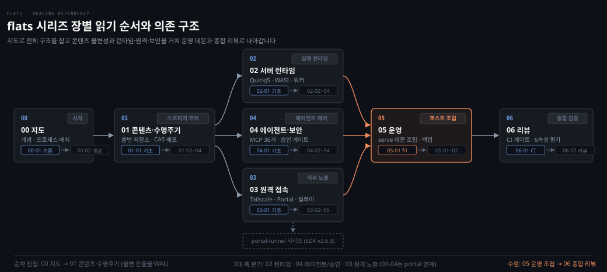

# flats — 시리즈 인덱스

---

> 에이전트가 생성한 웹 애플리케이션·문서·캔버스를 로컬 기계에서 격리 호스팅하고 승인을 거쳐 안전하게 외부로 공개하는 단일 Go 바이너리 gosuda/flats의 아키텍처를 코드 리딩으로 이해하고 실측 검증과 오픈소스 기여로 이어가는 학습 지도입니다.

## 시리즈 목적과 대상 독자

> 에이전트 호스팅 런타임을 밑바닥 소스 코드부터 정독하여, 불변 저장소·격리 샌드박스·승인 통제·원격 노출의 제어 원리를 파악하고 실제 결함 분석과 코드 기여까지 도달하는 것을 목표로 삼습니다.

인공지능 코딩 에이전트가 작성한 코드와 결과물을 외부 클라우드 플랫폼에 즉시 배포하면 자격 증명 유출이나 통제권 상실의 위험이 따릅니다. 반대로 로컬 개발 머신에서 무제한 권한으로 임의의 코드를 실행하면 호스트 프로세스 침해나 포트 충돌, 악의적인 브라우저 스크립트의 무단 승인 조작 위험에 노출됩니다. [gosuda/flats](https://github.com/gosuda/flats)는 이 문제를 해결하기 위해 에이전트가 만든 웹사이트, 서버 앱, HTML 페이지, Markdown 문서, 디자인 캔버스를 로컬 머신에서 격리 호스팅하는 소프트웨어입니다.

이 시리즈는 Go 언어로 작성된 MIT 라이선스 오픈소스 flats의 아키텍처를 코드 수준에서 정독합니다. 시스템의 내부 동작 원리를 파악하고 6대 품질 속성 평가와 오픈소스 코드 기여로 나아가도록 구성했습니다.

HTTP, TCP, Go 기본 문법을 이해하고 Claude Code 같은 코딩 에이전트를 사용해 본 개발자를 독자로 상정합니다. 반면 WebAssembly 가상 머신, WASI preview1 시스템 콜 격리, QuickJS 런타임, Tailnet 멀티 노드 임베딩은 처음 접하는 개념이라고 보고 첫 등장마다 배경을 설명합니다. MCP(Model Context Protocol) 내부 규격과 DNS rebinding 및 CSRF 브라우저 격리 기법도 원리와 함께 상세히 다룹니다.

이 독자는 같은 저장소의 [portal-tunnel 시리즈 인덱스](../../../02_os/project/portal-tunnel/README.md)를 읽었을 수도 있고 아닐 수도 있습니다. flats에서 무계정 분산 릴레이 네트워크인 Portal을 다룰 때는 해당 시리즈의 상세 편으로 안내하고 본문에서는 중복 설명을 피합니다.

기준 커밋 3abe537 (v0.11.0, 2026-10-17)입니다.


## 편 목록

> 전체 7개 장 묶음 아래 23개 편으로 나누어 개념 지도, 콘텐츠 수명주기, 서버 런타임, 원격 접속 제공자, 에이전트 보안 통제, 호스트 운영, 종합 리뷰를 단계별로 다룹니다.

로컬 에이전트 호스팅 시스템의 동작을 단편적인 기능 단위로만 바라보면 저장소 불변성과 런타임 격리, 그리고 인간 운영자 승인 사이의 인과관계를 온전히 파악하기 어렵습니다. 따라서 개념 지도, 배관과 샌드박스, 원격 노출과 보안, 호스트 수명주기와 품질 검증이라는 7개 장 묶음으로 나누어 체계적으로 다룹니다.

- 00 지도: 시리즈 개요, 문제의식과 비교 제품, 핵심 용어와 프로세스 및 패키지 배치 구조
- 01 콘텐츠와 수명주기: 불변 아티팩트·WAL 기초 → 번들 패키징 및 정적 검사, Version 수명주기 전이, 협업 문서 Revision 모델
- 02 서버 런타임: WebAssembly·WASI·QuickJS 샌드박스 기초 → 독립 워커 프로세스 격리 스폰, JS fetch 핸들러와 스토리지 브리지, WASI 실행 및 외부 egress 통제
- 03 원격 접속: 오버레이 VPN·역방향 터널 기초 → 네트워크 제공자 관리자와 권한 부여, Local 및 Tailscale/Funnel, Portal 분산 릴레이, zrok·Cloudflare quick·NetBird
- 04 에이전트·보안: MCP 프로토콜 및 브라우저 공격 격리 기초 → 관리 서버 HostGuard 다층 방어, 에이전트 연동 도구 36개와 안내 시스템, 승인 파라미터 동결과 신뢰 모델
- 05 운영: OS 서비스 관리자·잠금 기초(05-01 §1) → `flats serve` 호스트 데몬 조립과 데이터 디렉터리 배치, 무권한 설치와 비가역 스키마 전진 대비 선행 백업 및 업그레이드
- 06 리뷰: 189개 테스트 파일과 7개 샤드 CI 파이프라인 및 단계별 실측 게이트, 기준 커밋 3abe537 대상 6대 품질 속성 종합 평가와 단계별 기여 로드맵

| 장 묶음 | 편 | 다루는 것 | 상태 |
|---|---|---|---|
| 00 지도 | [00-01.What is Flats·비교 제품.md](00-01.What%20is%20Flats%C2%B7%EB%B9%84%EA%B5%90%20%EC%A0%9C%ED%92%88.md) | 에이전트 생성 웹 앱·문서·시각화 결과물의 로컬 기계 격리 호스팅 원리와 기존 클라우드 플랫폼·아티팩트 도구 대비 차별점 및 한계 비교 | draft |
| 00 지도 | [00-02.Concepts.md](00-02.Concepts.md) | 10대 핵심 용어, `flats serve` 단일 프로세스 컴포넌트 구성, 패키지 간 단방향 의존 구조와 두 요청 관통 경로 | draft |
| 01 콘텐츠와 수명주기 | [01-01.Immutable artifact·content hash·SQLite WAL.md](01-01.Immutable%20artifact%C2%B7content%20hash%C2%B7SQLite%20WAL.md) | (기초) 배포 단위 불변 격리 원리, 파일 묶음 내용 지문 결정론적 해시 계산, compare-and-swap 갱신과 SQLite WAL 동시성 및 복제 안전성 | draft |
| 01 콘텐츠와 수명주기 | [01-02.bundle·manifest.md](01-02.bundle%C2%B7manifest.md) | 에이전트 생성 디렉터리 수용 시의 다계층 검증 규약, 매니페스트(flats.json) 해석 및 유형 추론 규칙, os.Root 기반 격리 쓰기와 정적 검사(Lint) | draft |
| 01 콘텐츠와 수명주기 | [01-03.Version model.md](01-03.Version%20model.md) | 초안(Draft)에서 불변 버전(Version) 승인·보관, 격리 사본 헬스체크와 DB 스냅샷을 거친 무중단 배포(Deploy) 및 롤백(Rollback) 수명주기 | draft |
| 01 콘텐츠와 수명주기 | [01-04.Revision model.md](01-04.Revision%20model.md) | 문서·디자인 캔버스의 무승인 즉시 라이브 반영, 충돌 편집본을 보존하는 전체 리비전 스토어, 무승인 롤백 및 자동 쿼터 보존 | draft |
| 02 서버 런타임 | [02-01.WebAssembly·WASI·QuickJS·sandbox.md](02-01.WebAssembly%C2%B7WASI%C2%B7QuickJS%C2%B7sandbox.md) | (기초) 임의 서버 코드의 시스템 자원 통제, WebAssembly 명세 및 WASI preview1 격리 원리, wazero 위 QuickJS 샌드박스 다층 방어 구조 | draft |
| 02 서버 런타임 | [02-02.worker process·manager.md](02-02.worker%20process%C2%B7manager.md) | 단일 바이너리 재실행(re-exec)을 통한 `flats worker` 독립 서브프로세스 격리 스폰, fd 상속과 Unix 소켓 IPC, 지수 백오프 재시작과 프록시 흐름 | draft |
| 02 서버 런타임 | [02-03.fetch handler·env.DB·env.FILES·WebSocket.md](02-03.fetch%20handler%C2%B7env.DB%C2%B7env.FILES%C2%B7WebSocket.md) | JavaScript ES 모듈의 HTTP 서버 핸들러 동작 원리, WebAssembly 경계를 넘는 동기식 DB/FILES 호스트 브리지, 전용 런타임 기반 WebSocket 수명주기 | draft |
| 02 서버 런타임 | [02-04.WASI handler·egress·env·secrets.md](02-04.WASI%20handler%C2%B7egress%C2%B7env%C2%B7secrets.md) | WebAssembly(`.wasm`) 바이너리의 WASI preview1 요청별 인스턴스화, 외부 API egress 통제 및 SSRF 방어, AES-256-GCM 비밀 암호화 저장 및 워커 주입 | draft |
| 03 원격 접속 | [03-01.Overlay VPN·reverse tunnel·public relay.md](03-01.Overlay%20VPN%C2%B7reverse%20tunnel%C2%B7public%20relay.md) | (기초) NAT 뒤 루프백 서버의 아웃바운드 역방향 연결, 오버레이 VPN(WireGuard/Tailscale)과 공개 릴레이의 트래픽 라우팅 및 TLS 종료점 차이 | draft |
| 03 원격 접속 | [03-02.provider manager·grants·visibility.md](03-02.provider%20manager%C2%B7grants%C2%B7visibility.md) | 호스트 허용·flat별 권한·공개 승인·경로 준비의 다층 방어 구조, 8개 네트워크 제공자를 다루는 통합 관리자(Manager) 계약 및 상태 전이 | draft |
| 03 원격 접속 | [03-03.local·Tailscale·Funnel.md](03-03.local%C2%B7Tailscale%C2%B7Funnel.md) | 단일 루프백 포트의 Host 헤더 라벨 라우팅, tsnet 임베딩을 통한 flat별 독립 tailnet 노드 생성과 Funnel 공용 인터넷 노출 구조 및 수명주기 | draft |
| 03 원격 접속 | [03-04.Portal.md](03-04.Portal.md) | 무계정 분산 릴레이 네트워크를 통한 고유 HTTPS 공개 주소 부여, Portal SDK 임베딩, flat별 암호학적 신원 격리 및 자원 회수 수명주기 | draft |
| 03 원격 접속 | [03-05.zrok·Cloudflare quick·NetBird.md](03-05.zrok%C2%B7Cloudflare%20quick%C2%B7NetBird.md) | 계정 요건과 URL 수명이 다른 세 네트워크 제공자(zrok, Cloudflare quick tunnel, NetBird) 동작 원리와 공통 핸들러 상자(handlerBox) 패턴 | draft |
| 04 에이전트·보안 | [04-01.MCP·JSON-RPC·Same-origin·CSRF·DNS rebinding.md](04-01.MCP%C2%B7JSON-RPC%C2%B7Same-origin%C2%B7CSRF%C2%B7DNS%20rebinding.md) | (기초) 에이전트 통신 표준 MCP 및 JSON-RPC 2.0 프로토콜 규격, 루프백 관리 서버 보호를 위한 동일 출처 정책(SOP)·CSRF·Fetch Metadata·DNS Rebinding 방어 | draft |
| 04 에이전트·보안 | [04-02.management server·HostGuard·console.md](04-02.management%20server%C2%B7HostGuard%C2%B7console.md) | 단일 TCP 리스너의 CLI·에이전트·웹 브라우저 동시 수용 구조, `HostGuard`·`agentRequest`·`consoleRequest` 다층 가드를 통한 브라우저 공격 격리 및 승인 보호 | draft |
| 04 에이전트·보안 | [04-03.MCP tools·guide·plugin.md](04-03.MCP%20tools%C2%B7guide%C2%B7plugin.md) | Claude Code·Codex·Cursor 연동을 위한 MCP 도구 36개 분류 체계, 온디맨드 안내 시스템(guide·llms.txt), stdio 릴레이 다리(mcpBridge)와 승인 결정 분리 | draft |
| 04 에이전트·보안 | [04-04.approval·trust model.md](04-04.approval%C2%B7trust%20model.md) | 에이전트 변경 요청의 파라미터 동결(frozen params), 운영자 결정 시점 환경 드리프트 재검사(stale_approval), 계정 없는 단일 바이너리 환경의 출처·헤더 기반 신뢰 모델 | draft |
| 05 운영 | [05-01.serve 조립·config·data directory.md](05-01.serve%20%EC%A1%B0%EB%A6%BD%C2%B7config%C2%B7data%20directory.md) | (첫 절 기초 포함) OS 서비스 관리자(launchd/systemd)와 파일 잠금·원자적 교체 기초, `flats serve` 데몬 기동·정상 종료 수명주기, `flats.lock` 단일 파일 잠금, `config.json` 스키마 및 데이터 디렉터리 배치 | draft |
| 05 운영 | [05-02.install·upgrade·backup.md](05-02.install%C2%B7upgrade%C2%B7backup.md) | 무권한 단일 바이너리 설치와 백그라운드 서비스 등록, 다운그레이드 불가 스키마 전진 대비 선행 백업 및 업그레이드 순서, 전체 데이터 디렉터리 복구 및 핫 카피, CLI 독립 갱신 | draft |
| 06 리뷰 | [06-01.tests·gates·CI.md](06-01.tests%C2%B7gates%C2%B7CI.md) | 189개 테스트 파일과 로컬 실측 결과, 7개 샤드 분할과 정적 분석·경합 검출·스모크 CI 파이프라인, 단계별 실측 게이트 및 수명주기 회귀 검증, 생성 문서·스킬 코드화 무결성 및 에이전트 지침 체계 | draft |
| 06 리뷰 | [06-02.코드 리뷰.md](06-02.%EC%BD%94%EB%93%9C%20%EB%A6%AC%EB%B7%B0.md) | 기준 커밋 3abe537 대상 6대 품질 속성 종합 평가, OB-2 격리·OB-3 HostGuard·OB-4 승인 동결 등 핵심 불변식 검증, 실측 마찰 기반 단계별 기여 로드맵 | draft |


## 읽는 순서

> 지도로 전체 구조를 잡은 뒤 각 장 첫머리의 기초 편을 딛고 콘텐츠 불변성, 서버 런타임, 원격 노출, 에이전트 보안 경계, 데몬 운영과 최종 코드 리뷰로 나아갑니다.



처음 접하는 독자는 00-01편과 00-02편으로 전체 문제의식과 단일 프로세스 배치도를 파악한 다음 각 장을 순서대로 읽으면 됩니다. 각 장은 해당 영역의 기반 기술을 설명하는 기초 편으로 시작하므로 배경 지식이 필요한 독자는 장의 첫머리부터 차례대로 학습할 수 있습니다. 이미 충분한 지식을 갖춘 독자는 기초 편을 건너뛰고 곧바로 본편으로 진입해도 무방합니다.

각 장의 본편은 장 첫머리의 기초 편을 전제 지식으로 삼습니다. 본편을 읽다가 기본 원리가 생소하게 느껴질 때는 같은 장의 기초 편으로 돌아가 개념을 보충할 수 있습니다.

05장은 별도의 기초 편 파일을 두지 않습니다. 대신 [05-01.serve 조립·config·data directory.md](05-01.serve%20%EC%A1%B0%EB%A6%BD%C2%B7config%C2%B7data%20directory.md)의 1절에서 launchd·systemd 데몬 제어, flock 파일 잠금, rename 원자적 교체 등 운영체제 동시성 기초 개념을 다룹니다.

장을 넘나드는 주요 의존 관계를 보면 첫째, 01장의 저장소 및 버전 모델이 02장 서버 런타임의 입력이 됩니다. 01-03편에서 확정된 번들과 버전 산출물을 02장 워커가 받아 실행하기 때문입니다. 둘째, 04-04편의 승인 및 신뢰 모델은 01-03편의 초안(Draft)에서 버전(Version)으로 넘어가는 상태 전이 및 배포 시점 파라미터 동결 규칙을 전제로 삼습니다. 셋째, 03-04편의 무계정 공개 터널인 Portal은 외부 [portal-tunnel 시리즈 인덱스](../../../02_os/project/portal-tunnel/README.md)의 역방향 연결 풀링과 keyless TLS 설계를 그대로 품고 있습니다.

| 본편 | 같은 장 기초 편 | 다루는 배경 지식 |
|---|---|---|
| [01-02.bundle·manifest.md](01-02.bundle%C2%B7manifest.md), [01-03.Version model.md](01-03.Version%20model.md), [01-04.Revision model.md](01-04.Revision%20model.md) | [01-01.Immutable artifact·content hash·SQLite WAL.md](01-01.Immutable%20artifact%C2%B7content%20hash%C2%B7SQLite%20WAL.md) | 불변 산출물(CAS/내용 해시)과 SQLite WAL 모드의 동시성 및 원자적 트랜잭션 |
| [02-02.worker process·manager.md](02-02.worker%20process%C2%B7manager.md), [02-03.fetch handler·env.DB·env.FILES·WebSocket.md](02-03.fetch%20handler%C2%B7env.DB%C2%B7env.FILES%C2%B7WebSocket.md), [02-04.WASI handler·egress·env·secrets.md](02-04.WASI%20handler%C2%B7egress%C2%B7env%C2%B7secrets.md) | [02-01.WebAssembly·WASI·QuickJS·sandbox.md](02-01.WebAssembly%C2%B7WASI%C2%B7QuickJS%C2%B7sandbox.md) | WebAssembly·WASI preview1 시스템 콜 격리 및 QuickJS 샌드박스 다층 방어 구조 |
| [03-02.provider manager·grants·visibility.md](03-02.provider%20manager%C2%B7grants%C2%B7visibility.md), [03-03.local·Tailscale·Funnel.md](03-03.local%C2%B7Tailscale%C2%B7Funnel.md), [03-04.Portal.md](03-04.Portal.md), [03-05.zrok·Cloudflare quick·NetBird.md](03-05.zrok%C2%B7Cloudflare%20quick%C2%B7NetBird.md) | [03-01.Overlay VPN·reverse tunnel·public relay.md](03-01.Overlay%20VPN%C2%B7reverse%20tunnel%C2%B7public%20relay.md) | NAT 뒤 루프백 아웃바운드 연결, 오버레이 VPN(WireGuard/Tailscale)과 공개 릴레이의 TLS 종료점 및 라우팅 차이 |
| [04-02.management server·HostGuard·console.md](04-02.management%20server%C2%B7HostGuard%C2%B7console.md), [04-03.MCP tools·guide·plugin.md](04-03.MCP%20tools%C2%B7guide%C2%B7plugin.md), [04-04.approval·trust model.md](04-04.approval%C2%B7trust%20model.md) | [04-01.MCP·JSON-RPC·Same-origin·CSRF·DNS rebinding.md](04-01.MCP%C2%B7JSON-RPC%C2%B7Same-origin%C2%B7CSRF%C2%B7DNS%20rebinding.md) | MCP JSON-RPC 2.0 프로토콜 규격 및 루프백 관리 서버의 SOP·CSRF·DNS Rebinding·Fetch Metadata 방어 |
| [05-01.serve 조립·config·data directory.md](05-01.serve%20%EC%A1%B0%EB%A6%BD%C2%B7config%C2%B7data%20directory.md), [05-02.install·upgrade·backup.md](05-02.install%C2%B7upgrade%C2%B7backup.md) | [05-01.serve 조립·config·data directory.md](05-01.serve%20%EC%A1%B0%EB%A6%BD%C2%B7config%C2%B7data%20directory.md) (§1 기초 절) | OS 서비스 관리자(launchd/systemd) 데몬 제어, 파일 잠금(advisory lock)과 원자적 파일 교체 |
| [04-04.approval·trust model.md](04-04.approval%C2%B7trust%20model.md) (승인 동결) | [01-03.Version model.md](01-03.Version%20model.md) (01장) | 초안(Draft)에서 불변 버전(Version)으로의 상태 전이 및 배포 시점 파라미터 동결 |
| [03-04.Portal.md](03-04.Portal.md) (원격 터널) | [portal-tunnel 시리즈 인덱스](../../../02_os/project/portal-tunnel/README.md) (외부 시리즈) | 분산 역방향 릴레이 네트워크 및 keyless TLS 원격 서명 기반 무계정 터널링 |

01장 콘텐츠와 수명주기는 파일 지문 해시와 SQLite WAL을 기반으로 에이전트의 산출물을 불변 상태로 격리하는 저장 배관을 다루므로 가장 먼저 통과해야 합니다. 이 저장 토대가 마련되어야 그 위에 얹히는 02장 런타임 실행과 03장 원격 노출, 04장 에이전트 제어를 이해할 수 있습니다.

저장 배관을 확인한 후에는 실행 격리를 다루는 02장, 원격 노출을 다루는 03장, 에이전트 도구와 승인 모델을 다루는 04장 중 관심사에 따라 순서를 골라 학습할 수 있습니다. 05장 운영은 앞선 전 계층을 단일 프로세스로 엮는 `flats serve`의 기동 수명주기와 데이터 디렉터리 백업을 다룹니다. 마지막 06장 리뷰는 자동화 테스트 스위트와 6대 품질 속성 평가를 거쳐 실제 오픈소스 기여로 진입하는 경로를 안내합니다.


## 선행 지식과 관련 학습 문서

> 소켓 제어, 오버레이 터널링, MCP 에이전트 프로토콜, 그리고 Go 언어와 네트워크 로드맵의 기반 지식을 딛고 서 있습니다.

단일 Go 바이너리로 구동되는 호스팅 시스템을 깊이 이해하려면 소켓 I/O, 프로세스 격리, 가상 사설망 라우팅, 그리고 AI 에이전트 통신 규약을 미리 파악해 두어야 합니다. 아래 문서를 먼저 살펴보면 학습 효율이 높아집니다.

- 역방향 터널과 분산 릴레이 아키텍처: [portal-tunnel 시리즈 인덱스](../../../02_os/project/portal-tunnel/README.md)는 사설망 내부 서비스를 공인 IP 없이 외부에 노출하는 역방향 터널의 구조를 다룹니다. flats의 03-04 Portal 어댑터는 portal-tunnel SDK v2.6.3을 임베드하여 동작하므로 수송 배관과 keyless TLS 원리를 이해하는 핵심 선행 지식이 됩니다.
- MCP 프로토콜 표준 설계: [MCP 설계 — 외부 도구·데이터를 표준으로 연결하기](../../02-04.MCP%20%EC%84%A4%EA%B3%84%20%E2%80%94%20%EC%99%B8%EB%B6%80%20%EB%8F%84%EA%B5%AC%C2%B7%EB%8D%B0%EC%9D%B4%ED%84%B0%EB%A5%BC%20%ED%91%9C%EC%A4%80%EC%9C%BC%EB%A1%9C%20%EC%97%B0%EA%B2%B0%ED%95%98%EA%B8%B0.md)는 JSON-RPC 2.0 기반으로 에이전트와 도구를 연결하는 아키텍처를 설명합니다. flats가 관리 데몬을 MCP 서버로 노출하고 36개 도구를 구성하는 표준 배경이 됩니다.
- AI 엔지니어링 학습 로드맵: [AI 로드맵](../../ai-keywords.md)의 에이전트 환경과 도구 연동 영역에서 다루는 이론적 토대와 연결됩니다.
- 네트워크 학습 로드맵: [네트워크 로드맵](../../../02_os/network-keywords.md)의 8단계 오버레이와 신뢰, 9단계 터널과 경로에서 다루는 가상 사설망 및 릴레이 원리와 연결됩니다.
- Go 언어 학습 로드맵: [Go 로드맵](../../../01_language/go-keywords.md)의 동시성 제어, 채널, 저수준 I/O 및 고성능 백엔드 아키텍처 설계와 연결됩니다.


## 직접 써 보기

> 로컬 개발 머신에서 flats 바이너리를 설치하고, 첫 웹사이트를 생성·승인·배포한 뒤 에이전트를 연결하고 호스트 상태를 점검하는 최소 절차입니다.

flats의 단일 바이너리 조립과 배포 수명주기, 그리고 브라우저 콘솔에서 승인하는 모델을 직접 확인하려면 공식 안내에 따라 로컬 환경에서 설치하고 명령을 구동해 보면 됩니다.

```bash
# 1. flats 설치 (공식 README.md:71-81)
curl -fsSL https://raw.githubusercontent.com/gosuda/flats/main/install.sh | sh
```

설치 스크립트는 릴리스 무결성을 검증한 뒤 `flats` 바이너리를 sudo 권한 없이 `~/.local/bin`에 배치하고, 사용자 세션 백그라운드 서비스(macOS launchd 또는 Linux systemd)로 자동 등록해 기동합니다. 기본 네트워크 모드는 Local만 활성화되고 다른 외부 네트워크 제공자는 꺼진 상태로 시작합니다([05-02.install·upgrade·backup.md](05-02.install%C2%B7upgrade%C2%B7backup.md) 참조).

```bash
# 2. 첫 사이트 디렉터리 준비 및 초안 저장
mkdir -p hello
printf '<h1>Hello from Flats</h1>\n' > hello/index.html
flats save-draft hello ./hello

# 3. 버전 생성 요청 (출력된 안내 명령 실행)
flats create-version hello --revision 1 --hash <hash>

# 4. 버전 배포 요청 및 승인
flats deploy --flat hello --version 1
```

`flats save-draft`는 디렉터리를 패키징하여 초안(Draft) 리비전 1을 저장합니다. 그다음 `flats create-version`을 실행하면 해당 리비전과 파일 지문 해시(`--hash`)가 동결된 승인 요청이 생성됩니다.

반환된 승인 URL이나 로컬 웹 콘솔(`http://127.0.0.1:7878`)에서 운영자가 승인하면 불변 버전 v1이 생성됩니다. 버전 생성만으로는 사이트가 외부에 노출되지 않습니다. `flats deploy --flat hello --version 1` 명령을 실행하고 이 배포 요청까지 웹 콘솔에서 승인해야 실제 라이브 서비스로 게시됩니다. 배포 요청 대기 중 `flats deploy`는 exit code **3**을 반환합니다. 배포가 완료되면 `http://hello.localhost:7879`로 접속할 수 있습니다([01-03.Version model.md](01-03.Version%20model.md) 참조).

```bash
# 5. 코딩 에이전트 MCP 등록
claude mcp add --transport http flats http://127.0.0.1:7878/mcp

# 6. 호스트 상태 확인
flats status
```

Claude Code나 Codex에서 관리 서버의 Streamable HTTP 엔드포인트(`http://127.0.0.1:7878/mcp`)를 등록하면 36개의 관리 도구(`tools/list`)가 즉시 연동됩니다. 에이전트가 호출하는 모든 생성·배포·공개 요청은 파라미터가 동결된 승인 객체로 등록됩니다. 운영자의 웹 콘솔 승인 없이는 라이브 상태를 변경할 수 없습니다([04-03.MCP tools·guide·plugin.md](04-03.MCP%20tools%C2%B7guide%C2%B7plugin.md) 참조).

로컬 실측(2026-10-18)에서 관측된 호스트 런타임 특성입니다.
- 호스트가 개방하는 리슨 포트는 관리 서버(`127.0.0.1:7878`)와 로컬 사이트 서빙(`127.0.0.1:7879`) 두 루프백 포트뿐입니다. 원격 접속 제공자가 설정되어 있어도 호스트 포트를 외부에 임의로 추가 노출하지 않습니다.
- `flats status`(및 `flats --json status`) 확인 결과 지원하는 8개 네트워크 제공자 중 로컬 및 허용된 제공자만 구성됩니다. 미설정 제공자는 비활성 상태(`backend is not configured for this process`)를 유지합니다.
- 실행 중인 서버 flat 버전이나 실행 중인 문서는 호스트 메인 프로세스 아래 독립된 `flats worker` 서브프로세스를 각각 할당받아 Unix 도메인 소켓 및 전용 SQLite 파일로 격리 구동됩니다.
- `Host` 헤더를 조작한 악의적 요청은 관리 서버의 `HostGuard`가 403 Forbidden으로 즉시 차단해 DNS rebinding 공격을 선제 방어합니다.


## 실습 저장소와의 관계

> 원리와 한계를 손으로 체득하는 flats-lab 실습의 목표 지점이며 본 시리즈는 그 과정에서 길을 잃지 않게 돕는 프로덕션 참조서 역할을 맡습니다.

제품 코드를 눈으로 읽기만 해서는 샌드박스 자원 제약이나 다운그레이드가 불가능한 스키마 전진의 복잡성을 체감하기 어렵습니다.

flats의 설치, 서비스 등록, QuickJS·WASI 런타임 한계, 스키마 업그레이드와 백업 복구, 무계정 Portal 공개에 이르는 실습 기록은 로컬 전용 저장소인 flats-lab(`~/study/runners-lab/ai/flats`)에 축적되었습니다. 본 학습 시리즈는 해당 실습 랩의 실측 데이터를 사실적 근거로 삼아 각 편의 이론과 코드를 대조 검증하는 프로덕션 정독 참조서입니다.


## 기여 경로와 검증 절차

> 사람과 AI 기여자의 협업 경계를 존중하며 표면 계층의 마찰 해소에서 출발해 코어 아키텍처 리팩토링으로 나아가는 기여 흐름을 안내합니다.

오픈소스 프로젝트에 기여할 때 시스템의 성격에 맞지 않는 코어 변경을 섣불리 제안하면 회귀 버그를 유발하거나 리뷰 부담을 키우기 쉽습니다. flats 프로젝트의 테스트 체계와 품질 평가를 바탕으로 안전하고 단계적인 기여 진입 경로를 제안합니다.

- 테스트 체계와 검증 게이트: [06-01.tests·gates·CI.md](06-01.tests%C2%B7gates%C2%B7CI.md) 편은 flats 코드베이스가 189개의 테스트 파일과 7개 샤드 분할 CI, `race` 검출 및 설치 스모크 테스트로 무결성을 지키는 구조를 분석합니다. PR 기준선과 단계별 게이트(Phase 0 스파이크부터 Tailnet 실제 연동, 수명주기 블랙박스 회귀 검증, 낯선 에이전트의 런타임 디스커버리 게이트까지)의 증명 요건도 밝힙니다. 생성 문서와 플러그인 스킬까지 코드로 검증하는 메커니즘을 다루고, 저장소 루트에 `CONTRIBUTING.md`나 `AGENTS.md`가 부재한 상황에서 기여자가 로컬에서 사전에 수행해야 할 CI 명령 세트를 안내합니다.
- 아키텍처 종합 평가와 기여 로드맵: [06-02.코드 리뷰.md](06-02.%EC%BD%94%EB%93%9C%20%EB%A6%AC%EB%B7%B0.md) 편은 기준 커밋 `3abe537`을 바탕으로 flats의 6대 품질 속성을 평가합니다. 워커 격리(OB-2)·호스트 가드(OB-3)·승인 동결(OB-4) 등 핵심 불변식을 검증합니다. 실측에서 발견된 CLI 미리보기 만료 출력 오류(SF-1)와 정적 검사 안내 보완(LN-1) 등 표면 마찰 해결에서 출발합니다. 나아가 테스트 보강, 공용 `handlerBox` 추출 및 코어 대형 파일 분해(ST-4/ST-1)로 이어지는 단계별 오픈소스 기여 로드맵을 제시합니다.

이 문서에서 제시한 모든 기여 후보와 분석 내용은 프로젝트 학습과 내부 검토를 위한 것입니다. 외부 GitHub 저장소에 이슈를 발행하거나 풀 리퀘스트를 등록하는 활동은 본 문서의 범위에 포함되지 않으며 실제로 수행하지 않았음을 밝힙니다.


## 관련 문서

> 이 인덱스가 가리키는 외부 실습과 로드맵입니다.

- [portal-tunnel 시리즈 인덱스](../../../02_os/project/portal-tunnel/README.md): 역방향 연결 풀링, keyless TLS, SNI 라우팅을 구현한 Go 오픈소스 역방향 터널 심층 학습서 (flats의 03-04 Portal 어댑터의 기반 프로젝트)
- [MCP 설계 — 외부 도구·데이터를 표준으로 연결하기](../../02-04.MCP%20%EC%84%A4%EA%B3%84%20%E2%80%94%20%EC%99%B8%EB%B6%80%20%EB%8F%84%EA%B5%AC%C2%B7%EB%8D%B0%EC%9D%B4%ED%84%B0%EB%A5%BC%20%ED%91%9C%EC%A4%80%EC%9C%BC%EB%A1%9C%20%EC%97%B0%EA%B2%B0%ED%95%98%EA%B8%B0.md): AI 에이전트와 도구를 표준 규격으로 연결하는 MCP 아키텍처와 프로토콜 설계서
- [AI 로드맵](../../ai-keywords.md): 에이전트 도구 연동과 로컬 호스팅 아키텍처 학습 로드맵
- [네트워크 로드맵](../../../02_os/network-keywords.md): 8단계 오버레이와 신뢰, 9단계 터널과 경로를 다루는 네트워크 로드맵
- [Go 로드맵](../../../01_language/go-keywords.md): 시스템 소프트웨어와 동시성 및 Go 네트워크 서비스 설계 로드맵
